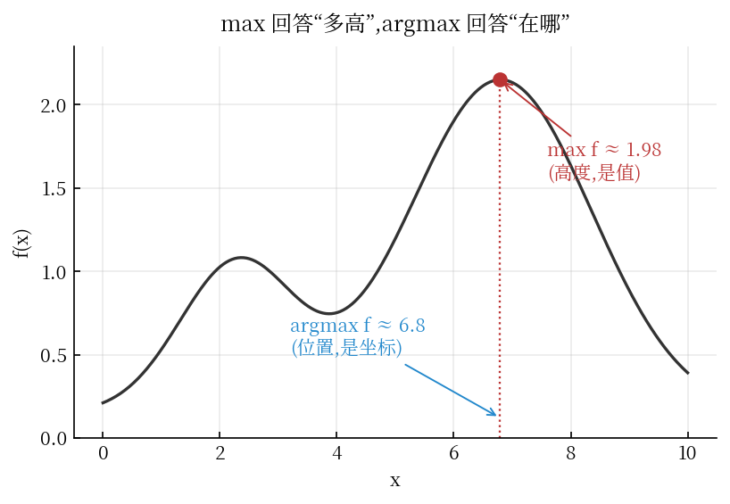
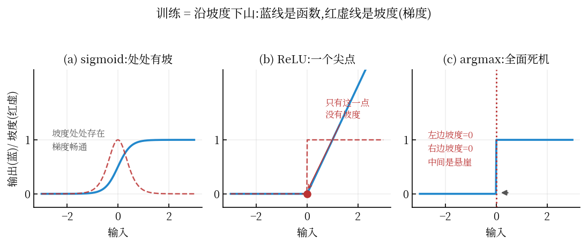
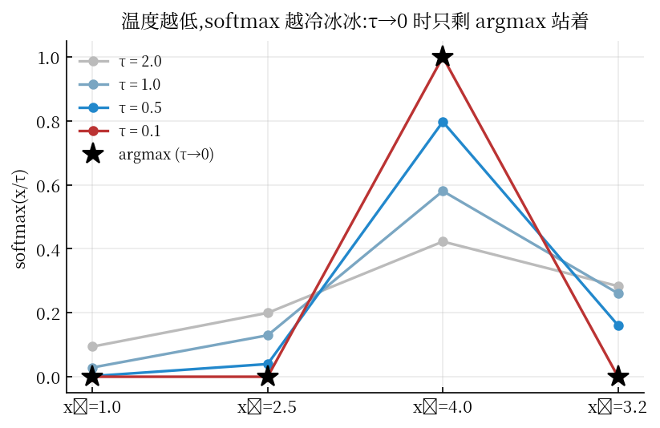
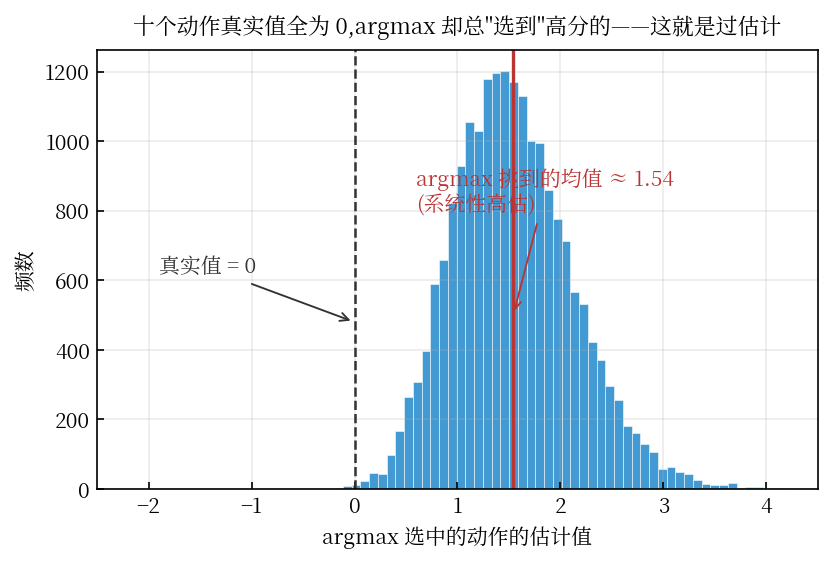

"取最大值,返回下标。"

"就这?"

"就这——但 GPT 每生成一个 token,最后一层是它;分类模型每次预测,输出是它;统计学的极大似然,本质是它;强化学习里一个著名的系统性偏差,病根也是它。"

argmax 大概是被名字耽误得最厉害的函数:五个字母,三个坑,一个偏差,外加一整条从连续通向离散的隧道。这篇长文把它们全部填平。

## 一、先分家:它返回的不是最大值,是"在哪里"

max 和 argmax 是两个问题:

- **max**:这座山**多高**?
- **argmax**:山顶**在哪**?

$$\max_{x \in [0,10]} f(x) \approx 1.98 \quad \text{(a number)} \qquad \arg\max_{x \in [0,10]} f(x) \approx 6.8 \quad \text{(a location)}$$

arg 是 argument(自变量)的缩写。argmax 回答"哪个自变量让函数最大"。

所以模型推理最后一层,输出的不是最高的那个概率值,而是**概率最高的那个词的下标**。拿到下标,查词表,吐出字。

分类模型也一样。`model.predict(x)` 的骨子里就是 `argmax(logits)`。

严格说,它返回的甚至是一个**集合**:

$$\arg\max_{x \in X} f(x) \;=\; \{x \in X \;:\; f(x) = \sup_{t \in X} f(t)\}$$

集合——这个细节接下来两个坑都从这里长出来。

## 二、坑一:它可能不存在

先分清 sup 和 max。

**上确界(sup)**是"天花板高度":不管够不够得着,天花板就在那里。

**最大值(max)**是"实际够到的最高点":必须真的取到。

$f(x) = x$ 在开区间 $(0,1)$ 上:天花板是 1,但永远够不着——sup 存在,max 不存在,argmax 是空集。

那什么时候保证存在?**Weierstrass 极值定理**:

> 紧集上的连续函数必取得最大值和最小值。

(紧集可以粗糙理解为"有界 + 含边界"——闭区间就是。)

证明思路三步,值得看一遍:

1. 紧集上的连续函数有界(否则构造发散子列,与紧性矛盾)
2. 有界则存在上确界 $M = \sup f$
3. 取一列 $f(x_n) \to M$;紧性给出收敛子列 $x_{n_k} \to x^*$;连续性保证 $f(x^*) = M$

第三步的"子列收敛"就是紧性的用武之地——**没有边界,最大值可以从指缝里溜走**。

三个不存在反例,一张表收全:

| 反例 | sup | argmax |
|---|---|---|
| $f(x)=x$ on $(0,1)$ | 1 | ∅(够不着) |
| $f(x)=x$ on $\mathbb{R}$ | $+\infty$ | ∅(无界) |
| $f(x)=x \cdot \mathbb{1}[x<1]$ on $[0,1]$ | 1 | ∅(不连续,跳变处丢失) |

机器学习里这类"不存在"比想象中常见:比如在概率单纯形的**开**约束下优化,极值贴着边界就是取不到——这是约束优化要处理边界情况的根本原因。

## 三、坑二:它可能不唯一——打平了怎么办

$f(x) = x^2$ 在 $\{-1, +1\}$ 上,两个点打平,argmax 返回 $\{-1, +1\}$。

什么时候保证唯一?**严格凹函数**。直觉:碗形的函数只有一个碗底(反过来,一个碗顶)。形式化:若 $f$ 严格凹,则最大值点唯一——因为两个并列最大值的中点由严格凹性必然更大,矛盾。

(顺带:严格凹在二阶可导时对应 $f'' < 0$。机器学习喜欢的损失函数大多做成凸的,就是为了这种"唯一性"的确定性。)

工程界的办法更朴素:**tie-breaking 约定**。NumPy 返回第一个遇到的,PyTorch 同样默认首索引——**但官方文档明确不保证跨设备一致**。同一个模型在 CPU 和 GPU 上偶现不同输出的排查深夜,一半埋在这里。

(这个情况有个高大上的名字叫 non-unique maximizer,听着唬人,意思就是打平了。)

## 四、坑三:它不可导——softmax 存在的全部理由

先补一块地基:**梯度到底是什么?**

### 4.1 梯度:坡度,训练的全部依仗

训练神经网络的本质,是在一片山地里找最低谷:**沿坡度最陡的方向往下走一步,再走一步**。

梯度就是脚下的坡度——"往这边走,地面下降最快"。反向传播做的就是把这个坡度信息从输出端一路传回每个参数。

整座训练大厦建立在一个前提上:**每一步的坡度都能算出来**。

用三张图感受"坡度"什么时候存在。蓝线是函数,红色虚线是坡度:

**(a) sigmoid**:坡度处处存在,红线是一条平滑的丘陵——训练畅通无阻。

**(b) ReLU**:一个尖点,只有那一个点坡度无定义。深度学习大度地容忍了它(一个点的测度为零,几乎处处可导),ReLU 成了最流行的激活函数。

**(c) argmax**:红色的坡度线几乎**消失**——左半边坡度是 0,右半边坡度也是 0,中间是一个垂直悬崖。

两头都死:

- **平地上(没跳变)**:导数恒为 0。梯度 = 0 意味着"信号丢失"——网络不知道该往哪调。改动输入一点,输出纹丝不动,训练信号就断在这
- **悬崖上(跳变点)**:导数无定义。输入动一根头发丝,输出从 0 跳到 1——"坡度无穷大"都不足以形容,是根本没有坡

一句话:**梯度传不回去,训练就断了**。

### 4.2 one-hot:这个死法具体长什么样

argmax 的输出是 one-hot:

$$\text{argmax}([1.0,\; 2.5,\; 4.0,\; 3.2]) = [0,\; 0,\; 1,\; 0]$$

假设网络最后一层输出 logits = [4.1, 2.5, 4.0, 3.2](第一名微调高了 0.1),argmax 结果**一模一样**——还是 [0,0,1,0]。

参数变了,输出没变,损失没变。**梯度 = 损失对参数的变化率,而变化率为零**。

这就是"不可导"在训练里的具体死相:不管你把参数怎么拧,argmax 的输出岿然不动,反向传播带回来的永远是零。

训练需要梯度。于是有了 softmax,argmax 的可导替身:

$$\text{softmax}(x_i) = \frac{e^{x_i}}{\sum_j e^{x_j}}$$

### softmax → argmax:完整证明

带温度版 softmax:$p_i(\tau) = e^{x_i/\tau} / \sum_j e^{x_j/\tau}$。设 $x^*$ 唯一最大,要证 $\tau \to 0$ 时 $p_{x^*} \to 1$、其余 $\to 0$。

分子分母同除 $e^{x^*/\tau}$:

$$p_i(\tau) = \frac{e^{(x_i - x^*)/\tau}}{1 + \sum_{j \ne *} e^{(x_j - x^*)/\tau}}$$

对 $i = *$:分子为 1,分母中每一项 $(x_j - x^*) < 0$ 除以 $\tau \to 0^+$ 后指数趋于 $e^{-\infty} = 0$,故 $p_*(\tau) \to 1/1 = 1$。

对 $i \ne *$:分子 $e^{(x_i-x^*)/\tau} \to 0$,分母 $\ge 1$,故 $p_i(\tau) \le e^{(x_i-x^*)/\tau} \to 0$。

**证毕。** τ→0 的 softmax 就是 argmax 的 one-hot。

### 4.4 工程界的"作弊":直通估计器

还有一个不修路、直接抄近道的流派:**直通估计器(straight-through estimator)**。

前向传播照常用 argmax(硬邦邦,推理友好);反向传播时**假装它是恒等函数**,把梯度原样放过去。

不严格,没有数学保证——但工程上好用,量化训练(二值网络)和 VQ-VAE 都靠它活命。

训练一个不可导的东西,路子一共三条:换可导替代(softmax)、加噪声软化(Gumbel)、反向假装可导(直通)。全是为了绕开这一节的悬崖。

### 温度:AI 的性格旋钮

生成式模型推理的 temperature 旋钮转的就是这个 τ:

- **τ → 0**:贪心解码,每步 argmax。复读机,永远同一个答案
- **τ 升高**:分布变平,小概率词有机会登场。发散、惊喜、偶尔胡说

低温保守,高温冒险——这是人性,也是采样。

### 一个例外:τ < 0 会怎样?

分母的指数里,最大项 $e^{(x^*-x^*)/\tau} = e^0 = 1$ 没问题,但**次大**项 $e^{(x_2-x^*)/\tau}$ 中 $(x_2 - x^*) < 0$ 除以负 τ 变正且巨大——分母爆炸,所有 $p_i \to 0$,概率加起来不再是一。**softmax 直接失效**。负温度只在能量模型的特殊场合合法,日常管线里它就是个 bug。

## 五、Gumbel-max:用"加噪声再 argmax"做可导采样

softmax 之外还有一个更漂亮的技巧:**Gumbel-max**。

往每个 logit 加一点 Gumbel 噪声再取 argmax,结果恰好等于按 softmax 概率采样:

$$\arg\max_i \big(x_i + G_i\big) \;\sim\; \text{Categorical}(\text{softmax}(x))$$

其中 $G_i$ 是独立 Gumbel(0,1) 噪声。证明只需对 Gumbel 的 CDF 做一次积分,但意义深远:

- **argmax + 噪声 = 采样**。决定论和随机性在这里握手
- 训练时把外层 argmax 换成 softmax(τ 可退火),就是 **Gumbel-Softmax**——离散变量端到端可导训练。场景:结构化预测、离散 VAE、可微架构搜索(NAS)

一个函数的"不可导病",催生了整整一族手术方案。

## 六、argmax 的隐身场合:你每天都在用,只是没看见

### 极大似然估计 = argmax

统计学最核心的估计方法,定义就是一个 argmax:

$$\hat\theta_{\text{MLE}} = \arg\max_\theta \; L(\theta) = \arg\max_\theta \; \prod_i p(x_i \mid \theta)$$

训练神经网络做什么?最小化损失 = 最大化负损失 = **在整个参数空间里做一次巨型 argmax**(虽然是近似的)。你每一次 `model.fit`,底层都是一场 argmax 的盛大演出。

### 贝叶斯最优分类器 = argmax

0-1 损失下,理论最优分类器是后验概率最大的类:

$$h^*(x) = \arg\max_c \; P(y = c \mid x)$$

这是分类问题的理论天花板——模型学的就是逼近这个 argmax。

### 贪心解码:LLM 每步一次

之前投机解码那篇里"验证后取最大概率路径",底层就是词表上的 argmax。几十万维,每 token 一次。

### Viterbi 与 CTC:动态规划的骨架

序列标注(HMM/CRF)的 Viterbi 算法,每一步转移取的就是 $\arg\max$ 前驱;语音识别的 CTC 解码同样。**凡是要"从一堆候选里挑一条最好的路"的地方,路标上写的都是 argmax。**

## 七、一个偏差:argmax 在强化学习里惹的祸

DQN 的动作选择是 $a = \arg\max_a Q(s, a)$。看起来无害。

但 $Q$ 是**估计值**——有噪声的估计值。而 argmax 对噪声不是中立的:**它专门挑出噪声里偏高的那些**。

做个实验。十个动作,真实值全是 0,估计值 = 0 + 正态噪声。argmax 会选中谁?

被选中的动作,估计值平均 **+1.54**——真实值是 0。argmax 没有犯错,它忠实地取了最大;但**"估计值最大的那个"系统性地比"真值"乐观**。

这就是 Q-learning 的**最大化偏差(maximization bias)**:

$$E\big[\max_i \hat{Q}_i\big] \;\ge\; \max_i E[\hat{Q}_i]$$

(Jensen 不等式的直接推论——max 是凸函数。)

**Double DQN** 的解法优雅到只有一句:选动作用一套网络(argmax),评估这个动作的价值用另一套。**挑的和打分的分开**,乐观偏差互相抵消大半。

一个函数定义里没写任何偏差,偏差却从"挑选"这个动作本身长了出来——这是本篇最值得带走的洞察。

## 八、工程侧:它跑得快,但有暗坑

- **复杂度**:naive 扫描 $O(n)$;GPU 上是树状 reduce,$O(\log n)$ 层,每层并行
- **数值稳定**:softmax 实现必须先减去 $\max x$(否则 $e^{x}$ 溢出)——log-sum-exp trick:
  $$\text{logsumexp}(x) = m + \log \sum_j e^{x_j - m}, \quad m = \max_j x_j$$
  又是 max 来救 softmax 的场
- **one-hot 内存**:几十万维词表的 one-hot 是稀疏向量;工程上从没人真的物化它——存一个整数下标就够了。argmax 本质上是**最极端的压缩**:一个浮点向量,压成一个整数

## 九、尾声:一条从连续到离散的隧道

回头看,argmax 是两个世界的边境检查站:

$$\text{continuous (gradients, softmax, training)} \;\xrightarrow{\;\tau \to 0\;}\; \text{discrete (decisions, one-hot, argmax)}$$

神经网络活在左边:连续、可导、能用梯度下降。

你说出的每个字活在右边:离散、整数、一次定终身。

所有的生成模型,最终都要穿过这条隧道。softmax 是隧道的坡道,Gumbel 噪声是隧道的岔路,Viterbi 是隧道里的轨道网。而检查站的章,永远是 argmax 盖的。

下次模型回复你一段话,可以想到:那段话的每一个 token,都经过了一次 argmax——几十万维里,一次冷静的一锤定音。

**思考题**(评论区见):你能找到自己领域里"argmax 系统性乐观"的例子吗?面试挑人、投资挑项目、招生挑简历——挑选者和打分者,是不是同一套噪声?

---

*参考:Weierstrass 极值定理(Rudin《Principles of Mathematical Analysis》);Jang et al. 2017《Categorical Reparameterization with Gumbel-Softmax》;van Hasselt et al. 2016《Deep RL with Double Q-learning》(maximization bias 的原始分析);Goodfellow et al.《Deep Learning》第 6 章(softmax 数值稳定);Sutton & Barto《Reinforcement Learning》Exercise 6.7。*
