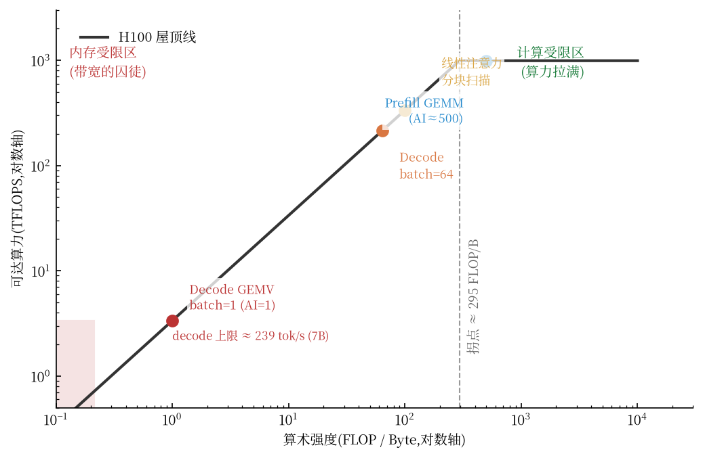
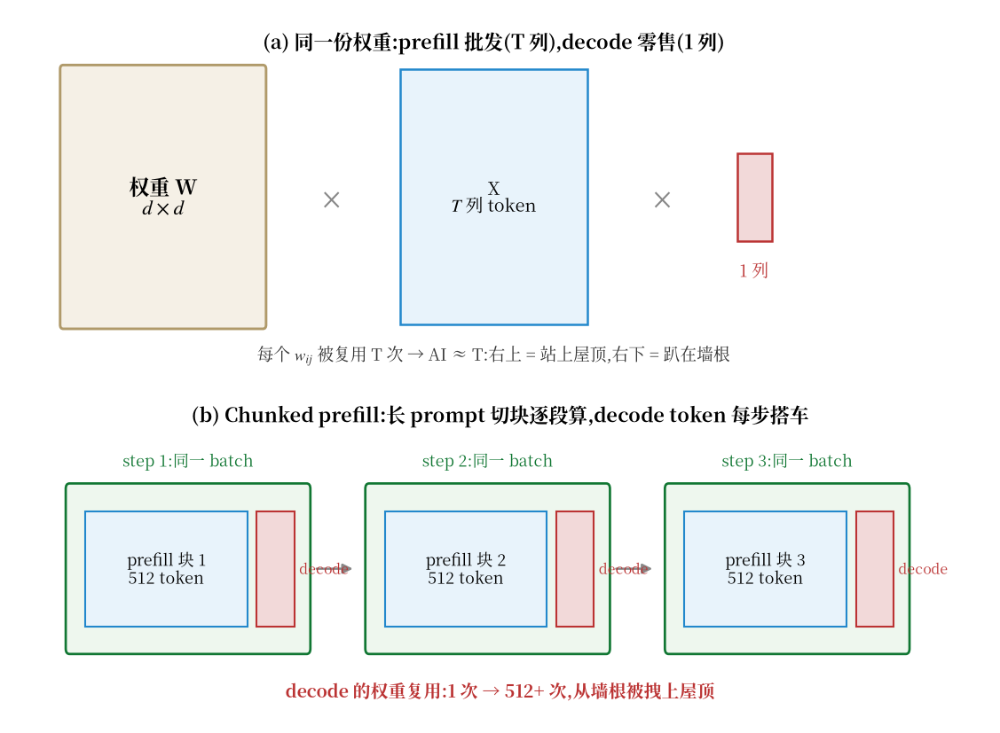
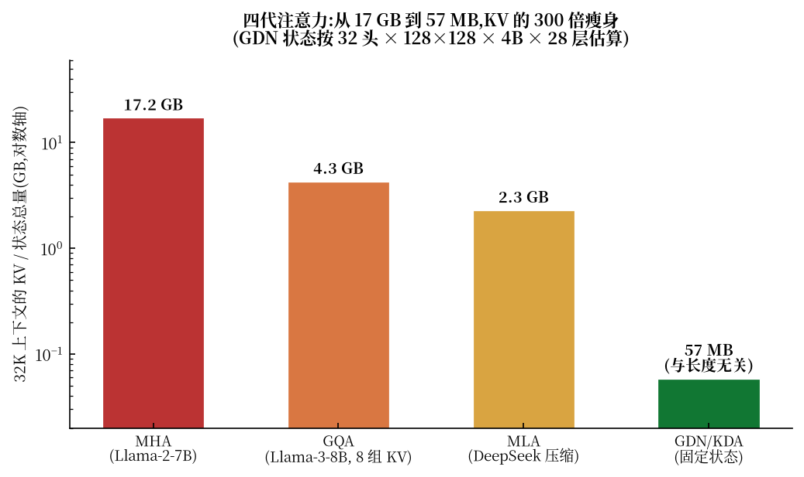
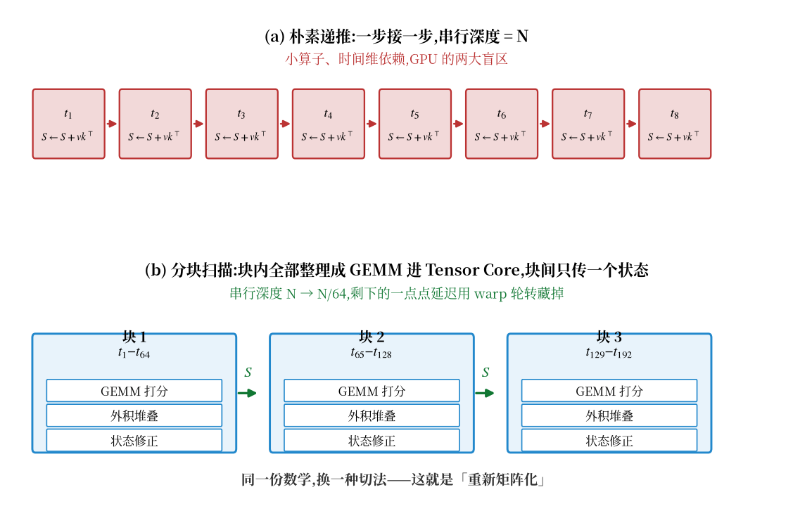

同一块 H100,同一个模型。

Prompt 阶段(prefill),它一秒钟能消化几万个 token,算力拉满,风扇狂转。

生成阶段(decode),它一秒钟只吐几十个字。99% 以上的算力躺在那里,显存带宽却被打满。

同一颗芯片,前后表现差两到三个数量级。这不是调优没做好,这是**结构性的错配**:GPU 是为稠密矩阵造的机器,而注意力结构的进化方向,正在一步步逃离稠密矩阵。

这篇讲模型和硬件的相互追赶:prefill 为什么计算密集、decode 为什么内存受限、GDN 和 KDA 这类线性注意力为什么让 GPU 更难受、chunk 三件套怎么救、以及——硬件到底会不会为这些新结构改牌。

## 一、GPU 的出厂设定:一台矩阵机器

先把第四篇(Tensor Core 脉动阵列)的结论搬过来:GPU 的算力大厦,建在一种运算上——**GEMM**(通用矩阵乘)。

H100 的 989 TFLOPS(FP16 稠密),几乎全部由 Tensor Core 产出;Tensor Core 吃的是规整的矩阵块(如 64×64 tile),数据一旦以这个形状流入,脉动阵列就满负荷运转。CUDA Core、SFU、访存单元都只是配角。

判断一个负载能不能喂饱 GPU,只用一个指标:**算术强度**(Arithmetic Intensity)——每读一字节显存,能做多少次浮点运算。

$$\text{AI} = \frac{\text{FLOPs}}{\text{Bytes}}$$

把它画在屋顶线(roofline)图上,GPU 的性格一目了然:



H100 的屋顶线拐点:

$$\frac{989\ \text{TFLOPS}}{3.35\ \text{TB/s}} \approx 295\ \text{FLOP/Byte}$$

翻译成人话:**每从显存搬一个字节,你得做 295 次运算,才算力拉满;做不到,你就是内存带宽的囚徒。**

记住这个数字,后面所有故事都是它的注脚。

## 二、Prefill 为什么计算密集:矩阵乘是数据复用机器

现在回答第一个问题:同样是过一遍模型权重,prefill 凭什么站在屋顶上?

先看一个方阵 GEMM:C = A × B,边长 N,全 FP16。账很好算:

- 数据搬运:A、B 读入,C 写回,共 3N² 个数,6N² 字节
- 计算量:2N³ 次浮点运算

$$\text{AI} = \frac{2N^3}{6N^2} = \frac{N}{3}\ \text{FLOP/Byte}$$

**算术强度随矩阵边长线性上涨。** N=4096:AI ≈ 1365,是拐点 295 的 4.6 倍。

为什么?因为矩阵乘本质是一台**数据复用机器**:A 的每个元素要和 B 的整列相乘,B 的每个元素要被 A 的整行使用。数据从显存搬进来一次,在芯片里被反复咀嚼几千拍。搬运一次,干活千次——这就是"计算密集"的全部含义。

把这条性质压成定律:

$$\text{AI}(\text{weights}) \approx T$$

其中 $T$ 是同批处理的 token 数。

**算术强度 ≈ 数据被复用的次数。Prefill 是批发,decode 是零售**——记住这句,屋顶线图上所有点的位置都能推出来。

## 三、经典 Transformer:生在蜜罐里

2017 年的 Transformer,结构上每一步都是矩阵:

```
X → QKV 投影(三个 GEMM)
→ 打分 Q·K^T(批量 GEMM)
→ softmax(行归约)
→ 加权求和 A·V(批量 GEMM)
→ 输出投影(GEMM)
```

Prefill 阶段,整段 prompt 一起进。复用发生在两个地方:

**权重侧:批发。** 线性层的权重矩阵 (d×d),每个 batch 读一次。8192 个 token 排成一个 (8192×4096) 的大矩阵右乘 (4096×4096) 的权重——**每个权重被复用 8192 次**。

**注意力侧:O(N²) 本身就是 GEMM。** 打分 Q·K^T 每头是 (8192×128)×(128×8192),32 头并行;序列越长矩阵越大。32K 上下文、128 维头、32 头,一层注意力的计算量:

$$4 \times (3.2 \times 10^4)^2 \times 128 \times 32 \approx 17.6\ \text{TFLOP}$$

32 层合计约 **563 TFLOP**——一根 32K 的 prompt,光注意力就要烧掉半 PFLOP,全是规整的 GEMM,Tensor Core 的满汉全席。

数据从 HBM 搬进来一次,在 SM 里被反复咀嚼几千拍——算术强度轻松破千,屋顶线上站得笔直。Llama-3(405B)预训练的 MFU 做到 43%(第六篇 NCCL 的数字),剩下的损耗大头是通信,不是计算形态。

**模型是被硬件的形状筛选出来的。** Transformer 赢下注意力大战,一半靠效果,一半靠它在 GPU 上的算术强度。

## 四、Chunk 三件套:保住矩阵形状,压下中间结果

"Prefill 依赖大矩阵"只说了一半。另一半是:大矩阵会**爆炸**。

32K 上下文的注意力分数矩阵,一层 32 头写出来是 32768² × 32 × 2B ≈ **68 GB**——显存直接去世。朴素做法要么放不下,要么反复读写把带宽打爆。所以 prefill 的高效实现,全都建立在 **chunk(分块)** 上。三个层次,各管一层:

### 3.1 计算层:Flash Attention 的 tiling

2022 年的最大贡献:注意力**永远不物化** N×N 的大矩阵。

把 Q、K、V 切成 128×128 的块。一个 K/V 块搬进 Shared Memory,128 行 Q 轮流进来和它算——**每个 K/V 块被复用 128 次**,数据在 SM 里干活 128 拍才走;softmax 改成在线更新(分子分母增量修正),每算完一块立刻把结果累积进输出,中间分数矩阵从头到尾不存在于显存。

这就是第二篇(Shared Memory 与 Tiling)和第四篇(Bank Conflict 的 swizzle)讲的全部技术在真实战场上的样子:块大小选 128 是为了吃满 SMEM 和 Tensor Core,swizzle 是为了让块内读取不撞 bank。

**chunk 在这里的作用:中间结果从 68 GB 降到 0,同时每块数据的复用次数一点没少——形状保住了,屋顶没下来。**

### 3.2 调度层:Chunked prefill 的混排

第二块拼图在系统层(vLLM、Sarathi-Serve 这些推理引擎)。

一根 32K 的长 prompt 一次性 prefill,有两个坏处:显存被激活值冲爆;更糟的是,服务器算这一根 prompt 的几秒钟里,**所有正在 decode 的请求全部停摆**——其他用户的字卡住不动。

做法:把长 prompt 切成 512~2048 的 chunk 逐块处理,并且**每个 chunk 和正在 decode 的 token 拼进同一个 batch**:



妙处回到第二节那条定律:decode token 本来独享不了权重复用(一个 token 读一遍全部权重,AI=1),现在它和 512 个 prefill token **同乘一个权重矩阵**——每个权重被读一次、干 512+1 次活,decode 的算术强度直接从 1 抬到数百。

**chunk 在这里的作用:把 decode token 搭上 prefill 的车,拽上屋顶线。** 论文里这套混排让长上下文场景的系统吞吐和生成延迟同时改善,是推理引擎的标配技术。

### 3.3 模型层:Chunked scan

第三块留给线性注意力——递推序列切块,块内整理成 GEMM。这是本文第九节的主角,先按下。

三层 chunk,一个动机:**矩阵形状不能丢(喂饱 Tensor Core),中间结果必须小(不撑爆显存),顺带把搭车的也捎上屋顶**。

## 五、Decode:一秒只吐几十个字的真相

轮到生成,定律的反面现身。

Decode 每个 step 只处理**一个 token**。7B 的模型,FP16 权重 14 GB,每生成一个字,这 14 GB 必须从显存完整流过计算单元一遍——因为**每个权重只用一次**:这次乘完,下个 token 再来一遍。

这就是 GEMV(矩阵×向量)和 GEMM(矩阵×矩阵)的本质区别。同一个权重矩阵:

- 右乘一个 (8192×d) 的矩阵:每个权重复用 8192 次,prefill
- 右乘一个 (1×d) 的向量:每个权重复用 1 次,decode

$$\text{AI}_{\text{decode}} = \frac{2 \times 7 \times 10^9\ \text{FLOPs}}{14 \times 10^9\ \text{Bytes}} = 1\ \text{FLOP/Byte}$$

**GEMV 的算术强度恒等于 1,和矩阵多大无关**——因为复用次数就是 1。对照拐点 295:差两个数量级。Decode 的理论上限被带宽锁死:

$$\frac{3.35\ \text{TB/s}}{14\ \text{GB}} \approx 239\ \text{tok/s}$$

这是 H100 跑 7B 模型 batch=1 的物理极限,**和 989 TFLOPS 没有半点关系**。算力利用率:1/295 ≈ 0.3%。

Prefill 是计算受限(compute-bound),decode 是内存受限(memory-bound)。**同一个模型的两半,活在屋顶线的两个世界。**

雪上加霜的是 KV cache。每个生成的 token,都要把之前所有 token 的 K、V 存起来。Llama-2-7B(32 层 × 32 头 × 128 维)每 token 的 KV cache:

$$2 \times 32 \times 32 \times 128 \times 2\ \text{B} = 524\ \text{KB}$$

上下文涨到 32K,KV cache 就是 **17 GB**——每生成一个 token,还得把这 17 GB 也读一遍。上下文越长,decode 越慢,慢到用户能肉眼感觉出来。

## 六、省带宽三代目:MQA → GQA → MLA

Decode 慢的病根是"读的字节太多",于是三代结构依次下药——**都是省带宽,不是省计算**:

**MQA**(多查询注意力,2019):所有 Q 头共享一组 K、V。KV cache 直接砍到 1/32。但质量掉得明显。

**GQA**(分组查询,2023):折中——32 个 Q 头共享 8 组 KV。Llama-3 全系在用,KV cache 降到 0.125 MB/token(32K 上下文 4 GB),质量几乎不损。

**MLA**(潜注意力,DeepSeek-V2/V3):换个思路——不存 K、V,存它们压缩后的**潜向量**,推理时再用 Q 把信息"解压"出来。KV cache 压到约 70 KB/token,比 MHA 省 93.3%。代价是解码时多几次低秩矩阵乘——**用计算换带宽**,在屋顶线图上,这是从墙根往拐点方向爬。



三代下来,KV cache 缩了 7 倍以上。但请注意:它们没有动 softmax 注意力本身,没有动"每个 token 依赖全部历史"的结构。**内存墙被推远了,没有拆掉。**

## 七、线性注意力:更快,也更不像矩阵

真正想拆墙的,是线性注意力家族。

把 softmax 拿掉,注意力变成"对外积的记忆":维护一个状态矩阵 S,每来一个 token 更新一次,输出用 S 查询:

$$S_t = S_{t-1} + v_t\, k_t^{\top}, \qquad o_t = S_t\, q_t$$

数学上可以证明,这等价于把注意力分数的 softmax 换成线性核——计算量从 O(N²) 降到 O(N),KV cache 消失,换成一个**固定大小**的状态矩阵。

模型层面完美:长上下文的计算和内存都线性了。

GPU 层面,灾难。看这个递推式长什么样:

- **时间维是串行的**:S_2 依赖 S_1,S_3 依赖 S_2……一步接一步,不能并行。第七篇讲过,GPU 靠 64 个 warp 轮转藏延迟,前提是**有海量独立任务**;串行依赖链是最反 GPU 的形态
- **算子是元素级的**:每步就是一次外积累加,几个小矩阵乘加,喂不进脉动阵列的大 tile。算术强度只有个位数——屋顶线墙根,decode 同款待遇
- **没有稠密大 GEMM**:tensor core 全程围观

一个为 O(N²) 矩阵盛宴优化的机器,拿到一份 O(N) 的流水席单子。算得少了,反而跑不快了——**因为 GPU 的快,只会在"数据复用"这一种形状上兑现,而递推恰恰是零复用**。

## 八、GDN/KDA:当红生的更难跑

现在的主角登场。纯线性注意力表达能力不够(记忆会糊),DeltaNet 一族给它加了"改写"能力——**delta rule**:新信息进来,先把旧记忆里相关的部分减掉,再写入新的:

$$S_t = S_{t-1}\,(I - \beta_t\, k_t k_t^{\top}) + \beta_t\, v_t\, k_t^{\top}$$

β 是门控,决定改写强度。**GDN(Gated DeltaNet)** 在此基础上把门控做成可学的衰减,成为 2024-2025 线性家族的主力;**KDA(Kimi Delta Attention)** 是月之暗面 Kimi Linear 用的版本,细化到逐通道的门控。

两个当红模型都用了它们,而且配方一致——**3:1 混合**:每 4 层里 3 层线性注意力 + 1 层全注意力(Qwen3-Next 的 GDN、Kimi Linear 的 KDA 都是 3:1,全注意力层用 MLA)。线性行程 + 全注意力精确检索,两头都要。

据各自技术报告:Kimi Linear 在 1M 上下文解码吞吐最高 **6 倍**于同规模 Transformer,KV cache 最高省 75%;Qwen3-Next(48B-A3B)同样主打长上下文解码的数量级提升。

但对 GPU 来说,delta rule 把处境变得更糟。这个带 (I − βkk^T) 的更新,在一段序列内是**矩阵的连乘递推**——严格说更像解一个三角方程组(前代换),既不是逐元素操作(还能靠 CUDA Core 硬扛),也不是稠密 GEMM(能进 Tensor Core)。不上不下,卡在两种加速器的夹缝里。

裸写这个 kernel,社区实测的 MFU 徘徊在个位数到百分之十几——**Tensor Core 基本在睡觉**。

## 九、软件的救赎:重新矩阵化 + 算子分流

接下来是过去两年最精彩的一章:**硬件一寸没动,软件把新数学翻译回了矩阵乘**。

### 9.1 重新矩阵化:chunked parallel scan

核心思路叫 chunkwise / 分块并行扫描,Mamba-2 的 SSD 公式和 Flash Linear Attention(FLA)库把它工程化:



把长度 N 的序列切成 C=64 或 128 的块:

**块内**:一个块里所有 token 的两两交互,可以整理成形状规整的块状矩阵运算——(C×d)×(d×C) 的打分矩阵、外积的堆叠。这些是**标准 GEMM**,直接进 Tensor Core。每块数据在 SM 里被复用 C 次,算术强度回到屋顶

**块间**:块与块之间只剩一个状态矩阵 S 在传递,递推深度从 N 降到 N/C——串行链缩短两个数量级,64 个 warp 的轮转(第七篇)终于藏得住这点延迟

**融合**:QKV 投影、门控计算、块内块间拼装,全部熔进一个 Triton kernel,中间结果不落显存,留在 Shared Memory 和寄存器里

分块之后,线性注意力的 MFU 从个位数爬到 30-50%。

### 9.2 算子分流:矩阵单元与向量单元的两班倒

就算全部翻译成了"矩阵 + 小算子",还剩一个分工问题:**这些算子各自该上哪台机器?**

GPU 内部本来就有两套计算班底:

| 单元 | 会干的活 | 速度 |
|---|---|---|
| Tensor Core | 只吃大块矩阵乘 | 峰值的全部来源 |
| CUDA Core(128 FP32 + 64 INT32) | 什么都算:元素级、归一化、门控、掩码、累加 | 慢一个量级 |
| SFU(16 个) | sin/exp/rsqrt 等超越函数 | 小众专线 |

这个分工不是 NVIDIA 独有,是所有加速器的标配形态:TPU 是 MXU(脉动矩阵阵)+ VPU(向量),昇腾是 Cube + Vector,Groq、Cerebras 同款结构。名字各异,骨架同源:**一颗矩阵单元,一簇向量单元**。

"把全注意力的大 GEMM 放到矩阵核上、把小算子交给 CUDA Core"——这个直觉完全正确,而它在现有硬件上的落地形态就是**融合 kernel 内的两班倒**:FLA 的 GDN kernel 里,Tensor Core 在算块内 GEMM 的同一拍,CUDA Core 在算门控衰减和状态修正,两类单元交替满载、互不等对方。Triton 编译器真正的核心工作,就是这种排班——把一个混合负载排成两条流水线的复拍。

至于把 softmax、打分、加权整个焊死成一颗"attention core"?电路层面有人试过,但它撞回那堵老墙:注意力公式年年换,焊死的电路改不了。**"通用矩阵积木 + 通用向量积木"反而是对架构变化最鲁棒的硬件形态**——这个判断直接引出下一节。

### 9.3 三代配套

- **FP8 权重**:decode 要读的字节直接砍半,239 tok/s 的带宽墙变 478
- **TMA + warp specialization**(Hopper 起):搬数据的活交给专用引擎,计算和搬运在时间轴上完全重叠(第七篇的单拍快照)
- **CUDA Graph / persistent kernel**:decode 每步的 kernel 启动开销,从几百次 launch 压成一次

这一整套打法可以总结成一句话:**模型随便进化,软件负责把它翻译回 GEMM,再把余下的碎活分给向量单元**。矩阵乘是 GPU 世界的通用语,任何新数学想在现有硬件上跑快,都必须学会这门语言。

## 十、硬件会为模型改牌吗

最后一个问题:这种"软件翻译"会一直够用吗?会不会长出为线性注意力、为 decode 定制的新硬件品种?

先看 GPU 自己的演化方向——每一代都在往"数据流"靠近:

| 代际 | 加的东西 | 受益者 |
|---|---|---|
| Hopper(2022) | TMA 异步搬运、wgmma | 分块 kernel、decode overlap |
| Blackwell(2024) | TMEM 张量内存、异步 tcgen05、FP4 | 更深的计算-搬运重叠 |
| 路线 | 越来越像数据流机 | 一切非 GEMM 负载 |

再看自立门户的。它们几乎全部瞄准**同一个软肋:decode 的内存墙**:

- **Groq LPU**:片上 SRAM(每芯 230 MB)+ 确定性调度,公开演示中 70B 级模型 batch-1 解码打到数百 token/s——思路是把 HBM 干掉
- **d-Matrix Corsair**:数字存内计算,权重放在计算单元旁边,专攻 batch-1 decode 的带宽墙
- **Cerebras**:晶圆级,靠超大规模片上 SRAM 和高时钟
- **学术方案 AttAcc**(ISCA 2024)等:存内计算加速注意力,论文里给出数量级的带宽优势

但注意一个残酷的时间尺度错配:**模型结构的半衰期是几个月,GPU 一代是两年,ASIC 从立项到流片是三到四年**。Etched 把宝全押在"未来只有 Transformer"上造 Sohu,结果架构风向转去了线性混合——专用芯片赌错一次,四年白等。

所以到今天的真实格局是三层:

1. **短期(现在)**:软件重新矩阵化,GPU 通用性吃满。FLA、Triton、DeepGEMM 这些库让新结构在现有硬件上"够快"
2. **中期**:GPU 逐代吸收数据流特性(TMA→TMEM→…),专用块越加越多——它自己也在变成"半个 ASIC"
3. **长期**:最可能养出新品种的是 **decode 这个场景本身**——不管模型怎么进化,decode 的内存墙都在(batch-1 生成是纯带宽问题,和注意力形态无关)。d-Matrix 们赌的不是某种注意力,而是"生成永远带宽受限"这个更稳定的命题

**模型在月度迭代,硬件在年度迭代,中间靠软件的翻译层续命**——这个三层结构,大概还要维持很多年。

## 十一、总结

三条带走:

**1. 屋顶线是理解一切的地图,而地图的坐标是一条定律。** 拐点 295 FLOP/Byte:prefill 站在屋顶上,decode 趴在墙根下。矩阵乘边长 N,AI = N/3;同一份权重,prefill 批发(T 次复用,站上屋顶),decode 零售(1 次复用,趴在墙根)。屋顶线图上每一个点,都是"复用次数"的坐标。

**2. Chunk 三件套是同一个动机的三层落地。** 计算层(Flash Attention:不物化 N²,保住复用)、调度层(chunked prefill:decode 搭车,复用从 1 抬到数百)、模型层(chunked scan:递推切块变 GEMM)。形状保住,中间结果压小。

**3. 硬件不会为某一种注意力改牌,但会为"decode"改牌。** 模型结构太善变,流片周期太长;而 batch-1 生成的内存墙是稳定命题——这才是新硬件品种真正的锚点。矩阵单元 + 向量单元的通用积木,是硬件对"模型会继续变"的最鲁棒回答。

GPU 解剖台前八篇讲完了硬件本体,这篇把镜头转向"模型 × 硬件"的相互塑造。下一篇回到预告过的分支发散,把这个坑填上。

如果这个系列对你有用,点个赞或者关注专栏,更新会持续。

---

*参考:FlashAttention: Fast and Accurate Attention with IO-Awareness(arXiv:2205.14135);Sarathi-Serve: Coordinating LC/BC inference(arXiv:2308.16369,chunked prefill 与混合批调度);vLLM: PagedAttention(arXiv:2309.06180);Kimi Linear: An Expressive, Efficient Attention Architecture(Moonshot AI,arXiv:2510.26692,3:1 混合与 6×/75% 数字出自技术报告);Qwen3-Next 技术博客(3:1 GDN+MLA 混合);Yang et al., Gated Delta Networks(arXiv:2412.06464);DeepSeek-V2(MLA,arXiv:2405.04434,KV cache 压缩 93.3%);Dao & Gu, Transformers are SSMs: Mamba-2 SSD(arXiv:2405.21060);Flash Linear Attention 库(GitHub: fla-org);NVIDIA H100/Blackwell 架构白皮书;AttAcc(ISCA 2024);Groq、d-Matrix、Cerebras 官方公开资料。屋顶线、GEMM 复用、KV cache、decode 上限数字均可按文中公式复算。*
