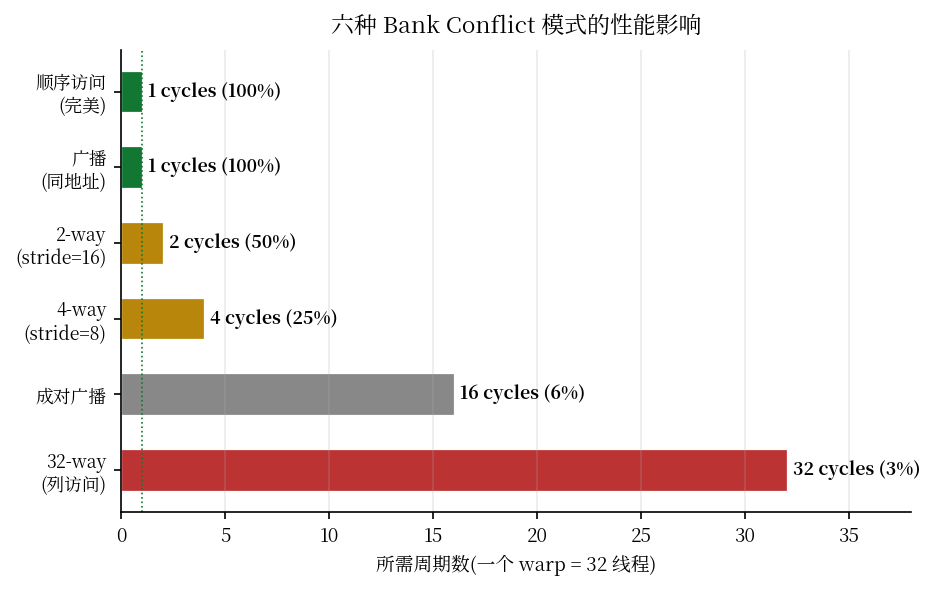
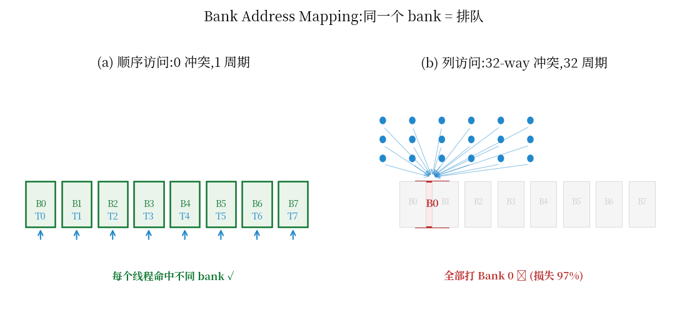
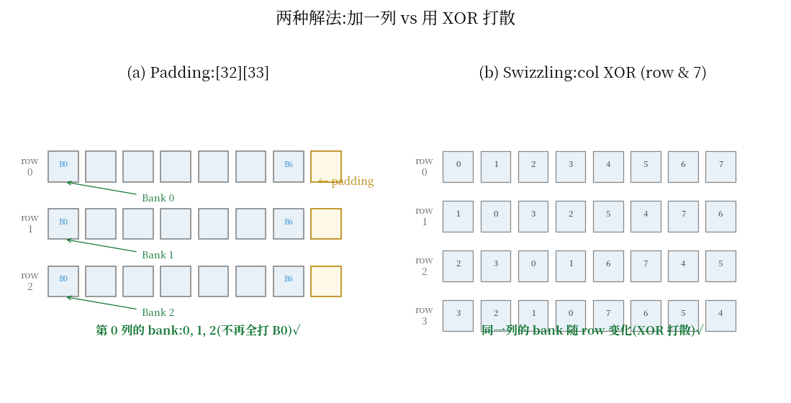

上一篇 Shared Memory 讲了 Shared Memory / L1 Cache 的可配置切分和 Tiling。但有一个隐藏杀手——**Bank Conflict**——能让你的精心优化的 kernel 慢 32 倍，而且编译器不报错，运行时不报错，只有 profile 才能看到。

这篇文章把 Bank Conflict 拆成**六种模式**,每种给具体的地址映射、周期数和修复方案。

## 一、什么是 Bank

Shared Memory 的 256 KB 被硬件**物理分割成 32 个独立的 bank**,每个 bank 宽 4 字节(一个 word):

$$\text{Bank} = \left\lfloor \frac{\text{byte\_address}}{4} \right\rfloor \bmod 32$$

即:**第 $k$ 个 4-byte word → Bank $k \bmod 32$**

```
word 序号:  0    1    2    3   ...  31   32   33  ...
Bank:      0    1    2    3   ...  31    0    1  ...
```

**为什么是 32 个 bank?** 因为一个 warp 恰好 32 个线程。理想情况下,32 个线程各访问一个 bank,**硬件 32 路并行,1 个周期完成**。

**什么时候出事?** 多个线程访问**同一个 bank 的不同地址**——bank 只有一根线,只能排队。

## 二、六种冲突模式



### 模式 ① 顺序访问(完美):1 个周期

```cuda
float x = shared[threadIdx.x];  // word 0..31
```

```
T0  → word 0  → Bank 0  ✓
T1  → word 1  → Bank 1  ✓
...
T31 → word 31 → Bank 31 ✓
```

32 个线程命中 32 个不同 bank → **全部并行,1 cycle,性能 100%**

### 模式 ② 2-way 冲突:2 个周期

```cuda
float x = shared[threadIdx.x * 16];  // word 0, 16, 32, 48, ...
```

```
T0 → word 0  → Bank 0
T1 → word 16 → Bank 16   ✓ (不同 bank)
T2 → word 32 → Bank 0    ← 和 T0 冲突!
T3 → word 48 → Bank 16   ← 和 T1 冲突!
```

每两个线程抢同一个 bank → 串行化成 2 轮 → **2 cycles,性能 50%**

### 模式 ③ 4-way 冲突:4 个周期

```cuda
float x = shared[threadIdx.x * 8];  // word 0, 8, 16, 24, ...
```

```
T0 → word 0  → Bank 0
T4 → word 32 → Bank 0  ← 冲突
T8 → word 64 → Bank 0  ← 冲突
T12→ word 96 → Bank 0  ← 冲突
```

4 个线程排队 → **4 cycles,性能 25%**

### 模式 ④ 32-way 冲突(最惨):32 个周期

经典场景:**按列访问行主序二维数组**



```cuda
__shared__ float mat[32][32];
float x = mat[threadIdx.x][0];  // 读所有行的第 0 列
```

地址映射:
```
mat[0][0]  → word 0   → Bank 0
mat[1][0]  → word 32  → Bank 32 % 32 = Bank 0!
mat[2][0]  → word 64  → Bank 0!
...
mat[31][0] → word 992 → Bank 0!
```

**全部 32 个线程打 Bank 0** → 32 轮串行 → **32 cycles,性能 3%**

原因:每行 32 个 word(正好绕 bank 一圈),所以**每一行的第 0 列永远映射到同一个 Bank**。

### 模式 ⑤ 广播(看似冲突,实际不是!):1 个周期

**重要特例**:多个线程访问**同一个地址**(不只是同一个 bank) → 硬件视为**广播(broadcast)**,不算冲突:

```cuda
float x = shared[5];  // 所有线程读 word 5
```

```
T0 → word 5 → Bank 5 ← 同一地址
T1 → word 5 → Bank 5 ← 同一地址(不是冲突,是广播)
T31→ word 5 → Bank 5
```

硬件把 word 5 的值**广播**给所有 32 个线程 → **1 cycle ✓**

**记住这个区别**:
- 同 bank **不同地址** = 冲突(排队)
- 同 bank **同一地址** = 广播(免费)

### 模式 ⑥ 成对广播:16 个周期

间接寻址时,如果地址成对重复:

```cuda
// shared_idx = [0, 0, 1, 1, 2, 2, ...](成对)
float x = shared[shared_idx[threadIdx.x]];
```

- T0 和 T1 都读 word 0 → 广播(免费)
- T2 和 T3 都读 word 1 → 广播
- 每对占一个 bank 一次,共 16 对 → **16 cycles,性能 50%**

## 三、六种模式总结表

| 模式 | 访问方式 | 周期 | 性能 | 典型代码 |
|---|---|---|---|---|
| ① 顺序 | `shared[tid]` | **1** | 100% | 向量操作 |
| ② 2-way | `shared[tid*16]` | **2** | 50% | stride=16 |
| ③ 4-way | `shared[tid*8]` | **4** | 25% | stride=8 |
| ④ 32-way | `mat[tid][0]` 列访问 | **32** | **3%** | 矩阵转置 |
| ⑤ 广播 | `shared[5]` | **1** | 100% | 所有线程读同一值 |
| ⑥ 成对广播 | 间接寻址成对 | **16** | 50% | lookup table |

## 四、修法 A:Padding(+1)



最简单粗暴:给数组**多加一列**,让每行的 bank 映射错开。

```cuda
// 原来:32 列 → 列访问全打 Bank 0
__shared__ float mat[32][32];

// 改成:33 列 → 每行错开 1 个 bank
__shared__ float mat[32][32 + 1];
```

Padding 后第 0 列的 bank 映射:
```
mat[0][0] → word 0   → Bank 0
mat[1][0] → word 33  → Bank 33 % 32 = Bank 1  ✓
mat[2][0] → word 66  → Bank 66 % 32 = Bank 2  ✓
mat[3][0] → word 99  → Bank 99 % 32 = Bank 3  ✓
```

32-way 冲突消失 → **从 32 cycles 降到 1 cycle(32 倍提速)**

代价:多占 $32 \\times 4 = 128$ 字节(Shared Memory 的 0.05%)。

**这就是为什么高性能 CUDA kernel 里到处看到 `[32][33]`、`[32][36]`、`[64][65]` 这种"奇怪"的数组大小——不是 bug,是在躲 Bank Conflict。**

## 五、修法 B:Swizzling(XOR)

Padding 浪费空间且只对固定 stride 有效。更高级的方案是 **Swizzling(XOR 异或)**——不改变物理大小,只改变索引计算:

```cuda
// 原来:直接用 col 索引 → 列访问全冲突
float x = mat[row][col];

// Swizzle:用 XOR 修改列索引
int col_swizzled = col ^ (row & 7);  // XOR 低 3 位
float x = mat[row][col_swizzled];

// 写回去的时候再 XOR 回来
mat[row][col_swizzled] = val;
```

**XOR 的效果**(以 `row=0..3,col=0` 为例):

| row | col | col ^ (row&7) | 实际 word | Bank |
|---|---|---|---|---|
| 0 | 0 | 0 ^ 0 = 0 | 0 | 0 |
| 1 | 0 | 0 ^ 1 = 1 | 33 | 1 ✓ |
| 2 | 0 | 0 ^ 2 = 2 | 66 | 2 ✓ |
| 3 | 0 | 0 ^ 3 = 3 | 99 | 3 ✓ |

每个 row 的同一 col 映射到不同 bank → **冲突消除**。

且 Swizzle 是**可逆的**($a \\oplus b \\oplus b = a$),所以写回时用同样的 XOR 就能还原原始索引。这就是 Flash Attention 和 cuBLAS GEMM kernel 使用的方案。

### Padding vs Swizzling 对比

| | Padding(+1) | Swizzling(XOR) |
|---|---|---|
| 实现难度 | 极简(改数组大小) | 较高(改索引计算) |
| 空间代价 | 多一列(128 字节) | **零** |
| 灵活性 | 只能修一种 stride | 可修任意模式 |
| 性能提升 | 32×(修列冲突) | 32×(同上) |
| 谁在用 | 教学/简单 kernel | Flash Attention / cuBLAS |

## 六、修法 C:换数据布局

如果 Padding 和 Swizzle 都不适合(比如你的 kernel 既读行又读列),可以直接换存储方式:

```cuda
// 行主序 → 列主序(转置)
__shared__ float mat[32][32];      // mat[i][j] = 行 i 列 j
__shared__ float mat_T[32][32];    // mat_T[j][i] = mat[i][j]
```

转置后:列访问变顺序(无冲突),但行访问变冲突。**Trade-off 取决于你的访问模式哪种更多。**

## 七、怎么检测:用 Nsight Compute

### 命令行

```bash
ncu --metrics l1tex__data_bank_conflicts_pipe_lsu_mem_shared_op_ld.sum ./myKernel
```

输出:
```
l1tex__data_bank_conflicts_pipe_lsu_mem_shared_op_ld.sum = 0        ← 完美
l1tex__data_bank_conflicts_pipe_lsu_mem_shared_op_ld.sum = 8,320    ← 有冲突!
```

### GUI

Nsight Compute 的 **"Memory Workload Analysis"** 页会可视化 Shared Memory 的 bank 命中:

- 绿色 = 每个 bank 均匀命中(完美)
- 红色 = 某几个 bank 被打爆(冲突)

### 反向推断周期数

$$\text{Conflict Severity} = \frac{\text{extra cycles}}{\text{total requests}}$$

严重度 > 0 就说明有浪费,需要 Padding 或 Swizzle。

## 八、实战案例:矩阵转置

经典的 Bank Conflict 重灾区。完整代码对比:

### 朴素版(有 32-way 冲突)

```cuda
__global__ void transpose(float* input, float* output, int n) {
    __shared__ float tile[32][32];

    int x = blockIdx.x * 32 + threadIdx.x;
    int y = blockIdx.y * 32 + threadIdx.y;

    tile[threadIdx.y][threadIdx.x] = input[y * n + x];  // 写:行访问,OK
    __syncthreads();
    output[x * n + y] = tile[threadIdx.x][threadIdx.y];  // 读:列访问,冲突!
}
```

读 `tile[threadIdx.x][threadIdx.y]` 是按列读 → 32-way conflict → **32 cycles**

### Padding 版(冲突消除)

```cuda
__global__ void transpose(float* input, float* output, int n) {
    __shared__ float tile[32][32 + 1];  // ← 只改了这里

    int x = blockIdx.x * 32 + threadIdx.x;
    int y = blockIdx.y * 32 + threadIdx.y;

    tile[threadIdx.y][threadIdx.x] = input[y * n + x];
    __syncthreads();
    output[x * n + y] = tile[threadIdx.x][threadIdx.y];  // ← 现在无冲突
}
```

一行改动,32 倍吞吐提升。

## 八b、五个实战案例

### 案例 ① 矩阵乘(GEMM):最经典的冲突场景

Tiled 矩阵乘 $C = A \times B$ 的内循环:

```cuda
__global__ void gemm(float* A, float* B, float* C, int N) {
    __shared__ float As[32][32];
    __shared__ float Bs[32][32];
    // ...
    for (int k = 0; k < 32; k++) {
        // 每个线程读 As[threadIdx.y][k] 和 Bs[k][threadIdx.x]
        sum += As[threadIdx.y][k] * Bs[k][threadIdx.x];
    }
}
```

**冲突分析**:

32 个线程(threadIdx.x = 0..31)在同一个 warp 中,threadIdx.y 固定(比如 y=0):
- 读 `As[0][k]`:所有线程读**同一个地址** → **广播,1 cycle** ✓
- 读 `Bs[k][threadIdx.x]`:word 地址 = $k \times 33 + threadIdx.x$ → 连续 32 个 word → **Bank $k \times 33 + tid \bmod 32$ → 如果 $k$ 是 32 的倍数,Bank = $tid$,无冲突;如果 $k \times 33$ 不是 32 的倍数,也不是 32 的倍数... 实际上 $33 \bmod 32 = 1$,所以 bank = $(k + tid) \bmod 32$ → 32 个不同 bank,**无冲突!** ✓

看起来 GEMM 天然无冲突?**如果你用 `[32][32]`(无 padding)的数组:**
- `Bs[k][tid]` → word $k \times 32 + tid$ → Bank $(k \times 32 + tid) \bmod 32 = tid \bmod 32$ → **Bank = tid,无冲突** ✓

但如果 warp 的 32 个线程是 $tid.y = 0..31$ 而不是 $tid.x = 0..31$(按列排布的 thread block):
- 读 `As[tid.y][k]` → **所有线程读同一列的同一行 → 同一个地址 → 广播** ✓
- 读 `Bs[k][tid.x]` → 不同 tid.x → 无冲突 ✓

**结论**:GEMM 的读取本身往往没冲突,但**写入 tile 时**(`As[tid.y][tid.x] = A[row][col]`)在按列排布时会冲突。这就是 cuBLAS 用 swizzle 的原因。

### 案例 ② Parallel Reduction(求和):树形归约

```cuda
__shared__ float data[256];

// Hillis-Steele scan / tree reduction
for (int stride = 1; stride < blockDim.x; stride *= 2) {
    int idx = 2 * stride * threadIdx.x;
    if (idx < blockDim.x) {
        data[idx] += data[idx + stride];
    }
    __syncthreads();
}
```

**stride=1 时**:线程 0,1,2...读 word 0,2,4,6...(偶数)→ Bank 0,2,4,6... → **无冲突** ✓
**stride=16 时**:线程 0,1,2...读 word 0,32,64,96...→ Bank 0,0,0,0... → **32-way 冲突!** ✗

修复:加 padding 或改用 warp shuffle(根本不用 Shared Memory):

```cuda
// 用 __shfl_down_sync 替代 Shared Memory 的 reduction
for (int offset = 16; offset > 0; offset /= 2) {
    val += __shfl_down_sync(0xFFFFFFFF, val, offset);
}
```

Warp shuffle 直接走寄存器,完全不经过 Shared Memory → **永远不会冲突**。

### 案例 ③ Softmax(LLM 推理)

LLM 推理最频繁的操作之一:

```cuda
// 1. 求行最大值(归约)
__shared__ float row[128];
// ... reduce to max ...

// 2. 计算 exp(x - max) 并求和
for (int i = tid; i < seq_len; i += 32) {
    row[tid] += expf(x[i] - max_val);  // 读写 row[tid]
}
```

**冲突分析**:tid = 0..31,`row[tid]` 是连续的 → word 0..31 → Bank 0..31 → **无冲突** ✓

**但如果换了布局**:
```cuda
// 按列处理(row-major → 变成了 stride 访问)
row[tid * seq_len] += expf(x[i] - max_val);  // stride = seq_len
```

如果 $seq\_len = 33$,则 word = $tid \times 33$ → Bank = $(tid \times 33) \bmod 32 = tid \bmod 32$ → 32 个不同 bank,**无冲突**!

如果 $seq\_len = 32$,则 word = $tid \times 32$ → Bank = $(tid \times 32) \bmod 32 = 0$ → **全部打 Bank 0,32-way 冲突!**

**规律**:stride 是 32 的倍数 → 必冲突;stride 与 32 互素 → 无冲突。

### 案例 ④ Flash Attention 的 Swizzling

Flash Attention 是 2022 年最重要的 GPU kernel 优化,它的 Shared Memory 访问用了一个精巧的 XOR swizzle:

```cuda
// Flash Attention 的 tile 索引计算
int swizzled_col = col ^ (row & 7);  // XOR 低 3 位
```

**为什么 XOR 低 3 位?** 因为 Flash Attention 的 tile 大小通常是 64×64 或 128×64,bank conflict 主要发生在**每 8 行一个周期**(8 × 32 = 256 word = 绕 bank 8 圈,回到同一个 bank)。XOR 低 3 位(即 $\&\,7$)恰好打散 8 行的 bank 映射。

```cuda
// 完整 swizzle 计算
int new_col = col ^ (row % 8);
float val = tile[row][new_col];
```

这个技巧让 Flash Attention 的 Shared Memory 吞吐从 ~33% 提升到 ~98%。

### 案例 ⑤ Embedding Lookup(间接寻址)

```cuda
// NLP 中的 embedding lookup
__shared__ float emb_table[1024][128];  // 1024 个词,128 维

// token id 是随机的
int token_id = tokens[threadIdx.x];  // 间接寻址
float val = emb_table[token_id][0];  // 读第 0 维
```

**冲突分析**:token_id 是**随机的**,所以 word 地址 = $token\_id \times 128$(因为每行 128 个 float)。Bank = $(token\_id \times 128) \bmod 32 = 0$(因为 128 是 32 的倍数)!

**全部 32 个线程都打 Bank 0!** 32-way conflict。

**修复**:
```cuda
__shared__ float emb_table[1024][128 + 1];  // +1 padding
// Bank = (token_id * 129) % 32 = (token_id * 129 % 32) → 因 129 与 32 互素,不同 token_id → 不同 bank ✓
```

或者把 embedding 表换到**常量内存**(constant memory,自动广播)或 L1 cache(不受 bank 限制)。

## 八c、冲突规律速查表

给你一张"什么情况会冲突"的速查表:

| stride | word 地址模式 | Bank 分布 | 冲突? |
|---|---|---|---|
| 1(连续) | $tid$ | $tid \bmod 32$ → 全不同 | **无** ✓ |
| 2 | $2 tid$ | $2tid \bmod 32$ → 2-way 冲突 | **2-way** |
| 4 | $4 tid$ | $4tid \bmod 32$ → 4-way 冲突 | **4-way** |
| 8 | $8 tid$ | $8tid \bmod 32$ → 8-way 冲突 | **8-way** |
| 16 | $16 tid$ | $16tid \bmod 32$ → 2-way 冲突 | **2-way** |
| 32 | $32 tid$ | $32tid \bmod 32 = 0$ → 全同一个 | **32-way** ✗ |
| 33(与32互素) | $33 tid$ | $33tid \bmod 32 = tid$ → 全不同 | **无** ✓ |
| 0(同地址) | 同一个 word | 同一个地址 | **广播,无冲突** ✓ |

**核心规律**:
$$\text{stride} \equiv 0 \pmod{32} \Rightarrow \text{32-way conflict}$$
$$\gcd(\text{stride}, 32) = 1 \Rightarrow \text{no conflict}$$
$$\gcd(\text{stride}, 32) = k \Rightarrow \text{k-way conflict}$$

## 九、总结

Bank Conflict 是 GPU kernel 的**隐形杀手**:

- 不报错(编译器不检查)
- 不崩溃(结果正确)
- **只慢**——而且最多慢 32 倍

记住三条:

1. **同 bank 不同地址 = 冲突(排队);同 bank 同一地址 = 广播(免费)**

2. **修复三板斧**:
   - Padding(+1):最简单,加一列就完事
   - Swizzling(XOR):最优雅,零空间代价
   - 换布局(转置):最后手段

3. **用 Nsight Compute 检测**,不要靠猜——`bank_conflicts` 指标 > 0 就要修

---

*参考:NVIDIA CUDA C++ Programming Guide(Shared Memory / Bank Conflict 章节);NVIDIA Nsight Compute Documentation(bank conflict metrics);"Demystifying GPU Microarchitecture through Microbenchmarking"(Zhang et al. 2011,Shared Memory bank 延迟实测);Flash Attention 论文中的 Swizzling 实现。*
