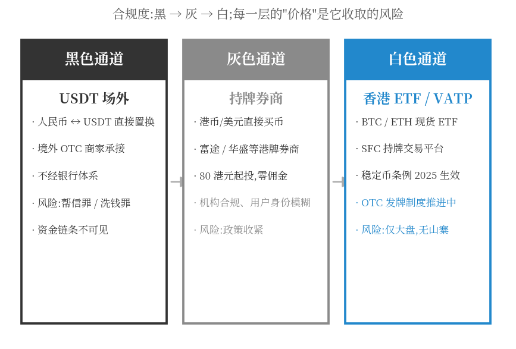
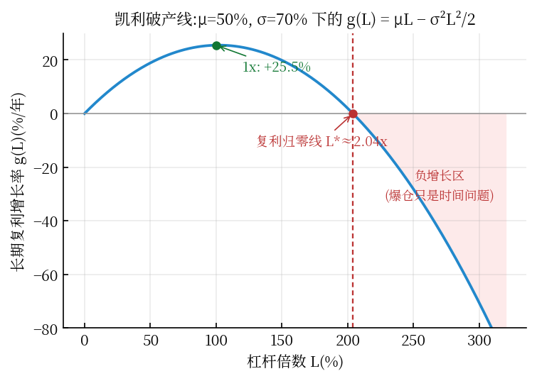
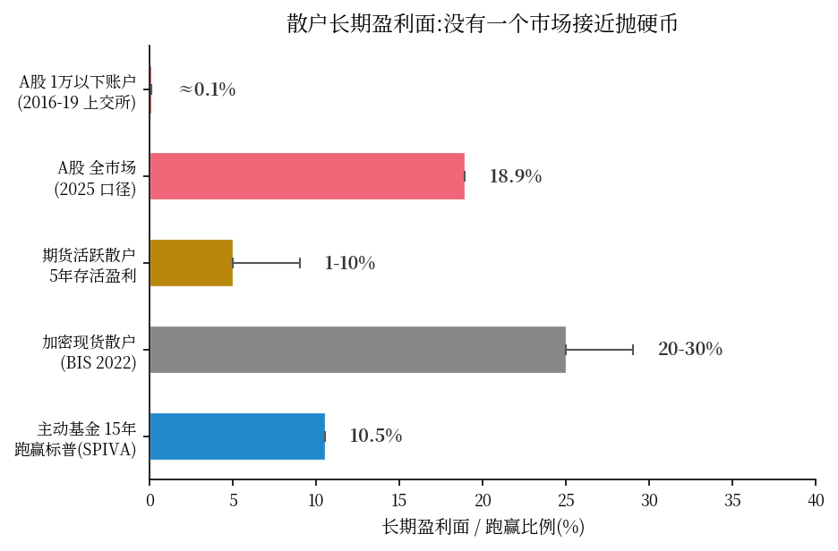

*(本文是市场机制的数据图鉴,不构成任何投资建议,亦非操作指南。所有信息来自公开报告与官方文件,出处见文末。)*

一个悖论打开了这个市场的大门:

**在内地,加密货币交易被定性为"非法金融活动"——合同不受保护、平台不得服务内地居民。但 Chainalysis 的链上数据显示:中文交易网络在 2025 年处理了约 161 亿美元非法资金,占全球加密洗钱活动的 20% 以上。**

禁令管得住持牌机构,管不住资金。这篇文章用机制视角拆解:中国钱是怎么进出这个市场的、在炒什么、以及 2026 年正在发生的合规裂口。

## 一、三色通道:黑、灰、白

内地资金进入加密市场,按合规度分三层结构:

### 黑色:USDT 场外

最原始也最大量的通道:人民币与 USDT 直接置换,由境外 OTC(场外)商家承接。为什么是 USDT?因为它在这个平行系统里扮演"数字美元"——进可买币、退可全球转账,且不经过银行系统。

它的风险不在市场,在**刑法**:场外收到的 USDT 对价资金,如果上游涉诈骗、赌博赃款,你的银行卡会被冻结,并可能被以帮助信息网络犯罪活动罪(帮信罪)或洗钱罪追诉——这不是理论风险,是每年大量发生的真实案例。2026 年 6 月,香港区域法院判处一名 34 岁内地女子洗黑钱罪:其来港开设多个银行账户,出借提现购买 USDT。黑色通道的"黑",最终黑在资金链条的两头。

### 灰色:券商通道

一批持牌港美股券商(如富途、华盛)提供加密交易:港币/美元直接买卖,最低 80 港元起,佣金已卷到零。机构是持牌的、服务在香港框架内——但内地居民按规不属于服务对象,这就构成了灰色地带:**通道真实存在、门槛极低,但内地居民使用处于合规模糊区**。

### 白色:香港 ETF 与持牌平台

2024 年 4 月,香港批出首批比特币、以太币现货 ETF(博时国际、华夏基金香港、嘉实国际发行),嘉实以太币 ETF(03179.HK)等成为合规配置加密敞口的少数途径。香港同时在补齐制度拼图:证监会(SFC)持牌虚拟资产交易平台名单公开可查,OTC 发牌制度立法推进中,稳定币条例已于 2025 年生效。

**香港是官方留给中国资本的"合规水阀"**——阀门开多大,取决于监管对资本外流的容忍度。

## 二、在炒什么:四类标的的行为指纹

**1. 大盘(BTC/ETH):ETF 叙事驱动**
比特币目前处于约 8 万至 8.7 万美元区间,主推动力是 ETF 资金流入。这部分参与者以配置型资金为主,通过香港 ETF 和券商通道进出,行为接近传统资产配置。

**2. 迷因币:散户博弈场**
迷因币指数单日涨幅可达 2.9%(同期比特币 +0.5%);SHIB 近月累计涨幅一度超过 84%。一个行为金融学指纹:**机构和 ETF 只碰 BTC/ETH,山寨与迷因币的超额波动几乎全部来自散户**——亚洲时段的 meme 币行情是全球加密市场最鲜明的"散户时钟"。

**3. 山寨叙事:AI 币与 RWA**
年内个别山寨标的涨幅达 3 倍以上(如 DeXe 年内 +363%)。2026 年的山寨主线是 AI 概念币与 RWA(真实资产代币化)——后者与下文的政策新变量直接相关。

**4. 机构化:对冲基金跑赢现货**
2026 年前 9 个月,加密对冲基金上涨约 9%,同期比特币下跌 12%——跑赢 21 个百分点。华人资金也在机构化:从"囤币"转向多空策略与市场中性,这个市场的参与者结构正在复制传统金融的演化路径。

## 三、谁在赚钱:跨市场的数学账本

最后一问,也是最扎心的:钱到底流向谁?这一节给足数学——五条,每条都算给你看。

### 3.1 市场代数:先分清你在哪个"和"里

任何市场参与者的总损益服从守恒式:

$$\sum_i P_i = \mu \cdot M \cdot t \; - \; \sum(\text{fees} + \text{spread} + \text{funding})$$

第一项是市场整体漂移 $\mu$,第二项是"抽水"。三个市场的定位:

| 市场 | 漂移 μ | 博弈结构 |
|---|---|---|
| 股市 | 正(企业盈利+分红) | 正和:存在"不用赢过任何人"的 β 路径 |
| 期货 | 0 | 严格负和(扣手续费后) |
| 加密现货 | 历史上正,内部转移极端 | 正和外壳 + 新钱接旧钱 |
| 加密合约 | 0 | 负和 + 双重抽水(手续费+资金费) |

### 3.2 抽水的宏观账:币安收入的自洽性检验

年损耗 = 费率 × 换手率。做个独立估算:全网加密日成交约 500-1000 亿美元,混合费率按 0.05%-0.10%(吃单与挂单、现货与合约的加权),则全网年抽水:

$$500{\sim}1000 \;\text{B} \times 365 \times 0.05{\sim}0.10\% \approx 90{\sim}365 \;\text{B USD/yr}$$

币安以最大份额(约四成量)对应百亿美元级收入——与公开估算的**币安 2024 年约 134 亿美元收入、手续费占八成**自洽。这不是巧合,是同一笔税的不同口径。交易所是行情涨跌都照收的"抽税者":有高管口径称,每个合约用户月均贡献约 6 万元人民币。

### 3.3 凯利破产线:为什么两倍杠杆就是极限

把加密资产看成几何布朗运动(年化漂移 $\mu$、波动 $\sigma$),加 $L$ 倍杠杆后资金的长期复利增长率(连续凯利公式):

$$g(L) = \mu L - \frac{\sigma^2 L^2}{2}$$

杠杆记为 L、年化漂移 μ、波动 σ,则 L 倍杠杆下资金的长期复利增长率为 g(L) = μL − σ²L²/2(连续凯利公式)——一条开口向下的抛物线:**L 超过某个点,复利期望由正转负,与你看对方向的频率无关**。代加密的典型参数(μ = 50%, σ = 70%,牛市级别的好年景),这条抛物线长这样:

| 杠杆 $L$ | 长期复利增长率 $g(L)$ |
|---|---|
| 1x | 0.50 − 0.245 = **+25.5%** |
| 2x | 1.00 − 0.98 = **+2%**(几乎白干) |
| 2.04x | **= 0(复利归零线)** |
| 3x | 1.5 − 2.2 = **−70%** |
| 10x | 5 − 24.5 = **−195%**(爆仓只是时间问题) |
| 125x | 62.5 − 3062.5 = **−3000**(数学意义的终结) |

临界杠杆 $L^* = 2\mu/\sigma^2 \approx 2.04$。**即使在一个年化 +50% 的大牛市里,加密的波动率也只允许约 2 倍杠杆;交易所挂在首页的 100x、125x,在凯利公式里不是激进,是数学上的死刑判决书。** 这解释了前文那个数据:合约用户月均给交易所贡献 6 万元——高杠杆群体的资金以月为单位定向流向抽税者。

### 3.4 波动拖累与回本不对称:高波动的两把暗刀

**第一把:几何损耗。** 复利存下来的是几何收益 $g = \mu - \sigma^2/2$,不是算术收益 $\mu$:

$$\sigma = 70\% \;\Rightarrow\; \text{drag} = \frac{0.49}{2} = 24.5\\%\\,/\\text{yr}; \qquad \sigma = 20\\%\\;(\\text{equities}) \;\Rightarrow\; \text{drag} = 2\\%$$

**同样的"+50% 平均年景",股市复利存下 48%,加密只存下 25.5%**——波动本身吃掉一半。散户的体感错配由此而来:"我经常抓到 +30% 的波动,为什么账户越来越薄?"因为 $0.7 \times 1.3 = 0.91$:对称震荡一回合,净值损 9%;震荡越频繁,损耗越快,而换手把损耗兑现。

**第二把:回本不对称。** 亏损 x 后回本需要涨幅 d(x) = x/(1−x):亏 50% 要 +100%,亏 90% 要 +900%,亏 99% 要 +9900%。叠加杠杆(价格回撤 1/L 即保证金归零)与加密的日常波动,深度回撤不是尾部事件,是必经站点。

### 3.5 双重滞后定理:为什么 73-81% 亏在入场那一刻

BIS 对 95 国的研究:73-81% 的比特币散户亏在自己的初始投资上。机制可以用两条滞后链严格写出来:

$$\text{price} \to \text{attention (lagged)} \to \text{entry (lagged again)} \;\Rightarrow\; \text{entry price} > \text{median price}$$

价格要先涨、上新闻、传到社交圈,新散户才会开户入场——**双重滞后保证入场集中在价格分布的右尾**。于是:

$$P(\text{loss}) = \sum_q P(\text{entry at } q) \cdot P(\text{price now} < q) \gg 50\%$$

不需要任何操纵叙事:**散户的注意力结构本身,就把他们钉在了亏损概率的高区**。这是 BIS 那个数字背后最干净的数学解释。

### 3.6 资金费:做多的年贡,与四个生态位

永续合约的资金费率(funding)是多空之间的定期转移,基准每 8 小时 0.01%(年化约 11%),牛市多头拥挤时可到年化 20-40%。散户行为指纹(追涨=系统性做多)意味着:**资金费实质是"做多税"——多头散户定期向空头(多为机构与套利)纳贡**。

至此可以写下完整的赢家公式:

$$\text{winners} = \underbrace{\text{toll collectors}}_{\text{exchanges / market makers}} + \underbrace{\text{early holders}}_{\text{low-cost chips}} + \underbrace{\text{harvesters}}_{\text{arb / quant, collect funding}} + \underbrace{\text{patient } \beta}_{\text{the only retail path}}$$

跨市场散户长期盈利面作证:

| 市场 | 散户长期盈利面 | 证据 |
|---|---|---|
| A 股 | 1 万以下账户亏损率 **99.9%**,1-10 万 **98.7%**;全市场盈利面约 18.9% | 上交所 2016-2019 全样本账户研究 |
| 期货 | 5 年持续盈利 **约 1%-10%**;活跃散户 5 年生存率约 0.5% | 国内统计口径;FIA 美国口径 20-30%(短期) |
| 加密现货 | **73-81% 亏损** | BIS 2022 |
| (参照)主动基金 | 15 年 **89.5%** 跑输标普 500 | SPIVA |

A 股数据里最锋利的一条:**机构在选股和择时上双双为正,散户择时贡献为负**——追涨杀跌不是情绪问题,是可测量的系统性高买低卖(与 3.5 的滞后结构同源)。把五条数学合起来,一句话收束:

> **钱从高换手、高杠杆、注意力滞后的参与者,流向低换手、低杠杆、注意力前置的参与者——以及中间每一层的抽税者。** 数学上的正期望路径全部反人性:降杠杆(凯利线)、降换手(少交税)、降波动暴露(几何损耗)、逆向入场(对抗自己的注意力)。

## 四、2026 年最重要的新变量:一道合规裂口

**2026 年 2 月,中国证监会发布第 1 号公告:以备案制规范境内企业在境外发行资产支持证券代币。**

解读这个信号要克制,但它的结构性含义值得注意:这是监管思路第一次从"全面禁止"转向"给一条合规轨道"——针对的不是炒币,而是 **RWA(资产代币化发行)**。如果这条轨道走通,中国资产(债券、不动产、应收款)将通过代币化形式接入全球链上市场,而定价、清算、托管环节的金融基础设施需求,可能与二级炒币完全分离。

一句话:**一级市场在开口子,二级市场仍是禁区。** 这是理解"中国加密监管 2026"最准确的一句话。

## 五、三层风险结构(给观察者,不是给参与者)

1. **刑事层**:出入金是最大雷区。黑色通道的资金链条风险不因"我只是换汇"而豁免——冻结与追诉的触发点在上游资金性质,而上游你永远看不见
2. **市场层**:迷因与山寨是纯博弈场。84% 的月度涨幅背后是对称量级的回撤——本专栏前文讲过的结论在这里加倍成立:杠杆与波动面前,爆仓价是区域,不是线
3. **政策层**:这是全球加密市场最大的单一风险源。内地备案制的走向、香港水阀的松紧、美国 ETF 监管的连锁反应——任何一个变量都足以重排整个市场的价格结构

## 六、结语:机制观察者的三个判断

1. **禁令改变的不是参与,是成本结构**:三色通道的存在本身就是价格——合规通道(香港 ETF)收取"窄选择权"的成本(只有大盘),灰色通道收取模糊性风险,黑色通道收取刑事尾部风险。资金按风险偏好分层,和任何受管制市场的演化路径一致
2. **散户行为指纹不变**:无论通道怎么变,meme 币的亚洲时钟说明博弈的本质没变——这是行为金融的恒定项
3. **真正的分水岭在一级市场**:RWA 备案制如果走通,"中国资产上链"会成为下一个十年的叙事主轴之一,而那时今天的三色通道图,会成为历史教材

市场会继续进化,图鉴需要定期重绘。这篇是 2026 年 11 月的快照。

---

*信源:Chainalysis《2025 Global Crypto Adoption Index》《2026 Crypto Money Laundering Report》;香港证监会(SFC)持牌虚拟资产平台名单;君合、江三角、宋氏律所对虚拟资产监管的政策解读;香港首批现货 ETF 公告(2024.4);中国证监会 2026 年第 1 号公告(Lexology 转引);Yahoo Finance、KuCoin Research、Bit.com Research 行情数据(2026.9-11)。本文不构成投资建议;内地居民参与虚拟货币交易不受法律保护,相关行为面临政策与法律风险。*
