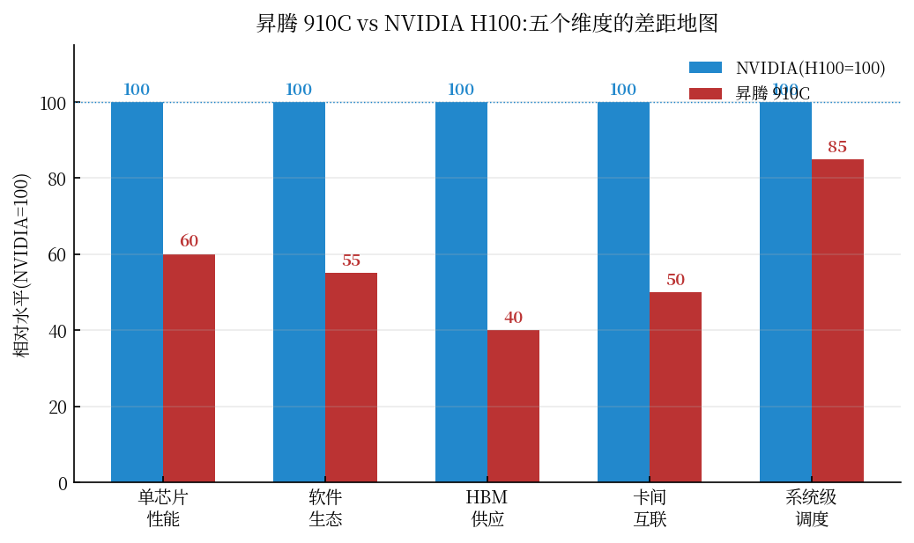
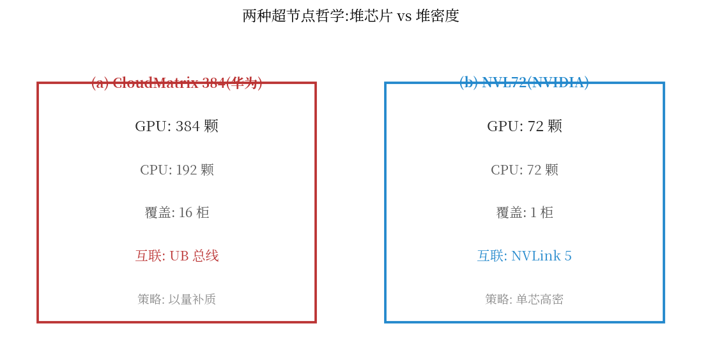
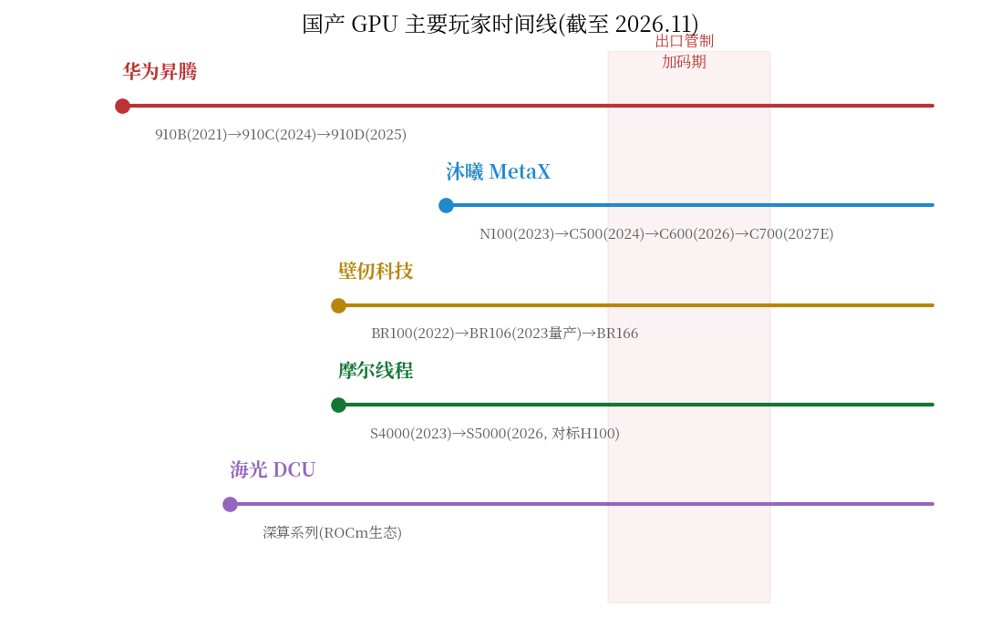

"国产 GPU 到底差在哪?"

这个问题我问过十个做 AI 的朋友,答案从"差三代"到"快追上了"都有。

差距是真实的,但它是**五种不同的差距**——有些一年能追,有些五年追不上。这篇文章拆开五个维度,逐个对照数据,把每家国产厂商放到正确的坐标系里。

## 一、差距地图:一根柱子看清楚

先上一张总图:以 NVIDIA H100 = 100 分为基准,华为昇腾 910C 在五个维度的相对水平:

| 维度 | 差距 | 性质 |
|---|---|---|
| 单芯片性能 | 约 40%(DeepSeek 实测) | 制程代差,短期难追 |
| 软件生态 | 最深,但 Triton 正在稀释护城河 | **正在松动** |
| HBM 供应 | 1-2 代差 | **硬瓶颈**,供应链问题 |
| 卡间互联 | 约 5 倍带宽差 | **追赶最快** |
| 系统级调度 | CloudMatrix 部分反超 | **国产优势区** |

下面逐个拆。

## 二、单芯片:差 40%,根源在制程

**DeepSeek 官方实测**(2025.2):910C 在推理任务中约为 **H100 的 60%**。

硬件规格撕开看:

| | 昇腾 910C | H100 | 倍差 |
|---|---|---|---|
| FP16 算力 | ~800 TFLOPS | 1,979 TFLOPS(含稀疏) | 2.5× |
| 芯片逻辑面积 | 比 H100 **大 60%** | — | — |
| 封装 | 双 910B die 合封 | 单 die | — |
| HBM | 受限(HBM2e 为主) | HBM3e | 1-2 代 |
| 制程 | 中芯 N+2(等效 7nm) | 台积电 4nm | **2-3 代** |

**面积大 60% 但算力只有 60%**——架构效率(每平方毫米算力产出)差了约 3 倍。这不是设计能力的差距,是**光刻机的差距**:没有 EUV,等效 7nm 就是物理天花板。

910D(2025.5 出样)目标超越 H100——但需要重新设计架构而非继续双芯拼封。

## 三、生态:CUDA 的 15 年护城河,正在被 Triton 稀释

**CUDA 护城河的量化**:数万个算子(cuDNN/cuBLAS/TensorRT/NCCL…),数百万开发者的肌肉记忆,PyTorch 原生优化。

**但 2025 年之后,情况在变**:

PyTorch 2 的 Prims 算子库 + Triton 中间层,把"必须写 CUDA"变成了"写 Triton(跨平台编译)"——绝大多数算法工程师**已经不再手写底层 CUDA**。中间层正在稀释护城河。

国产厂商各自的应对(每家路数完全不同):

| 厂商 | 策略 | 宣称覆盖 | 已知问题 |
|---|---|---|---|
| **华为 CANN Next** | CUDA 接口兼容层 | **95%** 兼容 | 剩 5% 恰是核心定制算子,仍需手写 |
| **沐曦 MXMACA** | API 拦截+自动翻译 | **6,000+** CUDA 应用 | 兼容粒度待验证 |
| **摩尔线程 MUSA** | 架构层面 CUDA 代码兼容 | PyTorch/Megatron-LM | S5000 2026.2 才适配 GLM-5 |
| **壁仞 BIRENSUPA** | 自研软件平台兼容 CUDA | 已适配通义千问 | 生态最封闭 |
| **海光 DCU** | 走 AMD ROCm 生态 | 跟随 ROCm | 上游节奏不可控 |

**关键陷阱**:95% 兼容听着很高,但你迁移大模型时最后卡住的那个 custom kernel——恰好就在那 5% 里。

## 四、HBM:受制于人的命脉

大模型训练是**内存带宽瓶颈**:backward pass 每 token 要读全部权重。HBM 就是 AI 芯片的血管。

全球 HBM 被 SK 海力士、三星、美光三家垄断。出口管制下:

- NVIDIA H100 用 HBM3e(3.35 TB/s),B200 用更高速的版本
- 国产芯片大多只能拿 **HBM2e**(上一代),部分依靠国产替代(长鑫存储在追,但代差明显)

**这是供应链差距,不是设计差距**——你可以设计出最好的芯片,但买不到最快的内存,算力上限就锁死了。

华为的应对:单卡 HBM 带宽不够 → **用更多卡 + 系统调度补**(第六节)。

## 五、互联:差距最大,但追赶最快

NVIDIA 的 NVLink 5 提供 900 GB/s 的 GPU 间互联,配上 NVSwitch 组成 NVL72(72 颗 B200 一柜)。

华为 CloudMatrix 384(2025.4)对标之:

| | CloudMatrix 384 | NVL72 |
|---|---|---|
| GPU 数量 | 384 颗 910C | 72 颗 B200 |
| CPU | 192 颗鲲鹏 | Grace |
| 机柜 | 16 柜 | 1 柜 |
| 互联 | UB(统一总线) | NVLink 5 / NVSwitch |
| 异构支持 | CPU/GPU/NPU 互通 | 仅 GPU |

**华为自己的承认**(2025.9 徐直军 keynote):跨柜互联带宽与超节点理想需求**差距约 5 倍**。但 MoE 场景 All-to-All 通信密集,超节点架构恰好命中痛点。

**黄仁勋公开承认** CloudMatrix 384 部分性能超过英伟达对应产品。

## 六、系统级:国产的优势区

单芯片打不过 → **用 2 倍的芯片 + 互联和调度补**。这是华为的核心战略。

- 功耗更低(910C 功耗低于 H100)
- 集群调度(MindSpore + CANN)经过千亿参数模型训练验证
- 智算中心大规模部署(中国移动等)

这不是"没有选择的选择",而是**系统级架构的主动设计**——用可用器件做到整体最优。

## 七、国产玩家全景:四小龙 + 华为,各自在哪里

### 华为昇腾:唯一从芯片到集群全栈自研

- **产品**:910B(2021)→ 910C(2024,双 die)→ 910D(2025 样品,目标超 H100)
- **生态**:CANN Next(95% CUDA 兼容),MindSpore 框架
- **优势**:全栈(芯片-互联-框架-调度),CloudMatrix 超节点实战
- **短板**:制程受限,HBM 依赖海外
- **体量**:年产 910C 约 140 万颗(计划)

### 沐曦 MetaX:生态兼容策略的极致

- **产品**:N100(2023,推理)→ C500(2024,训推一体,对标 A100)→ C600(2026)→ C700(2027E)
- **C500 规格**:FP32 约 15 TFLOPS,64GB HBM,350W
- **生态**:MXMACA 兼容 6,000+ CUDA 应用
- **财务**:2026 Q3 单季营收 **15 亿元,同比 +367%**,连续两季盈利
- **定位**:数据中心高性能计算,"生态策略优先的工程型公司"
- **客户**:智谱 AI、优刻得等,千亿参数大模型训推一体集群

### 壁仞科技:架构激进派

- **产品**:BR100(2022,770 亿晶体管,PFLOPS 峰值)→ BR106(2023.1 量产)→ BR110/BR166
- **架构**:Chiplet + 2.5D CoWoS,8192 个流式处理器,512 个张量加速器
- **显存**:64GB HBM2e,带宽 2.3 TB/s
- **生态**:BIRENSUPA 自研平台(兼容 CUDA)
- **部署**:中国移动智算中心(哈尔滨)等,三大运营商合作
- **特点**:BR100 曾宣称"超国际旗舰 3 倍",但 BR100/104 因出口管制"流产",后续产品不再公布详细参数

### 摩尔线程:CUDA 兼容最激进

- **产品**:S4000(2023,48GB,FP16 100 TFLOPS)→ S5000(2026,80GB,1.6 TB/s,对标 H100)
- **S5000 亮点**:第四代 MUSA 架构,FP8 全精度支持,多卡互联 784 GB/s,万亿参数训练
- **生态**:MUSA 架构设计之初就考虑 CUDA 代码兼容;2026.2 适配 GLM-5
- **体量**:2026 上半年营收 **17.36 亿元**(四小龙中最高)

### 海光 DCU:安静的追赶者

- **路线**:基于 AMD ROCm 生态(源自 x86 授权)
- **优势**:CPU+GPU 协同设计,DeepAI 系列已有数据中心部署
- **劣势**:上游 ROCm 节奏不可控,架构自主性弱

## 八、冷静的判断:三个时间尺度

**一年内追不上的**:制程(没有 EUV 就没有 4nm)、HBM(全球供应链卡脖子)。这是物理和地缘的差距。

**三年内可能追上的**:软件生态(Triton 稀释 CUDA 护城河的趋势在加速)、互联(UB 总线差距在快速收窄,CloudMatrix 已实战)。

**已经追上的**:系统级调度(华为超节点已获黄仁勋承认);推理场景(部分场景 910C 打平 H100);政策保护下的市场(2026 年中国 AI 芯片市场国产占比持续上升)。

## 九、尾声

"国产 GPU 差在哪"的完整答案:

> **差在光刻机,不差在设计;差在 HBM,不差在架构;差在 15 年生态积累,但护城河正在被中间层稀释。真正追不上的,是供应链的物理瓶颈;真正追上的,是系统级的工程智慧。**

国产 GPU 的突围不是一颗芯片的追赶,是**代工-HBM-互联-软件栈-调度**整条产业链的系统战。每家厂商选了不同的战场——华为打全栈,沐曦打生态,壁仞打架构,摩尔线程打兼容——策略分化本身,就是市场在成熟。

下次有人问"国产 GPU 到底行不行",你可以反问:你问的是哪个维度、哪个时间尺度?

---

*信源:DeepSeek 910C 实测(2025.2,多家转引);腾讯云/华为官方 keynote(2025.9);钛媒体/国金证券国产 GPU 报告(2026);沐曦/壁仞/摩尔线程官网及招股书;PyTorch Prims/Triton 生态分析(知乎专栏 2025-2026)。本文截稿 2026.11.15,数据以各官网为准。*
