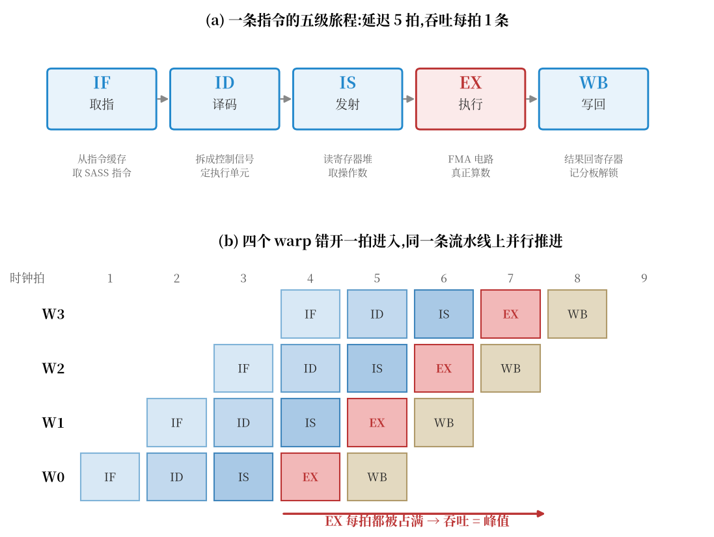
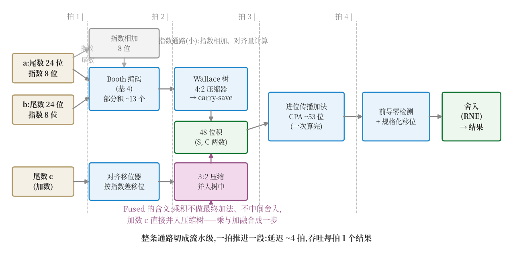
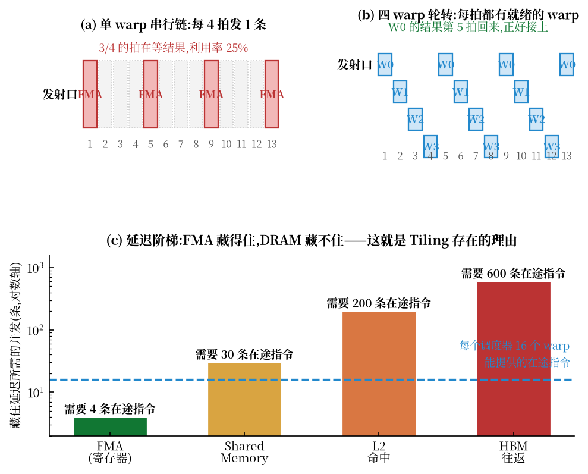

`c = a * b + c`。

一条 FMA 指令(乘加),H100 每秒执行约 29.6 万亿次。摊到每个 CUDA Core 头上:每 0.57 纳秒吞一条新指令、读三个新操作数、吐一个新结果。

一秒 17.5 亿次,节拍不能错一次。

问题是:CUDA Core 是整个 GPU 里最傻的部件。它不会找活干,看不懂循环,不会跳转。它唯一会做的事,是执行一条被**喂到嘴边**的指令。

谁在喂?怎么决定先喂谁?喂慢了会发生什么?

这是 GPU 解剖台的第七篇,讲计算的最后一段路:一条指令从取指到写回的完整旅程。前面的文章讲过 SM 里**有什么**(CUDA Core、Tensor Core、Shared Memory),这篇讲它们**怎么被驱动起来**——989 TFLOPS 的纸面数字和实际跑出来的性能之间,隔着的就是这套流水线。

## 一、主角不是 CUDA Core,是喂它的人

先立一个常识:GPU 的计算单元本身没有任何主动性。

128 个 FP32 Core 排在 SM 的四个分区里,每个分区 32 个。它们像 128 台洗衣机:衣服放进去,程序选好,按下启动,45 分钟后拿出来。洗衣机不会自己去衣柜找衣服。

找衣服、分配洗衣机、排时间表的,是每个分区里的 **Warp Scheduler(线程束调度器)**。

一个 H100 的 SM 最多同时管理 **64 个 warp**(2048 个线程),摊到 4 个调度器,每个管 16 个。每个时钟周期,调度器做一件事:

**从自己管的 warp 里,挑一个"就绪"的,把它的下一条指令发射出去。**

注意"就绪"两个字。这是整篇文章的题眼。

## 二、一条指令的五级旅程

被选中的 warp 指令,要走过五级流水线(概念模型;真实硬件级数更多、厂商不公开,但骨架一致):

```
IF → ID → IS → EX → WB
取指  译码  发射  执行  写回
```



**IF(取指)**:调度器给出 warp 的程序计数器,从指令缓存取出下一条 SASS 指令。你写的 CUDA C 先编译成 PTX,再由驱动编译成 SASS——后者才是硬件真正认识的指令。

**ID(译码)**:把二进制拆成控制信号。这是 FMA?读哪几个寄存器?写到哪?送去哪个执行单元(浮点、整数、SFU、访存)?

**IS(发射)**:从寄存器堆读出操作数。一条 FMA 要读两个源操作数加一个累加数,寄存器堆按 bank 组织,同时读这么多操作数,背后还有一层专门的总线网络(operand collector)。

**EX(执行)**:操作数进入执行单元,算术在这里真正发生。一个 SM 每拍最多发射 4 条 warp 指令(4 个调度器各 1 条),对应 4×32 = 128 条 lane——恰好是 128 个 FP32 Core 的数目。

**WB(写回)**:结果写回寄存器堆,同时通知记分板:"这个寄存器的值到了。"

五级,每级一拍。一条指令从头走到尾要 5 拍,但流水线上每一拍都**同时有 5 条不同的指令处在不同级**——就像洗衣店的流水线,烘干机转第 3 筒的时候,洗衣机已经在洗第 5 筒。

所以:延迟 5 拍,吞吐每拍 1 条。这是流水线的全部魔法。

## 三、记分板:调度器怎么判断谁"就绪"

64 个 warp 挤在一个 SM 里,每个都举着手喊"该我了"。调度器怎么裁决?

靠一张**记分板(scoreboard)**。

逻辑很简单:FMA 的结果要 4 拍后才写回。那么在结果回来之前,凡是**要用这个结果**的指令,都不能发射。硬件给每个 warp 最近发出的指令的目的寄存器挂一个倒计时,倒计时归零,依赖解除。

看一段代码:

```cuda
float a = x * y;   // FMA,4 拍后 a 才可用
float b = a + 1;   // 依赖 a —— 必须等
float c = z * w;   // 不依赖 —— 随时能发
```

调度器的视角:

- 周期 1:发 `x*y`,记分板给目标寄存器挂上"还差 4 拍"
- 周期 2:`a+1` 想发?查表,源操作数没就绪,**这个 warp 暂停**
- 同一拍:`z*w` 就绪,发射——注意它是**同一个 warp**里的指令。编译器会把不依赖的指令排到前面,这叫指令调度
- 周期 5:`a` 写回,记分板清零,`a+1` 解锁

如果这个 warp 实在没有可发的指令了,调度器不陪它等——转头去看自己管的另外 15 个 warp,挑一个就绪的发。

**GPU 从不空等。这是它和早期 CPU 最大的性格差异。**

顺带埋一个钩子:一个 warp 的 32 个线程共享一条指令。如果代码里出现 `if (cond)`,一半线程走真分支一半走假分支,硬件只能先执行一边、掩码屏蔽另一边,再反过来——两个分支轮流占用流水线,利用率直接减半。这个话题(分支发散)值得单独写一篇,这里按下不表。

## 四、EX 里发生了什么:一个 FMA 的电路

现在钻进执行级。c = a×b + c 这条指令,在电路里到底怎么算?

先把 FP32 拆开:1 位符号 + 8 位指数 + 24 位尾数(23 位存储 + 1 位隐含的 1)。浮点乘加的实质,是**尾数的整数乘加**加指数的对齐处理。



四步:

**第一步,生成部分积**。24×24 位的乘法,朴素做法是移位加,最多 24 个部分积。硬件用 Booth 编码(基 4)把被乘数三位一组重新编码,部分积减到十几个。

**第二步,压缩树**。十几个部分积不能用加法器两两相加——太慢。Wallace 树 / 4:2 压缩器把部分积层层压缩成两个数(保留进位形式),这一步的延迟是树的深度,不是串行加法。

**第三步,并入加数**。FMA 的精髓在这里:乘出来的积**不做最终加法**,而是把第三个操作数 c 按指数差移位对齐,直接塞进压缩树里一起压。这样乘和加真正融合成一步,中间不做舍入——这是 FMA 比"先乘后加"精度更高的原因,也是它叫 Fused 的原因。

**第四步,一次长加法 + 规格化**。压缩树输出的两个数做一次进位传播加法(约 50 位宽),然后前导零检测、规格化移位、IEEE 754 舍入,输出结果。

这整条数据通路本身也被切成流水级,一拍推进一段。微基准实测(Volta/Turing,ISPASS 系列论文)给出:FP32 算术指令从发射到结果可用的延迟约 **4 拍**,吞吐每拍 1 条。

一个冷知识:FMA 不是 GPU 的发明。第一颗商用 FMA 单元在 1990 年 IBM 的 RS/6000 上,设计初衷是让浮点乘加在**一条指令内完成、只舍入一次**——把科学计算里最频繁的操作速度和精度同时拉满。三十年后,它成了所有 GPU 姓名栏里的第一个技能。

旁边还有一间小厂房:**SFU(Special Function Unit)**,每个 SM 16 个。sin、cos、exp、log、倒数、平方根倒数走这里——它们没法用乘加树精确算,用的是"查表 + 小多项式修正"的近似电路,吞吐是 FP32 的 1/8。深度学习里的 GELU、Softmax 里的 exp,每秒几十亿次地穿过这 16 个小单元。

## 五、延迟 4 拍,吞吐每拍 1:流水线的账

现在算一笔账,这笔账决定了后面所有设计。

一条 FMA 延迟 4 拍。假设一个 warp 执行完一条 FMA,下一条 FMA 恰好要用它的结果——最短也得等 4 拍。如果整个 SM 里**只有这一个 warp 在干活**:

```
拍:      1    2    3    4    5    6    7    8    9
issue:  FMA  --   --   --   FMA  --   --   --   FMA
         ↑    ←—— 4 拍等结果 ——→  ↑
```

每 4 拍发射 1 条,128 个 FP32 lane 里 96 个在晒太阳。**利用率 25%。**

两个解法,一个软一个硬。

软的:**指令级并行(ILP)**。编译器重排指令,把互不依赖的乘加交错排布:

```cuda
// 原始:acc0 ← acc0 ← acc0 ← ...   (串行链,每条等上一条)
acc0 = acc0 + a0 * b0;
acc1 = acc1 + a1 * b1;   // 独立!插进来填空
acc0 = acc0 + a2 * b2;
acc1 = acc1 + a3 * b3;
```

四条独立的链交错,等待期被同伴填满。这就是为什么高性能 GEMM kernel 里,累加器总是拆成 4 个、8 个独立变量——不是代码洁癖,是在给流水线喂料。Register blocking(寄存器分块)的真实身份,是**软件层面手工做的指令调度**。

硬的,是下一节的主角。

## 六、64 个 warp 的轮转:延迟隐藏的数学

单靠 ILP 不够——一个 warp 里的独立指令数量有限,寄存器也有限。GPU 的根本解法是:**跨 warp 轮转**。

一个调度器管 16 个 warp。FMA 延迟 4 拍,每个 warp 发一条 FMA 后歇 3 拍。只要**任意时刻有至少 4 个就绪的 warp** 轮流上场,发射口每拍都有活干:



```
拍:     1      2      3      4      5      6      7
issue:  W0     W1     W2     W3     W0     W1     W2
        FMA    FMA    FMA    FMA    FMA    FMA    FMA
        ↑ W0 的结果在第 5 拍回来,正好接上
```

每拍 1 条,满载。延迟没有消失,只是被**轮转**藏在了别的 warp 的执行时间里。

这件事有一条通用公式,排队论里的 Little 定律:

$$\text{Concurrency} = \text{Latency} \times \text{Throughput}$$

要保持每拍 1 条的吞吐,系统里必须有"延迟 × 吞吐"那么多条在途指令。代入 FMA:

$$4\ \text{cycles} \times \frac{1\ \text{instr}}{\text{cycle}} = 4\ \text{in-flight}$$

需要 4 个,手上有 16 个 warp——**4 倍冗余**。所以纯计算 kernel 里,FMA 流水线可以常年满载,ALU 延迟对性能几乎透明。

这就是 GPU 设计哲学的核心一句:**用吞吐换延迟**。CPU 花几亿晶体管把单条指令的延迟从 4 拍压到 3 拍;GPU 用同样的晶体管堆 16 倍的 warp,让延迟在轮转里蒸发。哪条路对矩阵乘更划算,不言自明。

## 七、藏不住的 600 拍:为什么必须有 Tiling

但有一类延迟,这套机制藏不住。

把各种操作的延迟排成阶梯(微基准实测的量级,不同架构有差异):

| 操作 | 延迟(拍) | 藏住它需要多少在途指令 |
|---|---|---|
| FMA(寄存器→寄存器) | ~4 | 4 |
| Shared Memory 读取 | ~20-30 | ~30 |
| L2 命中 | ~200 | ~200 |
| HBM 显存往返 | ~600 | **~600** |

再念一遍 Little 定律:要每拍都有指令可发,就得有 600 条在途指令。一个调度器只有 16 个 warp,就算每个 warp 同时挂多个访存请求(访存级并行),也只有几十条——离 600 差一个数量级。

**DRAM 延迟藏不住。这就是 kernel 优化的全部出发点。**

回看这个系列的第三篇(Shared Memory 与 Tiling):为什么矩阵乘要先搬进 Shared Memory 再算?现在可以给出流水线视角的答案——

访问 Shared Memory 延迟约 30 拍,16 个 warp 的轮转加 cp.async 的预取,能把大半藏住;直接打 HBM 的 600 拍,谁也藏不住。Tiling 的本质,是把数据访问从阶梯的**最底层搬到第二层**,让延迟重新回到"轮转可藏"的区间。

第四篇(Bank Conflict)则是在保证 Shared Memory 的**吞吐**不打折——延迟藏住了,吞吐塌了照样白搭。这两篇加起来,就是"喂饱计算单元"的完整故事。

## 八、寄存器:延迟隐藏的隐形成本

轮转的前提是有足够多的 warp。而 warp 数量的上限,卡在一样东西上:寄存器。

H100 每个 SM 的寄存器堆是 256 KB,即 65,536 个 32 位寄存器,由整个 SM 的线程瓜分。每个线程最多用 255 个。列一张账:

$$W = \left\lfloor \frac{65536}{32 \times r} \right\rfloor$$

其中 $r$ 是每线程占用的寄存器数。

| 每线程寄存器 r | 每 warp 占用 | 驻留 warp 数 | 每调度器 | 能藏 4 拍 FMA? |
|---|---|---|---|---|
| 32 | 1024 | 64 | 16 | 绰绰有余 |
| 64 | 2048 | 32 | 8 | 够 |
| 128 | 4096 | 16 | 4 | 刚好贴线 |
| 255(上限) | 8160 | **8** | **2** | **藏不住,性能跳水** |

看出矛盾了吗?

寄存器用得越多,ILP 越强(第五节的独立累加器要占寄存器),单线程跑得越快;但驻留 warp 越少,延迟隐藏能力越差。

这是 GPU 编程里最经典的权衡:**ILP 换 TLP(线程级并行)**。`nvcc` 报的 "registers spilled to local memory"(寄存器溢出到显存),就是把超出的寄存器挪到 DRAM 里——每次访问多付 600 拍,性能断崖。编译器拍 `-maxrregcount` 或 `__launch_bounds__` 就是在这两个极端之间找平衡点。

Nsight Compute 的 Launch Statistics 页直接给出每线程寄存器数和实际 warp 驻留数,一行就能定位这类问题。

## 九、单拍快照:0.57 纳秒里的全家福

把前面所有部件叠进同一个时钟沿。任意一拍,一个 H100 SM 内部同时进行着:

| 部件 | 这一拍在做的事 |
|---|---|
| 4 个 Warp Scheduler | 各自裁决、各发 1 条 warp 指令 |
| 记分板 | 若干倒计时归零,若干新指令被挂起 |
| 128 个 FP32 lane | 128 个 FMA 在不同流水级上推进 = 256 FLOP |
| 64 个 INT32 lane | 地址计算、循环计数(不抢浮点管线) |
| 16 个 SFU | sin / exp / rsqrt 穿过查表电路 |
| 16 个 LSU | 128 字节 Shared Memory 访问 / 发起全局请求 |
| 4 个 Tensor Core | 4 × 512 = 2048 FLOP(FP16) |
| cp.async 引擎 | 后台搬数据,不占上面任何单元 |

注意最后一行。数据搬运有独立引擎,计算有独立管线,调度有独立裁决——三者**物理并行,互不抢占**。所谓 kernel 优化,无非是让这三条线在时间轴上都填满:调度器总有就绪的 warp( occupancy 够),Tensor Core 总有 operand( Shared Memory 吞吐够),搬运引擎总在飞行( cp.async 流水)。

## 十、从 torch.matmul 到电流:全链路

最后把七篇文章串成一条线。你写下 `torch.matmul(A, B)`,按下回车,到晶体管层面电流翻转,顺序是:

```
PyTorch: torch.matmul(A, B)
   ↓
cuBLAS: 选 kernel(tile 大小、是否用 TC)
   ↓
[第三篇 Shared Memory] cp.async 把 A、B 的 tile 搬进 SMEM
   ↓
[第四篇 Bank Conflict] Swizzle 保证 tile 读取不撞 bank
   ↓
本文:Warp Scheduler 挑就绪 warp
   → 译码 → 读寄存器 → 发射
   → CUDA Core 走 FMA 电路 / Tensor Core 走脉动阵列(第五篇)
   → 写回,记分板解锁后续指令
   ↓
64 个 warp 轮转,4 拍延迟在轮转中蒸发
   ↓
[第二篇 SM 解剖] 132 个 SM 同时上演这一幕
   ↓
[第六篇 NCCL] 多卡算完,梯度沿环同步
   ↓
[第一篇 FLOPS] 全部乘起来 = 你的 MFU
```

每一层都能在前六篇里找到展开。这也是开专栏的初衷:单点知识是散珠,链条才是项链。

## 十一、总结

三条带走:

**1. 计算单元是洗衣机,调度器是店长。** CUDA Core 没有主动性,每拍执行被投喂的指令;64 个 warp 谁就绪谁上,记分板裁决依赖。

**2. 延迟靠轮转蒸发,公式是 Little 定律。** 并发 = 延迟 × 吞吐。4 拍的 FMA 用 16 个 warp 轻松盖住;600 拍的 DRAM 谁也盖不住——所以有 Tiling,所以有 Shared Memory。

**3. 寄存器是 warp 数量的预算表。** 每线程寄存器翻倍,驻留 warp 减半,ILP 和 TLP 此消彼长。看到 occupancy 低于预期,先查寄存器账单。

下一篇打算写分支发散:warp 里 32 个线程在 if/else 面前分道扬镳,硬件怎么用掩码让两边轮流上流水线,以及为什么 sort/search 类算法在 GPU 上天生吃亏。

---

*参考:NVIDIA Hopper / Volta Architecture Whitepaper(SM 分区、warp scheduler、2048 线程);NVIDIA CUDA C++ Best Practices Guide(延迟隐藏与 occupancy);Jia et al., "Dissecting the NVIDIA Volta GPU Architecture via Microbenchmarking"(ISPASS 2018,FP32 issue-to-use 延迟实测);Zhang et al., "Demystifying GPU Microarchitecture through Microbenchmarking"(ISPASS 2011);Hokenek, Montoye & Cook, "Second-Generation RISC Floating Point with Multiply-Add Fused"(IBM JRD 1990,首颗商用 FMA);Hennessy & Patterson,《计算机体系结构:量化研究方法》(记分板与流水线)。延迟数字为微基准文献报告的量级,不同架构有出入。*
