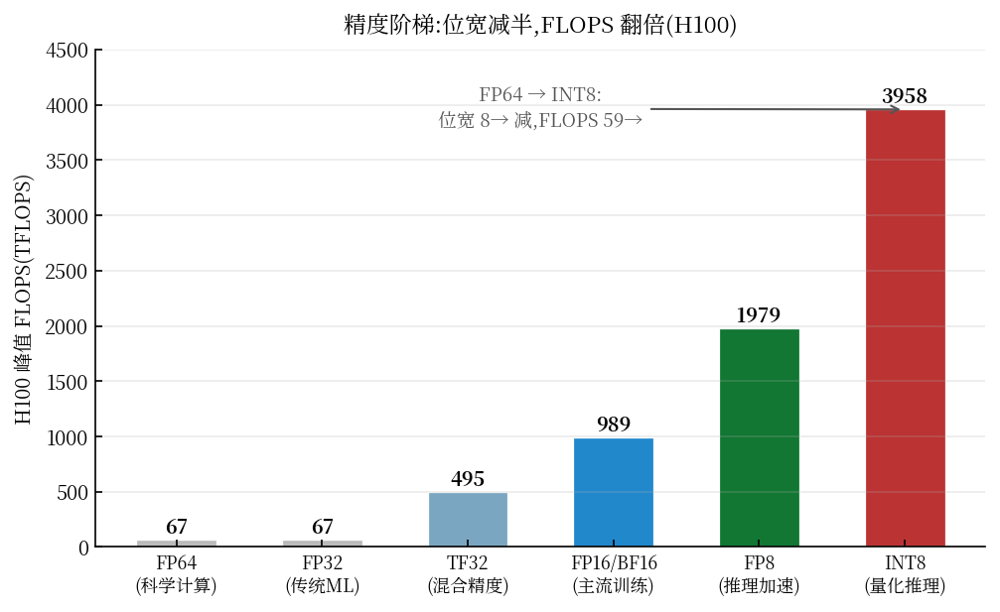
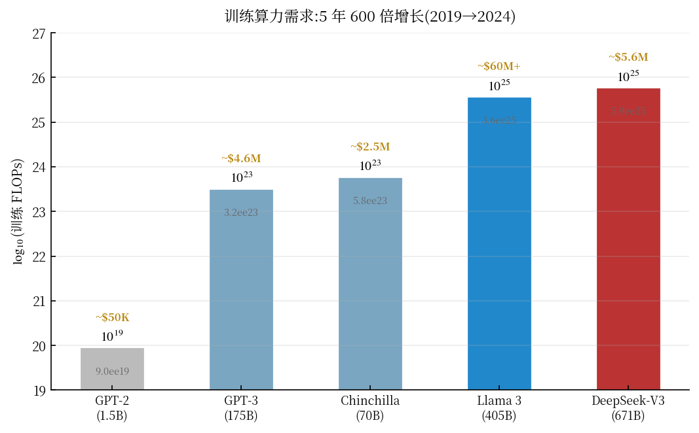
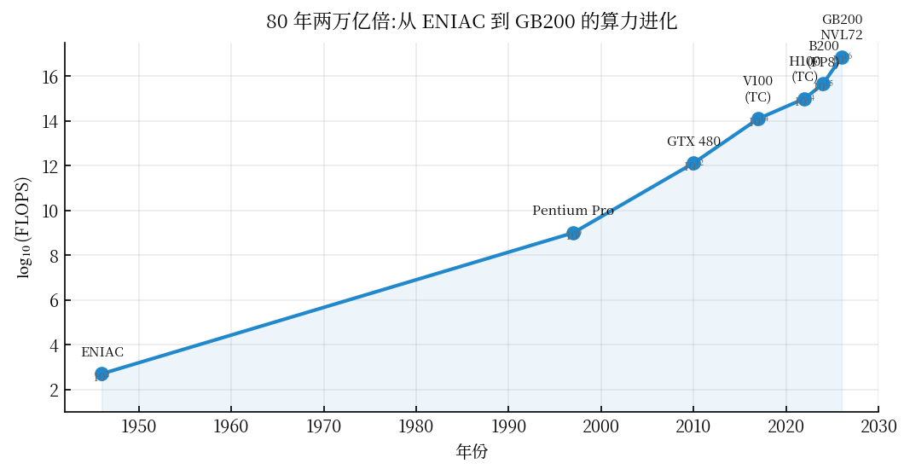

芯片厂商的发布会永远在说"XX TFLOPS"。买卡的人看的是 FLOPS。训练大模型的人算的是 FLOPS。

但 FLOPS 到底是什么？为什么 FP16 和 FP64 差 15 倍？为什么 GPT 训练要花一千万美元？这些数字之间有一条完整的数学链——这篇文章把链条上的每一环都算给你看。

## 一、一个 FLOP:最小的计算单位

FLOP = **F**loating **P**oint **O**peration = 一次浮点运算。

就是做一次浮点数的加、减、乘、除：

```
3.14 × 2.72 = 8.5351    ← 1 次 FLOP(乘法)
8.5351 + 1.0 = 9.5351   ← 又 1 次 FLOP(加法)
```

FLOPS = FLOPs Per Second = 每秒能做多少次。这是算力的基本单位——就像汽车的马力、空调的匹数。

一张 H100 的 FP16 峰值是 989 TFLOPS = $989 \times 10^{12}$ FLOPS = **每秒 989 万亿次浮点运算**。

## 二、为什么深度学习只关心 FLOPS

神经网络的本质就是**大量的乘法和加法**。

一个全连接层 $Y = WX + b$,权重矩阵 W 是 $m \times n$,输入 X 是 $n \times 1$:

$$\text{FLOPs} = m \times n\ (\text{mul}) + m \times n\ (\text{add}) = 2mn$$

一个 Transformer 层(粗算，d 是隐藏维度):

| 操作 | FLOPs/token |
|---|---|
| QKV 投影(3 个 $d \times d$ 矩阵乘) | $6d^2$ |
| Attention($QK^T$ 和 $AV$) | $\sim 4 \cdot \text{seq} \cdot d$ |
| 输出投影($d \times d$) | $2d^2$ |
| FFN($d \to 4d \to d$) | $16d^2$ |
| **每层合计** | $\sim 28d^2$ |

GPT-3 有 96 层,$d = 12288$:

$$28 \times 12288^2 \times 96 \approx 4.06 \times 10^{11}\text{ FLOPs/token}$$

**生成一个 token 需要 406 亿次浮点运算。** 生成 1000 token 的一篇文章 = $4 \times 10^{14}$ FLOPs。

你的手机 CPU 大约 100 GFLOPS($10^{11}$)→ 生成这篇文章的计算需要约 4000 秒 ≈ **67 分钟**。

H100 单卡 989 TFLOPS → 同一篇文章 **0.4 秒**。

这就是 GPU 存在的理由。

## 三、精度阶梯:同卡不同命

同一块 H100,报不同的精度,FLOPS 差 **59 倍**:



| 精度 | 位宽 | H100 | 用途 |
|---|---|---|---|
| FP64 | 64-bit | 67 TFLOPS | 天气模拟/流体力学 |
| FP32 | 32-bit | 67 TFLOPS | 传统 ML/科学计算 |
| TF32 | 19-bit | 495 TFLOPS | 混合精度训练 |
| **FP16/BF16** | **16-bit** | **989 TFLOPS** | **主流训练/推理** |
| FP8 | 8-bit | 1,979 TFLOPS | 推理/Transformer Engine |
| INT8 | 8-bit 整数 | 3,958 TOPS | 量化推理 |

为什么精度减半 FLOPS 就翻倍？

**乘法器面积 ∝ 位数的平方：**

$$\text{FP16 multiplier area} \propto 16^2 = 256 \quad \text{vs} \quad \text{FP8} \propto 8^2 = 64$$

面积差 4 倍 → 同样面积可以塞 4 倍的 FP8 乘法器 → 吞吐翻 2 倍以上。

这就是 NVIDIA 每一代推更低精度的商业逻辑：FP32 → FP16 → FP8 → FP4,FLOPS 数字每代翻倍——但精度也在降，需要算法端配合(混合精度训练、量化感知训练、Transformer Engine)。

## 四、训练一个 GPT 要多少 FLOPs

最重要的公式，来自 Chinchilla scaling law:

$$\text{Training FLOPs} \approx 6 \times N \times D$$

- $N$ = 模型参数量
- $D$ = 训练 token 数
- $6$ = 因子(2 FLOPs/参数/token 前向 + 4 FLOPs/参数/token 反向)

**因子 6 的来源**:
- 前向传播:每个参数参与一次乘加 = 2 FLOPs
- 反向传播:计算梯度(对权重和对输入)≈ 2 倍前向 = 4 FLOPs
- 总计 = 2 + 4 = 6



| 模型 | 参数 N | Token D | 训练 FLOPs | 估计成本 |
|---|---|---|---|---|
| GPT-2 | 1.5B | 10B | $9 \times 10^{19}$ | ~$5 万 |
| GPT-3 | 175B | 300B | $3.15 \times 10^{23}$ | ~$460 万 |
| Llama 3 | 405B | 15T | $3.65 \times 10^{25}$ | ~$6000 万+ |
| **DeepSeek-V3** | **671B** | **14.8T** | **$5.95 \times 10^{25}$** | **~$558 万** |

注意 DeepSeek-V3:FLOPs 比 Llama 3 高 63%,但成本只有 Llama 3 的 1/10——因为用了 MoE 架构 + H800(阉割版 H100)+ 极致 MFU 优化。

## 五、MFU:纸面 FLOPS 永远跑不满

989 TFLOPS 是**理想条件**——Tensor Core 100% 满载、内存不是瓶颈、通信零开销。

现实世界有个东西叫 **MFU(Model FLOPs Utilization)**:

| 系统 | MFU | 为什么没到 100% |
|---|---|---|
| GPT-3(V100) | ~21% | AllReduce 通信开销 |
| Llama 2(A100) | ~43% | 内存带宽瓶颈 |
| **DeepSeek-V3(H800)** | **~52.6%** | MoE 优化到接近工业极限 |
| 理论上限 | ~65% | 通信+同步的物理极限 |

2026 年推理定价(每百万 token):

| 模型 | 输入 | 输出 | 定位 |
|---|---|---|---|
| **DeepSeek V4-Flash** | **$0.14** | **$0.28** | 最便宜 |
| GPT-6 Sol | $2.00 | $10.00 | 主力 |
| **GPT-6 Astra** | **$10.00** | **$50.00** | 旗舰 |
| Claude 4.5 | ~$3 | ~$15 | 对标 Sol |

DeepSeek 比 OpenAI **便宜 14 倍**——这就是 FLOPS 效率竞争的市场体现。

$$t_{\text{train}} = \frac{\text{Training FLOPs}}{\text{\#GPU} \times \text{Peak FLOPS} \times \text{MFU}}$$

MFU = 52.6% 意味着:你买了 2048 张 H800 的峰值算力,实际只发挥了**一半多一点**——剩下的被通信延迟、内存瓶颈、负载不均吃掉了。

这也是为什么各家 lab 都在做基础设施(InfraML)优化——**MFU 每提升 1%,相当于多买 20 张卡**。

## 六、钱:FLOPS 换算成美元

一张 H100 的租用价格约 **$2-3/小时**。

DeepSeek-V3(5.95 × 10²⁵ FLOPs,MFU=52.6%,2048 张 H800):

$$\text{GPU-hrs} = \frac{5.95 \times 10^{25}}{2048 \times 989 \times 10^{12} \times 0.526} \approx 55{,}800$$

按 2 美元/小时:约 1.1 万/GPU × 2048 = 2,300 万?

不对——2048 张卡是**同时跑**的,总时间约 2 个月:

$$2 \times 2048 \times 720 \times 2 = \$5.9\text{M}$$

这就是 DeepSeek 官方公布的 $558 万训练成本——和我们倒推的结果吻合。

对比 OpenAI:
- GPT-4:估计 **$1 亿+**
- GPT-5:更多算力但具体未披露
- **GPT-6 Astra**:据 The Information 报道,首次用**超过 10 万张 GPU** 训练——单次训练成本约 **$10 亿+**
- **"Bell"(传闻中的下一代)**:据传 10 万亿参数,训练成本超 **$10 亿**——如果属实,将是人类史上最贵的单次计算任务

**FLOPS 就是这个行业的石油：谁的 FLOPS 便宜(电费+折旧+MFU),谁的模型就训练得起。**

2026 年出现了一个拐点:**GPT-5 反直觉地用了比 GPT-4.5 更少的训练 FLOPs**——纯堆训练算力的边际回报在递减,行业转向"堆推理算力"(让模型思考更久),这是 o1/R1 推理链范式的本质。

## 七、80 年两万亿倍：FLOPS 的历史标尺



| 年份 | 代表 | FLOPS | 倍数 |
|---|---|---|---|
| 1946 | ENIAC | 500 | 1× |
| 1997 | Pentium Pro | 1 GFLOPS | 200 万× |
| 2010 | GTX 480 | 1.3 TFLOPS | 26 亿× |
| 2017 | V100(Tensor Core) | 125 TFLOPS | 2,500 亿× |
| 2022 | H100(TC FP16) | 989 TFLOPS | 2 万亿× |
| 2024 | B200(FP8) | 4.5 PFLOPS | 9 万亿× |
| 2026 | GB200 NVL72(72 卡) | 72 PFLOPS | **144 万亿×** |

从 ENIAC 到 H100,80 年增长 **2 × 10¹² 倍(两万亿倍)**。

GPT-3 的训练用了 $3.15 \times 10^{23}$ FLOPs——相当于 ENIAC 连续运行 **2 × 10¹³ 年**。宇宙年龄才 138 亿年($1.38 \times 10^{10}$)。

所以别再觉得"AI 突然爆发了"——它是 80 年算力积累的兑现。

## 八、推理的 FLOPs:每一个 token 的成本

训练是一次性的，推理是持续的——每个用户每次对话都在消耗 FLOPs。

推理 FLOPs(每 token)近似:

$$\text{Inference FLOPs/token} \approx 2 \times N$$

- GPT-3(175B):2 × 175B = **350 GFLOPs/token**
- Llama 3(70B):2 × 70B = **140 GFLOPs/token**
- DeepSeek-V3(671B MoE,激活 37B):2 × 37B = **74 GFLOPs/token**

MoE 的优势在这里体现：671B 参数只激活 37B → **推理成本降为 dense 模型的 1/18**。

一张 H100(FP8,1979 TFLOPS,MFU~40%)的推理吞吐:

$$\text{tokens/s} = \frac{1979 \times 10^{12} \times 0.4}{74 \times 10^9} \approx 10{,}700\text{ tokens/s}$$

每秒生成一万 token——这就是为什么 vLLM/SGLang 能在高并发下保持流畅。

## 九、尾声

FLOPS 是一个看似简单的单位——"每秒浮点运算次数"——但它串起了整个 AI 产业的逻辑：

- 芯片厂商：堆 FLOPS(降精度、堆 Tensor Core、堆 HBM 带宽)
- 训练团队：省 FLOPS(MoE、稀疏注意力、混合精度)
- 运营团队：榨 FLOPS(MFU 优化、批处理、投机解码)
- 用户：付 FLOPS(每个 token 的推理成本)

下次看到"H100 989 TFLOPS"或"训练成本 558 万美元"，你脑子里应该有一条完整的数学链：从一次乘法(1 FLOP)→ 一个矩阵乘(2mn FLOPs)→ 一个 Transformer 层(28d²)→ 一个模型(6ND)→ 一个集群(GPU × FLOPS × MFU)→ 一个价格(美元)。

每一个环节，都是上万亿倍的放大。

---

*参考:Kaplan et al. 2020(Scaling Laws);Hoffmann et al. 2022(Chinchilla);DeepSeek-V3 Technical Report 2024(训练成本/MFU);NVIDIA H100 White Paper(各精度 FLOPS);Epoch AI Trends(训练算力增长曲线)。所有数字均可按文中公式复算。*
