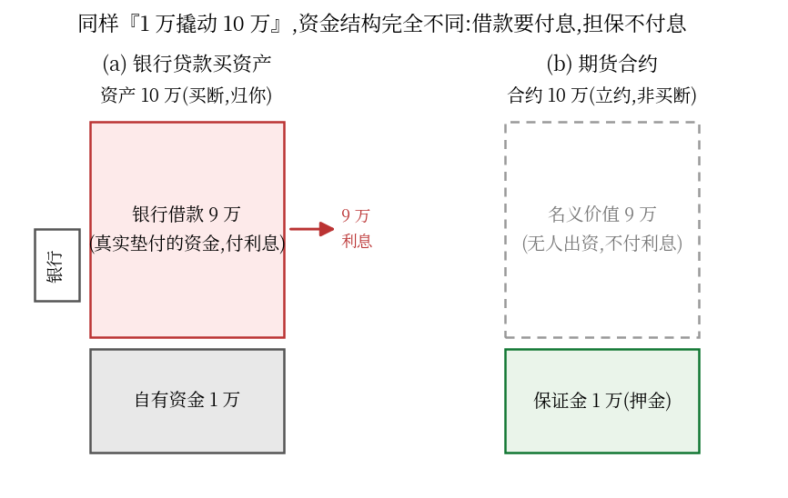
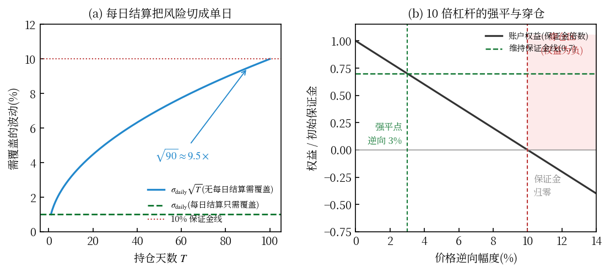
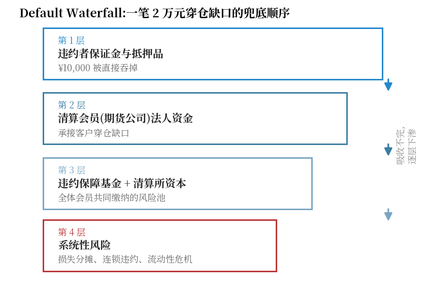
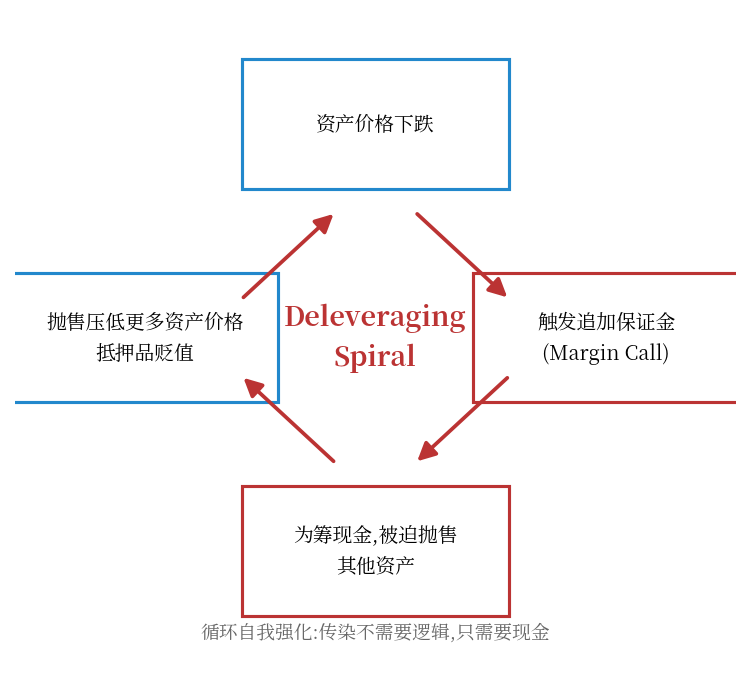
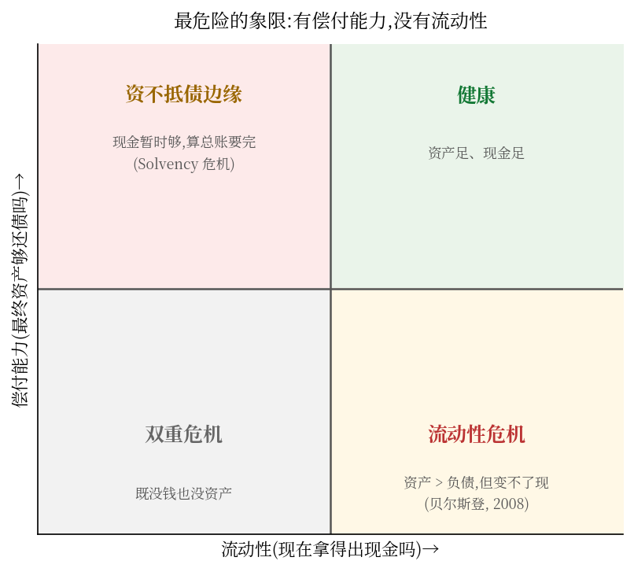

一个看似天真的问题,能难倒大多数散户,也藏着期货市场最重要的真相:

**你拿出 1 万元保证金,买入了价值 10 万元的黄金期货。那剩下的 9 万元,是谁借给你的?利息怎么算?**

答案是:**没有人借给你,你也不欠任何人这 9 万的利息。** 因为这笔"借款"从头到尾就不存在。

这篇文章从这个问题出发,一路推到金融系统最危险的角落:如果所有杠杆交易者同时爆仓,钱从哪来?系统会不会崩?读完你会明白一个反直觉的核心——

> **期货的盈亏可以在账面上完美抵消,但违约和流动性风险不会自动抵消。**

## 一、保证金不是首付,是押金

先把两种"1 万换 10 万"摆在一起,差异一眼便知:

| | 银行贷款买资产 | 期货合约 |
|---|---|---|
| 自己的钱 | 1 万 | 1 万 |
| 借来的钱 | 9 万 | **0 元** |
| 控制的资产/合约价值 | 10 万 | 10 万 |
| 是否支付贷款利息 | 是 | 通常不需要 |
| 为什么能控制 10 万 | 借钱**购买** | 缴纳担保**立约** |

区别的实质:银行贷款场景里,你真的**买下了** 10 万元的资产,缺口的 9 万是银行替你垫付的真实资金,所以你要付利息。期货场景里,你没有买任何东西——你**签了一份合约**,承诺未来按约定价格交割,保证金只是你履约能力的**押金**(collateral)。

记保证金比例为 $m$、杠杆倍数为 $L$:

$$m = \frac{\text{margin}}{\text{notional}}, \qquad L = \frac{1}{m}$$

10% 保证金 = 10 倍杠杆。杠杆不是"借了钱",而是"用小额押金撬动了大额名义敞口"——你盈亏的**计算基数**是那 10 万,但你**占用的资金**只有 1 万。这个分离有个专业名字:**名义本金(Notional Value)与实际资金占用的分离**,它是全部衍生品市场的第一性原理。

### 那保证金本身有利息吗?

分情况,而且值得较真:

- **现金保证金**:有的券商/期货公司支付利息(如 Interactive Brokers 对合格闲置余额计息),有的不计——开户前看条款
- **国债等抵押品**:在允许的市场里,抵押品本身继续产生票息收益
- **加密永续合约**:没有利息,但有多空之间定期互付的**资金费率(Funding Rate)**——那是另一种机制,别和利息混淆
- **隐含融资成本**:即使没有直接利息,市场利率也会通过"持有成本(Cost of Carry)"烙进期货价格(期货定价理论里的 $F = S e^{(r-y)T}$,远月贴水/升水的来源之一)

## 二、为什么敢给你 10 倍杠杆:波动率定价与风险切片

既然保证金是押金,那押多少是谁定的?为什么偏偏是 10%?答案是:**保证金不是拍脑袋定的,是按波动率定价的**——押金要覆盖的,是"一天的极端价格波动"。

### 2.1 保证金 ≈ k × 日波动率

看一组对照,规律一目了然:

| 品种 | 典型日波动 | 保证金比例 | 缓冲倍数 |
|---|---|---|---|
| 国债期货 | ~0.2% | ~2-3% | ~10× |
| 黄金期货 | ~1% | ~8-10% | ~10× |
| 股指期货 | ~1-1.5% | ~10-12% | ~10× |
| 原油期货 | ~2-3% | ~10-15% | ~5-7× |
| 比特币永续 | ~3-5% | ~30-50% | ~10× |

波动越大的品种保证金比例越高,而且缓冲倍数惊人地一致(约 10 倍日波动)。10 倍杠杆的底气,首先来自这个统计事实:**单日价格走出 10 个标准差,在正常市场里概率近乎为零。**

### 2.2 真正的魔法:每日结算把风险切成单日

但等等——如果合约持有 90 天,波动会累积,保证金只押 10 倍**日**波动怎么够?这正是**每日无负债结算(Mark-to-Market)**的威力。

如果没有每日结算、持有到期一次性结清,保证金必须扛住 90 天的累计波动。价格近似随机游走,波动按 $\sqrt{T}$ 累积:

$$\sigma_T = \sigma_{\text{daily}} \cdot \sqrt{T} \;\Rightarrow\; \sigma_{T=90} \approx 9.5\,\sigma_{\text{daily}}$$

黄金日波动 1% → 90 天累计 ~9.5% → 保证金得收 20-30% 才安全。而有了每日结算:每天收盘盈亏当场结清,浮亏立刻从保证金扣除,**亏损根本没有机会累积到第二天**——还没累积,就已经用现金结掉了。保证金只需要覆盖**一天**的波动加缓冲:

$$\text{no settlement: } z\,\sigma_{\text{daily}}\sqrt{T} \qquad \text{daily settlement: } z\,\sigma_{\text{daily}} + \text{buffer}$$

90 天合约,两者相差 $\sqrt{90} \approx 9.5$ 倍——**这正好解释了为什么 10% 这个数量级"恰好"够用**:不是市场慷慨,是每日结算制度把保证金需求压缩了一个 $\sqrt{T}$ 量级。

### 2.3 三道保险

1. **强平(强行平仓)不等穿仓**:权益低于维持线,系统立刻砍仓——在缺口产生**之前**切断,不追求卖在好价钱,只追求卖得出去
2. **对手方也押着保证金**:你赚的每一分钱都有对面的押金担保,系统两端都有缓冲
3. **违约瀑布**(第五节):真穿仓了,会员 → 基金 → 清算所逐层兜底

### 2.4 极限检验:125 倍杠杆为什么也能存在?

币安永续最高 125 倍,保证金 0.8%——比特币日波动 3-5%,连四分之一天都扛不住,它靠什么活?靠**比日更细的风险切片**:标记价格每秒盯市(不是每天结,是每秒结)、梯度保证金(仓位越大杠杆上限越低)、自动减仓(ADL,穿仓损失直接转嫁给对手方)。切片切到秒级,缓冲就能薄到 0.8%。

但极限检验也来了:2020 年 3·12、2021 年 5·19,行情跳空直接穿过多级缓冲——连环爆仓、保险基金被击穿、ADL 大规模触发。**缓冲再薄都有下限,切片再快也切不过"没有对手盘"的时刻。** 高杠杆的宿命:平时没事,出事时整体出事。

## 三、爆仓全景:强平、穿仓、逐仓与全仓

"爆仓"是散户口中用得最滥、也最容易用错的词。把它的层次拆开:

### 3.1 爆仓的精确定义:权益触及维持保证金线

账户权益 = 保证金 − 浮动亏损。10 倍杠杆、1 万保证金、10 万名义多头,价格逆向 $x$% 后:

$$E(x) = 10{,}000 - 100{,}000 \cdot x\%$$

初始保证金 10%(名义),维持保证金设 7%(名义)——权益跌破维持线,期货公司**强制平仓**,这就是爆仓的严格含义:

$$10{,}000 - 1000x \le 7{,}000 \;\Rightarrow\; x \ge 3\%$$

**10 倍杠杆,逆向 3% 就爆仓**——不是亏光才爆,是亏掉三成就被强制下车。爆仓价离入场价,近得超出多数新手的想象。

### 3.2 爆仓 ≠ 穿仓:亏光和倒欠是两回事

- **爆仓(强平)**:权益 ≤ 维持保证金,系统强制平仓。多数情况下你还剩回一些钱(权益从 10% 被砍到 7% 时平掉),最差亏光——**但不倒欠**
- **穿仓**:平仓没平出去(跳空、流动性枯竭、排队没排上),权益跌破零,**不仅亏光还倒欠平台**。第五节的违约瀑布,处理的就是穿仓

两者的分界线就是"强平机制有没有来得及干活"。正常波动里你只会遇到前者;跳空日、负油价日、镍逼空日,后者才现身。

### 3.3 逐仓与全仓:风险隔离的两个开关

- **逐仓(Isolated)**:每个仓位单独核算保证金,爆仓只亏这个仓位押的那部分——损失上限明确,适合单笔投机
- **全仓(Cross)**:整个账户权益作为共享保证金,浮盈仓位给浮亏仓位"输血",抗波动能力强得多——但一旦总权益触及维持线,是**整个账户被强平**,一爆全爆

同一个杠杆倍数,逐仓和全仓的爆仓价可以差数倍——这是杠杆之外,同样重要的一道风险开关。

### 3.4 为什么实际爆仓价和"理论爆仓价"总有差距

理论上 3% 就是你的强平线,实际上触发时可能已经在 3.2%、3.5%:强平单是**市价单**,要吃滑点;极端行情里深度不足,滑点可以很深;加密平台用标记价格(指数加权)而非最新成交价触发,防止插针误杀,但也意味着触发价和你的心理价位有偏差。**爆仓价是一个"区域",不是一条线。**

## 四、没人借钱,那利润从哪来?

第二个天然疑问:既然没人借我 9 万,为什么我能赚"相当于 10 万元资产"的收益?钱是谁付的?

**是对手方付的。** 期货(不考虑手续费)是严格的零和博弈:

记多空双方的总盈利为 $W_{\text{long}}$、$W_{\text{short}}$:

$$W_{\text{long}} + W_{\text{short}} = 0$$

你做多 10 万黄金期货,价格涨 5%:

$$100{,}000 \times 5\% = 5{,}000 \;\text{CNY}$$

这 5000 元不是交易所凭空造的,也不是银行垫的,而是市场上相应空头的亏损,通过**每日无负债结算(Mark-to-Market)**每天从空头账户划到你的账户。反过来价格跌 5%,你亏 5000,同样当日结清。

**每日结算**是理解期货风险的关键制度:盈亏每天兑现,而不是等到到期日一次性算总账。它的好处是风险不累积;它的冷酷是——账面浮亏立刻变成真金白银的扣款,保证金不足立刻面临**追加保证金通知(Margin Call)**,不追加就被**强制平仓**。期货的杠杆杀伤力快,根源就在这。

所以"谁给我提供了 9 万元"的完整答案是:

1. 没有人提供资金;
2. 清算体系只是**记账**:把名义敞口的每日价格变动,在多空双方的保证金账户之间搬来搬去;
3. 你的"收益权"来自合约赋予的**法律权利**,而不是来自任何一笔真实出借的资金。

这就是为什么全球衍生品的名义合约规模可以远超全世界的实际资金规模——衍生品创造的是**风险敞口**,不是资金。

## 五、输家赔不起怎么办:穿仓与违约瀑布

零和意味着总有赢家。真正的问题不是"没有赢家",而是——

> **输家可能赔不起。**

用原文那个例子推到底。你 1 万保证金,10 万多头,黄金一夜跳空暴跌 30%(极端行情,来不及强平):

| 极端行情下的资金缺口 | 金额 |
|---|---|
| 合约名义价值 | ¥100,000 |
| 价格跌幅 | −30% |
| 你应承担的亏损 | ¥30,000 |
| 你的保证金 | ¥10,000 |
| **穿仓缺口** | **¥20,000** |

你只押了 1 万,但对面的空头按合约"应得"3 万。那 2 万元的窟窿谁填?这就是**穿仓**,而金融体系处理它的机制,是一套层层兜底的**违约处置瀑布(Default Waterfall)**:

1. **第一层:违约者自己的保证金与抵押品**(1 万,直接吞掉)
2. **第二层:清算会员(期货公司/清算行)兜底**——客户穿仓先由会员法人资金承接
3. **第三层:清算所的违约保障基金(Default Fund)与自有资本**——会员们共同缴纳的风险池
4. **第四层:如果瀑布吸干仍不够**——损失分摊规则启动,系统性风险正式登场

这套瀑布不是理论装饰,它真实地被触发过:

- **2020 年 4 月,WTI 原油期货跌至 −37 美元**:史无前例的负结算价,大量多头不仅亏光保证金还倒欠钱。中行"原油宝"事件中,投资者不仅本金归零,还面临"倒欠银行"的追偿争议——最终监管介入,银行承担了部分负价差损失。这就是教科书级的穿仓 + 瀑布第二层兜底。
- **2022 年 3 月,LME 镍事件**:镍价两天暴涨约 250%,史诗级逼空让空头巨亏穿仓,LME 做了一件震动业界的事——**取消交易**(回滚数小时成交)并暂停镍交易一周。清算所的规则在极端情况下会被"修改",这本身就是系统性风险的一部分。

## 六、所有人一起崩盘:去杠杆螺旋

单个穿仓,瀑布兜得住。真正可怕的是**同时、同向、互相传染**:

价格暴跌 → 大量杠杆持仓触发追加保证金 → 他们为筹现金,被迫抛售股票、债券、黄金等一切能卖的资产 → 抛售压低这些资产价格 → 更多人的抵押品贬值、触发更多 Margin Call → 更大规模被迫抛售 → ……

这个自我强化的循环叫**去杠杆螺旋(Deleveraging Spiral)**。注意一个阴险的细节:**被迫抛售的资产可能和最初下跌的资产毫无关系**——你做多的是镍,被迫割肉的是国债。传染不需要逻辑,只需要现金。

2008 年金融危机就是它的全尺寸演出:次贷暴跌 → 结构化产品爆仓 → 机构被迫甩卖流动性资产 → 席卷一切的流动性枯竭 → 雷曼倒下。期货/衍生品不是那场危机的起点,但杠杆与保证金机制是放大器。

## 七、Solvency 与 Liquidity:金融学最重要的一组概念

理解了上面的机制,就能看懂这组概念为什么值千金:

- **Solvency(偿付能力)**:最終算总账,资产够不够还债?
- **Liquidity(流动性)**:**现在**,拿不拿得出即时支付的现金?

最危险的组合是**有偿付能力、没有流动性**——资产远大于负债,但资产变不了现,眼下到期的付款付不出。2008 年的贝尔斯登就是流动性死亡的典型:账面并非资不抵债,但市场对其抵押品失去信心、拒绝续借短期资金,48 小时内流动性蒸发,一家 85 年的老牌投行被迫贱卖。

回到本文的主线,现在可以把那个反直觉的结论完整说清了:

> **盈亏是账面记账,多空相抵,系统整体无净损失;但违约是现金事件,流动性是时点要求——账可以慢慢抵,债不能慢慢还。**

这就是"零和市场"能引发"系统性危机"的全部逻辑:零和保证的是**总量**,危机爆发在**时点**和**传导**。

## 八、三条实用结论

1. **保证金是押金,不是投资本金。** 心理账户上把它当成"可能全部归零的门票钱",杠杆仓位的第一问永远是"跌多少我会被强平",而不是"能赚多少"。
2. **杠杆放大的是敞口,不是钱。** 10 倍杠杆下,1% 的逆向波动就吃掉 10% 的保证金;跳空行情面前,止损单可能形同虚设(负油价那天,多少止损单成交在比触发价低得多的位置)。
3. **你的对家风险不只是市场。** 极端行情里,交易所改规则(取消交易)、 broker 改门槛(提高保证金比例)、流动性消失(想平仓没人接)都会发生——LME 镍事之后,"清算所会不会改规则"已经是风险管理教材里的正式章节。

一句话收束:**期货市场用"名义与资金分离"的聪明设计,让小额资金可以管理大额风险;而系统为这份聪明付出的代价,是要时刻准备接住"账面抵消不掉的违约与流动性冲击"。** 你在使用杠杆的每一刻,都在这套代价结构里游泳。

---

*参考:CME Group 清算与保证金制度文档;LME 镍事件审查报告(The Oxford-Haas Report, 2022);中行原油宝事件监管通报(2020);Brunnermeier & Pedersen (2009)《Market Liquidity and Funding Liquidity》;Gorton & Metrick (2012)关于 2008 流动性危机的研究*
