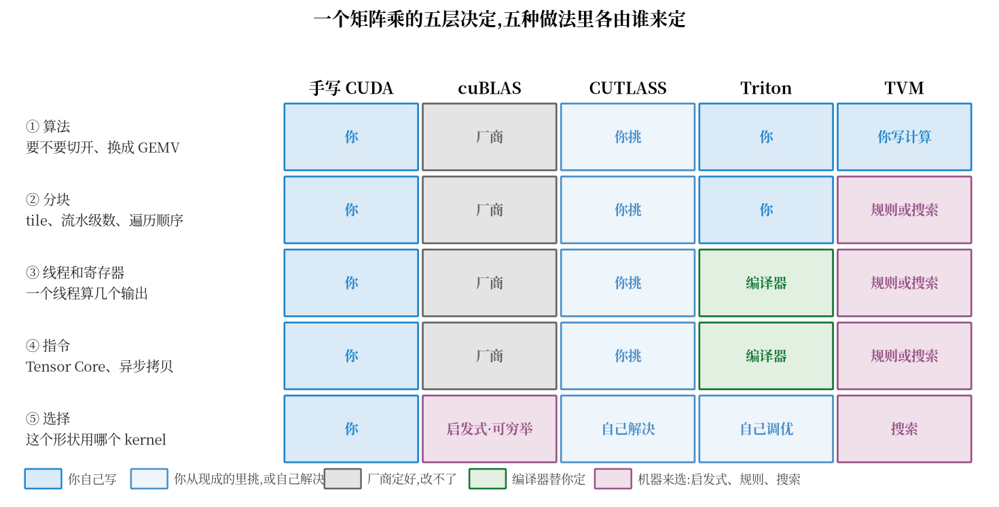

“算子库”这三个字,把四种完全不同的东西装在了一起。

矩阵乘是这个专栏的老熟人了。这次我不讲它的结构,讲的是:**同一个矩阵乘,交给不同的工具,分别能跑多快,以及它们到底是不是一类东西。**

我在三张卡上(V100、RTX 4080、RTX 4090 D),把同一个 4096×4096 的单精度矩阵乘用几种方式各做了一遍:

| 怎么做的 | V100 | RTX 4080 | RTX 4090 D |
|---|---|---|---|
| 我手写的 CUDA,第三个版本 | 9.1 TFLOPS | 17.9 TFLOPS | 25.7 TFLOPS |
| Triton,二十多行 Python | 编译不过 | 27.4 TFLOPS | 37.5 TFLOPS |
| cuBLAS | 12.6 TFLOPS | 34.3 TFLOPS | 49.1 TFLOPS |
| TVM | 没跑起来 | — | — |

我手写的第三个版本,到 cuBLAS 的七成(两张 RTX 上只有一半)。换成半精度,Triton 能和 cuBLAS 打平。TVM 我没跑起来,所以这篇里没有它的实测数字。

下面把这些数一个一个拆开。

## 一、先把词掰开:是四种东西

| 形态 | 代表 | 你给它什么 | 它给你什么 |
|---|---|---|---|
| 封闭的库 | cuBLAS、cuDNN | 一次函数调用 | 现成的 kernel,外加“帮你选一个” |
| 开源的零件 | CUTLASS | 一组模板参数 | 你自己编译出来的 kernel |
| 编译器 | TVM | “算什么” | 整个模型编译之后的代码 |
| 块级语言 | Triton、TileLang、TIRx | 以块为单位的计算 | 一个 kernel |

手写 CUDA 算第零种:什么都自己来。

它们的官方说法各不相同:

- cuBLAS:BLAS 在 CUDA 运行时之上的一个实现。
- CUTLASS:一组抽象,用来在 CUDA 里、在各个层级上实现高性能的矩阵乘。它是一堆头文件模板,用的时候不需要单独构建。
- Triton(论文原话):一种以 tile(块)为核心的语言和编译器。
- TVM:一个深度学习编译器,让人在任何硬件上都能用上高性能的机器学习。

注意 CUTLASS 和 cuBLAS 的区别:cuBLAS 是**做好的菜**,CUTLASS 是**切好的食材加菜谱**。

## 二、实测一:手写 CUDA 离 cuBLAS 有多远

我按这个专栏前几篇讲过的思路,写了三个版本:

1. **朴素**:一个线程算一个输出,直接读显存
2. **分块**:32×32 的块搬进 Shared Memory,一个线程还是只算一个输出
3. **分块加寄存器分块**:64×64 的块,一个线程算 4×4 个输出

上限是按每张卡自己报的参数算的:SM 数 × 每个 SM 的 FP32 核数 × 2 × 时钟。时钟我用的是**跑矩阵乘时实测的**,不是标称的最高时钟:

| 卡 | SM 数 | 标称最高时钟 | 跑单精度矩阵乘时的时钟 | 功率 |
|---|---|---|---|---|
| V100 | 80 | 1.38 GHz | 1.38 GHz | 224 W(上限 250) |
| RTX 4080 | 76 | 2.50 GHz | 2.37 GHz | 320 W(上限 320) |
| RTX 4090 D | 114 | 2.52 GHz | 2.30 GHz | 425 W(上限 425) |

两张 RTX 都顶到了功率上限,时钟降了下来。按实测时钟,上限分别是 14.1、46.1、67.0 TFLOPS。

| | V100 | RTX 4080 | RTX 4090 D |
|---|---|---|---|
| 朴素 | 1.9(14%) | 3.0(7%) | 4.6(7%) |
| 分块 | 3.0(21%) | 2.7(6%) | 4.1(6%) |
| 分块加寄存器分块 | 9.1(65%) | 17.9(39%) | 25.7(38%) |
| Triton(真 FP32) | 编译不过 | 27.4(59%) | 37.5(56%) |
| cuBLAS | 12.6(89%) | 34.3(74%) | 49.1(73%) |
| 手写最好的版本,是 cuBLAS 的 | 73% | 52% | 52% |
| Triton,是 cuBLAS 的 | — | 80% | 76% |

(单位 TFLOPS,括号里是占上限的比例。V100 那一列 Triton 写“编译不过”,原因在第四节。)

四个读法。

**第一,朴素写法离 cuBLAS 差 6.6 到 11 倍。** V100 上是 6.6 倍,4080 上 11.3 倍,4090 D 上 10.7 倍。同一个朴素 kernel,在 4080 上比在 V100 上快 1.6 倍,在 4090 D 上快 2.4 倍;而 cuBLAS 分别快了 2.7 倍和 3.9 倍。越新的卡,越依赖优化——至少这三张卡是这样。

**第二,分块在两张 RTX 上反而变慢了。** 都慢了一成左右。第 3 篇讲过,分块是为了少读显存。但这个版本每做一次乘加,要从 Shared Memory 读两个数,瓶颈从显存带宽挪到了 Shared Memory 上。而且累加器是一条串行链:每一步都依赖上一步的结果——正是计算流水线那篇讲的,没有独立指令可发,只能靠别的 warp 来填。我的判断是这两条加在一起,把分块的收益吃掉了。

**第三,寄存器分块一步涨了 3 到 6 倍。** 每个线程算 4×4:读 8 个数,做 16 次乘加,每做一次乘加只读半个数了。而且 16 个累加器互相独立,串行链变成了 16 条。

**第四,就算这样,还差 cuBLAS 三到五成。** 差在哪?后面的几节会回答。

## 三、实测二:半精度上,Triton 和 cuBLAS 打平

换成半精度,就能用上 Tensor Core 了。Triton 的矩阵乘我用的是它官方教程里那个 kernel,二十多行;然后试了 16 组块大小和流水级数的配置,取最好的。

| 矩阵大小 | 4080:cuBLAS | 4080:Triton | Triton 是 cuBLAS 的 | 4090 D:cuBLAS | 4090 D:Triton | Triton 是 cuBLAS 的 |
|---|---|---|---|---|---|---|
| 512 | 44.7 | 23.1 | 0.52 倍 | 20.7 | 12.5 | 0.60 倍 |
| 1024 | 77.7 | 68.5 | 0.88 倍 | 89.2 | 87.4 | 0.98 倍 |
| 2048 | 83.5 | 88.5 | 1.06 倍 | 132.7 | 133.2 | 1.00 倍 |
| 4096 | 92.5 | 99.9 | 1.08 倍 | 140.6 | 151.8 | 1.08 倍 |
| 8192 | 101.0 | 103.7 | 1.03 倍 | 142.6 | 152.6 | 1.07 倍 |

(单位 TFLOPS。这两张 RTX 没有官方的 Tensor 峰值标称,所以只给绝对值。V100 上 cuBLAS 的半精度是 84 TFLOPS。)

两张 RTX 的规律一样:小矩阵 cuBLAS 明显更快,大矩阵 Triton 略胜。

但先别急着下结论。我让 cuBLASLt 把候选算法自己跑一遍再选(“穷举调优”):

| 矩阵大小 | 4080:cuBLAS 默认 → 穷举后 | 4090 D:cuBLAS 默认 → 穷举后 |
|---|---|---|
| 4096 | 92.5 → 100.1(涨 8%) | 140.6 → 150.3(涨 6%) |
| 8192 | 101.0 → 101.5(没怎么涨) | 142.6 → 151.2(涨 4%) |

**也就是说,Triton 在 4096 上那 8% 的领先,绝大部分来自“cuBLAS 默认没选到它自己最好的那个”。** 让 cuBLAS 自己穷举,这个大小上 4080 是 100.1 对 100.2,4090 D 是 150.3 对 151.8。两边打平。

再看 Triton 自己。同样是 4096 的矩阵,16 组配置的成绩:

| | RTX 4080 | RTX 4090 D |
|---|---|---|
| 最好 | 100.2 | 151.9 |
| 中位数 | 88.9 | 137.4 |
| 最差 | 32.3 | 35.1 |
| 因 Shared Memory 不够而失败 | 3 组 | 3 组 |
| cuBLAS 默认 | 92.5 | 140.6 |

最好和最差差 3 到 4 倍。中位数不如 cuBLAS 默认。

**随手挑一组配置,大概率赢不了;挑对了才赢。**

顺便说,不同大小的矩阵,最好的配置也不一样:512 到 2048 最好是 64 宽的块,4096 和 8192 最好是 128×128。没有一组配置通吃。

## 四、跑不起来的两种

**Triton 在 V100 上编译不过。** 我用的 Triton 3.3.1,在 V100 上编译 `tl.dot`,LLVM 直接报错("Unsupported rounding mode for conversion")。换到两张 RTX 上用 Triton 3.6.0 才跑起来。

**TVM 我没跑起来。** 在 V100 那台机器上,pip 装的 TVM 0.27.0 能通过编译这一步,但一运行就报错:这个构建没有链接 CUDA 运行时,需要从源码开 `USE_CUDA` 重新编译。我没有做这件事。

所以这篇里 TVM 的部分没有实测,只有它论文里的说法。第九节单独讲。

## 五、cuBLAS 里面到底有什么:kernel 名字告诉我的

cuBLAS 是闭源的,看不到代码。但跑的时候,它用的 kernel 名字是能抓到的。我用 PyTorch 的 profiler 抓了一圈:

| 矩阵形状 | 卡 | 精度 | kernel 名字(截短) | 名字里的 tile |
|---|---|---|---|---|
| 512×512×512 | 4080 | 半精度 | `ampere_fp16_s16816gemm_fp16_64x64_ldg8_f2f_stages_64x5_nn` | 64×64 |
| 512×512×512 | 4090 D | 半精度 | `cutlass::Kernel2<cutlass_80_wmma_tensorop_f16_s161616gemm_f16_32x32_64x2_nn_align8>` | 32×32 |
| 512×512×512 | V100 | 单精度 | `volta_sgemm_64x32_sliced1x4_nn` | 64×32 |
| 8192×8192×8192 | V100 | 半精度 | `cutlass::Kernel<cutlass_70_tensorop_f16_s884gemm_relu_f16_128x128_nn_align8>` | 128×128 |
| 8192×8192×8192 | 4080 | 半精度 | `ampere_fp16_s16816gemm_fp16_256x128_ldg8_f2f_stages_32x3_nn` | 256×128 |
| 8192×8192×8192 | 4090 D | 单精度 | `cutlass::Kernel2<cutlass_80_simt_sgemm_256x128_8x4_nn_align1>` | 256×128 |
| 8×4096×4096 | V100 | 半精度 | `cutlass::Kernel<cutlass_70_wmma_tensorop_f16_s161616gemm_f16_16x16_64x2_nn_align8>` | 16×16 |
| 1×4096×4096 | 三张卡都是 | — | `internal::gemvx::kernel<...>` | 不是矩阵乘 |

(名字做了截短;tile 大小是按 cuBLAS 和 CUTLASS 的命名惯例读出来的。)

五件事。

**第一,一次 `matmul` 的背后是一大堆 kernel。** 矩阵从 512 变到 8192,tile 从 32×32、64×64 换到 128×128、256×128。没有哪个 kernel 是万能的。

**第二,有的 kernel 名字里就写着 CUTLASS。** 表里有四行的符号名是 `cutlass::Kernel<...>`。**cuBLAS 的一部分 kernel,就是 CUTLASS 的模板实例化出来的。** 另一些(比如 `ampere_fp16_s16816gemm`)是 cuBLAS 自己的命名。

**第三,形状很“瘦”的时候,用的根本不是矩阵乘。** 最后一行,M=1(就是 decode 的每一步),cuBLAS 调的是 GEMV(矩阵乘向量)。V100 上单精度这一个 0.39 TFLOPS,读 67 MB 的矩阵用了 86 微秒,折合 0.78 TB/s——已经接近这张卡的显存带宽了。它不是算得慢,是没东西可算:每读一个字节只做两次运算。

**第四,瘦的矩阵会切开。** M=8 的时候,kernel 列表里出现了 `splitKreduce_kernel`:把 K 方向切成几段分头算,最后再加起来。因为 M 太小,不切的话大部分 SM 没活干。

**第五,启发式也有选得差的时候。** 看表的前两行:同样是 512 的半精度矩阵乘,4080 选了一个 64×64 的 kernel,4090 D 选了一个 32×32 的。结果就是第三节表里那个反常的数字——小一号的 4080 跑出 44.7 TFLOPS,4090 D 只有 20.7。

再看 cuBLASLt 公开的接口,它能看出这个库的结构:

- `cublasLtMatmulAlgoGetHeuristic`:输入矩阵的形状和类型,返回一组候选算法,**按估计的耗时从短到长排好**
- 每个算法有一串可以调的参数:tile 选哪个(`TILE_ID`)、流水几级(`STAGES_ID`)、K 切几段(`SPLITK_NUM`)、线程块的遍历顺序要不要打乱(`CTA_SWIZZLING`)……

所以“算子库”的真实结构是:**一大堆写好的 kernel,加一个替你选 kernel 的机制。** 前一半是手艺,后一半也是。

## 六、一个矩阵乘,要做多少个决定

把上面所有线索收拢,一个矩阵乘要跑得快,要做五层决定:

| 层 | 决定什么 | 实测里的证据 |
|---|---|---|
| ① 算法 | 纯矩阵乘,还是切开、换成 GEMV | M=8 时 cuBLAS 用了 split-K |
| ② 分块 | tile 多大、流水几级、块按什么顺序遍历 | 512 用 64×64 或 32×32,8192 用 128×128、256×128 |
| ③ 线程和寄存器 | 一个线程算几个输出,warp 怎么分工 | 寄存器分块让手写版涨了 3 到 6 倍 |
| ④ 指令 | Tensor Core、异步拷贝、TMA | 4080 上 cuBLAS 半精度 101,单精度 34.7 |
| ⑤ 选择 | 这个形状,用哪个 kernel、哪组参数 | Triton 16 组配置差 3 到 4 倍;cuBLAS 穷举后最多涨 8% |

这张表是我按各家的公开接口和文档整理的,不是谁官方画的。五种做法,每层由谁来定:

| | ① 算法 | ② 分块 | ③ 线程和寄存器 | ④ 指令 | ⑤ 选择 |
|---|---|---|---|---|---|
| 手写 CUDA | 你 | 你 | 你 | 你 | 你 |
| cuBLAS | 厂商 | 厂商 | 厂商 | 厂商 | 厂商的启发式,可以穷举 |
| CUTLASS | 你挑 | 你挑 | 厂商做好零件,你挑 | 厂商做好零件,你挑 | 自己解决 |
| Triton | 你 | 你 | 编译器 | 编译器 | 自己调优 |
| TVM | 你写计算 | 规则或搜索 | 规则或搜索 | 规则或搜索 | 搜索 |

所以它们的差别,不是“谁的 kernel 更快”,是**这五层决定,分别交给谁。**

手写 CUDA 把五层都留给你,所以第二节里我写的版本只到 cuBLAS 的七成——③ 和④ 这两层我只做了最粗的版本,连 Tensor Core 都没用上。

cuBLAS 把五层都拿走了。你换来的是不用操心,付出的是改不了。

Triton 把 ③ 和④ 收走了。你不用再管 warp 怎么分工、数据怎么摆进寄存器,编译器替你做。但它要求你自己管 ② 和⑤——这就是第三节“16 组配置差 3 到 4 倍”的来历。

## 七、别人的数据怎么说

上面都是我自己量的。这一节是能查到出处的、别人公布的结果:

| 来源 | 平台 | 比的是什么 | 结果 |
|---|---|---|---|
| Triton 官方教程贴的运行结果 | 没注明 | 教程里的 kernel 对 cuBLAS,半精度 | 4096³:218 对 224(97%);2048³:184 对 221(84%) |
| Triton 的 issue #2339(2023 年 9 月) | H100 | 带 TMA 的 Triton 矩阵乘对 cuBLAS | 2048³:295 对 515,慢了四成多;三个月后修复 |
| Tawa 论文(2025) | H100 | 编译器自动生成的 kernel 对 cuBLAS | 最多快 1.1 倍;追平手写的 FlashAttention-3 |
| FlashAttention-3 论文(2024) | H100 | 手写的注意力 | 利用率从 35% 提到 75% |
| MetaSchedule 论文(2022) | — | TVM 的自动调优,整个模型 | 端到端快 48% |
| CUDA-L2 论文(2025) | — | 强化学习搜 1000 组配置 | 比 cuBLASLt 穷举调优后还快 11.4% |
| DeepGEMM 的说明 | H800 等 | 手写的 FP8 库 | “追平或超过专家调优的库” |

和我的实测对得上的,有三条:

**大矩阵上 Triton 约等于 cuBLAS。** 教程自己的数字是 97%;我挑了配置之后是 103% 到 108%。

**“约等于”是有条件的。** 教程在 2048 这个大小上只有 84%;我这边小矩阵 Triton 也只有 cuBLAS 的一半到九成。

**“约等于”还挑硬件、挑版本。** 2023 年 9 月的 Triton 在 H100 上慢四成多;我这边 3.3.1 在 V100 上直接编不过。

还有一条,是 PyTorch 源码里一段注释说的。PyTorch 的编译器 Inductor 有个自动调优开关,矩阵乘的候选后端默认是 `ATEN,TRITON,CPP`(ATEN 就是 cuBLAS),还可以加上 CUTLASS 等。它关于 NVIDIA 启发式库的那段注释,大意是:启发式排第一的,大多确实在前五;但在 M 为 512 左右的 BF16 矩阵上,最好的配置排得很靠后,只取前五个会损失最多 11%。

连 NVIDIA 自己的启发式,都会在某些形状上排偏。我这边也看到了一次:4090 D 上 512 的矩阵。第五层的难,就在这里。

## 八、最难的是第五层

NVIDIA 自己写过一篇博客,讲选择这一层有多贵。

Llama 3 405B 用到的全部矩阵乘形状,在 H100 上把候选配置穷举一遍:**700 多分钟**。换成启发式——先预测哪 16 个配置最可能快,只调这 16 个——**150 分钟左右,达到了峰值的 96%**。

这篇博客介绍的工具叫 nvMatmulHeuristics,博客原话说它是“cuBLAS 启发式的核心部分”。也就是说,cuBLAS 里“帮你选”的那一半,现在被单独拿出来了,给 CUTLASS 的用户用。

PyTorch 的做法更直接:不猜,实测。Inductor 的自动调优就是把候选后端的 kernel 一个个跑一遍,选最快的。它的源码里,搜索空间有两档,注释写的是“在编译时间开销和性能之间取平衡”和“性能最大化”。

再往前一步,是让机器来搜。有一个叫 CUDA-L2 的工作:用大模型加强化学习,自动改半精度矩阵乘的 CUDA 代码,搜 1000 组配置。还有一个叫 Kevin 的,用强化学习训练模型来写 CUDA kernel,平均加速从基座模型的 0.53 倍提到 1.10 倍(相对 PyTorch 默认实现)。

所以现状是这样的:

- kernel 写得好不好,重要
- 选得准不准,同样重要
- 而“选”这件事,已经从查表,走到了启发式,走到了实测,走到了搜索

## 九、TVM 在这张图上的位置

先说我做不到的:我没有 TVM 的实测数字,原因在第四节。所以下面关于 TVM 的性能,只有它论文里的说法。

- 2018 年的 TVM 论文:在低功耗 CPU、移动 GPU、服务器 GPU 上,“和最先进的手工调优的库有竞争力”
- 2022 年的 MetaSchedule:把搜索空间做成一种概率程序语言,端到端的深度学习负载快 48%
- 2023 年的 TensorIR:“和最先进的手工优化系统有竞争力”

“有竞争力”是个很诚实的措辞。关于单个算子,它不是“更快”。

回到第六节那张表,TVM 走的是另一条路:**②③④ 三层,不交给人,也不交给固定的编译器规则,而是交给搜索。** 前一篇讲 TVM 的文章说过它的三代做法:人写模板机器填参数(2018)、机器自己找骨架(2020)、按规则来(DLight)。它的本钱是自动搜索。

这条路的回报在哪?我的看法是这样:

**纯粹的矩阵乘上,论文自己的措辞是追平。** 而矩阵乘这一层,cuBLAS 已经调了十几年。

**它的回报在别处:**

- **融合算子。** 模型里的层不是单独的矩阵乘,是矩阵乘加归一化加激活。手工库一个个调,编译器可以把它们当成一个来编译
- **新硬件。** 第四节的 Triton 在 V100 上编不过,是个真实的例子:每种工具覆盖的硬件都不一样。编译器的卖点是“新硬件写一个后端,前面的算子都能用”
- **整个网络的调度。** 不只看单个算子,看整张图

还有一个旁证值得说。TileLang 是一个块级语言,它的编译器基础设施就建在 TVM 之上。但它走的是 Triton 那条路:论文的说法是“把调度空间(线程绑定、布局、tensorize、流水线)和数据流分开”。也就是说,用 TVM 的基础设施,做出来了和 Triton 同一个形态的东西。

另一个方向相反的例子是 DeepGEMM。它的说明里写:借鉴了 CUTLASS 和 CuTe 的一些概念,但“不重度依赖它们的模板或代数”,只有“数量有限的核心 kernel 函数”,运行时编译。它不靠编译器,也不靠模板,靠的是少量手写的 kernel。

这两个例子说明一件事:**工具的形态在收敛,又在分工。** 想省事,往 Triton 那头走;要压榨到极限,往手写那头走。FlashAttention-3 是后一种:论文说 FlashAttention-2 在 H100 上只跑出了 35% 的利用率,他们用 Tensor Core 和 TMA 的异步能力手工重写,FP16 做到了 75%。

而 Tawa 那篇论文说明,编译器也不是只能在后头追:它自动生成的代码在 H100 上追平了手写的 FlashAttention-3。

## 十、什么时候用哪个

| 场景 | 用什么 | 理由 |
|---|---|---|
| 标准的矩阵乘、卷积,形状正常 | cuBLAS、cuDNN | 第二、三节的实测:手写的最好版本只到它的 52% 到 73% |
| 形状固定,而且反复出现 | cuBLASLt 穷举调优 | 两张 RTX 上 4096 这个大小还能再赚 6% 到 8% |
| 半精度、FP8、分组矩阵乘、要接一段自定义的收尾计算 | CUTLASS | cuBLAS 自己的一部分 kernel 就是它;能改 |
| 注意力这类融合算子,新算子 | Triton,或者 TileLang、TIRx | 二十多行和 cuBLAS 打平;能表达新东西 |
| 要跑在多种硬件上,或者端侧 | TVM | 一个后端,所有算子受益 |
| 要榨到最后一点性能,而且有时间 | 手写 CUDA,加上搜索 | FlashAttention-3 从 35% 到 75%;CUDA-L2 比穷举再快 11% |

## 十一、总结

四条带走:

**1. “算子库”是四种东西。** 封闭的库(cuBLAS)、开源的零件(CUTLASS)、编译器(TVM)、块级语言(Triton)。它们不是比谁更快,是比“决定交给谁”。

**2. 手写离 cuBLAS 差三到五成,差的不是力气,是层数。** 我写了三个版本,最好的那个在 V100 上是 cuBLAS 的 73%,在两张 RTX 上都是 52%。越新的卡,越依赖优化——至少这三张卡是这样。

**3. Triton 和 cuBLAS 打平了,但“打平”是有条件的。** 大矩阵、挑对配置、硬件在支持范围内。小矩阵 cuBLAS 明显更快;Triton 自己的 16 组配置差 3 到 4 倍,中位数还不如 cuBLAS 默认。cuBLAS 穷举之后,领先就没了。

**4. 最难的是“选”。** 一个矩阵乘要做五层决定,前四层各家的做法在互相靠近,第五层——这个形状用哪个 kernel——还是查表、启发式、实测、搜索几种办法并存的地方。

打个比方。cuBLAS 是出租车:上车就走,走哪条路司机定。CUTLASS 是 4S 店的零件:发动机、变速箱都给你备好了,车自己装。Triton 是自动挡:路线你定,换挡交给车。TVM 是导航加辅助驾驶:你说目的地,它来规划。

至于去哪个目的地,得你自己定。用哪种工具,这件事还没有哪种工具能替你。

如果这个系列对你有用,点个赞或关注专栏,更新会持续。

---

*参考与数据来源——

实测:全部数字为 2026-11-24 的单次测量,取多次迭代的最快值;V100 上同时有其他常驻进程,数字有百分之几的波动。硬件与软件:Tesla V100-PCIE-32GB(sm_70,CUDA 12.9,torch 2.7.1+cu118,triton 3.3.1)、GeForce RTX 4080(76 个 SM,CUDA 13.0,torch 2.11.0+cu130,triton 3.6.0)、GeForce RTX 4090 D(114 个 SM,CUDA 12.9,torch 2.10.0+cu128,triton 3.6.0)。时钟和功率是跑 8192 的矩阵乘时用 nvidia-smi 采样的中位数。手写 kernel 的源码即正文描述的三个版本;Triton 使用其官方教程中的矩阵乘 kernel;cuBLAS 通过 torch.matmul 调用,kernel 名字取自 torch.profiler;穷举调优使用 torch.cuda.tunable。V100 的官方标称(15.7 TFLOPS FP32、125 TFLOPS Tensor Core)见 NVIDIA Tesla V100 产品页与数据表。

别人的数据:Triton 官方教程 "Matrix Multiplication" 页面及其贴出的运行结果;triton-lang/triton issue #2339;PyTorch 源码 torch/_inductor/config.py(main 分支,2026-11-24 抓取);NVIDIA 开发者博客 "Improving GEMM Kernel Auto-Tuning Efficiency on NVIDIA GPUs with Heuristics and CUTLASS 4.2";DeepGEMM、TileLang 的 GitHub README。

文献:Tillet, Kung, Cox, "Triton: An Intermediate Language and Compiler for Tiled Neural Network Computations"(MAPL 2019, DOI 10.1145/3315508.3329973);Chen et al., TVM: An Automated End-to-End Optimizing Compiler for Deep Learning(OSDI 2018,arXiv:1802.04799);Shao et al., Tensor Program Optimization with Probabilistic Programs(arXiv:2205.13603);Zheng et al., Ansor(OSDI 2020,arXiv:2006.06762);Feng et al., TensorIR(ASPLOS 2023,arXiv:2207.04296);Chen et al., Tawa: Automatic Warp Specialization for Modern GPUs with Asynchronous References(arXiv:2510.14719);Su et al., CUDA-L2(arXiv:2512.02551);Baronio et al., Kevin: Multi-Turn RL for Generating CUDA Kernels(arXiv:2507.11948);Wang et al., TileLang(arXiv:2504.17577);Shah et al., FlashAttention-3(arXiv:2407.08608)。

其他文档:NVIDIA cuBLAS 文档(cuBLASLt 启发式接口与算法属性);NVIDIA CUTLASS README;Apache TVM 官方文档。

TVM 部分不含实测。*
