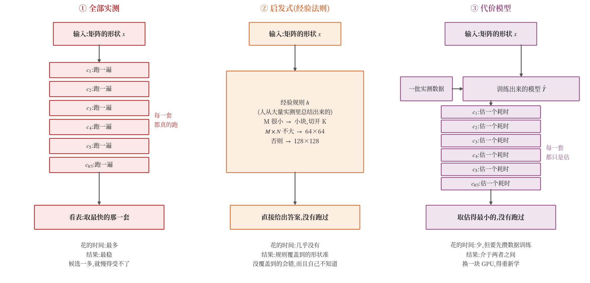
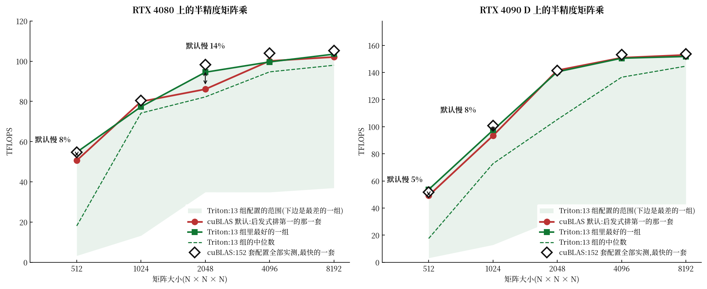

写模型的时候,几乎每个矩阵乘最后都会落到同一个问题:这行 `matmul`,底下是谁在算？

默认答案是 cuBLAS。但打开任何一篇性能讨论,你会看到 CUTLASS、Triton、TVM、TileLang……有人说编译器已经追平手工库,有人说 cuBLAS 永远打不过。

它们看着是竞品,其实是五十年里为了解决不同的问题,先后长出来的几样东西。

这篇不比谁的数字大,做三件事。先把账算清楚:一个矩阵乘快不快,背后是五笔账;这几种东西的区别,在于五笔账交给谁来算。再讲来历:每一样是哪一年、被什么问题逼出来的,为什么长成这个样子。最后,你该在什么时候用哪个。

## 一、"算子库"是四种不同的东西

它们经常被放在一起比,但根本不是一类:

| 形态 | 代表 | 你给它什么 | 它给你什么 |
|---|---|---|---|
| 封闭的库 | cuBLAS、cuDNN | 一次函数调用 | 现成的 kernel,外加"帮你选一个" |
| 开源的零件 | CUTLASS | 一组模板参数 | 你自己编译出来的 kernel |
| 块级语言 | Triton、TileLang、TIRx | 以块为单位的计算 | 一个 kernel |
| 编译器 | TVM | "算什么" | 整个模型编译之后的代码 |

手写 CUDA 算第零种,什么都自己来。

四种形态,回答的是四个不同的问题。

封闭的库回答:标准的运算,怎么最快拿到。

开源的零件回答:标准运算后面,要接上我自己的东西,怎么办。

块级语言回答:我要写一个新算子,又不想碰线程。

编译器回答:同一个模型,怎么跑上十几种硬件。

一句话记住它们的关系:cuBLAS 是**做好的菜**,CUTLASS 是**切好的食材加菜谱**,Triton 是**自动挡**,TVM 是**导航加辅助驾驶**。手写 CUDA 是手动挡。

后面每一种都按同一个顺序讲:从哪来,为什么长成这样,好在哪,差在哪,用在哪,什么时候用。

## 二、先看时间线

| 年份 | 发生了什么 | 解决的是什么 |
|---|---|---|
| 1973 / 1979 | BLAS:先是一封倡议,六年后正式发表 | 定一组标准接口,换机器不重写代码 |
| 1988 / 1990 | Level 2、Level 3;矩阵乘(GEMM)在 Level 3 | 在多级存储的机器上,把读进来的数据用足 |
| 1998 | ATLAS;FFTW 的论文 | 参数让机器自己测;选方案,估一下还是量一下 |
| 2002 | GotoBLAS | 手写汇编的微内核,外面套分层分块 |
| 2007 | CUDA 1.0,自带 CUBLAS 和 CUFFT | 不用再把计算伪装成图形接口 |
| 2013 | Halide | 算法和调度分开 |
| 2014 | cuDNN | 卷积这些深度学习算子 |
| 2016 | TVM 的第一个提交 | 一份模型,跑多种硬件 |
| 2017 | CUTLASS;同年 Volta 带来第一代 Tensor Core | 把矩阵乘拆成零件,开放出来 |
| 2019 | cuBLASLt;Triton 的论文 | 能融合、能选算法;以块为单位写 kernel |
| 2021 | Triton 开源 | |
| 2022 | FlashAttention | 注意力靠不了库,手写 |
| 2023 | PyTorch 2.0:编译器 Inductor 用 Triton 生成 GPU kernel | |
| 2025 | CUTLASS 4.0,带 Python 版 CuTeDSL;NVIDIA 开放 nvMatmulHeuristics | |

这张表里有两条线。

一条是**库**:1979 年定下接口,厂商往里填 kernel,一直填到今天的 cuBLAS。

另一条是**编译器**:ATLAS 让机器自己测参数,Halide 把算法和调度分开,TVM 把这套办法带进深度学习,Triton 干脆让人只写到"块"这一级,剩下的交给编译器。

两条线在 2017 年碰头。CUTLASS 把库里的零件拆开,开放给了写 kernel、写编译器的这一边。

## 三、先算账:一个矩阵乘要做五个决定

要判断一种工具好不好,先得知道矩阵乘的"好"是由什么决定的。

设 $C = A \times B$:A 是 M 行 K 列,B 是 K 行 N 列,C 是 M 行 N 列。下面所有的账,只用得着 M、N、K 三个数,再加上块的大小。

一个矩阵乘要做五个决定。一个决定,就是一笔账。

### 第一层,算法:活够不够分

每个输出要 K 次乘加,一共 M×N 个输出。乘一次加一次算两个浮点运算,总量是:

$$\text{FLOPs} = 2MNK$$

4096 见方的半精度矩阵乘,是 1374 亿次运算。4090 D 上用 cuBLAS 跑,149 TFLOPS,不到 1 毫秒。

这些活怎么分给 GPU？把输出切成块,一块交给一组线程。块取 128×128,块的个数是:

$$\#\text{blocks} = \lceil M/128 \rceil \times \lceil N/128 \rceil$$

4096 见方的时候是 32×32 = 1024 块。一张 4090 D 有 114 个 SM,谁都有活干。

但推理的 decode 阶段,矩阵是扁的。同时处理 8 个请求,过一个 4096×4096 的线性层:M = 8,N = K = 4096。块的个数是 1×32 = 32。

32 块,114 个 SM。不到三成的 SM 有活干。活不够分,算法再省也没有意义。

办法是把 K 方向也切开,分头算,最后把几份结果加起来。这叫 split-K。切成 s 段,块的个数就乘以 s:

$$\#\text{blocks} = \lceil M/b_m \rceil \times \lceil N/b_n \rceil \times s$$

4096 切成 4 段,32 块变成 128 块,铺满了。代价是多出一批加法,它占原本运算量的比例是:

$$\frac{MN\,(s-1)}{2MNK} = \frac{s-1}{2K}$$

K = 4096、s = 4 的时候是 0.04%,可以忽略。实测里,cuBLAS 给 8 行的单精度矩阵挑的块是 128×32 的窄条,再加 split-K,两样都用上了。

再扁一点,只有一行呢？M = 1 的时候,这已经不是计算问题,而是把权重整个读一遍。每读一个字节,能做多少次运算:

$$\text{AI} = \frac{2NK}{4NK} = 0.5\ \text{FLOP/Byte}$$

4 是单精度每个数占的字节数。第 8 篇讲过屋顶线:这个比值低于拐点,时间就由带宽决定,和算力没关系:

$$T \ge \frac{4NK}{BW} = \frac{67.1\ \text{MB}}{716.8\ \text{GB/s}} \approx 94\ \mu\text{s}$$

4080 的显存带宽是 716.8 GB/s,4096×4096 的单精度权重是 67.1 MB。实测 103 微秒,差的那一点是没有跑满带宽。算力用掉了多少？0.5 乘以带宽,是 0.36 TFLOPS,不到单精度峰值的 1%。

这笔账的结论很硬:**只有一行的时候,换哪个 kernel 都快不了。** 想快只有两条路:少读(把权重压成 8 位),或者多算几行(把多个请求拼成一批)。

数学上倒是有更省的乘法。1969 年的 Strassen 算法,把一层递归的运算量降到原来的 7/8,递归到底是 $n^{2.807}$。2016 年的一篇 SC 论文证明,它其实能塞进高性能库,大矩阵上更快,代价是数值稳定性差一些。

但那是 CPU 上的结果。它省下的是乘加,多出来的是一批只搬数据、几乎不算数的矩阵加减。GPU 上矩阵乘不缺算力,缺的是搬运。所以这一层在 GPU 上不换算法,只解决上面那笔账。

### 第二层,分块:读一次,能用多久

数据从显存搬进芯片,比算一次慢得多(第 3 篇)。所以关键是复用:一个数搬进来,能用多少次。

先看整个问题的上限。三个矩阵一共有 MK + KN + MN 个数,要做 2MNK 次运算。平均每个数能用多少次:

$$\frac{2MNK}{MK + KN + MN}$$

4096 见方的时候是 2730。每个数用足了,就接近算力的上限。

但芯片手边放不下整个矩阵,只能放下一小块。一个 $b_m \times b_n$ 的块,沿 K 方向每走 $b_k$ 这么长,要读入 $b_m b_k$ 个 A 和 $b_k b_n$ 个 B,做 $b_m b_n b_k$ 次乘加。每读一个数,能做多少次运算:

$$\frac{2\,b_m b_n b_k}{b_k\,(b_m + b_n)} = \frac{2\,b_m b_n}{b_m + b_n}$$

块是 1×1(朴素写法),这个数是 1:读一个,用一次。32×32 的块是 32。128×128 的块是 128。

块越大,一个数用得越久。可上一层的公式说了,块越大,块越少。而且块放在 Shared Memory 里,一个 SM 上只有几十到两百多 KB,还得给流水线留出预取的位置。

所以这一层的账,是在两头之间选:**块多大,K 方向一次走多长,流水线留几级。**

这笔账不是新账。1990 年提出 Level 3 BLAS 的那篇论文,摘要里写的目标就是:在"带多级存储的机器"上又快又可移植。矩阵乘进了 Level 3,名字叫 GEMM。

实测的朴素写法在 4080 上是 3.3 TFLOPS。分成 32×32 的块之后是 2.7,没有变快。因为显存是少读了,可每次乘加仍然要读两个数,只不过改从共享内存里读。这笔账要到下一层才还。

### 第三层,线程和寄存器:一个线程管几个输出

块搬进 Shared Memory 之后,每个线程从里面取数。一个线程只算一个输出,每做一次乘加,要读两个数。

让它管 $t \times t$ 个输出:读 t 个 A、t 个 B,一共 2t 个数,做 $t^2$ 次乘加。每次乘加要读几次:

$$\frac{2t}{t^2} = \frac{2}{t}$$

t = 4 的时候是 0.5,读的次数少了 4 倍。这些数读进寄存器之后反复用,所以这一步叫寄存器分块。

还有一笔时间上的账。乘加是一条接一条的依赖,一个结果要 4 个时钟周期才回来(第 7 篇)。线程手里只有一个累加器,就只能等 4 拍再发下一条。手里有 4×4 = 16 个互不依赖的累加器,才能每一拍都发一条。

这一步,2002 年的 GotoBLAS 做到了汇编级:最里面的小循环直接用汇编手写,外面再套上几层分块。后来 GPU 上的矩阵乘,骨架和它一样。

做完这一步,4080 上从 2.7 到 16.7 TFLOPS,是 cuBLAS 单精度的 46%。到这里写的还都是普通的 CUDA,没碰 Tensor Core。

### 第四层,指令:一条指令做多少运算

普通的乘加指令,一条做 2 次运算。Tensor Core 的矩阵指令,一条算一个 16×8×16 的小矩阵乘:

$$16 \times 8 \times 16 \times 2 = 4096\ \text{FLOPs}$$

一条顶两千条。它是怎么做到的,第 5 篇和第 9 篇讲过。

要用上它,第三层的摆法得改:数据要按指令要求的格式排好,一个 warp 的 32 个线程各拿其中一小块。这是手写里最费劲的一步,也是 Triton 和 CUTLASS 替你做掉的最主要的一件事。

差多少？4080 上 cuBLAS 的单精度是 36.1 TFLOPS,半精度是 99.3。

### 第五层,选择:这个形状,用哪一套

前四层定下来,得到的是一套完整的做法。把它记作 c:什么算法,多大的块,线程怎么分,用哪条指令。一个库里,这样的 c 有几十上百套。

麻烦在于,矩阵的形状一变,每套 c 的耗时都跟着变。把形状记作 x,耗时记作 $T(x, c)$,要找的是:

$$c^{*} = \arg\min_{c \in C} T(x, c)$$

读法:在所有候选 c 里,挑出在这个形状 x 上耗时 T 最小的那一套。

这个式子就是第五层的全部内容。找它有三种办法。

**办法一:全部实测。** 每一套 c 都真的跑一遍,看表挑最快的。最稳,但费时间。

Triton 每试一套新的都要先编译,实测 0.2 到 0.6 秒。cuBLASLt 的 152 套配置各跑一遍,512 见方的矩阵乘不到 1 秒,8192 见方要一分多钟。

形状一多,时间就是这么堆上去的。NVIDIA 自己的博客里,给一个大模型把所有形状穷举一遍,要 700 多分钟。

**办法二:启发式。**

"启发式"这个词听着玄,其实就是**经验法则**:不跑,凭经验直接给答案。

工程师先做大量的实测,再把结果总结成几条规则,或者一张表。来了一个形状,对一下规则,直接报出该用哪一套:

$$c = h(x)$$

h 就是那套经验。写成代码,大概是这样:

```text
如果 M == 1:          用"矩阵乘向量"的 kernel
否则如果 M 很小:      用窄长的小块,并将 K 切开
否则如果 M × N 不大:  用 64×64 的块
否则:                用 128×128 的块,流水线 3 级
```

好处是快。对一下规则几乎不花时间,所以每次调用都可以做一遍。

坏处是,规则是从过去的测量里总结的,**碰到规则没覆盖到的情况,它会错,而且自己不知道错了。**

直接调 cuBLASLt 做一个对照:取它启发式排第一的那一套;再把库里能跑的 152 套配置,每一套都真的跑一遍。两张卡,5 个大小,一共 10 组。

10 组里,有 6 组启发式离最快只差 4% 以内。它大多数时候是准的。

但 4080 上 2048 见方那一组,它给的是 86.1 TFLOPS,152 套里最快的能到 98.2,差了 14%。而同一张卡、同一个实验里,1024 见方只差 0.6%。

还有一笔账,是选错的代价。那 152 套里,最慢的一套只有 8.9 TFLOPS,和最快的差 11 倍。同一个库,选对了是 98.2,选错了是 8.9。

**办法三:代价模型。** 介于两者之间。先攒一批实测数据,训练一个模型来预测耗时,记作 $\hat{T}$。来了新形状,不跑,让模型把每套 c 的耗时都估一遍,取估得最小的:

$$c^{*} = \arg\min_{c \in C} \hat{T}(x, c)$$

它比实测快,比经验规则细。代价是要先有实测数据来训练,换一块 GPU 就得重新学。TVM 的自动调优走的是这条路,它第一篇论文里的叫法是"学出来的代价模型"。



| 办法 | 怎么找 | 花的时间 | 准不准 |
|---|---|---|---|
| 全部实测 | 每一套都跑一遍 | 最多 | 最稳 |
| 启发式 | 对一下经验规则 | 几乎没有 | 规则覆盖到的地方准,没覆盖到的会错 |
| 代价模型 | 让模型估一遍 | 要先攒数据训练 | 介于两者之间 |

这三种办法,没有一种是给 GPU 新发明的。

"估还是量",FFTW 的手册里就是几个开关。ESTIMATE:用一个简单的启发式,很快挑出一个可能不是最优的方案。MEASURE:真的算几次,量执行时间。再往上的 PATIENT 和 EXHAUSTIVE,搜得更宽,等得更久。FFTW 是 MIT 的 Frigo 和 Johnson 做的,两篇论文发在 1998 年和 1999 年。

让机器自己找参数,1998 年的 ATLAS 就在做了。它对自己的介绍是:用经验方法,提供可移植的性能。

回到 cuBLAS。它每次调用,用的是启发式。它的 cuBLASLt 接口把这个机制摆在了明面上:给它一个形状,它返回一份候选清单,这次拿到 8 个,按估计的耗时从小到大排好。注意是估计,不是测过。清单拿到手,要不要自己都跑一遍,是你的事。

这套启发式有多要紧,看 NVIDIA 2025 年做的一件事就知道了:把它单独开放出来,叫 nvMatmulHeuristics。

所以后文有两个词,区别在这里:**默认是启发式挑的,实测调优是把候选都跑过再挑的。**

### 摊开来看:五个决定,谁来拍板

四种工具的区别,不在于谁的 kernel 写得好,而在于这五个决定分别由谁来拍板。


| | 算法 | 分块 | 线程和寄存器 | 指令 | 选择 |
|---|---|---|---|---|---|
| 手写 CUDA | 你 | 你 | 你 | 你 | 你 |
| cuBLAS | 厂商 | 厂商 | 厂商 | 厂商 | 厂商的启发式 |
| CUTLASS | 你挑 | 你挑 | 厂商做好零件,你挑 | 厂商做好零件,你挑 | 自己解决 |
| Triton | 你 | 你 | 编译器 | 编译器 | 自己调优 |
| TVM | 你写计算 | 规则或搜索 | 规则或搜索 | 规则或搜索 | 搜索 |

交出去的决定越多,你越省心,也越改不动。下面逐个看。

## 四、cuBLAS:1979 年的接口,2007 年的 kernel

**来历:根在 1973 年。** 那一年,Hanson、Krogh、Lawson 在 SIGNUM Newsletter 上提议:把线性代数里最常用的运算,定成一组统一的子程序。1979 年正式发表,叫 BLAS。

它解决的是可移植。应用只调一组标准接口,每种机器由厂商自己给出优化过的实现。换机器不重写代码,速度由厂商负责。**今天 cuBLAS 的样子,一次函数调用换一个结果,就是 1979 年定下的。**

**为什么是封闭的。** BLAS 的传统就是厂商交付二进制,IBM 的 ESSL、Intel 的 MKL 都是这样。kernel 里装的是调了很多年的经验,这是厂商的本钱。

NVIDIA 2017 年介绍 CUTLASS 的博客里,说 cuBLAS 里是"手工调优过的汇编 kernel"。这些东西不公开,只随驱动和工具包发布。

开源的库是另一条线。2002 年,后藤和茂写出 GotoBLAS,微内核直接用汇编手写,2003 年全球前十的超算里有七台在用它。2010 年它停止维护,第二年社区分出了 OpenBLAS。

**2007 年,搬上 GPU。** CUDA 1.0 的编程指南写明,CUDA 是"不用再把计算映射到图形接口"的架构。软件栈里带着两个库:CUFFT 和 CUBLAS。cuBLAS 从这一天起,就是一个封闭的二进制库。

**2014 年,cuDNN。** 卷积、池化这些深度学习算子,单独做了一个库。2017 年那篇博客说,cuDNN 是从 cuBLAS 里的矩阵乘出发做起来的。

**2019 年,cuBLASLt。** 老接口还是 1979 年的样子:传进去矩阵,传出来结果。想在矩阵乘后面顺手加一个偏置、过一道激活,做不到;想自己挑 kernel,也做不到。

CUDA 10.1 里加的 cuBLASLt,官方的说法是"一个轻量的 GEMM 库,带一套灵活的接口"。它多了两样东西:算完之后接着做一小段收尾;把选 kernel 这件事,开放给调用的人。

**是什么。** 一个库文件加一组函数。你告诉它两个矩阵在哪、什么形状、什么精度,它把结果给你。

你看不到它的代码,但跑的时候能看到它调了哪个 kernel。kernel 的名字里带着块的大小:矩阵小,它用 32×32、64×64 的;矩阵大,它用 128×128、256×128 的。矩阵瘦到只有一行,它调的是"矩阵乘向量"。

所以它的真身是:**一大堆写好的 kernel,加一个替你选 kernel 的启发式。**

**用在哪。** 你其实天天在用它。PyTorch 在 NVIDIA 卡上的每一个 `torch.matmul`、`nn.Linear`、`einsum`,默认都走到它。只要你在用 PyTorch 训练模型,就已经在用它了。

**好在哪。**

- **省心。** 不用编译,不用调参。形状正常时,它吃掉了大半算力:单精度的大矩阵,在两张 RTX 上是 GPU 算力上限的七成。
- **边角情况它都想过了。** 瘦矩阵自动切开(split-K),只有一行时自动换成矩阵乘向量。这些自己写,很容易漏。
- **各种精度、各种形状都覆盖。**

**差在哪。**

- **是黑盒。** 想改一行都不行。
- **只有它给的那几种。** 想在矩阵乘后面直接接一段自己的计算,想要一个它没有的精度和形状的组合,没有这个接口。
- **启发式不总是对的。** 就是第五层那笔账。4080 上 2048 见方的半精度矩阵乘,默认 86.1;让它自己的 152 套候选各跑一遍再选,能到 98.2。
- **新硬件、新精度,要等厂商更新。**

**什么时候用。** 标准的矩阵乘、标准的卷积,形状不刁钻。绝大多数时候,这就是正确答案。

## 五、CUTLASS:把库拆成零件

**来历:2017 年 12 月。** NVIDIA 发布了 CUTLASS,同时写了一篇博客。用意写得很直白:CUTLASS 的目的,是把 GEMM 的各个"活动部件"拆开,抽象成 C++ 的模板类,让程序员能在自己的 kernel 里随意定制。

起因是封闭库满足不了新东西。同一年,Volta 带来了第一代 Tensor Core。卷积后面要接各种收尾计算;注意力、归一化都想和矩阵乘融在一起。这些 cuBLAS 都给不了。自己从零写,又追不上它调了十年的 kernel。

NVIDIA 的办法是把零件公开。你拿它的零件,自己拼。

**为什么是模板,不是函数库。** 因为块的大小、流水的级数,只有是编译期的常量才管用。博客里的原话:"大量使用模板参数和编译期常量,让 CUTLASS 既可调又灵活。"编译期常量让编译器能把循环展开、把数组元素放进寄存器。

做成运行时的函数库,这些就都没了。所以 CUTLASS 不是一个拿来就调的库,是一套替你写出 kernel 的模具。

**为什么分三层。** 它把矩阵乘拆成线程块的块、warp 的块、线程的块,三层嵌套。数据从显存进共享内存,再进寄存器。博客说,这个层级"和 CUDA 的编程模型紧密对应"。

线程为什么要在寄存器里管一小块,而不是只管一个数？博客的回答是:让寄存器里的数,能被同一个线程后面的多条运算反复使用。这正是第三笔账。

性能上,博客说 CUTLASS 离 cuBLAS 里手工调优的汇编 kernel"只差几个百分点"。

**后来每一代硬件都跟着走。** 2019 年的 2.0 支持 Turing 的 Tensor Core。2020 年的 2.2 支持 Ampere 的 mma.sync 和 cp.async,同年的 2.4 把卷积也改写成矩阵乘。

2022 年底跟进了 Hopper。2023 年的 3.0 换了一套底层抽象,叫 CuTe。2025 年初支持 Blackwell。2025 年 6 月的 4.0 推出了 Python 版,也就是 CuTeDSL。

**用在哪。** 最出名的是注意力。FlashAttention 的第三代,结构是人手排的,零件用的是它的;第四代干脆用 CuTeDSL 来写,官方 README 里写着这一句。DeepSeek 的 DeepGEMM 也说,借鉴了它和 CuTe 的概念。它还有一个身份:cuBLAS 里有一部分 kernel,就是它拼出来的。

**好在哪。**

- **能改。** 想在矩阵乘后面接激活函数、接量化、接偏置,都可以接在同一个 kernel 的结尾,不用把结果先写回显存再读一遍。
- **新特性跟得紧。** 每一代 GPU 的新指令,TMA、wgmma、tcgen05,CUTLASS 都是和硬件一起支持的。
- **性能和 cuBLAS 同一个来源。** cuBLAS 里有一部分 kernel 就是它拼出来的。

**差在哪。**

- **陡。** C++ 模板,一个参数填错,报错能刷好几屏。
- **零件太多,要自己选。** 哪个块、几级流水,没人替你定。第五层的账,得自己算。它自带一个 profiler 可以逐个试,但那是你的活。
- **编译慢。** 每一组参数都是一个要单独编译的 kernel。
- **只管 NVIDIA。**

**什么时候用。** 标准库给不了的东西:FP8、FP4 的矩阵乘,分组矩阵乘(MoE 用),矩阵乘后面要融合一段自己的计算。

## 六、Triton:让人只写到"块"

**来历:OpenAI,论文 2019 年,开源 2021 年。** 论文摘要里的出发点,是封闭库的边界:"用不上厂商库(cuBLAS、cuDNN)的运算,除非专家亲手写,否则设备的利用率会很差,而亲手写通常要牺牲可移植性。"

深度学习年年冒出新算子,不可能每个都等厂商。

**为什么以块为单位。** 手写 CUDA 最容易错的地方,都在线程这一层:哪些线程读哪块数据才能合并访存,数据怎么摆才不撞 Bank,哪里要同步。

Triton 的做法是把这一层整个收走。你只描述一个"块"怎么算,论文的说法是"一种以块为核心概念的语言和编译器"。块里的元素分给哪些线程、怎么搬进共享内存、什么时候同步,编译器来定。

用 Python 写,是因为用的人就在 Python 里。换一个编译器后端,同一份代码就能跑在别的硬件上;AMD 的 ROCm 上就有一份它的后端。

**是什么。** 一种用 Python 写的"块级语言"。对照五层:第一、二层你写,第三、四层它写,第五层留给你。

**2023 年的转折。** 3 月,PyTorch 2.0 发布。`torch.compile` 背后的编译器叫 Inductor,它在 GPU 上用 Triton 生成 kernel。

官方公告的原话:"对 NVIDIA 和 AMD 的 GPU,它把 OpenAI Triton 当作关键的积木","生成高性能的代码,把底层硬件的细节挡起来"。

从这一天起,写 PyTorch 的人不写 Triton,也在用 Triton。

另一个地方是注意力。FlashAttention 的官方仓库里带着一个 Triton 的实验实现。README 里的原话是,Triton 是比 CUDA 更高级的语言,可能更容易读懂、更容易拿来做实验。

**好在哪。**

- **短。** 官方教程里的半精度矩阵乘二十多行。挑对了配置,大矩阵上和 cuBLAS 的默认值是一个水平:实测是 0.97 到 1.04 倍。
- **能写新东西。** 注意力这种"矩阵乘加 softmax 加矩阵乘"的融合算子,用 Triton 写比用 CUDA 写短得多。
- **不容易写错。** 共享内存怎么分、数据怎么摆、什么时候同步,这些最容易出错的地方,编译器替你做了。
- **不绑着 NVIDIA。** FlashAttention 在 AMD 卡上就有一个 Triton 版。

**差在哪。**

- **要自己调。** 同一段代码,换 13 组能跑的配置:4096 见方时,最快的和最慢的差 3 到 4 倍;512 见方时差 17 倍。中位数比 cuBLAS 的默认值低,512 见方时只有它的三分之一多一点。
- **跟硬件有滞后。** 3.3.1 版在 V100 上编译不了矩阵乘。H100 刚出来那年,它在 H100 上比 cuBLAS 慢四成多,三个月后才修好。
- **上限看编译器。** 新硬件的特性,要等编译器支持。

**Triton 比 cuBLAS 快,这个说法对吗？** 挑对了配置,两者打平:10 个对照里,7 个相差不到 5%。

Triton 更快的是剩下那几个:两张卡上的 512 见方(快 8% 到 9%),4080 上的 2048 见方(快 10%),4090 D 上的 1024 见方(快 4%)。

这几个地方,恰好都是 cuBLAS 的启发式选偏了 5% 到 14% 的地方。把 cuBLAS 自己的 152 套配置各跑一遍再选,四处全部回到 4% 以内:两处反超 Triton,两处打平。

**Triton 多出来的那一点,来自对手没选对,不是自己写得更好。**



**什么时候用。** 融合算子,新算子,想快速验证一个想法。

## 七、TVM:算法归算法,调度归调度

**来历:2016 年。** 陈天奇在华盛顿大学读博的时候发起了 TVM,仓库的第一个提交是 2016 年 10 月 12 日。论文发表在 2018 年的 OSDI 上,现在是 Apache 的顶级项目。

**思想从哪来。** 算法和调度分开,不是 TVM 首创。2013 年的图像处理语言 Halide,把这个想法写在了自己首页的代码注释里。算法那一行:"不含存储,不含顺序。"调度那一行:"定义顺序和局部性。"

同一个算法,换一台机器,换一套调度。

更早的源头是"调度该由谁来定"。1998 年的 ATLAS 让机器自己测参数。TVM 把这件事推到了整个模型:不只矩阵乘,是几百种算子;不只一种机器,是十几种硬件。

**为什么是编译器。** 因为它要解决的是部署。模型训练好之后,要跑在手机、边缘设备、自研芯片上,这些地方没有 cuBLAS。

PyTorch 2.0 的公告里有一句同类的话:Inductor 背后的 PrimTorch,把两千多个算子归并成大约 250 个原语,"想写一个完整的 PyTorch 后端,冲着这 250 个写就行"。TVM 走得更远,连生成的代码也自己写。

代价是它得自己追每一代硬件。所以它的长处在多和广,不在 NVIDIA 卡上单个算子的极限。

**用在哪。** 亚马逊的 SageMaker Neo。AWS 的产品页写得很直接:Neo 用的是 Apache TVM,加上合作伙伴提供的编译器和算子库。它干的事,是把一个训练好的模型编译到云上的机器和各种各样的边缘设备上跑。TVM 自己 2018 年的论文里也说,当时已经在几家大公司里生产使用。

**是什么。** 一个编译器。你给它"算什么",它决定"怎么算"。对照五层:你写计算本身,后面几层交给规则或者搜索。而且它是整个模型一起看的:哪几层可以合在一起,每一层用哪套循环和线程的安排。它还带了一层更贴近硬件的内核语言,TIRx。

**好在哪。**

- **一份算子,多种硬件。** CPU、手机 GPU、NPU、自研芯片,各写一个后端就行。矩阵乘有几百种,硬件有十几种,它把这个"几百乘十几"变成"几百加十几"。这是它最大的卖点。
- **整网优化。** 不只看单个算子,看整张图,能跨层融合。
- **自动调优。** MetaSchedule 那篇论文报告,端到端的模型快了 48%。

**差在哪。**

- **在 NVIDIA 卡上做标准算子,它的卖点不是"更快"。** 它 2018 年和 2023 年的两篇论文,用的措辞都是"有竞争力"。矩阵乘这一层,cuBLAS 已经调了十几年。
- **上手重。** 要自己编译;搜索调度要花时间;官方文档跟着开发分支走,发布版经常对不上。pip 装的那个版本,就没带 GPU 运行时。
- **生态。** 做大模型的人大多在 PyTorch 里,直接用 Triton 更顺手。一个旁证:TileLang 建在 TVM 的基础设施上,但做出来的东西,形态和 Triton 是一路的。

**什么时候用。** 要跑在多种硬件上,端侧,或者自研芯片。

## 八、手写 CUDA:库管不到的地方

**来历:注意力不在任何一个库里。** cuBLAS 管矩阵乘,cuDNN 管卷积。注意力是夹在两者中间的东西:两次矩阵乘,中间一个 softmax。老接口里塞不进去。

2022 年的 FlashAttention 给出了做法:不调库,手写,把 softmax 和矩阵乘揉进一个 kernel,中间结果不写回显存。第二代在 2023 年,第三代在 2024 年。

Triton 的论文说,新算子要么等厂商,要么专家手写。FlashAttention 选的是后者,而且做成了。第三代直接对着 H100 的异步指令排流水线,把利用率从 35% 做到 75%。

第四代改用 CuTeDSL 写了。手写和零件的边界,到这里已经分不清:结构仍然是人排的,零件是 CUTLASS 的,语言从 C++ 换成了 Python。

Tawa 那篇论文的摘要里,把第三代叫作"手工优化的、CUTLASS C++ 写的 FlashAttention-3 kernel"。一年之后,才有编译器追平它。

**用在哪。** FlashAttention 的第二代是手写的 CUDA。DeepGEMM 是一整个手写的 CUDA 代码库,运行时才编译。

**好在哪。** 上限最高,而且完全可控。

**差在哪。** 贵,而且不认真优化差得很远。

朴素写法,一个线程算一个输出,不到 cuBLAS 单精度的 10%。认真做到第三层(寄存器分块),也只到 cuBLAS 的 46%;4090 D 上是 48%。

而且不通用。换一代硬件,很多要重写。

**什么时候用。** 确定这里是瓶颈,有懂硬件的人,有时间。

## 九、你手边的东西,底下是什么

| 你在用的东西 | 底下是什么 |
|---|---|
| `torch.matmul`、`nn.Linear`、`einsum` | cuBLAS,启发式选 kernel |
| `torch.compile` | Inductor 用 Triton 生成的融合 kernel;矩阵乘默认还是 cuBLAS |
| FlashAttention 第二代 | 手写 CUDA |
| FlashAttention 第三代 | 人手排的结构,CUTLASS 的零件 |
| FlashAttention 第四代 | CUTLASS 的 Python 方言 CuTeDSL |
| DeepGEMM(FP8 的矩阵乘) | 手写 CUDA,运行时编译,借鉴了 CUTLASS 的概念 |
| SageMaker Neo(模型部署到多种硬件) | TVM,加上其他厂商的编译器 |

## 十、怎么选

| 你的情况 | 用什么 |
|---|---|
| 标准的矩阵乘、卷积,形状正常 | cuBLAS、cuDNN |
| 形状固定,而且天天跑 | cuBLASLt,把候选各跑一遍再选 |
| FP8、FP4、分组矩阵乘,矩阵乘后面要接自己的计算 | CUTLASS |
| 注意力这类融合算子,或者一个新算子 | Triton |
| 要跑在多种硬件上,或者端侧,或者自研芯片 | TVM |
| 这里就是瓶颈,有人,有时间 | 手写 CUDA,再加上搜索 |

一个原则:**先看第五层有没有人替你兜底,再看前四层你要不要自己碰。** 大多数人只需要第五层有人兜底,那就是 cuBLAS;要改前四层,再往上走。

## 十一、四个常见的误会

**误会一:矩阵乘是一个 kernel。** 不是。是一大堆 kernel 加一个选择器。形状一变,kernel 就换了。

**误会二:Triton 比 cuBLAS 快。** 挑对了配置,大矩阵上也就是打平。它快的那几个地方,恰好是 cuBLAS 自己没选对。

**误会三:cuBLAS 和 CUTLASS 没关系。** cuBLAS 里有一部分 kernel,就是 CUTLASS 的模板拼出来的。

**误会四:有了编译器,就不用懂硬件了。** 恰恰相反。你得知道有这五层决定,才知道每一层该让谁来定。

## 十二、总结

**1. 一个矩阵乘,是五笔账。** 活够不够分;读一次能用多久;一个线程手里有几个累加器;一条指令做多少运算;这个形状该用哪一套。

**2. 五笔账都有年头。** 分块的账,1990 年 Level 3 BLAS 的论文就写了。寄存器分块,2002 年的 GotoBLAS 做到了汇编级。"估还是量",FFTW 和 ATLAS 在 1998 年就给出了两种答案。

**3. 四种东西,是被四个问题逼出来的。** 标准运算要最快,有了封闭的库。运算后面要接自己的东西,有了 CUTLASS。要写新算子又不想碰线程,有了 Triton。一份模型要跑十几种硬件,有了 TVM。

**4. 交出去的决定越多,越省心,也越改不动。** cuBLAS 全交出去;CUTLASS 交零件、不交选择;Triton 交线程和指令;手写什么都不交。

**5. 每一种的"差",都是它的"好"的另一面。** cuBLAS 省心,所以是黑盒。CUTLASS 能改,所以要自己选。Triton 短,所以上限看编译器。TVM 一份代码管多种硬件,所以在 NVIDIA 的标准算子上,它只是追平。

**6. 默认不等于最快。** 默认是启发式按经验挑的。它大多数时候离最快只差百分之几,但也有差 14% 的时候。形状固定、又天天跑的地方,值得把候选实测一遍。

如果这个系列对你有用,点个赞或关注专栏,更新会持续。

---

*历史与文献:Lawson, Hanson, Kincaid, Krogh, Basic Linear Algebra Subprograms for Fortran Usage(ACM TOMS 1979,DOI 10.1145/355841.355847);Dongarra, Du Croz, Hammarling, Hanson, Level 2 BLAS(ACM TOMS 1988);Dongarra, Du Croz, Hammarling, Duff, A Set of Level 3 Basic Linear Algebra Subprograms(ACM TOMS 1990,DOI 10.1145/77626.79170,摘要与引言);Whaley, Dongarra, Automatically Tuned Linear Algebra Software(SC98)及 ATLAS 主页;Frigo, Johnson, FFTW(ICASSP 1998;PLDI 1999)及 FFTW 手册 "Planner Flags";Goto, van de Geijn, Anatomy of High-Performance Matrix Multiplication(ACM TOMS 2008,DOI 10.1145/1356052.1356053),GotoBLAS 与 OpenBLAS 的公开资料;NVIDIA CUDA Programming Guide 1.0(2007 年 6 月 23 日,1.2 节);Chetlur et al., cuDNN: Efficient Primitives for Deep Learning(arXiv:1410.0759);NVIDIA 博客 "CUTLASS: Fast Linear Algebra in CUDA C++"(2017 年 12 月)及 CUTLASS 仓库的 CHANGELOG;NVIDIA 博客 "CUDA 10.1 Now Available"(2019 年 2 月);Ragan-Kelley et al., Halide(PLDI 2013)及 halide-lang.org;apache/tvm 仓库的首个提交(2016 年 10 月 12 日);Chen et al., TVM(OSDI 2018,arXiv:1802.04799);Shao et al.(arXiv:2205.13603);Feng et al., TensorIR(ASPLOS 2023,arXiv:2207.04296);Tillet, Kung, Cox, Triton(MAPL 2019,DOI 10.1145/3315508.3329973)及 PyPI 上 triton 的发布记录;PyTorch 2.0 发布公告(2023 年 3 月);Dao et al., FlashAttention(arXiv:2205.14135)、FlashAttention-2(arXiv:2307.08691)、FlashAttention-3(arXiv:2407.08608);Chen et al., Tawa(arXiv:2510.14719);Huang, Smith, Henry, van de Geijn, Strassen's Algorithm Reloaded(SC 2016,实验平台是 CPU 和 Xeon Phi)。*

*实测方法:文中"实测"的数字,来自 2026-11-24 在 GeForce RTX 4080、GeForce RTX 4090 D 上的测量。先让 GPU 持续负载进入稳态;再把 kernel 录进 CUDA Graph 连续回放来计时,避开 Python 的启动开销;各个点交错测 5 轮,取中位数。半精度一律用单精度累加。cuBLAS 的"默认值"是直接调 cuBLASLt 时它启发式排第一的那一套;"152 套配置"是按 cuBLASLt 自己报出的能力枚举(以 4080 为例:26 个算法 × 分块 × 流水级数 × split-K × 归约方式 × 交织,584 个组合里 152 个通过校验),逐个计时。Triton 用官方教程的矩阵乘 kernel,16 组配置里 13 组在这两张卡上能跑。手写 CUDA 是三个单精度 kernel:朴素、32×32 分块、64×64 分块加 4×4 寄存器分块。软件版本:torch 2.11.0、Triton 3.6.0(4080),torch 2.10.0、Triton 3.6.0(4090 D)。GPU 的时钟随功耗波动,所以文中的对比都取同一轮测试里的数。*

*别人的数据:NVIDIA 博客 "Improving GEMM Kernel Auto-Tuning Efficiency on NVIDIA GPUs with Heuristics and CUTLASS 4.2"(2025 年 9 月:穷举 700 多分钟、启发式 16 个候选约 150 分钟达到 96%,nvMatmulHeuristics);Triton 官方教程 "Matrix Multiplication";triton-lang/triton issue #2339(H100,2023 年 9 月);PyTorch 源码 torch/_inductor/config.py;NVIDIA cuBLAS 文档(cuBLASLt 的启发式接口);Apache TVM 官方文档;FlashAttention、DeepGEMM、TileLang 的 GitHub README;AWS 官网 SageMaker Neo 产品页;两张卡的 SM 数量取自设备属性,显存带宽取自 NVIDIA 公开规格。*
