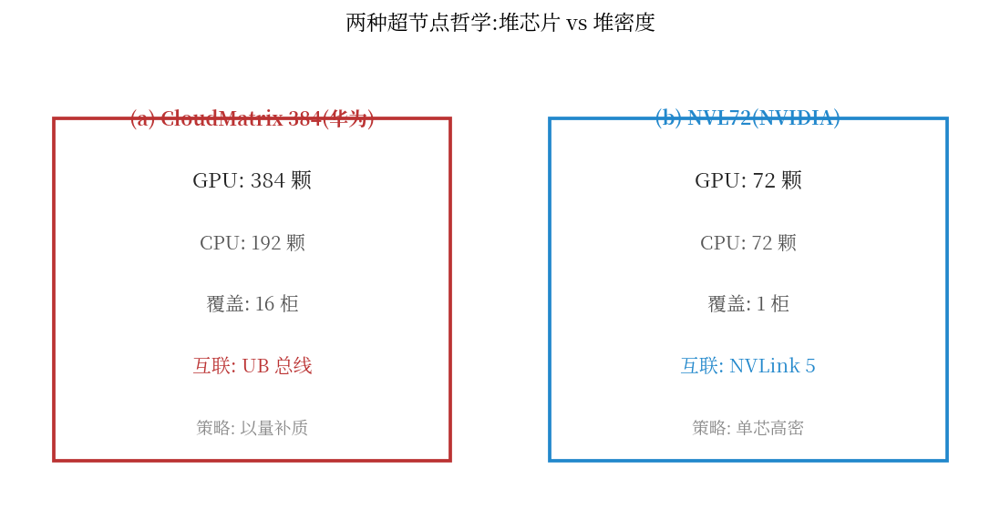
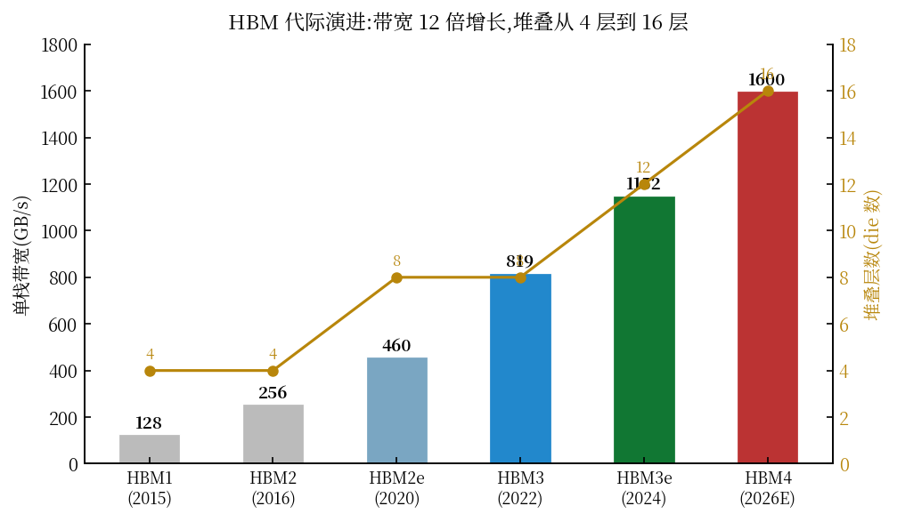

*(本文截稿 2026.11.15,数据以各官网为准;不构成投资建议。)*

"国产 GPU 到底差在哪?"

这个问题我问过十个做 AI 的朋友,答案从"差三代"到"快追上了"都有。

差距是真实的,但它是**五种不同的差距**——有些一年能追,有些五年追不上。其中一个维度(HBM)值得拆到制造工艺级别,因为**它是唯一的"买不到"而不是"做不出"**。

这篇文章分上下两篇:上篇画差距地图、逐家拆解;下篇深入 HBM 内部——硅穿孔怎么钻、芯片怎么叠、CoWoS 怎么封——把"命脉"两个字拆到微米级。

六张图,全部服务器生成。开始。

---

# 上篇:差距地图与玩家全景

## 一、差距地图:五根柱子看清楚

以 NVIDIA H100 = 100 分为基准,华为昇腾 910C 在五个维度的相对水平:


| 维度 | 差距 | 性质 |
|---|---|---|
| 单芯片性能 | 约 40%(DeepSeek 实测) | 制程代差,短期难追 |
| 软件生态 | 最深,但 Triton 正在稀释 | **正在松动** |
| **HBM 供应** | 1-2 代差 | **硬瓶颈,供应链问题** |
| 卡间互联 | 约 5 倍带宽差 | **追赶最快** |
| 系统级调度 | CloudMatrix 部分反超 | **国产优势区** |

## 二、单芯片:差 40%,根源在制程

DeepSeek 官方实测(2025.2):910C 推理任务约为 H100 的 60%。

| | 昇腾 910C | H100 | 倍差 |
|---|---|---|---|
| FP16 算力 | ~800 TFLOPS | 1,979 TFLOPS(含稀疏) | 2.5× |
| 芯片逻辑面积 | 比 H100 **大 60%** | — | — |
| 封装 | 双 910B die 合封 | 单 die | — |
| 制程 | 中芯 N+2(等效 7nm) | 台积电 4nm | **2-3 代** |

面积大 60% 但算力只有 60%——架构效率(每 mm² 算力)差约 3 倍。这不是设计能力的差距,是**光刻机的差距**:没有 EUV,等效 7nm 就是天花板。

## 三、生态:CUDA 的 15 年护城河正在被稀释

PyTorch 2 的 Prims + Triton 中间层,把"必须写 CUDA"变成"写 Triton(跨平台编译)"——**2025 年起多数工程师已不手写底层 CUDA**。

| 厂商 | 策略 | 宣称覆盖 | 已知问题 |
|---|---|---|---|
| **华为 CANN Next** | CUDA 接口兼容层 | **95%** | 剩 5% 恰是核心定制算子 |
| **沐曦 MXMACA** | API 拦截+自动翻译 | **6,000+** 应用 | 兼容粒度待验证 |
| **摩尔线程 MUSA** | 架构层面兼容 | PyTorch/Megatron-LM | S5000 2026.2 才适配 GLM-5 |
| **壁仞 BIRENSUPA** | 自研平台兼容 CUDA | 已适配通义千问 | 生态最封闭 |
| **海光 DCU** | 走 AMD ROCm | 跟随 ROCm | 上游不可控 |

**关键陷阱**:95% 兼容听着高,但你最后卡住的那个 custom kernel,恰好在 5% 里。

## 四、互联:追赶最快的一块



| | CloudMatrix 384 | NVL72 |
|---|---|---|
| GPU | 384 颗 910C | 72 颗 B200 |
| 互联 | UB(统一总线) | NVLink 5 |
| 机柜 | 16 柜 | 1 柜 |

华为承认跨柜带宽差距约 5 倍。但 MoE All-to-All 场景已实战,**黄仁勋公开承认部分性能超过英伟达对应产品**。

## 五、国产玩家全景


### 华为昇腾:全栈自研

- 产品线:910B(2021)→ 910C(2024,双 die)→ 910D(2025 样品,目标超 H100)
- 年产约 140 万颗;MindSpore + CANN 全栈
- CloudMatrix 384 超节点是中国算力突围的系统级答案

### 沐曦 MetaX:生态兼容极致

- C500(2024 量产):FP32 15 TFLOPS,64GB HBM,对标 A100
- **2026 Q3 单季营收 15 亿元,同比 +367%**,连续两季盈利
- MXMACA 兼容 6,000+ CUDA 应用;C600 已发布,C700 预计 2027 下半年
- 客户:智谱 AI、优刻得等

### 壁仞科技:架构激进派

- BR100(2022):770 亿晶体管,PFLOPS 峰值(曾宣称超国际旗舰 3 倍)
- Chiplet + 2.5D CoWoS,8192 个流处理器,512 个张量加速器
- BR106(2023.1 量产)→ BR110/BR166 已规模交付
- 部署:中国移动智算中心(哈尔滨)等,三大运营商深度合作
- 特点:BR100/104 因出口管制"流产"后,后续产品不再公布详细参数

### 摩尔线程:CUDA 兼容最激进

- S4000(2023):48GB,FP16 100 TFLOPS
- **S5000(2026)**:第四代 MUSA 架构,80GB HBM,1.6 TB/s,**对标 H100**;FP8 全精度;2026.2 适配 GLM-5
- 2026 上半年营收 **17.36 亿元**(四小龙最高)

### 海光 DCU:安静追赶者

- 走 AMD ROCm 生态,CPU+GPU 协同;DeepAI 系列已有数据中心部署

---

# 下篇:HBM 深度解剖——"命脉"里面长什么样

## 六、为什么 HBM 是命脉

传统 GDDR6 平铺在 PCB 上,数据走铜线。信号完整性在高速下急剧恶化,引脚带宽上限 ~20 Gbps。要更多带宽只有两条路:更多引脚(PCB 爆炸)或更快频率(信号散了)。都走不通。

HBM 的答案:**不铺在板上了,直接叠在 GPU 旁边。**

| | GDDR6 | HBM3e |
|---|---|---|
| 单栈带宽 | ~64 GB/s | **~1,152 GB/s** |
| 引脚数 | ~180 | **>5,000 TSV 连接** |
| 能效 | ~10 GB/s/W | **~50 GB/s/W** |
| 距离 GPU | 厘米(PCB) | **毫米(interposer)** |

**HBM 的本质:用三维堆叠换二维铺不开的带宽。**

而三维堆叠的每一步,都靠下面这两个技术。

## 七、TSV:硅穿孔——HBM 的血管

一根 TSV,就是**在硅片上钻一个头发丝十分之一细的洞,灌满铜,让电流垂直穿过整片芯片**。

听起来简单。做起来是人类精密制造的极限之一。下面把六道工序全部拆开——每一步的化学、物理、电子,用人话讲透。

### 7.1 第一步:钻孔(深反应离子刻蚀, DRIE)

**要干什么**:在硅片上垂直打几千个深 50-100 μm、直径 5-10 μm 的孔。

**为什么难**:你要在**头发丝横截面 1%** 的面积上,钻一个**比头发丝深 10 倍**的洞。而且内壁要光滑、垂直度 <1° 偏差。

**怎么做到:等离子体化学刻蚀。**

把硅片放进真空腔,通入四氟化碳气体(CF₄),加射频电压。气体被电离成等离子体——CF₄ 分子被撕开,变成高活性的氟自由基(F·)。氟自由基碰到硅,发生化学反应:

$$\text{Si} + 4\text{F}^\cdot \to \text{SiF}_4 \uparrow$$

硅被氟"吃掉",变成四氟化硅气体,被真空泵抽走——**这就是刻蚀:用化学反应把固体变成气体搬走**。

但问题来了:如果一直刻,孔会越来越宽,变成碗形而不是圆柱形。

**Bosch 工艺的 genius 之处**:不是连续刻,而是"刻一下,涂一下"交替进行——

```
循环 1(刻蚀, ~5 秒):通 CF₄ → 氟自由基垂直向下啃硅 0.5-1 μm
循环 2(钝化, ~3 秒):通 C₄F₈ → 在所有表面(包括孔壁)沉积一层
    特氟龙似的碳氟聚合物(~50 nm),保护侧壁
循环 3(刻蚀):再通 CF₄ → 离子轰击把底部的保护层打掉,
    氟继续啃底部新暴露的硅;侧壁有保护,不被啃
循环 4(钝化):再涂保护层
... 重复 50-200 个循环
```

**比喻**:像挖隧道——每挖一米,给隧道壁刷一层水泥,然后继续往前挖。壁永远有保护,只有最前端在推进。所以孔是**垂直的、圆柱形的**,深度精确可控。

**数学**:
- 深宽比(aspect ratio)= 深度 ÷ 直径 = 100 μm ÷ 10 μm = **10:1**
- 高端 HBM 用 TSV 达到 **15:1**——相当于钻一个直径 1 厘米、深 15 厘米的洞,还要内壁光滑

一个循环大约推进 0.5-1 μm,钻 100 μm 深需要 **100-200 个循环**,每个循环 8-10 秒,单孔总耗时约 **20-30 分钟**。一片晶圆同时刻几万个孔(并行),所以总时间可控。

### 7.2 第二步:绝缘层(为什么铜不能碰硅)

刻完孔之后,孔壁是裸露的硅。下一步要灌铜——**但铜原子会在硅里扩散**,跑到旁边的晶体管区域,把器件毒死(铜在硅中是深能级杂质,会俘获载流子,让晶体管永久失效)。

所以必须先给孔壁"刷漆"——沉积一层二氧化硅(SiO₂):

$$\text{SiH}_4 + 2\text{O}_2 \xrightarrow{400^\circ\text{C}} \text{SiO}_2 + 2\text{H}_2\text{O}$$

(硅烷 + 氧气,在 400°C 下反应生成二氧化硅和水)

这层漆叫"liner",厚度只有 **100-500 纳米**(约 500-2500 个硅原子厚)。太薄了挡不住铜扩散;太厚了占掉孔径,铜线截面变小、电阻变大。

**电子学直觉**:这层绝缘层的角色就像电线外面的塑料皮——防止铜线"漏电"到旁边的硅上。

### 7.3 第三步:阻挡层

光有绝缘层还不够——二氧化硅和铜的粘合力不好,铜容易剥离。需要在两者之间加一层"胶水":

$$2\text{TaCl}_5 + 5\text{NH}_3 \to 2\text{TaN} + 5\text{HCl} + \ldots$$

(五氯化钽 + 氨气 → 氮化钽薄膜)

钽(Ta)和氮化钽(TaN)既是良好的铜扩散阻挡层,又能和 SiO₂、Cu 都粘得住。用**物理气相沉积(PVD,溅射)**镀上去,厚度约 **5-25 纳米**(约 25-125 个原子层)。

**比喻**:绝缘层是墙漆,阻挡层是底漆。底漆让面漆(铜)刷得牢。

### 7.4 第四步:种子层(电镀的引子)

接下来要电镀填铜。但电镀需要**导电表面**——而现在的孔壁是绝缘的 SiO₂ 和半导电的 TaN,电流没法均匀通过。

所以先用**化学气相沉积(CVD)**在整个孔壁铺一层超薄的铜(约 50-100 纳米):

$$\text{CuCl} + \text{H}_2 \to \text{Cu} + \text{HCl}$$

(氯化亚铜 + 氢气 → 铜薄膜)

这层铜叫"种子层"——像撒在花盆表面的种子,后面的电镀铜会沿着这层种子"长"出来。

### 7.5 第五步:电镀填铜(最难的一步)

**原理**:把硅片(带种子层)做阴极,放入硫酸铜(CuSO₄)溶液,通直流电。溶液中的铜离子(Cu²⁺)被吸引到阴极(种子层),获得两个电子,变成铜原子沉积:

$$\text{Cu}^{2+} + 2e^- \to \text{Cu} \downarrow$$

听起来像小学实验课的电镀？难度在于**深宽比**。

**核心难题:孔底和孔口的沉积速率必须完全一致。**

如果孔口先长满,底部还是空的——就形成"空洞(void)",电流走不通,整根 TSV 报废。

**怎么解决"底部优先生长"**:

电镀液里加三种关键添加剂:
1. **加速剂**(如 SPS, 磺丙基二硫代丙磺酸钠):吸附在表面,降低铜沉积的活化能——让铜长得更快
2. **抑制剂**(如 PEG, 聚乙二醇):吸附在表面,减缓铜沉积
3. **整平剂**(如 JGB, 氨基偶氮染料):抑制凸出处的生长

**协同机制**:
- 抑制剂大分子扩散慢,进不了深孔——**孔底抑制剂少,加速剂占优,铜长得快**
- 孔口抑制剂浓度高,铜长得慢
- 结果:**底部追上口部**,从下往上"填满",不产生空洞

**数学**:
- 单根 TSV 铜柱体积 ≈ π × (5 μm)² × 100 μm ≈ **7,854 μm³**
- 铜的密度 8.96 g/cm³, 单根质量 ≈ 7 × 10⁻⁸ g
- 一片晶圆 50,000 根 TSV 总铜量 ≈ **3.5 毫克**(一点点,但每根都不能有空洞)
- 电镀时间:~30-60 分钟,电流密度 ~5-20 mA/cm²

(这就像给一万个 15 厘米深的细吸管同时灌水,要求每根都从底部往上填满、不留气泡——只不过管子的直径是 5 微米。)

### 7.6 第六步:化学机械抛光(CMP)

电镀完,整片硅表面被铜覆盖成一面"铜镜"。需要把表面多余的铜磨掉,只留孔里的——这叫 CMP(Chemical Mechanical Polish)。

**原理**:硅片面朝下压在旋转的抛光垫上,同时喷入含氧化硅纳米颗粒和化学腐蚀剂的抛光液。

- **化学腐蚀**:抛光液中的氧化剂把表面铜氧化成可溶的 Cu²⁺
- **机械研磨**:纳米颗粒把氧化层刮掉
- **化学+机械协同**:纯化学太慢,纯机械有划痕,两者交替,达到原子级平整

**精度**:抛光后表面粗糙度 < 1 纳米——**比一根头发丝的光滑度还高 10 万倍**。

### 7.7 TSV 的电气性能:为什么比导线好

一根 TSV 铜柱的电阻和电容:

- 电阻 R ≈ ρ·L/A = 1.7×10⁻⁸ Ω·m × 100 μm / (π×(5 μm)²) ≈ **0.02 Ω**
- 电容 C ≈ 2π·ε·L/ln(b/a) ≈ **~50 fF**(取决于绝缘层厚度)
- RC 延迟 ≈ R×C ≈ 0.02 × 50×10⁻¹⁵ = **1×10⁻¹⁵ 秒 = 1 飞秒**

对比传统引线键合(wire bond):
- 导线长 1-5 mm,电阻 ~0.1-0.5 Ω,电感 ~1-5 nH
- 信号延迟 ~10-100 皮秒

**TSV 比 wire bond 快 10,000-100,000 倍**。而且 TSV 是纯直流路径,没有引线的天线效应和串扰。

**计算机科学视角——为什么距离决定带宽**:

电信号在铜线中传播速度约 2×10⁸ m/s(光速的 2/3)。信号走 1 mm 的延迟:

$$t = \frac{10^{-3}\text{m}}{2 \times 10^8\text{m/s}} = 5\text{ ps}$$

看起来极短。但当 GPU 跑在 1 GHz 以上,每个时钟周期只有 1 纳秒——信号延迟 5 皮秒意味着每周期有 **0.5% 的时间浪费在传播上**。

- PCB 走线 5 cm → 延迟 250 ps → 每周期浪费 25%
- Interposer 走线 5 mm → 延迟 25 ps → 每周期浪费 2.5%
- TSV 走线 100 μm → 延迟 0.5 ps → 每周期浪费 0.05%

**距离缩短 100 倍,可用带宽翻倍以上**——因为频率可以跑得更高而不担心信号还没到。

一片 HBM 的 DRAM 硅片上,有**数千到数万根这样的 TSV**,每根的制造成本不到 0.001 分钱——但良率要求 >99.99%:一万根里坏一根,整颗 HBM 报废。

## 八、堆叠:一层一层"贴"上去


### 8.1 谁在底部:Logic Die

**每颗 HBM 最底层不是存储,是逻辑芯片。**

它做两件事:
1. **接口转换**:把 DRAM 内部信号翻译成标准 HBM PHY 接口
2. **TSV 中继**:汇聚上方各层信号,通向底面 C4 bump → interposer

(高大上的名字叫 base die,其实就是个带 TSV 中继的接口芯片——但它的设计直接决定时序和功耗,是各家核心竞争力。)

### 8.2 堆叠七步

```
1. Logic Die 固定在载板
2. 正面涂助焊剂 + 放微凸点阵列
3. 第一层 DRAM 对位、贴合(热压键合:250-300°C,对位 <2μm)
4. 重复 2-3,叠到设计高度(4/8/12/16 层)
5. 灌 MUF(molded underfill)保护胶
6. 底部植 C4 bump(连 interposer)
7. 全栈测试
```

**良率的残酷算术**:单层 die 良率 95%,8 层堆叠良率 = 0.95⁸ = **66%**。所以堆叠前必须做 KGD(Known Good Die)测试——只叠确认好的,一层废废全栈。

### 8.3 为什么不能无限叠

- **散热**:中间层热量穿不出,每升 10°C 寿命减半
- **翘曲**:12 层不同热膨胀系数叠一起,冷却后整栈像薯片一样翘
- **键合精度**:第 12 层累积误差 ±20 μm——微凸点已对不上
- **成本**:层数翻倍,良率指数下降

当前量产极限:**12-high(HBM3e)**;16-high(HBM4)是下一代战场。

## 九、CoWoS:HBM 和 GPU 怎么"住隔壁"

叠好的 HBM 栈需要和 GPU 近距离通信——这靠**封装**。


### 9.1 硅转接板(Interposer)

一片**无源硅片**(没有晶体管,只有金属布线),像一座微型桥:
- 上面刻 2-4 层金属布线(线宽 ~0.4-1.0 μm)
- 自身也有 TSV,穿透到底连封装基板
- GPU 和 HBM 的 C4 bump 焊在它上面,**信号距离毫米级**

为什么要硅做桥?PCB 铜线精度 ~50 μm;硅转接板精度 ~0.5 μm——**细 100 倍**,能在同样面积上布多 100 倍的线。

### 9.2 CoWoS 三种变体

| 变体 | Interposer | 特点 | 用途 |
|---|---|---|---|
| CoWoS-S | 纯硅 | 精度最高,面积受限 | H100/B200 |
| CoWoS-R | RDL | 面积大,精度略低 | 大尺寸多芯片 |
| CoWoS-L | 硅桥+RDL | 高速段用硅桥 | 下一代超大封装 |

**CoWoS 产能是 HBM 出货的隐形天花板**——TSMC 连续扩产仍供不应求。

## 十、HBM 代际演进



| 代 | 年份 | 单栈带宽 | 堆叠 | 单栈容量 |
|---|---|---|---|---|
| HBM1 | 2015 | 128 GB/s | 4 | 4 GB |
| HBM2 | 2016 | 256 GB/s | 4-8 | 8 GB |
| HBM2e | 2020 | 460 GB/s | 8-12 | 16 GB |
| HBM3 | 2022 | 819 GB/s | 8-12 | 24 GB |
| **HBM3e** | 2024 | **1,152 GB/s** | **12** | **36 GB** |
| HBM4 | 2026E | **>1,600 GB/s** | **16** | **48+ GB** |

带宽涨靠三件事:**叠更多层**(TSV 数量)、**跑更快**(接口速率)、**做更宽**(总线位宽)。每一件都绑在制造工艺上。

## 十一、供应链:谁在做,谁被卡住

| 厂商 | 份额(2025) | 优势 | 短板 |
|---|---|---|---|
| SK 海力士 | ~50% | HBM3e 率先量产 | 产能有限 |
| 三星 | ~30% | 产能最大 | HBM3e 良率追赶中 |
| 美光 | ~15% | HBM3e 获 NVIDIA 认证 | 起步晚 |
| **长鑫存储** | <5% | 追赶中 | **HBM2e 级,代差 1-2 代** |

**出口管制的完整因果链**:美国 2024.12 限制 HBM 对华出口 → 国产 GPU 买不到最快内存 → 算力上限锁死 → **不是设计不出来,是买不到**。

一颗 HBM3e 栈成本约 300-500 美元;H100 用 6 颗 = **1,800-3,000 美元**,占总 BOM 的 30-50%。

## 十二、尾声

"国产 GPU 差在哪"的完整答案:

> **差在光刻机,不差在设计;差在 HBM 买不到,不差在架构;差在 15 年生态积累,但护城河正在被 Triton 稀释。追不上的,是供应链的物理瓶颈;追上的,是系统级的工程智慧。**

下次看到"H100 有 3.35 TB/s 显存带宽",你脑子里应该浮现的是:6 个 HBM 栈,每个 12 层 DRAM,上万根硅穿孔,数万个微凸点,在一片硅转接板上和 GPU 紧紧挨着——人类微制造工艺的一次极限演出。

下次有人问"国产 GPU 行不行",你可以反问:你问的是哪个维度、哪个时间尺度?

---

*信源:DeepSeek 910C 实测(2025.2);腾讯云/华为 keynote(2025.9);钛媒体/国金证券报告(2026);沐曦/壁仞/摩尔线程官网及招股书;JEDEC HBM 标准(JESD235);SK 海力士/三星/美光 HBM 白皮书;TSMC CoWoS 技术文档;Wikichip。TSV 工艺参考 Bosch DRIE 专利。*
