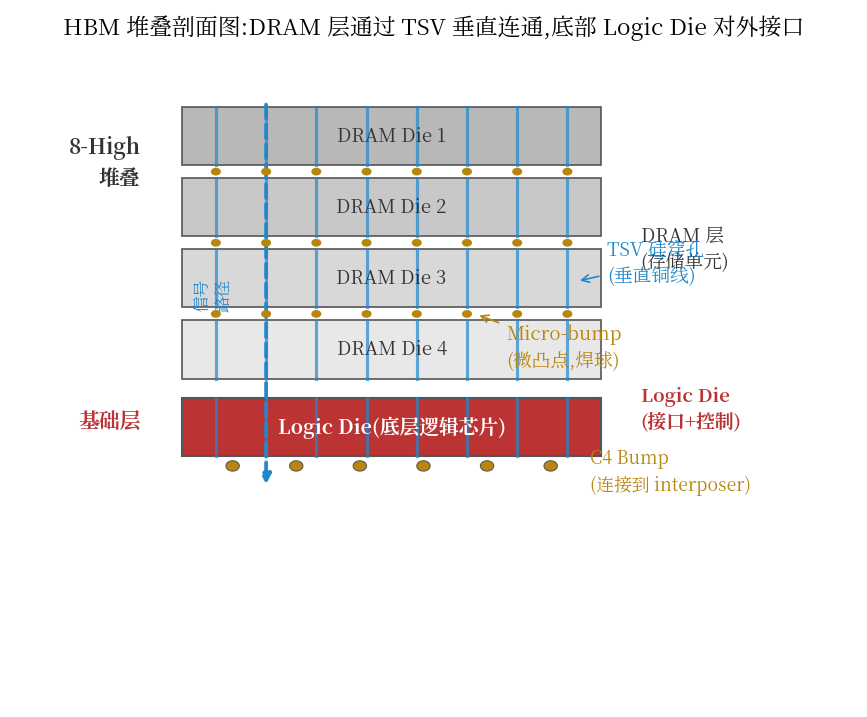

上篇国产 GPU 文里说 HBM 是"受制于人的命脉"。这次拆开看:命脉里面到底长什么样,一层一层是怎么叠上去的。

这不是科普级别的"堆叠内存"四个字——是**从光刻到键合、从硅穿孔到封装基板的完整制造链**。每一步都有物理极限,每一步都是钱。

## 一、为什么必须叠:传统内存的带宽墙

传统 GPU 显存(GDDR6)平铺在 GPU 芯片旁边的 PCB 板上。数据走 PCB 铜线,信号完整性在高速下急剧恶化,每根线的带宽上限 ~20 Gbps。

要更多带宽,传统方案只有两条路:**更多引脚**(PCB 面积爆炸)或**更快频率**(信号衰减失控)。都走不通。

HBM 的答案简单粗暴:**不铺在板上了,直接叠在 GPU 旁边**——用硅做桥,距离从厘米级缩到毫米级,引脚数从几千涨到几千**万**。

数字对比:

| | GDDR6 | HBM3e |
|---|---|---|
| 带宽(单芯片/栈) | ~64 GB/s | ~1,152 GB/s |
| 引脚数 | ~180 针 | >5,000 TSV 连接 |
| 能效(GB/s per Watt) | ~10 | ~50 |
| 距离(GPU 到内存) | 厘米级(PCB) | 毫米级(interposer) |

**HBM 的本质:用三维堆叠换二维铺不开的带宽。**

## 二、堆叠的核心技术:TSV(硅穿孔)

HBM 的每一层 DRAM 芯片,靠**穿透整片硅片的垂直铜线**连通。这叫 TSV(Through-Silicon Via),是整个三维集成的心脏。

### 2.1 TSV 是怎么做出来的

一根 TSV 的诞生,经过六道工序:

**第一步:刻蚀(Etch)**

在前道工序(FEOL,晶体管已建好)之后,用**深反应离子刻蚀(DRIE,又称 Bosch 工艺)**在硅片上垂直钻孔:

- 直径:**~5-10 微米**(头发丝的 1/10)
- 深度:**~50-100 微米**
- 工艺:交替通入刻蚀气体(CF₄)和钝化气体(C₄F₈),一层一层向下啃

**第二步:绝缘层(Liner)**

孔壁沉积一层二氧化硅(SiO₂),防止铜原子扩散进硅里污染晶体管。

**第三步:阻挡层(Barrier)**

再镀一层钽/氮化钽(TaN),做铜和绝缘层的粘合剂。

**第四步:种子层(Seed)**

化学气相沉积一层超薄铜,给后面的电镀当"引子"。

**第五步:电镀填铜(Cu Fill)**

整片硅片浸入硫酸铜溶液,通电。铜离子沿着种子层从孔底向上生长——**高深宽比(via)的电镀是纯工艺壁垒**,SK 海力士和三星各有专利配方,核心难点是保证孔底和孔口的沉积速率一致,不能有空洞(void)。

**第六步:化学机械抛光(CMP)**

表面磨平,为下一层金属布线做准备。

一片 HBM 用到的 DRAM 硅片上,**有数千到数万根这样的 TSV**。

### 2.2 一层 DRAM 长什么样

每层 DRAM die 的结构:

- **正面**:晶体管 + 电容(存储单元)+ 金属布线(几层铜,常规 CMOS 工艺)
- **背面**:磨到极薄(~50 μm)后,TSV 铜柱露出来
- **层与层之间**:通过**微凸点(micro-bump)**连接

Micro-bump 是什么?比传统芯片焊球(C4 bump)小一个量级的锡球:

| | C4 Bump | Micro-bump |
|---|---|---|
| 直径 | ~100-150 μm | **~25-40 μm** |
| 间距(pitch) | ~150-200 μm | **~40-55 μm** |
| 数量(每 die) | ~1,000 | **>5,000** |

密到什么程度?一张指甲盖大小的 die 上,密密麻麻排在上面五千多个微小的焊球,每一个的位置精度要求在 ±2 μm 以内。

## 三、堆叠过程:一层一层"贴"上去



### 3.1 谁在底部:Logic Die

**每颗 HBM 的最底层不是 DRAM,是一片 Logic Die(逻辑芯片)。**

它不存数据,只做两件事:

1. **接口转换**:把 DRAM 阵列的内部信号,翻译成标准 HBM PHY 接口(给 GPU 看)
2. **TSV 中继**:把上方各层 DRAM 的 TSV 信号,汇聚到底面的 C4 bump(通向 interposer)

(高大上的名字叫"base die"或"buffer die",其实就是个带 TSV 中继的接口芯片——但它的设计直接决定 HBM 的时序和功耗,是各家核心竞争力之一。)

### 3.2 堆叠流程

```
准备:所有 die 先做好 FEOL+TSV+BEOL,背面减薄到 ~50 μm
  ↓
1. 把 Logic Die 固定在载板上
  ↓
2. 在 Logic Die 正面涂布助焊剂,放上微凸点阵列
  ↓
3. 第一层 DRAM die 对位、贴合(热压键合,thermocompression bonding)
    → 温度 ~250-300°C,压力精确控制,对位精度 <2 μm
  ↓
4. 重复 2-3,叠到设计高度(4/8/12/16 层)
  ↓
5. 填充 MUF(molded underfill,模塑底填)——把层间空隙灌满保护胶
  ↓
6. 底部植 C4 bump(连接 interposer)
  ↓
7. 测试(全栈功能验证)
```

**良率的残酷算术**:假设单层 die 良率 95%,8 层堆叠的良率 = 0.95⁸ = 66%。所以堆叠前必须做 **KGD(Known Good Die)测试**——只叠确认好的 die,否则一层废废全栈。

### 3.3 为什么不能无限叠

叠得越高,问题越多:

- **散热**:中间层的 DRAM 热量穿不出去,温度每升 10°C,寿命减半
- **翘曲**:12 层不同热膨胀系数的材料叠在一起,冷却后整栈像薯片一样翘
- **键合精度**:叠到第 12 层时,对位误差累积到 ±20 μm 以上——微凸点已经对不上了
- **成本**:层数翻倍,良率指数下降,单价超线性上涨

当前量产极限:**12-high(HBM3e)**;16-high(HBM4)是下一代战场。

## 四、CoWoS:HBM 和 GPU 怎么"住在隔壁"

叠好的 HBM 栈,需要和 GPU 芯片近距离通信。这就需要**封装**。

### 4.1 硅转接板(Interposer)

CoWoS(Chip-on-Wafer-on-Substrate)是 TSMC 的招牌工艺:


硅转接板是一片**无源硅片**(没有晶体管,只有金属布线),像一座微型硅桥:

- 上面刻 2-4 层金属布线(线宽 ~0.4-1.0 μm,远细于 PCB)
- 自身也有 TSV,穿透到底连接封装基板
- GPU 和 HBM 的 C4 bump 都焊在它上面,**信号距离缩到毫米级**

### 4.2 为什么要硅做桥

PCB 铜线的加工精度 ~50 μm,信号在厘米级距离上跑 GHz 级频率就散了。硅转接板的金属线精度 ~0.5 μm——**比 PCB 细 100 倍**,所以:

- 能在同样面积上布**多 100 倍的线**
- 线短了,频率就能上去
- 阻抗连续,信号完整

一块硅转接板上放 1 颗 GPU + 4-8 颗 HBM 栈,整颗(加上 interposer)叫 **SiP(System in Package)**。H100 的 SiP 里放着 1 颗 GPU + 6 颗 HBM3e 栈。

### 4.3 CoWoS 的三种变体

| 变体 | Interposer 材料 | 特点 | 用途 |
|---|---|---|---|
| CoWoS-S | 纯硅 | 精度最高,面积受限(掩膜版 ≤ 3.3× 光罩) | H100 / B200 |
| CoWoS-R | RDL(重布线层) | 面积更大,精度略低 | 大尺寸多芯片 |
| CoWoS-L | 硅桥(局部)+ RDL | 硅桥做高速段,RDL 覆盖大面积 | 下一代超大封装 |

**CoWoS 的产能才是 HBM 出货的真正瓶颈**——TSMC 的 CoWoS 产能 2024-2025 年连续扩产仍供不应求,这是 NVIDIA GPU 出货受限的隐形天花板之一。

## 五、HBM 代际:带宽是怎么一代代涨上来的


| 代 | 年份 | 单栈带宽 | 堆叠层数 | 单栈容量 | 关键变化 |
|---|---|---|---|---|---|
| HBM1 | 2015 | 128 GB/s | 4 | 4 GB | 首商用(AMD Fury X) |
| HBM2 | 2016 | 256 GB/s | 4-8 | 8 GB | NVIDIA V100 采用 |
| HBM2e | 2020 | 460 GB/s | 8-12 | 16 GB | 带宽提升,容量翻倍 |
| HBM3 | 2022 | 819 GB/s | 8-12 | 24 GB | H100 主力 |
| **HBM3e** | 2024 | 1,152 GB/s | **12** | **36 GB** | B200/H200 |
| HBM4 | 2026E | **>1,600 GB/s** | **16** | **48+ GB** | 定标中 |

涨带宽靠三件事:**叠更多层**(TSV 数量)、**跑更快**(接口速率)、**做更宽**(总线位宽)。每一件都跟制造工艺深度绑定。

## 六、谁在做,谁被卡住

全球 HBM 供应被三家垄断:

| 厂商 | 份额(2025) | 优势 | 短板 |
|---|---|---|---|
| SK 海力士 | ~50% | HBM3e 率先量产,技术领先 | 产能有限 |
| 三星 | ~30% | 产能最大 | HBM3e 良率追赶中 |
| 美光 | ~15% | 后发但 HBM3e 获 NVIDIA 认证 | 起步晚 |
| **长鑫存储(国产)** | <5% | **追赶中** | HBM2e 级别,代差 1-2 代 |

**HBM 出口管制**:美国对中国大陆 HBM 出口限制(2024.12 落地),直接卡住国产 GPU 的带宽上限——你设计出最快的 AI 芯片,也买不到最快的内存,算力天花板就锁在那里。

这就是国产 GPU 那篇文章说"HBM 是受制于人的命脉"的完整因果链:**不是设计不出来,是买不到**。

## 七、钱:HBM 有多贵

一颗 HBM3e 栈的制造成本约 **300-500 美元**。H100 用 6 颗 = 仅内存就是 **1,800-3,000 美元**,占总 BOM 成本的 30-50%。

B200 用 8 颗,内存成本更高。**NVIDIA 的毛利率被 HBM 压缩**,但市场需求如此饥渴,谁也离不开。

## 八、尾声:三维集成是芯片的宿命

平面晶体管走到 3nm 之后,摩尔定律在放缓。但三维方向的空间还很大:

- HBM 的堆叠是**存储叠在存储旁边**(2.5D+3D)
- 3D V-Cache 是 **SRAM 叠在 CPU 上面**(纯 3D)
- 未来:**逻辑叠逻辑**(不同功能芯片直接 3D 堆叠)

硅穿孔、微凸点、键合精度——这些工艺每前进一步,芯片就能"长高一层"。

下次看到"H100 有 3.35 TB/s 显存带宽",你脑子里应该浮现的不是一句参数,而是:**6 个 HBM 栈,每个 12 层 DRAM,上万根硅穿孔,数万个微凸点,在一片硅转接板上和 GPU 紧紧挨着**——那是人类微制造工艺的一次极限演出。

---

*参考:JEDEC HBM 标准(JESD235);SK 海力士/三星/美光 HBM 白皮书;TSMC CoWoS 技术文档;Alchip/Amkor 封装技术综述;Wikichip HBM 规格页。TSV 工艺描述参考 Bosch DRIE 专利文献。本文截稿 2026.11.15。*
