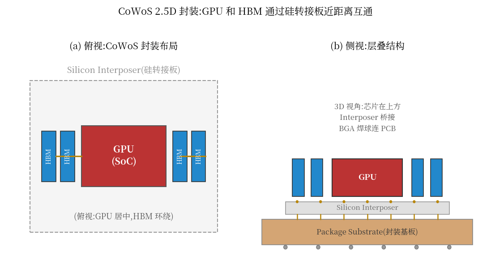

*(本文截稿 2026.11.15,数据以各官网为准;不构成投资建议。)*

"国产 GPU 到底差在哪?"

这个问题我问过十个做 AI 的朋友,答案从"差三代"到"快追上了"都有。

差距是真实的,但它是**五种不同的差距**——有些一年能追,有些五年追不上。其中一个维度(HBM)值得拆到制造工艺级别,因为**它是唯一的"买不到"而不是"做不出"**。

这篇文章分上下两篇:上篇画差距地图、逐家拆解;下篇深入 HBM 内部——硅穿孔怎么钻、芯片怎么叠、CoWoS 怎么封——把"命脉"两个字拆到微米级。

六张图,全部服务器生成。开始。

---

# 上篇:差距地图与玩家全景

## 一、差距地图:五根柱子看清楚

以 NVIDIA H100 = 100 分为基准,华为昇腾 910C 在五个维度的相对水平:


| 维度 | 差距 | 性质 |
|---|---|---|
| 单芯片性能 | 约 40%(DeepSeek 实测) | 制程代差,短期难追 |
| 软件生态 | 最深,但 Triton 正在稀释 | **正在松动** |
| **HBM 供应** | 1-2 代差 | **硬瓶颈,供应链问题** |
| 卡间互联 | 约 5 倍带宽差 | **追赶最快** |
| 系统级调度 | CloudMatrix 部分反超 | **国产优势区** |

## 二、单芯片:差 40%,根源在制程

DeepSeek 官方实测(2025.2):910C 推理任务约为 H100 的 60%。

| | 昇腾 910C | H100 | 倍差 |
|---|---|---|---|
| FP16 算力 | ~800 TFLOPS | 1,979 TFLOPS(含稀疏) | 2.5× |
| 芯片逻辑面积 | 比 H100 **大 60%** | — | — |
| 封装 | 双 910B die 合封 | 单 die | — |
| 制程 | 中芯 N+2(等效 7nm) | 台积电 4nm | **2-3 代** |

面积大 60% 但算力只有 60%——架构效率(每 mm² 算力)差约 3 倍。这不是设计能力的差距,是**光刻机的差距**:没有 EUV,等效 7nm 就是天花板。

## 三、生态:CUDA 的 15 年护城河正在被稀释

PyTorch 2 的 Prims + Triton 中间层,把"必须写 CUDA"变成"写 Triton(跨平台编译)"——**2025 年起多数工程师已不手写底层 CUDA**。

| 厂商 | 策略 | 宣称覆盖 | 已知问题 |
|---|---|---|---|
| **华为 CANN Next** | CUDA 接口兼容层 | **95%** | 剩 5% 恰是核心定制算子 |
| **沐曦 MXMACA** | API 拦截+自动翻译 | **6,000+** 应用 | 兼容粒度待验证 |
| **摩尔线程 MUSA** | 架构层面兼容 | PyTorch/Megatron-LM | S5000 2026.2 才适配 GLM-5 |
| **壁仞 BIRENSUPA** | 自研平台兼容 CUDA | 已适配通义千问 | 生态最封闭 |
| **海光 DCU** | 走 AMD ROCm | 跟随 ROCm | 上游不可控 |

**关键陷阱**:95% 兼容听着高,但你最后卡住的那个 custom kernel,恰好在 5% 里。

## 四、互联:追赶最快的一块


| | CloudMatrix 384 | NVL72 |
|---|---|---|
| GPU | 384 颗 910C | 72 颗 B200 |
| 互联 | UB(统一总线) | NVLink 5 |
| 机柜 | 16 柜 | 1 柜 |

华为承认跨柜带宽差距约 5 倍。但 MoE All-to-All 场景已实战,**黄仁勋公开承认部分性能超过英伟达对应产品**。

## 五、国产玩家全景


### 华为昇腾:全栈自研

- 产品线:910B(2021)→ 910C(2024,双 die)→ 910D(2025 样品,目标超 H100)
- 年产约 140 万颗;MindSpore + CANN 全栈
- CloudMatrix 384 超节点是中国算力突围的系统级答案

### 沐曦 MetaX:生态兼容极致

- C500(2024 量产):FP32 15 TFLOPS,64GB HBM,对标 A100
- **2026 Q3 单季营收 15 亿元,同比 +367%**,连续两季盈利
- MXMACA 兼容 6,000+ CUDA 应用;C600 已发布,C700 预计 2027 下半年
- 客户:智谱 AI、优刻得等

### 壁仞科技:架构激进派

- BR100(2022):770 亿晶体管,PFLOPS 峰值(曾宣称超国际旗舰 3 倍)
- Chiplet + 2.5D CoWoS,8192 个流处理器,512 个张量加速器
- BR106(2023.1 量产)→ BR110/BR166 已规模交付
- 部署:中国移动智算中心(哈尔滨)等,三大运营商深度合作
- 特点:BR100/104 因出口管制"流产"后,后续产品不再公布详细参数

### 摩尔线程:CUDA 兼容最激进

- S4000(2023):48GB,FP16 100 TFLOPS
- **S5000(2026)**:第四代 MUSA 架构,80GB HBM,1.6 TB/s,**对标 H100**;FP8 全精度;2026.2 适配 GLM-5
- 2026 上半年营收 **17.36 亿元**(四小龙最高)

### 海光 DCU:安静追赶者

- 走 AMD ROCm 生态,CPU+GPU 协同;DeepAI 系列已有数据中心部署

---

# 下篇:HBM 深度解剖——"命脉"里面长什么样

## 六、为什么 HBM 是命脉

传统 GDDR6 平铺在 PCB 上,数据走铜线。信号完整性在高速下急剧恶化,引脚带宽上限 ~20 Gbps。要更多带宽只有两条路:更多引脚(PCB 爆炸)或更快频率(信号散了)。都走不通。

HBM 的答案:**不铺在板上了,直接叠在 GPU 旁边。**

| | GDDR6 | HBM3e |
|---|---|---|
| 单栈带宽 | ~64 GB/s | **~1,152 GB/s** |
| 引脚数 | ~180 | **>5,000 TSV 连接** |
| 能效 | ~10 GB/s/W | **~50 GB/s/W** |
| 距离 GPU | 厘米(PCB) | **毫米(interposer)** |

**HBM 的本质:用三维堆叠换二维铺不开的带宽。**

而三维堆叠的每一步,都靠下面这两个技术。

## 七、TSV:硅穿孔——HBM 的血管

### 7.1 TSV 是怎么做出来的

一根 TSV(Through-Silicon Via)的诞生,六道工序:

**第一步:深反应离子刻蚀(DRIE,Bosch 工艺)**

在晶体管(FEOL)建好之后,用交替通入的刻蚀气体(CF₄)和钝化气体(C₄F₈)在硅片上垂直钻孔:
- 直径:**~5-10 微米**(头发丝的 1/10)
- 深度:**~50-100 微米**

**第二步:绝缘层**

孔壁沉积二氧化硅(SiO₂),防止铜扩散污染晶体管。

**第三步:阻挡层**

镀一层钽/氮化钽(TaN),做铜和绝缘层的粘合剂。

**第四步:种子层**

化学气相沉积超薄铜,给电镀当引子。

**第五步:电镀填铜**

整片浸入硫酸铜溶液,通电。铜从孔底向上生长——**高深宽比电镀是纯工艺壁垒**,SK 海力士和三星各有专利配方,核心难点是孔底和孔口沉积速率一致,不能有空洞。

**第六步:化学机械抛光(CMP)**

表面磨平,为下一层做准备。

一片 HBM 的 DRAM 硅片上,**有数千到数万根这样的 TSV**。

### 7.2 微凸点:层与层之间的焊球

| | C4 Bump(传统) | **Micro-bump** |
|---|---|---|
| 直径 | ~100-150 μm | **~25-40 μm** |
| 间距 | ~150-200 μm | **~40-55 μm** |
| 数量/die | ~1,000 | **>5,000** |
| 对位精度 | ±10 μm | **±2 μm** |

一张指甲盖大小的 die 上,密排五千多个微小焊球——每一个的位置精度要求 **±2 微米**。

## 八、堆叠:一层一层"贴"上去


### 8.1 谁在底部:Logic Die

**每颗 HBM 最底层不是存储,是逻辑芯片。**

它做两件事:
1. **接口转换**:把 DRAM 内部信号翻译成标准 HBM PHY 接口
2. **TSV 中继**:汇聚上方各层信号,通向底面 C4 bump → interposer

(高大上的名字叫 base die,其实就是个带 TSV 中继的接口芯片——但它的设计直接决定时序和功耗,是各家核心竞争力。)

### 8.2 堆叠七步

```
1. Logic Die 固定在载板
2. 正面涂助焊剂 + 放微凸点阵列
3. 第一层 DRAM 对位、贴合(热压键合:250-300°C,对位 <2μm)
4. 重复 2-3,叠到设计高度(4/8/12/16 层)
5. 灌 MUF(molded underfill)保护胶
6. 底部植 C4 bump(连 interposer)
7. 全栈测试
```

**良率的残酷算术**:单层 die 良率 95%,8 层堆叠良率 = 0.95⁸ = **66%**。所以堆叠前必须做 KGD(Known Good Die)测试——只叠确认好的,一层废废全栈。

### 8.3 为什么不能无限叠

- **散热**:中间层热量穿不出,每升 10°C 寿命减半
- **翘曲**:12 层不同热膨胀系数叠一起,冷却后整栈像薯片一样翘
- **键合精度**:第 12 层累积误差 ±20 μm——微凸点已对不上
- **成本**:层数翻倍,良率指数下降

当前量产极限:**12-high(HBM3e)**;16-high(HBM4)是下一代战场。

## 九、CoWoS:HBM 和 GPU 怎么"住隔壁"

叠好的 HBM 栈需要和 GPU 近距离通信——这靠**封装**。



### 9.1 硅转接板(Interposer)

一片**无源硅片**(没有晶体管,只有金属布线),像一座微型桥:
- 上面刻 2-4 层金属布线(线宽 ~0.4-1.0 μm)
- 自身也有 TSV,穿透到底连封装基板
- GPU 和 HBM 的 C4 bump 焊在它上面,**信号距离毫米级**

为什么要硅做桥?PCB 铜线精度 ~50 μm;硅转接板精度 ~0.5 μm——**细 100 倍**,能在同样面积上布多 100 倍的线。

### 9.2 CoWoS 三种变体

| 变体 | Interposer | 特点 | 用途 |
|---|---|---|---|
| CoWoS-S | 纯硅 | 精度最高,面积受限 | H100/B200 |
| CoWoS-R | RDL | 面积大,精度略低 | 大尺寸多芯片 |
| CoWoS-L | 硅桥+RDL | 高速段用硅桥 | 下一代超大封装 |

**CoWoS 产能是 HBM 出货的隐形天花板**——TSMC 连续扩产仍供不应求。

## 十、HBM 代际演进


| 代 | 年份 | 单栈带宽 | 堆叠 | 单栈容量 |
|---|---|---|---|---|
| HBM1 | 2015 | 128 GB/s | 4 | 4 GB |
| HBM2 | 2016 | 256 GB/s | 4-8 | 8 GB |
| HBM2e | 2020 | 460 GB/s | 8-12 | 16 GB |
| HBM3 | 2022 | 819 GB/s | 8-12 | 24 GB |
| **HBM3e** | 2024 | **1,152 GB/s** | **12** | **36 GB** |
| HBM4 | 2026E | **>1,600 GB/s** | **16** | **48+ GB** |

带宽涨靠三件事:**叠更多层**(TSV 数量)、**跑更快**(接口速率)、**做更宽**(总线位宽)。每一件都绑在制造工艺上。

## 十一、供应链:谁在做,谁被卡住

| 厂商 | 份额(2025) | 优势 | 短板 |
|---|---|---|---|
| SK 海力士 | ~50% | HBM3e 率先量产 | 产能有限 |
| 三星 | ~30% | 产能最大 | HBM3e 良率追赶中 |
| 美光 | ~15% | HBM3e 获 NVIDIA 认证 | 起步晚 |
| **长鑫存储** | <5% | 追赶中 | **HBM2e 级,代差 1-2 代** |

**出口管制的完整因果链**:美国 2024.12 限制 HBM 对华出口 → 国产 GPU 买不到最快内存 → 算力上限锁死 → **不是设计不出来,是买不到**。

一颗 HBM3e 栈成本约 300-500 美元;H100 用 6 颗 = **1,800-3,000 美元**,占总 BOM 的 30-50%。

## 十二、尾声

"国产 GPU 差在哪"的完整答案:

> **差在光刻机,不差在设计;差在 HBM 买不到,不差在架构;差在 15 年生态积累,但护城河正在被 Triton 稀释。追不上的,是供应链的物理瓶颈;追上的,是系统级的工程智慧。**

下次看到"H100 有 3.35 TB/s 显存带宽",你脑子里应该浮现的是:6 个 HBM 栈,每个 12 层 DRAM,上万根硅穿孔,数万个微凸点,在一片硅转接板上和 GPU 紧紧挨着——人类微制造工艺的一次极限演出。

下次有人问"国产 GPU 行不行",你可以反问:你问的是哪个维度、哪个时间尺度?

---

*信源:DeepSeek 910C 实测(2025.2);腾讯云/华为 keynote(2025.9);钛媒体/国金证券报告(2026);沐曦/壁仞/摩尔线程官网及招股书;JEDEC HBM 标准(JESD235);SK 海力士/三星/美光 HBM 白皮书;TSMC CoWoS 技术文档;Wikichip。TSV 工艺参考 Bosch DRIE 专利。*
