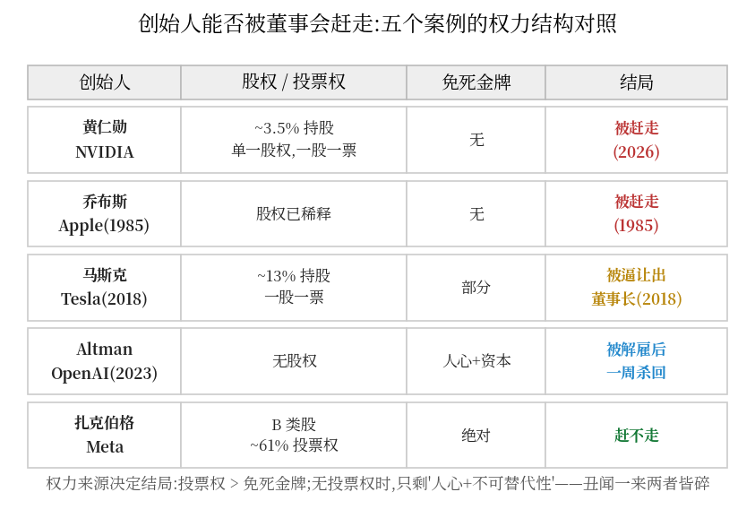

*(截至 2026.11.12,事件仍在快速演变,继任安排以官方公告为准。)*

72 小时里,英伟达(NVIDIA)的创始人、执掌公司 33 年的黄仁勋,从"几乎不可取代"变成了"宣布辞职"。

很多人第一反应是困惑:**他是创始人啊,公司是他建的,怎么能被"逼"走?**

这篇文章的回答是:丑闻只是扳机,真正的答案是结构。**"创始人"这三个字,在法律上从来不等于"老板"**——而且这一次,结构背后还有一层正在撕裂硅谷的芯片战争。

## 一、72 小时发生了什么

| 时间 | 事件 |
|---|---|
| 11.8 | 黄仁勋发全员信:承认两段婚外情(其一涉及疑似中国间谍、另一涉及公司员工),并回应"国家安全疑虑"——董事会已就其**成为外国情报行动目标**启动独立调查 |
| 11.10 | 独立董事发表声明 |
| 11.11 | 董事会开会讨论罢免(WSJ 放风"准备罢免");**盘后股价一度 -7.4%** 至 $160.95;Polymarket 上他年底前离任概率一度 **88%** |
| 11.12 | 黄仁勋宣布辞职。继任者未定(Jay Puri 呼声最高,预测市场给其 2028 年底前被官宣接任的概率约 20%) |

注意最后一步的措辞:不是"被罢免",是"宣布辞职"。记住这个细节,第五节解释。

## 二、"创始人"不是"老板":上市那天,他把自己雇了出去

公司治理第一课,也是这件事的第一把钥匙:

> **所有权 ≠ 控制权。CEO 是董事会聘任的高管,董事会代表全体股东监督他——解聘 CEO 是董事会的法定职权,不需要创始人同意。**

创始人身份只说明"你创办了它",不附带任何"永久管理权"。公司上市的那一刻,创始人就把管理权交给了公司治理结构:董事会聘任你,也就可以解聘你。黄仁勋管了 33 年,不是因为"公司是他的",而是因为**董事会和股东一直愿意让他管**——这个"愿意"是有条件的。

## 三、黄仁勋的权力结构:没有免死金牌

第二个关键细节:股权结构。NVIDIA 是**单一股权结构(一股一票)**,黄仁勋持股仅约 **3.5%**——他没有任何超级投票权。

把几位创始人放在一起,一眼看懂:

| 创始人 | 公司 | 持股/投票权 | 董事会能否赶走 |
|---|---|---|---|
| **黄仁勋** | NVIDIA | 约 3.5%,一股一票 | **能——已被验证** |
| 扎克伯格 | Meta | B 类股,约 61% 投票权 | 几乎不能(董事会多数归他控制) |
| Page / Brin | Alphabet | 超级投票权 | 几乎不能 |
| 乔布斯(1985) | Apple | 股权已被稀释到很小 | 能——被赶走过 |

黄仁勋和 1985 年的乔布斯是同一类人:**没有超级投票权的创始人,权力只来自"大家愿意让你干"**。乔布斯当年被自己请来的 CEO 斯卡利联合董事会赶出苹果,四十年后,同样的结构把同样的剧本演给了黄仁勋。

反例也有力量:2023 年 OpenAI 董事会解雇 Altman,一周内被 700+ 名员工联名逼宫、微软和投资人合力**塞了回去**——因为真正的话语权在人心和资本手里。而这一次,没有任何"黄仁勋必须回来"的声援潮出现。**董事会敢动手,正是因为判断过:人心已经不在了。**

## 四、董事会为什么"不得不":丑闻的风险定价

婚外情是私人道德问题,照理够不到罢免。真正压垮天平的是第二件事:**他本人成为外国情报行动的目标**——这对 NVIDIA 是商业层面的实质风险:

1. **客户结构**:NVIDIA 的重要客户包括美国政府、国防产业和受高度监管的云巨头。CEO 被外国情报盯上,等于整条政府业务线的合规与信任风险
2. **董事的法律责任**:董事对股东负有信义义务(fiduciary duty)。面对这种风险不作为,董事个人等着的是股东集体诉讼——**罢免不是无情,是自保**
3. **市场的即时投票**:-7.4% 的盘后跌幅,是股东在说:这个关键人物风险,我们不想背

Business Insider 说他"几乎不可取代"——没错,但**当"不可取代"撞上"不可接受的风险",风险赢**。这是"关键人物风险"的残酷定价公式:人越重要,他的丑闻的尾部风险越大,越必须被处理。

## 五、背景层:芯片战争里,他是绊脚石

第三把钥匙,也是最敏感的一层。先摆事实(全部可查证):

- **2025.4**:Anthropic 向美国政府提交《Securing America's Compute Advantage》,主张**维持并加强对华芯片出口管制**
- **2025.5**:NVIDIA 公开怒斥 Anthropic 讲"天方夜谭"——Anthropic 举证中国走私芯片的手法("藏在假孕肚里""和活龙虾装箱")被 NVIDIA 嘲讽夸大
- **2026.2**:Politico 报道,对华政策撕裂硅谷,**Anthropic 是 AI 公司里鼓吹管制最激进的一家**,与 NVIDIA 冲突最尖锐
- **2026.6**:SCMP 引分析师:Anthropic 的管制立场源于"竞争焦虑"——限制中国获取算力,就是保护自己的模型优势

而黄仁勋本人,是硅谷反对严管的**最大声且最顽固**的声音——"中国占全球一半的 AI 市场"、多次亲自出席中国活动。对华盛顿鹰派和安全派 AI 公司来说,他是产业界最大的绊脚石。

所以坊间的说法是:"有人想让他走"。这个说法要拆成两半看:

> **丑闻无法被策划**——婚外情是私人事实,情报接触是情报机构的事,竞争对手和鹰派"制造"不了;
> **但丑闻可以被利用**——风暴来了之后,乐于推船的人一直存在。丑闻曝光(非策划)→ "国家安全风险"叙事被放大 → 市场定价、监管注视、董事会启动程序——每一环都是合规动作,但风向是真实的。

写阴谋论会写"谁主谋了这一切";写事实只能写到:**结构提供了扳机(单一股权+信义义务),丑闻提供了弹药,而大博弈提供了顺风**。三层叠加,缺一不可——这也是为什么同样有丑闻的创始人,有的倒下、有的稳坐。

## 六、"被逼辞职"是体面的政治剧本

回头看那个措辞细节:他不是"被罢免",是"宣布辞职"。经典流程四步:

1. 董事会形成意向 → 向媒体放风"准备罢免"(WSJ 拿到的是剧本第一稿)
2. 舆论发酵 + 股价下挫 → 市场替董事会完成压力测试和定价
3. 创始人"主动"辞职 → 保住体面,换取谈判空间(比如董事席位的安排)
4. 董事会体面接收 → "我们感谢他的贡献"

这套剧本的历史演出:Uber 的 Kalanick 2017(投资人逼宫,"主动"辞职);马斯克 2018(被 SEC 和董事会逼着放弃董事长职位、只留 CEO)。**罢免是最后手段,辞职是双方台阶**——黄仁勋的 33 年功业,买到了一个体面的台阶,仅此而已。

## 七、两条启示

**给创始人**:你的权力只有三个真实来源——投票权(股权结构)、不可替代性(能力护城河)、人心(员工与资本的站队)。黄仁勋曾有后两个,但第一个从上市那天就没了;当丑闻击穿第二个,第三个会自动消失。**没有第一个的创始人,永远住在董事会租给你的房子里。**

**给投资者**:关键人物风险是真实的风险类别,而且是**凸性的**——人物越重要,其个人风险的尾部越大。一家市值四万亿美元的公司,CEO 的私人生活是必须进估值模型的变量。这一次,市场用 -7.4% 给出了定价示范。

最后回到标题:**赶走创始人的从来不是丑闻,是结构。** 丑闻每天都在发生,结构决定了谁是丑闻的幸存者。乔布斯 1985 年早就演过一遍——那年他被赶走时说了一句著名的话,大意是:被自己创办的公司解雇,是成年人最好的成长课。只是不知道这一次,历史会站在哪一边。

---

*信源:Reuters(2026.11.11)、WSJ(2026.11.12)、CNN live(2026.11.11)、NVIDIA 官网全员信(2026.11.8)与董事会声明(2026.11.10)、CNBC prediction markets(2026.11.9)、Business Insider(2026.11)、Politico(2026.2)、SCMP(2026.6)、Anthropic《Securing America's Compute Advantage》(2025.4)。事件仍在演变,请以官方公告为准。*
