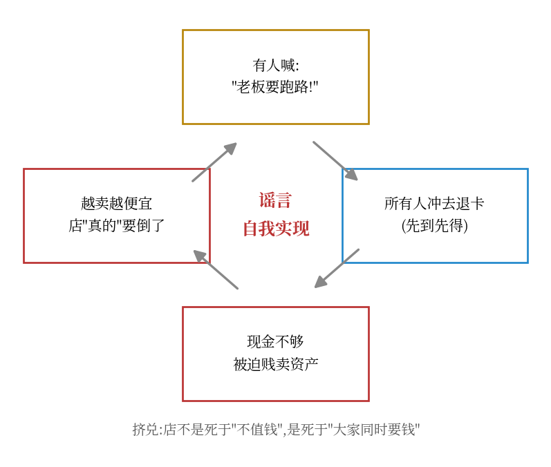
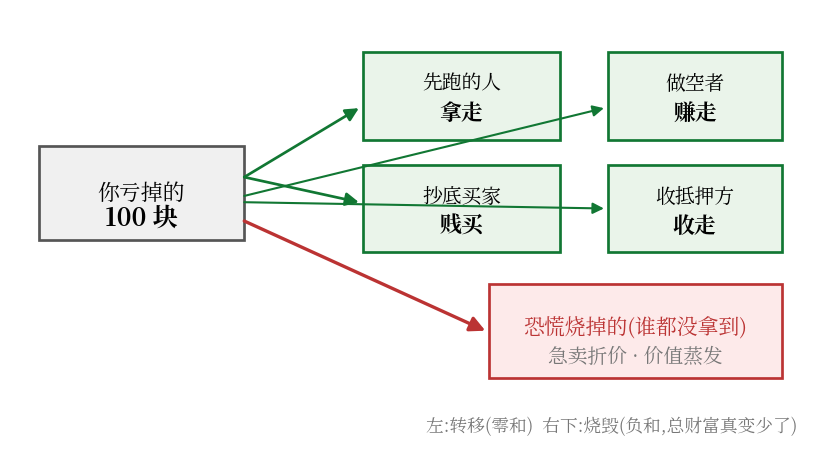

先看一个你秒懂的场景:

**你月薪 5 万,但今天是 1 号,工资 10 号才发,房东现在堵门口要 3 千房租,你卡里只有 200。**

你"有钱"吗?有钱。你"完蛋"吗?现在完蛋。

把这个场景的金额加上八个零、"房东"换成几千个债主、"工资"换成变现要半年的债券和贷款——就是 2008 年的贝尔斯登、2022 年的英国养老金、2023 年的硅谷银行。**它们死的时候,账面上全都是"有钱人"。**

这篇文章用人话讲清楚:它们怎么死的、死的时候钱去了哪、以及——**谁在数钱**。

## 一、村里小卖部的风波:挤兑的完整机制

村里有个小卖部,老板搞储值卡,全村存了 100 万。老板没把钱锁保险柜——他拿 60 万进货、40 万借出去收利息(一年后回来)。

小卖部值钱吗?值。老板想赖账吗?不想。

某天,有人喊了一嗓子:"**老板要跑路!**"

接下来发生的事,一步步看:

1. **先到先得**。谁先冲到店里退卡,谁全额拿回;去晚了,钱压在货和借条里,退不出来,可能血本无归
2. 于是,哪怕你根本不信老板会跑,你也得去退——**因为别人都在去**,你去晚了就排在吃亏的队伍里
3. 所有人一起冲。老板两天内被要求退 80 万,手里现金只有 10 万
4. 被迫**贱卖**:一万的货五千甩卖、欠条三折转让。本来值 100 万的店,慌乱中只变现出 40 万
5. 真退不出了。老板真倒了

第 5 步最讽刺:**那句"要跑路"是谣言,但所有人一起冲,就把店真冲垮了。** 店不是死于"不值钱",是死于"大家同时要钱"。

这就叫**挤兑**,它是流动性灾难的内核。而"急卖打折"(第 4 步)是隐藏的真正杀手——马上单独说。

## 二、三个真实版本:同一场戏,加八个零

### 贝尔斯登,2008 年 3 月:两天,180 亿 → 20 亿

天天借钱给它的机构(同行拆借、回购市场)一夜之间集体变脸:**不借了,抵押品还要追加**。两天之内,账上现金从约 180 亿美元掉到约 20 亿。一家 85 年历史、账面并非资不抵债的投行,最后以**每股 2 美元**卖给摩根大通(一个月前股价 70 多)。杀它的不是投资亏损——是**借钱给它的人同时抽贷**。

### 英国养老金,2022 年 9 月:不是没钱,是"马上要补钱"

英国的养老金买了大量国债,同时签了一些金融合约,合约里有条硬规矩:**国债跌到某个价,你必须立刻补钱进来**(就是保证金制度,做期货的朋友秒懂)。2022 年 9 月,政府一个减税方案吓得国债暴跌 → **全国养老金同时收到补钱通知**(央行事后估算追缴总额超 **700 亿英镑**)→ 手里能快速变现金的只有国债本身 → **所有人同时卖国债** → 国债再跌 → 要补的钱更多 → 死循环。

最后英格兰央行下场:"长期国债我买,别慌"——宣布了 650 亿英镑购买计划。有意思的是:**市场一听这话就镇定了,央行实际只买了约 190 亿就稳住了**。喊一嗓子比掏钱管用。

### 硅谷银行,2023 年 3 月:史上最快的挤兑,48 小时

储户高度集中(创业公司的钱基本都存它那)。3 月 9 日银行宣布"卖资产补亏损",消息在投资人群里炸开——**有人半夜群发'立刻把钱转走'**。以前挤兑要跑去银行排队,现在手机点两下。

结果:**3 月 9 日单日提款 420 亿美元;后来美联储监管副主席在国会披露,两天内储户试图转走的总额达 1420 亿美元**——SVB 存款总共约 1730 亿,**两天,82% 的存款想跑**。3 月 10 日被监管关闭。钱呢?拿去买长期债券、放出贷款了,一时变不回来。

## 三、唯一的数学,就一个不等式(人话版)

三场危机,死法完全一样,可以压缩成一个式子。

假设你手里有资产,账面值 1000 万(比如一套房),今天必须还债 600 万:

- **不着急**:房子挂出去慢慢卖,950 万成交 → 还完债剩 350 万,活得滋润
- **必须今天给钱**:买家都知道你急,三天内出手只出 500 万 → 还完 500 万,还欠 100 万 → **原本的千万资产,猝死成"资不抵债"**

**急卖能拿回的钱 < 今天必须还的钱 ⇒ 死。**

这个式子阴险在哪:**你能不能活,不取决于你有什么,取决于"此刻市场上的人愿意出多少钱接盘"——而恐慌时刻,所有人都在逃,没人接盘。** 急卖打折的幅度,是市场恐慌程度的函数,跟你的资产好不好没关系。

这也是"流动性灾难"和"破产"的本质区别:**破产是穷(真没钱),流动性灾难是堵(钱在,但都在远处,债主在门口)。** 而且堵的人会在慌乱中贱卖家产,把自己硬生生贱卖成穷人——两种死亡会互相转化。

## 四、灵魂拷问:大家都亏,谁赚了?

挤兑过后一片哀嚎,但钱不会凭空消失——**它是被转移和烧掉的**。赢家有五类:

### 第一类:跑得最快的人

头几个冲到店里退卡的,全额拿回。他们没"赚",但**后面的人亏的每一分,本质上是排队分配被他们先拿走了**。现实版:SVB 倒闭前,消息最灵通、动作最快的那批储户全身而退。更扎心的细节:**SVB 的 CEO 本人在倒闭前两周套现了百万美元级股票**——最懂内情的人排在队伍最前面,这事后成了调查焦点。

### 第二类:早就闻到味道的做空者

有人不排队,直接赌"店会倒"。

2008 年最传奇:全世界在次贷上亏钱时,**John Paulson 的基金靠做空次贷一年赚约 150 亿美元,他个人拿走约 37 亿美元**——当时对冲基金史上最大的单年个人收益。电影《大空头》讲的就是这批人:提前看懂危机,然后静静等恐慌来收钱。他们的钱从哪来?**从做多者亏的钱里来**,零和转移。

### 第三类:趁火打劫的买家(真正的大赢家)

急卖的 500 万成交,对面那个买家,转手市价 950 万,**白赚 450 万**。

现实里这类买家有多赚,看摩根大通的"危机购物清单":

- **2008 年,贝尔斯登**:每股 2 美元买下(纽约联储还搭了 290 亿美元帮它兜烂账)。贝尔斯登在麦迪逊大道的总部大楼,光楼就值十几亿美元——**买下整家公司,还没买楼贵**。史上公认"世纪贱买"
- **2023 年,第一共和银行**(SVB 危机余波):又是 JPM,又是在存款保险机构兜底下贱价接盘

为什么总是它?因为整个市场**只有它"不用卖、还正好揣着现金"**。恐慌里现金就是特权:所有人被迫卖,唯一拿钱站着的人拥有无限定价权。

### 第四类:收保证金的那一方

英国养老金那场戏里,追着养老金要补钱的交易对手,在国债崩跌时**收走了大量抵押品**。没人作恶,规则就是规则——但机械的规则在危机里自动完成了财富再分配:**被追保的人贱卖,收抵押的人低价收货。**

### 第五类(反直觉):有时连"救火的老爷"都赚了

英格兰银行喊了 650 亿,实际只买了约 190 亿市场就稳了。美国 2008 年的政府救市款(TARP),最后**连本带息收回来,还小赚了一点**——底部买的资产,后来涨回去了。老爷借钱时收的是好抵押+罚息,救火这门生意做得好是能盈利的。

## 五、总账:钱到底去哪了

把所有亏掉的钱加总,去向只有两个:

**你亏掉的 100 块 = 别人赚走的(先跑的、做空的、抄底的、收抵押的)+ 恐慌烧掉的(贱卖折价——谁都没拿到)。**

第二项最可惜,也最容易被忽略:1000 万的房子 500 万卖掉,买家赚的**不是**全部 500 万差价——卖家损失 500 万,买家所得少于这个数,**中间那部分价值凭空蒸发了**,纯粹因为"必须在今天卖"而被烧掉。这就是为什么挤兑是**负和游戏**:所有人越慌,一起烧掉的总财富越多,而赢家拿到的只是灰烬边的抢夺。

## 六、给你的三条启示

1. **永远不当"被迫在今天卖"的人。** 家庭资产里留出够 6-12 个月开支的活钱;机构同理——那些活过百年的金融公司,第一戒律不是利润最大化,是流动性缓冲
2. **恐慌时刻,价格是谎言。** 你看到的"暴跌"里有一大块是急卖折价,不是资产真变差了——这也解释了为什么危机后总有凌厉的反弹(烧掉的那部分价值回来了)
3. **听到挤兑传闻,别嘲笑排队的人。** 挤兑的博弈结构决定了"跑"是每个人的理性选择——问题从来不在个体理性,在那个"先到先得"的规则本身。所以现代金融的解法是存款保险、央行兜底:**把"先到先得"废掉,队伍自然就散了**

一句话收束:

> **偿付能力问题是"穷",死得慢;流动性灾难是"堵",死得快——而且会在慌乱贱卖中,把自己硬生生烧成穷人。** 而每一个流动性尸体的旁边,都站着五类赢家:先跑的、做空的、抄底的、收抵押的,和那位拿着罚息放贷的救火老爷。

---

**我是谁,在写什么**:我用数学和真实数据拆解 AI 与金融的底层机制——不编故事,每个数字都有出处,每个结论给推导。如果这篇让你有"原来如此"的感觉,**点个关注**,这个系列会一直写下去。

**本系列已发布**:
- 《深度学习优化器演进史:每一步都是在填前任的坑》
- 《投机解码全景:LLM 推理加速的数学、结构与六代演进》
- 《期货保证金与系统性风险:谁借给你那 9 万?》
- 《对赌协议的数学:你的赌局在签约当天就已经输了》

**下一篇预告**:《做空全解:怎么靠别人的灾难赚钱——从 Paulson 的 150 亿说到做空者的代价与死法》。本文里那句"John Paulson 一年赚 150 亿美元"只是结果,下一次我们把机制拆开:做空的钱从哪来、什么时候会反噬、为什么大部分想做空的人都死在黎明前。

(有想看的主题,评论区留言,点赞高的优先写。)

---

*数据出处:SVB 提款数字(Bloomberg/美联储副主席 Barr 2023.3 国会证词);英国 LDI 危机(英格兰银行 2022.9 公告、央行事后估算);贝尔斯登(SEC/纽约联储事后报告);Paulson 基金收益(《The Greatest Trade Ever》);TARP 回收数据(美国财政部 2014 年报告)。本文案例数字均经交叉核实。*
