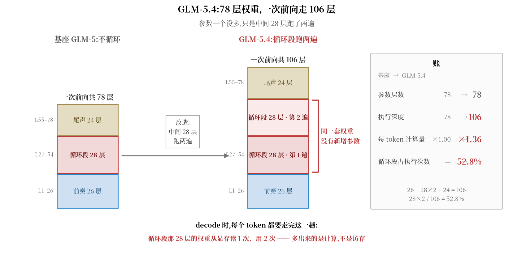
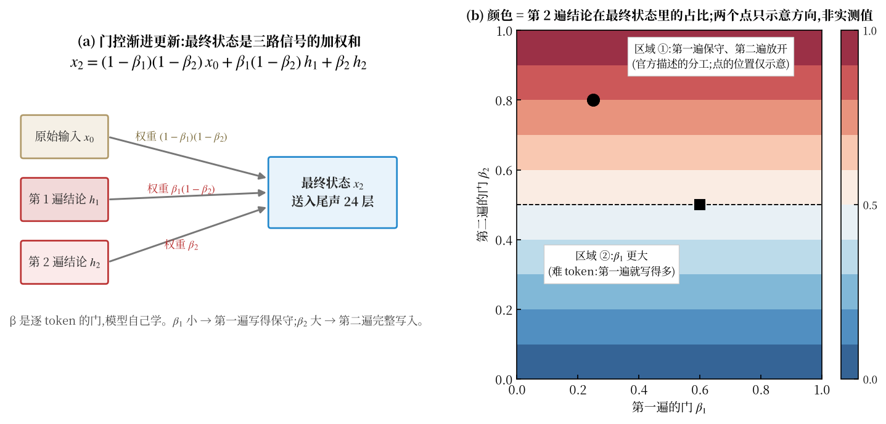
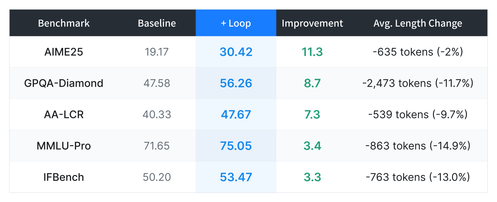
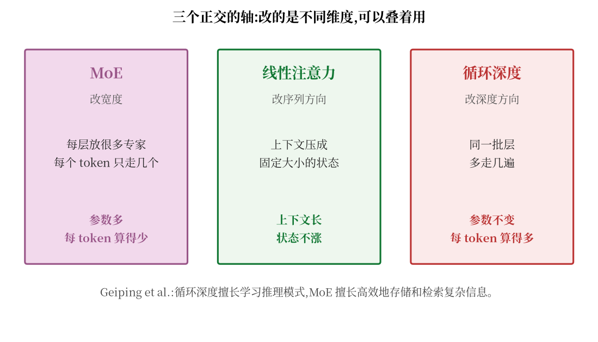

2026 年 11 月 23 日，智谱上线了 GLM-5.4。

官方博客的第一句话是:"过去三个月,我们同时激进地 scaling 了 loop 深度和模型大小。第一个惊喜来自 Loop Transformer 架构本身。"

这是 loop transformer(循环 Transformer)第一次被用在旗舰级模型上。而它的想法一句话就能说完:**让同一批层跑两遍。**

模型没有变大一层,却变"深"了。这件事听起来太便宜了——凭什么?

这篇把它拆开:loop 到底改变了什么、为什么普通模型不能直接拿来循环、GLM-5.4 为此做了哪三处改造、官方对照实验的数字说明什么、它和思维链/线性注意力/MoE 是什么关系、以及还没解决的问题。

## 一、先立常识:loop 不改层数,改的是"跑几遍"

这个词最容易被误解。先把两件事分开:

| | 普通模型 | Loop 模型 |
|---|---|---|
| **参数层数**(有多少套不同的权重) | 78 | 78 |
| **执行深度**(一次前向一共走了多少层) | 78 | 106 |

参数一个没多。变的是中间一段层被套了两遍。

从 GLM-5.4 的官方架构图读出来的布局:

| 段 | 层号 | 层数 | 执行几遍 |
|---|---|---|---|
| 前奏 Prelude | L1–L26 | 26 | 1 |
| **循环段 Loop** | **L27–L54** | **28** | **2** |
| 尾声 Coda | L55–L78 | 24 | 1 |

$$26 + 28 \times 2 + 24 = 106$$

一个现成的旁证:GLM-5 的开源配置里 `num_hidden_layers` 是 78,和这张图完全吻合。循环段占物理层的 35.9%,但按执行次数算,它占了 106 次里的 52.8%——**这个模型一半以上的层计算,发生在那 28 层里**。

所以"模型变深了"这句话,严格说是"**计算图变深了,模型没变**"。这两个概念分清,后面才不会乱。

## 二、为什么只循环中间,不循环全部

三个模型,三个团队,答案一样:

- **GLM-5.4**:循环中间 28 层,两头各留一段不循环
- **Huginn**(Geiping et al., 2025):前奏 2 层 + 循环 4 层 + 尾声 2 层
- **SMELT**(清华 + 字节 Seed, 2026):在 12 层模型上把循环位置从 0 到 12 层扫了一遍,验证损失在 50% 处最低

原因来自对普通 Transformer 的一类观察:一个模型的头几层和末几层很特殊——头几层负责把 token 揉成概念,末几层负责把概念变回词表分布;而中间那些层,功能上比较"可互换"。

SMELT 的扫描数据直接说明了这一点。同样是循环、同样把计算量和参数量对齐:

| 循环了几层(共 12 层) | 验证损失(越低越好) |
|---|---|
| 0(不循环) | 1.9445 |
| 2 | 1.9384 |
| 4 | 1.9275 |
| **6** | **1.9257** |
| 8 | 1.9374 |
| 10 | 1.9413 |
| 12(全部) | 1.9322 |

循环 6 层(正好一半)最好。循环 10 层,反而比只循环 2 层还差——头尾那几层各有专职,强行让它们"再干一遍自己不擅长的活"是亏的。

## 三、核心公式:第二遍到底在算什么

把循环段看成一个函数 $R$,它接收两个输入:上一轮的状态 $x_{i-1}$,和最初进来的信息。

GLM-5.4 的官方图给出的第一轮更新是:

$$x_1 = x_0 + \beta_1 (h_1 - x_0)$$

其中 $h_1 = R(x_0)$ 是循环段跑完一遍后的输出,$\beta_1$ 是一个**逐 token 的门**。

这个式子值得看三眼。如果 $\beta_1 = 1$,它就是 $x_1 = h_1$,普通的"输出覆盖输入"。如果 $\beta_1 = 0$,这遍等于白跑。$\beta_1$ 是模型自己学的,**每个 token 一个值**,决定"这一遍的结论,写回去几成"。

第二轮同构:

$$x_2 = x_1 + \beta_2 (h_2 - x_1), \qquad h_2 = R(x_1)$$

把两轮展开:

$$x_2 = (1-\beta_1)(1-\beta_2)\,x_0 + \big[\beta_1(1-\beta_2)\big] h_1 + \beta_2\, h_2$$

最终状态是三路信息的加权混合:**原始输入、第一遍的结论、第二遍的结论**。权重由两个门决定。

这就是 loop 和普通深层的本质差别。一个普通的 106 层模型,每一层都在往残差流上叠加新的变换;而 loop 是**同一套权重,对同一个问题给出两次判断,再把两次判断按置信度融合**。

## 四、为什么普通模型不能直接拿来循环

你可能会想:那我拿 Llama,把第 20 到 40 层跑两遍,是不是就白赚 20 层?

不行。问题出在**分布**上。

第 27 层的权重,是在"输入永远是第 26 层的输出"这个前提下训练出来的。你把它的输出再喂回去,它收到的信号就不是它见过的那种了——尺度不对、方向不对,后面的层收到的表示会跑出正常范围。

Huginn 论文记录了这件事有多容易翻车。他们第一次大规模训练,只改了两个看似无关的设定(去掉归一化层的可学习参数、把学习率调高十倍),结果:

> "hidden state 的相关性很快趋近 1.0——模型对序列里每个 token 预测出了同一个隐状态。"

第二次修了一半,模型不崩了,但**用 1 轮循环和用 32 轮循环,验证困惑度一模一样**——模型早早学会了忽略传进来的状态 $s$。两次失败,一次是塌缩,一次是"学会了但不用"。

所以循环不是运行时加个 for 循环就完事,必须从训练时就让模型适应。这也是为什么 GLM-5.4 走的是"**续训**"路线——官方原话:从零训练的循环模型在同等预训练算力下仍然落后于不共享的模型,所以他们把一个**已经预训练好的基座**改造成 loop,再用相对小的算力续训。

## 五、GLM-5.4 的三处改造

官方博客说,把中间层改成多遍循环,在 750B 这个规模上踩了三个坑,对应三个解法。

### 5.1 门控渐进更新:第一遍保守,第二遍放开

**坑**:直接覆盖隐状态,"激活范数会在迭代间爆炸",下游层收到的表示超出它们习惯的尺度和分布。

**解法**:就是第三节那个逐 token 的门 $\beta$。

训练完之后,两个门自己长出了分工。官方的描述:

- **第一遍**:建立全局上下文,门值小,**保守地写**,保证尺度稳定
- **第二遍**:在这个状态上精修,门开大,**完整地写**

而且门会看 token 的难度:难的 token,第一遍就写得更激进一些,让复杂预测更早受益于迭代。

这段话翻译成公式就是:$\beta_1$ 通常偏小,$\beta_2$ 通常偏大。这和 SMELT 在 MoE 上量到的现象一致——他们测了 16 组配置,第二遍写进残差流的更新量是第一遍的 **1.2 到 3.5 倍**,而且两次写入方向的余弦相似度是正的(同一个物理层平均 0.56)。

**第二遍不是推翻第一遍,是在同一个方向上放大。**

### 5.2 混合 KV cache:第二遍只多存一个滑窗

**坑**:朴素实现下,每一轮循环都要存一份完整的 KV cache,内存直接乘以循环次数。

GLM-5.4 的基座上下文长度是 100 万 token。多存一份就是多 1 份百万 token 的 cache。

**解法**:官方图里那张 "Two-Bank Sparse MLA" 说明了做法——第二遍的注意力同时看两个来源:

| 来源 | 内容 | 存多少 |
|---|---|---|
| Pass 1 前缀 | 第一遍选中的稀疏 KV(latent + top-k) | 不新存,直接复用 |
| Pass 2 滑窗 | 第二遍自己新生成的 KV | 只存一个滑动窗口(架构图标注为 128-tok window) |

两份可以在同一位置重叠,模型能同时看到"第一遍看到的上下文"和"第二遍更新后的局部表示"。

官方的说法是:"多一遍循环,只多花一个滑窗的 KV cache,而不是一整份上下文缓存。"

这里能确定的是结构,不是具体数字:滑窗的长度在官方博客和开源配置里都没有给出(架构图上的标注是 "128-tok window"),所以"到底省了多少"暂时算不出来,等权重开源后看配置。能确定的是量级关系——基座的上下文是 100 万 token,而一份完整 cache 和一个滑窗之间的差距,是两个数量级。

### 5.3 稀疏索引复用:第二遍不再找"看哪里"

**坑**:基座用的是稀疏注意力——每一层先由 indexer 挑出最该看的 top-k 个位置,再做注意力。这个挑选本身要算。循环一遍,就得多算一遍索引。

**解法**:第二遍**直接用第一遍选出来的索引**,自己不算。

官方图里这个设计标得很清楚:循环段的 block 在 Pass 1 是 "DSA Block **w/ Indexer**",到了 Pass 2 变成 "DSA Block (**w/o Indexer**)"。前奏段从第 3 层起、尾声段全部,都标着"Reuse top-k indices"。

基座的开源配置能逐项对上这张图:`index_topk: 2048`(每个 query 选 2048 个位置)、`index_topk_freq: 4`(每 4 层算一次索引,其余 3 层沿用),`indexer_types` 里 `full` 和 `shared` 交替出现——这正是架构图上"4 层一个 block、只有第一个 block 自己算索引"的来源。

官方称这样做和"每遍都重算索引"的效果几乎一样。

这件事的含义比省算力更重要:**两遍看的是同一批位置,变的是从这些位置读出来的内容**。SMELT 独立量到了同一件事——同一个注意力头在两遍里选中的 top-8 token,重叠 56%–66%(对照组只有 28%–34%);Q 和 K 在两遍间的余弦相似度是 0.89–0.93,而 V 掉到 0.65–0.74。

**"看哪里"沿用了,"读到什么"变了。**

## 六、官方对照实验:数字说了什么

GLM-5.4 没有从零训练,那 loop 到底有没有用?官方在发布前做了一个对照:拿一个**30B**、架构和 750B 基座完全相同的模型,**参数量完全相同**、只是训练算力多约 10%,比较加不加 loop。

| 基准 | 基线 | + Loop | 提升 | 平均输出长度变化 |
|---|---|---|---|---|
| AIME25 | 19.17 | 30.42 | +11.3 | −2% |
| GPQA-Diamond | 47.58 | 56.26 | +8.7 | −11.7% |
| AA-LCR | 40.33 | 47.67 | +7.3 | −9.7% |
| MMLU-Pro | 71.65 | 75.05 | +3.4 | −14.9% |
| IFBench | 50.20 | 53.47 | +3.3 | −13.0% |

两个读法值得说清楚。

**读法一:推理链越长,赚得越多。** 提升最大的是 AIME25(数学竞赛)和 GPQA-Diamond(研究生级理科问答),这两类题需要长链条推理;MMLU-Pro 和 IFBench 偏知识型和指令跟随,提升在 3 分多。官方的总结也是这句:数学、科学推理、长上下文任务收益最大。

**读法二:思考的 token 变少了。** 除了 AIME25,其余四项的平均输出长度都缩短了 10%–15%,官方说主要来自思维链变短。

第二条比第一条更有意思,因为它回答了一个争论:**loop 会不会替代思维链?**

## 七、loop 和思维链:不是替代,是换了个维度

这个问题容易混。两种"多想一会儿"的机制,载体完全不同:

| | 思维链(CoT) | 循环深度(Loop) |
|---|---|---|
| 多出来的计算发生在 | **序列维度**:多写 token | **深度维度**:同一批 token 的隐状态多过几遍层 |
| 中间结果存在哪 | 文本里,写进上下文就固化 | 激活里,每步用完即弃 |
| 占不占上下文位置 | 占 | 不占 |
| 进不进 KV cache | 进 | 不新增(见 5.2) |
| 人大致能读到吗 | 能 | 不能 |
| 花的是什么 | 解码时间 + 上下文长度 | 每层前向的 FLOPs |

所以"把 CoT 换成隐状态"这个说法不准确。它们不是一回事的两种写法,而是两个正交的方向。

那官方"输出长度下降 10–14%"怎么解释?合理的解读是**有一部分推理从"写出来"挪到了"在里面想"**:原本需要先用文字铺三步才能到的结论,现在两遍循环里就能直接到,于是少写了一些。

但注意边界。AIME25 上输出长度只降了 2%——最难的题,该写的步骤还是得写。而且 AIME 这一项的基线是 19.17,30 道题,每题约 3.3 分,**+11.3 分大约就是多做对了 3 到 4 道题**。这个数字方向可信,幅度别读得太精。

还有一条要诚实交代:Ouro 论文(字节,2025)在 Quora 问题对上做了个探针实验——用第 2 轮循环的隐状态去预测第 4 轮的答案,只有 36.1% 一致;相邻两轮之间是 55.1%。也就是说,**模型的决定确实在循环之间被改写**,不是"第一遍就定了,后面只是走个形式"。这是 loop 真的在"想"的一个证据。但同一篇论文也说,这类观测不是因果证明。

## 八、loop 和线性注意力、MoE:三个正交的轴

GLM-5.4 的基座本身就同时用了另外两样东西,所以这三个概念经常被放在一起谈。它们改的是不同的维度:

| 机制 | 改的是 | 省/花的是什么 |
|---|---|---|
| **MoE** | 每层 MLP 的宽度:很多专家,每个 token 只走几个 | 参数多、每 token 算得少 |
| **线性注意力** | 沿序列方向的依赖:上下文压成固定大小的状态 | 上下文长、状态不涨 |
| **循环深度** | 沿深度方向的计算:同一批层多走几遍 | 参数不变、每 token 算得多 |

一个旁证:GLM-5.3-Flash 的开源配置里,45 层中有 34 层是 `linear_attention`、11 层是稀疏全注意力,正好 3:1 混合;同时是 MoE(288 个路由专家,每个 token 选 8 个)。这个系列本来就是几种机制叠着用的。

三个轴为什么能叠?Geiping 在 Huginn 论文里有一句话,被后续工作反复引用:

> "循环深度擅长学习推理模式,MoE 擅长高效地存储和检索复杂信息。"

Ouro 论文用实验验证了前半句。他们让模型背合成传记,量"每个参数能存多少比特的知识":

- 循环 4 遍的模型和不循环的模型,**每个参数都是约 2 比特**,几乎没差
- 但在"知识操纵"任务上(模运算树、多跳问答),同参数的循环模型明显更好——比如表达式长度 16 的模运算,2 层循环 6 遍的模型对 96.3%,12 层不循环的只有 94.4%;长度拉到 24,前者 78.0%,后者 34.8%

**循环没有让模型多记住东西,它让模型更会用手里的东西。** 这也解释了第六节的表格:为什么知识型的基准提升小、推理型的提升大。

## 九、在 GPU 上,loop 是便宜还是贵

这个专栏的读者会关心硬件账。

参数侧:一个权重都没多。显存里放的还是 78 层的权重。

计算侧:有效深度 106 层对 78 层,**每个 token 的 FLOPs 多了 35.9%**。

这里有一个和之前那篇"注意力在 GPU 上"正好接上的点。那篇讲过,prefill 是计算受限、decode 是带宽受限,而 decode 慢是因为每生成一个 token 都要把全部权重从显存读一遍。

loop 在 decode 时的行为很特别:**循环段那 28 层的权重,读一次,用两遍。**

- 如果循环段的权重能留在片上(Shared Memory 放不下整个模型,但 28 层分 tile 流过时,同一个 tile 的两次使用是相邻的)——多出来的那一遍计算,几乎不额外花带宽
- decode 本来就是带宽受限、算力闲置 99.7%,多出来的 35.9% 计算正好填进空闲的算力里

这是 loop 在 decode 上的一个天然优势:**它增加的是计算,不是访存**;而 decode 缺的恰恰不是计算。当然实际能兑现多少,取决于 kernel 怎么写——官方也说了,要做到 200 token/s(非高峰)"需要模型和推理基础设施的紧密协同设计",并把循环放大的碎片化开销在系统层面做了算子融合。

反过来说,prefill 是计算受限的,多 35.9% 的计算就是实打实多 35.9% 的时间。所以 loop 的推理成本,主要加在 prefill 上,decode 上加得少。

## 十、业界现状:证据分级

截至 2026 年 11 月 23 日,loop transformer 的落地情况,按证据强度排:

| 证据强度 | 模型/工作 | 具体做法 | 来源 |
|---|---|---|---|
| **官方公开架构** | **GLM-5.4**(智谱,2026.11) | 750B 基座,循环 28 层 × 2 遍,续训 | 官方博客 + 架构图 |
| **官方公开架构** | Ouro 1.4B / 2.6B(字节,2025) | 全部 24 层(2.6B 是 48 层)循环 4 遍,7.7T token 从零训练,带早退门 | 论文 + 开源权重 |
| **官方公开架构** | Huginn-0125(2025) | 3.5B,2+4+2 布局,循环次数训练时随机采样 | 论文 + 开源权重 |
| **官方公开架构** | Nanbeige4.2-3B | 模型卡写明 "Looped Transformer",隐状态自底向上走完后反馈回同一批层 | 模型卡 |
| **论文** | SMELT(清华 + 字节 Seed,2026) | MoE + 中间一半循环 2 遍,三项预算对齐,最大 54B 非嵌入参数 | arXiv:2609.01343 |
| **媒体报道,未获官方确认** | OpenAI GPT-6 Astra | The Information 报道其使用 recurrent depth;官方只确认了计算图深度的相关说法 | 二手 |

几个值得记的结果:

- **Ouro**:1.4B 的循环模型在多数基准上追平 4B 的 Qwen3-Base(MATH500:82.40 对 59.60);2.6B 追平 8B。但**训练到 4 遍,推理时跑 5–8 遍,性能是下降的**——外推到没训过的深度不行
- **Ouro 的两个工程细节**:prefill 阶段每遍循环都需要各自的 KV cache(强行共享,GSM8K 掉 10 分以上);decode 阶段只保留最后一遍的 cache,显存降到 1/4,几乎不掉分
- **SMELT**:把每 token FLOPs、总参数、KV cache 三项同时对齐之后,循环版的损失曲线仍然更陡,在算力最优点上省 6.8%–18.0% 的训练 FLOPs;代码类任务最多,20.4%
- **SMELT 找到的第二遍机制**:在 Dyck 括号匹配任务上,他们定位了负责的那个注意力头——第一遍时,它把 60% 的注意力质量放在段首的 sink token 上;第二遍,sink 降到 2%,示范答案上的注意力从 24% 升到 85%

最后这条是目前对"第二遍到底在干什么"最具体的一个答案:**第一遍还不知道该看哪里,注意力悬在句首;第二遍知道了,把注意力放到了真正有信息的位置上。**

## 十一、还没解决的问题

官方博客自己列了两个:"如何做到自适应计算,让更难的 token 动态获得更多迭代",以及"循环次数和模型规模继续增长时,回报怎么变"。

再加上论文和配置里能看到的:

**循环次数不是越多越好。** SMELT 在对齐算力的前提下试了 2、3、4 遍,2 遍最好——多循环一遍,模型就得变窄一点来付这个算力,得不偿失。Ouro 最初用 8 遍训练,出现 loss 尖峰,降到 4 遍才稳。

**自适应深度还没进旗舰。** GLM-5.4 是固定的两遍。Ouro 和 Huginn 都做出了早退机制(简单的 token 少循环),但 Ouro 在论文里说,正因为深度是变的,现成的强化学习推理框架跑不了,他们的 RL 尝试没有超过 SFT 的结果。

**思维链的可读性。** 推理往激活里挪,人能读到的部分就变少。Huginn 的作者在论文里自己提了这一点。Ouro 的探针实验算是一个回答的起点——中间状态是能被读出来、也确实在变的——但离"可监督"还有距离。

**"马拉松式思考"。** 官方承认 GLM-5.4 有时会陷入过长的思考循环。loop 把每一步的推理能力变强了,但"什么时候该停"是另一个问题。

## 十二、总结

四条带走:

**1. Loop 改的是执行深度,不是参数层数。** GLM-5.4:78 层权重,106 层执行;中间 28 层跑两遍。只循环中间、不循环两头,是三个独立团队共同的结论。

**2. 第二遍是"放大",不是"重写"。** 门控融合的公式 $x_2 = x_1 + \beta_2(h_2 - x_1)$ 决定了最终状态是原始输入和两遍结论的加权混合。两遍看的是同一批位置,读出来的是不同的内容;注意力从句首的 sink 挪到了真正有信息的地方。

**3. 循环提升的是"用知识",不是"存知识"。** 每个参数存的知识量不变(约 2 比特);变强的是多步推理。所以同参数对照里,AIME 涨 11 分,MMLU-Pro 涨 3 分。

**4. 它和思维链、线性注意力、MoE 是三个正交的轴,可以叠着用。** 思维链在序列维度多想,loop 在深度维度多想。官方实验里思考 token 少了 10%–14%,说明有一部分推理确实从"写出来"挪到了"在里面想"——但最难的题,该写的还是得写。

GLM-5.4 的权重官方说会在安全加固后开源。等配置公开,这篇里从架构图读出来的数字可以再对一遍。

下一篇回 GPU 解剖台,填分支发散的坑。

如果这个系列对你有用,点个赞或关注专栏,更新会持续。

---

*参考:Z.ai, "Toward Generalized Coding with Our First Loop Transformer"(GLM-5.4 官方博客,2026.11.23,含架构图与 30B 同参数对照实验数据);zai-org/GLM-5、GLM-5.3-Flash 的 Hugging Face 配置文件(num_hidden_layers、layer_types、index_topk 等);Geiping et al., Scaling up Test-Time Compute with Latent Reasoning: A Recurrent Depth Approach(arXiv:2502.05171,NeurIPS 2025);Zhu et al., Scaling Latent Reasoning via Looped Language Models / Ouro(arXiv:2510.25741);Wang et al., SMELT: Scaling Laws for Compute-Matched MoE Looped Transformers(arXiv:2609.01343);Dehghani et al., Universal Transformers(arXiv:1807.03819);Bae et al., Mixture-of-Recursions(arXiv:2507.10524);Nanbeige4.2-3B-Base 模型卡。文中层数、占比、相对提升均按官方图表数字复算;关于 OpenAI 的部分为媒体报道,未经官方确认。*
