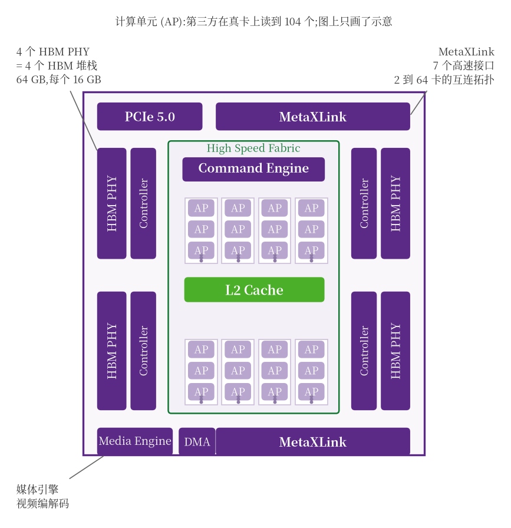
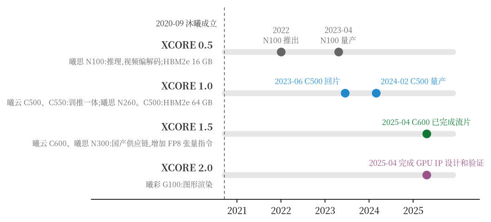
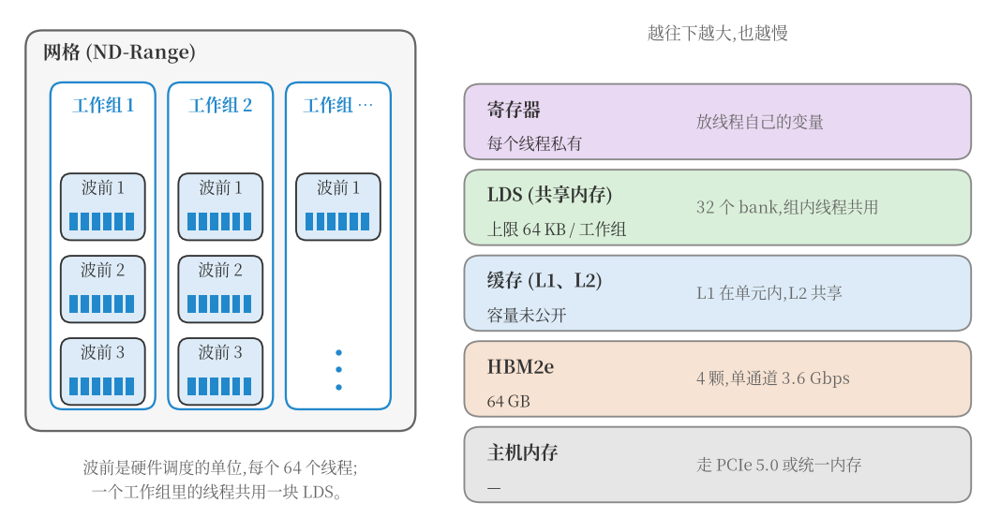
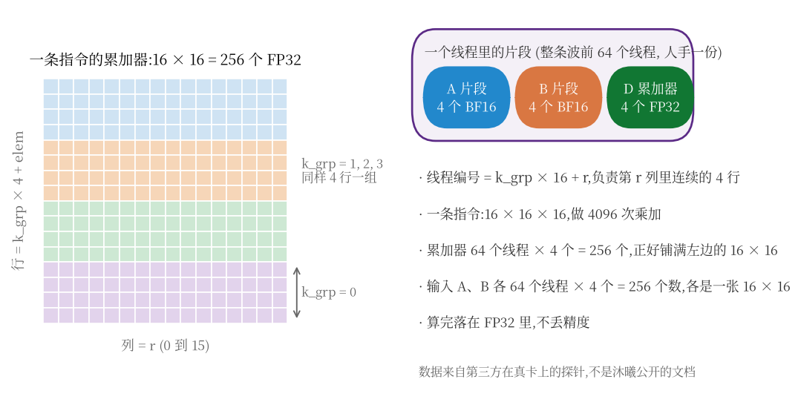
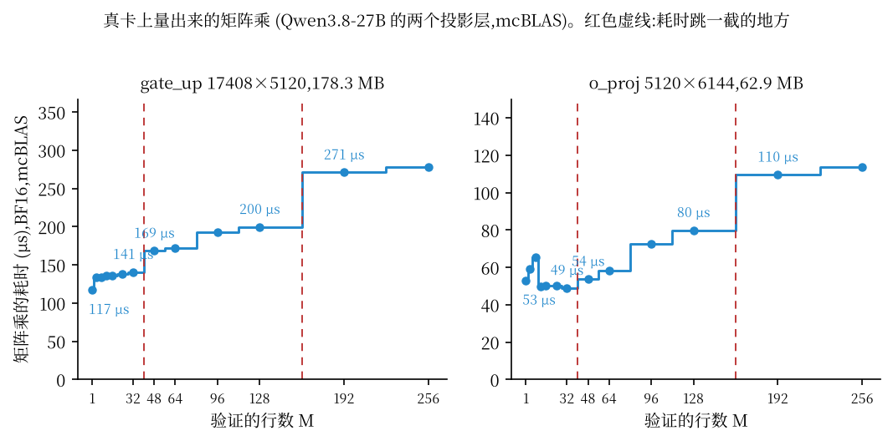
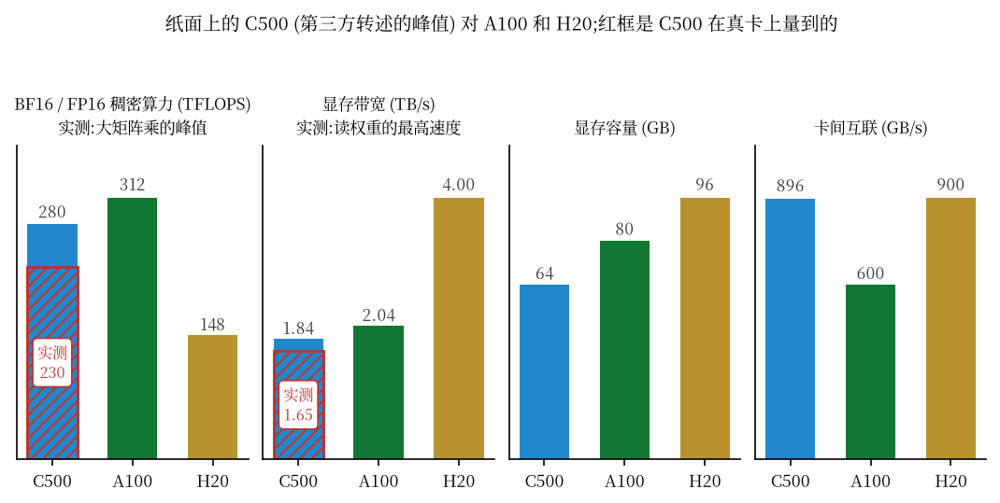

你写 `__builtin_mxc_mma_16x16x16bf16(a, b, c)` 这一行的时候,一条指令,16 × 16 × 16,4096 次乘加,由一条 64 线程的波前一起做完。

它是沐曦曦云 C500 上对应 Tensor Core 的那部分。沐曦没有公开过微架构手册,这一行在电路里怎么实现,没有文档可查。

能查的是三样东西。招股说明书和问询回复里有芯片的框图,两级缓存的结构,封装和显存的规格。沐曦在 GitHub 上公开了示例代码和算子库源码。有人在这张卡上量过带宽,量过矩阵乘,还用探针把这条指令的寄存器排布试了出来。

这篇把三样拼起来。先拆硬件,从整颗芯片到一条指令;再走软件,从驱动到框架;最后看纸面上的数在真卡上跑出几成。

文中每个数都写了来历。沐曦自己公布的,第三方在真卡上量的,从这两者推算的,三种分开写。

## 一、全景:一颗芯片里有什么

沐曦在招股书里放过一张 GPU 的基本组成架构图。C500 是它第一款训推一体的芯片,照这张图讲:



打个比方,这是一张发动机舱的布局图。两侧是油路,上下是传动轴,中间是发动机。布局图告诉你东西放在哪,不告诉你每个汽缸有几个气门。

外面一圈是接口。左上角是 PCIe 5.0,上下两条是 MetaXLink,左下角是媒体引擎,旁边是 DMA。

左右两侧各有一组 HBM PHY 和控制器,一共 4 个。问询回复里写了:C500"采用 4 颗 HBM2e 实现 2.5D 封装"。显存一共 64 GB,每颗 16 GB。

中间由一圈 High Speed Fabric 围着,从上到下是命令引擎,一组计算单元,L2 缓存,再一组计算单元。方格里写的 AP 是计算单元,招股书里叫它流处理器。

计算单元的数,真卡上读到的是 104 个。这个数只有一处出处,是第三方在卡上读设备属性得到的。

招股书,问询回复和官网能确认的 C500:

| 项 | 内容 |
|---|---|
| 架构 | 自研 XCORE 1.0 架构,指令集超过 600 条 |
| 运算单元 | 标量,矢量,张量三类 |
| 显存 | 4 颗 HBM2e,共 64 GB,全链路 ECC |
| 封装 | 2.5D 封装,HBM2e 和芯片封在 CoWoS-S 上 |
| 形态和功耗 | 全高全长双槽 PCIe 板卡,350 W |
| 精度 | FP64,FP32,TF32,FP16,BF16,INT8 |
| 互联 | 每颗芯片 7 个 MetaXLink 接口,PCIe 版支持 2 卡或 4 卡 |
| 虚拟化 | 最小 1% 颗粒度的软切分,可支持 16 个实例 |
| 时间 | 2023 年 6 月回片,2024 年 2 月量产 |

图上没画的,沐曦也没公布:制程,晶体管数,频率,缓存容量。

## 二、来历:XCORE 的四代



沐曦 2020 年 9 月成立。招股书里写,核心创始团队是整建制 AMD 背景,创始人 2007 年到 2020 年在 AMD 上海任职到高级总监。

四代架构一条线下来:

| 架构 | 产品 | 显存 | 变化 |
|---|---|---|---|
| XCORE 0.5 | 曦思 N100 (2022) | HBM2e 16 GB | 推理,视频编解码 |
| XCORE 1.0 | 曦云 C500,C550,曦思 N260 | HBM2e 64 GB | 训推一体,多精度混合算力 |
| XCORE 1.5 | 曦云 C600,曦思 N300 | HBM3e,HBM3 | 国产供应链,张量算力加倍,加了 FP8 |
| XCORE 2.0 | 曦彩 G100 | 未公布 | 图形渲染 |

C500 在第二代。同系列的 C550 是 OAM 模组的形态,显存同样 64 GB,功耗 450 W,支持 8 卡全互连。FP8 要等到 C600。

指令集跟着架构走。第一代计算指令集"基本涵盖了主流 GPU 所需求的各类矢量计算,访存以及张量计算功能",支持六种精度,满足 OpenCL 标准。

问询回复里对它有一句对标:第一代指令集"核心算力对标同等工艺水平国际 GPU 龙头英伟达 A100 的水准"。

到 XCORE 1.5,沐曦"加倍 FP16/BF16 tensor 的矩阵运算算力",加了 FP8 和 BF8 的张量指令,加了张量转置指令。

## 三、计算单元:标量,矢量,张量

招股书说 C500"拥有丰富的标量,矢量和张量计算单元"。三类各管一件事。

标量单元管每个线程都一样的活:更新指针,算循环下标,判断分支。矢量单元管每个线程各算各的活:加减乘除,逻辑运算。张量单元管整条波前合做的活:一块矩阵乘加。

线程怎么组织,是 SIMT 的那一套:



线程是最小的单位。硬件调度的单位是波前,64 个线程。一条矢量指令,64 个线程一起发出去;一条矩阵指令,64 个线程合做一个 16 × 16 的输出块。

波前再组成工作组。一个工作组里的线程共用一块共享内存,沐曦叫它 LDS。工作组再组成网格。沐曦的文档把这两层叫 ND-Range 和 Workgroup。

64 这个数有两处旁证。沐曦自己的基准测试仓库里写着:不同 GPU"如 WarpSize 的区别,需要用宏进行隔离"。

另一处在沐曦的算子库,一条注释是针对 C600 写的:物理上的 warp 是 64 个通道,而代码里 `WARP_SIZE` 定义成了 32。

C500 上波前是 64,是第三方在真卡上确认的。

指令怎么发射,招股书列了三条。

一是标量,矢量,张量混合的超标量发射流水线。二是零开销的线程切换,一条波前在等内存的时候,硬件切到另一条,不花额外时间。

三是最有特点的一条:双发射由软件打标记。问询回复写得更细:"创新性地采用软件控制指令双发射的方式,在指令集中引入临时寄存器缓冲解决双发射引入的寄存器端口冲突问题,大幅降低了硬件设计复杂度"。

打个比方,这像出车前由调度员在单子上标好哪两趟可以拼车,司机照着单子走,不在路上临时判断。硬件不用自己判断哪两条指令能一起发,电路就简单了。

代价是两条指令一起发会抢寄存器的端口,所以指令集里加了一块临时寄存器缓冲。

还有一条关于存储:招股书说访存优化是"通过动态调整存储大小来灵活适配计算需求"。每个工作组能用的共享内存上限是 64 KB。

这个上限有个旁证。沐曦算子库里判断一张卡是不是 C600,用的就是下面这一行。反过来读,C500 每个工作组不超过 64 KB。

```cpp
// mcoplib, op/vllm/layernorm_kernels.cu
bool is_c600 = prop.sharedMemPerBlock > 65536;
```

任务派发是硬件做的。框图里的命令引擎,在问询回复里的说法是"实现自主研发的高性能硬件任务调度"。

## 四、张量单元:一条指令的解剖

沐曦算子库里对这条指令的包装,和一处真实的调用:

```cpp
// MetaX-MACA/mcoplib, op/sglang/include/mma_common.cuh
#define mma_16x16x16bf16(a_reg, b_reg, c_reg) \
    c_reg = __builtin_mxc_mma_16x16x16bf16(a_reg, b_reg, c_reg)

// op/chunk_gated_delta_rule_fwd_h_native.cu
using NativeB64   = __NATIVE_VECTOR__(2, uint32_t);   // 4 个 BF16
using NativeF32x4 = __NATIVE_VECTOR__(4, float);      // 4 个 FP32

projection[mi][ni] = __builtin_mxc_mma_16x16x16bf16(af[mi], bf[ni], projection[mi][ni]);
```

形式和 CUDA 的 `mma.sync` 一样:传 A 片段,B 片段,进来的累加器,返回新的累加器。差别在形状。

NVIDIA Ampere 的一条 warp 指令 `m16n8k16` 做 16 × 8 × 16,一条指令 2048 次乘加,32 个线程分。C500 一条波前指令做 16 × 16 × 16,4096 次乘加,64 个线程分。

两边算下来,每个线程都是 64 次乘加。

$$16 \times 16 \times 16 = 4096\ \text{MACs}, \qquad 4096 \div 64 = 64\ \text{MACs per thread}$$

每个线程手里的东西,是第三方用探针在真卡上试出来的:



线程编号是 `k_grp × 16 + r`。每个线程持有 A 的 4 个 BF16,B 的 4 个 BF16,4 个 FP32 累加器。它的累加器落在输出块的第 r 列,从第 `k_grp × 4` 行开始的 4 行。

对一下数:64 个线程,每个 4 个累加器,一共 256 个,正好铺满 16 × 16。A 和 B 也一样,64 × 4 = 256 个数,各是一张 16 × 16 的矩阵。

乘加的结果落在 FP32 里。输入是 BF16,累加不丢精度,和 NVIDIA 的做法相同。

同一个文件里还有搬数据的内建指令,带谓词的读写有三组:

```cpp
// op/sglang/include/mma_common.cuh
#define ldg_b128_bsm_async(saddr, base, pred, ret0_en)                                                \
    __builtin_mxc_ldg_b128_bsm_predicator(cast_b128(saddr), cast_b128(base), 0, ret0_en, true, false, \
                                          true, pred, 1, MACA_ICMP_EQ);
```

`bsm` 按用法看是块的共享内存。这一条从全局内存一次搬 16 个字节进共享内存。宏名换成 `_reg_` 就搬进寄存器,换成 `stg_` 就写回全局内存。作用和 Ampere 的 `cp.async` 相近。

## 五、峰值从哪来:把 A100 的九成拆开

张量峰值由三个数相乘:

$$P = N_{\text{CU}} \times \text{MAC}_{\text{cycle}} \times 2 \times f$$

计算单元数,每个单元每周期做多少次乘加,频率。沐曦官网没有写 C500 的算力。

市面上流传的峰值来自一份平台文档,它标的是引自官方数据的理论峰值,对象是 OAM 形态:BF16 和 FP16 280 TFLOPS,TF32 140,INT8 560 TOPS,FP32 向量 18 TFLOPS,FP32 矩阵 36。

拿 A100 先验证这个公式。NVIDIA 的 Ampere 白皮书写着:108 个 SM,每个 SM 每周期 1024 次 FP16 乘加,加速频率 1.41 GHz。

$$108 \times 1024 \times 2 \times 1.41\ \text{GHz} = 311.9\ \text{TFLOPS}$$

对上了官方的 312。FP32 也一样,108 × 64 × 2 × 1.41 GHz = 19.5 TFLOPS。

现在轮到 C500。两个前提要说明。计算单元 104 个,来自第三方在真卡上的读数。

每个单元每周期 1024 次 BF16 乘加,64 条 FP32 通路,这是假设,相当于一条矩阵指令占 4 个周期。

把假设代进去,反过来求频率:

| 峰值 (TFLOPS) | 让它成立的频率 (GHz) |
|---|---|
| BF16 280 | 1.315 |
| FP32 向量 18 | 1.352 |

两个数落在同一个区间,1.31 到 1.35 GHz。一组假设同时对上两个峰值,说明模型站得住。

还有一套数也对得上。另几份资料写的是 FP32 15 TFLOPS,FP16 240 TFLOPS,INT8 480 到 512 TOPS。同一组假设下,15 对应 1.127 GHz,240 也对应 1.127 GHz。

**两套数很像同一颗芯片在两个频率点上的峰值。** 350 W 的 PCIe 板卡跑 1.13 GHz,450 W 的 OAM 模组跑到 1.3 GHz 以上。这是推算,沐曦没有这么说。

有了模型,A100 的九成就能拆开了。问询回复里沐曦自己的说法是 C500"综合性能对标英伟达 A100"。

纸面上,BF16 是 280 对 312,TF32 是 140 对 156,INT8 是 560 对 624,比值都是 0.897。

$$\frac{280}{312} = \frac{104}{108} \times \frac{1.315}{1.41} = 0.963 \times 0.933 = 0.898$$

九成由两部分组成:计算单元少 4%,频率低 7%。每个计算单元每个周期的吞吐,和 A100 的每个 SM 是一样的。

打个比方,这是参数表上的最高时速。C500 比 A100 少 4 个汽缸,转速低 7%,每个汽缸的排量相同。

差的那一截出在频率上,和沐曦自己的另一句话对得上。问询回复里写:"当前产品性能提升瓶颈主要体现在工艺制程"。

## 六、矢量单元和数据类型

矢量的峰值是 FP32 18 TFLOPS,是张量峰值的 6.4%。A100 是 19.5 对 312,6.3%。两张卡都是张量单元重,矢量单元轻。

C500 上有几个和 NVIDIA 不一样的地方,都是第三方在真卡上量出来的。

FP32 的 SIMT 吞吐实测约 15 TFLOPS,对得上 1.13 GHz 的那一套峰值。

`__hfma2` 比 FP32 的乘加还慢。NVIDIA 上半精度的打包运算快一倍,C500 上不快。

沐曦算子库里,打包的是 FP32:`__builtin_mxc_pk_fma_f32` 一条指令做两个 FP32 乘加,用了 99 次。

FP32 的矩阵乘走张量单元。第三方量到 FP32 大矩阵乘的峰值是 29.9 TFLOPS,比向量峰值的 18 高,对得上"FP32 矩阵 36"这个数。

INT8 的峰值是 BF16 的两倍,560 TOPS。TF32 是 BF16 的一半。FP8 在 XCORE 1.0 上没有,C600 才加。

## 七、内存层级:从寄存器到 HBM

从近到远是四层:寄存器,LDS,缓存,HBM。再往外是主机内存。

**LDS 是每个工作组的一块共享内存,上限 64 KB,分 32 个 bank。** 32 个 bank 这个数来自第三方,它踩过一个坑。

它的内核里,共享内存每一行的步长是 144 字节。用一条 64 位的加载去读,硬件会严重串行化。改成两条 32 位的加载,别的都不动,64 层加输出层的耗时从 63.02 ms 降到 49.55 ms。

打个比方,32 个 bank 像 32 条并行的收费车道。144 字节的步长让相邻的车总汇到同两条车道上,只能排队依次过。

缓存是两级,问询回复里写了结构。每个流处理器里有 L1 指令和数据缓存,L1 常量数据缓存,L1 矢量数据缓存。流处理器之间通过 L2 数据缓存共享数据。

各级缓存,HBM 和 PCIe 之间用"多维总线组网技术"连起来,带负载均衡。框图里围着计算单元的那一圈 High Speed Fabric 就是它。容量没有公布。

显存管理单元支持虚拟地址到物理地址的转换,用多级页表,不同大小的页可以混用。GPU 和 CPU 的虚拟地址空间可以融合,也可以隔离。沐曦的示例代码里有统一内存的例子。

HBM 是最外面一层,也是解码时的瓶颈所在。

$$4 \times 1024 \times 3.6\ \text{Gbps} \div 8 = 1.84\ \text{TB/s}$$

4 颗 HBM2e,每个堆栈 1024 根线,每根线 3.6 Gbps。堆栈数和速率是问询回复里的原话:"采用 4 颗 HBM2e,在所有 HBM2e 颗粒下的 CoWoS-S 上实现单通道 3.6Gbps"。

1024 根线是 HBM2e 的标准位宽。这三个数沐曦没有乘出来公布过。

真卡上的数能印证它。第三方量到读权重的最高速度是 1654 GB/s:一个 248320 × 5120 的输出层,1 行,mcBLAS,1536.7 µs。这是 1.84 的 90%。

有一篇对比文章写 C500 的带宽是 3.35 TB/s。实测的读速度只有它的 49%,一个只读不写的矩阵乘不该这么慢,这个数不成立。

自回归解码一步要把权重读一遍。Qwen3.8-27B 的 BF16 权重是 51.1 GB,第三方在 C500 上量到每个 token 38.69 ms。

$$\frac{51.1\ \text{GB}}{38.69\ \text{ms}} = 1321\ \text{GB/s}$$

是峰值的 72%。全速读也要 27.7 ms,所以这张卡上 27B 模型的自回归解码不会超过每秒 36 个 token。

把算力和带宽放在一起,能看出一张卡偏哪边。峰值算力除以峰值带宽:

$$\frac{280\ \text{TFLOPS}}{1.84\ \text{TB/s}} \approx 152\ \text{FLOP/byte}$$

每读一个字节,要做 152 次运算,张量单元才吃得饱。用实测的两个数算,229.6 除以 1.52,也是 151。

解码的时候每个权重字节只做 2 次运算。张量单元只派上用场 1.3%,时间都花在读权重上。

## 八、互联:MetaXLink,PCIe 和拓扑

卡和卡之间走 MetaXLink。问询回复里的数是每颗芯片 7 个接口,节点内支持 2 卡,4 卡,8 卡全互连,通过超节点架构可以到 16 卡,32 卡,64 卡。

官网写 C500 的 PCIe 板卡支持 2 卡或 4 卡互连。C550 的 OAM 模组支持 8 卡全互连,带宽 896 GB/s。

$$896 \div 7 = 128\ \text{GB/s per port}$$

每个接口 128 GB/s,这是推算。招股书说这个带宽"达到了英伟达 4nm 制程工艺下旗舰产品 (H200) 相当的互连带宽性能"。H200 的 NVLink 是 900 GB/s,A100 是 600 GB/s。

打个比方,这是车队之间的对讲机。C500 的对讲机带宽是 A100 的 1.5 倍,和 H200 持平。

拓扑不止一种。问询回复列了 Full-Mesh 和 Hybrid Cube Mesh,还写了"通过协议层设计创新,MetaXLink 具备较强的互连拓扑重构能力"。

XCORE 1.0 这一代还在每个 MetaXLink 上"引入了双模式,通过增强时延隐藏能力有效提高了传输带宽"。

对主机是 PCIe 5.0,招股书还说芯片支持 CXL。节点内走 PCIe 或 MetaXLink,跨节点走 InfiniBand 或以太网上的 RDMA。

DMA 管搬运,媒体引擎管视频编解码。虚拟化把一张卡切成多份,官网写的是最小 1% 颗粒度,问询回复写的是 C500 可支持 16 个实例切分。

## 九、软件栈:四层

软件栈叫 MXMACA,全称 MetaX Advanced Compute Architecture。问询回复里把它分成四层,从下往上:

![软件栈的分层图,从下到上。最底下是硬件:XCORE 1.0,计算单元,LDS 与两级缓存,4 颗 HBM2e 共 64 GB,MetaXLink 与 PCIe 5.0。软件驱动层:内核模式驱动,用户态驱动,内存访问与页表,虚拟化和容器,性能分析工具 mcProfiler,mcTracer,cycle-trace,代码调试。编程语言层:基于 LLVM 12 的 mxcc,编译 CUDA 源码的 cucc,cu-bridge,make_maca,cmake_maca,MXMACA C++ 和 Fortran,mcTriton。数学库及通信库层:mcBLAS,mcDNN,mcFFT,mcSPARSE,mcSOLVER,mcRAND,mcThrust,mcCUB,MCCL,mcTlass,mcoplib,mcFlashAttention。算法应用层:PyTorch,TensorFlow,JAX,vLLM,SGLang,LMDeploy,Megatron-LM,DeepSpeed,PaddlePaddle,FlashAttention,FlashInfer,FlashMLA,1,000 多个开源模型](images/fig6_stack.png)

**驱动层。** 内核模式驱动和用户态驱动,管内存访问,虚拟化和容器,性能分析,代码调试。第三方在卡上看到的驱动版本是 3.9.35。

问询回复说 C500 的驱动用了"异构内存管理与页表缓存技术,多种页表大小自适应混合技术",支持十余种操作系统。

**编程语言层。** 编译器叫 mxcc,装在 `/opt/maca` 下。沐曦官方示例的 Makefile 里是这样写的:

```make
MACA_PATH ?= /opt/maca
MXCC       = $(MACA_PATH)/mxgpu_llvm/bin/mxcc
MXCCFLAGS := -x maca
```

问询回复里写了它的底子:曦云 C500"根据架构分析选择 LLVM12 框架作为基础",后来升级到 LLVM 19。选项里有 `-emit-llvm` 和 `-mllvm`,设备后端的名字是 metaxgpu。

后端的选项名很能说明硬件有什么。`-disable_promote_alloca_to_bsm` 和 `-metaxgpu-bsm-direct-address` 里的 bsm 是块的共享内存。`-map_use_pk_fma` 对应上一节那条打包的 FP32 乘加。

编译器的测试用例,问询回复里写的是近 13,000 个。

**数学库及通信库层。** 一整套,名字对应 NVIDIA 的那一套:

| 沐曦的库 | 对应 NVIDIA 的 |
|---|---|
| mcBLAS | cuBLAS |
| mcDNN | cuDNN |
| mcFFT | cuFFT |
| mcRAND | cuRAND |
| mcSPARSE | cuSPARSE |
| mcSOLVER | cuSOLVER |
| mcThrust,mcCUB | Thrust,CUB |
| mcTlass | CUTLASS |
| MCCL | NCCL |

**算法应用层。** 问询回复的说法是支持超过 6,000 个 CUDA 应用,和超过 1,000 个开源模型。

推理框架上,vLLM 的官方组织有沐曦的专区。vllm-metax 按月和 vLLM 的版本对齐,2026 年 11 月是 v0.29.0。

工具在驱动层上面。问询回复点了三个名字:mcProfiler,mcTracer,还有时钟级的性能追踪器 cycle-trace,"以纳秒级精度分析每个 GPU 指令"。

打个比方,驾驶室是照着别家做的:方向盘,挡杆,踏板的位置都一样,发动机是自己造的。上层的人不用学新东西,写内核的人才碰得到发动机。

沐曦的技术报告里写了这套栈的规模。每个版本发布前跑 1 万 5 千多条测试用例,适配 40 多种框架,近 500 类模型,曦云 C 系列一个版本要用掉 6 万多个 GPU 小时。

## 十、兼容是怎么做到的

问询回复里专门回答了这个问题,MXMACA 怎么和 CUDA 生态兼容。答案分四块。

**第一块在硬件。** 原话是"发行人全系列产品与英伟达均采用统一的通用 GPU 架构,包括与 SIMT 相关的通用指令集,L2 cache 高级操作特性及高性能 GPU 架构设计等"。

线程模型一样,指令的功能一样,上层才好搬。

**第二块是源代码级兼容。** 原话是"采用源代码原生兼容 CUDA 生态的方式,支持 CUDA 源代码项目的工程构建自动切换到发行人 MXMACA 自主研发的完整工具链"。

做法是把编译过程接过来。沐曦的基准测试仓库里,同一个 Makefile,在 NVIDIA 上是 `make`,在沐曦上是 `make CC=cucc`。

仓库里还写了三条规矩:所有测试用 CUDA 编程语言编写,不允许用 PTX 写法;WarpSize 的区别用宏隔离;部分代码要切换宏 `NVIDIA_GPU_ARCH` 或 `METAX_GPU_ARCH`。

`cucc` 接的是 CUDA 语言写的源文件。`make_maca` 和 `cmake_maca` 是换了工具链的 make 和 cmake。`cu-bridge` 是 Gitee 上一个 Apache-2.0 的开源项目,沐曦的基准测试仓库写明受它启发,问询回复里说 MACA 软件自带这个工具。

写 MXMACA 自己的代码,差别更小。沐曦官方示例里的一段,分块矩阵乘:

```cpp
#include <mc_runtime.h>

__global__ void MatMulKernel_WithSharedMemory(Matrix2 A, Matrix2 B, Matrix2 C)
{
    int blockRow = blockIdx.y;
    int blockCol = blockIdx.x;
    Matrix2 Csub = GetSubMatrix(C, blockRow, blockCol);
    float Cvalue = 0;
    int row = threadIdx.y;
    int col = threadIdx.x;

    for (int m = 0; m < (A.width / BLOCK_SIZE); ++m)
    {
        Matrix2 Asub = GetSubMatrix(A, blockRow, m);
        Matrix2 Bsub = GetSubMatrix(B, m, blockCol);
        __shared__ float As[BLOCK_SIZE][BLOCK_SIZE];
        __shared__ float Bs[BLOCK_SIZE][BLOCK_SIZE];
        As[row][col] = GetElement(Asub, row, col);
        Bs[row][col] = GetElement(Bsub, row, col);
        __syncthreads();
        for (int e = 0; e < BLOCK_SIZE; ++e)
            Cvalue += As[row][e] * Bs[e][col];
        __syncthreads();
    }
    SetElement(Csub, row, col, Cvalue);
}
```

核函数和 CUDA 一字不差。`__global__`,`blockIdx`,`threadIdx`,`__shared__`,`__syncthreads`,全都在。

主机侧是同一份示例里的,中间省略了给 B 和 C 分配内存的几行:

```cpp
mcError_t err = mcSuccess;
mcMallocHost(&A.elements, m * n * sizeof(float));
mcMalloc(&d_A.elements, size);
mcMemcpy(d_A.elements, A.elements, size, mcMemcpyHostToDevice);
dim3 dimBlock(BLOCK_SIZE, BLOCK_SIZE);
dim3 dimGrid(B.width / dimBlock.x, A.height / dimBlock.y);
MatMulKernel_WithSharedMemory<<<dimGrid, dimBlock>>>(d_A, d_B, d_C);
mcStreamSynchronize(0);
err = mcGetLastError();
```

主机这边只换了前缀:

| CUDA | MXMACA |
|---|---|
| `cuda_runtime.h` | `mc_runtime.h` |
| `cudaError_t`,`cudaSuccess` | `mcError_t`,`mcSuccess` |
| `cudaMalloc`,`cudaFree` | `mcMalloc`,`mcFree` |
| `cudaMemcpy`,`cudaMemcpyHostToDevice` | `mcMemcpy`,`mcMemcpyHostToDevice` |
| `cudaStreamSynchronize(0)` | `mcStreamSynchronize(0)` |
| `cudaGetLastError`,`cudaGetErrorString` | `mcGetLastError`,`mcGetErrorString` |
| `nvcc` | `mxcc` |
| `nvidia-smi` | `mx-smi` |

Graph 是同一套名字。官方示例里流捕获的写法是 `mcStreamBeginCapture`,`mcStreamEndCapture`,`mcGraphInstantiate`,`mcGraphLaunch`。

编译器里判断平台的宏是 `__MACA_ARCH__`,对应 CUDA 的 `__CUDA_ARCH__`。算子库里用它区分设备:

```cpp
// mcoplib, op/chunk_gated_delta_rule_fwd_h_native.cu
// Both xcore1000 and xcore1008 belong to the C500 device branch.
#if defined(__MACA_ARCH__) && \
    ((__MACA_ARCH__ == 1000) || (__MACA_ARCH__ == 1008))
constexpr bool kC500DeviceImage = true;
#else
constexpr bool kC500DeviceImage = false;
#endif
```

**第三块是测试。** 问询回复里列的名词有:海量应用测试集,随机形式化验证,差分验证,CUDA 随机特性组合的功能验证,全软件栈的自动化回归测试。

**第四块是覆盖度。** 沐曦的技术报告给了一个逐项的数。从 GitHub 上挑 4,490 个带 CUDA 的仓库,在 MACA 上跑,4,173 个不用改代码,结果一致,占 92.94%。260 个改一点就能用,57 个不行。

问询回复里还引了几家单位的测试结论。中国科学技术大学写的是,曦云 C500"在性能上与 A100 处于同一 level",用 cu-bridge 工具"无需任何代码修改"就能把一个复杂的程序编到 C500 上。

上海超算中心写的是,借助 make_maca 工具"无任何修改即可编译并运行 cuda sample 代码"。

指令集有 600 多条,沐曦没有公开指令手册。算子库的源码里能数出用了哪些内建指令,一共 29 种,575 处:

| 类别 | 内建指令 | 处数 |
|---|---|---|
| 倒数 | `rcpf` | 196 |
| 打包的 FP32 乘加 | `pk_fma_f32` | 99 |
| 类型转换 | `cvt_*`,`*_cast_to_f32`,`i16_to_f16` | 89 |
| 带谓词的全局读写 | `ldg_b*`,`stg_b*` | 61 |
| 其中直接进共享内存的 | `ldg_b*_bsm_*` | 23 |
| 位域提取 | `ubfe` | 60 |
| 矩阵乘加 | `mma_16x16x16bf16`,`mma_16x16x16f16` | 33 |
| 同步 | `barrier_ex`,`arrive`,`barrier_inst` | 23 |
| 字节重排 | `byte_perm` | 10 |
| 投票计数 | `mbcnt_lo` | 4 |

这些名字和 AMD 的 GCN 指令集里同类指令的名字相同或相近:`v_pk_fma_f32`,`v_ubfe`,`v_perm_b32`,`v_rcp_f32`。招股书里写了团队的来历,命名上看得出来。

## 十一、代码搬过来,速度还剩多少

打个比方,这是"能开"和"开得快"的区别。挡杆的位置一样,车能走,动力够不够要上了赛道再说。速度要看四件事。

一是编译器管不了的地方。Triton 在 MACA 上写纯 BF16 的矩阵乘,能跑到 mcBLAS 的 93% 到 97%。

同样的骨架加上位运算,去解包一种 12 bit 的权重,就掉到 mcBLAS 的 0.49 倍,32 行的时候 0.11 倍。第三方找到的原因是字节级的加载加上位移解包,指令数上去,寄存器溢出。

换成手写的原生代码,用第四节那条矩阵指令,同样的事情在最大的那个矩阵上比 mcBLAS 快 4% 到 8%。

二是 LDS 的 bank。第七节那个例子,一条 64 位加载拆成两条 32 位,省了 13.47 ms。

三是有的东西没有。Hopper 专属的 FlashAttention-3 在 C500 上用不了。`torch._int_mm` 要求行数大于 16。FP8 不支持。

四是矩阵乘的耗时是台阶状的。第三方在真卡上量了两个投影层:



1 到 32 行是第一级,耗时只涨 20%。到 48 行跳一截,再涨 20%。128 到 192 行跳得更多,涨 36%。

打个比方,这像出租车的起步价。32 行以内一个价,过了 48 行跳表。

所以在这张卡上做推测解码,单请求的验证预算放在 32 行以内,批处理放在 128 行以内。

## 十二、纸面上的数,真卡上跑出几成



第三方的算子级测试,单卡,MACA 3.8.2.6:

| 项 | 实测 | 纸面 | 比例 |
|---|---|---|---|
| BF16 大矩阵乘 | 229.6 TFLOPS | 280 | 82% |
| FP32 大矩阵乘 | 29.9 TFLOPS | 36 | 83% |
| 读权重带宽 | 1524 到 1654 GB/s | 1.84 TB/s | 83% 到 90% |
| 卡内拷贝 | 1443 GB/s | 1.84 TB/s | 78% |

算力和带宽都到了各自峰值的八到九成。对 A100 的纸面数,BF16 是 74%,读带宽是 75% 到 81%。

这个测试有一个限定:它是在一个切片上跑的,可见显存 15.5 GB。切片是否也切了算力,文中没有说。

沐曦在问询回复里的两句话,可以对着看。

"综合性能对标英伟达 A100",纸面和实测都支持。

"曦云 C500 系列产品的单卡算力已超过 H20",纸面成立:BF16 是 280 对 148。带宽是 1.84 对 4.0 TB/s,H20 是靠带宽吃饭的卡。

## 十三、哪些数还没有出处

沐曦公布的 C500 信息里,没有下面这些:

- 制程。招股书和问询回复都没有写 C500 用什么工艺。
- 晶体管数,芯片面积,频率。
- L1 和 L2 的容量,每个线程的寄存器数。
- 官方的算力峰值。

同一个指标,不同的来源说法不一样:

| 指标 | 说法一 | 说法二 |
|---|---|---|
| FP32 | 15 TFLOPS | 18 TFLOPS |
| FP16 | 240 TFLOPS | 280 TFLOPS |
| INT8 | 480 到 512 TOPS | 560 TOPS |
| 显存带宽 | 1.8 TB/s | 3.35 TB/s |

第五节把前三个解释成两个频率点。第四个,官方的 3.6 Gbps 和实测都站在 1.8 这边。

计算单元 104 个,只有一处出处。

网上流传着一份 `macainfo` 的输出,芯片名是 XCORE1020,56 个计算单元,L1 32 KB,L2 8 MB。那不是 C500,不能拿来当 C500 的参数。

## 十四、面试里会问的

每个问题给一段能直接说出口的回答。先结论,再机制,最后一个数。

**1. C500 的计算单元里有哪三类运算单元?**

答:标量,矢量,张量。标量单元管每个线程都一样的活,比如指针和分支。矢量单元管每个线程各算各的。张量单元管整条波前合做的矩阵乘加。

三类混在一条超标量发射流水线里。双发射由软件打标记,硬件照着发。

**2. C500 上对应 Tensor Core 的是什么?一条指令多大?**

答:矩阵指令 `__builtin_mxc_mma_16x16x16bf16`。一条指令做 16 × 16 × 16 的乘加,4096 次,由 64 个线程的波前一起做。

每个线程持有 A 的 4 个 BF16,B 的 4 个 BF16,4 个 FP32 累加器。累加结果是 256 个,铺满一个 16 × 16 的块。

**3. 软件双发射是怎么回事?**

答:哪两条指令能一起发,由编译器在编译的时候定好,在指令里打上标记,硬件照着发。硬件不用自己判断,电路简单。

代价是两条指令一起发会抢寄存器的端口,所以指令集里加了一块临时寄存器缓冲。招股书的原话是"大幅简化了硬件设计"。

**4. C500 的峰值算力怎么算出来?为什么是 A100 的九成?**

答:计算单元数,乘每个单元每周期的乘加数,乘 2,再乘频率。104 个单元,每个每周期 1024 次 BF16 乘加,1.315 GHz,得到 280 TFLOPS。

和 A100 比,单元数是 104 对 108,频率是 1.315 对 1.41 GHz。乘起来是 0.898,这就是九成的来源。

**5. 波前是 64 个线程,把 CUDA 代码搬过来要注意什么?**

答:代码里按 32 写的地方要重看。沐曦的基准测试仓库写明,WarpSize 的区别要用宏隔离。

沐曦算子库里有一条针对 C600 的注释:物理上的 warp 是 64 个通道,代码里 `WARP_SIZE` 定义成 32,`__syncwarp()` 不能可靠地同步所有参与的线程。

归约和 shuffle 这类按 warp 设计的代码,在 C500 上一个 warp 里有 64 个线程。

**6. 缓存是几级?LDS 有多大,有什么坑?**

答:两级。每个流处理器里有 L1 指令和数据缓存,L1 常量数据缓存,L1 矢量数据缓存。流处理器之间通过 L2 数据缓存共享。容量没有公布。

LDS 每个工作组上限 64 KB,32 个 bank。坑是 bank 冲突:有一处内核共享内存的行步长是 144 字节,用 64 位加载读,硬件严重串行化。改成两条 32 位加载,64 层加输出层的耗时从 63.02 ms 降到 49.55 ms。

**7. C500 的显存带宽是多少?怎么知道的?**

答:1.84 TB/s。问询回复里写了 4 颗 HBM2e,单通道 3.6 Gbps。每个堆栈 1024 根线,乘起来就是 1.84。

真卡上读权重的最高速度是 1654 GB/s,是这个数的 90%。

**8. MetaXLink 是什么?和 NVLink 比怎么样?**

答:沐曦自研的卡间互联。每颗芯片 7 个接口,节点内支持 2 卡,4 卡,8 卡全互连,靠超节点架构可以到 64 卡,拓扑可以在协议层重构。

C550 的 8 卡全互连是 896 GB/s。A100 的 NVLink 是 600 GB/s,H200 是 900 GB/s。

**9. MXMACA 怎么做到兼容 CUDA?代码要改多少?**

答:四件事。硬件上同样是 SIMT 的通用 GPU 架构。软件上做源代码级兼容,CUDA 源码工程的构建自动切到 MXMACA 的工具链。再加上成套的测试,和 6,000 多个 CUDA 应用的覆盖。

沐曦的技术报告里,4,490 个带 CUDA 的仓库有 92.94% 不用改代码就能跑,结果一致。自己写内核的话,核函数的写法一字不差,主机 API 把前缀 `cuda` 换成 `mc`。

**10. 一段 CUDA 代码在 C500 上从源码到执行,走哪几步?**

答:编译器把设备代码编译成 LLVM 的中间表示,再由 metaxgpu 后端生成 XCORE 的机器码。主机代码调用运行时的 API 分配内存,拷贝数据,启动核函数。

驱动把任务交给卡上的命令引擎,命令引擎派发给计算单元,计算单元里的波前执行。

**11. CUDA 代码能跑,为什么速度会差很多?**

答:接口兼容不等于性能兼容。编译器生成的指令序列,和手写的差得远。

Triton 在 MACA 上写纯 BF16 的矩阵乘,能到 mcBLAS 的 93% 到 97%。加上位运算去解包权重,掉到 0.49 倍,32 行的时候 0.11 倍。换成原生代码用矩阵指令,反过来比 mcBLAS 快 4% 到 8%。

## 十五、总结

**1. C500 是一张按 A100 的规格造的卡。** 纸面算力是 A100 的 0.897,来自少 4% 的计算单元和低 7% 的频率。

**2. 张量单元以波前为单位工作。** 一条指令 16 × 16 × 16,64 个线程每个 4 个累加器,结果落在 FP32。

**3. 显存是 4 颗 HBM2e,单通道 3.6 Gbps。** 乘出来是 1.84 TB/s,真卡上读权重读到了九成。

**4. 软件栈分四层,照着 CUDA 的样子做。** 核函数不用改,主机 API 换前缀。九成以上的 CUDA 仓库不用改代码。

**5. 兼容不等于快。** 位运算,LDS 的 bank,按 32 设计的 warp 代码,三处都要重写。

沐曦没有公布的数还很多:制程,频率,缓存容量,官方峰值。这篇里用推算补上的地方,文中都标了。

如果这个系列对你有用,点个赞或关注专栏,更新会持续。

---

*出处与证据等级。沐曦公布的:招股说明书 (2025 年 4 月申报稿,1-1-122 到 1-1-124 页的产品表和芯片框图,1-1-185 页的对比表),首轮审核问询的回复 (2025 年 8 月 27 日,8-1-27 到 8-1-28 页,8-1-58 到 8-1-64 页的核心技术表,8-1-50 页的 H20 表,8-1-78 页的 MetaXLink,8-1-86 到 8-1-93 页的 CUDA 兼容),官网 C500 和 C550 的产品页,开发者社区的《曦云系列通用计算GPU快速上手指南》,《沐曦股份MXMACA-3.3.0.X简要技术报告》,GitHub 组织 MetaX-MACA 下的 maca-samples,gpuBenchmark 和 mcoplib (提交 39511c5)。*

*第三方实测两份。一是 ASKCOS 用字节的 xpu-perf 做的单卡算子级测试 (CSDN,2026 年 10 月 14 日,MACA 3.8.2.6,sGPU 切片)。二是 JunkaiShi 在 GitLink 上的复现日志 (c500-specpilot,2026 年 11 月 20 日记录,整卡):104 个计算单元,矩阵指令的寄存器排布,LDS 的 bank,矩阵乘的台阶,各类内核的耗时。*

*对比用的数:NVIDIA A100 的官方规格页和 Ampere 白皮书,NVIDIA H20 的数取自沐曦问询回复里的表,带宽取自 TechPowerUp 的数据库。峰值 280 和 18 TFLOPS 取自模力方舟的 C500 文档。*

*推算:每个计算单元每周期 1024 次 BF16 乘加和 64 条 FP32 通路是假设,由此得到两组频率;显存带宽由官方的 4 颗和 3.6 Gbps 乘上 HBM2e 的标准位宽得到;每个 MetaXLink 接口 128 GB/s 由 896 除以 7 得到。由论文和实测数字推出来的量都在 `calc.py` 里,结果在 `bench/calc_summary.json`。指令的使用次数在 `bench/mcoplib_builtins.txt`。文中数字截至 2026 年 11 月 27 日。*
