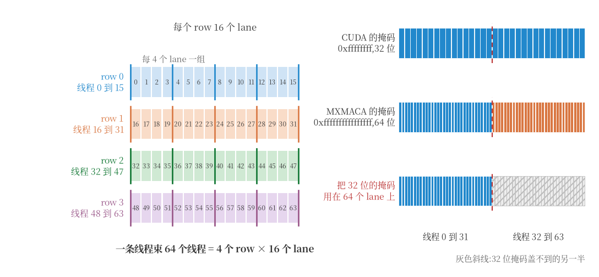
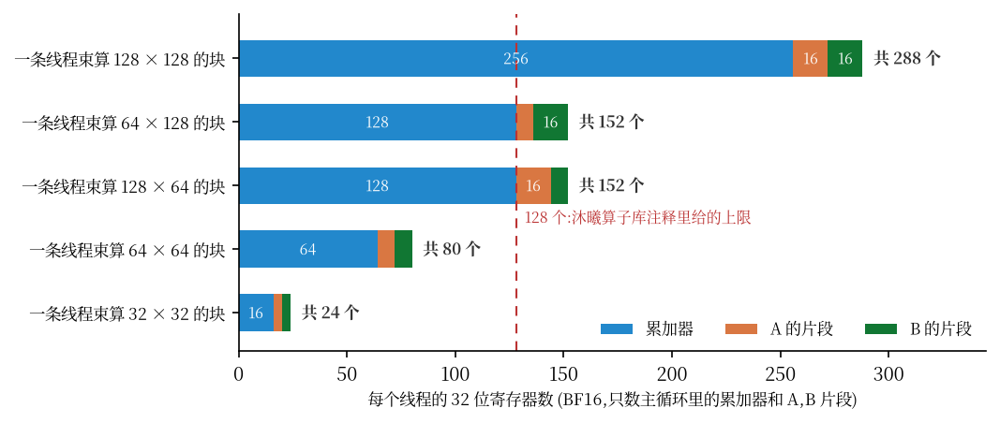
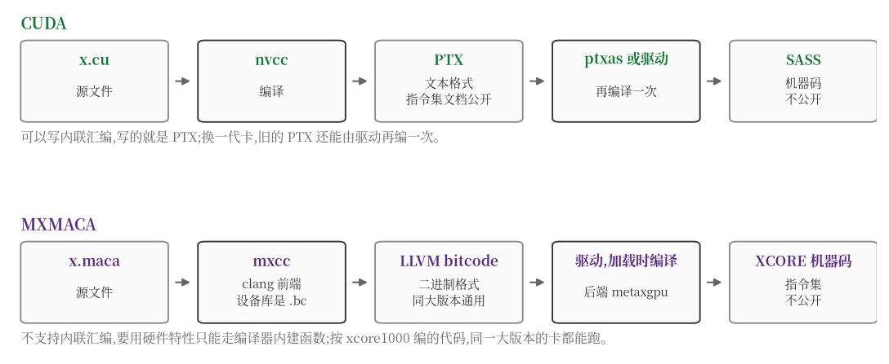

这是沐曦 MXMACA 里 `__syncwarp` 的声明:

```cpp
void __syncwarp(unsigned long mask=0xffffffffffffffffUL);
```

CUDA 里是同一个函数,默认掩码是 `0xffffffff`,32 个 1。这里数一数,是 64 个 1。

多出来的 32 个 bit 不是笔误。沐曦 GPU 的线程束是 64 个线程,一个 AP 里有 4 个 PEU,寄存器分成两类。接口长得和 CUDA 一样,底下按另一套尺寸造。

上一篇拆的是整颗芯片和软件栈。这一篇往下走一层,分三段。

先讲怎么用:装环境,写第一个 kernel,再往上到 PyTorch,Triton,TVM。再讲和 CUDA 的设计差异,哪些只是换了名字,哪些是真的不一样。最后拆 C500 的核心:有没有类似 SM 的东西,寄存器怎么分。

资料以沐曦开发者文档中心 MXC500 的文档为准,版本 3.10.1。每个数是哪来的,文中分开写。

## 一、先跑起来:装环境,写第一个 kernel

装环境是三步,出自官方的《快速上手指南》。

第一步看卡在不在。沐曦的 PCI 厂商号是 `9999`:

```
$ lspci | grep 9999
01:00.0 Display controller: Device 9999:4001 (rev 01)
```

第二步装驱动和 SDK。驱动是一个 `.run` 文件,SDK 解压后跑一个脚本,接受许可协议,默认装到 `/opt/maca`。文档写明只支持这个路径。

第三步设环境变量:

```
export PATH=$PATH:/opt/maca/mxgpu_llvm/bin:/opt/maca/bin
export MACA_PATH=/opt/maca
export LD_LIBRARY_PATH=/opt/maca/lib:/opt/maca/mxgpu_llvm/lib
```

敲 `macainfo`,能打出 `MXC System Attributes` 几行,环境就是好的。看温度,功耗,显存,时钟,用 `mx-smi`,对应 NVIDIA 的 `nvidia-smi`。

**第一个 kernel,用沐曦官方示例里的向量加法。** 设备端的代码是这样:

```cpp
#include <mc_runtime.h>
#include <mc_common.h>

__global__ void vectorAdd(const float *A, const float *B, float *C,
                          int numElements) {
  int i = blockDim.x * blockIdx.x + threadIdx.x;

  if (i < numElements) {
    C[i] = A[i] + B[i] + 0.0f;
  }
}
```

主机端的部分,省略了错误检查:

```cpp
  float *d_A = NULL;
  err = mcMalloc((void **)&d_A, size);

  err = mcMemcpy(d_A, h_A, size, mcMemcpyHostToDevice);

  int threadsPerBlock = 256;
  int blocksPerGrid = (numElements + threadsPerBlock - 1) / threadsPerBlock;
  vectorAdd<<<blocksPerGrid, threadsPerBlock>>>(d_A, d_B, d_C, numElements);
  err = mcGetLastError();
```

把 `mc` 换回 `cuda`,把头文件换回 `cuda_runtime.h`,就是 CUDA 的写法。核函数里的 `__global__`,`blockIdx`,`threadIdx`,三尖括号,一个字都不用动。

Makefile 只要三行,官方示例里的原文:

```make
MACA_PATH ?= /opt/maca
MXCC           = $(MACA_PATH)/mxgpu_llvm/bin/mxcc
MXCCFLAGS     := -x maca
```

打个比方,这是同一副方向盘换了一台发动机。挡杆,踏板,仪表盘都在原来的位置,踩下去之后里面怎么转,是另一回事。

运行时里有的东西,名字前面加 `mc` 就能找到。流和事件是 `mcStreamCreate`,`mcEventRecord`。Graph 是 `mcGraphCreate`,`mcGraphAddKernelNode`,`mcGraphLaunch`。

统一内存是 `mcMallocManaged`。流序内存分配是 `mcMallocFromPoolAsync`,沐曦的示例里叫 SOMA。协同启动是 `mcLaunchCooperativeKernel`。

## 二、查设备:几个 AP,线程束多大,上限在哪

写 kernel 之前先看设备的底细。官方《运行时API编程指南》里的查询程序,节选:

```cpp
//File test.maca
int main( void ) {
    mcDeviceProp_t prop;

    int count;
    mcGetDeviceCount( &count );
    for (int i=0; i< count; i++) {
        mcGetDeviceProperties( &prop, i );
        printf( "Name: %s\n", prop.name );
        printf( "Compute capability: %d.%d\n", prop.major, prop.minor );
        printf( "Multi-processor count: %d\n",
                prop.multiProcessorCount );
        printf( "Shared mem per MP: %ld\n", prop.sharedMemPerBlock );
        printf( "Registers per MP: %d\n", prop.regsPerBlock );
        printf( "Threads in wave: %d\n", prop.waveSize );
        printf( "Max threads per block: %d\n",
                prop.maxThreadsPerBlock );
    }
}
```

字段名和 CUDA 几乎一样,只有一处不同:CUDA 里叫 `warpSize`,这里叫 `waveSize`,打印出来的话是"Threads in wave"。

C500 上这个程序跑出来是什么,沐曦没有公开。公开能查到的是曦思 N260 上 `macainfo` 的输出。按官方文档,N260 的计算能力是 10.20,芯片名 XCORE1020,和 C500 的 10.00 是同一个大版本,同一条指令集。

输出里和核心有关的行:

```
  Name:                    XCORE1020
  Cache Info:
    L1:                    32 KB
    L2:                    8192 KB
  Max Clock Freq(MHz):     1600
  Accelerator Processors:  56
  PEUs per AP:             4
  Fast Float16 Operation:  FALSE
  Wavefront Size:          64(0x40)
  Workgroup Max Size:      1024(0x400)
  Max Waves Per AP:        32(0x20)
  Max Work-items Per AP:   2048(0x800)
  Max fbarriers/Workgroups:  32
  Pool 13
    Segment:               GROUP
    Size:                  64(0x40) KB
```

上一篇说过,这份输出不是 C500 的。现在能说得更准:它是 N260 的。

C500 的 AP 数,是第三方在真卡上读 `multiProcessorCount` 得到的,104 个。上面那份输出里 N260 是 56 个。

打个比方,这是同一款发动机的两个排量。汽缸数不同,每个汽缸里的结构是一样的。所以下面讲每个 AP 里有什么,用得上这份输出;讲整颗芯片有几个 AP,不能用它。

## 三、C500 的"SM":AP 里有什么

先回答标题里的问题:**有,沐曦叫它加速处理器 (Accelerated Processor,AP)。** 官方编程模型的原话是:"加速处理器都将分配给它的线程划分到线程束中,然后在可用的硬件资源上调度执行。"

它和 NVIDIA 的 SM 放在一起看:


逐项对一遍:

| | NVIDIA 的 SM (H100) | 沐曦的 AP |
|---|---|---|
| 里面分成 | 4 个分区,各有 1 个 warp 调度器 | 4 个 PEU |
| 线程束 | warp,32 个线程 | 线程束 (wave),64 个线程 |
| 每个里面的线程束 | 64 条 | 32 条 |
| 每个里面的线程 | 2048 个 | 2048 个 |
| 线程块上限 | 1024 个线程 | 1024 个线程 |
| 寄存器 | 64K 个 32 位,一类 | mtreg 和 streg 两类,总数未公布 |
| 共享内存 | 和 L1 共 256 KB,比例可配 | 64 KB,bank 固定 4 字节 |
| 发射 | 硬件调度器每周期挑线程束 | 硬件调度,加软件双发射 |

算一下数,两边对得上。NVIDIA 是 64 条线程束乘 32 个线程。沐曦是 32 条乘 64 个:

$$32 \times 64 = 2048 \ \text{threads per AP}$$

**都是 2048 个线程,只是切的刀不一样。** NVIDIA 切成 64 条细的,沐曦切成 32 条粗的。

每个 PEU 上能放几条线程束,是除出来的:

$$32 \div 4 = 8 \ \text{waves per PEU}, \qquad 8 \times 64 = 512 \ \text{threads}$$

线程块的上限是 1024 个线程,也就是 16 条线程束。一个 PEU 只放得下 8 条,所以最大的线程块要占两个 PEU。

这一点在沐曦自己的算子库里有旁证。GPTQ 量化矩阵乘的文件头里写着,下面这段是原文:

```c
/*
We will make a block size 256, which means 4 waves, we need all these 4 waves
execute on one PEU So the maximum shared memory used by a block use not larger
than 16K, and MTRegisters should be less than 128.
*/
```

256 个线程是 4 条线程束,正好落在一个 PEU 上。为此它给每个线程块定了两条预算:共享内存不超过 16 KB,每个线程的寄存器不超过 128 个。

运算单元是三类:标量,矢量,张量。招股书说流处理器"采用标量,矢量和张量混合的超标量指令发射流水线技术"。

上一篇按算力模型反推,每个 AP 有 64 条 FP32 通路。4 个 PEU 平分,每个 16 条,这是推算。按这个算法,一条 64 线程的线程束在一个 PEU 上发一条矢量指令要 4 个周期。

打个比方,NVIDIA 的 SM 像 64 个工人各干各的,每个工人一次拿 32 件活。沐曦的 AP 是 32 个工人,每个一次拿 64 件。两边手里的活一样多。

## 四、线程束是 64 个线程:搬代码时最先踩的坑

接口一样,线程束的宽度不一样。文档里带掩码的函数,掩码的类型多数从 CUDA 的 32 位换成了 `unsigned long`。《MXMACA C++编程指南》里的三个声明:

```cpp
void __syncwarp(unsigned long mask=0xffffffffffffffffUL);

unsigned long __activemask();

T __shfl_sync(unsigned long mask, T var, int srcLane, int width=warpSize);
```

掩码的类型是 `unsigned long`,每一位对应一个线程。64 个线程,就要 64 位。



所以 CUDA 代码里写死的 `0xffffffff`,搬到沐曦上只盖住半个线程束:

$$\frac{32}{64} = 50\%$$

沐曦算子库里有一条注释,说的就是这件事。原文是:"On MetaX C600-U the physical warp is 64 lanes while WARP_SIZE is #defined 32, so `__syncwarp()` does not reliably synchronize/fence all participating lanes."

从 CUDA 搬过来的代码,常把 warp 的大小定义成 32。于是一次 `__syncwarp()` 只同步了 64 个线程里的 32 个,另外 32 个读到的可能是旧值。

归约和 shuffle 也一样。CUDA 上按 32 个 lane 设计的蝴蝶归约,在沐曦上要么把 `width` 显式写成 32,要么按 64 重写。

以蝴蝶归约为例。CUDA 上常见的写法是按 32 个 lane 做异或:

```cpp
for (int offset = 16; offset > 0; offset /= 2)
    v += __shfl_xor_sync(0xffffffff, v, offset);
```

搬到沐曦上,照文档对 `width` 的说明改两处。掩码写满 64 位,`width` 指定成 32:

```cpp
for (int offset = 16; offset > 0; offset /= 2)
    v += __shfl_xor_sync(0xffffffffffffffffUL, v, offset, 32);
```

文档说,`width` 比 `warpSize` 小的时候,"每一个 warp 的子 group 将作为一个独立的实体"。这样 64 个 lane 分成两个 32 个 lane 的组,各归约各的。

这两行没有在真卡上跑过,是照文档推的。沐曦自己的示例里取 lane 号是这么写的:

```cpp
  int id      = threadIdx.x + blockIdx.x * blockDim.x;
  int warpId  = id / 64;
  int laneId  = threadIdx.x % 64;
```

线程束内部还有一层结构,出自《编译器内建函数编程指南》。64 个线程里每 16 个连续线程叫一个 row,共 4 个 row。混洗指令 `__builtin_mxc_mov_shfl` 在每个 row 里做 16 个线程之间的数据交换,参数叫 `rmsk`,`bmsk`,`bc`。

它的模式有 Quad Permutation,Row Shift,Row Rotate,Row Mirror,Row Broadcast。`bmsk` 是每 4 个 lane 一组的开关。

同类的内建函数还有几个。`__builtin_mxc_bsm_permute` 在整条线程束的 64 个线程之间换数据。`__builtin_mxc_read_xmsk` 读当前的活跃掩码。`__builtin_mxc_readfirstlane`,`__builtin_mxc_readlane`,`__builtin_mxc_writelane` 按 lane 号读和写。

这些名字和 AMD 的 GCN 指令集里同类指令的名字对得上。招股书写了团队的来历,线程束取 64 也和 AMD 一样。

有一处文档没有说清。投票函数 `__all_sync`,`__any_sync`,`__ballot_sync` 的声明里,掩码的类型写的是 `unsigned`,`__ballot_sync` 的返回值也是 `unsigned`。64 个 lane 怎么装进 32 位,文档没有交代,用之前要在真卡上验一下。

## 五、寄存器:两类,怎么数

NVIDIA 的 SM 里寄存器是一类,编译器只有一个 `-maxrregcount`。mxcc 有两个:

```
--maxrregcount amount (-maxrregcount)
      指定GPU函数可以使用的最大mtreg数量。

--maxsregcount amount (-maxsregcount)
      指定GPU函数可以使用的最大streg数量。
```

`mtreg` 和 `streg` 是什么,文档没有给定义。能查到的一句在《内建函数编程指南》里:带谓词的加载函数有个参数 `saddr_flag`,作用是"暗示编译器使用 streg (single thread register) 存储全局内存地址"。

**两类寄存器怎么分工,下面是按用法读出来的,不是文档的原话。** `streg` 存的是整条线程束共用的量,比如地址。`mtreg` 是每个线程各一份的,和 CUDA 里的寄存器对应。`-maxrregcount` 限的是后者,和 CUDA 同名的选项管同一件事。

寄存器堆的总数,沐曦没有公布。能查的接口有四个,到真卡上跑一下就有:

- `mcDevAttrMaxRegistersPerMultiprocessor`:文档说"此数量由所有驻留在多处理器上的线程块同时共享"。
- `mcDevAttrMaxRegistersPerBlock`:线程块能用的 32 位寄存器上限。
- `MC_FUNC_ATTRIBUTE_NUM_REGS`:一个 kernel 的每个线程用了几个。
- `mxcc -resource-usage`:编译时直接打印寄存器和内存的用量。

哪个变量进寄存器,官方的说法和 CUDA 一样:"automatic 变量一般会存储在寄存器中。但是在一些情况下,编译器会将其放入显存,这将会导致性能瓶颈。"

`__launch_bounds__` 的用法也一样。文档的原话是,编译器"从它们派生出内核应该使用的寄存器数量上限,以确保 maxThreadsPerBlock 线程可以驻留在多处理器上"。

**手写矩阵乘的时候,寄存器可以先算出来。** 一条线程束负责多大的输出块,每个线程就要多少寄存器。只数主循环里的三样东西:累加器,A 的片段,B 的片段。

一条矩阵指令里,每个线程拿 4 个 FP32 累加器,A 和 B 各 4 个 BF16。4 个 BF16 打包成 2 个 32 位寄存器。输出块切成 16 × 16 的小块,设一条线程束算 $r \times c$ 的块:

$$R = 4 \cdot \frac{r}{16} \cdot \frac{c}{16} + 2 \cdot \frac{r}{16} + 2 \cdot \frac{c}{16}$$

算 64 × 64 的块,是 4 × 16 + 2 × 4 + 2 × 4 = 80 个:



对照那段注释里的 128:64 × 64 的块放得下,128 × 64 的光累加器就超了。这还没算地址,循环变量和流水线的缓冲。

换个角度,算占用率。每个 AP 能放 2048 个线程。寄存器堆如果有 $R_{AP}$ 个,占满的时候每个线程分到 $R_{AP} \div 2048$ 个。拿 H100 的 64K 做例子:

$$\frac{65536}{2048} = 32 \ \text{registers per thread}$$

一个用了 128 个寄存器的 kernel,同样的寄存器堆只放得下 8 条线程束,是上限 32 条的四分之一。沐曦的寄存器堆多大,要用上面第一个接口去查。

运行时也有现成的占用率接口,`mcOccupancyMaxActiveBlocksPerMultiprocessor`。给它 kernel,线程块大小和共享内存用量,它算出一个 AP 上能同时放几个块。

## 六、矩阵指令:一条多大,每个线程拿多少

《内建函数编程指南》里的硬件矩阵指令,一共七条:

```cpp
v4f32 __builtin_mxc_mma_16x16x16bf16(v4f16 a, v4f16 b, v4f32 c);
v4i32 __builtin_mxc_mma_16x16x16i8(int a, int b, v4i32 c);
v4f32 __builtin_mxc_mma_16x16x8tf32(v2f32 a, v2f32 b, v4f32 c);
v4f32 __builtin_mxc_mma_16x16x4f32(float a, float b, v4f32 c);
```

名字的后缀是 m-n-k。输出都是 16 × 16,变的只有 K。七条的账算在一起:

| 类型 | 形状 | 每线程的 A 和 B | 每线程的累加器 | 一条指令的乘加数 | 每线程的乘加数 |
|---|---|---|---|---|---|
| FP16,BF16 | 16 × 16 × 16 | 各 4 个,共 4 个寄存器 | 4 个 FP32 | 4096 | 64 |
| INT8,xcore1500 以下 | 16 × 16 × 16 | 各 4 个,共 2 个寄存器 | 4 个 INT32 | 4096 | 64 |
| INT8,xcore1500 起 | 16 × 16 × 32 | 各 8 个,共 4 个寄存器 | 4 个 INT32 | 8192 | 128 |
| TF32 | 16 × 16 × 8 | 各 2 个,共 4 个寄存器 | 4 个 FP32 | 2048 | 32 |
| FP32 | 16 × 16 × 4 | 各 1 个,共 2 个寄存器 | 4 个 FP32 | 1024 | 16 |
| FP64 | 16 × 16 × 4 | 各 1 个,共 4 个寄存器 | 4 个 FP64 | 1024 | 16 |

NVIDIA Ampere 的 `mma.m16n8k16` 是 16 × 8 × 16,一条指令 2048 次乘加,32 个线程分。每线程也是 64 次。

$$16 \times 16 \times 16 = 4096, \qquad 4096 \div 64 = 64 = 2048 \div 32$$

两边每个线程干的活一样多,差别在一条指令管多少人。沐曦一条指令带 64 个线程,NVIDIA 带 32 个。

INT8 那两行值得单看。`mma_16x16x16i8` 要求"offload arch 需要小于 xcore1500",`mma_16x16x32i8` 要求"大于等于 xcore1500"。C500 是 xcore1000 这一代,走前一条。C600 把 K 加了一倍,和招股书里"加倍 FP16/BF16 tensor 的矩阵运算算力"对得上。

不想碰内建函数,可以用和 CUDA 同名的 `wmma` 接口。官方的示例:

```cpp
__global__ void wmma_ker(half *a, half *b, float *c) {
  // 声明矩阵分片
  wmma::fragment<wmma::matrix_a, 16, 16, 16, half, wmma::col_major> a_frag;
  wmma::fragment<wmma::matrix_b, 16, 16, 16, half, wmma::row_major> b_frag;
  wmma::fragment<wmma::accumulator, 16, 16, 16, float> c_frag;

  // 输出初始化为0
  wmma::fill_fragment(c_frag, 0.0f);

  // 加载输入
  wmma::load_matrix_sync(a_frag, a, 16);
  wmma::load_matrix_sync(b_frag, b, 16);

  // 执行矩阵乘法
  wmma::mma_sync(c_frag, a_frag, b_frag, c_frag);

  // 保存输出
  wmma::store_matrix_sync(c, c_frag, 16, wmma::mem_row_major);
}
```

支持的形状和 CUDA 的 WMMA 是同一批名字:半精度的 16 × 16 × 16,32 × 8 × 16,8 × 32 × 16;TF32 的 16 × 16 × 8;双精度的 8 × 8 × 4。区别是这些形状在沐曦上由 64 个线程合做。

## 七、从源码到机器码

CUDA 的中间层是 PTX,沐曦的中间层是 LLVM bitcode。两条路放在一起:



mxcc 基于 LLVM,问询回复里写 C500 选的是 LLVM12。输入文件的后缀是 `.maca`,设备库是两个 bitcode 文件,`maca_kernellib.bc` 和 `maca_mathlib.bc`。

中间格式也是 bitcode,由驱动在加载的时候接着编。官方《运行时API编程指南》的原话是:"作为上下文创建的一部分,设备代码在必要时进行即时编译并加载到设备内存中。"

编译时指定架构用 `--offload-arch`。文档给了两个选择:`xcore1000` 是 MXC500 这一代的通用选项,"可在所有 major 版本相同的 GPU 上运行"。`xcore1002` 是 C550 专用的,"可能获得特定于硬件的性能优化"。

计算能力的编号和 NVIDIA 是两套。10.xx 是 MXC500 系列,15.xx 是 MXC600 系列。C500 是 10.00,C550 是 10.02,N260 是 10.20。

运行时编译也有,叫 MCRTC,头文件 `mcrtc.h`。示例里的流程是 `mcrtcCompileProgram` 编出 bitcode,`mcModuleLoadData` 加载,`mcModuleLaunchKernel` 启动。

有三处和 CUDA 不一样,写 kernel 的时候会碰到:

- **不支持内联汇编。** 文档的原话是"MXMACA 暂时不支持内嵌汇编,如有需要可联系沐曦客户支持部门协助"。要用硬件特性,只能走内建函数。
- **PTX 有公开的指令集文档,XCORE 没有。** 指令有 600 多条,能看到的只有编译器暴露出来的内建函数。
- **C++ 标准**:C++11 和 C++14 完全支持,C++17 及以后是部分支持,文档写"不建议使用"。默认是 `-std=c++14`。

## 八、往上走:PyTorch,Triton,TVM,vLLM

不写 kernel,只在框架里用,差别更小。

**PyTorch。** 沐曦的版本叫 mcPyTorch,现在有 2.4,2.6,2.8,2.10 四个版本。设备和流还是 `cuda` 这个名字,官方的验证命令:

```
$ python -c "import torch; print(torch.ones(2).cuda())"
tensor([1., 1.], device='cuda:0')
```

有个设计值得单说。mcPyTorch 用户指南里写,`torch.cuda.get_device_capability` 返回 `(8, 0)`,`get_arch_list` 返回 `['sm_80']`,"模拟 CUDA capability==8.0 时的行为"。

也就是说,在 PyTorch 眼里,沐曦的卡是一张 Ampere。上一篇里说 Hopper 专属的 FlashAttention-3 用不了,和这里对得上:框架问它是不是 sm_90,它答的是 sm_80。

还有一个容易踩的坑。四维张量从 CPU 搬到 GPU 的时候,mcPyTorch 默认会把布局改成 channels_last:

```
>>> a = torch.rand(2,3,4,5).cuda()
>>> a.stride()
(60, 1, 15, 3)
```

这是为了性能。代价是有些按 NCHW 写的 `view` 会报错。设 `export PYTORCH_DEFAULT_NCHW=1` 可以恢复官方的默认行为,stride 变回 `(60, 20, 5, 1)`。

**Triton。** 沐曦的版本叫 mcTriton,用法和官方一样,多了两个配置项。官方的示例:

```python
@triton.autotune(
    configs=[
        triton.Config({...,'pipeline': "basic",'scenario': "unprefetch",...}, num_warps=4, num_stages=2),
        triton.Config({...,'pipeline': "cpasync",...}, num_warps=8, num_stages=3),
    ],
    key=['M', 'N', 'K'],
)
```

`pipeline` 选流水线的做法。`basic` 把多级缓冲放在寄存器里,`cpasync` 用异步拷贝直接从全局内存搬到共享内存,共享内存的用量跟着涨。文档给的提示是,单个大 tile 的矩阵乘建议用 `cpasync`。

`tl.dot` 支持的类型,C50X 系列比 C60X 少一样:FP8 在 C50X 上不支持。

mcTriton 要用沐曦自己的 LLVM 来编,仓库里的编译脚本要指向 `metax_llvm` 目录。NVIDIA 上的 Triton 自己生成 PTX,沐曦上的 Triton 走的是 mxcc 同一条 LLVM 的路。

**TVM。** 沐曦维护了一个 mcTVM,基于 TVM v0.18.0。后端的名字叫 `maca`:

```python
import tvm
# define maca target by kind name
target = tvm.target.Target("maca")
# or specific target by tag name
target = tvm.target.Target("metax/mxc-c500")
# define maca device
dev = tvm.maca()
```

**vLLM。** vllm-metax 是一个硬件插件,按月和 vLLM 的版本对齐。官方只支持用沐曦开发者社区发布的 Docker 镜像部署:

```
docker run -it --device=/dev/mxcd --device=/dev/dri --group-add video ${image_name} /bin/bash
```

打个比方,越往上走,越看不出发动机换了。到 PyTorch 这一层,连设备的名字都还叫 `cuda`。

## 九、哪些数还没有出处

C500 自己的设备信息,沐曦没有公开过。下面这些数,文中用的是 N260 的,因为两者是同一个大版本:

- 每个 AP 4 个 PEU。
- 每个 AP 32 条线程束,2048 个线程。
- 线程块最多 1024 个线程。
- 工作组共享内存 64 KB。

这四个数写在指令集里。C500 和 N260 是同一条指令集,所以文中按这四个数来讲。C500 自己的输出,文中没有拿到。

以下这些,哪颗卡都没有公开:

- 寄存器堆的总数,每个线程最多能用多少。
- `mtreg` 和 `streg` 的定义和分工。
- 每个 PEU 有多少条运算通路。文中说的 16 条,是从上一篇的算力模型推出来的。
- 一条矢量指令在一个 PEU 上占几个周期。

N260 输出里的 L1 32 KB,L2 8 MB,最高 1600 MHz,是那一颗芯片的,文中没有当成 C500 的用。

"Fast Float16 Operation: FALSE"这一行,和第三方在 C500 上量到的对得上:`__hfma2` 比 FP32 的乘加还慢。沐曦打包的是 FP32,内建函数是 `__builtin_mxc_pk_fma_f32`。

## 十、面试里会问的

**1. 沐曦 GPU 上对应 SM 的是什么?里面怎么分?**

答:加速处理器,AP。里面分 4 个 PEU,每个 PEU 上最多放 8 条线程束。运算单元是标量,矢量,张量三类。线程束是 64 个线程,一个 AP 最多 2048 个线程,和 NVIDIA 的 SM 一样多。

**2. 线程束是 64 个线程,搬 CUDA 代码要注意什么?**

答:带掩码的函数全要重看。`__syncwarp`,`__shfl_sync`,`__reduce_add_sync` 的掩码在沐曦上是 64 位,CUDA 代码里写死的 `0xffffffff` 只盖住一半线程。按 32 个 lane 设计的归约,要么把 `width` 写成 32,要么按 64 重写。

**3. 寄存器分几类?编译器怎么限?**

答:两类,mtreg 和 streg。`-maxrregcount` 限 mtreg,对应 CUDA 里的每线程寄存器上限。`-maxsregcount` 限 streg,按用法看是整条线程束共用的寄存器,比如地址。

**4. 一个 kernel 用了多少寄存器,怎么查?**

答:编译时加 `mxcc -resource-usage`。运行时用 `mcFuncGetAttribute` 读 `MC_FUNC_ATTRIBUTE_NUM_REGS`。设备一共有多少,查 `mcDevAttrMaxRegistersPerMultiprocessor`。

**5. 一条线程束算 64 × 64 的输出块,每个线程要几个寄存器?**

答:80 个,只算矩阵乘的主循环。16 个 16 × 16 的小块,每块 4 个累加器,共 64 个。A 和 B 的片段各 8 个。换成 128 × 64,光累加器就 128 个。

**6. 共享内存多大?bank 多宽?**

答:每个线程块 64 KB。32 个 bank,每个固定 4 字节,一行 128 字节。NVIDIA 的 bank 宽度可以设成 4 或 8 字节,沐曦只支持 4 字节。

**7. 沐曦的 PTX 是什么?能写内联汇编吗?**

答:LLVM bitcode。mxcc 把设备代码编成 bitcode,驱动在加载的时候接着编成机器码。按 `xcore1000` 编的代码,同一个大版本的卡都能跑。不支持内联汇编,要用硬件特性只能走内建函数。

**8. PyTorch 里查计算能力,返回 8.0,可 C500 不是 10.00 吗?**

答:两套编号。10.00 是 MXMACA 自己的编号,15.xx 是 MXC600 系列。mcPyTorch 对外统一报 `sm_80`,模拟 Ampere 的行为,所以框架按 Ampere 的能力来用它。

**9. 一条矩阵指令多大?**

答:FP16 和 BF16 是 16 × 16 × 16,一条指令 4096 次乘加,64 个线程分,每个线程 64 次。TF32 是 16 × 16 × 8。FP32 和 FP64 是 16 × 16 × 4。C500 上的 INT8 是 16 × 16 × 16,C600 加到 16 × 16 × 32。

**10. 为什么 half2 在沐曦上反而慢?**

答:硬件没有为打包的半精度运算做专门的加速,`macainfo` 里写的是"Fast Float16 Operation: FALSE"。第三方在 C500 上量到 `__hfma2` 比 FP32 的乘加还慢。要打包,沐曦打包的是 FP32,`__builtin_mxc_pk_fma_f32`。

## 十一、总结

**1. 沐曦有和 SM 对应的东西,叫 AP。** 4 个 PEU,32 条线程束,每条 64 个线程,一共 2048 个线程。

**2. 接口和 CUDA 一样,尺寸不一样。** 线程束是 64,掩码是 64 位,共享内存 64 KB,bank 固定 4 字节。搬代码最先踩的坑是掩码。

**3. 寄存器分两类。** mtreg 每个线程一份,streg 整条线程束共用。总数没有公布,沐曦自己的 kernel 给的预算是每个线程 128 个以内。

**4. 中间层是 LLVM bitcode,不是 PTX。** 不支持内联汇编,指令集不公开,硬件特性只能走内建函数。

**5. 越往上越像 CUDA。** PyTorch 里设备还叫 `cuda`,计算能力报的是 8.0。

沐曦公开的设备参数很少。这篇里每个 AP 的数值来自曦思 N260,寄存器的分工和每个 PEU 的通路数是按用法读出来的,文中都标了。

如果这个系列对你有用,点个赞或关注专栏,更新会持续。

---

*出处与证据等级。沐曦官方文档, MXC500, 版本 3.10.1:《MXMACA C++编程指南》 (线程束内函数, 执行配置, Launch Bounds, 内联汇编), 《运行时API编程指南》 (编程模型, 设备查询, 计算能力, 运行时编译), 《MXMACA运行时API参考》 (设备属性, 共享内存配置, 占用率), 《mxcc编译器用户指南》, 《MXMACA编译器内建函数编程指南》, 《mcPyTorch用户指南》, 《mcTriton用户指南》, 《快速上手指南》, 《mx-smi使用手册》。都在 developer.metax-tech.com/doc。*

*沐曦官方代码: GitHub 组织 MetaX-MACA 下的 maca-samples (vectorAdd 等), mcoplib (提交 39511c5, GPTQ 矩阵乘文件头的注释), mcTVM 的 README, mcPytorch 和 vLLM-metax 的 README。*

*曦思 N260 上 macainfo 的输出: 掘金专栏「沐曦异构并行计算软件栈」第 2 章 (2025 年 2 月 12 日)。*

*第三方的数: C500 的 104 个 AP, LDS 的 32 个 bank, `__hfma2` 的实测, 取自 gitlink.org.cn/JunkaiShi/c500-specpilot 的实验日志。*

*NVIDIA 一侧: H100 的 SM 取自本专栏《GPU 的心脏:SM 内部解剖》, `mma.m16n8k16` 取自 NVIDIA 的 PTX 指令集文档。推算的过程在 `calc.py` 里, 结果在 `bench/calc_summary.json`。文中数字截至 2026 年 11 月 27 日。*
