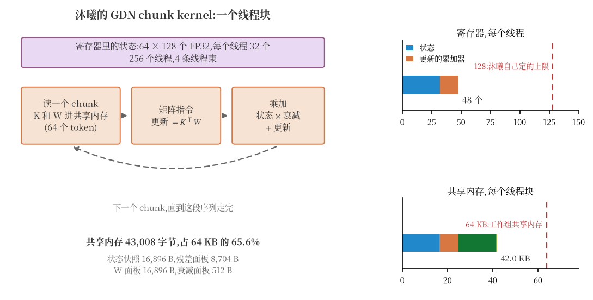
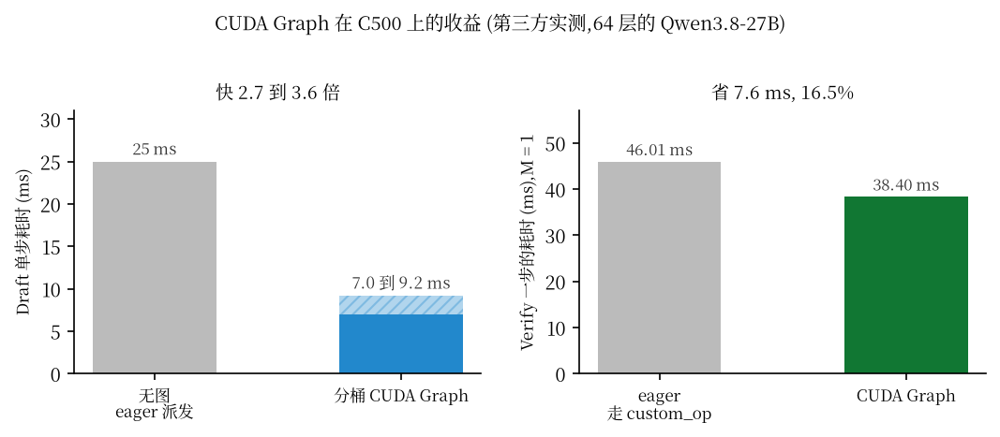

这是沐曦给 C500 写的 GDN kernel 里的两句:

```cpp
update[mi][ni] = __builtin_mxc_mma_16x16x16bf16(
    af[mi], bf[ni], update[mi][ni]);

state_reg[p][mi][ni][r] =
    fmaf(state_reg[p][mi][ni][r], decay[r], update[mi][ni][r]);
```

第一句算 $K^\top W$,一条矩阵指令,张量单元做。第二句是旧状态乘衰减,加上新贡献,一次乘加,矢量单元做。

Qwen3.8-27B 有 48 层 GDN。每层的递推,到了硬件上就是这两句。

这篇拿 Qwen3.8-27B 当例子,在沐曦 C500 上走一遍。模型结构怎么落到 AP 上。融合 kernel 和 CUDA Graph 怎么写,能省多少。在 vLLM 里换掉自带的算子,怎么做才不怕升级。

资料分三类,文中分开写。沐曦和 vLLM 的文档与代码。第三方在 C500 上的实验日志。由这两者推算的数。文中的示意代码没有在真卡上跑过。

## 一、一层 GDN,拆成三类活

Qwen3.8-27B 的文本主干是 64 层,48 层 GDN 加 16 层全注意力。这是第三方从模型配置里读出来的。GDN 的形状是 16 个 Q,K 头,48 个 V 头,K 和 V 都是 128。

GDN 不存 KV cache,存的是状态矩阵,每个 V 头一个 K × V。算一下有多大:

$$48 \times 128 \times 128 \times 4\ \text{bytes} = 3.15\ \text{MB per layer}$$

48 层一共 151 MB,一条序列一份,不随长度变。16 层全注意力的 KV cache 是每个 token 64 KB。上下文到 32K 是 2.15 GB,是 GDN 状态的 14 倍。

解码的时候,每一步都把状态读一遍,再写回去。48 层是 302 MB,在 1.84 TB/s 上是 0.16 毫秒:

$$\frac{2 \times 151\ \text{MB}}{1.84\ \text{TB/s}} = 0.16\ \text{ms}$$

《沐曦 C500 技术分解》那篇量到,一步是 38.69 毫秒,大头在读 51.1 GB 的权重上。GDN 的状态只占 0.4%。

一层 GDN 的活分三类,再加上 MLP:


打个比方,这是把一张配方交给车间。配方再复杂,车间里只有车,铣,磨几种机床。配方决定的是每种机床开几次,工件怎么流转。

框架不做自动解析。eager 模式下,它一个算子一个算子地调用现成的 kernel。

## 二、kernel 里:两句代码

上面那两句出自 mcoplib 的 `chunk_gated_delta_rule_fwd_h_native.cu`,1684 行。文件里有两个 kernel。一个是保正确性的,注释写着 "One block owns one (sequence, head, v) state row"。另一个是给 BF16,K = V = 128 优化的。

优化的那个,常量写在文件头。chunk 长 64 个 token,一个线程块管状态的 64 行,每行 128 列,一个线程块 256 个线程。注释里有一句:"No FP32 state panel: the Bv x 128 state is register-resident."

prefill 的时候,一个线程块拿一个头的半份状态,顺着 chunk 一个一个往下走。每来一个 chunk,把 K 和 W 读进共享内存,发矩阵指令算出更新,再乘衰减加到状态上。走完这段序列,状态写回去。

打个比方,状态是留在工位上的半成品,每来一批新料就在工位上接着加工,不送仓库。每用一次都去仓库取,时间全花在走路上。

## 三、这两句在 AP 上怎么摆



《MXMACA 怎么用》那篇讲过 AP 的底细。线程束 64 个线程,一个 PEU 放 8 条,工作组共享内存 64 KB,分 32 个 bank。对着这些数看这个 kernel。

**状态放在寄存器里。** 64 × 128 个 FP32 是 8192 个寄存器,平摊到 256 个线程,每个线程 32 个。更新用的累加器,每个线程再占 16 个:

$$\frac{64 \times 128}{256} = 32, \qquad 2 \times 2 \times 4 = 16$$

两项加起来 48 个。那篇还说过,沐曦自己的 GPTQ kernel 给 4 条线程束定的预算是每个线程 128 个以内。这里还没算地址和循环变量,余量是够的。

**共享内存四块,合计 43,008 字节。** 状态快照 16,896,残差面板 8,704,W 面板 16,896,衰减面板 512。合 42.0 KB,占 64 KB 的 65.6%。

行和行之间留了空。残差面板的行步长是 68 个半字,合 34 个字:

$$68 \div 2 = 34, \qquad 34 \bmod 32 = 2$$

每隔一行错开 2 个 bank,16 个 lane 一组读下来不撞车。K 的步长 132 个半字,合 66 个字,错开的也是 2 个 bank。文件头的注释花了近二十行算这件事。

## 四、换一种 GPU,变的是什么

算法层不变。分块,递推,状态放在离计算最近的地方,谁写都是这一套。

变的是指令。NVIDIA 是 `mma.sync.m16n8k16`,32 个线程一条。沐曦是 `__builtin_mxc_mma_16x16x16bf16`,64 个线程一条。

变的是切块。vLLM 自带的 GDN 走的是 Triton kernel。vllm-metax v0.28.0 把上游的文件整份拷过来,只改了一处,autotune 的 `num_stages` 砍成 `[1]`。注释写的理由是 "Reduce Triton `num_stages` in `chunk_delta_h` kernels to stay within MACA shared-memory limits"。

原因在前面的数里。沐曦的 mcTriton 文档写着,`cpasync` 模式下 `num-stages` 增大,共享内存的用量跟着涨。工作组共享内存只有 64 KB,级数多了放不下。

所以 vLLM 自带的那一份,在沐曦卡上是"先别炸",不是"调到极致"。想更快有两条路。一条是 Triton,在沐曦卡上重新 autotune,或者换算法。另一条是原生 C++,像上一节那个 kernel 一样直接用矩阵指令。

mcoplib 里两条路都有现成的。GDN 解码的 `fused_sigmoid_gating_delta_rule_update` 有 xcore1000 的 Triton 版和原生版。prefill 的 `chunk_gated_delta_rule_fwd_h` 有原生版,pybind 里的说明是 "same public signature as the Triton entry"。

## 五、融合 kernel:三条路

融合是把几个小算子并成一个 kernel,中间结果不落显存。在沐曦卡上有三条路。

**Triton,最省事。** mcTriton 和 mcPyTorch 在同一个安装包里,`.py` 文件不用改。本专栏融合算子那篇里的 RMSNorm 就是这种:

```python
@triton.jit
def _rms_norm_kernel(x_ptr, w_ptr, y_ptr, eps, D: tl.constexpr, BLOCK: tl.constexpr):
    row = tl.program_id(0).to(tl.int64)          # 一个 program 管一行
    cols = tl.arange(0, BLOCK)
    mask = cols < D
    ptr = row * D + cols
    x = tl.load(x_ptr + ptr, mask=mask, other=0.0).to(tl.float32)
    var = tl.sum(x * x, axis=0) / D              # 整行一次读完,方差留在寄存器里
    rstd = tl.math.rsqrt(var + eps)
    w = tl.load(w_ptr + cols, mask=mask, other=0.0).to(tl.float32)
    tl.store(y_ptr + ptr, (x * rstd * w).to(y_ptr.dtype.element_ty), mask=mask)
```

一行读进来,方差留在寄存器里,写回去,显存只碰两次。

调优时多了两个配置项。`pipeline` 选流水线的做法,`basic` 把缓冲放寄存器,`cpasync` 用异步拷贝直接搬到共享内存。`scenario` 是针对场景的编译选项,有 `flashattn-fwd`,`unroll`,`fullstage` 这些。

Qwen3.8-27B 的隐藏维是 5120,不是 2 的幂。这个 kernel 一行要装进一个块,块只能取 8192:

$$1 - \frac{5120}{8192} = 37.5\%$$

近四成的 lane 落在掩码外面。改成循环五段 1024,才用得满。

`export MCTRITON_LOG_LEVEL=INFO` 会打印每个 kernel 的寄存器和共享内存用量。`num_warps` 在沐曦上对应多少线程,文档没写,靠这个日志定。

**原生 C++,性能到顶。** 按 CUDA 的写法写 `.cu` 文件,用 PyTorch 的 `torch.utils.cpp_extension` 编,编译器走 cucc。要先设三个环境变量:

```
export CUDA_PATH=/opt/maca/tools/cu-bridge/
export CUCC_PATH=/opt/maca/tools/cu-bridge/
export PATH=${CUCC_PATH}/tools:${CUCC_PATH}/bin:${PATH}
```

要用硬件特性,只能走沐曦的内建函数。沐曦自己的融合 kernel 都在 mcoplib 里,可以照着写:`fused_add_rmsnorm_per_token_quant_padding_output`,`fused_rmsnorm_rope_quant_reshape_and_cache`,`silu_mul_quant_fp8_nopack`,`fused_sigmoid_gating_delta_rule_update_native`。

**`torch.compile` 自动融合。** mcPyTorch 支持 `torch._dynamo`,生成的 Triton 走 mcTriton。第三方量过,`@torch.library.custom_op` 在 eager 模式下每步多 7 到 9 毫秒的派发开销,所以要和 CUDA Graph 配着用。

真卡上踩过的两个坑。带 Hopper 专属内建函数的 Triton kernel 要先剥掉才能跑。`pid_m` 大于 0 的时候出过异常,要避开。

## 六、CUDA Graph:一次提交

eager 模式下,每个 kernel 都由主机提交一次。第三方的引擎有 64 层,一步里光 Python 派发就是 25 到 30 毫秒,平均一层 0.39 到 0.47 毫秒。

CUDA Graph 把这一串提交录成一张图,以后一次提交。打个比方,这是把整张工单一次交给车间,不再每个工位口头交代一遍。



接口和 CUDA 同名。PyTorch 层是 `torch.cuda.CUDAGraph()`,第三方的引擎用的就是它。PyTorch 官方文档里的整网捕获写法:

```python
g = torch.cuda.CUDAGraph()

s = torch.cuda.Stream()                 # 旁路的流里预热
s.wait_stream(torch.cuda.current_stream())
with torch.cuda.stream(s):
    for _ in range(3):
        y = model(static_input)
torch.cuda.current_stream().wait_stream(s)

with torch.cuda.graph(g):               # 捕获
    static_output = model(static_input)

static_input.copy_(new_input)           # 回放前把新数据拷进静态输入
g.replay()
```

运行时层把 `cuda` 换成 `mc`:

```cpp
mcStreamBeginCapture(stream, mcStreamCaptureModeGlobal);
// 中间是核函数和拷贝
mcStreamEndCapture(stream, &graph);
mcGraphInstantiate(&graphExec, graph, NULL, NULL, 0);
mcGraphLaunch(graphExec, stream);
```

沐曦的文档里有一句说得直白:"与核函数融合不同,任务图保留了多个核函数的独立性,但只需一次提交操作即可执行整个图。"图省的是提交的钱,不是计算的钱。

有一个开关要实测,`MACA_EXT_GRAPH_LAUNCH_MODE`。0 是用 Ring Buffer 逐个启动节点,1 是整个图一次提交,也是默认值,2 是在图里开 PDL。官方提醒,并发的节点多时会抢 AP 的资源,图不一定更快。

真卡上踩过的坑,有三条最值钱。

- **自定义 kernel 没传 stream,回放时被静默跳过。** 第三方的 C++ 扩展用默认的流启动,vLLM 在另一条流上捕获,256 层矩阵乘一个都没录进去。速度反常地快,输出全是乱码,运行时不报错。启动时要带上当前的流。
- **捕获期间不能有主机到设备的拷贝。** `torch.tensor([-1])` 会触发 `cudaErrorStreamCaptureImplicit`,改成设备端的 `torch.full((1,), -1)`。
- **变化的量放设备端张量,批大小分桶。** 序列长度做成 `kv_len_tensor`,长短上下文共用一张图。第三方的桶是 16,32,64,128。

## 七、在 vLLM 里换算子:先找口子

vLLM 给换算子留了正式的口子。vllm-metax 补丁层的 README 第一条就是:能用注册表,注意力后端,平台钩子的,就不要打补丁。


**口子一:注册表。** vLLM 的算子分两种。`CustomOp` 是一个算,按平台分派,插件平台上走 `forward_oot()`。`PluggableLayer` 是一整层,实例化的时候整层换成登记的类。

机制是一张表。实例化时按类名查 `op_registry_oot`,查到了就用表里的类。上游文档的原话是 "without directly modify vLLM"。

对着 Qwen3.8-27B 的 GDN 看这张表:

| 要换的东西 | vLLM 里的名字 | vllm-metax v0.28.0 的状态 |
|---|---|---|
| prefill 的块状递推 | `ChunkGatedDeltaRule` (CustomOp) | 沐曦登记了 `MacaChunkGatedDeltaRule` |
| GDN 整层,含 decode | `QwenGatedDeltaNetAttention` (PluggableLayer) | 注册表里没有它 |
| decode 的状态更新 | `fused_sigmoid_gating_delta_rule_update` | 普通函数,没登记,没人补 |

沐曦登记的那一份是个壳。它的 `forward_oot` 默认直接调 `forward_native`,走 vLLM 自带的 Triton 版。设了 `MACA_VLLM_USE_EXTERNAL_FLA=1`,才去调外部的 fla 包。

同名不能再登记,断言会报 "Duplicate op name"。想接手,就继承它,只改 `forward_oot`,再把表里那一项换成自己的类。下面这段是示意:

```python
from vllm.model_executor.custom_op import CustomOp
from vllm_metax.registry.custom_ops.layers.mamba.qwen_gdn_linear_attn import (
    MacaChunkGatedDeltaRule,
)


class MyGDN(MacaChunkGatedDeltaRule):
    def forward_oot(self, q, k, v, g, beta, initial_state, output_final_state,
                    cu_seqlens=None, **kwargs):
        if my_kernel.supports(q, k, v, cu_seqlens):
            return my_kernel.run(q, k, v, g, beta, initial_state, cu_seqlens)
        return super().forward_oot(q=q, k=k, v=v, g=g, beta=beta,
                                   initial_state=initial_state,
                                   output_final_state=output_final_state,
                                   cu_seqlens=cu_seqlens, **kwargs)


assert CustomOp.op_registry_oot["ChunkGatedDeltaRule"] is MacaChunkGatedDeltaRule
CustomOp.op_registry_oot["ChunkGatedDeltaRule"] = MyGDN
```

三件事要留意。

- 分派在实例化时决定,要在建模之前装好。做成 vLLM 的 general plugin,entry point 的组是 `vllm.general_plugins`。用 `VLLM_PLUGINS` 能指定只加载哪几个。
- 插件之间谁先谁后没有保证,vllm-metax 自己也是两个 general plugin。上面那行 `assert` 就是查这个的。
- `torch.compile` 模式下 custom op 默认是关的,要在 `compilation_config.custom_ops` 里显式打开。

GDN 整层在注册表里是空的,可以直接登记:

```python
from vllm.model_executor.layers.mamba.gdn.qwen_gdn_linear_attn import (
    QwenGatedDeltaNetAttention,
)


@QwenGatedDeltaNetAttention.register_oot
class MyGDNLayer(QwenGatedDeltaNetAttention):
    ...
```

**口子二:`@patch` 补丁层。** 没有注册点的时候用,`from vllm_metax.patch.utils import patch`。它比手写 monkey patch 稳在三点。目标必须已经存在,改名或挪位置会在 import 时报 `AttributeError`。同一个目标补两次报 `RuntimeError`。原对象记在补丁的 `__vllm_metax_patch__` 属性里,可查可还原。

GDN 的 decode 只能走这里。它是 vLLM 那个模块里的一个普通函数,层里按名字调用它。要换,就补那个模块里的这个名字。沐曦对 vLLM 自带的 Triton kernel 也是这么做的。

官方定的规矩有四条。保留上游的名字,签名,装饰器和没改的代码。只在改动的行加 `MetaX Modification` 注释。每个补丁写明受影响的版本和移除条件。每个补丁配一个回归测试。

还有一条来自上游。vLLM 的文档提醒,插件函数可能在不同进程里被调用多次。`@patch` 补两次会报错,插件里要自己加一个只装一次的开关。

## 八、升级了怎么办

补丁依赖 vLLM 的实现细节,升级就可能失效。vllm-metax 自己也躲不开,它的做法可以直接照搬。

**每个 vLLM 版本钉一个 commit。** 它的 `vllm_metax/patch/AUDIT.md` 是一张逐版本对账的表,开头写着 "Reviewed upstream target: v0.34.0",底下是 commit 号,再往上一版是 v0.33.0。

**每个补丁一行,决定是四种里的一种。** 保留。更新后保留:上游的签名变了,就把上游新的实现整份拿来,重新套上自己那一处改动。删除。迁移:上游修了,或者有了正式接口。

对 GDN 那个 Triton kernel 的补丁,表里写的是 "Update; retain MACA tuning"。升级的时候把上游新的实现拿过来,继续保留 `num_stages` 的限制。

**升级的顺序是固定的。** 先对平台,再对注册表和注意力后端,再对原生代码,其余的 Python 文件逐个过,然后是模型,最后才过补丁。过补丁的时候先想能不能删,它的原话是 "Consider upstream fixes, supported hooks/registrations and already adapted local modules before retaining a patch."

**版本是一对一配套的。** mcoplib 的 README 有一张表:

| vLLM | mcoplib |
|---|---|
| 0.28.0 | release/v0.4.13 |
| 0.29.0 | release/v0.4.14 |
| 0.30.0 | release/v0.4.15 |
| 0.32.0 | release/v0.4.16 |

vllm-metax 自己的 `requirements/maca_private.txt` 里写的正是 `mcoplib==0.4.13`。

换成自己的项目,清单是五条。

1. 先量。用 profiler 找出要换的算子的耗时,和 mcoplib 仓库里的 `mcoplib_ops_performance_C500.csv` 对照。
2. 能注册就不补丁,必须补丁就用 `@patch`。
3. kernel 和适配层分开。kernel 只认张量形状。适配层照沐曦那份的写法,用 `inspect.signature` 看参数名再决定状态布局,不假设版本。
4. 启动时自检,过不了就不启动。注册表里那一项是不是你以为的类。小形状上和 `forward_native` 对数。CUDA Graph 捕获回放对数。
5. 往上游提。mcoplib 和 vllm-metax 都是开源仓库,进了仓库,跟着升级对账的就是沐曦的人。

## 九、值不值得换:第三方的一个例子

第三方的引擎在 C500 上,用纯 Triton-on-MACA 换掉了 GDN 的验证算法。原算法是 Path Verify,逐个节点验证。新算法是 SpecPilot 论文 4.2 节的 TreeWY。48 层 GDN 的总耗时:

| 树的节点数 | Path Verify | TreeWY | 比值 |
|---|---|---|---|
| 8 (单链) | 3.55 ms | 6.70 ms | 0.53 |
| 16 (窄树) | 7.11 ms | 6.72 ms | 1.06 |
| 24 (中树) | 12.52 ms | 6.17 ms | 2.03 |
| 32 (宽树) | 18.13 ms | 6.19 ms | 2.93 |

新算法的耗时几乎是平的,老算法随节点数线性涨。交叉点在 16 个节点。8 个节点的时候,新的反而慢一半。

这正是上一节那段示意代码里 `supports()` 的用处。换算法不是处处都赢。按形状分派,不划算的形状走原路。

## 十、哪些是实测,哪些是推算

第三方的数:Qwen3.8-27B 的层结构,GDN 的状态大小,两张耗时表,CUDA Graph 的收益,踩过的坑。都取自同一份实验日志,整卡,单方。

官方的数:沐曦 kernel 的常量和共享内存,vllm-metax 的注册和补丁个数,版本对应表。都是逐行读代码数出来的。

推算的数有五个。每个线程 32 个状态寄存器,是 64 × 128 除以 256。GDN 解码一步的状态流量 302 MB 和 0.16 毫秒,是按一步读一次写一次算的。RMSNorm 那个 37.5%,是 5120 和 8192 算出来的。Python 派发每层 0.39 到 0.47 毫秒,是 25 到 30 毫秒除以 64。KV cache 是 GDN 状态的 14 倍,是 2.15 GB 除以 151 MB。

文中的示意代码没有在真卡上跑过。插件之间的加载顺序,0.28.0 上的实际情况没有验证。

## 十一、面试里会问的

**1. 一个模型的注意力结构,是怎么落到硬件上的?**

答:先拆成算子,一个算子对应一个写好的 kernel,kernel 里只剩几种指令。GDN 的递推是状态乘衰减加 $K^\top W$,在沐曦的 kernel 里就是一条矩阵指令加一次乘加,张量单元和矢量单元各一样。

**2. 沐曦那个 GDN kernel,状态放在哪,为什么?**

答:放在寄存器里。一个线程块管 64 × 128 个 FP32,256 个线程,每个线程 32 个寄存器。状态每个 chunk 都要用,放寄存器里不用反复去共享内存取。

共享内存里放的是每个 chunk 读进来的 K,W 和衰减,一共 43,008 字节。

**3. 共享内存的行步长为什么是 68 个半字?**

答:为了 bank 冲突。68 个半字是 34 个字,对 32 取余是 2,相邻的行错开 2 个 bank,16 个 lane 一组读下来不撞车。

**4. vLLM 自带的 Triton kernel,在沐曦卡上为什么慢?**

答:不一定是慢,是保守。vllm-metax 把 `num_stages` 砍到 1,是为了塞进 64 KB 的工作组共享内存,没在这张卡上重新调优。想快,要么在沐曦卡上重新 autotune,要么用原生 C++ 直接写矩阵指令。

**5. CUDA Graph 省的是什么钱?能省多少?**

答:省的是主机提交的开销。每个 kernel 提交一次,64 层一步要 25 到 30 毫秒的 Python 派发。录成图以后一次提交,第三方的 Draft 单步从 25 毫秒降到 7 到 9 毫秒。图不改变计算本身。

**6. 自己写的 kernel 接进 CUDA Graph,最容易踩什么坑?**

答:启动时没带当前的流。kernel 落在默认流上,捕获用的是另一条流,运行时不报错,回放的时候整个跳过。

第三方的 256 层矩阵乘就是这样被跳过的,速度快得反常,输出全是乱码。启动时带上当前的流,再加一道捕获回放的精度校验。

**7. 在 vLLM 里换算子,有几条路?先走哪条?**

答:两条。先看 vLLM 有没有把它登记成 `CustomOp` 或 `PluggableLayer`,有就用 `register_oot`。没有再用 vllm-metax 的 `@patch`,目标必须已经存在,补两次报错。

vLLM-metax 自己是 25 个算子走注册表,35 处补丁走 `@patch`。

**8. 上游升级了,补丁失效怎么办?**

答:把升级当一个项目做。版本钉到 commit。每个补丁对着上游的新代码过一遍,决定是保留,更新后保留,删除,还是迁移到正式接口。最后用小形状的对数测试和捕获回放测试验收。

## 十二、总结

**1. 模型结构落到硬件上,只剩几种指令。** GDN 的递推是一条矩阵指令加一次乘加。

**2. kernel 的功夫在摆放。** 状态放寄存器,每个线程 32 个。共享内存 42 KB。行步长取 68,错开 bank。

**3. 换 GPU 换的是指令和切块。** vLLM 自带的 Triton kernel 在沐曦卡上被砍到 1 级流水,为的是塞进 64 KB。

**4. CUDA Graph 省的是提交。** 第三方的 Draft 单步从 25 毫秒降到 7 到 9 毫秒,坑在流和拷贝。

**5. 换算子先找口子。** 注册表,再 `@patch`。升级靠逐版本对账和自检。

如果这个系列对你有用,点个赞或关注专栏,更新会持续。

---

*沐曦的代码: GitHub 组织 MetaX-MACA 下 mcoplib (提交 39511c5) 的 `op/chunk_gated_delta_rule_fwd_h_native.cu`, `op/pybind.cpp`, README 里的版本对应表。vLLM-metax v0.28.0 (分支 releases/v0.28.0) 的 `pyproject.toml`, `requirements/maca_private.txt`, `vllm_metax/patch/` (README, utils.py, bugfix/triton_support/chunk_delta_h.py), `vllm_metax/registry/`。`vllm_metax/patch/AUDIT.md` 和升级说明取自仓库的主分支, 对应 vLLM v0.34.0。*

*上游 vLLM: v0.28.0 的 `vllm/model_executor/layers/mamba/gdn/qwen_gdn_linear_attn.py`, `vllm/model_executor/custom_op.py`, `vllm/plugins/__init__.py`; `docs/design/custom_op.md`。*

*沐曦的文档, MXC500, 版本 3.10.1:《运行时API编程指南》 (图编程接口, 环境变量), 《mcTriton用户指南》, 《mcPyTorch用户指南》。*

*第三方的数: gitlink.org.cn/JunkaiShi/c500-specpilot 的实验日志, Qwen3.8-27B 的层结构, Path Verify 和 TreeWY 的耗时表, CUDA Graph 的收益和踩过的坑。*

*推算的过程在 `calc.py` 里, 结果在 `bench/calc_summary.json`。文中数字截至 2026 年 11 月 27 日。*
