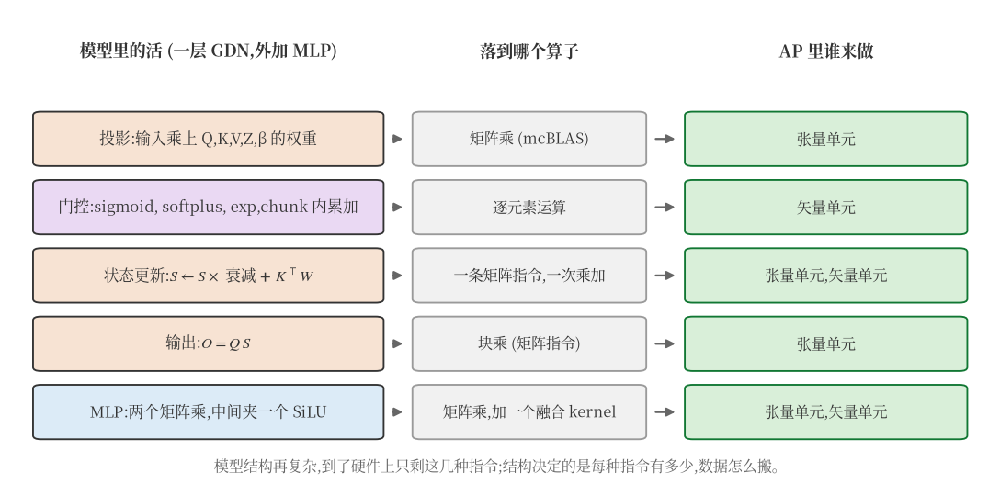
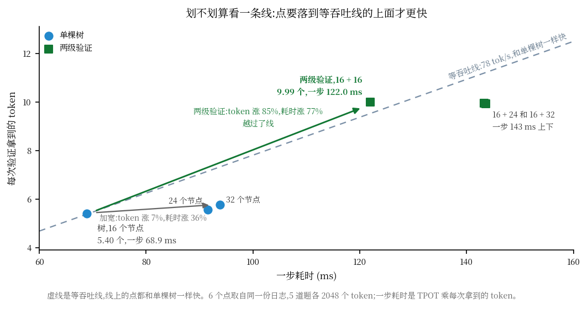

这是沐曦给 C500 写的 GDN kernel 里的两句:

```cpp
update[mi][ni] = __builtin_mxc_mma_16x16x16bf16(
    af[mi], bf[ni], update[mi][ni]);

state_reg[p][mi][ni][r] =
    fmaf(state_reg[p][mi][ni][r], decay[r], update[mi][ni][r]);
```

第一句算 $K^\top W$,一条矩阵指令,张量单元做。第二句是旧状态乘衰减,加上新贡献,一次乘加,矢量单元做。

Qwen3.8-27B 有 48 层 GDN。每层的递推,到了硬件上就是这两句。

这篇拿 Qwen3.8-27B 当例子,在沐曦 C500 上走一遍。模型结构怎么落到 AP 上。融合 kernel 和 CUDA Graph 怎么写,能省多少。在 vLLM 里换掉自带的算子,怎么做才不怕升级。最后换一个方向,两级验证是什么,怎么接到 vLLM 的模型上。

资料分四类,文中分开写。沐曦和 vLLM 的文档与代码。SpecPilot 论文。第三方在 C500 上的实验日志,和同一份代码的复测。由这些推算的数。第七节有两段示意代码,没有在真卡上跑过,其余都是原码。

## 一、一层 GDN,拆成三类活

Qwen3.8-27B 的文本主干是 64 层,48 层 GDN 加 16 层全注意力。这是第三方从模型配置里读出来的。GDN 的形状是 16 个 Q,K 头,48 个 V 头,K 和 V 都是 128。

GDN 不存 KV cache,存的是状态矩阵,每个 V 头一个 K × V。算一下有多大:

$$48 \times 128 \times 128 \times 4\ \text{bytes} = 3.15\ \text{MB per layer}$$

48 层一共 151 MB,一条序列一份,不随长度变。16 层全注意力的 KV cache 是每个 token 64 KB。上下文到 32K 是 2.15 GB,是 GDN 状态的 14 倍。

解码的时候,每一步都把状态读一遍,再写回去。48 层是 302 MB,在 1.84 TB/s 上是 0.16 毫秒:

$$\frac{2 \times 151\ \text{MB}}{1.84\ \text{TB/s}} = 0.16\ \text{ms}$$

《沐曦 C500 技术分解》那篇量到,一步是 38.69 毫秒,大头在读 51.1 GB 的权重上。GDN 的状态只占 0.4%。

一层 GDN 的活分三类,再加上 MLP:



打个比方,这是把一张配方交给车间。配方再复杂,车间里只有车,铣,磨几种机床。配方决定的是每种机床开几次,工件怎么流转。

框架不做自动解析。eager 模式下,它一个算子一个算子地调用现成的 kernel。

## 二、kernel 里:两句代码

上面那两句出自 mcoplib 的 `chunk_gated_delta_rule_fwd_h_native.cu`,1684 行。文件里有两个 kernel。一个是保正确性的,注释写着 "One block owns one (sequence, head, v) state row"。另一个是给 BF16,K = V = 128 优化的。

优化的那个,常量写在文件头。chunk 长 64 个 token,一个线程块管状态的 64 行,每行 128 列,一个线程块 256 个线程。注释里有一句:"No FP32 state panel: the Bv x 128 state is register-resident."

prefill 的时候,一个线程块拿一个头的半份状态,顺着 chunk 一个一个往下走。每来一个 chunk,把 K 和 W 读进共享内存,发矩阵指令算出更新,再乘衰减加到状态上。走完这段序列,状态写回去。

打个比方,状态是留在工位上的半成品,每来一批新料就在工位上接着加工,不送仓库。每用一次都去仓库取,时间全花在走路上。

## 三、这两句在 AP 上怎么摆


《MXMACA 怎么用》那篇讲过 AP 的底细。线程束 64 个线程,一个 PEU 放 8 条,工作组共享内存 64 KB,分 32 个 bank。对着这些数看这个 kernel。

**状态放在寄存器里。** 64 × 128 个 FP32 是 8192 个寄存器,平摊到 256 个线程,每个线程 32 个。更新用的累加器,每个线程再占 16 个:

$$\frac{64 \times 128}{256} = 32, \qquad 2 \times 2 \times 4 = 16$$

两项加起来 48 个。那篇还说过,沐曦自己的 GPTQ kernel 给 4 条线程束定的预算是每个线程 128 个以内。这里还没算地址和循环变量,余量是够的。

**共享内存四块,合计 43,008 字节。** 状态快照 16,896,残差面板 8,704,W 面板 16,896,衰减面板 512。合 42.0 KB,占 64 KB 的 65.6%。

行和行之间留了空。残差面板的行步长是 68 个半字,合 34 个字:

$$68 \div 2 = 34, \qquad 34 \bmod 32 = 2$$

每隔一行错开 2 个 bank,16 个 lane 一组读下来不撞车。K 的步长 132 个半字,合 66 个字,错开的也是 2 个 bank。文件头的注释花了近二十行算这件事。

## 四、换一种 GPU,变的是什么

算法层不变。分块,递推,状态放在离计算最近的地方,谁写都是这一套。

变的是指令。NVIDIA 是 `mma.sync.m16n8k16`,32 个线程一条。沐曦是 `__builtin_mxc_mma_16x16x16bf16`,64 个线程一条。

变的是切块。vLLM 自带的 GDN 走的是 Triton kernel。vllm-metax v0.28.0 把上游的文件整份拷过来,只改了一处,autotune 的 `num_stages` 砍成 `[1]`。注释写的理由是 "Reduce Triton `num_stages` in `chunk_delta_h` kernels to stay within MACA shared-memory limits"。

原因在前面的数里。沐曦的 mcTriton 文档写着,`cpasync` 模式下 `num-stages` 增大,共享内存的用量跟着涨。工作组共享内存只有 64 KB,级数多了放不下。

所以 vLLM 自带的那一份,在沐曦卡上是"先别炸",不是"调到极致"。想更快有两条路。一条是 Triton,在沐曦卡上重新 autotune,或者换算法。另一条是原生 C++,像上一节那个 kernel 一样直接用矩阵指令。

mcoplib 里两条路都有现成的。GDN 解码的 `fused_sigmoid_gating_delta_rule_update` 有 xcore1000 的 Triton 版和原生版。prefill 的 `chunk_gated_delta_rule_fwd_h` 有原生版,pybind 里的说明是 "same public signature as the Triton entry"。

## 五、融合 kernel:三条路

融合是把几个小算子并成一个 kernel,中间结果不落显存。在沐曦卡上有三条路。

**Triton,最省事。** mcTriton 和 mcPyTorch 在同一个安装包里,`.py` 文件不用改。本专栏融合算子那篇里的 RMSNorm 就是这种:

```python
@triton.jit
def _rms_norm_kernel(x_ptr, w_ptr, y_ptr, eps, D: tl.constexpr, BLOCK: tl.constexpr):
    row = tl.program_id(0).to(tl.int64)          # 一个 program 管一行
    cols = tl.arange(0, BLOCK)
    mask = cols < D
    ptr = row * D + cols
    x = tl.load(x_ptr + ptr, mask=mask, other=0.0).to(tl.float32)
    var = tl.sum(x * x, axis=0) / D              # 整行一次读完,方差留在寄存器里
    rstd = tl.math.rsqrt(var + eps)
    w = tl.load(w_ptr + cols, mask=mask, other=0.0).to(tl.float32)
    tl.store(y_ptr + ptr, (x * rstd * w).to(y_ptr.dtype.element_ty), mask=mask)
```

一行读进来,方差留在寄存器里,写回去,显存只碰两次。

调优时多了两个配置项。`pipeline` 选流水线的做法,`basic` 把缓冲放寄存器,`cpasync` 用异步拷贝直接搬到共享内存。`scenario` 是针对场景的编译选项,有 `flashattn-fwd`,`unroll`,`fullstage` 这些。

Qwen3.8-27B 的隐藏维是 5120,不是 2 的幂。这个 kernel 一行要装进一个块,块只能取 8192:

$$1 - \frac{5120}{8192} = 37.5\%$$

近四成的 lane 落在掩码外面。改成循环五段 1024,才用得满。

`export MCTRITON_LOG_LEVEL=INFO` 会打印每个 kernel 的寄存器和共享内存用量。`num_warps` 在沐曦上对应多少线程,文档没写,靠这个日志定。

**原生 C++,性能到顶。** 按 CUDA 的写法写 `.cu` 文件,用 PyTorch 的 `torch.utils.cpp_extension` 编,编译器走 cucc。要先设三个环境变量:

```
export CUDA_PATH=/opt/maca/tools/cu-bridge/
export CUCC_PATH=/opt/maca/tools/cu-bridge/
export PATH=${CUCC_PATH}/tools:${CUCC_PATH}/bin:${PATH}
```

要用硬件特性,只能走沐曦的内建函数。沐曦自己的融合 kernel 都在 mcoplib 里,可以照着写:`fused_add_rmsnorm_per_token_quant_padding_output`,`fused_rmsnorm_rope_quant_reshape_and_cache`,`silu_mul_quant_fp8_nopack`,`fused_sigmoid_gating_delta_rule_update_native`。

**`torch.compile` 自动融合。** mcPyTorch 支持 `torch._dynamo`,生成的 Triton 走 mcTriton。第三方量过,`@torch.library.custom_op` 在 eager 模式下每步多 7 到 9 毫秒的派发开销,所以要和 CUDA Graph 配着用。

真卡上踩过的两个坑。带 Hopper 专属内建函数的 Triton kernel 要先剥掉才能跑。`pid_m` 大于 0 的时候出过异常,要避开。

## 六、CUDA Graph:一次提交

eager 模式下,每个 kernel 都由主机提交一次。第三方的引擎有 64 层,一步里光 Python 派发就是 25 到 30 毫秒,平均一层 0.39 到 0.47 毫秒。

CUDA Graph 把这一串提交录成一张图,以后一次提交。打个比方,这是把整张工单一次交给车间,不再每个工位口头交代一遍。


接口和 CUDA 同名。PyTorch 层是 `torch.cuda.CUDAGraph()`,第三方的引擎用的就是它。PyTorch 官方文档里的整网捕获写法:

```python
g = torch.cuda.CUDAGraph()

s = torch.cuda.Stream()                 # 旁路的流里预热
s.wait_stream(torch.cuda.current_stream())
with torch.cuda.stream(s):
    for _ in range(3):
        y = model(static_input)
torch.cuda.current_stream().wait_stream(s)

with torch.cuda.graph(g):               # 捕获
    static_output = model(static_input)

static_input.copy_(new_input)           # 回放前把新数据拷进静态输入
g.replay()
```

运行时层把 `cuda` 换成 `mc`:

```cpp
mcStreamBeginCapture(stream, mcStreamCaptureModeGlobal);
// 中间是核函数和拷贝
mcStreamEndCapture(stream, &graph);
mcGraphInstantiate(&graphExec, graph, NULL, NULL, 0);
mcGraphLaunch(graphExec, stream);
```

沐曦的文档里有一句说得直白:"与核函数融合不同,任务图保留了多个核函数的独立性,但只需一次提交操作即可执行整个图。"图省的是提交的钱,不是计算的钱。

有一个开关要实测,`MACA_EXT_GRAPH_LAUNCH_MODE`。0 是用 Ring Buffer 逐个启动节点,1 是整个图一次提交,也是默认值,2 是在图里开 PDL。官方提醒,并发的节点多时会抢 AP 的资源,图不一定更快。

真卡上踩过的坑,有三条最值钱。

- **自定义 kernel 没传 stream,回放时被静默跳过。** 第三方的 C++ 扩展用默认的流启动,vLLM 在另一条流上捕获,256 层矩阵乘一个都没录进去。速度反常地快,输出全是乱码,运行时不报错。启动时要带上当前的流。
- **捕获期间不能有主机到设备的拷贝。** `torch.tensor([-1])` 会触发 `cudaErrorStreamCaptureImplicit`,改成设备端的 `torch.full((1,), -1)`。
- **变化的量放设备端张量,批大小分桶。** 序列长度做成 `kv_len_tensor`,长短上下文共用一张图。第三方的桶是 16,32,64,128。

## 七、在 vLLM 里换算子:先找口子

vLLM 给换算子留了正式的口子。vllm-metax 补丁层的 README 第一条就是:能用注册表,注意力后端,平台钩子的,就不要打补丁。


**口子一:注册表。** vLLM 的算子分两种。`CustomOp` 是一个算,按平台分派,插件平台上走 `forward_oot()`。`PluggableLayer` 是一整层,实例化的时候整层换成登记的类。

机制是一张表。实例化时按类名查 `op_registry_oot`,查到了就用表里的类。上游文档的原话是 "without directly modify vLLM"。

对着 Qwen3.8-27B 的 GDN 看这张表:

| 要换的东西 | vLLM 里的名字 | vllm-metax v0.28.0 的状态 |
|---|---|---|
| prefill 的块状递推 | `ChunkGatedDeltaRule` (CustomOp) | 沐曦登记了 `MacaChunkGatedDeltaRule` |
| GDN 整层,含 decode | `QwenGatedDeltaNetAttention` (PluggableLayer) | 注册表里没有它 |
| decode 的状态更新 | `fused_sigmoid_gating_delta_rule_update` | 普通函数,没登记,没人补 |

沐曦登记的那一份是个壳。它的 `forward_oot` 默认直接调 `forward_native`,走 vLLM 自带的 Triton 版。设了 `MACA_VLLM_USE_EXTERNAL_FLA=1`,才去调外部的 fla 包。

同名不能再登记,断言会报 "Duplicate op name"。想接手,就继承它,只改 `forward_oot`,再把表里那一项换成自己的类。下面这段是示意:

```python
from vllm.model_executor.custom_op import CustomOp
from vllm_metax.registry.custom_ops.layers.mamba.qwen_gdn_linear_attn import (
    MacaChunkGatedDeltaRule,
)


class MyGDN(MacaChunkGatedDeltaRule):
    def forward_oot(self, q, k, v, g, beta, initial_state, output_final_state,
                    cu_seqlens=None, **kwargs):
        if my_kernel.supports(q, k, v, cu_seqlens):
            return my_kernel.run(q, k, v, g, beta, initial_state, cu_seqlens)
        return super().forward_oot(q=q, k=k, v=v, g=g, beta=beta,
                                   initial_state=initial_state,
                                   output_final_state=output_final_state,
                                   cu_seqlens=cu_seqlens, **kwargs)


assert CustomOp.op_registry_oot["ChunkGatedDeltaRule"] is MacaChunkGatedDeltaRule
CustomOp.op_registry_oot["ChunkGatedDeltaRule"] = MyGDN
```

三件事要留意。

- 分派在实例化时决定,要在建模之前装好。做成 vLLM 的 general plugin,entry point 的组是 `vllm.general_plugins`。用 `VLLM_PLUGINS` 能指定只加载哪几个。
- 插件之间谁先谁后没有保证,vllm-metax 自己也是两个 general plugin。上面那行 `assert` 就是查这个的。
- `torch.compile` 模式下 custom op 默认是关的,要在 `compilation_config.custom_ops` 里显式打开。

GDN 整层在注册表里是空的,可以直接登记:

```python
from vllm.model_executor.layers.mamba.gdn.qwen_gdn_linear_attn import (
    QwenGatedDeltaNetAttention,
)


@QwenGatedDeltaNetAttention.register_oot
class MyGDNLayer(QwenGatedDeltaNetAttention):
    ...
```

**口子二:`@patch` 补丁层。** 没有注册点的时候用,`from vllm_metax.patch.utils import patch`。它比手写 monkey patch 稳在三点。目标必须已经存在,改名或挪位置会在 import 时报 `AttributeError`。同一个目标补两次报 `RuntimeError`。原对象记在补丁的 `__vllm_metax_patch__` 属性里,可查可还原。

GDN 的 decode 只能走这里。它是 vLLM 那个模块里的一个普通函数,层里按名字调用它。要换,就补那个模块里的这个名字。沐曦对 vLLM 自带的 Triton kernel 也是这么做的。

官方定的规矩有四条。保留上游的名字,签名,装饰器和没改的代码。只在改动的行加 `MetaX Modification` 注释。每个补丁写明受影响的版本和移除条件。每个补丁配一个回归测试。

还有一条来自上游。vLLM 的文档提醒,插件函数可能在不同进程里被调用多次。`@patch` 补两次会报错,插件里要自己加一个只装一次的开关。

## 八、升级了怎么办

补丁依赖 vLLM 的实现细节,升级就可能失效。vllm-metax 自己也躲不开,它的做法可以直接照搬。

**每个 vLLM 版本钉一个 commit。** 它的 `vllm_metax/patch/AUDIT.md` 是一张逐版本对账的表,开头写着 "Reviewed upstream target: v0.34.0",底下是 commit 号,再往上一版是 v0.33.0。

**每个补丁一行,决定是四种里的一种。** 保留。更新后保留:上游的签名变了,就把上游新的实现整份拿来,重新套上自己那一处改动。删除。迁移:上游修了,或者有了正式接口。

对 GDN 那个 Triton kernel 的补丁,表里写的是 "Update; retain MACA tuning"。升级的时候把上游新的实现拿过来,继续保留 `num_stages` 的限制。

**升级的顺序是固定的。** 先对平台,再对注册表和注意力后端,再对原生代码,其余的 Python 文件逐个过,然后是模型,最后才过补丁。过补丁的时候先想能不能删,它的原话是 "Consider upstream fixes, supported hooks/registrations and already adapted local modules before retaining a patch."

**版本是一对一配套的。** mcoplib 的 README 有一张表:

| vLLM | mcoplib |
|---|---|
| 0.28.0 | release/v0.4.13 |
| 0.29.0 | release/v0.4.14 |
| 0.30.0 | release/v0.4.15 |
| 0.32.0 | release/v0.4.16 |

vllm-metax 自己的 `requirements/maca_private.txt` 里写的正是 `mcoplib==0.4.13`。

换成自己的项目,清单是五条。

1. 先量。用 profiler 找出要换的算子的耗时,和 mcoplib 仓库里的 `mcoplib_ops_performance_C500.csv` 对照。
2. 能注册就不补丁,必须补丁就用 `@patch`。
3. kernel 和适配层分开。kernel 只认张量形状。适配层照沐曦那份的写法,用 `inspect.signature` 看参数名再决定状态布局,不假设版本。
4. 启动时自检,过不了就不启动。注册表里那一项是不是你以为的类。小形状上和 `forward_native` 对数。CUDA Graph 捕获回放对数。
5. 往上游提。mcoplib 和 vllm-metax 都是开源仓库,进了仓库,跟着升级对账的就是沐曦的人。

## 九、值不值得换:第三方的一个例子

第三方的引擎在 C500 上,用纯 Triton-on-MACA 换掉了 GDN 的验证算法。原算法是 Path Verify,逐个节点验证。新算法是 SpecPilot 论文 4.2 节的 TreeWY。48 层 GDN 的总耗时:

| 树的节点数 | Path Verify | TreeWY | 比值 |
|---|---|---|---|
| 8 (单链) | 3.55 ms | 6.70 ms | 0.53 |
| 16 (窄树) | 7.11 ms | 6.72 ms | 1.06 |
| 24 (中树) | 12.52 ms | 6.17 ms | 2.03 |
| 32 (宽树) | 18.13 ms | 6.19 ms | 2.93 |

新算法的耗时几乎是平的,老算法随节点数线性涨。交叉点在 16 个节点。8 个节点的时候,新的反而慢一半。

这正是上一节那段示意代码里 `supports()` 的用处。换算法不是处处都赢。按形状分派,不划算的形状走原路。

## 十、换个方向:让一步多出几个 token

前面九节都在让一步更快。同一条 vLLM 0.28 的线上有对照。自回归是 25.39 tok/s。

把 GDN 的 decode kernel 换掉,每层省 4.7 微秒,48 层一步省 0.23 毫秒。端到端的中位收益是 +0.38%,三组里还有一组是负的。MLP 的 down_proj,逐位一致的候选里最快的一个,kernel 自己快 0.24%。

同一套 vLLM,加上 DFlash2 草稿走投机解码,66.77 tok/s,2.6 倍。

差在思路上。解码一次只出一个 token,是串行的,下一个要等上一个算完。

2022 年 11 月,Google 的 Leviathan,Kalman 和 Matias 提出投机解码。摘要里写的是 "an algorithm to sample from autoregressive models faster without any changes to the outputs, by computing several tokens in parallel"。

两个月后,DeepMind 的 Chen 等独立做出同一件事,叫 speculative sampling。论文里写明 "undertaken concurrently and independently of the work on speculative decoding from Leviathan et al."。

做法分三步。小模型当草稿,先写几个 token。大模型一趟把这几个都算出来。从左往右对,对上几个收几个,对不上的那个由大模型自己给。

它为什么快,DeepMind 那篇一句话讲完了:"the latency of parallel scoring of short continuations, generated by a faster but less powerful draft model, is comparable to that of sampling a single token from the larger target model"。

解码一步的瓶颈在读权重。权重读一次,给一行用是读,给十几行用也是读。

C500 上量出来是这样。复测里,独立引擎自回归一步 42.71 毫秒。同一个引擎验一棵 16 个节点的树,一步 54.2 毫秒,多 11.5 毫秒,换回每次 4.83 个 token。再往上就不行了,精确验证 16 个节点是 52.4 毫秒,24 个节点是 75.4 毫秒。

草稿模型也有来历。2024 年 1 月的 EAGLE 让草稿在特征上做自回归,摘要里是 "autoregression at the feature (second-to-top-layer) level is more straightforward than at the token level"。

2025 年 3 月的 EAGLE-3 不只吃最上面一层,"replaces reliance on top-layer features with multi-layer feature fusion"。2026 年 2 月的 DFlash 把草稿换成一个块扩散模型,"employs a lightweight block diffusion model for parallel drafting"。这里用的 DFlash2 就是它,5 层。

## 十一、两级验证:一趟精确验证,配两份草稿

树只建一棵,和单链差不了太多。复测里同一组 5 道短题,DSpark 草稿下单链 8 个,每次 3.48 个 token;树 16 个,4.37 个。

差不了太多的原因在树的形状上。一棵树要两头顾,一头往深处走,一头留分叉。16 个节点里,最后被接受的只有一条路,其余验完就扔。

SpecPilot 论文 4.3 节换了个做法,叫两级验证。一个调度步变成两段。

第一段,草稿写一棵树,目标模型换上低精度的权重看一遍。原话是 "A Q pass over the 8-bit view of W12 checks the draft tree and returns the path that matches its argmax",结果是 "a chain C, without updating the KV cache or the recurrent state"。

这一趟只接受,不提交。它选出来的那条路叫链 C。

第二段,草稿从 C 的末尾再写一份。原话是 "The drafter drafts again from the end of C, and its best-first subtree, truncated to N-|C| nodes, is attached below C"。然后目标模型用精确的权重,把 C 连同第二棵树一趟验完,照常提交。


打个比方,先让二厨过一遍,把明显不对的划掉,大厨只验划剩下的。二厨说了不算。

所以是两棵树。第二份草稿不用再两头顾,它的节点全放在 C 的后面,往深处写。两趟各验 16 个节点,谁都没碰到 24 个节点那道坎。

C500 上的实现是作者引擎的 `generate(mode="tlv")`。第二轮草稿之前有这么一段,`aux_q` 是第一趟给每个节点算出来的特征:

```python
if lq < n_exact:
    q_idx_t = torch.tensor(q_nodes, dtype=torch.long, device=self.dev)
    self.d.write_context_kv(aux_q.index_select(0, q_idx_t), start_pos=cur_len, write_slot=cur_len)
    self.d.ctx_len_t.fill_(cur_len + lq)
    anc_t.fill_(anchor2)
    dpos.copy_(pos_base + (cur_len + lq))
    t2_tok, t2_par, _ = run_d2(anc_t, dpos)
    self.d.ctx_len_t.fill_(cur_len)  # Restore committed ctx_len before target exact verify!
```

这段在做一件事。链 C 的 token 还没被精确验证,草稿 2 却要从 C 的末尾往后写。所以先把第一趟的特征临时写进草稿的缓存,让草稿 2 能看见 C。草稿的缓存是什么,放到第十四节讲。

无损,因为只有精确那趟提交。论文的原话是 "TLV is lossless because only the exact pass accepts tokens"。

作者往第一趟里灌了 25% 的随机翻转,每次拿到的 token 从 8.23 到 11.09 个掉到 3.40 到 3.86 个,速度掉到 30 tok/s 上下。两道题的输出和自回归逐 token 一致,其余三道只在近乎打平的位置不同,logit 差不超过 0.125。

## 十二、划不划算,看一条线

第一趟不便宜。C500 上它 39.6 毫秒,精确那趟 52.4 毫秒,四分之三。权重换成 8 位,省下的字节没有变成同样的时间。

所以一个做法更快,条件只有一个:每次验证拿到的 token 涨的比例,比一步耗时的涨得多。

$$\frac{\tau_{\text{new}}}{\tau_{\text{old}}} > \frac{T_{\text{new}}}{T_{\text{old}}}$$

$\tau$ 是每次验证拿到的 token,$T$ 是一步的毫秒。把右边除过去,就是 $\tau/T$ 没有降。过原点的每一条射线上,这个比值都一样,叫等吞吐线。



| 做法 | 每次拿到 token | 一步耗时 | 吞吐 |
|---|---|---|---|
| 树,16 个节点 | 5.40 | 68.9 ms | 78.07 tok/s |
| 树,24 个节点 | 5.57 | 91.6 ms | 60.73 tok/s |
| 树,32 个节点 | 5.78 | 93.8 ms | 61.60 tok/s |
| 两级验证,16 + 16 | 9.99 | 122.0 ms | 82.15 tok/s |
| 两级验证,16 + 24 | 9.94 | 143.3 ms | 69.10 tok/s |
| 两级验证,16 + 32 | 9.93 | 143.6 ms | 68.80 tok/s |

六行来自同一份日志,5 道题各 2048 个 token。一步耗时是 TPOT 乘每次拿到的 token。吞吐是单题的几何均值。

三组对照。树从 16 加宽到 32 个节点,token 涨 7%,耗时涨 36%,慢 21%。树换成两级验证,token 涨 85%,耗时涨 77%,快 5%。两级验证的第二棵树再加宽,token 没动,耗时涨 17%,慢 16%。

六行里只有 16 + 16 那一行越过了线,而且只超了一点。

第一趟用不用量化,决定它在线上还是线下。按各阶段的耗时算,第一趟也用精确权重,一步是 124.1 毫秒,每个 token 12.4 毫秒,比单棵树的 11.9 毫秒还慢。

批处理下,线会翻过来。论文在 H100 的 BF16 批处理上,两级验证慢 13%,原因是 "TLV's Q pass cuts bytes only in the attention and recurrent-layer projections"。复测里 16 路并发,同一组 20 个请求,vLLM 自回归 207.87 tok/s,独立引擎的 DFlash2 是 203.26。

复测还说明这层赚头有多薄。还是那 5 道短题,DFlash2 草稿下单棵树 84.04 tok/s,两级验证 80.02;DSpark 草稿下单棵树 75.54,两级验证 77.35。

## 十三、第一趟的权重:4 位和 8 位混着用

第一趟读的不是 BF16 权重,是目标模型的一份低精度副本。作者在 C500 上的配置叫 `hybrid_w4w8`,按模块分三种:

| 模块 | 副本 |
|---|---|
| 第 2 到 61 层的 `mlp.gate_up_proj` 和 `linear_attn.in_proj_qkvz` | 4 位,105 个 |
| 第 2 到 61 层的 `mlp.down_proj`,`linear_attn.out_proj`,`self_attn.qkv_proj`,`self_attn.o_proj`,再加 `lm_head` | 8 位,136 个 |
| 第 0,1,62,63 层 | 不建副本 |

105 是 60 个 gate_up 加 45 个 in_qkvz。136 是 1 个 LM head,60 个 down,45 个 GDN 的 out_proj,15 个 qkv_proj,15 个 o_proj。最外面 4 层留着不动,作者代码里的注释是 "for outlier precision + VRAM margin"。副本一共占 15.70 GB。

分法来自一张对照表。64 层加 LM head,M 等于 16 的时候:

| 后端 | 耗时 | 说明 |
|---|---|---|
| mcBLAS,BF16 | 39.22 ms | 精确 |
| W12 | 44.98 ms | 逐位一致 |
| W12 里嵌套的 8 位视图 | 31.93 ms | 不占额外显存 |
| MCTLASS W8A8 | 24.08 ms | 和精确的余弦相似度 0.99992 |
| MCTLASS W4A8,逐通道 | 22.98 ms | 余弦相似度 0.9927,每个参数 0.5 个字节 |

两个量化后端各管一头。4 位的省显存,留给最大的两个矩阵,gate_up 和 in_qkvz。M 到了 32,它从 22.98 掉到 30.16 毫秒。8 位的从 24.08 到 25.63,没有这道坎,精度也高,其余都用它。换完之后,第一趟从 39.55 毫秒降到 27.58 毫秒。

副本不能直接当验证用。日志里有个只靠 8 位视图验证的配置,78.17 tok/s,作者标为有损:10 道题里逐字符一致的 0 道,同一张表里标为无损的配置是 4 道。

调完之后,公开 20 题上两级验证是 105.01 tok/s,单棵树 100.12。

## 十四、接到 vLLM 上:prefill 改了什么

作者的引擎自带一套目标模型,权重自己加载。复测里试了一种接法:循环,kernel,缓存都不动,目标模型换成 vLLM 加载的那一份。目的写在复测的结论里:先在同一套数值上把循环跑通,再谈接 vLLM 的分页状态提交和批调度。

第七节说过,能注册就不打补丁。这里是反过来的:补丁打在模型的实例上,退出时还原。它是实验路径,没有服务开关。

做法是继承作者的 `SpecPilotEngine`。`prefill` 和 `_target_forward_tree` 两个方法被重写,另加了几个帮手。新的 prefill 是这样:

```python
@torch.inference_mode()
def prefill(self,prompt_ids,return_logits=False):
    self.reset_state()
    size=len(prompt_ids)
    ids=torch.tensor(prompt_ids,dtype=torch.int64,device=self.dev)
    pos=torch.arange(size,dtype=torch.int32,device=self.dev)
    logits,aux=self.model_pass(ids,pos,"prefill",False)
    h=torch.cat(aux,dim=-1).contiguous()
    bonus=int(logits[0].argmax().item())
    self.d.write_context_kv(h,start_pos=0,write_slot=0)
    self.kv_len_t.fill_(size)
    self.d.ctx_len_t.fill_(size)
    return (bonus,h[-1:].clone(),logits[0].float()) if return_logits else (bonus,h[-1:].clone())
```

原版是一个手写的 64 层循环。这里换成调 vLLM 的模型对象。循环里每个子模块的 `forward` 被换成作者的 kernel:

| 位置 | 换成 |
|---|---|
| 所有 RMSNorm | `rmsnorm`,`fused_add_rmsnorm` |
| MLP 的激活 | `silu_and_mul` |
| 48 个 GDN 层 | prefill 走 `gdn_prefill`,验证走 `gdn_tree_conv_silu` 加 `gdn_treewy_verify_core` |
| 16 个注意力层 | prefill 走因果 SDPA,验证走 `tree_attention_forward` |

线性层没换,照常走 vLLM 加载的那份 W12 权重。


prefill 跑完,三样东西各有一个去处。

| 产物 | 从哪来 | 落到哪 |
|---|---|---|
| 第 1 个输出 token | 最后一层过 LM head,取 argmax | 返回给调用方,当第一轮的锚点 |
| 目标模型的状态 | 16 层的 K 和 V,48 层 GDN 的卷积状态和递归状态 | 引擎私有的连续缓冲,不走 vLLM 的分页 KV |
| 草稿的上下文 | 第 6,20,34,48,62 层跑完后的隐状态 | `write_context_kv`,写进 DFlash2 的 K 和 V |

特征取哪几层,写在草稿的配置里,`dflash_config.target_layer_ids` 是 5,19,33,47,61。加 1 交给 vLLM 的 `set_aux_hidden_state_layers`,就是 vLLM 给 EAGLE-3 用的那套机制。取的值是那一层跑完后的残差流,`hidden_states + residual`。每层 5120 维,5 层拼成 25600 维:

$$5 \times 5120 = 25600$$

草稿每轮的输入只有锚点 token 和 7 个掩码位,上下文全靠这份 K 和 V。`write_context_kv` 用 `fc_w` 把 25600 维投到 5120 维,归一化,`fused_kv_w` 投出 5 层各自的 K 和 V。

这两个矩阵留在 BF16,作者的注释是 "aux_hidden concatenates 5 target layers with ~30x cross-layer magnitude variance, so per-token INT8 quant crushes early-layer features"。

两级验证在这里多做一步。草稿 2 要从链 C 的末尾往后写,草稿的 K 和 V 里得先有 C 这一段。第十一节那段代码做的就是这件事:

1. 链 C 的特征取自第一趟,`aux_q`,临时写进去。
2. 草稿 2 以 C 末尾的下一个 token 为锚点,从 `cur_len + lq` 起写。
3. 写完把 `ctx_len_t` 恢复成 `cur_len`。
4. 精确趟之后,`_commit_exact` 用精确趟的特征覆盖同一批位置,原注释是 "overwriting any transient Q-pass KV!"。

第一趟的特征只影响第二份草稿写什么,不进输出。

对数是这样做的。把作者自己那套目标模型指向同一份 vLLM 权重,同一份状态缓冲上先跑原版,再跑接上去的版本。首轮 prefill 的 248,320 个 logits,K 和 V,GDN 状态,第一轮 Q 和精确两趟的分数和特征,逐元素一致。

公开 20 题,这条路径聚合 101.44 tok/s。作者的公开成绩是 97.91,同一台机器上原样复现是 99.65。20 题的文本,长度,步数全部一致。

有一个数容易看漏。内部工作区按 16 槽配的时候是 99.94 tok/s,多生成 794 个 token,一道代码题出了语法错误。作者的命令行按 32 槽配。槽位数不改变两趟验证各 16 个节点的预算,输出却跟着变了,原因没有定位。

它不是 vLLM 的原生调度。状态在单请求私有的连续缓冲里,验证输入还是第一趟 16 个节点,精确趟 16 个节点。

## 十五、哪些是实测,哪些是推算

第三方的数:Qwen3.8-27B 的层结构,GDN 的状态大小,两张耗时表,CUDA Graph 的收益,踩过的坑。第十节到第十三节的各阶段耗时,宽度扫描,量化副本的对照表,噪声注入,公开 20 题。都取自同一份实验日志,整卡,单方。

论文的数:两级验证的定义和原话,H100 上第一趟和精确趟的比例,BF16 批处理慢 13%。取自 SpecPilot 的 4.3 节和附录 C。投机解码,EAGLE,EAGLE-3,DFlash 的原话取自各自的摘要。

复测的数:同一份代码换一张 C500,MACA 3.8.4.9。5 道短题,公开 20 题,16 路并发,vLLM 线上换 kernel 的收益,接到 vLLM 上的对数和 20 题。原始数字在 `bench/tlv.json`。

推算的数分两批。第一批在前九节:每个线程 32 个状态寄存器,是 64 × 128 除以 256。GDN 解码一步的状态流量 302 MB 和 0.16 毫秒,是按一步读一次写一次算的。RMSNorm 那个 37.5%,是 5120 和 8192 算出来的。Python 派发每层 0.39 到 0.47 毫秒,是 25 到 30 毫秒除以 64。KV cache 是 GDN 状态的 14 倍,是 2.15 GB 除以 151 MB。

第二批在后五节。一步耗时,是 TPOT 乘每次拿到的 token。单路解码比 16 个节点的树一步少 11.5 毫秒,是 54.2 减 42.7。第一趟也用精确权重的 124.1 毫秒,是五个阶段相加。4 位视图 105 个,8 位视图 136 个,是按层结构数出来的。三组对照里的涨跌,是宽度扫描里两行相除。

第七节那两段示意代码没有在真卡上跑过。第十一节和第十四节的代码是跑过的原码。插件之间的加载顺序,0.28.0 上的实际情况没有验证。

## 十六、面试里会问的

**1. 一个模型的注意力结构,是怎么落到硬件上的?**

答:先拆成算子,一个算子对应一个写好的 kernel,kernel 里只剩几种指令。GDN 的递推是状态乘衰减加 $K^\top W$,在沐曦的 kernel 里就是一条矩阵指令加一次乘加,张量单元和矢量单元各一样。

**2. 沐曦那个 GDN kernel,状态放在哪,为什么?**

答:放在寄存器里。一个线程块管 64 × 128 个 FP32,256 个线程,每个线程 32 个寄存器。状态每个 chunk 都要用,放寄存器里不用反复去共享内存取。

共享内存里放的是每个 chunk 读进来的 K,W 和衰减,一共 43,008 字节。

**3. 共享内存的行步长为什么是 68 个半字?**

答:为了 bank 冲突。68 个半字是 34 个字,对 32 取余是 2,相邻的行错开 2 个 bank,16 个 lane 一组读下来不撞车。

**4. vLLM 自带的 Triton kernel,在沐曦卡上为什么慢?**

答:不一定是慢,是保守。vllm-metax 把 `num_stages` 砍到 1,是为了塞进 64 KB 的工作组共享内存,没在这张卡上重新调优。想快,要么在沐曦卡上重新 autotune,要么用原生 C++ 直接写矩阵指令。

**5. CUDA Graph 省的是什么钱?能省多少?**

答:省的是主机提交的开销。每个 kernel 提交一次,64 层一步要 25 到 30 毫秒的 Python 派发。录成图以后一次提交,第三方的 Draft 单步从 25 毫秒降到 7 到 9 毫秒。图不改变计算本身。

**6. 自己写的 kernel 接进 CUDA Graph,最容易踩什么坑?**

答:启动时没带当前的流。kernel 落在默认流上,捕获用的是另一条流,运行时不报错,回放的时候整个跳过。

第三方的 256 层矩阵乘就是这样被跳过的,速度快得反常,输出全是乱码。启动时带上当前的流,再加一道捕获回放的精度校验。

**7. 在 vLLM 里换算子,有几条路?先走哪条?**

答:两条。先看 vLLM 有没有把它登记成 `CustomOp` 或 `PluggableLayer`,有就用 `register_oot`。没有再用 vllm-metax 的 `@patch`,目标必须已经存在,补两次报错。

vLLM-Metax 自己是 25 个算子走注册表,35 处补丁走 `@patch`。

**8. 上游升级了,补丁失效怎么办?**

答:把升级当一个项目做。版本钉到 commit。每个补丁对着上游的新代码过一遍,决定是保留,更新后保留,删除,还是迁移到正式接口。最后用小形状的对数测试和捕获回放测试验收。

**9. 解码一步只出一个 token,一趟验证十几个为什么几乎不加钱?**

答:一步的瓶颈在读权重。权重读一次,给一行用和给十六行用读的是同一份。C500 上,独立引擎自回归一步 42.71 毫秒,验 16 个节点的一步是 54.2 毫秒。过了 16 个节点就不一样了,精确验证 24 个节点是 75.4 毫秒。

**10. 两级验证为什么是两棵树?第一趟贵不贵?**

答:一棵树要两头顾,节点有不少花在会被扔掉的分叉上。第一趟先挑出一条路,第二份草稿只往这条路后面写,节点全花在深处。第一趟不便宜,C500 上是精确那趟的四分之三。所以它换来的是薄利,公开 20 题上比单棵树快 4.9%。

**11. 一个新做法划不划算,怎么判断?**

答:每次验证拿到的 token 涨的比例,要超过一步耗时涨的比例。树从 16 加宽到 32 个节点,token 涨 7%,耗时涨 36%,亏。换成两级验证,token 涨 85%,耗时涨 77%,赚。批处理下第一趟省不下多少,就翻过去了。

**12. 第一趟的量化副本,能不能直接当验证用?**

答:不能。它和精确的结果不完全一样,直接提交就是有损的。作者的日志里,只靠 8 位视图验证的配置被标为有损。两级验证让它只接受不提交,精确那趟说了才算。

**13. 草稿模型的上下文从哪来?**

答:从目标模型的隐状态来。DFlash2 取第 6,20,34,48,62 层跑完后的隐状态,拼成 25600 维,投影成草稿 5 层的 K 和 V,写进缓存。草稿自己每轮只输入锚点 token 和 7 个掩码位。

**14. 把作者的两级验证接到 vLLM 的目标模型上,prefill 改了什么?**

答:逻辑没改,改的是谁来跑。vLLM 的模型对象负责 64 层循环,每个子模块的 `forward` 换成作者的 kernel。prefill 的三样产物各有去处:第一个 token 当锚点,K,V 和 GDN 状态进引擎私有的缓冲,5 层隐状态写进草稿的 K 和 V。

## 十七、总结

**1. 模型结构落到硬件上,只剩几种指令。** GDN 的递推是一条矩阵指令加一次乘加。

**2. kernel 的功夫在摆放。** 状态放寄存器,每个线程 32 个。共享内存 42 KB。行步长取 68,错开 bank。

**3. 换 GPU 换的是指令和切块。** vLLM 自带的 Triton kernel 在沐曦卡上被砍到 1 级流水,为的是塞进 64 KB。

**4. CUDA Graph 省的是提交。** 第三方的 Draft 单步从 25 毫秒降到 7 到 9 毫秒,坑在流和拷贝。

**5. 换算子先找口子。** 注册表,再 `@patch`。升级靠逐版本对账和自检。

**6. 单路解码下,让一步多出 token,比把一步变快值钱。** 同一条 vLLM 线上,换 kernel 是 +0.38%,换投机解码是 2.6 倍。

**7. 两级验证是两份草稿配一趟精确验证。** 第一趟只接受不提交,第二份草稿只往深处写。划不划算,看 token 涨的比例有没有超过耗时涨的比例。

**8. 接上去的时候,先看清明三样东西落到哪。** 第一个 token,目标模型的状态,草稿的上下文。链 C 的特征写两次,第二次是精确的。

如果这个系列对你有用,点个赞或关注专栏,更新会持续。

---

*沐曦的代码: GitHub 组织 MetaX-MACA 下 mcoplib (提交 39511c5) 的 `op/chunk_gated_delta_rule_fwd_h_native.cu`, `op/pybind.cpp`, README 里的版本对应表。vLLM-Metax v0.28.0 (分支 releases/v0.28.0) 的 `pyproject.toml`, `requirements/maca_private.txt`, `vllm_metax/patch/` (README, utils.py, bugfix/triton_support/chunk_delta_h.py), `vllm_metax/registry/`。`vllm_metax/patch/AUDIT.md` 和升级说明取自仓库的主分支, 对应 vLLM v0.34.0。*

*上游 vLLM: v0.28.0 的 `vllm/model_executor/layers/mamba/gdn/qwen_gdn_linear_attn.py`, `vllm/model_executor/custom_op.py`, `vllm/plugins/__init__.py`; `docs/design/custom_op.md`; `vllm/model_executor/models/qwen3_next.py` 里取辅助隐状态的主循环。*

*沐曦的文档, MXC500, 版本 3.10.1:《运行时API编程指南》 (图编程接口, 环境变量), 《mcTriton用户指南》, 《mcPyTorch用户指南》。*

*论文: SpecPilot, arXiv 2611.02501 (2026 年 11 月), 4.3 节和附录 C。投机解码的来历: Leviathan, Kalman, Matias, 《Fast Inference from Transformers via Speculative Decoding》, arXiv 2211.17192, 2022 年 11 月; Chen 等, 《Accelerating Large Language Model Decoding with Speculative Sampling》, arXiv 2302.01318, 2023 年 2 月。草稿模型: EAGLE, arXiv 2401.15077, 2024 年 1 月; EAGLE-3, arXiv 2503.01840, 2025 年 3 月; DFlash, arXiv 2602.06036, 2026 年 2 月。*

*第三方的数: gitlink.org.cn/JunkaiShi/c500-specpilot 的实验日志 (提交 693c478b), Qwen3.8-27B 的层结构, Path Verify 和 TreeWY 的耗时表, CUDA Graph 的收益和踩过的坑; 第十到第十三节的各阶段耗时, 宽度扫描, 量化副本的对照表, 噪声注入; 引擎 `c500_specpilot_engine.py` 和 kernel 文件 `c500_specpilot_kernels.py` 里逐行读出来的常量和注释。*

*复测: 同一份代码在另一张 C500 上, MACA 3.8.4.9。5 道短题每题最多 256 个输出 token, 每个配置 2 轮取中位数; 公开 20 题各 1 轮, 上下文 3072, 输出上限 2048; 16 路并发每个请求 256 个 token。vLLM 线上的对照是 vLLM 0.28.0 加 vLLM-MetaX 0.28, 换 kernel 的收益是 eager 模式下三组交错配对的中位数。*

*推算的过程在 `calc.py` 里, 结果在 `bench/calc_summary.json`。文中数字截至 2026 年 11 月 28 日。*
