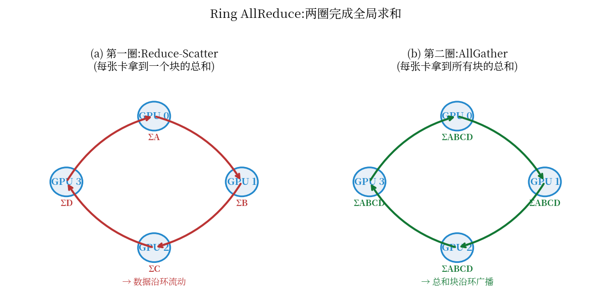
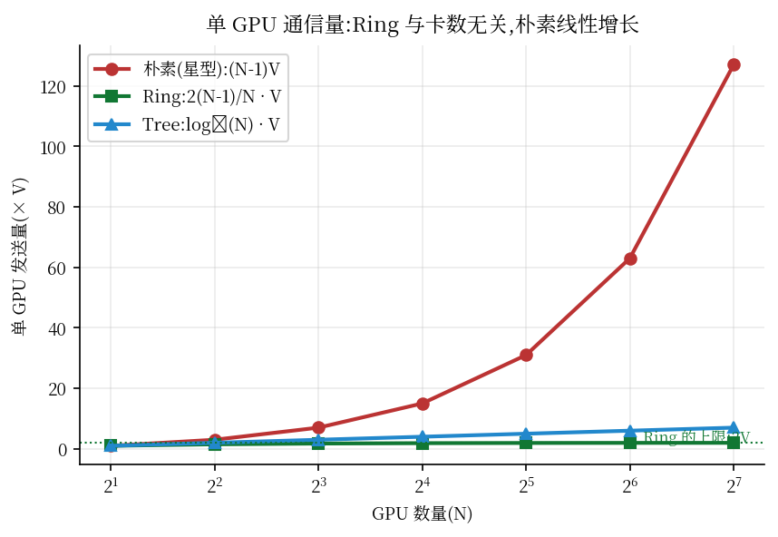
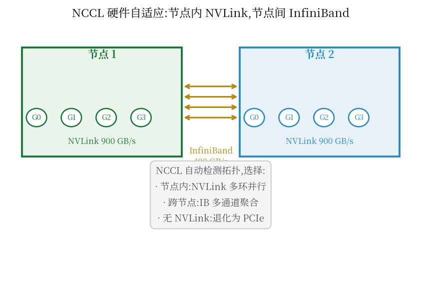

8 张 H100 训练一个大模型，每张卡每步算完梯度后，需要把梯度**同步**给所有其他卡。梯度 1 GB,8 张卡——听起来每张卡要发 7 GB?

实际上只发 **1.75 GB**。不管 100 张还是 1000 张卡，每张卡永远只发约 **2 GB**。

这就是 NCCL(NVIDIA Collective Communications Library)的核心魔法：**Ring AllReduce**。这篇文章拆开它。

## 一、问题：多 GPU 训练的梯度同步

你用 PyTorch DDP 训练：

```
GPU 0 算出梯度 g₀ ──┐
GPU 1 算出梯度 g₁ ──┤    所有人需要拿到相同的
GPU 2 算出梯度 g₂ ──┼──→ 平均梯度 ḡ = (g₀+g₁+...+g₇)/8
GPU 3 算出梯度 g₃ ──┤    然后各自更新参数
...                  │
GPU 7 算出梯度 g₇ ──┘
```

"把所有人的梯度加起来，发给所有人"——这个操作叫 **AllReduce**。

它是分布式训练中**通信量最大、频率最高**的操作：每一步(step)都要做一次，梯度越大通信越多。Llama-3(405B)训练中，每步的梯度同步约 800 GB,训练 15 万步 = **总通信量 120 PB**(拍字节)。

NCCL 就是 NVIDIA 专门写来做这件事的库——目标：让通信快到你感觉不到。

## 二、朴素方法有多惨

最直觉的做法：所有 GPU 把梯度发给 GPU 0,GPU 0 加起来，再广播回去。

$$\text{GPU-0 receive} = (N-1) \times V$$

8 卡、梯度 1 GB:GPU 0 收 7 GB + 发 7 GB = **14 GB**。其他 GPU 各只发 1 GB 收 1 GB。

两个致命问题：
1. **GPU 0 是瓶颈**——它的通信量是别人的 7 倍
2. **网络利用率低**——NVLink 是全互联的(任意两卡直连)，但星型模式只用到了"GPU 0 ↔ 其他"这 7 条链路，其余 21 条空转

## 三、Ring AllReduce:把星型改成环型

### 3.1 排成环

把 8 张 GPU 排成一个环，每张卡只跟**左右两个邻居**通信：

```
GPU 0 ↔ GPU 1 ↔ GPU 2 ↔ GPU 3
  ↑                         ↓
GPU 7 ↔ GPU 6 ↔ GPU 5 ↔ GPU 4
```

NVLink + NVSwitch 是全互联的，NCCL 会从所有可能的连接中选一个**物理上最优的环**(相邻卡之间的 NVLink 带宽最大化)。

### 3.2 第一圈:Reduce-Scatter

把梯度向量 $V$ 切成 $N$ 块(8 卡切 8 块):

$$V = [V_0, V_1, V_2, V_3, V_4, V_5, V_6, V_7]$$

每个 GPU $i$ 的第 $k$ 块记为 $V_k^{(i)}$。

第一圈做 $N-1 = 7$ 步。每一步(以步 $s$ 为例):

- 每个 GPU 把手上的"第 $(i - s) \bmod N$ 块"的**部分和**发给右边邻居
- 收到左边邻居发来的块后,**加上自己的对应块**
- 继续往右传

走完 7 步:

$$\text{GPU } i \text{ holds } \sum_{j=0}^{7} V_i^{(j)}$$

**每张 GPU 有且只有一个块的完整总和。**



### 3.3 第二圈:AllGather

现在 GPU 0 有第 0 块的总和，GPU 1 有第 1 块的总和...但每张 GPU 需要**所有块**的总和。

再做一圈:每个 GPU 把手上的"总和块"往右传。$N-1 = 7$ 步后，所有人都拿到了所有 8 块的总和。

**AllReduce = Reduce-Scatter + AllGather。两圈，完成。**

### 3.4 通信量的数学

每张 GPU 的发送量:

$$\text{send} = \underbrace{\frac{V}{N}(N-1)}_{\text{RS}} + \underbrace{\frac{V}{N}(N-1)}_{\text{AG}} = \frac{2V(N-1)}{N}$$

关键性质:当 $N \to \infty$:

$$\lim_{N \to \infty} \frac{2V(N-1)}{N} = 2V$$

**不管多少卡,每张 GPU 的发送量趋近于 $2V$(永远不会超过 $2V$)。**

| 卡数 | 朴素方法(单卡) | Ring(每卡) | 差距 |
|---|---|---|---|
| 8 | $7V$ | $1.75V$ | 4× |
| 32 | $31V$ | $1.94V$ | 16× |
| 128 | $127V$ | $1.98V$ | 64× |
| 1024 | $1023V$ | $2.00V$ | **512×** |



而且朴素方法只有 GPU 0 忙死、其他人闲着;Ring 的**每一张卡、每一条链路**都在同时收发——**网络利用率 100%**。

### 3.5 时间复杂度

$$T = \underbrace{\frac{2(N-1)V}{NB}}_{\text{transfer}} + \underbrace{2(N-1)\alpha}_{\text{latency}}$$

- $B$:单条链路带宽
- $\alpha$:单步的启动延迟

当 $N$ 增大时:
- 传输项 $\frac{2(N-1)V}{NB} \approx \frac{2V}{B}$(与 $N$ 无关——带宽最优)
- 延迟项 $2(N-1)\alpha$(线性增长——卡多了变慢)

**所以 Ring 适合大消息(带宽主导)，不适合小消息(延迟主导)。** 这引出了 Tree。

## 四、Tree 算法:小消息用树

当消息很小时(几 KB),延迟是主要瓶颈——Ring 要走 $2(N-1)$ 步，太慢。

Tree 算法把 GPU 排成**二叉树**:

```
         GPU 0
        /      \
    GPU 1      GPU 2
   /     \    /     \
GPU 3  GPU 4 GPU 5  GPU 6
```

Reduce(上行):叶子节点把数据发给父节点，父节点加完再往上传。$\log_2 N$ 步完成。
Broadcast(下行):根节点往下游，$\log_2 N$ 步。

$$\text{Tree hops} = O(\log N) \ll O(N)$$

| | Ring | Tree |
|---|---|---|
| 跳数(8 卡) | 14 步 | 6 步 |
| 每卡发送量 | $\approx 2V$(最优) | $\approx V \log N$(更多) |
| 适合 | **大消息**(梯度同步) | **小消息**(loss、barrier) |

NCCL **自动选择**:梯度同步(GB 级)用 Ring;小张量同步(KB 级)用 Tree。也可以手动指定 `NCCL_ALGO=Ring` 或 `NCCL_ALGO=Tree`。

## 五、NCCL 的硬件自适应

NCCL 不绑定某一种互联。它**自动探测硬件拓扑，选最优路径**:



| 互联 | 带宽(双向) | 延迟 | 场景 |
|---|---|---|---|
| NVLink 4 + NVSwitch | **900 GB/s** | ~1.5 μs | 单节点内(8 卡) |
| PCIe 5 | 64 GB/s | ~5 μs | 无 NVLink 时退化 |
| InfiniBand NDR | 400 GB/s | ~1 μs | 跨节点 |
| RoCE(以太网) | 200 GB/s | ~2 μs | 无 IB 时 |

**跨节点场景**是 NCCL 最复杂的工作:它会创建**多个并行环**。比如 4 节点各 8 卡(NVLink 内 + IB 间),NCCL 建 4 个环——每个环用不同的 NVLink 通道 + 不同的 IB 端口，**让所有可用链路同时跑满**。

这是为什么 NCCL 被称为"通信领域的 cuDNN"——它把底层硬件拓扑的复杂性全部封装，用户只需要调 `all_reduce()`。

## 六、PyTorch DDP 的实际调用链

```python
# 你写的
model = torch.nn.parallel.DistributedDataParallel(model)

# 背后发生的(每一步训练)
for batch in dataloader:
    loss = model(batch)        # 1. 前向(各 GPU 独立)
    loss.backward()            # 2. 反向(各 GPU 独立)
    # 3. DDP 自动做梯度同步:
    #    → NCCL Ring AllReduce
    #    → 所有 GPU 的梯度变成一致的平均值
    optimizer.step()           # 4. 更新(各 GPU 独立)
```

**关键优化:梯度桶(gradient bucket)+ 通信重叠**

DDP 不会等所有层的梯度都算完才发。它把参数分成多个桶(bucket),**某个桶里的所有梯度算完就立刻发 AllReduce**——同时后面的层还在算反向传播。

```
时间轴:
  反向传播: [层 N-1] [层 N-2] [层 N-3] ... [层 0]
  通信:              [桶3 AllReduce] [桶2 AllReduce] [桶1 AllReduce]
                     ↑ 通信和计算重叠,通信时间被"吃掉"大半
```

没有 overlap:计算 100ms + 通信 50ms = 150ms
有 overlap:计算 100ms(通信 50ms 藏在里面)= **100ms**(提速 33%)

## 七、通信是训练的隐形杀手

Llama-3(405B,1536 卡 H100)训练中:
- MFU ~43% → **57% 的时间 GPU 在闲着**
- 其中通信占多少?分场景:
  - NVLink 内(单节点 8 卡):1 GB 梯度 / 900 GB/s = 1.1 ms → **几乎无感**
  - InfiniBand 跨 192 节点:每步梯度同步约 100-200 ms → **占 step 时间的 20-30%**

这就是 MFU 只有 43% 而不是 90% 的主要原因。

**优化通信是提升 MFU 的主战场**:NCCL 调优(多环、多通道)、梯度压缩(FP16/FP8 梯度)、通信-计算 overlap(DDP bucket)、层次化 AllReduce(先节点内 NVLink、再节点间 IB)。

## 八、NCCL 2.32(2026)的新东西

当前最新版 NCCL 2.32(2026 年):

- **多环并行**:自动创建 2-4 个并行环，充分利用 NVSwitch 全互联
- **Lazy Connection**:延迟建连，减少初始化时间
- **跨数据中心支持**:NCCL Direct A2A,跨越数据中心的大规模分布式训练
- **对称内存(Symmetric Memory)**:利用 NVLink SHARP 硬件加速
- **自动算法选择**:基于消息大小、拓扑、卡数,自动在 Ring/Tree/Patent(自定义)间切换

### 8.5 NCCL 与网络原理的血缘关系

NCCL 的核心问题和计算机网络是同一个:**怎么在一群节点之间高效地传数据**。几乎每个 NCCL 概念都有网络原理的"亲戚":

| NCCL 概念 | 网络原理对应 | 共同思想 |
|---|---|---|
| Ring AllReduce(大消息) | ECMP 多路径路由 / 链路聚合 | 让每条链路跑满(带宽最优) |
| Tree AllReduce(小消息) | CDN / Anycast | 跳数最少(延迟最优) |
| 自动切换 Ring/Tree | TCP 拥塞控制(窗口大小自适应) | 延迟主导还是带宽主导,动态选 |
| 拓扑探测 + 最优环规划 | SDN 控制器(发现拓扑→计算路径→下发流表) | 先知道网长什么样,再选路 |
| NVSwitch | 交换芯片 / Crossbar 矩阵 | 非阻塞全互联 |
| 多环并行 | MPTCP / Linux bonding | 多路径同时跑满 |
| DDP 梯度桶 overlap | TCP 滑动窗口 / HTTP2 多路复用 | 流水线:不等一个完成再开始下一个 |

更本质的对应:

**AllReduce 的 2V 下界 ↔ 最大流-最小割定理**:Ring AllReduce 单卡发送量趋近 2V,恰好是"每张卡的入口和出口同时满载"——和数据中心 fat-tree / Clos 网络"消除瓶颈、所有链路等速"是同一个思想.

**NCCL 属于 MPI 大家族**:集合通信(collective communication)在 HPC 集群上跑了 30 年(MPI 标准),NCCL 本质上是 MPI 集合通信在 NVIDIA 硬件上的极致优化版:

| MPI 操作 | 做什么 | 网络类比 |
|---|---|---|
| AllReduce | 全员求和,发给全员 | 群聊 |
| Broadcast | 一人发给全员 | Pub/Sub |
| AllGather | 每人发一块,全员拼全图 | Gossip / DHT 同步 |
| ReduceScatter | 全员求和,每人拿一块 | 分片聚合 |
| AlltoAll | 每人给每人发不同数据 | 全互联路由 |

下次学网络原理(TCP 拥塞控制、路由算法、SDN)时,可以反向联想到 NCCL——**底层是同一套数学**.

## 九、总结

NCCL 的核心贡献可以用一个公式总结:

$$\text{Ring: per-GPU send} = \frac{2V(N-1)}{N} \approx 2V$$

这意味着:从 8 卡扩展到 1024 卡,你的**通信开销几乎不变**——这就是为什么大规模分布式训练在工程上是可行的。

如果没有 NCCL(或者没有 Ring AllReduce),朴素方法的通信量是 $O(N)$:1024 卡时单卡要发 1023 GB——完全不可行。

下次看到"模型在 2048 张 GPU 上训练 2 个月",想一想:每一秒，这 2048 张卡之间有**几十条并行环**在同时流动，每张卡每步只发约 2 GB——不多不少，由一个 2015 年的算法精确保证。

---

*参考:NVIDIA NCCL 2.32 Documentation(docs.nvidia.com);Baire et al. 2017 "Demystifying Parallel and Distributed Deep Learning";NCCL GitHub(GitHub Issue #457: Algorithm Selection);PyTorch DDP Documentation(gradient bucketing / overlap);NVIDIA NVLink/NVSwitch White Paper。通信量公式推导可在文中逐步验证。*
