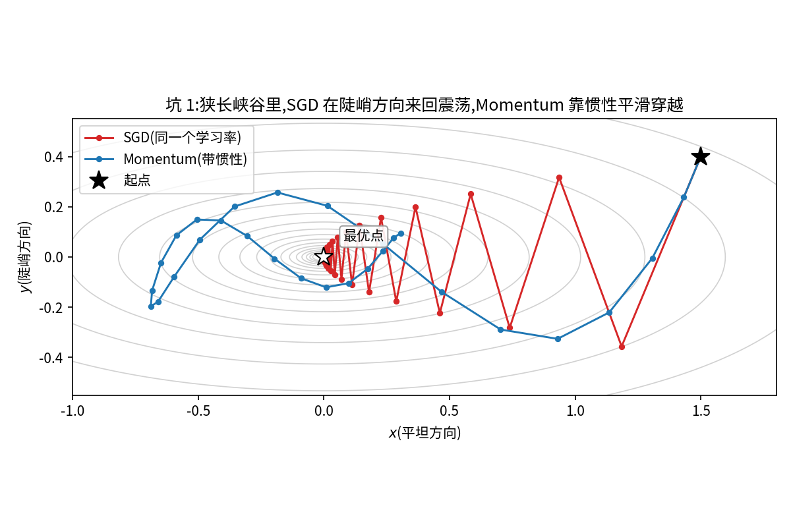
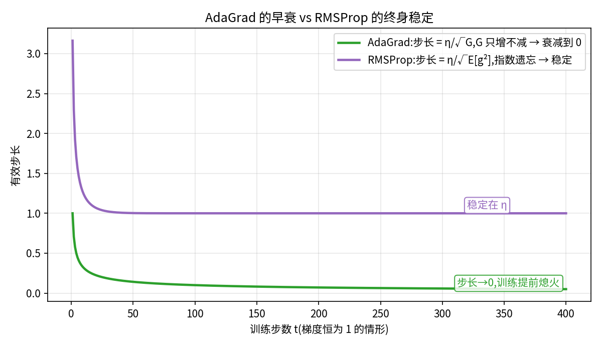
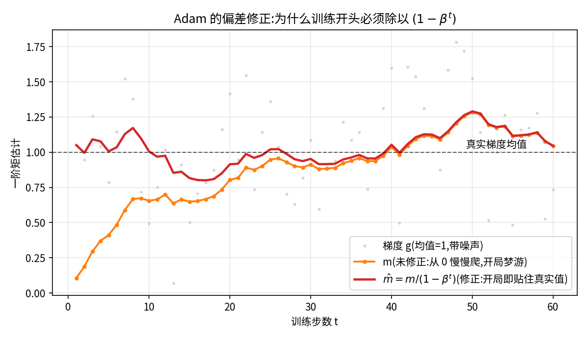
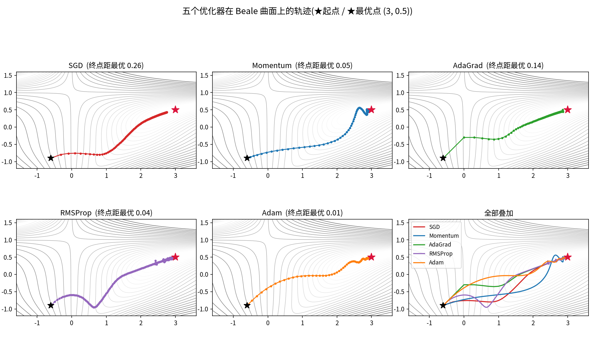

你有没有想过一个问题:为什么训练 Transformer 时,大家默认都用 AdamW,而不是最"经典"的 SGD?

更奇怪的是,AdamW 的论文标题叫《Decoupled Weight Decay Regularization》——"解耦权重衰减",完全看不出是个优化器。而它所修正的 Adam,论文里甚至根本没提 weight decay。

因为优化器的历史,不是天才们凭空发明的历史,而是一部**填坑史**:每一代优化器,都是为了解决上一代留下的坑。沿着这条线走一遍,你会发现那些公式全都变得理所当然。

## 一、SGD:一切的起点,和它的三个坑

深度学习的本质是找到一组参数 $\theta$,让损失函数 $L(\theta)$ 最小。最朴素的方法:算出梯度,往反方向走一小步。

$$\theta \leftarrow \theta - \eta \cdot g$$

$g$ 是当前 mini-batch 的梯度,$\eta$ 是学习率。这就是 SGD(随机梯度下降)。

简单,但有三个坑:

**坑 1:一个学习率管所有参数。** 想象损失曲面是一条狭长的峡谷:平坦的沟底方向想要大步走,陡峭的两壁方向必须小步挪。可 SGD 全局只有一个 $\eta$——设大了在两壁之间来回震荡,设小了在沟底龟速爬行。

**坑 2:mini-batch 噪声。** 每次只用一小批数据算梯度,梯度天然带噪声,路径抖得厉害。

**坑 3:鞍点和病态曲率。** 高维空间里到处是鞍点,SGD 常常在附近打转。

后面出场的每一位,都是在填这三个坑。

## 二、Momentum:给小球一点惯性

物理直觉:真实的球滚下山,不会每一步都归零重新受力——它有**惯性**。梯度方向一致时越滚越快,方向反复横跳时互相抵消。

$$v \leftarrow \beta v + g, \qquad \theta \leftarrow \theta - \eta \cdot v$$

$\beta$ 通常取 0.9,意思是"保留 90% 的历史速度,再叠加当前梯度"。

- 沟底方向:梯度一直指向前进方向 → 速度累积 → **加速**
- 两壁方向:梯度一会儿正一会儿负 → 互相抵消 → **震荡被抑制**

坑 2 解决了大半,坑 1 纹丝不动:学习率还是全局一个。

> 顺带一提 **Nesterov 动量**:先按惯性走半步,在"预计到达的位置"算梯度。相当于开车提前看前方的路刹车,而不是等撞上再反应。是个聪明的小改进,但在后面的故事里戏份不多。

## 三、AdaGrad:每个参数,配自己的学习率

2011 年,AdaGrad 提出了一个改变游戏规则的 idea:

> 梯度一直很大的参数(陡峭方向),步长该小;梯度小或稀少的参数,步长该大。

做法:为每个参数累积历史梯度的平方和 $G$,

$$G \leftarrow G + g^2, \qquad \theta \leftarrow \theta - \eta \cdot \frac{g}{\sqrt{G} + \epsilon}$$

除以 $\sqrt{G}$ 之后,每个参数拥有了自己的有效学习率 $\eta/\sqrt{G}$——梯度大的参数分母大、步子小;梯度小的参数分母小、步子大。

**坑 1,解决了。** 处理稀疏特征(比如推荐系统里偶尔出现的 item)特别好使。

但新坑立刻出现:$G$ 是**只增不减**的累积和。训练越久,$G$ 越大 → 学习率一路衰减 → 训练后期步长趋近于零,模型提前"熄火",不再学习。

## 四、RMSProp:一篇课件引发的传奇

AdaGrad 的问题在于"记性太好"——去年的梯度还在拖累今天的学习率。

RMSProp 的修法简单到粗暴:把累积和换成**指数移动平均**,只看最近的梯度尺度:

$$E[g^2] \leftarrow \rho \cdot E[g^2] + (1-\rho) \cdot g^2, \qquad \theta \leftarrow \theta - \eta \cdot \frac{g}{\sqrt{E[g^2]} + \epsilon}$$

$\rho = 0.9$:旧的梯度信息指数级淡忘。学习率不再无限衰减,自适应保持终身有效。

冷知识:RMSProp 是 Hinton 在 Coursera 课件里提出的,**从未正式发表过论文**——但它可能是深度学习史上被引用最多的"课件"。

至此,两股技术路线都成熟了:

- Momentum 路线:管**方向**(平滑、惯性)
- RMSProp 路线:管**步长**(每参数自适应)

就差有人把它们装到一起。

## 五、Adam:合体时刻

2014 年,Kingma & Ba 的 Adam(Adaptive Moment Estimation)做了这个加法,顺手补了一个关键细节。

**第一步,两条线各算各的:**

$$m \leftarrow \beta_1 m + (1-\beta_1) g \qquad \text{(一阶矩:梯度的均值,≈动量)}$$

$$v \leftarrow \beta_2 v + (1-\beta_2) g^2 \qquad \text{(二阶矩:梯度平方的均值,≈RMSProp)}$$

**第二步,关键细节——偏差修正:**

$$\hat{m} = \frac{m}{1-\beta_1^t}, \qquad \hat{v} = \frac{v}{1-\beta_2^t}$$

为什么必须有这一步?初始化时 $m = v = 0$,训练开头这几千步,估计值严重偏小(想想 $\beta_2 = 0.999$ 意味着每步只吸收 0.1% 的新信息,从 0 爬起来有多慢)。除以 $1 - \beta^t$——$t$ 很小时这是个 0.1、0.01 级别的小数——把估计**放大**回真实尺度。

没有偏差修正,Adam 的开局等于梦游。

**第三步,更新:**

$$\theta \leftarrow \theta - \eta \cdot \frac{\hat{m}}{\sqrt{\hat{v}} + \epsilon}$$

方向由 $\hat{m}$ 平滑,步长由 $\sqrt{\hat{v}}$ 对每个参数自适应。默认参数 $\eta = 10^{-3}, \beta_1 = 0.9, \beta_2 = 0.999, \epsilon = 10^{-8}$,几乎不用调。

**"开箱即用",是 Adam 统治世界的真正原因。** 从 2014 年至今,它是论文实验部分的默认 baseline。

## 六、Adam 的两个遗留问题

**问题 1:收敛快,泛化未必好。** 在视觉任务上,精调过的 SGD+Momentum 的最终泛化性能常常胜过 Adam。一种解释:自适应学习率让 Adam 过快收敛到"尖锐"的极小值,而 SGD 的噪声反而把它推进更平坦、泛化更好的盆地。

**问题 2(更要命的):加 L2 正则的方式是错的。** 想给模型加正则防止过拟合,标准做法是把 $\lambda \theta$ 加进梯度里。但 Adam 的梯度随后要除以 $\sqrt{\hat{v}}$——**正则强度被自适应缩放搅乱了**:梯度大的参数,权重衰减反而被削弱。等于你精心设置的 $\lambda$,在每个参数身上执行的力度都不一样。

## 七、AdamW:把 decay 从梯度里拆出来

2017 年,AdamW 的修法干净利落:权重衰减不该走梯度这条路,直接作用在参数上——

$$\theta \leftarrow \theta - \eta \cdot \left( \frac{\hat{m}}{\sqrt{\hat{v}} + \epsilon} + \lambda \theta \right)$$

注意 $\lambda \theta$ 不进 $m$、不进 $v$,不被任何自适应机制缩放。**decay 与自适应,彻底解耦。**

一句话记忆:**AdamW = Adam + "正确版"的权重衰减。** 训练 Transformer 的默认选项,从此定型。

## 八、同场竞技:五个优化器跑同一座山

纸上谈兵终觉浅。把前面五位放到同一个 Beale 曲面上,从同一起点出发各跑 220 步:

结果一目了然:SGD 沿谷底龟速爬行,终点距最优还有 0.26;AdaGrad 后期明显减速(0.14);Momentum(0.05)和 RMSProp(0.04)表现接近;**Adam 以 0.01 的终点误差拿下第一**——动量管方向、自适应管步长,合体的威力就在这里。

## 九、后 Adam 时代:新秀速览

AdamW 之后,优化器进入"应用驱动"时代——大家不再追求通用改进,而是针对具体瓶颈发力:

| 优化器 | 一句话定位 | 主战场 |
|---|---|---|
| AdaMax | 把 $\beta_2$ 范数推广到 $\infty$ 范数,更稳健 | 较少 |
| Nadam | Adam + Nesterov 前瞻 | NLP 常用 |
| Adafactor | 二阶矩矩阵分解,显存省一大截 | T5、PaLM |
| LAMB | 分层自适应,撑起超大 batch | 大规模分布式 |
| Lion(2023) | 只用梯度的符号更新,内存省一半 | Google 系 |
| Sophia(2023) | 轻量 Hessian 估计,LLM 预训练理论上省 2 倍算力 | 学术界 |
| Muon(2024-25) | 对动量矩阵做正交化,LLM 实测显著加速 | 当前最热 |

特别说一句 **Muon**:它注意到 Adam 对动量逐元素缩放,忽略了参数矩阵的整体几何结构,于是用 Newton-Schulz 迭代把动量矩阵正交化,让每一步更新在所有方向上"等幅推进"。在 LLM 预训练上实测能比 AdamW 少用相当可观数据量达到同 loss,是目前最有威胁的挑战者。

## 十、实战怎么选

不绕弯子,直接给结论:

- **Transformer / NLP / LLM 微调** → AdamW,闭眼选
- **CV 刷榜(ResNet 系)** → SGD + Momentum 精调,泛化上限更高
- **稀疏特征 / 推荐系统** → AdaGrad 血统的优化器
- **显存紧张的大模型** → Adafactor / 8-bit Adam(bitsandbytes)
- **追前沿的 LLM 预训练** → AdamW 仍是工业界标准,Muon 值得跟踪

## 十一、总结:一部填坑史

回头看这条演进线,每一环都严丝合缝:

$$\text{SGD(三个坑)} \to \text{Momentum(填震荡)} \to \text{AdaGrad(填学习率)} \to \text{RMSProp(填早衰)} \to \text{Adam(合体)} \to \text{AdamW(填 decay bug)}$$

下次面试被问"Adam 和 AdamW 的区别",别背公式了,讲这个故事:一个修了 bug 的 Adam。

你平时训练用的是哪个优化器?踩过什么坑?评论区聊聊。

---

*参考:Kingma & Ba, 2014《Adam: A Method for Stochastic Optimization》;Loshchilov & Hutter, 2017《Decoupled Weight Decay Regularization》;Ruder, 2016《An overview of gradient descent optimization algorithms》*
