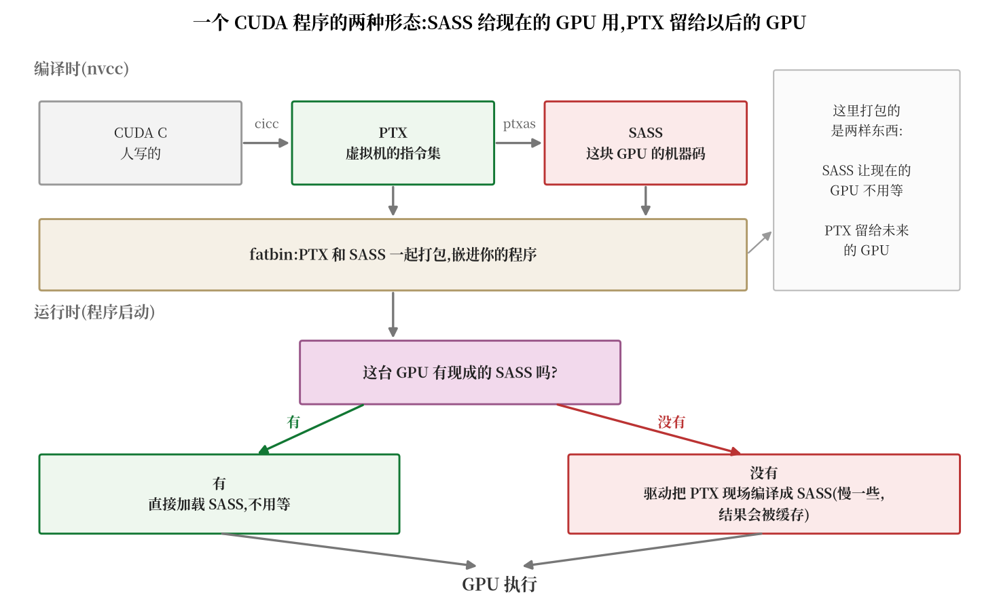
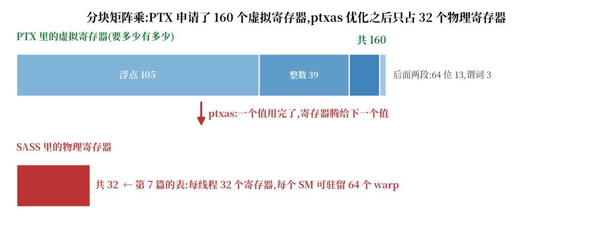
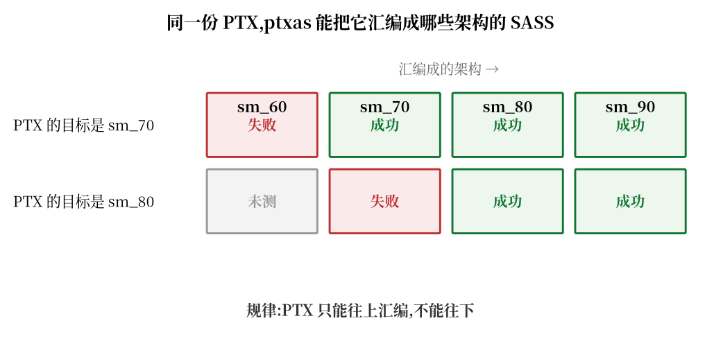

第 7 篇里我写过一句话:"你写的 CUDA C 先编译成 PTX,再由驱动编译成 SASS——后者才是硬件真正认识的指令。"

当时是一笔带过的。这篇把它展开。

先看一个今天真实发生的报错。我在服务器上装了 torch 2.14.1 的 CUDA 13 版本,放到一台 V100 上,第一次调用就报:

```
Found GPU0 Tesla V100-PCIE-32GB which is of compute capability (CC) 7.0.
The following list shows the CCs this version of PyTorch was built for:
- 7.5 which supports hardware CC >=7.5,<8.0
- 8.0 which supports hardware CC >=8.0,<9.0 except {8.7}
- 8.6 which supports hardware CC >=8.6,<9.0 except {8.7}
- 9.0 which supports hardware CC >=9.0,<10.0
- 10.0 which supports hardware CC >=10.0,<11.0 except {10.1}
- 12.0 which supports hardware CC >=12.0,<13.0
Your installed torch==2.14.1+cu130 does not include kernels for this GPU.
```

同一个安装包,H100 能跑,B200 能跑,V100 跑不了。

为什么?这六行数字是什么意思?读完这篇,这段报错你就能自己读懂。

## 一、三个名字:谁写给谁看

一个 CUDA 程序从你敲下到 GPU 执行,中间有三种形态:

| 形态 | 谁写的 | 给谁看 | 长什么样 |
|---|---|---|---|
| CUDA C | 人 | 编译器 | `c[i] = a[i] + b[i];` |
| **PTX** | 编译器 | 另一个编译器 | `add.f32 %f3, %f2, %f1;` |
| SASS | 编译器 | 硬件 | `FADD R9, R4, R3 ;` |

PTX 在中间。NVIDIA 官方文档对它的定义只有一句:

> PTX defines a virtual machine and ISA for general purpose parallel thread execution.

PTX 定义了一台虚拟机,和给这台虚拟机用的指令集。

"虚拟机"三个字是关键。它不是任何一块真实 GPU 的指令集。真实的 GPU 只认 SASS。PTX 是一个中间层:往上看,它离 CUDA C 不远;往下看,每一代 GPU 都可以把它翻译成自己的 SASS。

这一篇里的 PTX 和 SASS,全部是我今天在一台 V100 服务器上用 CUDA 12.9 实际编译出来的,不是手写的示意。

## 二、nvcc 实际做了什么

`nvcc` 有一条命令可以只打印它要执行的步骤、不真的执行。我对一个普通的 `.cu` 文件跑了一遍,去掉路径和参数、只留工具名,再加上我的注释,是这样:

```
gcc        预处理
cudafe++   把设备代码从源文件里拆出来
cicc       生成 PTX            → demo.ptx
ptxas      把 PTX 汇编成 SASS  → demo.sm_70.cubin
fatbinary  把 cubin 和 PTX 打包 → 嵌进程序
gcc        编译主机代码
nvlink     链接
```

所以链路是:`.cu` → **cicc** → PTX → **ptxas** → SASS。

官方文档对 ptxas 的称呼是 "the PTX optimizing assembler",PTX 优化汇编器。记住这个词"优化",第四节会用到。



注意最后打包的那一步。打出来的包叫 fatbin,里面**同时装着** SASS 和 PTX。我用 `-arch=sm_70` 编译了一个程序,再列出包里的内容:

```
ELF file    1: app70.1.sm_70.cubin     ← SASS
ELF file    2: app70.2.sm_70.cubin
PTX file    1: app70.1.sm_70.ptx       ← PTX
```

两样都有。这不是巧合:官方文档写明,`-arch=sm_70` 这个简写等价于"生成 sm_70 的 SASS,同时生成 compute_70 的 PTX"。

为什么要带一份 PTX?第八节讲。

## 三、读一份真实的 PTX

一个向量加法,三行 CUDA:

```cuda
__global__ void vec_add(const float* a, const float* b, float* c, int n) {
    int i = blockIdx.x * blockDim.x + threadIdx.x;
    if (i < n) c[i] = a[i] + b[i];
}
```

编译出来的 PTX 贴在这里(去掉了开头的几行注释和空行):

```
.version 8.8
.target sm_70
.address_size 64

.visible .entry _Z7vec_addPKfS0_Pfi(
    .param .u64 _Z7vec_addPKfS0_Pfi_param_0,
    .param .u64 _Z7vec_addPKfS0_Pfi_param_1,
    .param .u64 _Z7vec_addPKfS0_Pfi_param_2,
    .param .u32 _Z7vec_addPKfS0_Pfi_param_3
)
{
    .reg .pred  %p<2>;
    .reg .f32   %f<4>;
    .reg .b32   %r<6>;
    .reg .b64   %rd<11>;

    ld.param.u64  %rd1, [_Z7vec_addPKfS0_Pfi_param_0];
    ld.param.u64  %rd2, [_Z7vec_addPKfS0_Pfi_param_1];
    ld.param.u64  %rd3, [_Z7vec_addPKfS0_Pfi_param_2];
    ld.param.u32  %r2, [_Z7vec_addPKfS0_Pfi_param_3];
    mov.u32       %r3, %ctaid.x;
    mov.u32       %r4, %ntid.x;
    mov.u32       %r5, %tid.x;
    mad.lo.s32    %r1, %r3, %r4, %r5;
    setp.ge.s32   %p1, %r1, %r2;
    @%p1 bra      $L__BB0_2;

    cvta.to.global.u64  %rd4, %rd1;
    mul.wide.s32        %rd5, %r1, 4;
    add.s64             %rd6, %rd4, %rd5;
    cvta.to.global.u64  %rd7, %rd2;
    add.s64             %rd8, %rd7, %rd5;
    ld.global.f32       %f1, [%rd8];
    ld.global.f32       %f2, [%rd6];
    add.f32             %f3, %f2, %f1;
    cvta.to.global.u64  %rd9, %rd3;
    add.s64             %rd10, %rd9, %rd5;
    st.global.f32       [%rd10], %f3;

$L__BB0_2:
    ret;
}
```

第一次看会觉得乱。这些名字确实都挺吓人的——虚拟寄存器、谓词、状态空间——无形中增加了理解难度。其实一个一个翻成人话,都不复杂。

**文件头三行。** `.version 8.8` 是 PTX 的版本(CUDA 12.9 对应 8.8),`.target sm_70` 是为哪一代 GPU 写的,`.address_size 64` 是地址 64 位。

**入口。** `.visible .entry` 后面那串乱码 `_Z7vec_addPKfS0_Pfi`,是 C++ 把函数名和参数类型混在一起编出来的名字。下面四个 `.param` 是四个参数。

**寄存器。** 开头四行是在"申请寄存器":

| 写法 | 人话 |
|---|---|
| `.reg .pred %p<2>` | 两个谓词寄存器,名字叫 `%p0`、`%p1` |
| `.reg .f32 %f<4>` | 四个 32 位浮点寄存器,`%f0` 到 `%f3` |
| `.reg .b32 %r<6>` | 六个 32 位整数寄存器 |
| `.reg .b64 %rd<11>` | 十一个 64 位寄存器 |

谓词(predicate)就是一个布尔值,只有真和假。名字开头的字母只是习惯:`p` 是谓词,`f` 是浮点,`r` 是 32 位,`rd` 是 64 位。

**指令的格式。** 每条指令都是"做什么.类型  目标, 来源":

```
mov.u32     %r3, %ctaid.x          ; r3 = blockIdx.x
mov.u32     %r4, %ntid.x           ; r4 = blockDim.x
mov.u32     %r5, %tid.x            ; r5 = threadIdx.x
mad.lo.s32  %r1, %r3, %r4, %r5     ; r1 = r3 * r4 + r5(取低 32 位)
```

`mad` 是 multiply-add,乘加。这四行就是 CUDA 里的 `blockIdx.x * blockDim.x + threadIdx.x`。

**分支。**

```
setp.ge.s32  %p1, %r1, %r2    ; p1 = (r1 >= r2)
@%p1 bra     $L__BB0_2        ; 如果 p1 为真,跳到标签 $L__BB0_2
```

分支在 PTX 里是两步:先用 `setp`(set predicate)算出一个真假,再用"前面带 `@` 的跳转"决定跳不跳。`@` 的意思是"只有这个谓词为真,这条指令才执行"。

**状态空间。** 指令名字里的 `.param`、`.global`、`.shared`、`.const`、`.local`,叫状态空间(state spaces)。人话就是**数据住在哪个房间**:

| 状态空间 | 住在哪 |
|---|---|
| `.param` | 函数参数 |
| `.global` | 显存 |
| `.shared` | Shared Memory |
| `.const` | 常量内存 |
| `.local` | 每个线程私有的局部内存 |
| `.reg` | 寄存器 |
| `.sreg` | 特殊寄存器(线程编号、线程块编号这些) |

所以 `ld.global.f32 %f1, [%rd8]` 的意思是:从显存地址 `%rd8` 读一个 32 位浮点数,放进 `%f1`。`st.global.f32 [%rd10], %f3` 是反过来,写出去。

二十来行,讲完了。

## 四、虚拟寄存器:要多少有多少

这里有一个和第 7 篇直接相关的地方。

第 7 篇讲过,H100 每个 SM 的寄存器堆是 256 KB,一共 65,536 个 32 位寄存器,由所有线程瓜分。每个线程最多用 255 个。寄存器用得越多,能同时驻留的 warp 越少。

但你看上面那份 PTX:`.reg .b64 %rd<11>`。11 个 64 位寄存器,再加上前面那些,对一个小小的向量加法来说,是不是太多了?

不心疼。因为**PTX 的寄存器是虚拟的,要多少有多少。**

把它们映射到真实的物理寄存器上,是下一步 ptxas 的活。这就是官方说的"优化汇编器"里的"优化"。

看矩阵乘的例子。分块矩阵乘的 PTX 开头:

```
.reg .pred  %p<3>;
.reg .f32   %f<105>;
.reg .b32   %r<39>;
.reg .b64   %rd<13>;
```

105 个浮点寄存器,39 个 32 位整数寄存器,13 个 64 位寄存器。而 ptxas 处理完之后:

```
Used 32 registers, used 1 barriers, 8448 bytes smem
```

**32 个。**



这个 32 正好落在第 7 篇那张表的第一行:每线程 32 个寄存器,每个 SM 可以驻留 64 个 warp,是满的。

160 个怎么塞进 32 个?靠复用。一个虚拟寄存器的值用完了,它占的物理寄存器就可以腾出来给下一个用。ptxas 做的就是这件事:安排每个值在什么时候住在哪个物理寄存器里。

所以第 7 篇讲的"Warp Scheduler 从就绪的 warp 里挑一个",挑的那些 warp 能有多少个,是 ptxas 在这一步决定的。你写的 CUDA C 只决定了"需要多少临时的值",决定不了"最后占多少寄存器"。

## 五、之前讲过的东西,在 PTX 里长什么样

这个专栏前面几篇讲的东西,在 PTX 里都能找到对应。

**Shared Memory。** 分块矩阵乘的 PTX 里有这样两行声明(数组名里嵌着 C++ 的函数名,用省略号代替了):

```
.shared .align 4 .b8 ...E2As[4224];
.shared .align 4 .b8 ...E2Bs[4224];
```

两个数组,各 4224 字节。4224 = 32 × 33 × 4。33 是因为第 6 篇讲的那个"多加一列躲 Bank Conflict"。

读 Shared Memory 的指令里能直接看到这个 33:

```
ld.shared.f32  %f11, [%r8+132];
```

132 = 33 × 4。跳过一整行再加一列,正好落在下一行同一列的位置。

**同步。**

```
st.shared.f32  [%r5], %f6;
...                            ; 算地址、从显存读下一个数
st.shared.f32  [%r6], %f7;
bar.sync  0;
ld.shared.f32  %f8, [%r8];
```

写进去两个数,`bar.sync 0` 等所有线程到齐,然后开始读。这就是 `__syncthreads()`。

**乘加。** 内层循环展开之后,PTX 里是 32 条:

```
fma.rn.f32  %f10, %f9, %f8, %f104;
fma.rn.f32  %f13, %f12, %f11, %f10;
...
```

`fma` 就是第 7 篇开头那个 `c = a * b + c`。

**分支发散。** 我写了一个内核:偶数线程和奇数线程走两条不同的计算路径。它的 PTX:

```
and.b32    %r6, %r1, 1;           ; r6 = i & 1
setp.eq.b32  %p2, %r6, 1;        ; p2 = (r6 == 1)
...
@%p5 bra   $L__BB2_3;            ; 偶数线程跳走
bra.uni    $L__BB2_2;            ; 奇数线程往下

$L__BB2_3:
sqrt.rn.f32 ...                 ; 偶数线程走的路
```

中间省略了几行:先比出 `i & 1` 是不是 1,再把结果取反,得到 `p5`——`p5` 为真的是偶数线程。`bra.uni` 是无条件的跳转,`.uni` 表示走到这条指令的线程都会跳。

同一批指令,每个线程按自己的谓词决定跳不跳。一个 warp 里一半线程去了左边,一半去了右边。这就是分支发散在指令层面的样子:没有专门的"发散指令",只是每个线程各自算各自的谓词。

## 六、再往下一步:SASS

PTX 交给 ptxas,出来 SASS。同一个向量加法的 SASS,去掉地址和机器码(开头的初始化指令和结尾一条占位的跳转省略了):

```
S2R  R6, SR_CTAID.X ;
S2R  R3, SR_TID.X ;
IMAD R6, R6, c[0x0][0x0], R3 ;
ISETP.GE.AND P0, PT, R6, c[0x0][0x178], PT ;
@P0 EXIT ;
MOV  R7, 0x4 ;
IMAD.WIDE R4, R6, R7, c[0x0][0x168] ;
IMAD.WIDE R2, R6, R7, c[0x0][0x160] ;
LDG.E.SYS R4, [R4] ;
LDG.E.SYS R3, [R2] ;
IMAD.WIDE R6, R6, R7, c[0x0][0x170] ;
FADD R9, R4, R3 ;
STG.E.SYS [R6], R9 ;
EXIT ;
```

和 PTX 对照着看:

| PTX | SASS | 人话 |
|---|---|---|
| `mov.u32 %r3, %ctaid.x` | `S2R R6, SR_CTAID.X` | 从特殊寄存器读到普通寄存器 |
| `mad.lo.s32` | `IMAD` | 整数乘加 |
| `setp.ge.s32` | `ISETP.GE.AND P0` | 比较,结果放进谓词 P0 |
| `@%p1 bra $L__BB0_2` | `@P0 EXIT` | 谓词为真就跳。这里编译器把"跳到结尾"直接改成了"退出" |
| `ld.global.f32` | `LDG.E.SYS` | 从显存读 |
| `add.f32` | `FADD` | 浮点加 |
| `st.global.f32` | `STG.E.SYS` | 写回显存 |
| `cvta.to.global.u64` | (没有单独的指令) | 地址计算被合并了 |

三处值得看。

**寄存器编号变了。** PTX 里是 `%rd1`、`%f3`,SASS 里是 `R4`、`R9`。前面带字母的是虚拟寄存器,后面只有编号的是物理寄存器。

**参数变成了常量内存。** PTX 里的四个 `.param`,在 SASS 里是 `c[0x0][0x168]` 这种写法。`c` 是 constant,方括号里是偏移量。

**指令数变了。** PTX 里 21 条,这里 17 条。

矩阵乘的 SASS 里,Shared Memory 的读写是这样的:

```
STS [R10], R17 ;
LDS.U R26, [R8+0x1080] ;
BAR.SYNC 0x0 ;
```

`0x1080` 是十六进制,等于 4224。也就是说 `Bs` 紧挨着 `As` 放,`As` 占了前 4224 个字节。

**分支发散的 SASS 里多了两样东西:**

```
BSSY B0, 0x350 ;
ISETP.NE.U32.AND P0, PT, R3, 0x1, PT ;
@P0 BRA 0x180 ;
...                                  ; 奇数线程走的路
BSYNC B0 ;
```

`BSSY` 在分叉的地方记下"汇合点在哪",`BSYNC` 是汇合点本身。PTX 里没有这两条。

这是 Volta 这一代加进来的机制:从 Volta 开始,warp 里的每个线程可以独立调度,不再强制所有线程步调一致。硬件需要知道哪些线程是"暂时分开、等下还要汇合"的,所以要用指令把这个边界标出来。分支发散值得单独写一篇,这里先按下。

## 七、PTX 也分代

PTX 有版本,`.version` 那一行就是。今天三个工具编译出来的:

| 工具 | 生成的 PTX 版本 |
|---|---|
| nvcc 12.9 | 8.8 |
| Triton 3.3.1 | 8.4 |
| 官方文档当前版本 | 9.5 |

版本越高,能用的指令越多。第 9 篇讲的那些矩阵乘指令,在 PTX 里都有,但每一代架构只认自己那一代及之前的:

这个可以让 ptxas 自己说。我把每条指令单独写成一小段 PTX,故意把目标标成旧架构,让它报错。报错原文里就写着要求:

| 指令 | ptxas 的报错原文 |
|---|---|
| `mma` | Feature 'mma' requires .target sm_70 or higher |
| `ldmatrix` | Feature 'ldmatrix' requires .target sm_75 or higher |
| `cp.async` | Feature 'cp.async' requires .target sm_80 or higher |
| `wgmma.fence` | Instruction not supported on .target 'sm_90' |
| `tcgen05.fence` | Instruction not supported on .target 'sm_100' |

最后两条值得注意:它们连 `sm_90`、`sm_100` 都不接受。要换上带 `a` 后缀的目标才行——`sm_90a`、`sm_100a`,我换上这两个再试,就通过了。带 `a` 的是架构专属的目标:只在这一代 GPU 上可用。

所以 PTX 文件头上那个 `.target` 是有约束的:你写了 `cp.async`,目标就不能是 `sm_70`。

## 八、为什么要多这一层

现在回到开头那个报错。

我在服务器上做了个实验:拿同一份 PTX,让 ptxas 试着把它汇编成不同架构的 SASS。



| PTX 的目标 | 汇编成 sm_60 | sm_70 | sm_80 | sm_90 |
|---|---|---|---|---|
| sm_70 | 失败 | 成功 | 成功 | 成功 |
| sm_80 | — | 失败 | 成功 | 成功 |

规律很干净:**PTX 只能往上汇编,不能往下。** 一份为 sm_70 写的 PTX,可以变成 sm_80、sm_90 的 SASS;一份为 sm_80 写的 PTX,变不成 sm_70 的。

失败时的报错原文是:`SM version specified by .target is higher than default SM version assumed`。意思是:这份 PTX 声称自己需要 sm_80,你却让我生成 sm_70 的代码。

官方文档把两条规则写得很清楚。

**SASS 的规则:**

> 在同一个 compute capability 大版本内,GPU 的小版本号大于或等于 cubin 所针对的小版本号时,可以加载并执行这个 cubin。

以及:

> NVIDIA GPUs are not binary compatible between major compute capability versions.

不同大版本之间不兼容。

**PTX 的规则:**

> PTX can be JIT compiled at application runtime for any compute capability equal or higher to the compute capability of the PTX code.

PTX 可以在程序运行时被现场编译,用于任何不低于它的 GPU。

现在看报错里那六行。`8.0 which supports hardware CC >=8.0,<9.0`:为 8.0 编译的 SASS,能用于 8.0 到 8.9 之间的所有 GPU,不能用于 9.0。这就是"同一大版本内"。`9.0 which supports hardware CC >=9.0,<10.0` 同理。

六行里最低的一行是 7.5。V100 是 7.0,不在任何一行里——这是确定的:没有现成的 SASS 可用。而 PTX 只能往上汇编,所以就算安装包里带了 PTX,也变不成 7.0 的 SASS。

两头都够不着,所以报错:"no kernel image is available for execution on the device"。

而同一台机器上另一个环境里装的 torch 2.7.1(CUDA 11.8 版)就能正常跑。

这就是 PTX 这一层存在的理由:**一份 PTX,可以在它出现时还不存在的 GPU 上运行。** 官方的原话是,这"实现了对未来 GPU 的前向兼容,不需要重新构建应用或库"。

代价是时间。官方也写明了:现场编译会增加程序的加载时间。驱动会把编译结果缓存起来,避免重复编译;驱动升级时缓存失效。

所以发行二进制的库,常见的做法就是第二节看到的那样:给现在主流的几代 GPU 各带一份 SASS,让它们不用等;再带一份 PTX,留给以后的 GPU。

## 九、怎么看自己程序的 PTX

都是今天用过的命令:

```bash
nvcc -arch=sm_70 -ptx  demo.cu -o demo.ptx       # 只生成 PTX
nvcc -arch=sm_70 -cubin demo.cu -o demo.cubin    # 只生成 SASS
nvcc -arch=sm_70 -cubin -Xptxas -v demo.cu       # 顺便打印寄存器和 Shared Memory 用量
cuobjdump -sass demo.cubin                       # 把 SASS 反汇编出来看
cuobjdump --list-elf  app                        # 程序里装了哪些架构的 SASS
cuobjdump --list-ptx  app                        # 程序里装了哪些架构的 PTX
```

用 Triton 的话更直接。编译完一个内核,它的中间结果都在 `kernel.asm` 里:

```python
kernel.asm["ptx"]     # PTX
kernel.asm["ttir"]    # Triton 自己的 IR
kernel.asm["ttgir"]   # Triton 的 GPU 版 IR
kernel.asm["llir"]    # LLVM IR
kernel.asm["cubin"]   # SASS 的二进制
```

上一篇讲 TVM 的时候提过这五层。从 Triton 自己的 IR,到 LLVM 的 IR,到 PTX,到 SASS,同一个向量加法被翻译了四次。

## 十、总结

四条带走:

**1. PTX 是虚拟机的指令集,不是任何一块真实 GPU 的。** 链路是:CUDA C → cicc → PTX → ptxas → SASS。SASS 才是硬件执行的。

**2. PTX 里的寄存器是虚拟的,谓词就是布尔值,状态空间就是"数据住在哪个房间"。** 读懂这三样,一份 PTX 就能逐行读下来。

**3. 物理寄存器是 ptxas 分的。** 矩阵乘的 PTX 申请了 160 个虚拟寄存器,ptxas 优化之后只占 32 个物理寄存器。第 7 篇讲的占用率,是在这一步定下来的。

**4. PTX 只能往上汇编,不能往下;SASS 只在同一大版本内兼容。** 所以发行二进制要同时带两样:SASS 让现在的 GPU 不用等,PTX 留给未来的 GPU。开头那个报错,就是 V100 的 7.0 两头都够不着。

TVM 篇说的是"怎么把模型的计算翻译到 CUDA 这一层";这一篇说的是"CUDA 这一层怎么再往下走到硬件"。上下两篇接起来,从 PyTorch 的一行 `torch.matmul`,到 GPU 里真正执行的指令,整条路就通了。

下一篇填分支发散的坑:`@%p bra` 背后,硬件怎么让分道扬镳的线程再汇合。

如果这个系列对你有用,点个赞或关注专栏,更新会持续。

---

*参考:NVIDIA PTX ISA 官方文档(PTX 的定义原文、状态空间列表、当前版本 9.5);NVIDIA CUDA Compiler Driver NVCC 官方文档(编译流程、ptxas 为 "the PTX optimizing assembler"、`-arch=sm_XX` 的等价写法、嵌入的 PTX 在找不到现成二进制时由运行时动态编译);NVIDIA CUDA C++ Programming Guide "The CUDA Platform"(二进制兼容与 PTX 兼容的规则原文、JIT 的代价与缓存)。文中全部 PTX 与 SASS、`ptxas -v` 的输出、兼容性实验结果、fatbin 列表、torch 报错文本,均为 2026-11-23 在 Tesla V100(sm_70)服务器上用 CUDA 12.9、torch 2.7.1+cu118 / 2.14.1+cu130、triton 3.3.1 实际运行所得;指令按架构的划分参考本专栏第 9 篇。*
