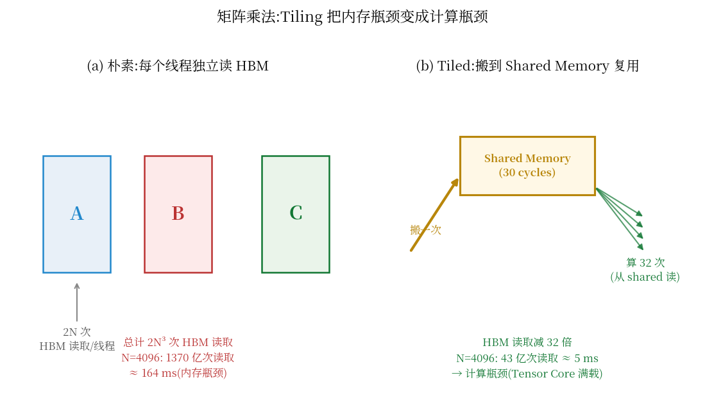
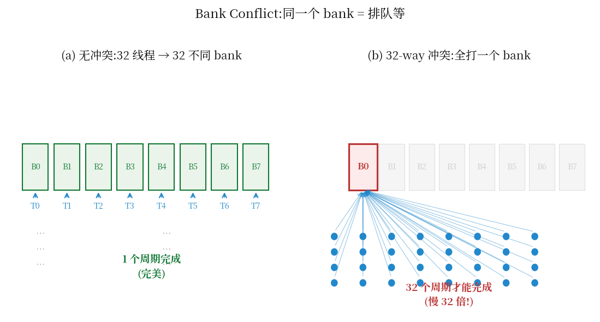
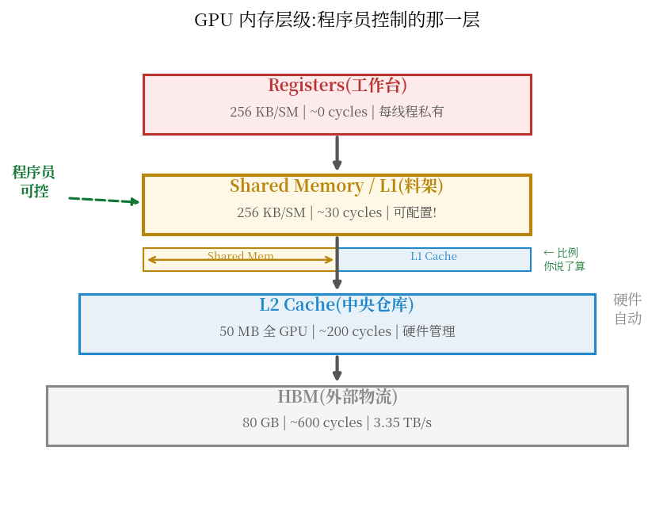

上一篇 SM 解剖里提到 256 KB 的 Shared Memory / L1 Cache"程序员可控"——这句话埋了一个巨大的设计哲学分歧，值得单独写一整篇。

因为这不是"GPU 恰好多了个功能"，而是**两种计算世界观的正面碰撞**：CPU 假设你不知道程序在干什么，GPU 假设你知道。

## 一、物理本质：不是两块存储，是同一块 SRAM

一个令人意外的事实：

**Shared Memory 和 L1 Cache 物理上是同一块 256 KB 的 SRAM。** 区别不在硬件，在"谁管它"：

- 当作 **L1 Cache**:硬件自动管理——什么进、什么出、怎么替换，全是硬件的启发式决策
- 当作 **Shared Memory**:**你**用代码声明"把这块数据放在这里"——什么时候放、什么时候读、什么时候覆盖，全部你说了算

而且比例可以配置：

```cuda
// 告诉 CUDA:这块 SRAM 我要 100% 当 Shared Memory 用
cudaFuncSetAttribute(myKernel,
    cudaFuncAttributePreferredSharedMemoryCarveout,
    cudaSharedmemCarveoutMaxShared);
```

你可以选 0%(全 L1)、50%(各半)、100%(全 Shared),取决于你的 kernel 需要缓存还是需要协作。

## 二、为什么 GPU 给你控制权，CPU 不给

| | CPU L1 Cache | GPU Shared Memory |
|---|---|---|
| 管理者 | 硬件(LRU 策略) | **程序员** |
| 可见性 | 透明(你不知道在不在) | **明确(你知道什么时候在)** |
| 线程协作 | 不支持 | `__syncthreads()` 同步 |
| 适合场景 | 不可预测的访问(浏览器/数据库) | **规则的访问(矩阵乘/卷积)** |

CPU 不给你控制权，是因为它跑的代码**访问模式不可预测**：浏览器一会儿渲染 DOM,一会儿跑 JS,一会儿解码视频——硬件的 LRU 启发式确实比人聪明。

GPU 给你控制权，是因为 ML 的访问模式**极度规则**：矩阵乘法每个线程读哪些元素，写代码的时候就能算出来。这时候**程序员比硬件更懂访问模式**——你明确知道 A[i][k] 会被 32 个线程用到，硬件不知道。

一句话：**CPU 假设你不知道你的程序在干什么；GPU 假设你知道。**

## 三、最经典的使用场景：矩阵乘 Tiling



### 3.1 不用 Shared Memory(朴素版)有多惨

$C = A \times B$,N = 4096,每个 CUDA 线程算 C 的一个元素：

- 每个线程从 HBM 读 A 的一行(N 个数)+ B 的一列(N 个数)
- 总读取量 = $N^2$ 个线程 × $2N$ = $2 \times 4096^3$ = **1,370 亿次**

按 HBM 带宽 3.35 TB/s,每次读 4 字节：

$$t_{\text{mem}} = \frac{137 \times 10^9 \times 4\text{B}}{3.35 \times 10^{12}\text{B/s}} \approx 164\text{ ms}$$

而计算时间(FP16 Tensor Core,989 TFLOPS):

$$t_{\text{calc}} = \frac{2 \times 4096^3}{989 \times 10^{12}} \approx 0.14\text{ ms}$$

**内存读取是计算的 1000 倍。** Tensor Core 99.9% 的时间在等数据。

### 3.2 Tiled 版：搬到 Shared Memory 复用

关键观察：**$A[i][k]$ 会被同一行所有线程用到，$B[k][j]$ 会被同一列所有线程用到**——但朴素版每个线程都独立从 HBM 读，重复读了 32 次。

解法：**一个 block 的 32×32 个线程协作，把 A 和 B 的子块搬到 Shared Memory(只搬一次)，然后大家一起从 Shared Memory 读(30 cycles vs 600 cycles)**

```cuda
#define TILE 32

__global__ void matmul(float* A, float* B, float* C, int N) {
    __shared__ float As[TILE][TILE];  // ← 声明:放 Shared Memory
    __shared__ float Bs[TILE][TILE];

    int row = blockIdx.y * TILE + threadIdx.y;
    int col = blockIdx.x * TILE + threadIdx.x;
    float sum = 0;

    for (int t = 0; t < N / TILE; t++) {
        // 1. 协作加载:所有线程一起搬数据到 Shared Memory
        As[threadIdx.y][threadIdx.x] = A[row * N + t*TILE + threadIdx.x];
        Bs[threadIdx.y][threadIdx.x] = B[(t*TILE + threadIdx.y) * N + col];

        __syncthreads();  // 2. 等所有人都搬完

        // 3. 计算:从 Shared Memory 读(30 cycles)
        for (int k = 0; k < TILE; k++)
            sum += As[threadIdx.y][k] * Bs[k][threadIdx.x];

        __syncthreads();  // 4. 等所有人都用完才能覆盖下一块
    }
    C[row * N + col] = sum;
}
```

**HBM 读取量减少 32 倍**(每个数据只从 HBM 读一次，之后 32 次使用全部从 Shared Memory 读)。

数学：$2N^3 / 32 = 43$ 亿次 HBM 读取 ≈ 5 ms → **从内存瓶颈(164 ms)变成计算瓶颈(0.14 ms)**。

Tensor Core 终于满载了。这就是 Shared Memory 存在的意义。

## 四、Bank Conflict:Shared Memory 的隐形杀手

Shared Memory 不是一块平坦的存储——它内部分成 **32 个 bank**,每个 bank 独立服务一个请求。

### 4.1 为什么要分 bank

Shared Memory 的目标是**一个周期服务一个 warp(32 个线程)的并发读取**。如果是一整块存储，32 个请求就要排队。分成 32 个独立的 bank,每个 bank 服务一个线程——**并行处理，1 个周期搞定**。

规则很简单：**地址按 4 字节轮流分配到 bank**:

```
Bank:    0     1     2    ...   31
word:   [0]   [1]   [2]   ...  [31]    ← 第一行 32 个 word
        [32]  [33]  [34]  ...  [63]    ← 第二行
        [64]  [65]  [66]  ...  [95]
```

### 4.2 什么时候出事



- **无冲突**:32 个线程各自访问不同 bank → 1 周期 ✓
- **2-way 冲突**:2 个线程访问同一 bank 的不同地址 → 2 周期(慢 2 倍)
- **32-way 冲突**:32 个线程全打同一个 bank → **32 周期(慢 32 倍)**

经典陷阱：按**列**访问一个 shared 数组：

```cuda
__shared__ float As[32][32];

// 线程 threadIdx.x=0..31,都读第 0 列:
// As[0][0] → Bank 0
// As[1][0] → Bank 0  ← 冲突!
// As[2][0] → Bank 0  ← 冲突!
// ... 32-way conflict,慢 32 倍!
float x = As[threadIdx.x][0];
```

### 4.3 解法:Padding

多加一列，让每一行的 bank 映射错开：

```cuda
// 原来:As[32][32] → As[i][0] 全在 Bank 0
__shared__ float As[32][32];

// 改成:As[32][33] → As[i][0] 在不同 bank
__shared__ float As[32][32 + 1];  // +1 = padding

// 验证:
// As[0][0] → word 0    → Bank 0
// As[1][0] → word 33   → Bank 33 % 32 = Bank 1  ✓
// As[2][0] → word 66   → Bank 66 % 32 = Bank 2  ✓
```

代价：多占 32 × 4 = **128 字节**(Shared Memory 的 0.05%)。收益：**32 倍吞吐提升**。

这就是高性能 CUDA kernel 里到处看到 `[32][33]`、`[32][36]` 这种"奇怪"尺寸的原因——**不是 bug,是在躲 bank conflict**。

## 五、L1/L2/Shared 的完整层级



| 层级 | 容量 | 延迟 | 管理 | 用途 |
|---|---|---|---|---|
| **Registers** | 256 KB/SM | ~0 cycle | 编译器 | 每线程手头数据 |
| **Shared / L1** | 256 KB/SM | ~30 cycles | **程序员** | block 内协作复用 |
| **L2 Cache** | 50 MB(全 GPU) | ~200 cycles | 硬件 | 跨 SM 共享复用 |
| **HBM** | 80 GB | ~600 cycles | OS/驱动 | 大容量存储 |
| **NVLink** | — | ~1500 cycles | NCCL | 跨 GPU 通信 |

一个实际数字：ResNet-50 推理(batch=32)的特征图约 30 MB——恰好塞进 50 MB L2。这就是为什么 ResNet 推理的有效带宽远超 HBM 的 3.35 TB/s:**L2 命中率高，大部分读取不用去 HBM**。

### L2 和 Shared Memory 的分工

- **Shared Memory**:同一个 **block** 内的线程协作(block = 最多 1024 个线程，在同一个 SM 上)
- **L2**:不同 **SM** 上的线程共享(全 GPU 132 个 SM 都能看到同一份 L2)

Shared Memory 是你家的冰箱(自己管)，L2 是小区的便利店(谁都能去，但不知道有没有你要的东西)。

## 六、Hopper 的新玩具:cp.async

H100 加了一条新指令:`cp.async`(async copy)——**从 HBM 直接拷贝到 Shared Memory,不经过寄存器**。

以前(手动两步)：
```
HBM → 寄存器(线程个人) → Shared Memory
```

H100(一步直达)：
```
HBM → Shared Memory(硬件自动搬)
```

好处:**线程不用亲自搬数据了**——cp.async 在后台搬运，线程同时可以算上一块 tile。这叫**软件流水线(software pipelining)**:

```
时间线:
  线程:   [算 tile 0] [算 tile 1] [算 tile 2] ...
  cp.async:    [搬 tile 1] [搬 tile 2] [搬 tile 3] ...  ← 后台并行
```

计算和数据搬运重叠——Shared Memory 的利用率又多榨了一层。

## 七、下沉到 PTX:指令级看 Shared Memory

CUDA C 是给人类写的。GPU 真正执行的是 **PTX(Parallel Thread Execution)**——NVIDIA 的虚拟汇编。在这一层，你能精确看到每一条指令做什么，从而**数出你的 kernel 到底是计算瓶颈还是内存瓶颈**。

### 7.1 Shared Memory 的 PTX 指令

CUDA C 的 `__shared__` 声明和读写，编译后变成这些 PTX 指令：

| CUDA C | PTX 指令 | 做什么 |
|---|---|---|
| `As[tid] = x` | `st.shared.f32 [%r1], %f1` | 写 4 字节到 Shared Memory |
| `x = As[tid]` | `ld.shared.f32 %f1, [%r1]` | 从 Shared Memory 读 4 字节 |
| `__syncthreads()` | `bar.sync 0` | 屏障：等所有线程到齐 |
| `A[i] = x`(HBM) | `st.global.f32 [%r2], %f1` | 写到全局内存(HBM) |
| `x = A[i]`(HBM) | `ld.global.f32 %f1, [%r2]` | 从全局内存读 |
| Tensor Core 调用 | `mma.sync.aligned.m16n8k16...` | 一次矩阵乘 |

矩阵乘 Tiled 内核的 PTX 核心循环长这样(简化)：

```ptx
// 加载 tile 到 shared memory
ld.global.f32  %f1, [%rd_global_A];    // 1. 从 HBM 读(600 cycles)
st.shared.f32 [%rs_A], %f1;            // 2. 写入 Shared Memory
bar.sync 0;                            // 3. 等所有线程搬完

// 从 shared memory 读数据,做乘加
ld.shared.f32 %f2, [%rs_A + %r_off];   // 4. 从 Shared 读(30 cycles)
ld.shared.f32 %f3, [%rs_B + %r_off];
fma.rn.f32 %f4, %f2, %f3, %f4;         // 5. 乘加(CUDA Core)
// 或:mma.sync...                       //    矩阵乘(Tensor Core)
bar.sync 0;
```

**指令计数 = 性能上限**。你可以数 PTX 里的 `ld.shared` 和 `mma` 条数，精确算出你的 kernel 每个循环用了多少带宽和多少算力。

### 7.2 从 PTX 数出你的 Arithmetic Intensity

一个 m16n8k16 的 Tensor Core 指令(Hopper):

```
mma.sync.aligned.m16n8k16.row.col.f32.f16.f16.f32
```

这条指令做 16×8×16 矩阵乘 = **16 × 8 × 16 × 2 = 4096 FLOPS**

它需要的输入：
- A 矩阵：16 × 16 = 256 个 FP16 = 512 字节
- B 矩阵：16 × 8 = 128 个 FP16 = 256 字节
- 总输入 = 768 字节

$$\text{AI}_{\text{mma}} = \frac{4096\ \text{FLOPS}}{768\ \text{Bytes}} = 5.33\ \text{FLOPs/Byte}$$

但这只是**单条指令**的 AI。关键在于数据复用：

- 如果 A 和 B 从 Shared Memory 读(30 cycles),而 Shared Memory 里的数据已经从 HBM 读过一次
- 那么 HBM 层面的 AI = 单条 AI × **复用次数**

矩阵乘 4096×4096、TILE=32 时，每个 Shared Memory 里的数据被复用 32 次：

$$\text{AI}_{\text{HBM}} = 5.33 \times 32 = 170.7\ \text{FLOPs/Byte}$$

H100 平衡点是 295 FLOPs/Byte——还差一点。加大 TILE 到 64:

$$\text{AI}_{\text{HBM}} = 5.33 \times 64 = 341 > 295$$

这就是为什么高性能 GEMM kernel 用 TILE=64 或 128:**让 HBM 层面的 AI 超过平衡点，Tensor Core 才能满载**。

### 7.3 Speed of Light(SOL):终极优化指标

NVIDIA 的 Nsight Compute 工具会报告两个核心指标：

```
SM(计算)利用率:    ████████░░  78%
Memory(带宽)利用率: █████░░░░░  45%
```

- **SM SOL**:你的 kernel 用了 Tensor Peak 的百分比
- **Memory SOL**:你的 kernel 用了 HBM 带宽的百分比

**理想状态：瓶颈那个指标接近 100%,另一个尽可能低**。

| SM SOL | Memory SOL | 诊断 | 怎么修 |
|---|---|---|---|
| 90% | 30% | 计算瓶颈(好！) | 已经接近极限，增加 TILE 可能再挤 3-5% |
| 20% | 80% | 内存瓶颈(不好) | 增大 TILE、用 cp.async 流水线 |
| 30% | 30% | **延迟瓶颈** | 增加 occupancy(更多 warp)、消除 bank conflict |
| 50% | 50% | 混合瓶颈 | 逐步调 TILE 和流水线深度 |

**SOL 的数学**：

$$\text{Achieved Performance} = \min(SM_{\text{SOL}},\ Memory_{\text{SOL}}) \times \text{Peak}$$

两个 SOL 中的**较低者**决定实际性能。优化策略：找出哪个是短板，然后针对它修。

### 7.4 PTX 级优化清单

从高到低优先级：

1. **确认 AI > 平衡点**(否则全是白搭)：
   - TILE 加大到 HBM 层面 AI 超过 Compute/BW 比值
   - H100 FP16: $295$ FLOPs/Byte

2. **消除 Bank Conflict**:
   - 编译 PTX 后数 `ld.shared` 条数
   - 有 conflict 时一条 `ld.shared` 会变成串行多条
   - 用 Padding `[N][N+1]` 或 Swizzle 重排

3. **软件流水线(cp.async)**:
   - Hopper: `cp.async.ca.shared.global` 后台搬运
   - 让搬运 tile N+1 和计算 tile N 重叠

4. **最大化 Occupancy**:
   - 减少每线程寄存器数(PTX 编译器有 `-maxrregcount`)
   - Shared Memory 用量 ≤ 48KB/block(保证多个 block 同时驻留)
   - 目标：≥50% occupancy,足够隐藏 600-cycle HBM 延迟

5. **指令级并行(ILP)**:
   - 一个循环里放多个独立的 `mma`(无数据依赖)
   - PTX 编译器会自动调度，但要确保源代码没有人为的串行化

## 八、总结

Shared Memory 是 GPU 设计里**最像"给程序员的一个承诺"**的东西：

> "你比硬件更懂你的数据访问模式，所以我给你一块你可以完全控制的存储。你决定什么放进去、什么时候读、什么时候释放。作为交换，你要自己处理同步(__syncthreads)和 bank conflict。"

CPU 从来不会给你这个承诺——它的哲学是"你不用管缓存，硬件会帮你搞定"。

两种哲学没有对错，只是各自适合各自的工作负载。ML 的访问模式足够规则，所以程序员控制(Shared Memory)胜过硬件启发式(L1 Cache)——这就是 GPU 统治深度学习的又一个结构性原因。

---

*参考:NVIDIA CUDA C++ Programming Guide(Shared Memory 章节);NVIDIA Hopper White Paper(cp.async);"Demystifying GPU Microarchitecture through Microbenchmarking"(Zhang et al. 2011,L1/Shared 延迟实测)。H100 数据:256KB/SM L1+Shared,50MB L2,80GB HBM3e。矩阵乘 benchmark:朴素 vs Tiled 的 32× HBM 读取差异由 TILE=32 直接推出。*
