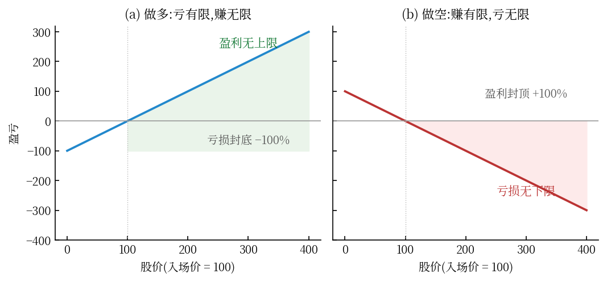
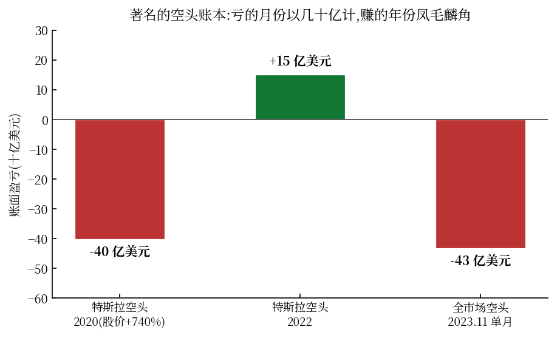

上一篇《流动性灾难》里有个数字让很多人睡不着:2008 年,John Paulson 的基金靠做空次贷**一年赚了约 150 亿美元,他个人拿走约 37 亿**。

于是后台最多的问题就是:做空到底是什么？我能不能做？

这篇文章把做空拆到底：机制、工具、史上最伟大和最惨烈的空头、以及为什么这门生意的数学结构**天然对 99% 的人不利**——最后你会明白，保尔森赢的不是勇气，是** payoff 结构**。

## 一、做空的机制：三步走，和一个致命的不对称

做空的定义动作只有三步：

1. **借**：从券商/持有人那里借来股票(付借券费)
2. **卖**：立刻按市价卖掉，拿到现金
3. **还**：未来某时买回股票还给债主

股价跌了，你低买高还，赚差价；股价涨了，你高买低还，亏差价。

听着是对称的？恰恰相反，这是金融里最恶毒的不对称：

**做多：亏损上限 100%,盈利无上限；做空：盈利上限 100%,亏损无上限。**

股价从 100 跌到 0,做空最多赚 100%;股价从 100 涨到 200、300、700(特斯拉 2020 年涨了 740%),你的亏损是 100%、200%、600%——**没有底**。而且别忘了，你手里还捏着卖空所得的现金和一份随时被追保的负债：做空天然自带杠杆，涨得越多，保证金追得越紧。

## 二、工具箱：裸做空、CDS、认沽期权——三种完全不同的物种

### 2.1 裸卖空(借券做空)

最原始的方式。成本是**借券费率**：容易借的大盘股年化约 0.25%-3%;冷门股(空头拥挤)可达两位数，甚至根本借不到(hard-to-borrow)。还有**召回风险**：出借人随时可以要回股票，逼你在最不利的价位强制回补。

### 2.2 CDS:不借一股的"合成做空"

信用违约互换(CDS)本质是**给债券买保险**：你付保费(年化通常 1-3%),如果标的违约，卖保险的一方按面值赔你。**买 CDS = 做空信用 = 赌违约**——不需要借任何券。

这就是保尔森和大空头们的武器，它的 payoff 是：

$$\text{loss capped at premium} \;\quad\; \text{gain is the default payout}$$

**注意这个形状——它和裸做空恰好相反！** 保尔森 2007 年的仓位：每年付出几亿美元保费，赌美国房贷崩盘。赌错了，亏保费；赌对了，收回百亿赔付。时间成本可控、没有无限亏损、没有召回、没有轧空。**同样的做空观点，工具的 payoff 结构决定生死。**

### 2.3 认沽期权:散户唯一体面的做空

买入认沽(put):付权利金，获得按行权价卖出的权利。亏损封顶 = 权利金，这与 CDS 同属"买保险型"。查诺斯(下面会讲他)晚年做空特斯拉就改用了这个工具——裸空头被 740% 的涨幅逼疯之后。

## 三、案例双面：最伟大的空头与最惨烈的尸体

### 赢家侧

- **保尔森(2007)**:CDS 做空次贷，基金赚约 150 亿美元(《The Greatest Trade Ever》)
- **Michael Burry**:更早建仓 CDS,基金当年净回报约 489%(《大空头》主角)
- **查诺斯猎杀安然(2001)**:通过财报分析识破造假，做空获利；其基金 Kynikos 创立于 1985 年，专注空头策略近四十年

### 输家侧(数据都来自 S3 Partners 等第三方)

- **特斯拉空头，2020 年**：股价 +740%,空头账面亏损**超 400 亿美元**——人类历史上单一股票空头的最大年度亏损。十一年里做空特斯拉几乎年年是"最亏交易"
- **GME 逼空，2021 年 1 月**：GameStop 的空头持仓一度**超过流通盘的 100%**(借出总量比市场上存在的股票还多)。Reddit 散户抱团买入 → 股价一月内暴涨十几倍 → 空头被强制回补(回补本身又推高股价，死亡螺旋)。**Melvin Capital 单月亏损 53%**,全年 -39%,2022 年清盘关门。Robinhood 在 1 月 28 日干脆**禁止买入、只许卖出**——空头的对手盘被物理消失了一天
- **2023 年 11 月**:美股反弹，对冲基金空头单月损失约 **432 亿美元**
- **查诺斯谢幕，2023 年 11 月**：近四十年做空生涯的老将，关闭了对冲基金，转为家族办公室——职业空头最后的体面退场

## 四、空头的四种死法

**死法一：时机死。** 凯恩斯那句刻进墓碑的话:"**市场保持非理性的时间，可以长过你保持不破产的时间。**"看对了泡沫，死在泡沫破裂前——2005 年就做空次贷的 Burry,客户在黎明前疯狂撤资，他差点没撑到 2007 年。

**死法二：轧空死。** 数学上残酷而优美：空头利息超过 100% 流通盘，意味着**全体空头必须买回的股票比市场上存在的还多**——回补必然推价，价格推高又逼更多空头回补。GME 是教科书，也是死刑执行书。

**死法三：成本死。** 借券费按日计提，拥挤交易费率飙升；再加上出借人召回(常发生在最不方便的时刻)，你在和时间双向付费。

**死法四：保证金死。** 做空浮亏即浮亏在负债端——本专栏期货篇讲过的机制在这里原样适用：权益触及维持线，强平。**740% 的涨幅对多头是狂欢，对空头是连续 7 次以上的保证金追缴，直到爆仓。**

## 五、数学审判：为什么凯利框架判裸做空"有罪"

把做空放进前面文章用过的复利增长率框架(凯利公式 $g = \mu L - \sigma^2 L^2 / 2$),结论一目了然：

对一只长期漂移 $\mu > 0$ 的股票(整个股市长期如此)，做空 = **持有漂移为负的资产**——不仅期望为负，而且：

$$\text{left tail capped } (+100\%),\; \text{right tail unbounded } (-\infty) \;\Rightarrow\; f^* \to \text{tiny or zero}$$

这就是"做空一个长期上涨的市场是与时间为敌"的数学表达。对照三个物种：

| 工具 | 损失结构 | 时间成本 | 凯利评价 |
|---|---|---|---|
| 裸卖空 | 无限 | 借券费逐日累积 | 结构性劣势 |
| CDS/认沽 | 封顶(保费/权利金) | 保费/权利金损耗 | **保险型，唯一健康结构** |
| 不做 | 0 | 0 | 大多数人的最优解 |

**保尔森的真正遗产不是"他敢赌崩盘"，而是他把赌崩盘的仓位构建成了保险型 payoff**——亏小赚大，时间成本锁死。同样看空次贷、用裸空(或卖 CDS 那一侧的交易商)死掉的，没有传记。

## 六、做空的社会功能，与给你的三条结论

做空不是纯粹的食腐：空头是市场里**唯一有财务动机去揭穿造假的力量**——查诺斯之于安然、浑水(Muddy Waters)之于瑞幸，做的是"有偿审计"。没有空头的市场，财务造假只能靠崩盘来自我揭露。

三条结论:

1. **普通人不裸做空**——数学结构(无底亏损 + 负漂移 + 四种死法)判了你死刑，除非你像 Burry 一样读完了每一份财报，而即便是他，也差点死于客户撤资
2. **要看空，就买保险**——认沽期权/CDS 型结构：亏小赚大、时间成本锁死；宁可损耗权利金，不给"无限亏损+追保"开门
3. **尊重空头，但别羡慕幸存者**——你看到的 Paulson 是从尸山上走下来的那一个；同样的仓位，Melvin 和 2020 年的特斯拉空头们付了学费

> **做多是与人性的贪婪同行，做空是与数学的时间为敌。靠别人的灾难赚钱的前提是：你的仓位结构，能让你活着看到灾难。**

---

*数据与信源:WSJ《Melvin Capital Lost 53% in January》(2021.1);S3 Partners 特斯拉空头数据(第一财经/华尔街见闻转引，2020-2022);WSJ 中文网(2022.11);财联社查诺斯关闭基金(2023.11);《The Greatest Trade Ever》(Zuckerman);Wikipedia: GameStop short squeeze。本文不构成投资建议。*
