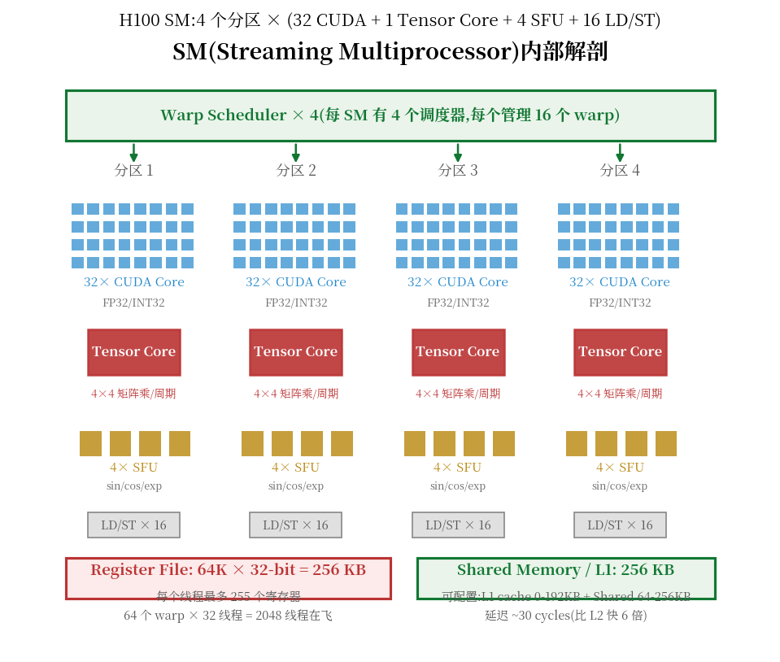
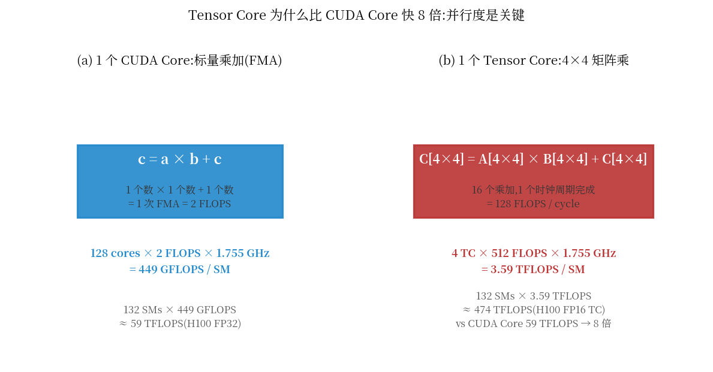
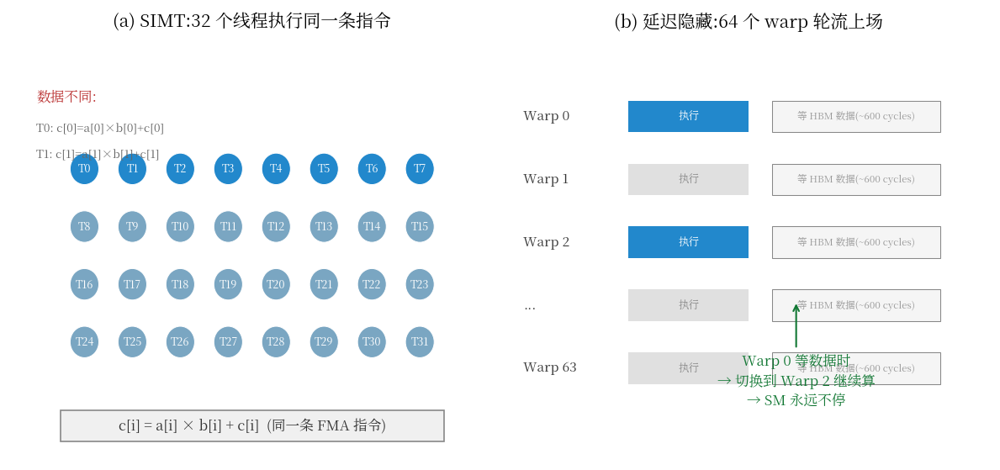
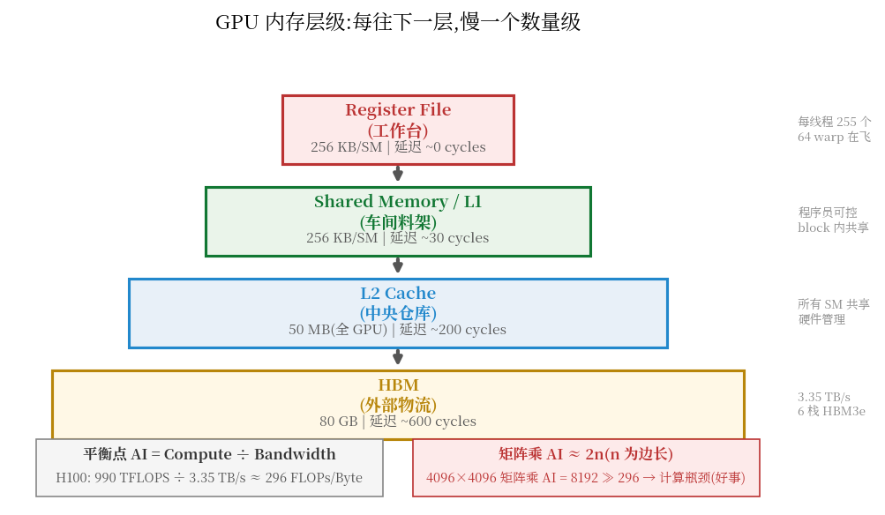

上一篇文章讲了 GPU 怎么战胜 CPU。这次打开 GPU 的引擎盖——看它的心脏,**SM(Streaming Multiprocessor)**——到底长什么样。

一块 H100 有 132 个 SM。每个 SM 就是一个独立的"工厂车间"——有自己的工人(CUDA Core)、专家(Tensor Core)、工作台(寄存器)、料架(Shared Memory)、主管(Warp Scheduler)。132 个这样的车间复制粘贴，加上内存和互联，就是一块 GPU。

这篇文章把一个 SM 拆到**每个零件的电路级别**，每个数字都算给你看。

## 一、SM 全景图



一个 SM 的完整家当：

| 部件 | 数量 | 功能 | 类比 |
|---|---|---|---|
| CUDA Core | 128 个 | FP32/INT32 标量运算 | 普通工人 |
| Tensor Core | 4 个 | 4×4 矩阵乘(专用电路) | 专家工人 |
| SFU | 16 个 | sin/cos/exp/log(超越函数) | 特殊工种 |
| LD/ST Unit | 16 个 | 内存读写 | 搬运工 |
| Warp Scheduler | 4 个 | 调度 64 个 warp | 车间主管 |
| Register File | 64K × 32-bit = 256 KB | 每线程的工作空间 | 工作台 |
| Shared Memory / L1 | 256 KB | 车间内共享缓存 | 料架 |

## 二、128 个 CUDA Core:普通工人的产能

### 2.1 一个 CUDA Core 是什么

一个 CUDA Core 就是一个 **FMA(Fused Multiply-Add)单元**——一个时钟周期完成"乘一次，加一次":

$$c = a \times b + c \quad \text{(1 cycle, 1 FMA)}$$

一次 FMA = 2 FLOPS(1 乘 + 1 加)。

### 2.2 产能计算

一个 SM 有 128 个 CUDA Core,跑在 1.755 GHz(H100 boost 频率):

$$\text{FP32} = 128 \times 2 \frac{\text{FLOPS}}{\text{cycle}} \times 1.755 \times 10^9 = 449 \text{ GFLOPS/SM}$$

全 GPU(132 个 SM):

$$449 \times 132 = 59.3 \text{ TFLOPS (FP32)}$$

这就是 H100 的 FP32 峰值算力——**普通工人(不看 Tensor Core)贡献的部分**。

### 2.3 关键：CUDA Core 没有 cache、没有分支预测

CPU 的一个 core 内部有分支预测器(branch predictor,猜下一条指令走哪条路)、乱序引擎(out-of-order engine,重排指令提高并行度)、大 cache(几十 MB L3)。这些占了 CPU die 面积的 80% 以上。

CUDA Core 什么都没有。就是纯粹的乘加电路。省下来的面积干什么？**再堆 128 个**。这就是 GPU 哲学：把 CPU 用于"让单个 core 变聪明"的面积，全部用来"堆更多 core"。

$$\text{CPU core} \approx 10\text{-}20\ \text{mm}^2 \quad \text{vs} \quad \text{CUDA core} \approx 0.1\ \text{mm}^2 \quad \Rightarrow \quad \text{100x density}$$

## 三、4 个 Tensor Core:专家的降维打击

### 3.1 一个 Tensor Core 是什么

Tensor Core 不是"更快的 CUDA Core"——它是**完全不同的电路**，专门做矩阵乘法:



一个 Tensor Core 在一个时钟周期内完成:

$$C_{[4 \times 4]} = A_{[4 \times 4]} \times B_{[4 \times 4]} + C_{[4 \times 4]}$$

4×4 矩阵乘 = 4×4×4 = 64 次乘法 + 48 次加法 = **128 FLOPS/cycle**。

### 3.2 为什么 Tensor Core 快 8 倍

同一个 SM 内:

| | CUDA Core 全开 | Tensor Core 全开 | 倍差 |
|---|---|---|---|
| 单 SM 算力 | 449 GFLOPS | 3,590 GFLOPS | **8×** |
| 全 GPU(132 SM) | 59 TFLOPS | 474 TFLOPS | **8×** |

为什么正好 8 倍？拆开算:

$$\frac{4 \text{ TC} \times 512 \ \text{FLOPS/cycle}}{128 \text{ CC} \times 2 \ \text{FLOPS/cycle}} = \frac{2048}{256} = 8$$

**关键：一个 Tensor Core 的吞吐(512 FLOPS/cycle,第四代)≈ 256 个 CUDA Core。**

但 Tensor Core 的面积大约只有 8 个 CUDA Core 大小。所以**单位面积的算力，Tensor Core 是 CUDA Core 的 32 倍**。这就是专用电路的力量。

### 3.3 Tensor Core 的精度支持

第四代 Tensor Core(Hopper)支持:

| 精度 | 位宽 | H100 峰值 | 用途 |
|---|---|---|---|
| FP64 | 64-bit | 67 TFLOPS | 科学计算 |
| FP32 | 32-bit | 67 TFLOPS | 通用训练 |
| TF32 | 19-bit 有效 | 495 TFLOPS | 混合精度训练 |
| **FP16/BF16** | 16-bit | **989 TFLOPS** | **主流训练/推理** |
| FP8 | 8-bit | 1,979 TFLOPS | 推理/Transformer Engine |
| INT8 | 8-bit | 3,958 TOPS | 量化推理 |

每次精度减半,吞吐翻倍——因为乘法器的面积和功耗按位数的平方增长。FP8 乘法器面积 ≈ FP16 的 1/4,所以同样面积可以塞 4 倍的单元。

## 四、Warp:GPU 真正的执行单位

### 4.1 什么是 Warp

GPU 不像 CPU 一次调度一个线程——它一次调度一个 **Warp(线程束)**,包含 **32 个线程**。



这 32 个线程在同一个时钟周期,执行**同一条指令**,操作**不同的数据**:

```
指令: FMA R1, R2, R3    (同一条指令)
T0:   c[0] = a[0]×b[0] + c[0]    (T0 的数据)
T1:   c[1] = a[1]×b[1] + c[1]    (T1 的数据)
...
T31:  c[31] = a[31]×b[31] + c[31]  (T31 的数据)
```

这就是 **SIMT**(Single Instruction, Multiple Threads)——GPU 的执行哲学。一条指令的电路面积摊到 32 个线程头上，面积效率极高。

### 4.2 延迟隐藏:64 个 Warp 轮流上场

一个 SM 同时管理 **64 个 warp** = 2048 个线程在飞行中(in flight)。

为什么需要这么多？因为**内存延迟**:

- HBM 读取延迟:~400-600 cycles
- 一个 warp 算 FMA:~1 cycle

也就是说,warp 发出一次内存请求后,要等 600 个周期才能拿到数据。如果只有 1 个 warp,SM 在这 600 个周期里什么也干不了——**99.8% 的时间在空闲**。

GPU 的解法:64 个 warp 排队。Warp 0 等内存时,SM 立刻切到 Warp 1 继续算;Warp 1 也要等内存,切 Warp 2……只要能计算的 warp 数量 ≥ 内存延迟 ÷ 计算时间,SM 就永远不闲着:

$$\text{warps needed} \geq \frac{\text{mem latency}}{\text{compute time}} = \frac{600 \text{ cycles}}{1 \text{ cycle}} = 600?$$

不对——64 个 warp 就够了,因为每个 warp 有 32 个线程,每个线程可以做多次 FMA。实际的 occupancy(占用率)计算更复杂,但原理就是:**用海量并行掩盖高延迟**。

### 4.3 Warp Divergence:SIMT 的代价

如果 32 个线程里有分支(if/else),一部分走 if,一部分走 else——GPU 怎么办？

答案是:**串行执行两条路径**。先让走 if 的线程执行,走 else 的等待;然后反过来。这叫 **warp divergence(分支发散)**,会损失最多 50% 的效率。

这就是为什么 GPU 友好的代码要尽量避免分支——尽量让同一个 warp 里的 32 个线程走同一条路。

## 五、内存层级:每一层都差一个数量级



### 5.1 四级内存

| 层级 | 容量 | 延迟 | 带宽 | 类比 |
|---|---|---|---|---|
| **Register File** | 256 KB/SM | ~0 cycles | 极高 | 手边的工具 |
| **Shared Memory / L1** | 256 KB/SM | ~30 cycles | ~128 B/cycle/SM | 车间料架 |
| **L2 Cache** | 50 MB(全 GPU) | ~200 cycles | ~5 TB/s | 中央仓库 |
| **HBM** | 80 GB | ~600 cycles | 3.35 TB/s | 外部物流 |

每往下一层:**容量大 100 倍,速度慢 10 倍**。

### 5.2 寄存器:64K 个 32-bit 是什么概念

$$64\text{K} \times 32\text{-bit} = 65{,}536 \times 4 \text{ bytes} = 256 \text{ KB}$$

256 KB 的寄存器堆——比 CPU 的 L1 cache 还大。为什么？因为要同时服务 2048 个线程:

$$\frac{65{,}536 \text{ registers}}{2{,}048 \text{ threads}} = 32 \text{ registers/thread}$$

每个线程平均分到 32 个寄存器(最多可申请 255 个)。如果一个 kernel 需要更多寄存器,能同时在飞的 warp 数就减少(occupancy 降低),延迟隐藏能力下降。

**这是 GPU 编程的核心 trade-off**:寄存器多 → 每个 warp 干活快 → 但能同时跑的 warp 少;寄存器少 → 每个 warp 慢 → 但能跑更多 warp。CUDA 编译器(ptxas)自动做这个平衡。

### 5.3 Shared Memory:程序员唯一可控的缓存

256 KB 的 Shared Memory / L1 Cache,比例**可以由程序员配置**:

```
// CUDA 代码:配置 Shared Memory vs L1 的比例
cudaFuncSetAttribute(myKernel, cudaFuncAttributePreferredSharedMemoryCarveout,
                     cudaSharedmemCarveoutMaxShared);  // 最大化 Shared Memory
```

可以选 0%(全做 L1)、25%、50%、100%(全做 Shared)。这是 **GPU 独有的设计**——CPU 的 cache 你控制不了,GPU 的这块 256KB 你说了算。

Shared Memory 的典型用途:
- **Tile 分块**:矩阵乘时把子块从 HBM 搬到 Shared Memory,反复使用
- **线程间通信**:同一个 block 内的线程通过 Shared Memory + `__syncthreads()` 协作
- **Reduction**:归约操作(求和/最大值)在 Shared Memory 中完成

### 5.4 算术强度:判断你是计算瓶颈还是内存瓶颈

$$\text{Arithmetic Intensity (AI)} = \frac{\text{FLOPs}}{\text{Bytes transferred}}$$

H100 的**屋顶线(Roofline)平衡点**:

$$\text{AI}_{\text{balance}} = \frac{989 \text{ TFLOPS (FP16 TC)}}{3.35 \text{ TB/s}} = \frac{989 \times 10^{12}}{3.35 \times 10^{12}} \approx 295 \text{ FLOPs/Byte}$$

**解读**:每从 HBM 读 1 字节数据,你需要做 ≥295 次浮点运算,才能让 Tensor Core 全速运转。

- **矩阵乘**(AI ≈ 2n,大矩阵时非常高):轻松超过 295 → **计算瓶颈** = 好事,Tensor Core 满载
- **向量加**(AI = 2/12 ≈ 0.17):远低于 295 → **内存瓶颈** = Tensor Core 闲着,浪费算力
- **Attention**(AI ≈ 100-500):恰好接近平衡点 → 架构设计的甜蜜点

这就是为什么 NVIDIA 的设计(堆 Tensor Core + 堆 HBM 带宽)恰好匹配深度学习(矩阵乘 + Attention)——**不是巧合，是共同进化**。

## 六、SFU 和 LD/ST:配角也重要

### SFU(Special Function Unit)

16 个 SFU 做超越函数: $\sin, \cos, \exp, \log, \text{rsqrt}$。

用在哪？
- **归一化层**:$\hat{x} = \frac{x - \mu}{\sqrt{\sigma^2 + \epsilon}}$ → rsqrt(开方取倒数)
- **激活函数**:SiLU = $x \cdot \text{sigmoid}(x)$ → exp
- **Softmax**:需要 exp

SFU 的吞吐只有 CUDA Core 的 1/8(16 个 vs 128 个),所以如果 kernel 里全是超越函数,SFU 就成了瓶颈。

### LD/ST(Load/Store Unit)

16 个 LD/ST 单元负责读写内存。关键概念是 **Coalesced Access(合并访存)**:

- **好的访问模式**:一个 warp 的 32 个线程读连续的 32×4=128 字节 → 硬件合并成**一次** 128-byte 事务
- **坏的访问模式**:32 个线程读分散的地址 → 32 次独立事务 → **带宽浪费 32 倍**

这就是为什么 GPU 编程要求数据布局对齐(align)且连续——不是为了好看,是硬件的物理要求。

## 七、SM 的一生总结

一个 SM 的运作循环:

```
1. Warp Scheduler 从 64 个 warp 中选一个"就绪"的
2. Dispatch Unit 发射指令到对应的功能单元
   - FMA → CUDA Core(128 个中的某 32 个)
   - 矩阵乘 → Tensor Core
   - sin/exp → SFU
   - 读/写内存 → LD/ST
3. 数据在 Register File 里(0 延迟)或 Shared Memory(30 cycles)
4. 如果要读 HBM(600 cycles),这个 warp 挂起
5. Scheduler 立刻切换到下一个就绪的 warp
6. 循环——SM 的所有单元尽量不停歇
```

**GPU 的性能公式**(简版):

$$\text{Achievable Performance} = \min\left(\text{Peak Compute},\ \frac{\text{Peak Bandwidth} \times \text{AI}}{1}\right)$$

你的 kernel 实际能跑多快,取决于计算力和带宽两个天花板中**较低的那个**。AI(算术强度)决定了你撞的是哪个天花板。

---

*参考:NVIDIA H100 White Paper;CUDA C++ Programming Guide(SIMT 执行模型);Hennessy & Patterson《Computer Architecture》第 6 章(GPU 部分);NVIDIA Hopper Architecture 白皮书。H100 数据:132 SMs / 1.755 GHz boost / 50MB L2 / 80GB HBM3e / 3.35 TB/s。*
