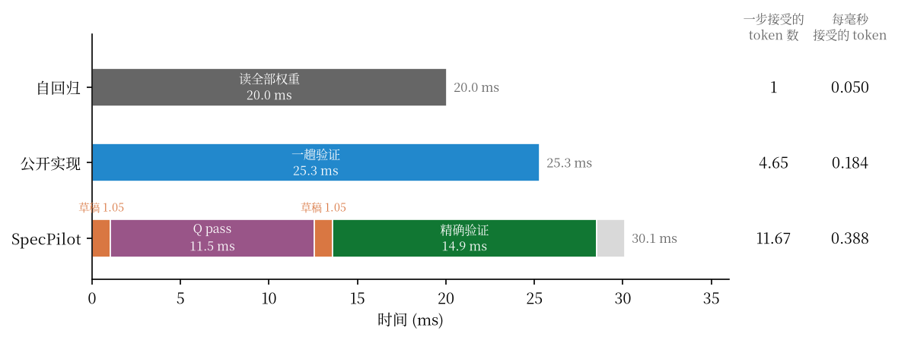
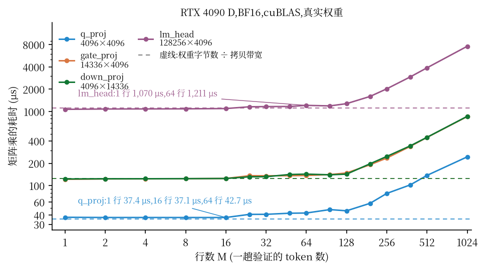
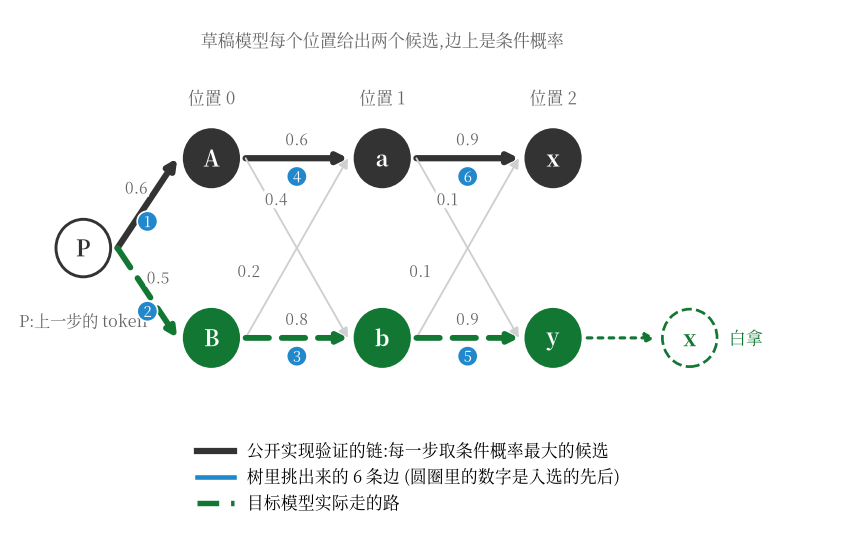
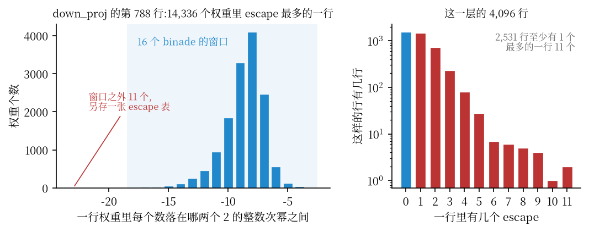
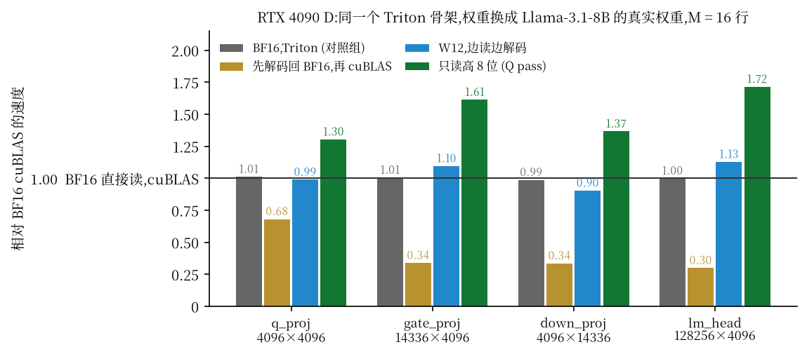
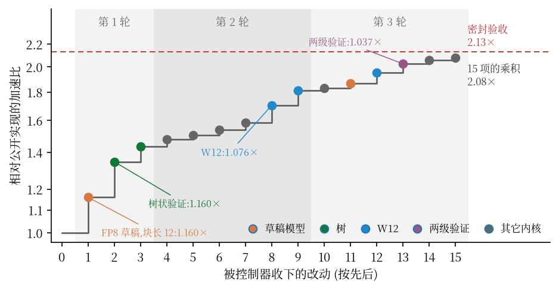

同一个模型,同一张 H100。公开的投机解码比自回归快 3.95×。一篇论文说,能到 8.86×。

多出来的这一倍多,没有靠训练。输出仍然由目标模型决定。

论文叫 SpecPilot,2026 年 11 月 2 日挂上 arXiv (2611.02501)。它做了两件事:算清公开实现把速度丢在了哪,再让一组 agent 分头去找。找到四样东西:树状验证,12 bit 的无损权重,两级验证,三个批处理的办法。

这篇按这个顺序走。先算账,再看这四样各动了哪里,最后看它们换一块卡还剩多少。

W12 那一节附一个参考实现,在三个开源模型上逐 bit 验证过,escape 的比例和论文对得上。另外在 4090D 上量了两组:多读几行的代价,和同一个 Triton 骨架的五种读权重方式。

论文摘要里的数字是 10.87×,出自 RTX PRO 6000。H100 上是 8.86×,这一条线上的 15 次提升有明细,所以下面按它拆。

## 一、先算账:一步的时间花在哪

27B 的模型存成 BF16,权重 51.1 GB。自回归解码每出一个 token,要把这 51.1 GB 从显存里读一遍。H100 的峰值带宽是 3.35 TB/s,读一遍至少要:

$$t_{\text{AR}} \ge \frac{\text{bytes}}{\text{bandwidth}} = \frac{51.1\ \text{GB}}{3.35\ \text{TB/s}} = 15.25\ \text{ms}$$

论文量到的是 19.1 ms,峰值的 80%。读这么多,只为了算一行矩阵乘。

投机解码改的就是这个浪费。草稿模型先猜几个 token,目标模型一趟前向一起验。猜对几个收几个,权重只读一遍。

猜和验的数学在《投机解码全景》那篇里推过,这里只留两个量:

$$S(N) = \frac{\tau(N)}{c(N)}, \qquad c(N) = \frac{T_{\text{step}}(N)}{T_{\text{AR}}}$$

τ 是一步接受的 token 数,c 是一步的时间相当于几个自回归步。加速比就是两个数相除。论文做的所有事,不是抬高 τ,就是压低 c。

把公开实现的数代进去。H100 上它一步 25.3 ms,接受 4.65 个 token。c 是 1.26,S 是 3.69。



SpecPilot 那一条分成五段,来自它的两级验证:一个周期里有两份草稿,一趟低精度的 Q pass,一趟精确验证。

每次精确验证接受 11.67 个 token,每毫秒接受的 token 数是公开实现的 2.1 倍。它为什么划得来,第六节算。

## 二、朴素做法:一条链,逐个比

公开的引擎是裁剪过的 SGLang v0.5.20。一趟验证从 `DFlashWorkerV2.forward_batch_generation()` 进去,做四件事:

- 草稿模型出一块草稿。
- 把草稿的 token 摊平,交给 `prepare_for_verify`,目标模型做一趟前向。
- 每一行取 argmax。
- `_accept_block()` 决定接受几个。

贪心解码下,接受规则是一个十几行的 kernel,一个请求一个 program:

```python
accept_len = tl.full((), 0, tl.int32)
prefix_live = tl.full((), 1, tl.int32)
for col in range(BLOCK_SIZE - 1):
    in_range = col < (block_size - 1)
    candidate_id = tl.load(candidate_row_ptr + (col + 1), mask=in_range, other=0)
    target_id = tl.load(target_row_ptr + col, mask=in_range, other=0)
    match_i32 = (candidate_id == target_id).to(tl.int32)
    keep = in_range & (prefix_live != 0) & (match_i32 != 0)
    accept_len += keep.to(tl.int32)
    prefix_live = tl.where(in_range, prefix_live & match_i32, prefix_live)

commit_len = accept_len + 1
bonus_id = tl.load(target_row_ptr + accept_len.to(tl.int64))
```

从左到右扫。草稿的第 i 个 token 和目标模型在第 i 行的预测一样,`prefix_live` 就保持 1;第一个对不上的位置之后全是 0。接受的个数加 1,是这一步提交的 token 数。

多出来的那一个是目标模型在断点处的预测,白拿的。

这十几行没有错。问题在它只看一条链。

打个比方,后厨的大厨每验一道菜,要把整间后厨的设备预热一遍。验 1 道和验 10 道,预热的时间一样。

学徒报菜的时候,每个位置其实备了 16 个候选。大厨只验排第一的那一条,其余 15 个看都不看。

多验几行真的几乎不要钱。论文在 H100 上量过:第一轮之前,所有 GEMM 加起来,1 行 17.88 ms,64 行 18.58 ms,多了 3.9%。

4090D 上量了同样的事。权重是 Llama-3.1-8B 的四个真实矩阵,BF16,交给 cuBLAS:



q_proj 从 1 行到 16 行,耗时是 37.4 µs 和 37.1 µs,没有变化。到 64 行是 42.7 µs,多了 14%。lm_head 从 1,070 µs 到 1,211 µs,多了 13%。

1 行的时候,cuBLAS 读权重的速度是每秒 898 到 982 GB,贴着这张卡的带宽 (拷贝带宽 943.8 GB/s)。台阶从 24 行开始上,每个矩阵上得不一样早。

被跳过的候选里,常常有目标模型想要的那个。论文做了一次离线回放:把草稿模型的候选和目标模型的输出录下来,重新跑一遍选树和验证。

公开实现的链每步接受 4.25 个 token。如果每一步都在前 16 个候选里挑目标模型真正会选的那个,8 个位置能接受 6.42 个,16 个位置能接受 8.20 个。

这是第一个麻烦:单请求下,草稿已经给出的候选,公开实现扔掉了大半。

第二个麻烦在批处理。多张桌子同时点菜,灶眼开始忙了。预热不再是瓶颈,多验的每一道菜都占灶眼。每个请求有自己的 attention 和递归状态,新来的 prompt 还要 prefill。

FP8 的 Qwen3.8-27B 上,公开实现相对自回归的加速比从单请求的 3.40× 掉到 24 个请求时的 1.89×。

第三个麻烦是,同一个办法在这头是收益,在那头是亏损。两级验证在单请求下的成对增益是 1.037×,在 BF16 的批处理上慢 13%。

论文摘要里有一句原话:no universal optimization fits every serving regime, drafter, target model and GPU。四样里换一样,最优解就得重新找。

## 三、SpecPilot 的循环:先量,再改,再验

既然一种部署要找一次,论文就找了一组 agent 来做。一轮分五段:

1. 成本模型量出离上限还差多少。
2. 几个子 agent 各占一块 GPU,各试一个方向。
3. 单独量太小的改动,叠在一起再量。
4. 一个专门调内核的子 agent,接手离字节下限最远的内核。
5. 封存:换一批没见过的请求和公开实现比,输出再过一遍 token forcing。

第 1 段是整个循环的骨架。上限拆成三个因子相乘:

$$\text{ceiling} = \frac{\tau_{\text{best}}}{\tau} \cdot \frac{T_{\text{prof}}}{T_{\text{floor}}} \cdot \frac{T_{\text{step}}}{T_{\text{prof}}}$$

第一个因子:换一棵最好的树,每步还能多接受几成。第二个:profile 到的内核时间,是字节下限的几倍。第三个:profile 没看到的时间占多少。

字节下限取两个里大的那个:算力按峰值的 60% 折算时间,带宽按峰值的 90% 折算。两个百分比是经验值,只为给方向排序。

排序是有用的。第一轮之前,上限是 2.57×,拆开来是 1.83 × 1.01 × 1.39,大头在树,内核跟在后面。第二轮之前是 1.95× = 1.34 × 1.45,瓶颈换成了每一步的成本。

第三轮两个因子都没多少余地了,agent 去动上限自己的假设:每次草稿只做一趟精确验证。

收不收一个改动,不由动手改的 agent 说了算。控制器是 agent 能调,不能改的脚本。两套系统在两块 GPU 上跑同一批请求,中间互换 GPU。增益是每道题速度比值的几何平均,置信区间用 bootstrap:

```python
def accept_patch(before, after, noise, min_gain=0.01, boot=2000, seed=0):
    logs = [math.log(b / a) for a, b in zip(before, after)]
    rng = random.Random(seed)
    resampled = sorted(sum(rng.choice(logs) for _ in logs) / len(logs) for _ in range(boot))
    gain, lower = math.exp(sum(logs) / len(logs)), math.exp(resampled[int(0.025 * boot)])
    return lower > 1 + min_gain + 2 * noise, gain, lower
```

`noise` 是什么都没改时,同一套系统测两次的增益波动。单请求下 H100 上它小于 0.1%,所以门槛在 1.2% 上下。改动让输出和当前最优不一样的话,门槛提到 3% 左右。

这条线不好过。用这段函数模拟一下:30 道题,每道题两次运行的速度之间有 2% 的随机涨落,真实增益不同的改动各试 2,000 次。

| 真实增益 | 过线的比例 |
|---|---|
| 0 | 0.0% |
| 1% | 1.1% |
| 1.5% | 14.9% |
| 2% | 59.3% |
| 3% | 99.8% |

所以循环里有"叠在一起再量"那一段:很多改动单独过不了线,合起来够。

打个比方,这是请一组实习生分头改菜谱,再由一个不下厨的领班拿秒表验收。验收的人不动手,是为了防有人把菜做生了来省时间。

做生了菜,论文里叫 reward hacking:agent 为了快,换一条会改变输出的数值捷径,任务分数又看不出差别。论文试了试任务分数能不能发现它:给系统注入一个故障,2048 个 token 之后每隔 7 个词表下标加一个大小为 2 的 logit 偏置。

任务准确率的变化是 −1.6 个点,区间 [−3.6, +0.3]。无损系统是 −0.3 个点,区间 [−1.6, +0.7]。两个区间叠在一起,分不出来。

token forcing 分得出来。把系统的输出逐个喂回公开实现的引擎 (LM head 用 FP32),比每个位置的 argmax。公开实现自己有 0.72% 的 token 对不上,都是浮点归约顺序造成的近似平局。

两条规则拒掉一个改动。一是不一致的比率比公开实现高出 0.5 个百分点以上。二是出现了解释不了的大间隔不一致,而且比公开实现更频繁。注入故障的系统不一致率是 2.0% 和 2.4%,各被拒。

每收下一个改动,记成一条记忆:相对它依赖的其它条目的代码增量,有哪些变体,正确性约定,证据,没测过的场景。带进新部署之前,要能在公开实现上原样重建出源系统的代码。现在有 140 条。

代价也报了。13 轮一共 164 小时,530 GPU 小时,486 个改动,收下 54 个。agent 是 Claude Opus 5.5。

对照组是去掉成本模型的单 agent 循环。三轮之后它做到 1.34×,SpecPilot 是 2.13×。

它盯着最显眼的 τ:加了 24 节点的树,加长草稿块,给草稿模型降精度。占一步 80% 的权重读取,它一次都没碰。

## 四、机制一:树状验证

树的思想一句话:链在第一个猜错的位置就停,树让别的候选接着走。

草稿模型的候选组成一张格:每个位置有 K 个候选,每条边上是"上一个位置选了第 i 个候选时,这个位置选第 j 个"的条件概率。best-first 树按路径概率从高到低,从格里挑 N − 1 个节点:

```python
def best_first_tree(root, edges, n_nodes):
    heap, serial = [], itertools.count()
    for j, lp in enumerate(root):
        heapq.heappush(heap, (-lp, next(serial), (j,)))
    tree = []
    while heap and len(tree) < n_nodes:
        score, _, path = heapq.heappop(heap)
        tree.append(path)
        s = len(path) - 1
        if s < len(edges):
            for j, lp in enumerate(edges[s][path[-1]]):
                heapq.heappush(heap, (score - lp, next(serial), path + (j,)))
    return tree
```

`root` 是位置 0 各个候选的对数概率,`edges` 是条件对数概率。一个节点被取出来之后,它的孩子才进堆。所以取出来的这批路径,前缀也一定在里面,是一棵合法的树。



图里是一个手算得过来的例子。公开实现的链是 P,A,a,x,每一步取条件概率最大的候选,路径概率 0.297。目标模型实际要走的却是 B,b,y。链的第一个 token 就错了,这一步只拿到白拿的 1 个。

树里的 6 条边按路径概率挑:A 0.55,B 0.45,B 到 b 0.36,A 到 a 0.33,B 到 b 到 y 0.32,A 到 a 到 x 0.30。目标模型走的路都在里面。这一步接受 b 和 y,再白拿一个 x,一共 3 个 token。

一趟前向里,每个节点只看得到自己的祖先。之后在树上找最长的那条被接受的路:

```python
def greedy_accept_tree(tokens, parents, target_pred):
    accepted, depth, leaf = [True], [0], 0
    for i in range(1, len(tokens)):
        p = parents[i]
        accepted.append(accepted[p] and tokens[i] == target_pred[p])
        depth.append(depth[p] + 1)
        if accepted[i] and depth[i] > depth[leaf]:
            leaf = i
    path, best = [], leaf
    while leaf > 0:
        path.append(leaf)
        leaf = parents[leaf]
    return [tokens[i] for i in reversed(path)], target_pred[best]
```

节点 i 被接受要两条同时成立:它的 token 等于目标模型在它父节点处的预测,并且它的父节点也被接受。根是上一步白拿的那个 token。

公开的代码里,建树和接受各是一个 Triton kernel,一个请求一个 program,规则和上面一样。建树的 kernel 维护一个池子,放"父节点 × 候选",循环 N − 1 次,每次取走得分最高的一项,再把它的孩子放进池子。

树的节点数上限是 63,因为每个节点用一个 64 位的掩码记自己的祖先。

树能多接受多少,论文用离线回放量过。草稿 8 个位置时,32 个节点的 best-first 树把每步接受的 token 数从 4.25 提到 5.38,多了 27%。

草稿加到 16 个位置 (它训练时的块长是 8),32 个节点是 5.85,63 个节点是 6.25。

16 个节点的时候,best-first 树和 EAGLE-2 风格的 top-4 树打平 (5.03 对 5.02),比 Sequoia 的树高 (4.71)。再往上,就得靠格本身和节点数了。

树不是越宽越好。在换了 W12 权重的系统上,48 个节点的树慢了 4.3%:32 个以上,每个节点一步要花 0.17 ms 左右,带来的价值只有 0.063 ms 左右。

目标模型是混合结构时,树还有一个麻烦。Qwen3.8-27B 的 64 层里有 48 层是 Gated DeltaNet。这些层不存 KV,存一个固定大小的状态,每个 token 更新一次:

$$h_t = \alpha_t \left(I - \beta_t k_t k_t^{\top}\right) h_{t-1} + \beta_t k_t v_t^{\top}, \qquad o_t = h_t^{\top} q_t$$

α 是衰减门,β 是写入强度。验证一条链时,公开实现在每个位置存一份状态的快照,接受几个就取第几份。树有 32 个节点,就要 32 份快照。

SpecPilot 不存快照。每条从根出发的路径,从已经提交的状态开始把 h 重算一遍。接受之后,再沿被接受的那条路把状态推进到全部 48 层。在链上,这个结果和公开实现的 kernel 逐 bit 相同。

更快的版本借自 TreeWY:把这一串秩一更新改写成矩阵乘,所有路径一起上 tensor core。FP32 的状态拆成三份 BF16,24 位有效数字一位不丢,结果和逐条重算的 kernel 差在一个 BF16 的 ulp 之内。

这一类改动在 H100 单请求那条线上的成对增益:16 节点的树 1.160×,32 节点的宽树 1.065×,GDN 的树内核 1.030×。

## 五、机制二:W12,每个权重 12 bit,一位不丢

权重读一遍的时间,和字节数成正比。BF16 每个权重 16 bit。能不能存 12 bit,读的时候再拼回去,一个 bit 都不变?

打个比方,后厨货架上的食材,同一层货架的克数量级差不多。标签不写全名,只写比基准少几位。标签小了四分之一,内容一字不差。

BF16 的一个数是 1 位符号,8 位指数,7 位尾数:

$$w = (-1)^s \cdot 2^{e-127} \cdot \left(1 + \frac{m}{128}\right)$$

一行权重 (一个输出通道) 里的数,数量级很集中。W12 给每一行挑 16 个连续的指数 [E − 15, E],让落在里面的权重最多。窗口里的权重存三样:符号 s,偏移 c,尾数 m:

$$c = e - (E - 15) \in [0, 15], \qquad 1 + 4 + 7 = 12 \ \text{bits}$$

解码的时候先拼出一个约分后的值,再把公因子乘回去:

$$\tilde{w} = (-1)^s \cdot 2^{c-15} \cdot \left(1 + \frac{m}{128}\right), \qquad w = \tilde{w} \cdot 2^{E-127}$$

公因子是 2 的整数次幂,在浮点数里乘除不丢位。窗口外面的权重,0 和非规格数,另存一张按行的稀疏表,叫 escape 表。

下面是参考实现,只求正确:

```python
def w12_encode(w):                                   # w: [N, K] bfloat16
    u = w.view(torch.int16).to(torch.int32) & 0xFFFF
    e = (u >> 7) & 0xFF                              # 指数域
    row = torch.arange(w.shape[0], device=w.device)[:, None] * 257
    hist = torch.bincount((row + e).flatten(), minlength=w.shape[0] * 257).view(w.shape[0], 257)
    hist[:, 0] = 0                                   # 0 和非规格数不进窗口
    cum = hist.cumsum(1)
    tops = torch.arange(15, 256, device=w.device)
    below = cum[:, (tops - 16).clamp(min=0)]
    below[:, tops < 16] = 0
    cover = cum[:, tops] - below                     # 窗口 [E-15, E] 能盖住多少个
    best = cover == cover.max(1, keepdim=True).values
    E = tops[best.int().cumsum(1).argmax(1)].int()   # 盖得最多的那个
    c = e - (E[:, None] - 15)
    esc = (c < 0) | (c > 15) | (e == 0)              # 窗口外,或者是 0
    s, m = u >> 15, u & 0x7F
    hi = torch.where(esc, 0, (s << 7) | (c.clamp(0, 15) << 3) | (m >> 4)).to(torch.uint8)
    m4 = torch.where(esc, 0, m & 0xF)
    lo = (m4[:, 0::2] | (m4[:, 1::2] << 4)).to(torch.uint8)
    return hi, lo, E, esc


def w12_decode(hi, lo, E):                           # 还原成 bfloat16
    low = torch.stack([lo & 0xF, lo >> 4], dim=2).view(hi.shape).to(torch.int32)
    h = hi.to(torch.int32)
    wt = ((h << 8) & 0x8000) | ((h & 0x7F) << 4) | 0x3800 | low
    bits = wt + ((E[:, None] - 127) << 7)
    return bits.to(torch.int16).view(torch.bfloat16)
```

12 bit 拆成两块存。`hi` 是 8 位:符号,4 位偏移,尾数的前 3 位。`lo` 是 4 位:尾数的后 4 位,相邻两个存在一个字节里。

解码只有几个整数运算。`0x3800` 把指数域的高 4 位填成 0111:约分后的值,指数域落在 112 到 127 之间,4 位偏移正好接在后面。

矩阵乘是 x 乘上权重的转置。现在变成 x 乘上约分后的权重的转置,再按行乘回公因子。公因子乘在 FP32 的累加结果上。escape 的位置在记录里是占位值 2 的 −15 次方,校正项是 x 乘上 (精确值减占位值),同样乘回公因子。

把三个开源模型的全部二维 BF16 权重各编解码一遍:

| 模型 | 权重数 | 论文的 escape 比例 | 这里算的 | 逐 bit 不一致 |
|---|---|---|---|---|
| Llama-3.1-8B-Instruct | 80.3 亿 | 7.66×10⁻⁵ | 7.62×10⁻⁵ | 0 |
| Mistral-7B-Instruct-v0.3 | 72.5 亿 | 1.21×10⁻⁴ | 1.210×10⁻⁴ | 0 |
| Qwen3.5-4B (只算语言模型) | 42.0 亿 | 7.88×10⁻⁵ | 7.88×10⁻⁵ | 0 |

论文表 A2 的三行都对上了。Qwen3.5-4B 的 checkpoint 里还带一个视觉塔和一个 MTP 头,一起算进去是 8.22×10⁻⁵。只算语言模型,才是论文的数。



图是 Llama-3.1-8B 第 16 层 down_proj 里 escape 最多的那一行。14,336 个权重,11 个落在窗口外。整个张量 4,096 行里,1,565 行一个 escape 都没有。

escape 大多是小权重。Llama 的 61.2 万个 escape 里,60.0 万个低于窗口,1.1 万个高于窗口,1,286 个是 0。Mistral 的注意力权重更散一些:一行里最多有 235 个 escape。

单个张量之间差别很大。Llama 第 0 层的 q_proj 有 0.13% 的权重在窗口外,是平均值的 17 倍。

算上 escape 表 (每个 8 字节) 和每行的元数据 (8 字节),每个权重占 12.02 到 12.03 bit。论文报的是 12.013 到 12.020,差在记账方式。三个模型的权重字节数都少了 24.9% 左右。

公开的 kernel 把解码放进 GEMM,在寄存器里做。每 12 KB 一个记录,对应一块 128 × 64 的权重。每 32 个权重一组,移位和按位运算加上 `byte_perm`,一共六十条上下的指令,拼出 16 个寄存器。源码注释给的预算是每个寄存器 3.3 条。

格式和速度是两回事。只读字节,12 bit 比 16 bit 最多快 16/12 = 1.33 倍。真要快,得让这个 kernel 比厂商的 BF16 库还接近带宽上限。

论文的数字:H100 上 W12 的 GEMM 比 cuBLAS 快 1.19 到 1.47 倍 (1 行),整个自回归解码快 1.19 到 1.28 倍。Qwen3.8-27B 的单请求 TPOT 从 19.1 ms 到 15.6 ms。

H100 单请求那条线上,W12 一共被收下三次:格式本身 1.076×,流水线调优 1.063×,布局和边界校准 1.045×。

在 4090D 上从零写一个试试。骨架是一个 Triton 的小矩阵乘,权重换成 Llama-3.1-8B 的四个真实矩阵,只换读法:

```python
@triton.jit
def _unpack(hi, low, Q_ONLY: tl.constexpr):
    if Q_ONLY:
        low = 8                                   # 扔掉的低 4 位取中点
    bits = ((hi << 8) & 0x8000) | ((hi & 0x7F) << 4) | 0x3800 | low
    return bits.to(tl.uint16).to(tl.bfloat16, bitcast=True)


@triton.jit
def _w12_gemm_kernel(x_ptr, hi_ptr, lo_ptr, scale_ptr, y_ptr, ws_ptr, M, N, K,
                     BLOCK_M: tl.constexpr, BLOCK_N: tl.constexpr, BLOCK_K: tl.constexpr,
                     SPLIT_K: tl.constexpr, Q_ONLY: tl.constexpr):
    pid_n = tl.program_id(0)
    pid_k = tl.program_id(1)
    rm = tl.arange(0, BLOCK_M)
    rn = pid_n * BLOCK_N + tl.arange(0, BLOCK_N)
    acc = tl.zeros((BLOCK_N, BLOCK_M), dtype=tl.float32)
    k_per = K // SPLIT_K
    for k0 in range(pid_k * k_per, (pid_k + 1) * k_per, BLOCK_K):
        rk = k0 + tl.arange(0, BLOCK_K)
        hi = tl.load(hi_ptr + rn[:, None] * K + rk[None, :]).to(tl.int32)              # [BN, BK]
        rj = k0 // 2 + tl.arange(0, BLOCK_K // 2)
        lb = tl.load(lo_ptr + rn[:, None] * (K // 2) + rj[None, :]).to(tl.int32)       # [BN, BK/2],一字节两个
        low = tl.interleave(lb & 0xF, lb >> 4)                                         # [BN, BK]
        w = _unpack(hi, low, Q_ONLY)                                                  # [BN, BK] bf16
        xk = tl.load(x_ptr + rm[None, :] * K + rk[:, None], mask=rm[None, :] < M, other=0.0)  # [BK, BM]
        acc = tl.dot(w, xk, acc)                                                      # [BN, BM]
    out = tl.trans(acc)                                                               # [BM, BN]
    scale = tl.load(scale_ptr + rn)[None, :]
    if SPLIT_K == 1:
        tl.store(y_ptr + rm[:, None] * N + rn[None, :], (out * scale).to(tl.bfloat16), mask=rm[:, None] < M)
    else:
        tl.store(ws_ptr + pid_k * M * N + rm[:, None] * N + rn[None, :], out * scale, mask=rm[:, None] < M)
```

`hi` 和 `lo` 是 W12 的两个平面。解码就是上面 `w12_decode` 里那几个整数运算,只是这边拼完直接进矩阵乘。

K 方向切开时,每个 program 只算一段,部分和由另一个 kernel 加起来。

同一个骨架,五种读法,M = 16 行。表里的数是相对 cuBLAS 读 BF16 的速度,大于 1 是更快:

| 读法 | 每个权重搬多少 | q_proj | gate_proj | down_proj | lm_head |
|---|---|---|---|---|---|
| BF16,cuBLAS (定为 1) | 16 bit | 1.00 | 1.00 | 1.00 | 1.00 |
| BF16,Triton (对照组) | 16 bit | 1.01 | 1.01 | 0.99 | 1.00 |
| 先解码回 BF16,再 cuBLAS | 12 + 16 + 16 bit | 0.68 | 0.34 | 0.34 | 0.30 |
| W12,边读边解码 | 12 bit | 0.99 | 1.10 | 0.90 | 1.13 |
| 只读高 8 位 (Q pass) | 8 bit | 1.30 | 1.62 | 1.37 | 1.72 |



对照组说明骨架没有问题:读 BF16 的时候,Triton 版和 cuBLAS 打平,差在 1% 以内。

W12 这一路字节少了四分之一,速度从慢一成到快一成三。它读权重的速度是每秒 637 到 811 GB,cuBLAS 读 BF16 是 903 到 958 GB。差的就是解码:字节读进来之后,要先拼成 BF16,才能进 tensor core。

先解码再乘最慢。小矩阵上,解码出来的 BF16 权重还留在缓存里,速度也只有 cuBLAS 的 0.68 倍和 0.34 倍。lm_head 有 1 GB,留不住,0.30 倍。

这一路有个干净的副产品:它的输出和直接用原始 BF16 权重逐 bit 相同,四个矩阵都是。W12 的解码确实一位不丢。边读边解码的那一路,误差和 Triton 读 BF16 时一样,最大的相对误差在 0.22% 到 0.27%。

只读高 8 位的那一路快 1.3 到 1.7 倍。字节少一半,速度没有翻倍,原因相同。它是有损的,和精确值比,最大的相对偏差在 17% 到 26%,只能当 Q pass 用。

同一个 kernel,配置不同,结果差得很远。第一版只试了 4 组配置,q_proj 上挑出来的那组要 45.5 µs,比 cuBLAS 慢 22%。19 组都试一遍,挑出来的是 37.6 µs。

论文说 W12 的价值来自内核,不亚于格式。4090D 上也是这样。

两个边界。行数多的时候 (prefill) 不走这个 kernel,而是把权重整份解码回 BF16 再交给 cuBLAS。所以 W12 加快的是解码,不是 prefill。

换一张没有 wgmma 的卡,kernel 要重写。RTX PRO 6000 上改用 mma.sync。

还有一处设计给下一节留着。只读每个记录的高 8 位,尾数的后 4 位取中点,得到一个 8 位的浮点数:符号,4 位偏移,3 位尾数。在 Qwen3.8-27B 上,它和精确值的 top-1 在 98.3% 的位置上一致,而且不多占一个字节。

## 六、机制三:两级验证

单请求下多验几行不要钱,那就多验一棵树。可是树的节点数有上限,过了 32 个,每个节点都比它带来的价值贵。SpecPilot 换了一个维度:一趟精确验证,配两份草稿。

打个比方,先让二厨过一遍,把明显不对的划掉,大厨只验划剩下的。二厨说了不算。

一个调度步变成两段。第一段:草稿模型出一份草稿,建一棵树,用目标模型的 8 位视图 (上一节最后那一个) 验一遍。这一趟只接受,不提交:不写递归状态,不发布序列长度。它接受出来的那条路叫链 C。

第二段:草稿模型从 C 的末尾再出一份草稿,它的树截到 N − |C| 个节点,挂在 C 的下面。目标模型用精确的权重,把 C 加上这棵树一趟验完,照常接受和提交。

两级验证是无损的,因为只有第二段提交 token。链 C 和别的草稿一样,只是提议。

H100 上一个周期的账:两次草稿各 1.05 ms,Q pass 11.5 ms,精确验证 14.9 ms,其余 1.6 ms,合计 30.1 ms。每次精确验证接受的 token 从单级的 6.16 个涨到 11.67 个。

划不划算,看一个比值:

$$\frac{\tau_{\text{two-level}}}{T_{\text{draft}} + T_Q + T_{\text{draft}} + T_{\text{exact}}} > \frac{\tau_{\text{one-level}}}{T_{\text{one-level}}}$$

右边的 T 由成对增益反推:单级时一步 16.5 ms。两边算出来是 0.388 对 0.374 个 token 每毫秒,快 3.7%。正好是表里两级验证的成对增益 1.037×。

Q pass 读的字节是精确那趟的三分之二,时间却是它的 77%。加上第二份草稿,一个周期是单级一步的 1.83 倍。token 数得涨到 1.83 倍以上才不亏。

H100 单请求是 1.89 倍,踩在线的上面一点。

换到批处理就掉到线下面了。BF16 的 Qwen3.8-27B 上,两级验证慢 13%。那里的 Q pass 只省下 attention 和递归层投影的字节,占一步的 0.80 到 0.88,一个周期得接受接近两倍的 token 才回本。

再往下切也不行。论文试了三级验证,慢 2% 到 12%。Q 视图从 8 位减到 7 位慢 3.8%,减到 6 位慢 17.5%。每去掉 1 位,也就是八分之一的字节,和精确值的一致率掉 0.01,是省下的时间换得回来的两倍。

## 七、机制四:批处理的三件事

批处理下,每一行验证都要花钱,但不是匀速花的。GEMM 的耗时是台阶状的:行数在同一级台阶里增加,时间不变;跨过一级,时间跳一截。

三个机制都把行数安排在台阶里面。它们只决定草稿和验证哪些行,所以无损。

第一件,共享节点预算。每一步验证的节点总数固定,所有请求的节点放在一起,按路径对数概率取前 N 个。best-first 树是前缀闭的,所以每个请求分到的那部分还是一棵合法的树。

FP8 的 Qwen3.8-27B 上,24 个请求共用 192 个节点,落在目标 GEMM 的一块平地上:到下一个 tile 边界之前,多一行不多花时间。和每棵树一样大的做法比,多接受 6% 到 14% 的 token。

第二件,每个请求的草稿块长。有的请求草稿准,有的不准。按最近的接受情况和草稿的把握,在 GPU 上给每个请求选 16,12 或 8 个位置,树的深度跟着截。成对增益 1.040×。

17 到 24 个请求时,草稿模型的行数被压在 256 行以内,也在草稿 GEMM 的一块平地上。

第三件,prompt 搭车。新来的 prompt 本来要单独 prefill,再读一遍权重。让它的行直接进验证那一步,权重就只读一遍。

FP8 上 384 个 token 以内的 prompt 作为一条链进来,但只在调度器本来就会把它压后的时候。只放排队中的 prompt 快 3.5%,每个短 prompt 都放反而亏。

同一个机制,在两个 regime 下的符号经常相反:

| 机制 | 单请求 | 批处理 |
|---|---|---|
| 宽树 | 32 节点:1.065× | FP8 上 24 节点:慢 14.9% |
| 两级验证 | 1.037× | BF16 上:慢 13% |
| 共享节点预算 | 用不上 | 多接受 6% 到 14% 的 token |
| prompt 搭车 | 用不上 | 快 3.5% |

## 八、2.13× 是怎么凑出来的

H100 单请求那条线上,控制器一共收下 15 个改动。



按类别乘起来:

| 类别 | 包括的改动 | 乘积 |
|---|---|---|
| 草稿模型 | FP8 草稿加块长 12,INT4 草稿 | 1.19× |
| 树 | 16 节点,32 节点 | 1.24× |
| W12 | 格式,流水线,布局 | 1.20× |
| 其它内核 | 瘦 GEMM 与融合,certified LM head,内核预置,GDN 树内核,尾步跳过,prefill 图,交接融合 | 1.14× |
| 两级验证 | | 1.04× |
| 合计 | 15 项 | 2.08× |

15 项的乘积是 2.08×,密封验收是 2.13×。没有单项大头:最大的一项是第一轮把草稿模型换成 FP8,1.160×。草稿只负责提议,它的精度随便换,输出不受影响。

论文正文说第三轮的两级验证"把系统带到 416 token/s",它自己的成对增益是 1.037×。三轮下来是 184,270,416 token/s,瓶颈每轮换一个:先是没有用上的候选,然后是权重的字节数,最后是一步这个单位本身。

批处理那边,H100 上:

| 目标模型,草稿模型 | 公开实现 | SpecPilot |
|---|---|---|
| Qwen3.8-27B FP8,DFlash2,16 到 24 个请求 | 2.02× | 3.90× |
| Qwen3.8-27B FP8,DSpark,16 到 24 个请求 | 1.94× | 3.93× |
| Qwen3.5-4B,DFlash2,24 到 32 个请求 | 1.51× | 3.77× |
| Gemma-4-12B,EAGLE-3,16 到 48 个请求 | 0.68× | 2.09× |

24 个请求时,SpecPilot 每个请求还有 215 token/s,公开实现是 115。

## 九、怎么评价这篇论文

站得住的部分:

- 作者从全新的 clone 重跑了四个 H100 设置,得到 2.25×,2.52×,1.94×,2.04×。比密封验收高 5% 左右,在论文自己给的 −2% 到 +6% 之内。
- 负面结果列了表:11 bit 的权重解码慢 3 倍;跨 GEMM 的持久化 kernel 每层 196 µs,不持久是 172 µs;整层合成一个 kernel 的 GDN 层每层 32.3 µs,分开是 17.3 µs。
- 同一个机制在两个 regime 下的正负都报了。
- 去掉成本模型的对照组,和整个循环的 GPU 小时数,都报了。
- 代码公开,Apache-2.0。

要打折扣的地方:

- 10.87× 是四个单请求设置里最好的那一个,出自 RTX PRO 6000,那里自回归只有 26.9 token/s。H100 上是 8.86× 和 9.41×。
- 加速比是逐请求比值的几何平均。按总速率算,H100 是 416.1 / 49.9 = 8.34×。
- τ = 13 是每次精确验证接受的 token 数。一个周期里有两份草稿和一趟 Q pass,不能和公开实现的每步 4.65 直接比。
- 换成串行的草稿模型就弱了。Gemma-4-12B 配 EAGLE-3,SpecPilot 是 2.09×,公开实现本身比自回归还慢 (0.68×)。
- 单请求的每个数据集只取前 6 题,一共 30 个请求。任务得分只当了 sanity check。
- 内核只给了 sm_90 和 sm_120a。搜索循环没有放出来,仓库里 `research/autoresearch` 只有一个文件:别人能复现速度,复现不了发现这个过程。
- "KV 池扩大 2.03×"这个数,用文中的权重 (51.1 到 39.8 GB) 和配置里的 `--mem-fraction-static 0.90` 推不出来,上限是 1.54×。
- token forcing 是相对公开实现的统计检验,不是证明。无损的定义允许近似平局处的差异,公开实现自己就有 0.72%。

## 十、换一块卡还剩多少

论文自己搬过一次。RTX PRO 6000 没有 wgmma,每个线程块有 99 KB 共享内存。

把 H100 的树和 W12 两条记忆搬过去 (W12 改用 mma.sync,树验证改用 Triton 的 attention 后端),只这一轮,密封验收就到了 1.92×。再加两级验证和 INT6/INT8 的 Q pass,2.44×,超过了它 2.12× 的上限。那一轮花了 7.0 小时,24.3 GPU 小时。

国产卡上已经有人做了一遍。GitLink 上有一个复现任务,ccf-ai-infra/opengrow 的第 86 号 issue,单卡沐曦 C500,64 GB,MACA 3.8.2.6。下面的数字取自 JunkaiShi 的复现仓库 README,是对方的实测。

| 平台 | 自回归 | 公开实现 | SpecPilot | c:公开实现 | c:SpecPilot |
|---|---|---|---|---|---|
| H100 (论文) | 49.9 token/s | 183.9 (3.69×) | 416.1 (8.34×) | 1.26 | 1.57 |
| RTX PRO 6000 (论文) | 26.9 token/s | 108.2 (4.02×) | 272.3 (10.12×) | 1.30 | 1.26 |
| C500 (复现仓库) | 25.8 token/s | 67.8 (2.63×) | 105.0 (4.07×) | 1.63 | 2.30 |


自回归的基线,C500 和 RTX PRO 6000 一样慢,25.8 对 26.9 token/s。按每步读 51.1 GB 折算,有效带宽 1.3 TB/s。差距全在优化后的系统:105 对 272 token/s。

差在 c。H100 上公开实现的一步是 1.26 个自回归步,C500 上是 1.63。SpecPilot 的一个周期是 1.57 对 2.30。同样的算法,每一步在 C500 上相对更贵。

W12 在 C500 上主要是省显存,不是省带宽。BF16 的公开实现在 8K 上下文下直接 OOM,W12 腾出 11.75 GiB。速度上,只有 lm_head 的 W12 比 BF16 的 mcBLAS 快,1.11×。

Triton 写的 W12 解包寄存器溢出,只有 BF16 的 0.11 到 0.49 倍,最后是手写的 MACA 内核。certified LM head 是 0.27 到 0.36 倍,和论文在 RTX PRO 6000 上"这个头更慢"的结论方向一致。

4090D 上用 Triton 写的 W12 是 0.90 到 1.13 倍,比 C500 上的 0.11 到 0.49 倍好得多,也只是和 cuBLAS 打平的样子。

批处理下按聚合吞吐算,c 等于 4 是 2.4×,8 是 1.7×,16 是 1.3×。论文批处理的 3.9× 是 80 GB 的 H100 上跑 FP8 权重,16 到 24 个请求,两边不是一个口径。

## 十一、面试里会问的

每个问题给一段能直接说出口的回答。先结论,再机制,最后一个数。

**1. 投机解码为什么是无损的?**

答:目标模型验证过的才算数。草稿模型只负责提议,接不接受由目标模型的一趟前向决定。贪心解码下,草稿和目标模型的预测逐个相同的最长前缀被接受,再白拿一个。

论文的定义更严一点:每个被接受的 token,都经过一趟精确权重的验证,并且等于那一趟的 argmax。

所以输出和目标模型自己解码一样,只在浮点归约顺序造成的近似平局处可能不同。公开实现自己就有 0.72% 的这种 token。

**2. 单请求下多验证几行为什么不要钱?到什么时候就要钱了?**

答:单请求的一步是带宽受限的。时间花在读权重上,算几行几乎不占时间。

H100 上,27B 的 BF16 权重 51.1 GB,读一遍至少 15.25 ms。GEMM 从 1 行加到 64 行,总时间只多了 3.9%。

4090D 上也一样:4096 × 4096 的 BF16 矩阵乘,1 行 37.4 µs,16 行 37.1 µs,64 行 42.7 µs。

批处理下就不一样了。每个请求有自己的 attention 和递归状态,多一行真的多花时间。FP8 的 Qwen3.8-27B,加速比从单请求的 3.40× 掉到 24 个请求的 1.89×。

**3. τ 和 c 分别是什么?**

答:τ 是一步接受的 token 数,c 是一步的时间相当于几个自回归步。加速比等于 τ 除以 c。

想快,要么一步多收几个 token,要么让一步更短。树状验证和两级验证抬 τ,W12 压 c。

H100 上公开实现是 τ 等于 4.65,c 等于 1.26,加速比 3.69×。

**4. 树状验证为什么比链好?best-first 树怎么建?**

答:链在第一个猜错的位置就停了,后面全作废。草稿模型在每个位置其实给出了多个候选,树把排在后面的候选也拿来一起验。一条路断了,另一条还能接着走。

best-first 树按路径概率建:把父节点乘候选放进一个池子,每次取走得分最高的一项,再把它的孩子放进池子。一个节点的父节点一定先入选,所以结果是一棵合法的树。

论文的离线回放里,32 个节点的树把每步接受的 token 从 4.25 提到 5.38。

**5. 目标模型带 Gated DeltaNet 时,树状验证难在哪?**

答:这类层不存 KV,存一个固定大小的状态,每来一个 token 更新一次。验一条链,在每个位置存一份快照就行。验一棵树,每个节点一份快照,32 个节点就是 32 份。

SpecPilot 的办法是不存:每条从根出发的路径,从已提交的状态开始重算。接受之后,再沿被接受的那条路把状态推进一次。

更快的版本把一串秩一更新改写成矩阵乘,所有路径一起上 tensor core。这一项在 H100 上是 1.030×。

**6. W12 是怎么做到无损的?为什么 16 个 binade 就够?**

答:BF16 是 1 位符号,8 位指数,7 位尾数。一行权重里的数数量级很集中,所以每一行挑 16 个连续的指数做窗口,指数只存相对窗口底的偏移,4 位就够。加上符号和尾数,一共 12 位。

窗口外的权重另存一张稀疏表。Llama-3.1-8B 上,这样的权重占 7.6×10⁻⁵。

三个开源模型上各编解码了一遍,逐 bit 不一致的个数是 0。

**7. W12 最多能快多少?prefill 能用吗?**

答:字节从 16 位降到 12 位,上限是 1.33 倍。H100 上整个自回归解码实测 1.19 到 1.28 倍。

快多少取决于内核,不是格式。解码要在矩阵乘里做,边读边拼,还得比厂商的 BF16 库更接近带宽上限。

4090D 上用 Triton 从零写的一个,字节少了四分之一,速度是 cuBLAS 的 0.90 到 1.13 倍。只读高 8 位的 Q pass 字节少一半,快 1.3 到 1.7 倍。

prefill 不走这条路:行数多的时候,权重整份解码回 BF16 再交给 cuBLAS。所以 W12 加快的是解码。

**8. 两级验证里 Q pass 是有损的,为什么整体还是无损?什么时候反而变慢?**

答:Q pass 只接受,不提交。它接受出来的链,和第二份草稿一起,由精确的权重再验一遍。提交 token 的只有精确这一趟。

它划得来的条件是:一个周期多接受的 token,要多过周期多花的时间。H100 单请求下,Q pass 用了精确那趟 77% 的时间,token 数涨到 1.89 倍,成对增益 1.037×。

批处理下,Q pass 占一步的 0.80 到 0.88,就亏了。BF16 的 Qwen3.8-27B 上慢 13%。

**9. 批处理下加速比为什么减半?SpecPilot 用了哪三个办法?**

答:单请求的一步是带宽受限,多验几行不要钱。批处理下每个请求有自己的 attention 和递归状态,权重读取不再是瓶颈,每一行验证都要花时间。

三个办法都只挑验哪些行。所有请求共用一个节点预算,按路径概率取前 N 个。每个请求按草稿准不准选块长。新来的 prompt 搭验证的车,不再单独读一遍权重。

FP8 的 Qwen3.8-27B 上,SpecPilot 在 16 到 24 个请求下是公开实现的 1.85 倍。

**10. token forcing 查的是什么?为什么任务准确率查不出来?**

答:查输出有没有偏离目标模型。把系统的输出逐个喂回公开实现的引擎,比每个位置的 argmax。不一致率比公开实现高 0.5 个百分点以上,或者出现解释不了的大间隔不一致,就拒掉。

任务准确率查不出来,是因为故障可能要在很长的输出里才生效,或者改动很小,落在准确率的误差区间里。

论文注入了一个 2048 个 token 之后才生效的故障。任务准确率的变化是 −1.6 个点,区间和无损系统的叠在一起。token forcing 看到不一致率 2.0%,拒了。

**11. SpecPilot 的成本模型在干什么?和直接让 agent 试有什么区别?**

答:它先算离上限还差多少,把差距拆成三个因子:树还能多接受几成,内核离字节下限差几倍,profile 之外的时间占多少。每轮重新算,最大的那个因子就是这一轮的方向。

区别在顺序。去掉成本模型的单 agent 盯着最显眼的每步 token 数,三轮做到 1.34×。权重读取占一步的 80%,它一次都没碰。

带着成本模型的循环是 2.13×。

**12. 换一张新卡,这些东西还能用吗?**

答:格式和算法能搬,内核要重写。W12 的格式和硬件无关,速度来自一个手写的 Hopper kernel,里面是 wgmma,内联 PTX,TMA。批处理的三个办法只动调度,最容易搬。

论文自己从 H100 搬到 RTX PRO 6000。那里没有 wgmma,改用 mma.sync,第一轮就到了 1.92×。

C500 上有人复现过:自回归的基线和 RTX PRO 6000 一样慢,结果是 4.07×,H100 上是 8.34×。

## 十二、总结

**1. 单请求的一步是读权重的时间。** 多验几行不要钱,多接受 token 才是钱。

**2. 树把没用上的候选用起来。** 一条路断了,别的候选接着走。

**3. W12 把每个权重从 16 位存成 12 位,一位不丢。** 一行里的数量级很集中。快多少看内核。

**4. 两级验证让一趟精确验证配两份草稿。** Q pass 说了不算,所以无损。它占的时间决定划不划算。

**5. 批处理下符号反过来。** 每一行都要花钱,办法变成挑着验。

**6. 找办法的过程可以交给 agent。** 前提是有一个不受 agent 影响的验收:成对计时,逐 token 对照。

「推理引擎拆解」系列的前三篇:[vLLM 0.34 是怎么搭起来的](https://zhuanlan.zhihu.com/p/2108648884092265647),[KV 缓存是怎么设计的](https://zhuanlan.zhihu.com/p/2108834472112215377),[融合算子是怎么写的](https://zhuanlan.zhihu.com/p/2108873361338144213)。投机解码的数学在[上一篇](https://zhuanlan.zhihu.com/p/2103229098457940607)。

调度器那篇在后面:`schedule()` 那一千一百行,到底在排什么。

如果这个系列对你有用,点个赞或关注专栏,更新会持续。

---

*数据与方法:论文的数字取自 arXiv:2611.02501v1 的正文和附录。由论文数字推出来的量 (时间,比例,乘积) 都在 `calc.py` 里算,结果在 `bench/calc_summary.json`。*

*W12 的校验:`w12_ref.py` 是参考实现,`w12_stats.py` 把三个 checkpoint 的全部二维 BF16 权重各编解码一遍,在 CPU 上跑,PyTorch 2.14.0。escape 比例是 escape 个数除以权重个数。每个权重的 bit 数按 12,加每个 escape 8 字节,加每行 8 字节算。*

*树和接受规则的实现在 `specpilot_toys.py`,纯 Python,自测各 300 次全过。接受规则的过线率是模拟:30 道题,每道题两次运行的速度比值服从标准差 2% 的对数正态分布,每种真实增益试 2,000 次。*

*4090D 实测:`bench/w12_bench.py`,RTX 4090 D,torch 2.14.0,Triton 3.8.0。权重是 Llama-3.1-8B-Instruct 第 0 层的 q_proj,gate_proj,down_proj,和 lm_head,真实权重。*

*计时用 CUDA Graph。每种格式准备几份同样的权重副本轮流用,合起来不少于 256 MiB (这张卡的 L2 是 72 MiB)。一张图里把几份副本各用一遍,回放 50 次取平均。五种读法在每个行数上交错测 5 轮取中位数。Triton 的块大小,warps,流水级数,K 方向切分从 19 组里挑:先和 PyTorch 的参考比误差,对不上的淘汰,再按 M = 16 的耗时取最快的一组,每个矩阵每个 kernel 各挑一次。escape 的稀疏校正不计时。*

*测量期间核心时钟 2,655 到 2,670 MHz。lm_head 那一组功耗顶在 430 W,时钟降到 2,250 MHz。五种读法是交错测的,比值不受影响。*

*公开引擎的代码摘自 StargazerX0/SpecPilot 的 main 分支:SGLang v0.5.20 的裁剪版,和 H100 单请求设置的补丁。C500 的数字取自 gitlink.org.cn/JunkaiShi/c500-specpilot 的 README,是对方的实测。文中数字截至 2026 年 11 月 26 日。*
