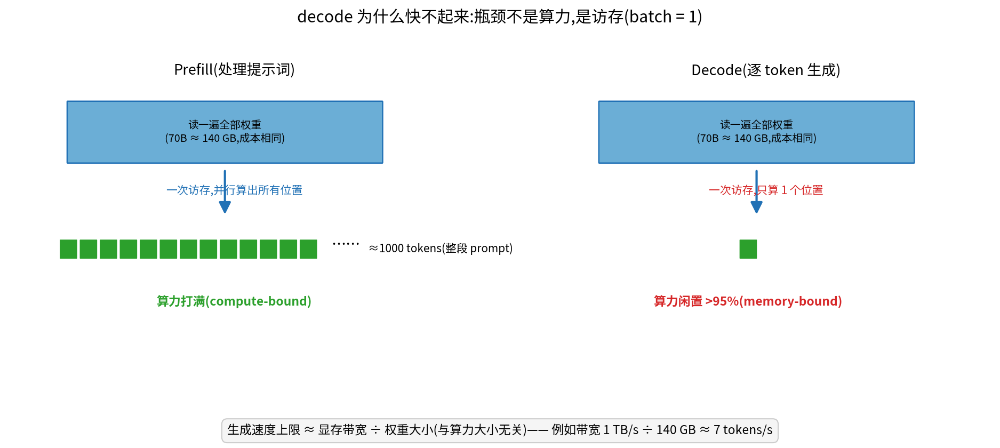
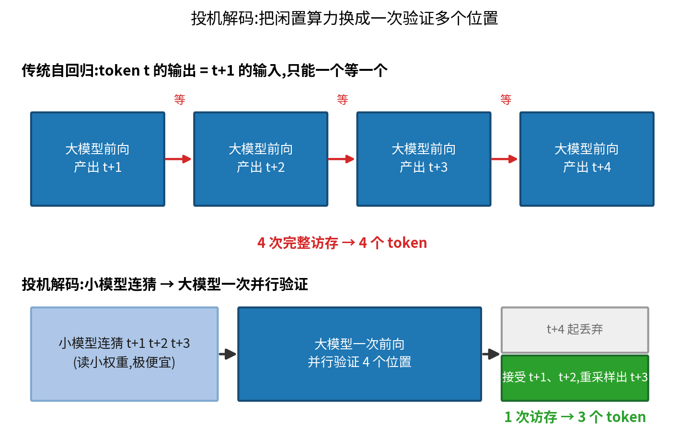
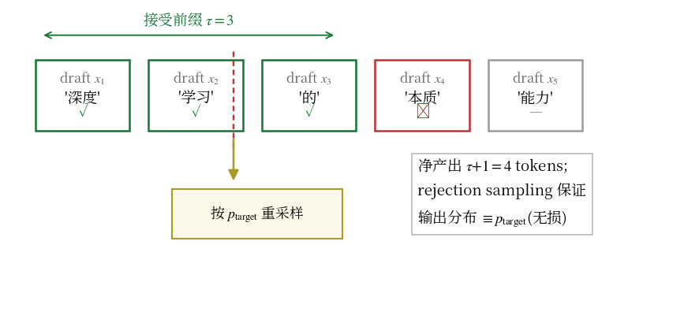
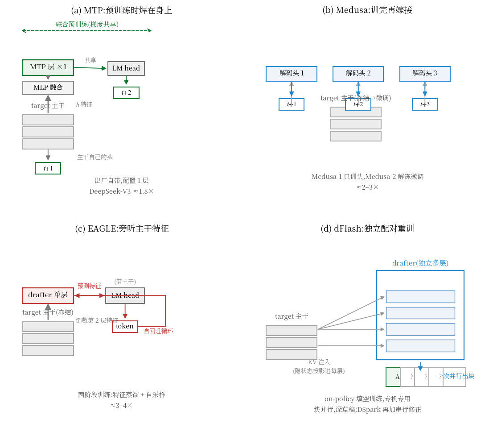
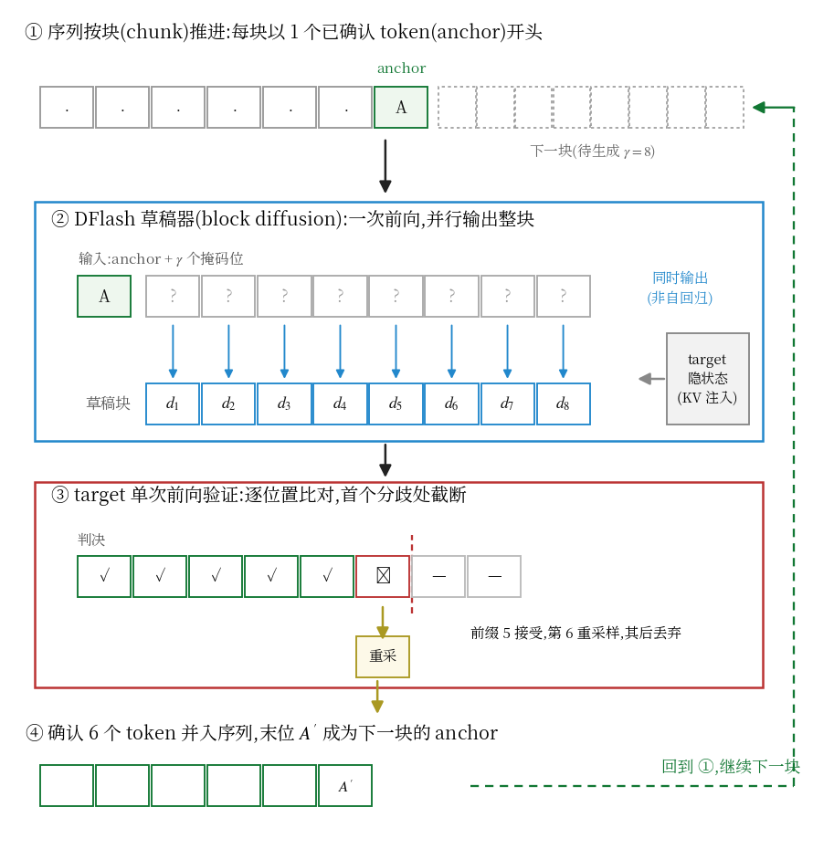
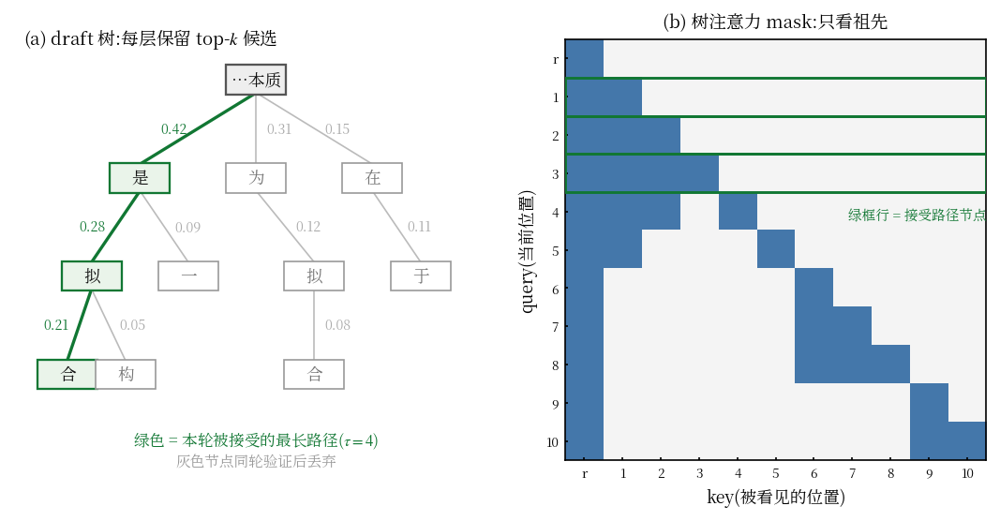
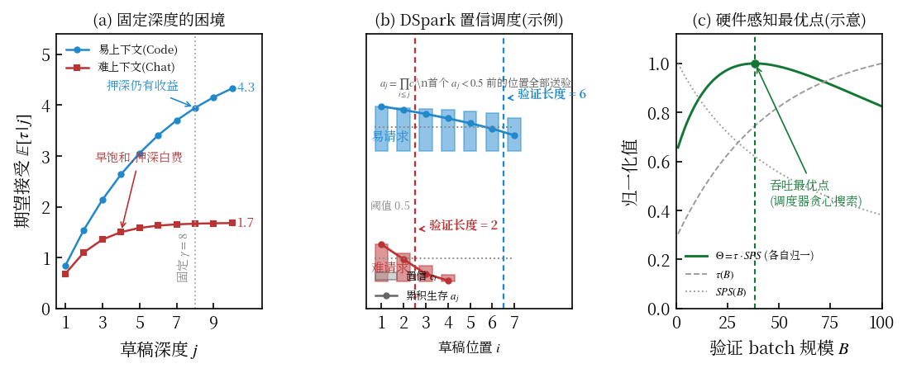
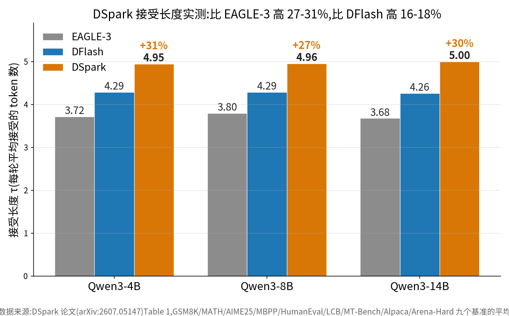
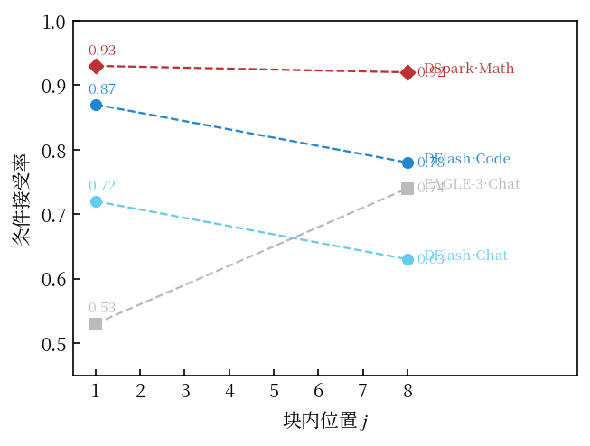
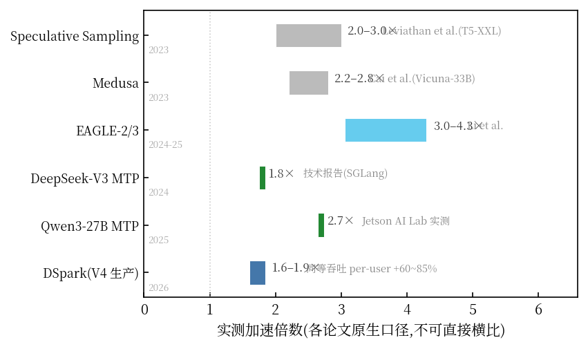

为什么 DeepSeek 能一边把模型做大、一边把价格打到地板?为什么 vLLM、SGLang 的配置文件里,speculative decoding 一栏的选项越来越多——EAGLE、MTP、DFlash、DSpark?

这些名字共享同一个内核思想:**别让大模型一次只算一个 token**。这篇文章把这个内核拆开——包括它的数学(为什么加速是免费的)、它的结构(草稿器怎么设计)、它的工程(怎么调度、怎么部署),以及 2022 到 2026 年六代方法的完整演进。所有关键结论都给出推导,所有性能数字都注明出处。

## 一、解码为什么慢:算一笔访存账

### 1.1 自回归的串行牢笼

语言模型生成文本是自回归的:第 $t+1$ 个 token 依赖第 $t$ 个的输出。设模型参数量为 $N$,生成一个 token 需要一次完整前向。前向的主要开销在哪?对 batch 大小为 1 的解码阶段,每步的计算量约为

$$\text{FLOPs}_{\text{token}} \approx 2N$$

(每个参数对应一次乘加)。而每一步都必须把全部参数从显存搬运到计算单元一次,访存量为

$$\text{Bytes}_{\text{token}} = |W| = 2N \;\text{bytes}\;(\text{fp16})$$

于是定义该过程的**算术强度**(arithmetic intensity):

$$\text{AI} = \frac{\text{FLOPs}}{\text{Bytes}} = \frac{2N}{2N} = 1 \;\text{FLOP/byte}$$

### 1.2 屋顶线:问题出在机器平衡点

一块 GPU 的**机器平衡点**为峰值算力与峰值带宽之比。以 H100(SXM)为例:

$$\frac{\text{Peak FLOPS}}{\text{Peak BW}} = \frac{989\;\text{TFLOPS}}{3.35\;\text{TB/s}} \approx 295 \;\text{FLOP/byte}$$

解码阶段的 AI = 1,比平衡点低了近 300 倍——这是教科书级的 **memory-bound**:计算单元 99% 以上时间在等数据。此时生成速度的上限由带宽决定:

$$v_{\max} = \frac{\text{Peak BW}}{|W|}$$

代个具体数字:70B 模型、fp16,权重 $|W| = 140$ GB,单卡 H100:

$$v_{\max} = \frac{3350 \;\text{GB/s}}{140 \;\text{GB}} \approx 24 \;\text{tokens/s}$$

此时算力利用率:

$$\frac{v_{\max} \cdot 2N}{\text{Peak FLOPS}} = \frac{24 \times 1.4\times 10^{11}}{9.89\times 10^{14}} \approx 0.34\%$$

**买再多的算力也没用——瓶颈是搬运,不是计算。** 这就是 batch=1 解码的处境。



注意到一个不对称:prefill(处理输入提示词)阶段一次前向要算 $L$ 个位置,FLOPs 变成 $2NL$ 而 Bytes 仍是 $|W|$,算术强度变成 $L$,直接跨过平衡点变成 compute-bound。**同一块 GPU,prefill 时算力打满,decode 时算力闲置 99%——投机解码的全部灵感,就是把这块闲置算力利用起来。**

## 二、内核:猜与验的数学

### 2.1 三步流程

投机解码由 Google 与 DeepMind 在 2022-2023 年几乎同时提出(Leviathan et al. 与 Chen et al.)。流程:

1. **draft(猜)**:用一个便宜的小模型 $q$ 连续采样 $\gamma$ 个 token $x_1,\dots,x_\gamma$;
2. **verify(验)**:大模型 $p$(target)**一次前向**并行计算位置 $t+1,\dots,t+\gamma+1$ 的条件分布;
3. **accept/reject(收)**:从前往后逐个检查,接受所有"与 $p$ 一致"的前缀 token;遇到第一个分歧,从修正分布重采样一个,丢弃其后所有草稿。

每轮一次大模型访存,平均产出 $\mathbb{E}[\tau]+1$ 个 token($\tau$ 为接受长度)。关键问题是:这样"走捷径",输出分布还等于直接用 $p$ 生成的分布吗?

### 2.2 无损性:rejection sampling 的三行证明

**命题**:设草稿 $x \sim q(\cdot)$,以概率 $\min\left(1, \frac{p(x)}{q(x)}\right)$ 接受;若拒绝,从剩余分布

$$r(x) = \frac{\max\!\big(0,\; p(x)-q(x)\big)}{\sum_{x'} \max\!\big(0,\; p(x')-q(x')\big)}$$

重采样。则最终样本严格服从 $p$。

**证明**:先算总拒绝率。注意

$$Z \triangleq \Pr(\text{reject}) = 1 - \sum_x q(x)\min\left(1,\frac{p(x)}{q(x)}\right) = \sum_x \max\big(0,\; p(x)-q(x)\big)$$

样本 $x$ 最终被产出,走的是两条互斥路径:直接接受,或全体拒绝后重采到 $x$:

$$\Pr(x) = \underbrace{\min\big(q(x),\, p(x)\big)}_{\text{直接接受}} + \underbrace{Z \cdot r(x)}_{\text{拒绝重采}}$$

分情况。当 $p(x) \ge q(x)$:有 $r(x) = \frac{p(x)-q(x)}{Z}$,于是

$$\Pr(x) = q(x) + Z\cdot\frac{p(x)-q(x)}{Z} = p(x)$$

当 $p(x) < q(x)$:有 $r(x) = 0$,于是

$$\Pr(x) = p(x) + 0 = p(x)$$

两种情况合起来覆盖全集,故 $\Pr \equiv p$。**证毕。**

这个三行证明就是"免费加速"的数学根基:无论草稿器多差($q$ 偏离 $p$ 多远),输出分布永远无损——差的草稿只影响速度,不影响正确性。

### 2.3 期望接受长度与加速比

定义逐位置**条件接受率**

$$\alpha_j = \mathbb{E}_{x_{1:j-1}}\;\mathbb{E}_{x_j \sim q}\left[\min\left(1, \frac{p(x_j\mid x_{<j})}{q(x_j\mid x_{<j})}\right)\right]$$

在独立性近似下(各位置接受互不相关),接受长度不小于 $j$ 的概率为 $\prod_{i\le j}\alpha_i$,于是

$$\mathbb{E}[\tau] = \sum_{j=1}^{\gamma}\prod_{i=1}^{j}\alpha_i \;\approx\; \frac{\alpha(1-\alpha^{\gamma})}{1-\alpha} \quad (\alpha_i \equiv \alpha)$$

加速比。设大模型一次前向耗时 $c$,小模型每 token 耗时 $\beta c$($\beta \ll 1$):

$$S = \frac{c\,(\mathbb{E}[\tau]+1)}{\gamma\beta c + c} = \frac{\mathbb{E}[\tau]+1}{1+\gamma\beta}$$

直觉立刻浮现:草稿越准($\alpha\to 1$)、越便宜($\beta\to 0$),加速越大;但 $\gamma$ 过大时 $\alpha^\gamma$ 衰减,分母却在涨——**最优深度存在内点**。第五节会回到这个最优化问题。

$$\text{例:}\;\alpha = 0.8,\;\beta = 0.02,\;\gamma = 4 \;\Rightarrow\; \mathbb{E}[\tau] \approx 2.95,\; S \approx \frac{3.95}{1.08} \approx 3.7\times$$





## 三、草稿从哪来:六代演进

验证的数学是死的,变化的是"草稿从哪来"。这一条进化线上,每一代都在改上一代的训练方式与结构。



### 3.1 第一代(2022-23):独立小模型

直接训练/挑选一个小模型当 drafter。缺陷:小模型与 $p$ 的分布对齐差($\alpha$ 低),且服务要同时驻留两个模型。原始论文在 T5-XXL 上用 T5-small 打草稿,约 2-3×。

### 3.2 第二代:Medusa(2023.09)——嫁接解码头

冻结主干,顶部嫁接 $k$ 个轻量解码头,第 $i$ 个头直接预测位置 $t+i$ 的 token(跳过中间 token)。训练目标:

$$\mathcal{L} = \sum_{i=1}^{k} \text{CE}_i + \lambda\,\mathcal{L}_{\text{conn}}$$

其中 $\mathcal{L}_{\text{conn}}$ 是 Medusa-2 联合微调时约束主干输出不漂移的连接损失。配合树注意力(第四节)验证,约 2-3×。缺陷:头与主干"不够亲"——冻结意味着头只能旁听,不能重塑主干特征。

### 3.3 第三代:EAGLE(2024)——在特征层自回归

EAGLE 的核心观察是**信息论式**的:token 是离散的、有损的,相邻 token 的映射多对一;而连续特征(hidden state)保留的信息远多于 token。于是 drafter 不猜 token,改猜**下一位置的倒数第二层特征**:

$$\tilde{h}_{t+1} = f_{\text{draft}}\big([\,h_t^{(L-1)},\; \text{Embed}(x_t)\,]\big), \qquad x_{t+1} = \text{LMhead}(\tilde h_{t+1})$$

drafter 只有单层 transformer,却因为工作在平滑的特征空间,$\alpha$ 显著高于 token 级方案。训练分两阶段:先用 target 前向收集的 $(h_t, h_{t+1})$ 对做静态蒸馏,再用 drafter 自回归采样的数据(贴近推理时的真实状态分布)训练。EAGLE-2 加动态树,EAGLE-3 改多层特征融合与对比目标,一路到 3-4×,成为 2024-25 开源社区的事实标准。

### 3.4 第四代:MTP(2024-25)——把草稿焊进预训练

前三代都是"训完再改"。MTP(Multi-Token Prediction)把多 token 预测写进预训练:Meta(Gloeckle et al., 2024.04)最初作为**训练技术**提出——强迫模型往前看 $\gamma$ 步,缓解教师强制的曝光偏差;DeepSeek-V3(2024.12)首次把它工程化为**生产级推理加速**。

结构:主干倒数第二层特征 $h^0$ 与上一 token 的 embedding 融合,过一个独立的 transformer 层,共享主干的 LM head:

$$h^{k} = \text{MTP}_k\big(\text{Proj}([h^{0},\;\text{Embed}(x)])\big)$$

预训练损失按深度加权($k$ 越深权重越低):

$$\mathcal{L} = \mathcal{L}_{\text{main}} + \lambda \sum_{k=1}^{\gamma} \frac{\gamma+1-k}{\gamma}\,\text{CE}_k$$

推理时配置一层 MTP:主头出 $t+1$、MTP 头出 $t+2$,一次验证两个位置。代入第二节的公式($\gamma=1$,$\mathbb{E}[\tau] = \alpha$):

$$S = \frac{1+\alpha}{1+\beta}, \qquad \alpha \approx 0.85\text{--}0.90 \;\Rightarrow\; S \approx 1.8\times$$

这正是 DeepSeek 官方 SGLang 部署报告的 1.8×。看起来不惊人,但代价近乎为零:无独立模型、无配对训练、显存开销可忽略。2025 年 Qwen3、GLM-4.5 等模型原生携带 MTP 权重,Jetson AI Lab 在 AGX Thor 上实测 Qwen 27B + MTP(depth 3):13 → 35 tokens/s,约 **2.7×**——投机解码从"外挂"变成了"出厂预装"。

### 3.5 第五代:dFlash(2026)——块并行,把自回归请出草稿

前四代 drafter 都是串行的:第 $i$ 个草稿依赖第 $i-1$ 的实际取值,延迟 $O(\gamma)$。dFlash(Chen, Liang & Liu, *Block Diffusion for Flash Speculative Decoding*)换成 block diffusion 的**完形填空**:

**输入**是 1 个 anchor token 加 $\gamma$ 个共享 mask 占位向量;**块内双向注意力**(mask 位置互相可见、但都不知道彼此最终取值);一次前向,全部位置同时出 token;KV 注入把 target 的多层隐状态投影进 drafter 每层作条件。伪代码:

```python
x = concat(anchor_emb, mask_emb.repeat(gamma))   # γ+1 个输入位
h = drafter(x, context=kv_inject(target_hidden)) # 块内双向注意力,一次前向
logits = lm_head(h[:, 1:])                        # γ 个位置并行出分布
d = sample(logits)                                # d_1 … d_γ 同时落地
```

延迟特性变了:$t_{\text{draft}} = O(1)$ 与 $\gamma$ 无关,于是可以放心用更深的 drafter、更大的 $\gamma$(官方推荐 depth 15)。代价是联合分布被因式分解:

$$q(x_1,\dots,x_\gamma) = \prod_{i=1}^{\gamma} q(x_i \mid x_{\le t}) \quad\text{而非}\quad \prod_i q(x_i \mid x_{\le t}, x_{t+1:i-1})$$

块内位置互相"看不见对方实际填了什么",后缀位置的草稿容易与前缀打架——这就是**后缀衰减**(第六节 R2 图:DFlash 块尾条件接受率从 0.87 掉到 0.78、Chat 从 0.72 掉到 0.63)。



训练侧(承接上一节的讨论):推理只用"1 anchor + γ 连续 mask"这一种姿势,训练必须见过多样的挖法——mask 数量、位置、块长、预填比例全部随机化(mask scheduling),并以 on-policy 方式采集 target 在语料上的隐状态与分布作监督。**便宜了推理,费在训练管线。**

### 3.6 第六代:DSpark(2026)——并行成型 + 串行修正 + 置信调度

DSpark(北大 & DeepSeek,arXiv:2607.05147)在 DFlash 骨干上打三个补丁:

1. **轻量串行头**(Markov/RNN):整块并行生成后,逐位置以前文为条件快速 refine,直接治理后缀衰减;
2. **置信头**:预测每个位置的条件接受概率 $c_{r,i}$,经顺序温度缩放(STS)校准;
3. **硬件感知调度器**:由累积生存概率 $a_{r,j}=\prod_{i\le j}c_{r,i}$ 与实测吞吐曲线联合决定每条请求的验证长度(第五节展开)。

串行头的开销仅为全轮延迟的 0.2%-1.3%,换来接受长度比 DFlash 高 16-18%、比 EAGLE-3 高 27-31%(第六节 R1 图)。

## 四、候选的组织:链、树、块

草稿的组织方式是第一个正交维度。

**链(线性)**:一条串。深度 $\gamma$ 的链全部正确概率 $\alpha^\gamma$,指数衰减。

**树**:每层保留 top-$k$ 候选扇出。一次前向并行验证整棵树的武器是**树注意力**:树中每个位置只 attend 自己的祖先路径。设树 $T$ 的节点集,对节点 $v$:

$$\text{mask}(v, u) = \mathbb{1}[u \in \text{Anc}(v) \cup \{v\}]$$

于是 $\gamma{+}1$ 条互斥路径可以摊平进一个序列一次算完。期望接受长度为"最深全对路径":

$$\mathbb{E}[\tau_{\text{tree}}] = \sum_{d\ge 1} \Pr\left(\exists\;\text{深度} \ge d\;\text{的路径全部被接受}\right)$$

同样验证预算下,树的 $\mathbb{E}[\tau]$ 远高于链——**总有一条路走得远**。谱系:

- **Medusa**:多头候选的笛卡尔积成树(TOMD 树注意力);
- **EAGLE-2**(2024.06):**动态树**——按 drafter 置信度决定扩展形状,易句浅宽、难句深窄,接受长度冲到 4.26;
- **Sequoia**(2024.02):把树形设计建成约束优化 $\max_{T}\,\mathbb{E}[\tau]\;\text{s.t.}\;|T|\le B$,用动态规划离线求解,结论是最优树**上宽下窄**。



**块**:dFlash 式整块并行,深度零延迟但有后缀衰减。2026 年的主战场正是**树系(EAGLE-3)对块系(DSpark)**的正面对决。

## 五、深度的调度:静态 $\gamma$ 与自适应

第二个正交维度:每轮押多深。

### 5.1 固定深度的次优性

接受率随上下文难度波动。用 2.3 的模型,最优 $\gamma$ 应当满足边际条件;而 $\alpha$ 本身逐上下文变化——同一个 $\gamma$ 对"中华人民共和国的首都是"(近乎确定性)太浅,对创作性文本太深。实测(锚定 DSpark 论文 Figure 2 的 Code/Chat 条件接受率):



### 5.2 自适应一族

| 方法 | 深度决策信号 | 代价 |
|---|---|---|
| SVIP(2023) | drafter 输出分布的熵 | 免训练 |
| AdaEDL(2024.10) | 熵早停,免训练免参数 | 零开销,比静态快 10-57% |
| SpecDec++(2024.05) | 训练 stopping head(最优停止问题) | 需训练 |
| DISCO(2024) | 分类器逐轮定长,分布可证不变 | 需训练 |
| Learning to Draft(2026) | 强化学习双策略协同 | 训练最重 |
| DSpark(2026) | 置信调度 + 硬件吞吐曲线 | 一个置信头 |

熵直觉:$q$ 的熵升高意味着草稿"越猜越虚",$\alpha$ 必然走低,继续押是浪费。

### 5.3 DSpark 的调度数学

DSpark 把决策推到系统层。对请求 $r$、验证长度 $j$,期望净产出为 $\big(1 + \sum_{i \le j} a_{r,i}\big)$(含重采样),引擎实测的每秒步数记 $SPS(B)$(随总 batch $B$ 增大而下降)。系统吞吐:

$$\Theta = \tau_{\text{eff}} \cdot SPS(B)$$

调度器以 $\Theta$ 为目标,贪心地为每条请求选择验证长度——高置信请求押深(生存概率 $a_{r,j}$ 缓降),低置信请求早验。生产环境(DeepSeek-V4)中,验证预算从 MTP-1 的静态 2 token 动态扩展到 4-6 token,同等吞吐下 per-user 速度提升 60-85%(V4-Flash)、57-78%(V4-Pro);80 tok/s/user 的 SLA 下系统吞吐 +51%。

## 六、实测记分牌:论文原生的数字

接受长度(每轮平均接受 token 数,DSpark 论文 Table 1,Qwen3 三个尺寸 × 九个基准平均):



后缀衰减(同论文 Figure 2,Qwen3-4B):



值得注意 EAGLE-3 的"前低后高":串行 drafter 首位置要吸收上下文、后续越来越准——与块并行的衰减正好相反,这是两条路线的本质差异在数据上的指纹。

六代方法的公开加速数字(各自论文/部署报告原生口径):



**一个必要的警告**:这些数字不可直接横比。离线低并发基准、生产同等吞吐对比、端侧实测——三种口径的基线、batch、SLA 各不相同。横比图只能看量级,不能排名次。

## 七、工程选择指南

按 Jetson AI Lab 的官方建议与生态现状:

- **模型自带 MTP 权重**(Qwen3、GLM-4.5、DeepSeek-V3/R1 系):直接开 MTP,depth 从 3 起步——零额外成本,2-3×;
- **要最广 checkpoint 生态 / 必须用 llama.cpp**:DFlash,depth 从 15 起步;
- **vLLM + 追求极限吞吐**:DSpark,depth 从 4 起步(注意目前 llama.cpp 不支持);
- **研究/自定义模型**:EAGLE-3 是最成熟的训练管线。

三条工程铁律:草稿器必须与 target 的**精确变体**配对(量化、尺寸、架构变了就要重配);接受率要在自己的真实 prompt 分布上实测;depth 不是越大越快,务必在自己的负载下调优。

## 八、总结:一条主线,四个维度

$$\underbrace{\text{猜-验内核}}_{\text{rejection sampling,无损}} \times \underbrace{\text{草稿结构}}_{\text{小模型}\to\text{头}\to\text{特征}\to\text{MTP}\to\text{块}} \times \underbrace{\text{候选组织}}_{\text{链}\to\text{树}\to\text{块}} \times \underbrace{\text{深度调度}}_{\text{静态}\to\text{自适应}}$$

- 数学上,加速是**无损的**:rejection sampling 三行证明保证输出分布恒等于大模型;
- 结构上,演进方向是**让草稿越来越懂大模型**:从旁听(冻结嫁接)到血脉相连(联合预训练)再到每层注入(独立配对);
- 组织上,从链的指数衰减,到树的"总有一条路走得远",到块的深度零延迟;
- 调度上,从全局固定 $\gamma$ 到逐请求的置信调度 + 硬件感知。

下一代故事已经在发生:Muon 等训练侧优化器与推理侧投机解码正在合流,树系与块系的对决才打到中盘。唯一确定的是那条底层公式——

$$\text{速度} = \frac{\text{闲置算力利用起来了}}{\text{访存次数省下来了}}$$

以及那个三行证明保证的承诺:**快,但不牺牲任何一个 token 的正确性。**

---

*参考:Leviathan et al. 2023《Fast Inference from Transformers via Speculative Decoding》;Chen et al. 2023《Accelerating LLM Decoding with Speculative Sampling》;Cai et al. 2024《Medusa》;Li et al. 2024《EAGLE / EAGLE-2 / EAGLE-3》;Gloeckle et al. 2024《Better & Faster LLMs via Multi-token Prediction》;DeepSeek-AI 2024《DeepSeek-V3 Technical Report》;Chen et al. 2024《Sequoia》;Cheng et al. 2026《DSpark: Confidence-Scheduled Speculative Decoding》(arXiv:2607.05147);Kai et al. 2024《AdaEDL》;Jetson AI Lab《Speculative Decoding on Jetson》*
