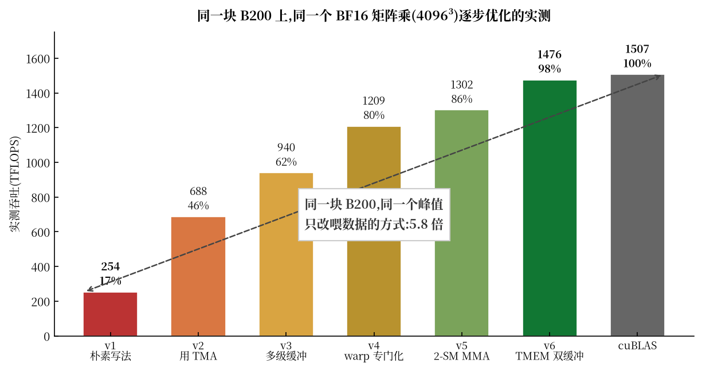
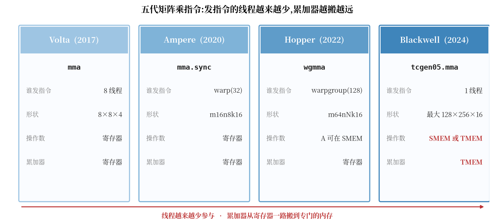
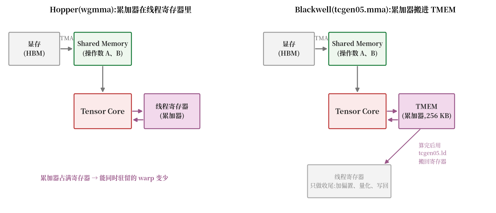
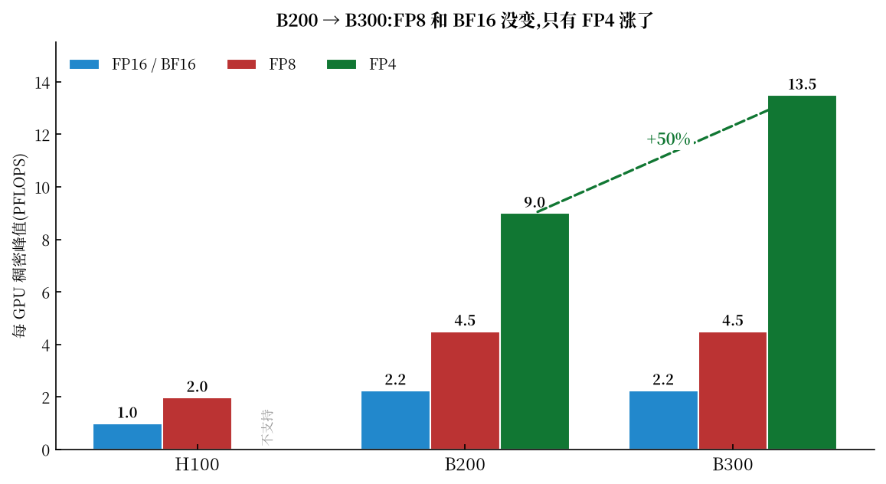
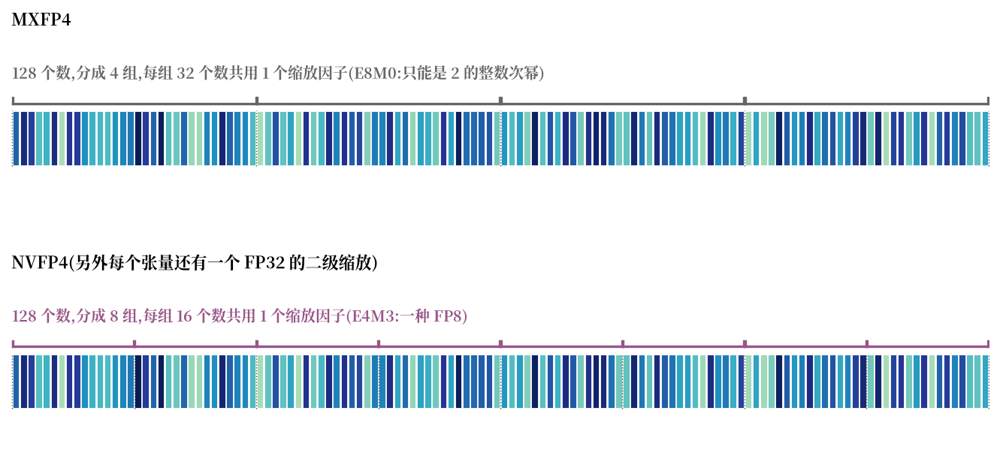

同一块 B200,同一个 BF16 矩阵乘,4096×4096。

一个人写出来是 254 TFLOPS。另一个人写出来是 1476。

差 5.8 倍。芯片是同一块,峰值是同一个数。差的全是"怎么喂它"。

这件事很多人有过直觉:同一个模型,在 H100 上调好了,搬到 B200 上得重调;在 A 卡上又是一套写法。厂商宣传的峰值算力,和自己跑出来的数,中间隔着一条沟。

这篇把这条沟量出来。讲三件事:搬数据的指令怎么一代代演进、矩阵乘指令怎么一代代演进、以及 H、B、A 三家卡的 Tensor Core 到底差在哪——最后回答"所谓适配,到底在适配什么"。

## 一、先量一下这条沟有多深

有人在一块 B200 上,把同一个 BF16 矩阵乘一步步优化,每一步都记了数(M=N=K=4096):

| 版本 | 改了什么 | TFLOPS | 占最终 |
|---|---|---|---|
| v1 | 朴素写法:每个线程自己算地址、自己搬数据 | 254 | 17% |
| v2 | 改用 TMA 搬数据 | 688 | 46% |
| v3 | 加多级缓冲,搬运和计算重叠 | 940 | 62% |
| v4 | warp 专门化:不同的 warp 干不同的活 | 1209 | 80% |
| v5 | 2-SM MMA:两个 SM 协同做一条指令 | 1302 | 86% |
| v6 | TMEM 双缓冲等 | 1476 | 98% |
| — | cuBLAS(NVIDIA 官方库) | 1507 | 100% |



**芯片没变,峰值没变,只改了"喂数据的方式",就差了 5.8 倍。**

第一步到第二步就翻了 2.7 倍——只是把"搬数据"换了一种写法。所以这篇先从搬数据讲起。

## 二、搬数据:三代指令

Tensor Core 一拍能做好几百次乘加。但数据在显存里,离计算单元很远。如果让计算线程自己去搬,搬一趟的工夫,计算单元就闲一趟。

三代指令,解决的是同一个问题的三个层次:**搬的时候别占计算线程、别让线程算地址、一次搬一整块。**

### 2.1 第一代:线程自己搬(Ampere,A100)

Ampere 引入了 `cp.async`——异步拷贝。意思是:线程发一条指令,说"把显存里这 16 个字节搬到 Shared Memory",然后不用等,可以继续干别的。数据直接从显存进 Shared Memory,**不经过寄存器**。

但它仍然是"每个线程搬自己那一份":

```
每个线程:  自己算地址 → 发一条 cp.async → 最多搬 16 字节
一个 warp(32 线程):  32 条指令,搬 512 字节
```

问题有两个。第一,一个 tile 动辄几十 KB,要发几百条指令,这些指令本身占着发射流水线——第七篇讲过,一个调度器每拍只能发一条,发几百条搬运指令的工夫,计算线程就少发几百条计算指令。第二,**每个线程要自己算地址**:这个 tile 在整个矩阵里的位置、行 stride、加上要不要 swizzle(第五篇讲过的 XOR 打散),全靠线程用整数指令算出来。

### 2.2 第二代:一个线程搬一整块(Hopper,H100/H200)

Hopper 加了 TMA(Tensor Memory Accelerator,张量存取加速器),对应指令 `cp.async.bulk.tensor`。

做法分两步。

**第一步,在主机上建一个"描述符"**(tensor map)。这是一个 128 字节的不透明结构,里面写好了:这块张量在显存的起始地址、有几个维度、每个维度的形状和步长、一次取多大的 tile、要不要 swizzle。

**第二步,在 kernel 里,一个线程发一条指令**,只给 tile 的坐标。剩下的全交给 TMA 这个硬件单元:生成所有地址、处理边界、做 swizzle、写进 Shared Memory、搬完之后更新一个计数器。

| | `cp.async`(Ampere) | TMA(Hopper) |
|---|---|---|
| 谁发指令 | 每个线程 | **一个线程** |
| 地址谁算 | 每个线程自己算 | **TMA 单元按描述符算** |
| 一次搬多少 | 每线程最多 16 字节 | **任意大小的 tile** |
| 怎么知道搬完 | `wait_group` | `mbarrier`(一个带计数的屏障) |
| 适合什么 | 小块、不规则的访问 | 大块、规整的 tile |

剩下的 127 个线程呢?彻底解放。它们不用管数据怎么来,只管算。

这就是 v1→v2 翻 2.7 倍的来源:发射流水线被腾出来了,地址计算消失了。

### 2.3 第三代:Blackwell 上 TMA 继续用,但搭档换了

Blackwell(B200/B300)没有推翻 TMA,而是给 TMA 找了个新搭档。Hopper 上 TMA 把数据搬进 Shared Memory 之后,还得有人把操作数从 Shared Memory 搬进寄存器,才能喂给矩阵乘指令。Blackwell 加了一块新的内存,让这条路更短。

这块内存叫 TMEM,下一节讲。

## 三、矩阵乘:五代指令

前面几篇讲过 Tensor Core 里是脉动阵列。但"怎么把指令发给它",每一代都不一样。主线只有一条:**让矩阵乘越来越少占用线程和寄存器。**



### 3.1 Volta(2017):8 个线程一条指令

指令 `mma`,由 8 个线程(两个 4 线程组)一起执行,形状 8×8×4。操作数要先搬进寄存器,结果也放寄存器。FP16 输入、FP32 累加。

### 3.2 Ampere(2020,A100):整个 warp

指令 `mma.sync`,形状 m16n8k16,由整个 warp(32 线程)一起执行。配了一条新指令 `ldmatrix`,专门按 Tensor Core 要的布局把数据从 Shared Memory 装进寄存器。

两个线程必须步调一致地发指令——这叫"warp 同步"。如果 warp 里有线程在等数据,其他线程也得等。

### 3.3 Hopper(2022,H100/H200):128 个线程,操作数不过寄存器了

指令 `wgmma`,由 warpgroup(4 个 warp,128 线程)一起发。形状 m64nNk16,N 最大到 256。

两个进步:**A 矩阵可以直接从 Shared Memory 读**,不用先经过寄存器了;指令是异步的,发出去就可以干别的。

但累加器还在寄存器里。一个 m64n256 的 tile,每个线程要拿几十个寄存器存累加结果。寄存器被占满,能同时驻留的 warp 就少——第七篇讲的延迟隐藏,余地就小了。

### 3.4 Blackwell(2024,B200/B300):一个线程,累加器搬家

指令 `tcgen05.mma`。这是五代里变化最大的一代,三件事同时变了:

**第一,一个线程发。** 不需要 warp 同步,不需要 warpgroup。硬件自己选出其中一个线程去发。

**第二,累加器搬进 TMEM。** TMEM(Tensor Memory,张量内存)是 Blackwell 新加的一块片上内存,每个 SM 256 KB,专门放矩阵乘的累加器。



为什么要把累加器搬出去?累加器是矩阵乘里读写最频繁的东西——每一条指令都要把它读出来、加上新结果、再写回去。放在寄存器里有两个代价:占寄存器,以及读写要挤寄存器堆的端口。

TMEM 的组织是 128 行 × 512 列,每格 32 位。按列分配,一次至少分 32 列。每个 warp 只能读自己的 32 行——所以要把整块 TMEM 读出来,需要 4 个 warp 一起干。

算完之后,累加器还在 TMEM 里,要用 `tcgen05.ld` 搬回寄存器,才能做后面的 epilogue(比如加偏置、量化、写回显存)。整个矩阵乘过程中,**线程寄存器完全不参与**。

**第三,两个 SM 一起干。** Blackwell 可以把相邻的两个 SM 配成一对,协同执行一条指令(2-SM MMA)。做法是:A 矩阵各拿一半,B 矩阵共享一份。

为什么是 B 共享?矩阵乘 C = A × B 里,A 通常是激活,B 通常是权重。两个 SM 算的是同一个 B 的不同行——B 的数据完全可以共用。共享之后,**每个 SM 需要的 Shared Memory 带宽减半**。

上面那张表里 v4→v5 的提升(1209→1302)就是它带来的。

### 3.5 五代放在一起

| 代 | 年 | 指令 | 谁发 | 形状 | 操作数 | 累加器 |
|---|---|---|---|---|---|---|
| Volta | 2017 | `mma` | 8 线程 | 8×8×4 | 寄存器 | 寄存器 |
| Ampere | 2020 | `mma.sync` | warp(32) | m16n8k16 | 寄存器(经 `ldmatrix`) | 寄存器 |
| Hopper | 2022 | `wgmma` | warpgroup(128) | m64nNk16 | A 可在 SMEM | **寄存器** |
| Blackwell | 2024 | `tcgen05.mma` | **1 线程** | 最大 128×256×16 | SMEM 或 TMEM | **TMEM** |

(Turing 介于 Volta 和 Ampere 之间,主要贡献是加了 INT8/INT4。)

看最后两列的方向:操作数离 Shared Memory 越来越近,累加器离线程寄存器越来越远。

## 四、B300 和 B200 差在哪

两颗芯片的 Tensor Core 是同一代架构。差别在配置:

| 每 GPU | H100 | B200 | B300 |
|---|---|---|---|
| FP8 dense | 2.0 PFLOPS | 4.5 PFLOPS | 4.5 PFLOPS |
| FP4 dense | 不支持 | 9 PFLOPS | **13.5 PFLOPS** |
| FP16/BF16 dense | 989 TFLOPS | 2.25 PFLOPS | 2.25 PFLOPS |
| 显存 | 80 GB | 180 GB | 262 GB |

(算力按 NVIDIA DGX 整机规格除以 8;显存是 DGX 版本的每卡容量,不是 GB200/GB300 那种和 CPU 封在一起的版本。)

B300 相对 B200,只有两项变了:**FP4 dense 多 50%,显存多 46%**。FP8 和 FP16 都没变,FP4 的稀疏模式也没变——只有稠密 FP4 提了。

所以 B300 不是"全面更快",是**专门为 FP4 推理更快**。

这 50% 从哪来,官方没有解释。有一家分析机构(SemiAnalysis)认为是 Tensor Core 在 FP4 模式下跑了更高的时钟——这是他们的推断。



## 五、H、B、A 三家卡的 Tensor Core

"H"是 Hopper,"B"是 Blackwell,"A"通常指 AMD。三家的矩阵乘单元,设计思路不同。

### 5.1 三种粒度

| | NVIDIA Hopper | NVIDIA Blackwell | AMD CDNA 4 |
|---|---|---|---|
| 指令 | `wgmma` | `tcgen05.mma` | `mfma` |
| 谁发 | warpgroup(128 线程) | **1 个线程** | wavefront(64 线程) |
| 操作数 | A 可在 SMEM | SMEM 或 TMEM | **寄存器** |
| 累加器 | 寄存器 | **TMEM** | **寄存器** |
| wavefront 大小 | 32 | 32 | **64** |
| 新精度 | FP8 | FP4、FP6 | FP4、FP6 |

AMD 的 MFMA(Matrix Fused Multiply-Add)有两个明显不同。

**第一,wavefront 是 64 个线程**,不是 NVIDIA 的 32。一条 MFMA 指令要 64 个线程一起发,操作数分布在这 64 个线程的寄存器里。

**第二,累加器和操作数都在寄存器里**。CDNA 4 没有类似 TMEM 的结构。所以 AMD 上的矩阵乘,寄存器压力比 Blackwell 大。

这不是"谁更先进",是路线不同。AMD 的 CU(Compute Unit)里,Matrix Core 直接读寄存器,路径短;NVIDIA Blackwell 多了一级 TMEM,换来的是寄存器解放。两条路各有所长。

### 5.2 AMD 的指令长什么样

CDNA 4 上的一条 FP16 矩阵乘:`32×32×8`,64 个线程一起执行。意思是这条指令算一个 32×32 的输出 tile,K 方向走 8。

CDNA 4 新加的精度:

| 输入 | 形状 | 周期 |
|---|---|---|
| FP16/BF16 | 32×32×16 | 32 |
| FP8 | 32×32×32 | 32 |
| FP6/FP4 | 32×32×64 | 32 或 64 |

看这张表能读出一件事:**同样的 32 个周期,K 方向能走多远,取决于每个数占几个比特**。FP16 是 16 比特,K 走 16;FP8 是 8 比特,K 走 32;FP6/FP4 更小,K 走 64。

这是所有低精度加速的共同原理:**矩阵乘单元每拍能搬的字节数是固定的,每个数越小,一拍能算的数就越多。** 精度减半,吞吐翻倍——不是算得更快,是一拍塞进去更多。

AMD 给出的 MI355X 峰值:FP16 2.5 PFLOPS,FP8 5 PFLOPS,FP6/FP4 各 10 PFLOPS。每降一级精度,翻一倍。

### 5.3 为什么同一个 kernel 不能直接搬

现在可以回答"为什么在 H 卡上调好的,到 B 卡要重调,到 A 卡又是另一套"了:

- **Hopper → Blackwell**:累加器从寄存器搬到 TMEM,指令从 warpgroup 发改成单线程发。写法要整个换:原来靠寄存器双缓冲的,现在要靠 TMEM 双缓冲;原来 warp 一起发指令的,现在要选出一个线程发
- **NVIDIA → AMD**:wavefront 从 32 变 64,操作数必须进寄存器,没有 TMEM,没有 TMA 的等价物(AMD 的对应机制是另外一套)。tile 大小、warp 专门化的分工都要重排

**矩阵乘的数学是一样的,但"谁持有数据、谁发指令"完全不同。** 这就是适配要解决的问题。

## 六、所谓"适配",在适配什么

你之前问过:对模型的适配是不是分两层。我理解是两层,而且这篇讲的内容正好是第一层的工具。

### 6.1 第一层:让计算单元不闲着

这一层不改数学,只改"怎么组织数据流"。前面五节讲的全是它:

- 用 TMA 搬数据,把计算线程解放出来(v1→v2)
- 多级缓冲,让搬数据和计算重叠(v2→v3)
- warp 专门化:一部分 warp 只管搬,一部分只管算,一部分只管收尾(v3→v4)
- 2-SM MMA,省 Shared Memory 带宽(v4→v5)
- TMEM 双缓冲(v5→v6)

这一层做到位,能把 17% 做到 98%。

### 6.2 第二层:降低精度

计算单元喂饱之后,下一招是**换更小的数**。

第一节那张表是 BF16。如果换成 FP8,峰值翻倍;换成 FP4,B200 上再翻倍,B300 上是 FP8 的 3 倍。所以在 B300 上,FP4 的峰值是 BF16 的 6 倍。

但 FP4 只有 16 个不同的值。直接把权重截成 FP4,模型基本就废了。所以要有缩放方案。

Blackwell 支持两种 FP4 格式:

| | MXFP4 | NVFP4 |
|---|---|---|
| 多少个数共用一个缩放因子 | 32 个 | **16 个** |
| 缩放因子的格式 | E8M0(只能是 2 的整数次幂) | **E4M3(一种 FP8)** |
| 第二级缩放 | 无 | **每个张量一个 FP32** |



NVFP4 做了两件事让它更准:**缩放粒度更细**(16 个数一组,而不是 32 个),**缩放因子本身更精**(是 FP8,不是只能翻倍的指数)。

代价是每个数平均占 4.5 比特,而不是正好 4 比特。

精度损失多大?NVIDIA 官方给的数据:DeepSeek-R1 从 FP8 量化到 NVFP4,七项评测里精度下降不到 1%。

这正好接上第八篇讲的屋顶线。decode 是内存受限的,权重从 FP16(16 比特)降到 NVFP4(平均 4.5 比特),每个 token 要读的字节数降到原来的 28%。如果瓶颈完全在显存带宽上,decode 速度就能涨到约 3.5 倍——实际能涨多少,取决于这个 kernel 有没有先做到第一层。

### 6.3 两层的顺序不能反

第一层是"把硬件喂饱",第二层是"给硬件喂更小的数"。

顺序反了会出问题:一个只跑出 17% 的 kernel,换成 FP4 也只是从 17% 的 BF16 变成 17% 的 FP4——瓶颈根本不在精度,在数据流。

**先把数据流理顺,再降精度。**

## 七、总结

四条带走:

**1. 峰值和实测之间的沟,是"喂数据"挖出来的。** 同一块 B200,朴素写法 254 TFLOPS,优化到底 1476,差 5.8 倍。第一步只改搬运方式就翻了 2.7 倍。

**2. 搬运指令三代,解决的是"谁来搬、谁算地址"。** `cp.async` 每个线程搬 16 字节、自己算地址;TMA 一个线程搬一整块,地址由硬件按描述符算。

**3. 矩阵乘五代,主线是"让线程越来越少参与"。** 执行指令的线程从 8 → 32 → 128 → 1;累加器从寄存器一路搬到 TMEM。AMD 走的是另一条路:64 线程的 wavefront,操作数和累加器都留在寄存器里。

**4. 适配分两层,顺序不能反。** 先理顺数据流把硬件喂饱(17% → 98%),再降精度(FP16 → FP8 → FP4,每级吞吐翻倍)。B300 相对 B200 只提了稠密 FP4 和显存,就是奔着第二层去的。

GPU 解剖台到这里讲了九篇。分支发散那个坑,下一篇填。

如果这个系列对你有用,点个赞或关注专栏,更新会持续。

---

*参考:gau-nernst, "tcgen05 for dummies"(B200 上 BF16 矩阵乘逐步优化的实测数据,254→1476 TFLOPS);Colfax Research, "Writing GEMM Kernels Using Tensor Memory for NVIDIA Blackwell GPUs"(TMEM 组织、tcgen05 指令、CTA pair);SemiAnalysis, "NVIDIA Tensor Core Evolution from Volta to Blackwell" 及 "Dissecting NVIDIA Blackwell Tensor Cores"(五代指令演进、2-SM MMA、SMEM 带宽);NVIDIA CUDA Programming Guide §4.13(异步拷贝、TMA、tensor map);NVIDIA DGX B200 / DGX B300 / HGX 官方规格页(峰值算力、显存);AMD CDNA 4 Architecture Whitepaper;AMD ROCm Blog, "Matrix Core Programming on CDNA 3 and CDNA 4"(MFMA 指令形状、周期数、MI355X 峰值);NVIDIA Developer Blog, "Introducing NVFP4 for Efficient and Accurate Low-Precision Inference"(NVFP4 格式与精度数据)。表中每 GPU 算力按 NVIDIA DGX 整机规格除以 8 换算,均为 dense;B300 的 FP4 提升来源为 SemiAnalysis 推断,官方未解释。*
