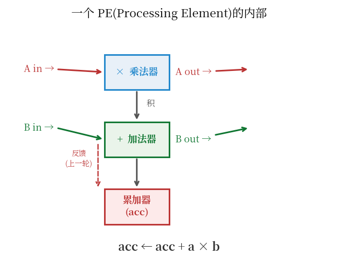
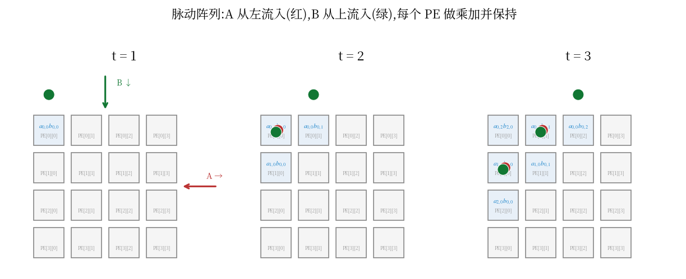
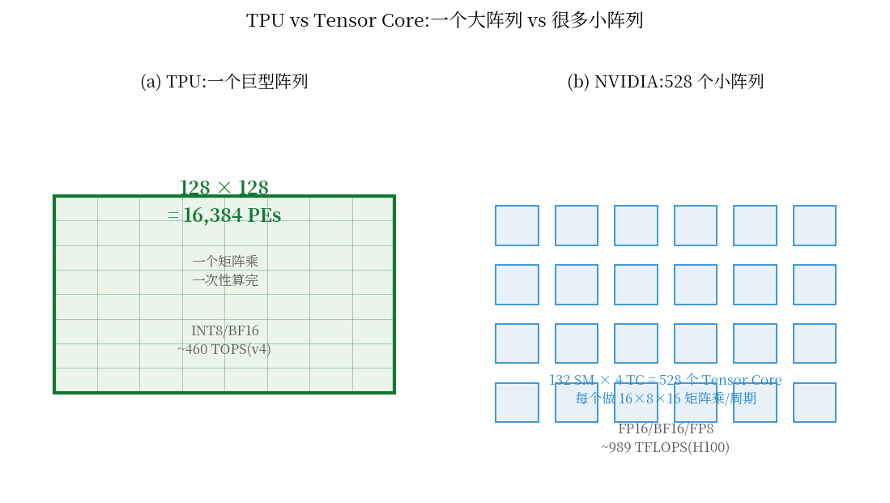

你写 `mma.sync.aligned.m16n8k16.row.col.f32.f16.f16.f32` 这行 PTX 时,一条指令,4096 FLOPS,一个时钟周期。

但硬件里到底发生了什么?

答案是**脉动阵列(systolic array)**——一个 2D 的乘加器网格,数据像血液一样流过它,每流一次就完成一次乘加。这是 GPU 里最"专用芯片"的部分,也是 989 TFLOPS 这个数字的物理来源。

这篇文章把脉动阵列拆到**每个 Processing Element 的电路级别**,再对比 Google TPU 的同类设计——两种哲学,一个目的。

## 一、问题:为什么需要专用电路

CUDA Core 一次做一次乘加(1 FMA = 2 FLOPS)。要算一个 $16 \times 8 \times 16$ 的矩阵乘 $C = A \times B$:

$$\text{FLOPs} = 2 \times 16 \times 8 \times 16 = 4096$$

用 CUDA Core 做:需要 2048 个 core 各做一次 FMA(假设完美并行)。128 个 CUDA Core 的 SM 要 **16 个周期**。

用 Tensor Core 做:**1 个周期**。

快 16 倍的代价是什么?**不能做别的**。Tensor Core 的电路只做矩阵乘——不能跑操作系统,不能做字符串匹配,不能做 if/else。这就是"专用电路"(ASIC)的极致。

## 二、什么是脉动阵列

### 2.1 命名来源

"脉动"(systolic)来自心脏学术语——**systole(收缩期)**,心脏把血液泵出去的动作。

1982 年，CMU 的 H.T. Kung(孔祥重)教授提出了这个架构:数据不是像传统冯·诺依曼架构那样"从内存读→算→写回内存",而是**在处理器阵列中流动,经过每个处理单元时被计算一次**。

(高大上的名字叫 systolic array,其实就是"让数据像血液一样流过一堆小计算器,流一遍就算完了"。)

### 2.2 核心结构:PE 网格



一个 **PE(Processing Element)** 是最小的计算单元:

$$\text{acc} \leftarrow \text{acc} + a \times b$$

就这么一个操作。乘法器算 $a \times b$,加法器把结果加到累加器上,A 和 B 继续往右/往下流给下一个 PE。

把这些 PE 排成 2D 网格,就得到脉动阵列。

### 2.3 数据怎么流:三步走



以 $4 \times 4$ 阵列算 $C = A \times B$ 为例:

**第一步:A 从左边流入**

$A$ 矩阵的第 $i$ 行元素($a_{i,0}, a_{i,1}, a_{i,2}, a_{i,3}$)依次进入第 $i$ 行的 PE。**每行错开一个周期**(对角线推进),就像游行队伍错开入场。

**第二步:B 从上面流入**

$B$ 矩阵的第 $j$ 列元素($b_{0,j}, b_{1,j}, b_{2,j}, b_{3,j}$)依次进入第 $j$ 列的 PE。同样错开。

**第三步:在每个 PE 里做乘加**

当 $a_{i,k}$ 和 $b_{k,j}$ **同时到达** PE[$i$][$j$] 时:

$$c_{ij} \leftarrow c_{ij} + a_{ik} \times b_{kj}$$

数据流过之后,**每个 PE 的累加器里就是 $C$ 矩阵的一个元素**。

### 2.4 完整 Walkthrough:用具体数字走一遍 4×4 阵列

这是本篇最重要的一节。用实际数字,一个周期一个周期地看数据怎么流过阵列。

**设定**:4×4 阵列,算 $C = A \times B$。

$$A = \begin{pmatrix} 1 & 2 & 3 & 4 \\ 5 & 6 & 7 & 8 \\ 9 & 10 & 11 & 12 \\ 13 & 14 & 15 & 16 \end{pmatrix} \quad B = \begin{pmatrix} 1 & 0 & 0 & 1 \\ 0 & 1 & 0 & 1 \\ 0 & 0 & 1 & 1 \\ 1 & 1 & 1 & 1 \end{pmatrix}$$

预期结果(心算可以验证):$C[0][0] = 1+4 = 5$,$C[0][3] = 1+2+3+4 = 10$,$C[1][1] = 6+8 = 14$。

**数据入场规则**:
- $A$ 的第 $i$ 行从左侧进入第 $i$ 行 PE,**每行延迟 $i$ 个周期**
- $B$ 的第 $j$ 列从上方进入第 $j$ 列 PE,**每列延迟 $j$ 个周期**
- 当 $a_{i,k}$ 和 $b_{k,j}$ **同时到达** PE[$i$][$j$] 时,执行 $\text{acc} += a \times b$

#### t=1(第一个周期)

只有 PE[0][0] 收到数据:
- A 侧:$a_{0,0} = 1$(第 0 行,第 0 个元素)
- B 侧:$b_{0,0} = 1$(第 0 列,第 0 个元素)
- 计算:$\text{acc}[0][0] = 0 + 1 \times 1 = \mathbf{1}$

其他所有 PE:空转,等数据。

#### t=2

对角线扩展到两个 PE:

**PE[0][1]**:
- A 侧:$a_{0,1} = 2$(第 0 行继续推进)
- B 侧:$b_{1,1} = 1$(第 1 列,第 1 个元素)
- 计算:$\text{acc}[0][1] = 0 + 2 \times 1 = \mathbf{2}$

**PE[1][0]**:
- A 侧:$a_{1,0} = 5$(第 1 行,延迟 1 周期后到达)
- B 侧:$b_{0,0} = 1$(第 0 列继续推进)
- 计算:$\text{acc}[1][0] = 0 + 5 \times 1 = \mathbf{5}$

#### t=3

**PE[0][2]**: $a_{0,2}=3$, $b_{2,2}=1$ → $\text{acc}[0][2] = 3 \times 1 = \mathbf{3}$

**PE[1][1]**: $a_{1,1}=6$, $b_{1,1}=1$ → $\text{acc}[1][1] = 0 + 6 \times 1 = \mathbf{6}$

**PE[2][0]**: $a_{2,0}=9$, $b_{0,0}=1$ → $\text{acc}[2][0] = 9 \times 1 = \mathbf{9}$

#### t=4(峰值:4 个 PE 同时计算)

**PE[0][3]**: $a_{0,3}=4$, $b_{3,3}=1$ → $\text{acc}[0][3] = 4 \times 1 = \mathbf{4}$

**PE[1][2]**: $a_{1,2}=7$, $b_{2,2}=1$ → $\text{acc}[1][2] = 7 \times 1 = \mathbf{7}$

**PE[2][1]**: $a_{2,1}=10$, $b_{1,1}=1$ → $\text{acc}[2][1] = 10 \times 1 = \mathbf{10}$

**PE[3][0]**: $a_{3,0}=13$, $b_{0,0}=1$ → $\text{acc}[3][0] = 13 \times 1 = \mathbf{13}$

#### t=5(开始第二轮乘加——K 维度的第二项)

PE[0][0] 收到第二组数据:
- A 侧:$a_{0,1} = 2$(K=1 的项)
- B 侧:$b_{1,0} = 0$
- 计算:$\text{acc}[0][0] = 1 + 2 \times 0 = \mathbf{1}$(不变,因为 $b=0$)

PE[1][1] 第二轮:
- $a_{1,2} = 7$, $b_{2,1} = 0$ → $\text{acc}[1][1] = 6 + 7 \times 0 = \mathbf{6}$

#### t=6 到 t=10:继续逐项累加

每个 PE 依次收到 K=2 和 K=3 的数据:

**PE[0][0] 的完整 4 轮**:
| 轮次 | A 值 | B 值 | 乘积 | 累加器 |
|---|---|---|---|---|
| t=1 | a₀,₀ = 1 | b₀,₀ = 1 | 1 | **1** |
| t=5 | a₀,₁ = 2 | b₁,₀ = 0 | 0 | 1 |
| t=9 | a₀,₂ = 3 | b₂,₀ = 0 | 0 | 1 |
| t=13 | a₀,₃ = 4 | b₃,₀ = 1 | 4 | **5** |

$C[0][0] = 5$ ✓

**PE[0][3] 的完整 4 轮**:
| 轮次 | A 值 | B 值 | 乘积 | 累加器 |
|---|---|---|---|---|
| t=4 | a₀,₀ = 1 | b₀,₃ = 1 | 1 | 1 |
| t=8 | a₀,₁ = 2 | b₁,₃ = 1 | 2 | 3 |
| t=12 | a₀,₂ = 3 | b₂,₃ = 1 | 3 | 6 |
| t=16 | a₀,₃ = 4 | b₃,₃ = 1 | 4 | **10** |

$C[0][3] = 1+2+3+4 = 10$ ✓

#### 最终结果(t=16 后所有 PE 的累加器)

$$C = \begin{pmatrix} 5 & 6 & 7 & 10 \\ 5 & 14 & 15 & 26 \\ 5 & 22 & 23 & 42 \\ 5 & 30 & 31 & 58 \end{pmatrix}$$

你可以用 $C[i][j] = \sum_{k=0}^{3} A[i][k] \times B[k][j]$ 验证每一个元素。

#### 观察到的规律

1. **对角线推进**:t=1 只有 1 个 PE 在算,t=4 峰值 4 个,t=16 最后一个完成
2. **流水线**:填充(filling)→ 稳态(steady state)→ 排空(draining)
3. **总时间** = $2n - 1 = 7$ 个周期(4×4 阵列,n=4)
4. **稳态吞吐**:峰值时每个 PE 每周期 1 次乘加 = 16 MAC/cycle

对于 $n \times n$ 阵列:
- 流水线填充时间:$n$ 周期
- 总时间:$2n - 1$ 周期
- 总计算量:$n^3$ 次乘加($n^2$ 个 PE × $n$ 轮)
- **效率**:$\frac{n^3}{(2n-1) \times n^2} = \frac{n}{2n-1} \approx 50\%$(含填充和排空)

阵列越大,效率越接近 50%(填充/排空的占比越小)。TPU 的 128×128 阵列效率约 $\frac{128}{255} \approx 50.2\%$。

阵列越大,流水线填充时间越长,但**稳态吞吐是每个周期每个 PE 都在算**——不浪费。

### 2.5 关键优势:数据复用

一个 $n \times n$ 脉动阵列算 $n \times n$ 矩阵乘:
- 每个输入元素只从外部**读入一次**
- 但它**流过 $n$ 个 PE**,被使用 $n$ 次
- 总外部读取:$3n^2$(读 A、B,写 C)
- 总计算量:$2n^3$ FLOPs
- **计算访存比 = $\frac{2n^3}{3n^2} = \frac{2n}{3}$**

$n = 128$ 时:计算访存比 = 85.3 FLOPs/Byte——**远超 HBM 能供给的带宽**。这就是为什么矩阵乘可以打满 Tensor Core:数据在阵列内部被高度复用,不需要反复访问内存。

## 三、Tensor Core:NVIDIA 的实现

### 3.1 mma.sync 指令

第四代 Tensor Core(Hopper)的矩阵乘指令:

```
mma.sync.aligned.m16n8k16.row.col.f32.f16.f16.f32
       │       │      │    │   │   │   │   │  └─ D 矩阵格式(FP32)
       │       │      │    │   │   │   │   └──── C 矩阵格式(FP32)
       │       │      │    │   │   │   └──────── B 格式(FP16)
       │       │      │    │   │   └──────────── A 格式(FP16)
       │       │      │    │   └──────────────── 输出格式(FP32)
       │       │      │    └──────────────────── 布局(row-major A, col-major B)
       │       │      └───────────────────────── K = 16(内部维度)
       │       └──────────────────────────────── N = 8(B 的列数)
       └──────────────────────────────────────── M = 16(A 的行数)
```

含义:$D_{[16 \times 8]} = A_{[16 \times 16]} \times B_{[16 \times 8]} + C_{[16 \times 8]}$

一次指令 = $2 \times 16 \times 8 \times 16 = 4096$ FLOPS。

### 3.2 硬件映射

Tensor Core 内部是一个小脉动阵列(或多个并行的小阵列)。NVIDIA 没有公开确切尺寸,但从指令格式可以推断:

- $M=16, N=8$ → 输出矩阵 $16 \times 8 = 128$ 个元素 → 至少 128 个 PE
- $K=16$ → 每个输出元素需要 16 次乘加 → 阵列深度 16 级
- 布局:可能是 $16 \times 8$ 的 2D 阵列,K 维通过多拍完成

### 3.3 吞吐数学

一个 SM 有 4 个 Tensor Core,每个第四代 TC 在 FP16 下提供 **512 FLOPS/cycle**:

$$\text{SM TC} = 4 \times 512 = 2048\ \text{FLOPS/cycle}$$

$$\text{GPU} = 132 \times 2048 \times 1.755\text{ GHz} \approx 474\ \text{TFLOPS}$$

加上稀疏化(50% 稀疏):$474 \times 2 = 948 \approx 989$ TFLOPS(H100 的标称 FP16 稀疏峰值)。

### 3.3b 数据怎么到 Tensor Core:warp 级碎片化

Tensor Core 的输入不在 Shared Memory 里,而在 **warp 的寄存器**里。一个 warp(32 个线程)必须把 $A_{[16 \times 16]}$ 和 $B_{[16 \times 8]}$ 分布到自己的寄存器中,然后调用 `mma.sync`。

**这是最复杂的部分**。具体布局(m16n8k16,FP16):

A 矩阵(16×16 = 256 个元素)分配给 32 个线程:
- 每个线程拿到 8 个 FP16 元素 = 4 个 32-bit 寄存器
- 布局:每个线程负责 2 行 × 4 列的区域

B 矩阵(16×8 = 128 个元素)分配给 32 个线程:
- 每个线程拿到 4 个 FP16 元素 = 2 个 32-bit 寄存器

```
线程 0: A[0][0:3], A[1][0:3]     B[0][0:1], B[1][0:1]
线程 1: A[0][4:7], A[1][4:7]     B[0][2:3], B[1][2:3]
线程 2: A[0][8:11], A[1][8:11]   B[0][4:5], B[1][4:5]
...
线程 16: A[8][0:3], A[9][0:3]    B[8][0:1], B[9][0:1]
...
```

PTX 里用 `ldmatrix` 指令从 Shared Memory 加载这种碎片化布局:

```ptx
// 从 Shared Memory 加载 A 的一个 8×8 fragment 到寄存器
ldmatrix.sync.aligned.m8n8.x4.shared.b16
    {%r0, %r1, %r2, %r3}, [%rs_addr];
```

`ldmatrix` 一次操作从 Shared Memory 读取一个 8×8 的 FP16 矩阵块,按 Tensor Core 要求的碎片布局分配到 warp 的 32 个线程的寄存器中。

**为什么这么复杂?** 因为 Tensor Core 的硬件设计(脉动阵列)要求输入数据以**特定物理布局**到达——不是随意的矩阵格式,而是和阵列的 PE 连线一一对应。`ldmatrix` 就是编译器和硬件之间的"数据搬运协议"。

### 3.3c 完整 PTX 序列:一次 mma.sync 的前后

以下是 Hopper 上执行一次 $16 \times 8 \times 16$ 矩阵乘的完整 PTX 序列(简化):

```ptx
// 1. 从 Shared Memory 加载 A fragment(16×16 FP16)
ldmatrix.sync.aligned.m8n8.x4.shared.b16 {%f0, %f1, %f2, %f3}, [%rs_A];

// 2. 从 Shared Memory 加载 B fragment(16×8 FP16)
ldmatrix.sync.aligned.m8n8.x2.shared.b16 {%f4, %f5}, [%rs_B];

// 3. 初始化 C fragment(16×8 FP32, 4 个寄存器/线程)
// (或者从上一轮的累加器继续)

// 4. 执行矩阵乘:1 条指令,4096 FLOPS
mma.sync.aligned.m16n8k16.row.col.f32.f16.f16.f32
    {%f6, %f7, %f8, %f9},    // D: 输出 16×8 FP32
    {%f0, %f1, %f2, %f3},    // A: 输入 16×16 FP16
    {%f4, %f5},              // B: 输入 16×8 FP16
    {%f6, %f7, %f8, %f9};    // C: 累加器(初始或上一轮)
```

**注意步骤 4**:一条 `mma.sync` 指令的输入和输出**都在寄存器里**,不访问 Shared Memory。这就是为什么 Tensor Core 能做到 1 周期完成——数据已经在旁边,不需要等内存。

一个完整的 GEMM kernel 内循环:
1. `ldmatrix` 加载 A tile → 2. `ldmatrix` 加载 B tile → 3. `mma.sync` 计算 → 重复 K/TILE 次
4. 最后把累加器 `st.global` 写回 HBM

### 3.4 一个 CUDA Core 的对比

| | CUDA Core(1 个) | Tensor Core(1 个) | 倍差 |
|---|---|---|---|
| 操作 | c = a × b + c(标量) | C = A × B + C(矩阵) | — |
| FLOPS/cycle | 2 | **512** | **256×** |
| 面积 | ~0.1 mm² | ~0.8 mm² | 8× |
| 面积效率 | 20 FLOPS/mm² | **640 FLOPS/mm²** | **32×** |

**单位面积的算力,Tensor Core 是 CUDA Core 的 32 倍**。这就是为什么 GPU 里的 Tensor Core 越来越多、CUDA Core 比例越来越少。

## 四、Google TPU:脉动阵列的另一种玩法



Google TPU(Tensor Processing Unit)比 NVIDIA Tensor Core 更早采用脉动阵列,但设计哲学完全不同:

### 4.1 TPU 的架构

| | TPU v1(2016) | TPU v4(2021) | H100 Tensor Core |
|---|---|---|---|
| 阵列大小 | **256×256**(65,536 PE) | **128×128**(16,384 PE) | 多个 ~16×8 小阵列 |
| 每芯片阵列数 | 1 个 | 2 个 | **528 个** |
| 精度 | INT8 | BF16 | FP16/FP8/INT8 |
| 峰值 | 92 TOPS | 275 BFLOPS* | 989 TFLOPS |
| 可编程性 | 极低(编译器驱动) | 低 | **高(CUDA/Triton)** |
| 通用计算 | 不能 | 不能 | **可以(同 SM 混合)** |

*TPU v4 标称值,实测因工作负载而异

### 4.2 大阵列 vs 小阵列的 trade-off

**TPU 的巨型阵列(128×128):**

优势:
- **计算访存比更高**:$\frac{2 \times 128}{3} = 85.3$ FLOPs/Byte,数据复用极好
- 适合**大矩阵**:一次吃一个 $128 \times 128$ 块,吞吐拉满

劣势:
- 小矩阵浪费:如果你的矩阵只有 $8 \times 8$,128×128 的阵列 99% 的 PE 在空转
- 灵活性差:只能做矩阵乘,不能做别的
- 需要专用编译器(XLA)来填充阵列

**NVIDIA 的小阵列(16×8,大量复制):**

优势:
- **灵活性**:小矩阵也可以用 1 个 TC 算,大矩阵拆成小块分给多个 TC
- 与 CUDA Core 共存:同一个 kernel 里可以混用 Tensor Core(矩阵乘)和 CUDA Core(激活函数)
- 可编程性高:CUDA/Triton 直接调用

劣势:
- 计算访存比低一些:小阵列的数据复用不如大阵列
- 需要更多的 Shared Memory 协调(把数据搬到 TC 旁边)

### 4.2b TPU 的 MXU 具体怎么工作

TPU 的矩阵乘单元叫 **MXU(Matrix Multiply Unit)**。以 TPU v1 为例(256×256):

**输入**:一个 256×256 的 weight 矩阵(提前从 HBM 加载到 Weight FIFO)

**流过**:activation 矩阵(256×N)从左侧流入,每个周期流入一列

**输出**:每 256 个周期,MXU 输出一列结果

**TPU 编译器(XLA)的任务**:把用户的任意大小矩阵乘**切分**成 256×256 的块,填满 MXU。如果你的矩阵是 8×8,XLA 会用 padding 填充到 256×256——**99.9% 的 PE 在算零**。

这就是 TPU 和 Tensor Core 最大的实际差异:

| 场景 | TPU(1 个 256×256 MXU) | NVIDIA(528 个 16×8 TC) |
|---|---|---|
| 大矩阵(4096×4096) | 拆成 16×16 块,MXU 满载 | 拆成 256×512 块,分给 528 个 TC |
| 小矩阵(8×8) | padding 到 256×256,**浪费 99.9%** | 1 个 TC 就够,**其他 527 个空闲** |
| 混合(矩阵乘+激活函数) | 只能矩阵乘,激活函数在别的单元 | 同一个 SM 里 CUDA Core 做激活 |

### 4.3 历史渊源

有趣的时间线:

1. **2015**:Google 开始部署 TPU v1(内部使用),基于脉动阵列,用于搜索排序
2. **2016**:TPU 论文发表(ISCA 2017),脉动阵列引起学术界关注
3. **2017**:NVIDIA 发布 V100,第一代 Tensor Core——**受 TPU 启发,但走了小阵列+高可编程性的路线**
4. **2020**:TPU v4,BF16,128×128 阵列
5. **2022**:H100,第四代 Tensor Core,支持 FP8
6. **2024**:B200,第五代,支持 FP4
7. **2026**:GB200,Tensor Core 持续进化

Google 证明了脉动阵列是做矩阵乘的正确架构;NVIDIA 证明了它可以**嵌入通用 GPU**,而不是做成专用芯片。

## 五、从 CUDA 代码到 Tensor Core:完整的调用链

你在 PyTorch 里写 `torch.matmul(A, B)` 时,经过的完整链路:

```
PyTorch: torch.matmul(A, B)
    ↓
ATen → cuBLAS(或 CUTLASS / Triton)
    ↓
CUDA kernel: tiled + Tensor Core 调用
    ↓
PTX: mma.sync.aligned.m16n8k16.row.col.f32.f16.f16.f32
    ↓
硬件: 4 个 Tensor Core 中的某个,内部脉动阵列
    ↓
PE[0][0]: acc += a[0][k] × b[k][0]
PE[0][1]: acc += a[0][k] × b[k][1]
...     (128 个 PE 同时计算)
PE[15][7]: acc += a[15][k] × b[k][7]
    ↓ (16 个 K 步后)
结果: C[16][8] 矩阵块
```

每一步都是上一篇 Shared Memory 的 tiling + 这一篇的脉动阵列,编译器(或 cuBLAS 工程师)把它们串起来。

## 六、性能极限:为什么不是无限快

Tensor Core 的理论峰值(989 TFLOPS)永远跑不满,因为:

1. **数据供给不上**:HBM 带宽 3.35 TB/s,平衡点 AI = 295 FLOPs/Byte。需要 Shared Memory tiling 来复用数据
2. **Shared Memory 带宽**:每个 SM 的 Shared Memory 读带宽有限(~128 B/cycle),如果 tiling 不够,TC 在等数据
3. **Warp 调度延迟**:warp 发出 mma.sync 后需要等结果(几周期延迟),调度器需要切换到其他 warp
4. **通信开销**:多 GPU 训练时,AllReduce 的通信时间和计算时间竞争

这就是 MFU(Model FLOPs Utilization)永远在 30-50% 的物理原因。

## 七、下一代:更密的阵列、更低的精度

Tensor Core 的进化方向:

| 代 | 架构 | 新增精度 | mma 尺寸 | 备注 |
|---|---|---|---|---|
| 1st | Volta(2017) | FP16 | m4n4k4 | 首代,实验性 |
| 2nd | Turing(2018) | INT8/INT4 | m8n8k4 | 加速推理 |
| 3rd | Ampere(2020) | TF32/BF64 | m16n8k16 | 主力训练 |
| 4th | Hopper(2022) | **FP8** | m16n8k16 | Transformer Engine |
| 5th | Blackwell(2024) | **FP4** | 更大 | 双倍 TC 密度 |

趋势明确:**精度越来越低,阵列越来越密,吞吐越来越高**。FP4 的乘法器面积只有 FP16 的 1/4——同样面积可以塞 4 倍。

## 八、总结

脉动阵列的本质:**把"读数据→算→写回"变成"数据流过一串计算器"**。

$$\text{traditional: } \text{read} \to \text{compute} \to \text{write} \qquad \text{systolic: } \text{read once} \to \text{flow through } n\text{ PEs} \to \text{write once}$$

这就是为什么 Tensor Core 能在单位面积上比 CUDA Core 快 32 倍——不是因为电路更"聪明",而是因为**数据在硬件内部被复用了更多次**。

下次看到 H100 的 989 TFLOPS,你脑子里应该浮现的是:132 个 SM,每个里面有 4 个 Tensor Core,每个 TC 内部是一个小脉动阵列——**528 个微型矩阵乘工厂**,每个都在以 1.755 GHz 的频率,每周期吞吐 512 FLOPS。

它们不思考、不判断、不做 if/else。它们只做一件事:乘法,加法,累加。但做得够多、够快,就变成了智能。

---

*参考:H.T. Kung & C.E. Leiserson,"Systolic Arrays(for VLSI)",1978(原始论文);Jouppi et al.,"In-Datacenter Performance Analysis of a TPU v1",ISCA 2017;NVIDIA Hopper White Paper;NVIDIA CUDA Programming Guide(mma.sync PTX 指令);Tillet et al.,"Triton: An Intermediate Language for Tiled Neural Network Computation",MAPL 2019。H100 数据:132 SM × 4 TC × 512 FLOPS/cycle × 1.755 GHz ≈ 474 TFLOPS dense FP16。*
