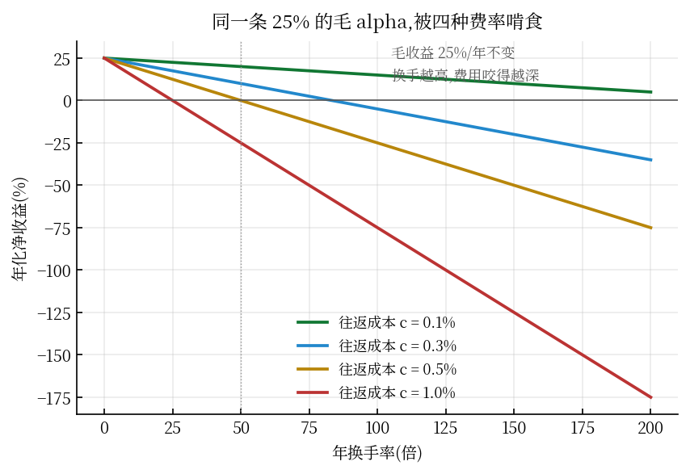
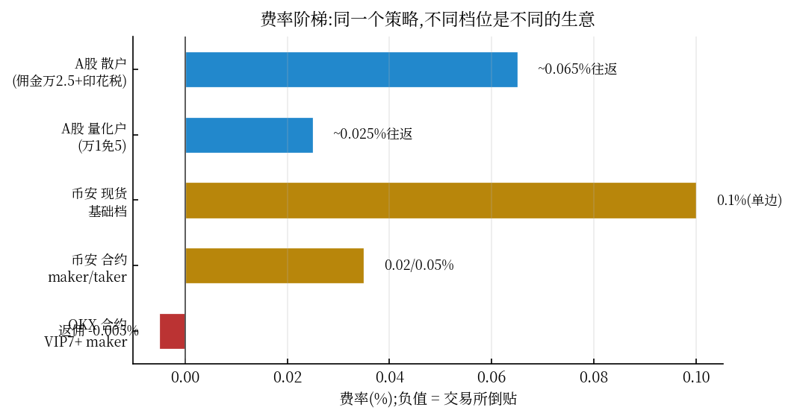
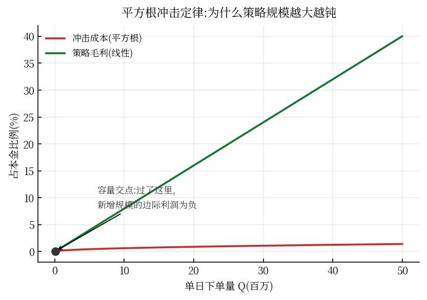

*(本文不构成投资建议;所有费率为公开信息,以各平台官网实时页面为准。)*

很多写量化策略的人,都经历过同一种懵:回测曲线一路向上,年化 25%,夏普 2.5;接上实盘,三个月,亏了 5%。

模型没变,数据没变,市场也没变。

变的是什么?**每一笔交易,你都要付费。**而费用和你交易得越频繁,关系越铁。

这篇文章讲清楚:费用怎么构成、怎么把一条好曲线啃到负数、以及实战里怎么活下去。查资料查到的费率全部标注来源,数学全部可复算。

## 一、费用的完整解剖:三层显性,三层隐性

每笔交易的成本分两块。看得见的:

| 项目 | A 股(2026) | 加密(币安/OKX 基础档) |
|---|---|---|
| 佣金 | 万 2.5~万 3(散户),量化户可谈**万 1 免 5** | 现货 0.10% 单边 |
| 印花税 | **0.05%,仅卖出单边**(2023.8 减半延续至今) | 无 |
| 过户费 | 0.001‰ 双边 | 无 |
| 合约费率 | — | taker 0.05% / **maker 0.02%** |

看不见的(通常更大):

- **价差 spread**:挂单价和吃单价之间那道缝,一进一出,白亏半个到一个 spread
- **滑点 slippage**:你的信号价和最终成交价之间的差——行情比你下手快
- **冲击成本 impact**:你自己的单子把价格打了动——**规模的专属敌人**,第五节专门收拾它

显性费用谈得清、算得明;隐性费用才是回测和实盘差距的主力。

## 二、核心数学:换手率是费用的放大器

一条公式决定生死:

$$\text{Net} \approx \text{Gross} - \text{Turnover} \times c$$

年化净收益 ≈ 年化毛收益 − 年换手率 × 往返成本。

数字说话。设往返成本 c = 0.3%(中频策略的典型水平:佣金 + 半个价差 + 一点滑点):

| 频段 | 年换手 | 年费用损耗 | 25% 毛收益还剩 |
|---|---|---|---|
| 月调仓 | 4× | 1.2% | **23.8%**(几乎无害) |
| 周调仓 | 20× | 6% | 19% |
| 日内(日) | 100× | 30% | **-5%**(回测天堂,实盘地狱) |
| 高频 | 万× | 3000% | 只有负费率能活 |

**每笔判据**(实战更好用):每笔净 edge = 每笔毛 edge − 每笔成本。日均 10 笔、毛 edge 0.1%、成本 0.05% → 净 0.5%/天;成本 0.15% → **每笔净负,越勤快越亏**。

(换高大上的名字说就是:策略的 implementation cost frontier 必须整体压在 per-trade alpha 之下——听着唬人,意思就是每笔赚的得够付每笔费的。)

## 三、为什么高频全靠 maker:费率阶梯的生意

看一组实测费率阶梯(公开信息):

关键分野在 **taker 与 maker**:

- **taker(吃单)**:你主动吃掉挂着的单,立刻成交,付高费(合约 0.05%)
- **maker(挂单)**:你把单挂在簿子上等别人来吃,提供流动性,**费率低得多**(合约 0.02%),高等级甚至是**负的**——OKX VIP7+ 挂单成交,交易所倒贴你约 0.005%;币安的流动性提供者计划提供 0 maker + 业绩返佣

高频策略每笔 edge 薄如纸(0.01~0.05%),taker 费直接判死刑——**maker-only 是生存底线**。这也是为什么专业量化团队费率谈判是正经工程活:高换手下,费率每降 0.01% 都是纯利。

## 四、执行:把一笔大单拆碎喂给市场

中频策略的隐藏功课是**执行算法**。Almgren-Chriss 框架(最优执行的经典模型)的核心权衡:

> **拆得快,冲击大;拆得慢,行情风险大。**最优执行在这两者之间找平衡——风险厌恶低就是 TWAP(均匀切),厌恶高就前倾(先大后小)。

实战三条:

1. **VWAP/TWAP 切单**:大单切成小片,跟随成交量分布喂入
2. **参与率上限**:单量控制在市场成交量的 5~10% 以内(POV)
3. **衡量用 implementation shortfall**:决策价 − 实际成交均价。这是你真实成本的天值,回测里的费率假设只是估计

## 五、规模的敌人:平方根冲击定律

费用最后一层,也是策略容量的天花板。市场微观结构研究(Almgren 2005;Bouchaud 等的实证综述)给出了惊人稳定的经验公式——**平方根定律**:

$$\text{Impact} \approx Y \cdot \sigma \cdot \sqrt{\frac{Q}{V}}$$

- σ:标的日波动率
- Q:你的下单量
- V:市场日成交量
- Y:经验系数,实证约在 0.5~1.5

直觉:单量翻 4 倍,冲击只翻 2 倍——**比你想象的好;但冲击随规模超线性增长,而策略收益随规模线性增长,两者必有一个交点。**

交点右侧,每多一块钱管理规模,边际成本超过边际收益。这就是为什么:

- 好策略天然有**容量上限**,规模是收益的敌人
- 私募会**主动封盘**——不是装,是数学
- 同一个策略,管 1000 万和管 10 亿是两个策略

## 六、实战清单

1. **回测必含费用,宁高勿低**——零费用回测是自欺;费率假设敏感性测试(±50%)是必修课
2. **先算每笔成本,再谈每笔 edge**——fee-aware alpha,开发阶段就把成本放进目标函数
3. **maker 化 + 费率工程**:能挂单不吃单;VIP 等级、BNB 抵扣、返佣计划都算真金白银
4. **控参与率**:单量 ≤ 成交量 5~10%,冲击成本才可控
5. **盯实盘 implementation shortfall**,和回测假设对账——差距大就是执行层有 bug 或市场变了
6. **容量意识**:规模涨,冲击按平方根涨;alpha 摊薄,冲击放大,双杀

## 七、尾声

量化策略的竞争,一半在模型,一半在**成本端的抠**。模型赚的是毛利,费用决定净利——这个行业的分工其实很直白:研究员管分子,执行和费率管分母。

下次看到一条漂亮回测曲线,第一反应不是看年化,是看换手率——**先问它每笔付多少钱,再问它每笔赚多少钱**。

回测是理想,费用是地心引力。飞不飞得起来,取决于你有没有把引力算进去。

---

*信源:A 股印花税/佣金水平(财政部 2023.28 公告延续;百度股市通/新浪财经 2026 年汇总);币安/OKX 费率与返佣(官方费率页,2026.11);Almgren et al. 2005《Direct Estimation of Equity Market Impact》;Almgren & Chriss 2001 最优执行框架;Bouchaud et al. 平方根冲击定律实证综述。本文数字均可按文中公式复算。*
