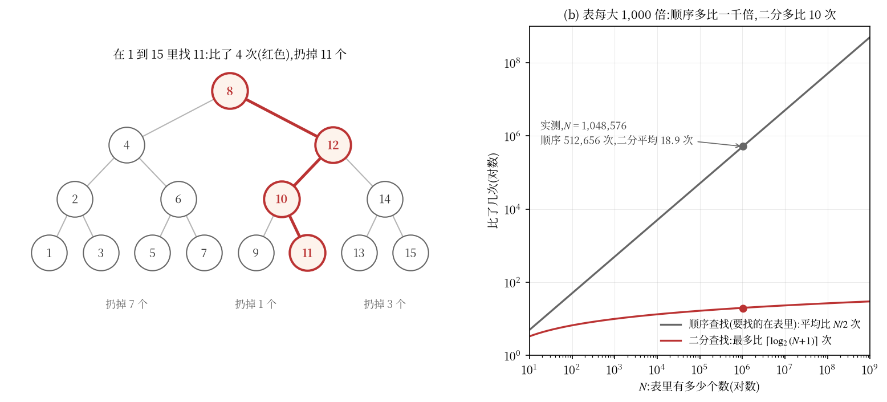
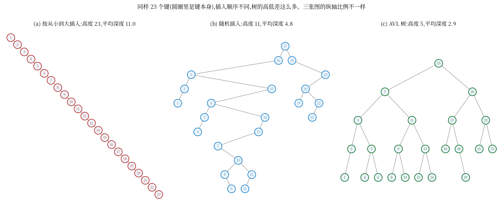
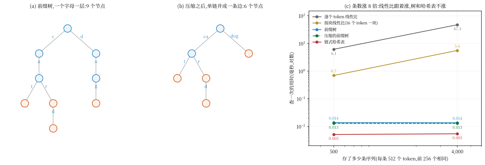
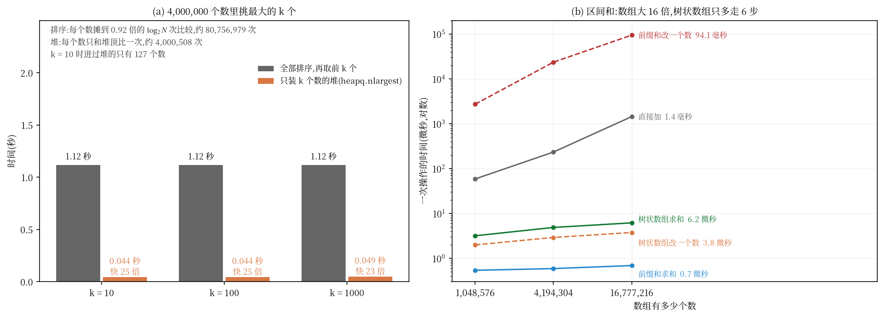
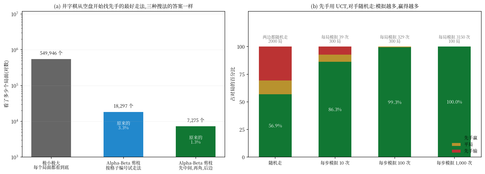

面试里问到树,常见的回答是"时间复杂度 log n"。追问一句为什么是 log n,前缀树为什么不是 log n,kd 树为什么到了高维就不灵,不少人就卡住了。

这些问题背后是同一件事:一次搜索快不快,看每走一步能扔掉多少。树只是把"扔掉"排成了一条路。

这篇按六种问法讲:找一个确切的值,找开头相同的一段,找最大的几个,找一段的和,找最近的,在博弈里找最好的一步。每一种都先看朴素做法慢在哪,再看树怎么做,最后在一台 CPU 服务器上量一遍。

## 一、找一个确切的值:从挨个看,到每次扔掉一半

先看最朴素的做法。1,048,576 个互不相同的整数排好序,要找的数在表里,从头挨个比。实测平均比 512,656 次,47.7 毫秒。要找的数不在表里,要把 1,048,576 个全比完,104.3 毫秒。

二分查找:先看中间那个,比它小就只看左半边,比它大就只看右半边。同样的表,平均比 18.9 次,3.3 微秒。快了 14,647 倍。



左图是 15 个键里找 11 的过程。二分查找其实是在一棵看不见的二叉树上走:第一个看的中间数是根,两个半边是左右子树。每比一次扔掉一半,走 4 步,扔掉 11 个。

把"扔掉一半"写成式子。$N$ 个键,比 $k$ 次之后最多还剩 $N/2^k$ 个。剩到 1 个就找到了:

$$k = \lceil \log_2 (N+1) \rceil$$

表每大 1,000 倍,只多比 10 次。实测 1 千个键平均比 9 次,100 万个 19 次,10 亿个 29 次,1 万亿个 39 次。

Python 标准库的 bisect 就是这几行:

```python
    if key is None:
        while lo < hi:
            mid = (lo + hi) // 2
            if a[mid] < x:
                lo = mid + 1
            else:
                hi = mid
```

`bisect.py:93`,Python 3.12.4。在 1,677 万个元素的列表上,每找一次 1.7 微秒。

打个比方,猜数字。1 到 15 里想一个数,每次对方说"大了"还是"小了",你就扔掉一半。四次一定猜中。

## 二、把二分存下来:二叉搜索树,和它长歪的理由

排好序的数组有个麻烦:往中间插一个数,后面的都要往后挪。二叉搜索树把顺序直接存成树的形状:每个节点左边的都比它小,右边的都比它大。查找从根往下走,每步扔掉一边。插入也走同一条路,到了空位挂上。

问题出在树的形状。实测 65,536 个键:

| 怎么插入 | 高度 | 平均深度 | 插入时一共比了几次 |
|---|---|---|---|
| 按从小到大 | 65,536 | 32,767.5 | 2,147,450,880 |
| 随机顺序 | 37 | 19.75 | 1,294,407 |
| AVL 树,随机顺序 | 20 | 14.39 | 974,382 |
| AVL 树,按从小到大 | 17 | 14.00 | 983,041 |

按从小到大插入,每个新键都比前面所有的大,一路挂到最右下。树成了一条链,查找又退化成挨个看。

随机插入的树高低不齐,平均深度 19.75。它比理想的 $\log_2 N = 16$ 高两成多。理论上这个平均深度和 $2 \ln N$ 成正比,大约是理想值的 1.39 倍;这里 $2 \ln N$ 算出来是 22.18。



AVL 树不许树长歪。它的规矩只有一条:每个节点左右两边的高度差不能超过 1,超了就转一下。1962 年 Adelson-Velskii 和 Landis 提出来,是最早的自平衡树。

实测 AVL 树不管按什么顺序插入,高度都在 17 到 20,平均深度 14。按从小到大插入时转了 65,519 次,差不多每个键一次。

```python
def avl_insert(n, k, cnt, rot):
    """AVL 树的插入:两边的高度差到 2 就转一下。返回新的子树的根。"""
    if n is None:
        return Node(k)
    cnt[0] += 1
    if k < n.k:
        n.l = avl_insert(n.l, k, cnt, rot)
    else:
        n.r = avl_insert(n.r, k, cnt, rot)
    n.h = 1 + max(hgt(n.l), hgt(n.r))
    bf = hgt(n.l) - hgt(n.r)
    if bf > 1:
        if hgt(n.l.l) < hgt(n.l.r):
            n.l = rot_left(n.l)
        rot[0] += 1
        return rot_right(n)
    if bf < -1:
        if hgt(n.r.r) < hgt(n.r.l):
            n.r = rot_right(n.r)
        rot[0] += 1
        return rot_left(n)
    return n
```

`bench/bench_point.py`,实测用的插入函数。`bf` 是左右高度差,绝对值到 2 就转。

高度差不超过 1,树的高度就有了上限:

$$h \le 1.44 \log_2 (N+2) - 0.33$$

比理想的 $\log_2 N$ 高出四成多,仍然是对数。

后来的人觉得 AVL 转得太勤,换了别的规矩。1972 年 Bayer 提出对称二叉 B 树,1978 年 Guibas 和 Sedgewick 给它起了名字,叫红黑树。

红黑树在操作系统里也有。Linux 6.5 及以前的 CFS 调度器,把可以运行的进程放在一棵红黑树里,按 vruntime 排序,最左边那个就是下一个该上 CPU 的(`kernel/sched/fair.c` 里的 `tasks_timeline`)。6.6 起换成 EEVDF,树还在,排序的键变了。

打个比方,排队。新来的人从队头比个子,找到自己的位置。要是来的人恰好一个比一个高,全站到了最右边,队就成了一条长龙。AVL 树是隔一会儿就整顿一次队形。

## 三、到了磁盘上:为什么要 B+ 树

二分查找快,是因为看一眼中间那个数几乎不要钱。在内存里是这样。在磁盘上,读一个数要先把它所在的整块读进来,这一下慢得多。

所以数据库关心的不是比了几次,是读了几块。办法是让每个节点装得多一点:一个节点装得下一千多个路标,读一块就能知道该往一千多个分支里的哪一个走。树每层分叉多,层数就少:

| 10 亿个键,每个节点分几个叉 | 一次查找要读几个节点 |
|---|---|
| 4 | 15 |
| 16 | 8 |
| 64 | 5 |
| 256 | 4 |
| 1,024 | 3 |

层数的算法:

$$h = 1 + \lceil \log_f (N/m) \rceil$$

$N$ 是键数,$m$ 是一个叶子装几个,$f$ 是一个节点分几个叉。

1970 年,波音实验室的 Bayer 和 McCreight 在会议上报告了这种结构,1972 年正式发表,叫 B 树。今天的数据库用的是它的变种 B+ 树:根和内部节点只放路标,真正的键全在叶子上,叶子之间用链子串起来。MySQL 官网的一篇博客写的就是,InnoDB 的每个索引是一棵 B+ 树。


实测用 SQLite。建一张 500 万行的表,一块 4 KB,一共 72,222 块:

| 怎么找 | 一次查询 | 执行计划里的原话 |
|---|---|---|
| 按主键找一行 | 4.7 微秒 | SEARCH t USING INTEGER PRIMARY KEY (rowid=?) |
| 给另一列建索引之后找 | 5.0 微秒 | SEARCH t USING INDEX idx_w (w=?) |
| 没有索引,按那一列找 | 215 毫秒 | SCAN t |

差 46,066 倍。把最慢的一次和最快的一次拿来比,也差 4,800 倍。SQLite 的文件格式文档写明,表和索引都是 B 树。

那个索引建了 2.3 秒,多占 20,855 块,85 MB。全表扫一遍 215 毫秒,平均一行 43 纳秒,已经不慢了,只是行的数量太多。

打个比方,图书馆找一本书。没有索引,就是把 500 万本一本本翻。有索引,是先看楼层,再看书架,再看格子:每一层只做一次选择,三次就到。

## 四、换一种问法:开头相同的有多少

前面三个问题问的都是"某个值在哪"。换个问法:来了一条新序列,已经存着的几万条里,和它开头相同的最长是多少。推理服务里的前缀缓存问的就是这个:两条请求的提示词开头一样,后一条的前半段就不用再算了。

朴素做法:和每一条存着的序列挨个比,一个字符一个字符地比到不一样。存的条数翻倍,工作量也翻倍。

前缀树换了个思路:开头相同的部分合并起来。一个字符一层,从根往下走,走过的路径就是前缀。走不动了,走过多长,开头相同的就有多长。代价只和序列长度有关,和存了多少条无关。



实测每条序列 512 个 token,前 256 个相同,后 256 个各不相同:

| 存了多少条 | 逐个 token 线性比 | 前缀树 | 压缩的前缀树 | 链式哈希表 |
|---|---|---|---|---|
| 500 条 | 6.1 毫秒 | 14 微秒 | 13 微秒 | 5 微秒 |
| 4,000 条 | 47.3 毫秒 | 14 微秒 | 13 微秒 | 5 微秒 |

条数涨 8 倍,线性比涨 7.7 倍。前缀树一直是 257 步:走完 256 个相同的,第 257 步走不动了。

前缀树是 1960 年 Fredkin 提出来的。它费空间:这里 4,000 条序列用了 1,024,035 个节点。1968 年 Morrison 的 PATRICIA 把只有一个孩子的节点并进边里,叫基数树。同样的序列只要 4,434 个节点,少了 231 倍。比较的次数没变,还是要一个字符一个字符地看。

vLLM 没有用树。它的设计文档写的是,前缀缓存用的是基于哈希的办法。做法是把序列切成块,每一块的哈希里混进前一块的哈希:

```python
    Hashes are computed at ``hash_block_size`` granularity and chained over the
    full prefix, so each hash uniquely fingerprints the prefix ending at its
    boundary. Coarser group block sizes and partial-cache boundaries reuse
    these hashes directly (see ``BlockHashListWithBlockSize``).
```

`vllm/v1/core/kv_cache_utils.py:957`,v0.34.0,一个函数的文档字符串。一块的哈希里带着它前面所有的块,所以一个哈希就是一段前缀的身份证。查的时候从第一块开始,一块一块查字典,查不到就停:

```python
        # Phase 1: longest run of cached full blocks from the start. A missing
        # block implies every later block misses too (chained hashes).
        for block_hash in itertools.islice(full_block_hashes, max_length // block_size):
            cached_block = block_pool.get_cached_block(block_hash, kv_cache_group_ids)
            if not cached_block:
                break
```

`vllm/v1/core/single_type_kv_cache_manager.py:797`。实测里 16 个 token 一块,256 个 token 只要查 17 次,5 微秒,比前缀树还快,也不用维护一棵树。命中之后块怎么接管,「vLLM 的 KV 缓存是怎么设计的」那一篇量过。

用基数树的是 SGLang:它的 RadixAttention 论文写的是,缓存放在一棵基数树里,前缀的查找、复用、插入和淘汰都在这棵树上做。

打个比方,接头暗号。暗号是连着的一长串,第 17 个对上了,等于前面 16 个也都对上了。不用从头对,只要对方报出第 17 个,查一下本子上有没有。

## 五、只要最大的几个:堆

再换一种问法:400 万个数,要最大的 10 个。不需要知道谁第 1 谁第 2,只要把这 10 个挑出来。

朴素做法是全部排序。实测 1.12 秒。排序要比的次数,是每个数摊到 0.92 倍的 $\log_2 N$ 次,折算下来约 8,076 万次。

堆只要一部分顺序:每个父节点不小于它的两个孩子。堆顶永远是全体里最小的那个。挑最大的 k 个,就维护一个只装 k 个数的小顶堆:后面的数来了,和堆顶比一下,比堆顶大才进堆,否则连看都不用看。



| k | 全部排序 | 堆 | 进过堆的数 |
|---|---|---|---|
| 10 | 1.12 秒 | 0.044 秒 | 127 个 |
| 100 | 1.12 秒 | 0.044 秒 | 1,023 个 |
| 1,000 | 1.12 秒 | 0.049 秒 | 8,310 个 |

快 23 到 25 倍。比较次数约 400 万次:每个数只和堆顶比一次。k 等于 10 的时候,最后留在堆里的 10 个数来自进过堆的 127 个,其余 400 万个只比了一次就出局。

Python 标准库的 `heapq.nlargest` 就是这么写的:

```python
        it = iter(iterable)
        result = [(elem, i) for i, elem in zip(range(0, -n, -1), it)]
        if not result:
            return result
        heapify(result)
        top = result[0][0]
        order = -n
        _heapreplace = heapreplace
        for elem in it:
            if top < elem:
                _heapreplace(result, (elem, order))
                top, _order = result[0]
                order -= 1
        result.sort(reverse=True)
        return [elem for (elem, order) in result]
```

`heapq.py:547`。先拿前 n 个建堆,之后每个数只和堆顶 `top` 比。

`heapreplace` 的注释里,作者自己把这个用法写了出来:

```python
    """Pop and return the current smallest value, and add the new item.

    This is more efficient than heappop() followed by heappush(), and can be
    more appropriate when using a fixed-size heap.  Note that the value
    returned may be larger than item!  That constrains reasonable uses of
    this routine unless written as part of a conditional replacement:

        if item > heap[0]:
            item = heapreplace(heap, item)
    """
```

`heapq.py:147`。

堆是 1964 年 Williams 在堆排序里提出来的,今天到处都在用。asyncio 的事件循环用一个堆存所有定时器,堆顶就是最早该触发的那个:

```python
        elif self._scheduled:
            # Compute the desired timeout.
            when = self._scheduled[0]._when
            timeout = min(max(0, when - self.time()), MAXIMUM_SELECT_TIMEOUT)
```

`asyncio/base_events.py:1944`。事件循环空下来要睡多久,看一眼堆顶就知道。睡醒了,把到期的从堆顶一个个弹出来:

```python
        while self._scheduled:
            handle = self._scheduled[0]
            if handle._when >= end_time:
                break
            handle = heapq.heappop(self._scheduled)
```

`asyncio/base_events.py:1956`。

GPU 上取最大的 k 个也不排序。vLLM 采样时调的是 `logits.topk`(`vllm/v1/sample/ops/topk_topp_sampler.py:281`)。PyTorch 在 CUDA 上的实现叫 radix select:按二进制位,每次筛掉几位,几遍下来就找到第 k 大的分界线。

打个比方,领奖台。要从 400 万人里挑 10 个最高的,不用给所有人量身高排总名次。只要盯住一个 10 个人的领奖台:新来一个人,比台上最矮的高才上台,把最矮的换下来。

## 六、要一段不要一个点:树状数组

前面的问法都是找一个点。换成:一个 100 多万个数的数组,反复问第 l 个到第 r 个的和,中间还会改里面的数。

前缀和能回答查询:先算好从头加到第 i 个的和,一段的和就是两个前缀和相减。实测 0.54 微秒。但改一个数,后面的前缀和全要重算:平均一段有 27 万个数的时候,改一次 2.7 毫秒。

树状数组让每个节点管一段。下标 $i$ 的格子,管原数组里从 $i - \text{lowbit}(i) + 1$ 到 $i$ 这一段的和。$\text{lowbit}(i)$ 是 $i$ 的二进制里最低位的 1。求和与修改都只走 $\log_2 N$ 步:

```python
    def add(self, i, delta, cnt=None):
        i += 1
        while i <= self.n:
            self.t[i] += delta
            if cnt is not None:
                cnt[0] += 1
            i += i & -i

    def sum(self, i, cnt=None):
        """前 i 个数的和(下标 0 到 i-1)。"""
        s = 0
        while i > 0:
            s += self.t[i]
            if cnt is not None:
                cnt[0] += 1
            i -= i & -i
        return s
```

`bench/bench_heap_range.py`。`i & -i` 就是 lowbit。

| 数组大小 | 直接加,求一段 | 树状数组,求一段 | 树状数组,改一个数 | 前缀和,改一个数 |
|---|---|---|---|---|
| 1,048,576 | 58.6 微秒 | 3.2 微秒 | 2.0 微秒 | 2.7 毫秒 |
| 4,194,304 | 232.9 微秒 | 4.9 微秒 | 2.9 微秒 | 23.5 毫秒 |
| 16,777,216 | 1,436.9 微秒 | 6.2 微秒 | 3.8 微秒 | 94.1 毫秒 |

数组大 16 倍:直接加慢了 24.5 倍,树状数组只多走 6 步,从 19 步到 25 步。步数的上限是 $2 \log_2 N$,这里是 40 步和 48 步。

这是 1994 年 Fenwick 提出来的结构。线段树做的是同一件事,每个节点也管一段,只是分法不一样。

打个比方,公司的账。每个小组有一本账,几个小组的账合成部门的账,几个部门的账合成公司的账。问某个区间的总和,不用把每个人的账单加一遍,挑几本中间的账加起来就行。有人报了一笔新开销,只改他所在的那几本账。

## 七、找最近的那个:kd 树,和它为什么在高维不灵

再换一种问法:100 万个点里,离给定的点最近的是哪个。向量检索问的就是这个。朴素做法:把 100 万个距离全算一遍。

kd 树给空间的每一小块建一个节点。每个节点在某一维上切一刀,左边一块,右边一块。查找时先走到查询点所在的那块,找到一个候选答案。然后看别的块:如果这一块离查询点最近可能的距离,都比手里的答案远,整块就不用看了。


左图是平面上的例子:灰色的格子整块剪掉,只有绿色的几块要算距离。实测自己搭的 kd 树,2 万个点,一次查询要算百分之几的点的距离:

| 维数 | 2 | 4 | 8 | 16 | 32 | 64 |
|---|---|---|---|---|---|---|
| 算了距离的点 | 0.07% | 0.21% | 1.7% | 32% | 99.9% | 100% |

2 维几乎全剪掉了。16 维还剩三分之二剪不掉,32 维起等于没剪。

换成 scipy 的 cKDTree,10 万个点,和老实算全部距离比:2 维快 8.7 倍,8 维快 9.5 倍。32 维起反过来,比老实算慢 1.8 到 3.2 倍。

原因是维数。维数一高,每块地方都被切得又薄又长,查询点到它的最近可能的距离,和到手里答案的距离差不太多,剪不掉。这就是贝尔曼 1957 年在《动态规划》的序言里说的"维度灾难"。scikit-learn 的文档写得很直白:维数大了,树的代价接近 $O(DN)$,还会比暴力搜索慢。

所以高维向量检索不靠树,靠近似:不保证找到最近的,但很快。常用的是 HNSW,2016 年挂到 arXiv,2020 年发表在 TPAMI 上。它不是一棵树,是一张分层的图:上层稀疏,下层稠密,查找时从上往下,顺着边一步步挪到目标附近。


实测 hnswlib,找最近的 10 个:

| 数据 | 老实算 | ef = 50 | ef = 400 |
|---|---|---|---|
| 均匀随机的点,100 万个,64 维 | 24 毫秒 | 0.12 毫秒,召回 22.6% | 0.77 毫秒,召回 69.8% |
| 均匀随机的点,100 万个,768 维 | 219 毫秒 | 0.55 毫秒,召回 5.4% | 3.5 毫秒,召回 19.8% |
| 手写数字图片,6 万张,784 维 | 12.5 毫秒 | 0.17 毫秒,召回 99.5% | 0.80 毫秒,召回 99.97% |

召回率是真最近的 10 个里找回了几个。ef 是搜索时一路盯着看的候选数:调大它,时间变长,召回率升高。

数据的结构差别很大。均匀随机的点没有结构,图上找不到近路,召回率上不去。手写数字的图片是真实数据,同样取 ef = 50,比老实算快 75 倍,召回率 99.5%。同样形状的 6 万个均匀随机点,只召回 19%。

打个比方,在地图上找最近的医院。先看自己所在的区,再看隔壁的区,远处的区一眼就能排除。可要是地图有 768 个方向,每个区都薄得像纸,隔壁的区比自己的区还多,就没法排除了。

## 八、在博弈树上找最好的一步:剪枝和蒙特卡洛树搜索

最后一种问法:下棋,轮到自己了,哪一步最好。

把棋局看成树:节点是局面,边是走法。极小极大搜索把每个局面都往后看到底:先手挑分最大的,后手挑分最小的,交替进行。

井字棋只有 9 个格子。实测从空盘开始,一共看了 549,946 个局面,其中 255,168 局下到了终局。答案:双方都不出错,是平局。

Alpha-Beta 剪枝不改变答案。搜索时记两个数:alpha 是先手到这里已经稳拿的分,beta 是后手已经能压到的分。两边一碰上,说明这一支的结局已经定了,再往下看也不会被任何一方选,就不看了。

```python
    if player == X:
        best = -2
        for i in moves(b, order):
            b[i] = X
            v = alphabeta(b, O, alpha, beta, order, cnt)
            b[i] = 0
            best = max(best, v)
            alpha = max(alpha, best)
            if alpha >= beta:
                cnt["cutoffs"] += 1
                break
        return best
```

`bench/bench_game.py`。`break` 那一行就是剪枝。

| 搜法 | 看了多少个局面 |
|---|---|
| 极小极大 | 549,946 |
| Alpha-Beta,按格子编号试走法 | 18,297 |
| Alpha-Beta,先中间,再角,后边 | 7,275 |

剩下 3.3%。换一下试走法的顺序,再砍到 1.3%。

顺序为什么重要:先试好的走法,alpha 很快就抬高了,后面那些差的走法一进门就被砍掉。Knuth 和 Moore 在 1975 年分析了这件事。每个局面都把最好的走法放在第一个试,要看的终局数是:

$$b^{\lceil d/2 \rceil} + b^{\lfloor d/2 \rfloor} - 1$$

$b$ 是每个局面有几种走法,$d$ 是看几步。和 $b^d$ 比,差不多降到了它的平方根。走法是随机排的,降不了这么多。

顺序也不是越聪明越好。走了两步之后,先手下中间,后手下角上,按格子编号试要看 703 个局面,先中间后角要看 1,157 个。哪个顺序好,取决于局面。



打个比方,逛自助餐厅。每样菜都尝一口再决定吃什么,是极小极大。尝一口觉得难吃,就不再吃第二口,是剪枝。先挑看着顺眼的几样试,试完再决定下一轮挑哪些,是蒙特卡洛树搜索。

井字棋树小,看完都行。围棋平均一步有 250 种走法,一局 150 步,$250^{150}$ 大约是 $10^{360}$,剪到平方根也有 $10^{180}$。AlphaGo 那篇论文的引言里,围棋的分支数和深度取的就是这两个数。全看是不可能的。

蒙特卡洛树搜索换了个思路:不把树看完,只把力气花在看起来有希望的地方。反复做四件事:顺着最有希望的路往下走;走到没去过的地方就停下来;从这里随机下到终局,看谁赢;把结果记回路上的每一个节点。

"最有希望"怎么定:去得少的节点要多试试,赢面大的要多去看看。UCT 用这个式子挑:

$$\frac{w_i}{n_i} + c \sqrt{\frac{\ln N}{n_i}}$$

$n_i$ 是第 $i$ 个节点去过几次,$w_i$ 是在那里赢了几次。$N$ 是它的父节点一共去了几次, $c$ 是常数,实测里取 1.4。

实测先手用 UCT,后手随机走:

| 每步模拟几次 | 先手赢 | 平 | 先手输 | 每局一共模拟几次 |
|---|---|---|---|---|
| 0,先手也随机走 | 56.9% | 12.5% | 30.6% | 0 |
| 10 | 86.3% | 6.3% | 7.3% | 39 |
| 100 | 99.3% | 0.7% | 0 | 329 |
| 1,000 | 100% | 0 | 0 | 3,150 |

每步只模拟 10 次,一局下来一共 39 次模拟,已经赢了 86%。对比极小极大:只是空盘上的第一步,就要看 549,946 个局面。

蒙特卡洛树搜索是 2006 年 Coulom 系统地总结的。同年 Kocsis 和 Szepesvári 把多臂老虎机的 UCB1 接了上来,叫 UCT。2016 年 AlphaGo 把它和两个神经网络接在一起:策略网络给出候选走法,价值网络给局面打分,树搜索不用再下到终局。

大模型上的思路也是树。2023 年的 Tree of Thoughts 让模型在一个节点上生成几个候选的下一步,再挑有希望的往下走。把它用进训练并不容易。DeepSeek-R1 的论文写了没把蒙特卡洛树搜索用上的两条原因:一是生成 token 的搜索空间比棋类大得多,是指数级的;二是细粒度的价值模型很难训练。

推理引擎里还有一棵候选树,在投机解码里。「投机解码全景」和 SpecPilot 那两篇讲过,这里不重复。

## 九、来历:一张时间线

| 时间 | 发生了什么 | 解决了什么 |
|---|---|---|
| 1957 年 | Bellman 的《动态编程》,序言里写下"维度灾难" | 高维空间里,靠几何上的远近排除候选会失效 |
| 1960 年 | Fredkin 的前缀树 | 按字符走,查找只和长度有关 |
| 1962 年 | Adelson-Velskii 和 Landis 的 AVL 树 | 搜索树自己保持平衡 |
| 1964 年 | Williams 的堆排序 | 堆只维持一部分顺序,取最值是对数步 |
| 1968 年 | Morrison 的 PATRICIA | 前缀树的单链压成一条边,省空间 |
| 1970 年 | Bayer 和 McCreight 在会议上报告 B 树,1972 年发表 | 树变矮,磁盘上少读几块 |
| 1972 年 | Bayer 的对称二叉 B 树;1978 年 Guibas 和 Sedgewick 叫它红黑树 | 用更松的平衡规矩换更少的旋转 |
| 1975 年 | Bentley 的 kd 树;Knuth 和 Moore 分析 Alpha-Beta 剪枝 | 按空间分块找最近邻;把剪枝的收益算清楚 |
| 1994 年 | Fenwick 的树状数组 | 区间和的查与改都是对数步 |
| 2002 年 | Auer 等的 UCB1 | 在"看着好的"和"没试过的"之间取舍的公式 |
| 2006 年 | Coulom 总结蒙特卡洛树搜索;Kocsis 和 Szepesvári 的 UCT | 分支太多看不完的博弈,也能往下搜 |
| 2016 年 | AlphaGo;HNSW 挂到 arXiv | 神经网络加树搜索;高维最近邻换用图 |
| 2020 年 | HNSW 在 TPAMI 发表 | 同上 |
| 2023 年 | Tree of Thoughts;SGLang 的 RadixAttention | 大模型上的树搜索;前缀缓存用基数树 |
| 2024 年 1 月,vLLM v0.3.0 | 实验性的前缀缓存,用的是哈希 | 重复开头的提示词不用重算 |

## 十、一条道理:每走一步扔掉多少

回头看六种问法,树在每一种里做的都是同一件事:把候选排成一棵树,顺着一条路往下走,每走一步扔掉一部分。走到叶子,剩下的就是答案。

代价可以拆成两项:

$$\text{cost} \approx (\text{path length}) \times (\text{cost per step})$$

树有 $N$ 个叶子,每个节点分 $b$ 个叉,路径长度就是 $\log_b N$。各种树的变化,都在这两项上做文章:

| 问法 | 每走一步扔掉什么 | 代价 | 什么时候不灵 |
|---|---|---|---|
| 找一个确切的值 | 比中间那个小的一半,或者大的一半 | log₂ N 次比较 | 树长歪了;读一个节点太贵 |
| 开头相同的有多少 | 下一个字符不一样的所有序列 | 序列长度 L,和 N 无关 | 没有公共开头,费空间 |
| 最大的 k 个 | 比堆顶小的那一个 | 约 N 次比较 | 要全体排大小的时候 |
| 一段的和 | 路上没经过的那些段 | log₂ N 步 | 只查不改的时候,前缀和更快 |
| 最近的一个 | 整块空间 | 低维 log N,高维 O(N) | 维数高了剪不掉,改用近似的图 |
| 最好的一步 | 结局已经不比现有选择好的那些支 | b^(d/2) 上下 | 没有好的评估,剪枝和选择都失效 |

所以选树之前先问三个问题:每一步能扔掉什么;扔掉它要多少代价;数据会不会让树长歪,或者让"扔掉"不成立。

## 十一、怎么选:一张表

| 你的情况 | 用什么 | 原因 |
|---|---|---|
| 数据排好序,只查不插 | 二分查找 | log₂ N 次比较;1,048,576 个键平均 19 次 |
| 边插边查,插入顺序不可控 | 平衡树(AVL,红黑树) | 顺序插入会把搜索树压成链;AVL 树 65,536 个键平均深度 14 |
| 数据在磁盘上,量很大 | B+ 树,或者现成的数据库索引 | 每层多分叉,少读几块;SQLite 上差 46,066 倍 |
| 查前缀,条数多 | 前缀树或基数树;按块查用链式哈希 | 代价只和长度有关;哈希表更快,也不用维护树 |
| 只要最大的 k 个,或者要不停地取最小的 | 堆 | 每个数只和堆顶比一次;400 万个数快 25 倍 |
| 边改边求区间和 | 树状数组或线段树 | 查和改都是 log₂ N 步 |
| 只查不改的区间和 | 前缀和 | 一次查询 0.54 微秒 |
| 十几维以下的最近邻,要精确解 | kd 树 | 8 维快 9.5 倍 |
| 高维向量的最近邻 | 近似的图索引(HNSW) | 精确的树在高维比暴力搜索还慢;真实数据上召回 99.5%,快 75 倍 |
| 博弈或规划,分支多,看得深 | 剪枝加评估,或者蒙特卡洛树搜索 | 全看是天文数字;井字棋剪枝后只看 1.3% |

## 十二、面试里会问的

每个问题给一段能直接说出口的回答。先结论,再机制,最后一个数。

**1. 树上的搜索为什么快?**

答:因为每走一步都能扔掉一部分候选。从根走到叶子,一路扔下来,最后剩下的就是答案。

二叉树每个节点分两个叉,$N$ 个叶子只要走 $\log_2 N$ 步。实测 1,048,576 个键,二分查找平均比 19 次,顺序找要 512,656 次。

追问:树的形状重要吗?重要。同样的 65,536 个键,随机插入平均深度 19.75,按从小到大插入是 32,767.5,变成了一条链。

**2. 二叉搜索树什么时候退化?怎么解决?**

答:按有序的顺序插入时退化成链表,查找变成 $O(N)$。

两种树都靠旋转维持平衡。AVL 树要求左右高度差不超过 1。红黑树的规矩松一点,只对路径上的黑白颜色做限制。

实测 AVL 树插 65,536 个键,按顺序插高度 17,随机插高度 20,平均深度都在 14 左右。

**3. 数据库为什么用 B+ 树,不用二叉树?**

答:因为磁盘上读一个节点很贵,树要矮。

二叉树每个节点只分两个叉,10 亿行要 30 层,一层读一块。B+ 树一个节点装几百上千个路标,10 亿行只要 3 到 5 层。

实测 SQLite 500 万行,按主键查 4.7 微秒,没有索引全表扫 215 毫秒。

**4. 前缀树的时间复杂度是多少?为什么不是 log n?**

答:是 $O(L)$,$L$ 是要查的序列长度,和存了多少条无关。

因为每一步是按序列里的下一个字符走的,不是在候选里二分。代价换成了空间:每个字符一个节点。

实测存 4,000 条各 512 个 token 的序列,前缀树 1,024,035 个节点,查一次 14 微秒,线性比 47 毫秒。压缩之后只要 4,434 个节点。

**5. 最大的 k 个数,为什么用堆不用排序?**

答:排序给所有数排了全序,可只需要前 k 个。堆只维护一个大小为 k 的秩序。

每个数只和堆顶比一次,比较次数约 $N$。实测 400 万个数挑最大的 10 个,排序 1.12 秒,堆 0.044 秒。

追问:数据是流式来的呢?堆照样用,排序要等数据到齐。

**6. 树状数组和前缀和的区别?**

答:前缀和只能查不能改,改一个数要重算后面所有的。树状数组查和改都是 $\log_2 N$ 步。

实测 16,777,216 个数:前缀和查一次 0.69 微秒,改一次 94 毫秒;树状数组查 6.2 微秒,改 3.8 微秒。

只查不改,前缀和更快。

**7. kd 树为什么在高维失效?怎么办?**

答:因为维数高了剪不掉。每个节点的区域又薄又长,到它的最近可能的距离和手里的答案差不多,整块跳过的条件几乎不成立。

实测 2 万个点:2 维只算 0.07% 的点的距离,32 维算 99.9%。cKDTree 在 32 维比老实算慢 3.2 倍。

办法是近似最近邻,比如图索引 HNSW。真实数据上实测召回 99.5%,快 75 倍。

**8. Alpha-Beta 剪枝为什么能剪?依赖什么?**

答:因为一支的结局已经不比现有的选择好,就不会被任何一方选,可以不看。剪枝不改答案。

它依赖走法的顺序:好的走法先试,alpha 和 beta 碰头早。实测井字棋,极小极大看 549,946 个局面,按格子编号试 18,297 个,先试中间和角 7,275 个。

**9. 蒙特卡洛树搜索和极小极大有什么区别?**

答:极小极大把整棵树看完,靠的是规则。蒙特卡洛树搜索只看一部分,靠的是随机模拟出来的胜率,用置信上界在看着好的和没试过的之间取舍。

实测井字棋,每步只模拟 10 次,对随机对手胜率 86.3%;每步 100 次,99.3%。

**10. 推理引擎里哪里用到了树?**

答:前缀缓存问的是开头相同的多长。SGLang 用基数树,vLLM 用链式哈希表。采样里的 top-k 是堆的思路。asyncio 的事件循环用堆找最早的定时器。RAG 的向量检索用图索引。

vLLM 的链式哈希在 v0.34.0 的 `kv_cache_utils.py:954`,一块的哈希里带着它前面所有的块。

**11. 怎么判断该不该用树?**

答:先问每一步能扔掉什么。扔不掉,树就帮不上忙。

kd 树在高维剪不掉,退化成线性扫描。按顺序插入的二叉搜索树,每步只扔掉一个节点,也退化成线性扫描。两种情况下树的形状还在,"扔掉"已经不成立了。

**12. 哪些树是排好序的,哪些不是?**

答:红黑树和 B 树是全序:每个节点左边的都比它小,右边的都比它大。

前缀树按字符的次序组织,节点之间没有大小关系。堆只有偏序:父节点不小于子节点,同一个父节点的两个孩子谁大谁小不知道。

## 十三、总结

**1. 树快,是因为每步扔掉一部分。** 代价约等于路径长度乘每步的代价。

**2. 顺序插入会让搜索树变链。** 65,536 个键,平均深度从 14 变成 32,767.5。平衡树靠旋转解决。

**3. 磁盘上要树矮。** B+ 树每层多分叉,10 亿行 3 到 5 层。SQLite 上差 46,066 倍。

**4. 前缀树按长度走,不按条数。** 条数涨 8 倍,查询时间不变。链式哈希更快:5 微秒。

**5. 只要前 k 个就用堆。** 400 万个数快 25 倍,比较次数约 400 万次。

**6. 区间和用树状数组。** 查和改都是 $\log_2 N$ 步;只查不改用前缀和。

**7. 高维的最近邻,树不行。** 32 维起 cKDTree 比老实算还慢。换近似的图索引:真实数据召回 99.5%,快 75 倍。

**8. 博弈树靠剪枝和选择。** 剪枝砍到 1.3%,蒙特卡洛树搜索每步 10 次模拟胜率 86.3%。

如果这个系列对你有用,点个赞或关注专栏,更新会持续。

---

*实测方法:一台 CPU 服务器,两个 Xeon Platinum 8352V,Python 3.12.4。除建 HNSW 索引用 16 个线程外,都是单线程,用 `taskset -c 56` 绑在同一个 NUMA 节点的一个核上。这台机器空闲时核的频率降到 800 MHz,刚醒来的那几秒计时慢好几倍,所以每个脚本开头先把核跑热 2.5 秒。几种做法轮流各测几轮,每轮取中位数,最后再取中位数;五个脚本是逐个单独跑的,同时跑会抢内存带宽。① 点查询:1,048,576 个互不相同的随机整数;命中和未命中各测 300 和 150 次,顺序和二分交错 3 轮。65,536 个键的搜索树是 Python 写的,只量高度和比较次数,不比时间。SQLite 3.45.3 用 Python 自带的模块,表 500 万行,每行的 w 列都不一样;没有索引那一组查的是一个不在表里的值,只能扫完全表。② 前缀:5 种找法轮流各测 5 轮,五轮之间的差别在 1% 以内。③ 最大的 k 个:排序和堆交错 5 轮;排序的比较次数是在 10 万个数上包一层会数数的壳量的:一共 1,529,011 次,相当于每个数比 15.3 次,是以 2 为底取对数后的 0.92 倍。400 万个数的 8,076 万次是按这个比例折算的。堆的比较次数是按每个数一次、每次进堆 $\log_2 k$ 次估的。④ 区间和:直接加和前缀和用的是 NumPy 2.3.5,树状数组是纯 Python。前缀和改一个数的 40 次测量,数组越大越慢,是因为整个数组都要重算一遍。⑤ 最近邻:自己搭的 kd 树只数算了几次距离,叶子最多 16 个点。cKDTree 来自 SciPy 1.18.1,和它对比的是 NumPy 2.5.5 算全部距离,BLAS 也定成单线程;每个查询两种做法紧挨着各做一次,前 50 个查询只用来热身。HNSW 用 hnswlib 0.8.0,M 取 16,建索引时 ef 取 200。均匀随机的点撒在单位立方体里;手写数字图片用 MNIST 的训练集,每张拉成一个 784 维的向量,查询是测试集的前 300 张。另外试过人工分成 1,000 团的随机点,召回率和均匀的差不多:ef 取 50 时 27%,均匀的是 23%。⑥ 井字棋:局面数是数出来的,和计时无关。UCT 的探索常数取 1.4,对手随机走,每步模拟 0 次的那一组两边都随机走。脚本在 bench/ 下,结果在 bench/results/,正文和图里的数都由 calc.py 从结果文件里算出。*

*历史与文献:Bellman,Dynamic Programming(Princeton University Press,1957),序言第 ix 页:All this may be subsumed under the heading the curse of dimensionality。Fredkin,Trie Memory,Communications of the ACM 3(9):490-499,1960。Adelson-Velskii 和 Landis,An algorithm for the organization of information,Doklady Akademii Nauk SSSR 146(2):263-266,1962。Williams,Algorithm 232: Heapsort,Communications of the ACM 7(6):347-348,1964。Morrison,PATRICIA,Journal of the ACM 15(4):514-534,1968。Bayer 和 McCreight,Organization and Maintenance of Large Ordered Indexes,Acta Informatica 1(3):173-189,1972(1970 年的会议报告在先)。Bayer,Symmetric binary B-Trees,Acta Informatica 1(4):290-306,1972。Guibas 和 Sedgewick,A dichromatic framework for balanced trees,FOCS 1978,pp. 8-21。Bentley,Multidimensional binary search trees used for associative searching,Communications of the ACM 18(9):509-517,1975。Knuth 和 Moore,An analysis of alpha-beta pruning,Artificial Intelligence 6(4):293-326,1975。Fenwick,A new data structure for cumulative frequency tables,Software: Practice and Experience 24(3):327-336,1994。Auer,Cesa-Bianchi 和 Fischer,Finite-time Analysis of the Multiarmed Bandit Problem,Machine Learning 47:235-256,2002。Coulom,Efficient Selectivity and Backup Operators in Monte-Carlo Tree Search,Computers and Games 2006,LNCS 4630,pp. 72-83。Kocsis 和 Szepesvari,Bandit Based Monte-Carlo Planning,ECML 2006。Browne 等,A Survey of Monte Carlo Tree Search Methods,IEEE Transactions on Computational Intelligence and AI in Games 4(1):1-43,2012。Silver 等,Mastering the game of Go with deep neural networks and tree search,Nature 529:484-489,2016。Malkov 和 Yashunin,Efficient and robust approximate nearest neighbor search using Hierarchical Navigable Small World graphs,arXiv:1603.09320,2016;IEEE TPAMI 42(4):824-836,2020。Yao 等,Tree of Thoughts,NeurIPS 2023,arXiv:2305.10601。Zheng 等,SGLang 的 RadixAttention,arXiv:2312.07104。DeepSeek-R1,arXiv:2501.12948,Unsuccessful Attempts 一节。vLLM 在 GitHub 上的发布记录:v0.3.0(2024 年 1 月 31 日)。Linux 内核 kernel/sched/fair.c 的 6.5 版和 6.6 版。scikit-learn 的 Nearest Neighbors 文档。SQLite 的 File Format 文档第 1.6 节。*

*源码与数据:vLLM 的代码摘录来自 v0.34.0(提交 62d4bc3),行号都指这个版本。Python 标准库的摘录来自 3.12.4,行号指服务器上那份文件。PyTorch 的 radix select 在 aten/src/ATen/native/cuda/SortingRadixSelect.cuh。表中数字截至 2026 年 11 月 28 日。MNIST 来自 ossci-datasets 在 S3 上的镜像。*
