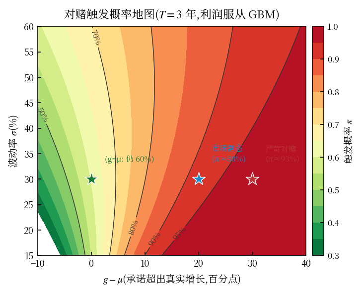
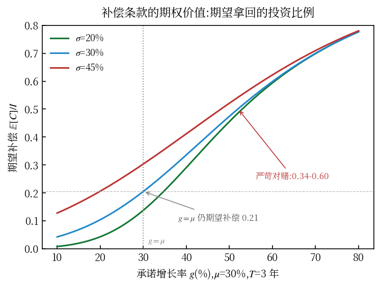
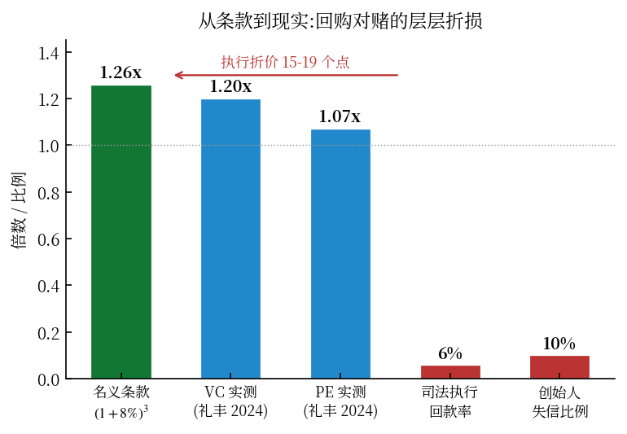

投资谈判桌上最经典的僵局:创始人说"我的公司值 10 亿",投资人说"凭什么?你去年利润才 3000 万。"

对赌协议(学名**估值调整机制**,Valuation Adjustment Mechanism,VAM)就是为了打破这个僵局发明的:**先按你的乐观估值成交,用未来可验证的业绩裁决谁对谁错,错了的一方吐出利益。**

听起来公平合理,像一场体面的赌局。但这篇文章要讲的是一个几乎没人算过的数学事实:

> **一份典型对赌的触发概率不是 50%,而是 80%-98%。承诺增长率哪怕恰好等于公司的真实增长率,触发概率依然有 60%。**

也就是说,大部分对赌在签约那天就已经分出胜负了。它不是赌,而是**伪装成股权投资的高息债**。下面把这句话一步步变成公式,每个数字都算给你看。

## 一、机制速览:四种条款与三个公式

先 30 秒过一遍基础知识(熟悉的读者直接跳到第二节)。

| 类型 | 触发条件 | 结果 | 核心公式 |
|---|---|---|---|
| 现金补偿 | 业绩不达标 | 创始股东赔现金 | $C = I \cdot (1 - E'/E)$ |
| 股权补偿 | 业绩不达标 | 创始股东转让股份 | $\Delta s = s_0 \cdot (1 - E'/E)$ |
| 股权回购 | 未按期上市/并购 | 创始人按本息回购 | $P = I \cdot (1+r)^t, r \approx 8\%-12\%$ |
| 反向激励 | 业绩超额达标 | 创始人获赠股/低价增持 | — |

$I$ 是投资额,$E$ 是承诺利润,$E'$ 是实际利润。直觉:投后估值 $P_0 = k \cdot E$($k$ 为约定市盈率),你把利润吹大了 $(1-E'/E)$ 的比例,就把对应比例的投资款退回来——补偿公式就是这么来的。

法律上有一条生死线:与**股东个人**对赌有效可执行;与**公司**对赌履行受限(海富案 2012 确立,《九民纪要》2019 软化为"履行障碍")。所以实务里义务人永远是创始人个人。

## 二、触发概率有闭式解:对赌天然偏向投资人

### 2.1 把利润当成几何布朗运动

对赌的裁决变量(净利润)是随机的。标准做法(也是 PLOS ONE 2022 研究 VAM 最优目标的建模选择):把利润 $E_t$ 建成几何布朗运动(GBM)——年化真实增长 $\mu$,年化波动 $\sigma$。那么到期 $T$ 时:

$$\ln E_T \sim \mathcal{N}\!\left(\ln E_0 + \left(\mu - \tfrac{\sigma^2}{2}\right)T,\; \sigma^2 T\right)$$

承诺值 $E = E_0 \cdot e^{gT}$($g$ 为承诺复合增长率)。**触发补偿的概率**就是一个正态 CDF:

$$\pi = P(E_T < E) = \Phi\!\left(\frac{(g - \mu + \sigma^2/2)\,\sqrt{T}}{\sigma}\right)$$

### 2.2 算出来吓一跳

代入成长期公司的正常参数(以下全部经代码实算,可复现):

| 场景 | 触发概率 |
|---|---|
| $\mu$=20%, $g$=50%, $\sigma$=30%, $T$=3(蒙牛级承诺,普通公司) | **97.7%** |
| $\mu$=40%, $g$=50%, $\sigma$=30%, $T$=3(高成长公司) | **79.9%** |
| **$g = \mu$ = 30%, $\sigma$=30%, $T$=3(承诺恰等于真实增长)** | **60.2%** |
| $g = \mu$ = 30%, $\sigma$=50%, $T$=3(高波动版) | 66.7% |

第三行是整篇文章的题眼:**承诺增长率恰好等于公司真实增长率,触发概率仍有 60%。**

原因藏在 $\sigma^2/2$ 这一项里:对数正态分布的中位数是 $E_0 e^{(\mu-\sigma^2/2)T}$,永远低于均值 $E_0 e^{\mu T}$。承诺目标锚定的是"均值路径",而真实利润有一半时间跑在中位数以下——**波动率本身就是触发器**。这不是条款谈判的结果,是数学性质:对赌的概率结构天然偏向投资人。

### 2.3 公允对赌长什么样

令 $\pi = 50\%$,反解出**公允承诺增长率**:

$$g^* = \mu - \frac{\sigma^2}{2}$$

$\sigma^2/2$ 是"波动的承诺税"——**波动越大的公司,公允承诺必须越保守**:

| $\mu$, $\sigma$ | 公允承诺 $g^*$ | 承诺税 |
|---|---|---|
| 20%, 30% | 15.5% | 4.5 个百分点 |
| 30%, 40% | 22.0% | 8.0 个百分点 |
| 40%, 50% | 27.5% | 12.5 个百分点 |

对照现实:市场上真实对赌的 $g$ 通常**高出** $\mu$ 一二十个百分点——方向与公允值完全相反。学术侧的互证:PLOS ONE 2022(Xue & Yun)用实物期权+委托代理模型证明了两个同向结论——**VAM 期权价值随目标单调递增**(解释了 VC 为什么系统性设高目标),以及**最优目标是 σ 的减函数**(与承诺税公式一致)。

## 三、补偿条款是期权:期望价值算出来更吓人

现金补偿 $C = I(1 - E_T/E)$ 只在触发时生效,改写一下:

$$C = \frac{I}{E} \cdot \max(0,\; E - E_T)$$

这是一个**以业绩为标的、行权价 $E$ 的看跌期权**(面值 $I/E$ 张)。用对数正态的截断期望给出精确的期望补偿率:

$$\frac{\mathbb{E}[C]}{I} = \Phi(d_2) - e^{(\mu - g)T}\,\Phi(d_1), \qquad d_2 = \frac{(g-\mu+\sigma^2/2)\sqrt{T}}{\sigma},\;\; d_1 = d_2 - \sigma\sqrt{T}$$

数值(代码实算):

| 场景 | 期望补偿 $\mathbb{E}[C]/I$ |
|---|---|
| $\mu$=20%, $g$=50%, $\sigma$=30%, $T$=3 | **0.599** |
| $\mu$=40%, $g$=50%, $\sigma$=30%, $T$=3 | 0.336 |
| $g=\mu$=30%, $\sigma$=30%, $T$=3(公允情形附近) | 0.205 |

两张脸摆在一起看:**严苛对赌下,投资人每投 1 元,期望拿回 0.6 元补偿**;就连"承诺=真实增长"的中性对赌,期望补偿也有 0.2。加上股权本身的期望价值,这类协议的期望回报结构已经远离"风险投资",逼近"高息债+转股期权"——这正是司法与监管讨论"名股实债"时的数学底层:$\pi \to 1$ 的对赌,经济实质就是债。

## 四、契约理论:对赌真正的功能是转移控制权

条款和公式之上还有一层:为什么对赌长这样?

Hart 与 Aghion-Bolton 的不完全契约理论给出的定位:**未来写不进合同,所以把控制权的归属挂在一个可验证的信号上**——业绩好,控制权归创始人(他更善用成长机会);业绩差,控制权向投资人转移(资本保护优先)。

这个视角一眼看穿几个现象:

1. **为什么补偿常常是股份而不是现金**——股份是控制权的载体。太子奶对赌失败出让 61.6% 股权,不是"赔钱",是控制权状态转移的执行;俏江南的回购→领售权(drag-along)链条,是转移的"暴力加速档"。
2. **为什么对赌从来不是最优契约**——三个摩擦:业绩可操纵(下一小节)、双边道德风险(投资人的投后资源同样影响业绩,但条款只惩罚一方)、验证与执行成本(第六节)。它是次优的相机安排,不是教科书暗示的聪明设计。
3. **激励反转**——PLOS ONE 的模型给出边界:目标一旦越过"最大努力可达线",创始人的理性选择从冲刺变成风险转嫁。金融工程的说法:处于深度虚值的看涨期权,价值随波动率上升——**期望不够,方差来凑**。永乐电器(历史复合增长 40%,2007 年三档利润目标 7.5/6.75/6 亿,实际 5.66 亿)对赌失败前的激进开店与并购扩张,就是义务人在被条款逼着"买波动率"。

### 实证:精准达标与盈余管理

- Ding et al.(2023,上财,新三板样本):VAM 显著提高挂牌前一年及当年的**应计盈余管理**;VAM 还导致风投监督懈怠(监督被条款替代)
- 中注协《中国注册会计师》2024 年第 8 期审计风险提示:**承诺期内"每年精准达标"存在较大舞弊嫌疑**
- 《财贸经济》实证:"精准达标"现象集中出现在股票支付的并购交易

一句话:裁决变量本身可被操纵,赌局的骰子有一面是棉花做的。

## 五、执行博弈:判决书之外的均衡

条款写得再狠,触发之后还要能执行。这一层的数据(礼丰律所 2024 年 8 月《VC/PE 基金回购及退出分析报告》)比任何理论都生动:

- 约 **13 万个**创投项目面临退出压力,涉及约 **1.4 万家**公司;PE 投资项目**平均约 3 年触发回购**
- 名义条款:$(1+8\%)^3 = 1.26\times$;**实际**回购退出回报:PE **1.07×**、VC **1.20×**——执行折价 15-19 个点
- 进入司法程序的回购案件,**平均执行回款率仅约 6%**
- 约 **10% 的创始人**因无法履行回购义务成为失信被执行人

博弈论视角读这组数:**事后重新谈判才是主流**(绝大多数触发的对赌以展期、折价回购、部分豁免收场,诉讼是谈判破裂的残余);执行难(无个人破产制度,要么执行到死要么实质豁免)反过来重塑条款——2024-25 年新签协议里宽限期、分档目标、公司+创始人连带结构的流行,就是司法环境反馈回合同设计的实时证据。而投资人把创始人赶尽杀绝有声誉成本(优质创始人会用脚投票),这是执行烈度的隐性上限。

## 六、四个案例,一条规律

| 案例 | 对赌内容 | 结果 |
|---|---|---|
| **蒙牛 vs 摩根士丹利(2003-06)** | 三年复合增长 ≥50% | 超额达标,2005.4 投资方提前支付数千万美元股份奖励,双赢 |
| **永乐 vs 大摩/鼎晖(2005-06)** | 2007 利润三档 7.5/6.75/6 亿 | 实际 5.66 亿,激进并购后并入国美,陈晓出局 |
| **太子奶(2007-08)** | 三年销量高增长 | 创始人出让 61.6% 股权出局,公司破产重整 |
| **俏江南 vs 鼎晖(2008-12)** | 2012 年底前上市 | IPO 失败→回购→领售权→CVC 接盘,张兰出局 |

规律:蒙牛的 50% 是"跳一跳够得着"(当年管理层把产能与渠道做到了);后三个的条款在签约时就落在本节公式的 80%+ 触发区。**同一张条款纸,概率结构不同,一个是激励,一个是绞索。**

## 七、给双方的三条结论

**创始人**:签约前算 $\pi$——把 $\mu$(去掉运气的真实增长)、$\sigma$(行业波动)、$g$、$T$ 代进公式,触发概率高于 70% 就是在卖期权给投资人;要求分档阶梯(达标 90% 按比例调整)和封顶;绝对警惕"回购+领售权"组合链条;义务人宁可自己,别让公司(履行不了)。

**投资人**:对赌替代不了尽调(裁决变量可操纵);与公司对赌基本不可执行;条款狠到必然触发,你得到的不是保护而是一场平均回款 6% 的诉讼。

**观察者**:判断一份对赌的性质,不用看故事,看三个数——$g - \mu$ 的差、$\sigma$、$T$。$\pi$ 接近 0.5 是赌,$\pi$ 接近 1 是债。中国一级市场过去十年的主流对赌,大多数是后者;2024 年之后的回购纠纷潮,不过是这批"伪股权、真债权"到期后的集中兑付时刻。

---

*参考:Xue & Yun (2022) The Optimal Performance Target of VAM Agreement, PLOS ONE;Ding et al. (2023) 风险投资对赌协议对盈余管理的影响;Jiang et al. (2026) Valuation Adjustment Mechanisms in Venture Capital, China Economic Review;礼丰律所(2024.08)《VC/PE 基金回购及退出分析报告》;海富案(2012)、《九民纪要》(2019)、华工案(2019);Aghion & Bolton (1992)、Hart 不完全契约理论。本文全部公式数值经代码复算。*
