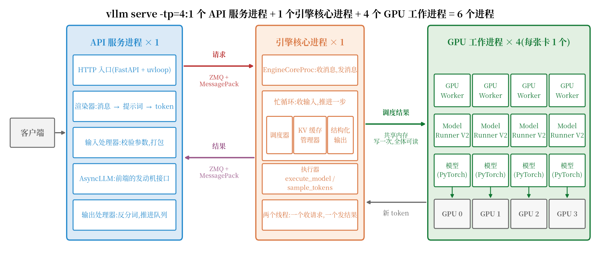
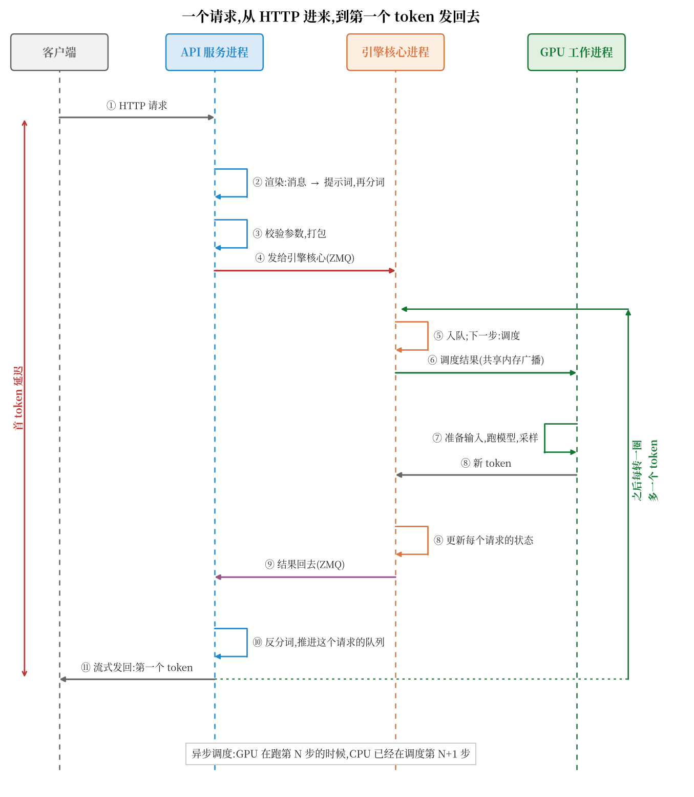
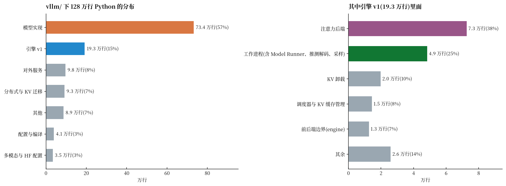

敲一行 `vllm serve`,等上一会儿,屏幕上出现一行 `Uvicorn running on http://0.0.0.0:8000`。

服务器上多出来的,不止这一个进程。单卡是 3 个,4 张卡是 6 个,8 张卡按 2 路张量并行、4 路数据并行跑,是 17 个。

面试里被问"讲讲 vLLM 的架构",最好的开头就是这几个进程:有哪几个,各干什么,为什么非拆开不可。

这是专栏的第一篇,只做一件事:把 0.34 版的构造摆清楚。有哪几块,每块在哪,为什么这么分。之后每一篇,钻进去一块。

## 一、先看全貌:4 张卡,6 个进程



| 进程 | 几个 | 干什么 | 代码在哪 |
|---|---|---|---|
| API 服务进程 | 1 个;数据并行时跟着路数涨 | 接 HTTP 请求,分词,把结果流式发回去 | `vllm/entrypoints/`、`vllm/v1/engine/async_llm.py` |
| 引擎核心进程 | 每路数据并行 1 个 | 调度,管 KV 缓存,指挥工作进程 | `vllm/v1/engine/core.py` |
| GPU 工作进程 | 每张卡 1 个 | 加载模型,跑前向 | `vllm/v1/worker/gpu_worker.py` |
| 数据并行协调进程 | 数据并行大于 1 时才有 1 个 | 在各路之间分请求 | `vllm/v1/engine/coordinator.py` |

进程数是一道加法。API 服务进程数,加上引擎核心数,再加上卡数;用了数据并行,再加 1。

$$\#\text{procs} = A + DP + N \quad (+1 \text{ if } DP > 1)$$

A 是 API 服务进程数,默认等于数据并行的路数 DP;N 是卡数,等于数据并行、流水并行、张量并行三个数的乘积。

数据并行的时候,每一路有自己的引擎核心进程,各管各的。协调进程负责把请求分给其中一路。模型是 MoE 的话,各路的引擎核心每一步还要对齐,因为专家是分散在所有卡上的。

三类进程之间,用的是两种通信方式。

API 服务进程和引擎核心之间,走 ZMQ 套接字,消息用 MessagePack 编码。API 服务进程开两个口:一个收请求,一个收结果。引擎核心两头各接一根线:从收请求的口拿活,往收结果的口交活。

引擎核心和工作进程之间更近。同一台机器上,走一块共享内存:引擎核心写一次,所有工作进程都读得到。

为什么非拆成三个进程,第四节讲。先看它是怎么长成这样的。

## 二、来历:操作系统里的一个老办法

vLLM 仓库 2023 年 2 月 9 日的头几个提交,是 Woosuk Kwon 写的:建仓库,加 `.gitignore`,然后是两个,Add cache engine(加缓存引擎),Add block manager(加块管理器)。

最先写的是缓存。因为 vLLM 要解决的问题不在模型,在 KV 缓存。

大模型每生成一个 token,都要把之前所有 token 的 K 和 V 留着,这就是 KV 缓存。它大,而且每个请求都在不停地长。

一个 token 的 KV 缓存有多大:

$$\text{KV per token} = 2 \times n_{\text{layer}} \times n_{\text{head}} \times d_{\text{head}} \times b$$

2 是 K 和 V 各一份,b 是每个数占的字节数。拿 Llama-2-7B 算:32 层,32 个头,每头 128 维,半精度。2 × 32 × 32 × 128 × 2,是 512 KB。

一个 token 半兆。一个 4096 个 token 的请求,光 KV 缓存就是 2 GB。

2023 年 6 月的第一篇官方博客,给的是当时的情况:别的系统因为内存碎片和预留,要浪费 60% 到 80% 的 KV 缓存显存。

他们的办法是从操作系统里搬来的:虚拟内存,分页。论文叫 PagedAttention,2023 年 9 月放上网,10 月发表在 SOSP 上。

做法是把一个请求的 KV 缓存,切成固定大小的块。博客里的类比是:块相当于页,token 相当于字节,请求相当于进程。逻辑上连着的块,物理上可以散在各处,中间靠一张块表对上号。

这样一来,浪费只发生在每个请求的最后一块里,不到 4%。同一篇博客给的数:比当时的 HuggingFace 最高快 24 倍,比 TGI 最高快 3.5 倍。

这个思路到今天还在用。0.34 版有一项改动,叫可扩展 KV 缓存,代码里的说明是"预留地址空间,按需提交块":先把整块 KV 缓存的地址空间占住,物理显存用到多少,才给多少。

地址空间和物理内存分开管,这还是分页那一套。

## 三、重写了两次:V0、V1、Model Runner V2

**第一次,整个引擎重写。**

2025 年 1 月的博客把原因写得很直白:各个功能是分开做的,很难干净地拼在一起,技术债攒多了。

他们给 V1 定了四个目标。代码简单、模块化、好改;性能高,CPU 开销接近零;各种优化统一到一个架构里;不用调参,好东西默认打开。

V1 做的几个决定,今天还是 0.34 的骨架。

引擎核心单独拿出来,做成一个只管调度和执行的循环。

调度器不再分预填充和解码。每一步只回答一个问题:每个请求,这一步算几个 token。

前缀缓存做到几乎零开销,所以默认打开。博客里的数是:命中率是 0 的时候,吞吐也只掉不到 1%。

**第二次,只重写工作进程里跑模型的那一层。**

V1 出来还不到一年,又重写了一次,这回是 Model Runner V2。设计文档里的原话:"V1 里好几处设计,事后看是次优的。"

V2 改了四件事,第五节细讲。

| 时间 | 版本 | 发生了什么 |
|---|---|---|
| 2023 年 2 月 | | 仓库开工,先写缓存引擎和块管理器 |
| 2023 年 6 月 | 0.1.0 | 第一个版本 |
| 2023 年 10 月 | | PagedAttention 论文发表在 SOSP |
| 2025 年 1 月 | 0.7.0 | V1 引擎开放测试,靠一个环境变量打开 |
| 2025 年 3 月 | 0.8.0 | V1 成为默认 |
| 2025 年 10 月 | 0.11.0 | V0 的代码删完,V1 成了唯一的引擎 |
| 2025 年 12 月 | 0.12.0 | Model Runner V2 进来,实验性 |
| 2026 年 5 月 | 0.22.0 | Rust 写的前端进来,实验性 |
| 2026 年 11 月 | 0.34.0 | 只剩 Model Runner V2;可扩展 KV 缓存默认打开 |

节奏也值得看一眼。从 2025 年 10 月的 0.11,到 2026 年 11 月的 0.34,13 个半月发了 23 个版本。0.34 这一个版本,有 1,061 个提交,来自 412 个人。

现在的 vLLM 是 Linux 基金会治理下的项目。治理文档里写着它的原则:吞吐和性能排第一;代码要保持可读、模块化,因为很多人会去读它的代码。

## 四、为什么拆成三个进程

先说 Python 的一个限制。一个进程里,同一时刻只有一个线程在跑 Python 代码。这叫 GIL,全局解释器锁。

vLLM 里有三样活,谁都不想被别人卡住:

- API 服务进程要一直守着 HTTP 连接,请求一来就得响应。
- 引擎核心进程每一步都要调度,是纯 CPU 的活,还必须快。
- 工作进程抱着一张卡,要加载几十 GB 的权重,还要跑前向。

放进一个进程,它们抢的是同一把锁。拆成三个进程,就是三把锁,各用各的 CPU 核。这是第一个理由。

第二个理由是崩溃。HTTP 那一层出异常,模型和 KV 缓存不用跟着重来。

第三个理由是对称。张量并行时,每张卡一个工作进程。早先,第 0 号工作进程和调度器挤在一起,别的工作进程在外面,走的路径不一样。V1 的办法是每一步只传改动过的部分,数据量小到调度器和 0 号进程也能分开。于是所有工作进程都一样了。

这个结构是一步一步长出来的。V1 刚出来的时候,引擎核心默认还在原来的进程里,要靠一个环境变量才能拆出去。现在那个变量的默认值,是拆。

拆开有代价。数据要序列化,消息要排队,调试的时候要同时盯几个进程。

但进程的边界,同时也是协议的边界。前端只要会讲这套消息,用什么语言写都行。0.22 版进来的 Rust 前端就是这么来的:HTTP 服务、聊天模板、分词这一层用 Rust 重写,引擎还是 Python 的,两边照样用 ZMQ 和 MessagePack 对话。它现在是实验性的,默认关闭。

## 五、每个进程里装了什么

### 5.1 API 服务进程:HTTP 进,token 出;token 进,HTTP 出

Web 框架是 FastAPI,事件循环用的是 uvloop。

入口不止 OpenAI 兼容接口一种。`vllm/entrypoints/` 下面,还有 Anthropic 兼容的、Cohere 兼容的、gRPC 的、MCP 的。

一个聊天请求进来,走四站。

**第一站,渲染。** 把一组消息变成提示词。大多数模型用 Hugging Face 上的聊天模板;有几家模型的规则特殊,单独写了渲染器。然后分词。

**第二站,校验。** `InputProcessor.process_inputs` 检查采样参数合不合法,给请求分配一个号,打包成发给引擎核心的消息。

**第三站,发送。** 交给 `AsyncLLM`。它是前端进程里的发动机接口,构造函数里只造四样东西:渲染器、输入处理器、输出处理器,和一个连向引擎核心的客户端。

**第四站,收尾。** 一个常驻的协程,不停地从引擎核心取结果,交给 `OutputProcessor`。它做增量反分词:每来一个新 token,只解码多出来的那一点。然后推进每个请求自己的队列。HTTP 那边从队列里取文字,变成流式响应。

模型吐出来的文本,还要再解析一遍:哪一段是推理过程,哪一段是工具调用。这是 `vllm/parser/`、`vllm/tool_parsers/`、`vllm/reasoning/` 三个包的活。

### 5.2 引擎核心进程:一个忙循环

`vllm/v1/engine/core.py` 里有两个类。`EngineCoreProc` 管进程这一层:收消息,发消息,处理退出信号。`EngineCore` 是里面的本体,文档字符串只有一句:Inner loop of vLLM's Engine,vLLM 引擎的内循环。

它另起两个线程,一个守着收请求,一个守着发结果。主循环自己只跟两个队列打交道,不碰套接字。

主循环就两步,中间两行统计略去:

```python
while self._handle_shutdown():
    self._process_input_queue()    # 看有没有新请求
    self._process_engine_step()    # 推进一步
```

`EngineCore` 的构造函数里,主要的东西也是三样:执行器、调度器、结构化输出管理器。

推进一步,是四个动作。下面是 `step()` 的骨架,省略了结构化输出和采样两行:

```python
scheduler_output = self.scheduler.schedule(...)
future = self.model_executor.execute_model(scheduler_output, non_block=True)
model_output = self._wait_for_output(future)
engine_core_outputs = self.scheduler.update_from_output(scheduler_output, model_output)
```

**调度器。** `vllm/v1/core/sched/scheduler.py`。它每一步做一个决定:在跑的请求,这一步各算几个 token;再放进来几个新请求。

约束是一个 token 预算,叫 `max_num_batched_tokens`。这个数按显存分档。70 GB 以上的卡(A100 除外),在线服务默认 8192;160 GB 以上是 16384;再小的卡是 2048。同时能跑的请求数,大卡默认 1024,小卡 256。

没有"先做预填充,再做解码"两个阶段。一个新来的长提示词,会被切成几块,和别的请求的解码混在同一步里。

KV 缓存不够了,就抢占。被抢的请求,它占的块全部交回,进度清零,回到等待队列,下次轮到它从头算。不往内存里换出。策略默认是先来先服务,抢的是最后进来的那个。

`schedule()` 这一个方法,有一千一百多行。下一篇专门讲它。

**KV 缓存管理器。** `vllm/v1/core/kv_cache_manager.py`。对外是三个动作:查前缀缓存,分配块,释放块。

前缀缓存靠哈希认块。每个块的哈希,由三样东西算出来:上一个块的哈希,本块的 token,再加一些额外信息,比如 LoRA 的编号、图片的哈希。

所以两个请求只要开头相同,后面的哈希就一路相同,不用算,直接复用。

默认的块大小,0.34 从 16 改成了 64。

**结构化输出管理器。** 让模型只能按给定的格式输出,比如合法的 JSON。做法是在采样之前,把不合法的 token 拦掉。后端有 xgrammar、guidance、outlines 几种。

### 5.3 工作进程:模型住在这里

引擎核心不直接碰 GPU。它和 GPU 之间隔着一个执行器。每一步都要调的接口是三个方法:`execute_model`、`sample_tokens`、`collective_rpc`。最后一个的意思是,让所有工作进程各执行一个同名函数。

执行器下面,每张卡一个工作进程。每个工作进程里,一个 `GPUWorker`,管加载权重和显存;再往下是 `GPUModelRunner`,管每一步怎么跑;最底下才是模型本身,一个普通的 PyTorch 模块。

**Model Runner V2 改了什么。**

每一步要交给模型的输入,是几千个请求的各种小表:token 编号、位置、块表、采样参数。

V1 的做法是维护一张常驻的大表,有请求进来或结束,就挪动表里的行。挪得慢,还容易乱。

V2 的做法是每个请求进来就分到固定的一行,一直占到结束,中间谁也不挪。每一步要用的时候,从大表里把当前这批请求的行抽出来,组成一份新的输入。抽取在 GPU 上做。

调度是异步的:GPU 在跑第 N 步,CPU 已经在准备第 N+1 步。这要求 CPU 这一侧,没有一处要停下来等 GPU。

V2 是 0.12 版以实验性质进来的。0.34 把 V1 删了,只剩 V2。

**模型。** 全部加起来 74 万行,占整个代码库的一半多。注册表里登记了 426 种模型架构。

所有模型的构造函数长得一模一样:`__init__(self, *, vllm_config, prefix="")`。官方文档给了理由:模型运行器不需要知道它跑的是哪一种模型;视觉模型和语言模型,也能这样拼在一起。

切分和量化,是在建模型的时候做的,不是建完再改。文档里的例子:一个 405B 的模型,权重 810 GB,放在 16 张 80 GB 的卡上。先建后切,每张卡都要先装下 810 GB;边建边切,每张卡只建自己那 50 GB。

最新的十几家模型,一家一个目录。Kimi-K3 一家,7.9 万行,194 个文件。

**注意力后端。** 模型里的注意力层不自己算,交给后端。后端的枚举里有 52 项:FlashAttention、FlashInfer,有 Triton 写的,有 Cutlass 写的 MLA,还有专门给某一家模型用的稀疏注意力。

用哪个,不用你选。每个平台有一张优先级表,按设备能力从高往低,找第一个能用的。

### 5.4 启动的时候,工作进程做了什么

引擎核心一起来,不先接请求。先走五步。

1. 每个工作进程加载权重。
2. 每个工作进程空跑一遍,量出峰值的显存,报告还剩多少。
3. 引擎核心按剩多少,算出 KV 缓存能分多少块,让工作进程分配。
4. 工作进程编译模型,预热算子,录 CUDA Graph。
5. 预热完再看一眼还剩多少显存,把 KV 缓存加大。这一步就是可扩展 KV 缓存。

第 4 步可以选级别。`-O0` 全关,启动最快。`-O1` 编译,加分段的 CUDA Graph。`-O2` 是默认,再多一些融合,分段和整段的 CUDA Graph 都录。`-O3` 现在等于 `-O2`。

分段,是把模型切成几段,每段录一张图。整段,是一张图管完整个前向。

所以第一个请求进来之前,模型已经按几种批量大小,各跑过一遍了。

## 六、一个请求从头到尾



1. 客户端发来一个聊天请求,进 API 服务进程。
2. 渲染器把消息变成提示词,再切成 token。
3. 输入处理器校验参数,打包。
4. 通过 ZMQ 发给引擎核心进程。API 服务进程不等它,转头去接下一个请求。
5. 引擎核心把它放进等待队列。轮到下一步,调度器决定:这一步给它多少个 token,开头几个块能不能直接从缓存里命中。
6. 调度结果通过共享内存,一次发给所有工作进程。
7. 每个工作进程准备输入,跑模型,采样,得到新 token。
8. 结果回到引擎核心,调度器更新每个请求的状态:算到第几个 token 了,完了没有。
9. 结果通过 ZMQ,回到 API 服务进程。
10. 输出处理器反分词,推进这个请求的队列。
11. HTTP 那边从队列里取出文字,作为一条流式消息发出去。第一个 token,到这里才到客户端手里。

从第 5 步起,再转一圈,就多一个 token。转一圈花的时间,就是两个 token 之间的间隔。

异步调度在这里起作用:第 7 步 GPU 在跑的时候,第 5 步已经在给下一圈做准备了。

## 七、代码都在哪,从哪读起

128 万行 Python,加上 17.6 万行 Rust。



一大半代码是模型。引擎本体 19 万行,只占 15%。

所以读源码,别从模型读起。按这个顺序:

| 顺序 | 读什么 | 行数 | 看什么 |
|---|---|---|---|
| 1 | `docs/design/arch_overview.md` | 352 | 官方总览,进程结构和设计原则 |
| 2 | `vllm/v1/engine/core.py` | 3,143 | 忙循环,一步的四个动作 |
| 3 | `vllm/v1/engine/async_llm.py` | 1,470 | 前端的四样东西 |
| 4 | `vllm/v1/core/sched/scheduler.py` | 3,934 | `schedule()` 和 `update_from_output()` |
| 5 | `vllm/v1/core/kv_cache_manager.py` | 947 | 前缀缓存,分配,释放 |
| 6 | `vllm/v1/worker/gpu/model_runner.py` | 2,591 | `execute_model()`:准备输入,跑模型 |
| 7 | `vllm/v1/attention/backend.py` | 1,132 | 注意力后端的接口 |

再往外一圈,是启动参数。`EngineArgs` 有 265 个字段,就是 `vllm serve` 后面能跟的那些选项。它们最后归并成一个 `VllmConfig`,35 个字段,启动时发给每一个进程。官方文档管它叫引擎级的全局状态。

还有一个文件值得知道:`vllm/envs.py`,里面登记了将近 300 个环境变量。

## 八、怎么往里加东西

vLLM 的模型、硬件、解析器,大部分不是写死在代码里的,是登记进去的。

- 加一种模型:在模型注册表里登记架构名和类,`ModelRegistry.register_model`。
- 加一种硬件:写一个平台插件。
- 加一种工具调用或推理内容的解析器:两张注册表,`ToolParserManager` 和 `ReasoningParserManager`。
- 加一个 HTTP 接口:入口插件。
- 加一种统计日志:日志插件。

用的是 Python 包自带的机制,叫入口点。所以这些东西可以放在仓库外面,自己的包里,不用改 vLLM 的代码。

插件文档里有一句提醒:每个进程都要把插件加载一遍。前面说过,它们是各自单独启动的。

## 九、面试里会问的

下面这些,这张地图都能答:

- **vLLM 起了几个进程,为什么拆开?** 三类进程。为了各用各的 GIL,互不拖垮,工作进程之间对称。
- **PagedAttention 解决了什么问题?** KV 缓存的碎片和预留。把缓存切块,像分页一样管。
- **调度器每一步做什么?为什么不分预填充和解码?** 按 token 预算,决定每个请求这一步算几个 token。一个循环就够。
- **KV 缓存满了怎么办?** 抢占。进度清零,回头重算。
- **前缀缓存怎么判断命中?** 哈希链:父块的哈希,加本块的 token,加额外信息。
- **张量并行时,哪个进程在调度?** 引擎核心进程,只有一个。工作进程每张卡一个,只管跑。
- **vLLM 启动的时候做了什么?** 加载权重,量显存,分 KV 缓存,编译,录 CUDA Graph。
- **怎么加一个新模型?** 在模型注册表里登记。可以在仓库外做。

## 十、总结

**1. 三个进程。** API 服务进程管 HTTP 和分词,引擎核心进程管调度,工作进程管 GPU。

**2. 边界就是协议。** 前端和引擎之间是 ZMQ 加 MessagePack。所以前端可以换一种语言写,0.22 版换了 Rust。

**3. 引擎核心里三样东西。** 调度器,KV 缓存管理器,执行器。一步就是调度、执行、更新。

**4. 调度按 token 预算。** 没有预填充和解码两个阶段,只有"每个请求,这一步算几个 token"。

**5. 一大半代码是模型。** 模型 74 万行,引擎 19 万行。读源码从引擎读起。

**6. 加东西靠登记,不靠改代码。** 模型、硬件、解析器、接口,都是注册进去的,可以放在仓库外。

下一篇钻调度器:`schedule()` 那一千一百行,到底在排什么。

如果这个系列对你有用,点个赞或关注专栏,更新会持续。

---

*历史与文献:Kwon, Li, Zhuang, Sheng, Zheng, Yu, Gonzalez, Zhang, Stoica, Efficient Memory Management for Large Language Model Serving with PagedAttention(SOSP 2023,arXiv:2309.06180,DOI 10.1145/3600006.3613165);vLLM 官方博客 "vLLM: Easy, Fast, and Cheap LLM Serving with PagedAttention"(2023 年 6 月 20 日)、"vLLM V1: A Major Upgrade to vLLM's Core Architecture"(2025 年 1 月 27 日);vLLM 在 GitHub 上的发布记录 v0.1.0 至 v0.34.0,以及仓库在 2023 年 2 月 9 日的头几个提交;vLLM 仓库的 docs/governance/process.md。*

*源码与文档:文中关于构造的描述,来自 vLLM v0.34.0 的源码(提交 62d4bc3)和它自带的 docs/design/ 下的 arch_overview.md、model_runner_v2.md、prefix_caching.md、multiprocessing.md,以及 rust/README.md。行数按该版本 `vllm/` 目录下全部 Python 文件统计,是 3,364 个文件、约 130 万行;Rust 是 400 个文件、约 17.6 万行。注册的模型架构数,按 model_executor/models/registry.py 里的登记项统计。文中数字截至 2026 年 11 月 24 日。*
