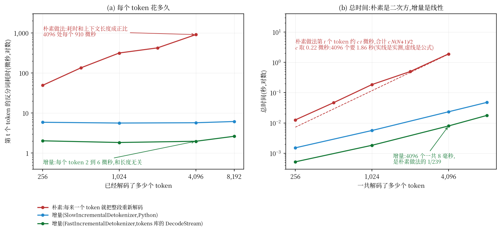
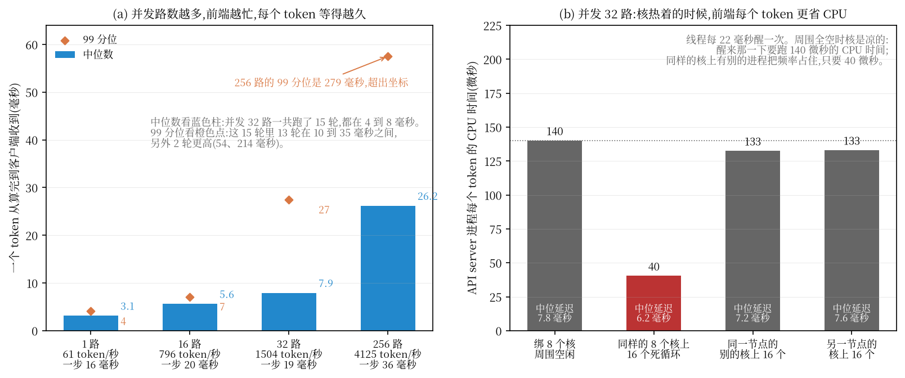
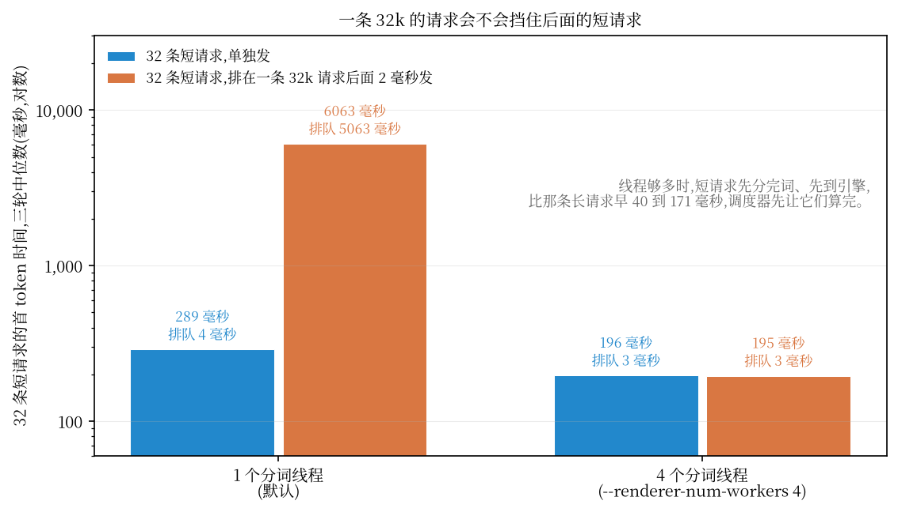
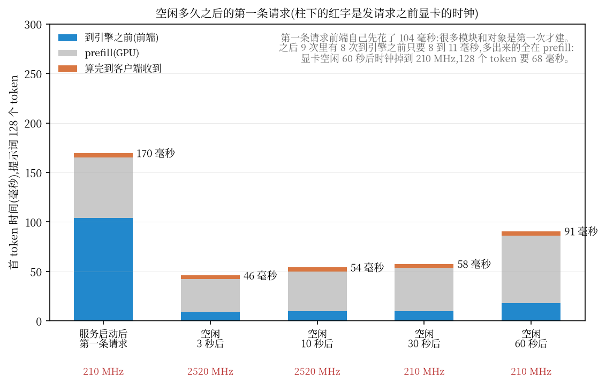

上一篇里,token 在引擎里一步一步算了出来。可客户端看到的不是引擎:它发的是一个 HTTP 请求,收到的是一段一段往下流的文字。

中间这一段叫前端。谁收请求,谁把文字变成 token 编号,谁把它送进另一个进程。算出来的编号谁变回文字,一个汉字被切成两个编号怎么办,客户端中途关掉页面引擎知不知道。

这篇按 v0.34.0 的源码把这条路走一遍,再在 4090D 上把每一站的耗时量出来。先从最朴素的做法看起。

## 一、最朴素的做法:一个函数,从头做到尾

最直接的前端长这样。HTTP 处理函数收到请求,分词,调模型的 `generate()`,等它把整段写完,反分词,返回一个 JSON。

三处吃亏。

第一处,不能流式。用户盯着空白的屏幕,要等最后一个 token 写完,才一次性看到全文。

第二处,这个线程被占住了。生成要几秒到几分钟,其间它接不了别的请求。一个请求开一个线程也不行:Python 的全局解释器锁,同一时刻只让一个线程跑 Python 代码。

第三处藏在反分词里。最直接的做法是每写一个 token,就把整段重新解码一遍,写得越长越慢。v0.2.0(2023 年 9 月)把它换成了增量反分词(#984)。同一份发布说明里还有一条:优化反分词和采样,最多快 60%。

打个比方,前台接待接到订单,亲自进后厨,从头炒到尾,端出来才回来接下一位。客人问一句"好了吗",她腾不出嘴回答。

先算第三处,它最不像性能问题。

## 二、先算账:朴素的反分词是二次方的

模型吐出来的是 token 编号,要变回文字。分词器有 `decode(ids)`,把一串编号解码成一个字符串。

朴素做法:第 $t$ 个 token 到了,把前 $t$ 个编号一起送进 `decode`。解码的耗时和长度成正比,记每个编号 $c$ 微秒,这一次就是 $c$ 乘 $t$。一路加下来:

$$T(N) = \sum_{t=1}^{N} c\,t = \frac{c\,N(N+1)}{2}$$

$N$ 是生成的 token 数。总时间跟着 $N$ 的二次方涨。

用 Llama-3.1-8B-Instruct 的分词器,在 Xeon 8352V 上量。写到 4,096 个 token 时,朴素做法每解码一个要 910 微秒,折合每个上下文编号 0.22 微秒。代进公式,4,096 个一共 1.86 秒,实测 1.905 秒。

写到 8,192 个,光反分词就要 7.5 秒。



增量的做法每个 token 只解码自己:2 到 6 微秒,和已经写了多长无关。4,096 个一共 8 毫秒,是朴素做法的 1/239。

## 三、只解码新来的那一个,汉字会断

增量做法不能简单写成 `decode([新的编号])`。

Llama-3 的分词器是按字节切的。拿"大模型的推理引擎"编码,最后一个字"擎"落在了两个编号里。每个编号单独解码都是半截,显示成替换符:

```
逐个解码再拼起来:  ''  '大'  '模型'  '的'  '推'  '理'  '引'  '\ufffd'  '\ufffd'
增量反分词器给的:  ''  '大'  '模型'  '的'  '推'  '理'  '引'  ''       '擎'
```

实测一段 1,024 个 token 的英文,逐个解码再拼起来,和整段解码一致。换成中文就不一致了。

所以增量反分词器要记住读到了哪里,不完整的字符先含着。这是它的主循环:

```python
        # 1) Detokenize the new token ids incrementally.
        num_prev_tokens = self.num_output_tokens()
        first_new_token_index = len(self.token_ids)
        # Output text offsets at the boundaries of the new tokens.
        token_offsets = [len(self.output_text)] if self.stop else None
        for new_token_id in new_token_ids:
            self.token_ids.append(new_token_id)
            self.output_text += self.decode_next(new_token_id)
            if token_offsets is not None:
                token_offsets.append(len(self.output_text))
```

`vllm/v1/engine/detokenizer.py:117`。`decode_next` 返回这一步能放出来的文字,放不出来就返回空串。

它有两个实现,按分词器能不能用 `tokenizers` 库来选:

```python
        if uses_fast_detokenizer(tokenizer):
            # Fast tokenizer => use tokenizers library DecodeStream.
            return FastIncrementalDetokenizer(tokenizer, request)

        # Fall back to slow python-based incremental detokenization.
        return SlowIncrementalDetokenizer(tokenizer, request)
```

`detokenizer.py:63`。

慢的那个是 Python 写的,靠两个下标:上一个空格在哪,读到了哪。每步 5 到 6 微秒。

快的那个把活交给 `tokenizers` 库的 `DecodeStream`,每步 2 微秒。v0.8.5(2025 年 4 月)引入,发布说明写了两条:更快的增量反分词(#15137);`tokenizers` 的版本不低于 0.21.1 才启用(#17158)。

打个比方,同声传译。说一句译一句,不从头重译。听到半个词,先含着,等下半个词到了再出口。

## 四、来历:一张时间线

前端今天的样子不是一次设计出来的。下面的条目都来自 vLLM 在 GitHub 上的发布记录,括号里是 PR 编号。

| 时间 | 发生了什么 | 解决了什么 |
|---|---|---|
| 2023 年 9 月,v0.2.0 | 增量反分词(#984);协程被取消时中止请求(#1020) | 反分词不再二次方;客户端走了引擎就停 |
| 2023 年 12 月,v0.2.3 | 聊天接口支持 chat template(#1756) | 对话的格式由模型自带的模板决定 |
| 2024 年 3 月,v0.4.0 | Asynchronous tokenization(#2879) | 分词不占着处理请求的线程 |
| 2024 年 5 月,v0.4.2 | 连接中断时中止请求(#4363) | 连接断了,请求也停 |
| 2024 年 7 月,v0.5.2 | 实验性的 `vllm` 命令行,能起服务也能查询(#5090) | 不用自己写启动脚本 |
| 2024 年 8 月,v0.5.4 | 用 ZeroMQ 把 API server 和推理循环分开(#6883) | 发布说明:首 token 快 20%,token 间隔快一倍 |
| 2024 年 8 月,v0.5.5 | ZeroMQ 改走本机进程间通信(#7222);前端用 uvloop(#7570) | 同机传消息不用 TCP |
| 2024 年 9 月,v0.6.0 | 异步输出处理器(#7049 等) | 拼输出的数据结构和 GPU 计算重叠,吞吐多 12% |
| 2024 年 11 月,v0.6.4 | V1 的 `AsyncLLM`(#9826) | 现在这套前端的主体 |
| 2024 年 12 月,v0.6.5 | 分词不阻塞事件循环(#10635);V1 默认多进程(#11074) | 长请求分词时,别人不被卡 |
| 2025 年 1 月,v0.7.0 | 合并挤在一起的 `RequestOutput`(#12298) | 前端比客户端快时,不白拼帧 |
| 2025 年 4 月,v0.8.5 | 更快的增量反分词(#15137,#17158) | 反分词每个 token 2 微秒 |
| 2025 年 6 月,v0.9.1 | API server 横向扩展,多对多的通信(#17546) | 多个 API server 对多个引擎 |
| 2025 年 7 月,v0.10.0 | 并发请求的微批分词(#19334) | 发布说明:请求用时少 48% |
| 2025 年 10 月,v0.11.0 | 移除 V0 引擎;去掉 tokenizer group(#24078) | 只剩 V1 |
| 2026 年 1 月,v0.14.0 | gRPC 入口(#30190) | HTTP 之外的第二种协议 |
| 2026 年 1 月,v0.15.0 | `api_server_count` 跟随 `dp_size`(#32525) | 数据并行时不用手写 |
| 2026 年 4 月,v0.19.0 | 阻塞的分词操作挪到线程池(#34789);弃用 `--disable-frontend-multiprocessing`(#37612) | 前端和引擎分开成了定局 |
| 2026 年 5 月,v0.22.0 | 实验性的 Rust 前端(#40848,#43283) | 前端换一种语言重写 |
| 2026 年 8 月,v0.27.0 | 原始提示词的预处理挪出事件循环(#49608) | 事件循环少一件慢活 |
| 2026 年 10 月,v0.32.0 | 新连接去负载最小的 API worker(#60723) | 多个 API server 共用一个端口 |
| 2026 年 11 月,v0.34.0 | 等模型输出时处理新请求和中止(#65466);引擎核心不再导入 openai 和 fastapi(#65423);completion 流式帧渲染快约 9 倍(#52875) | 分得更干净,帧更便宜 |

## 五、vLLM 怎么做:两个进程,一条去程,一条回程


`vllm serve` 起来的是两个进程。API server 进程里是 uvicorn 和 FastAPI,HTTP 处理和请求的状态跑在同一个事件循环里。EngineCore 进程里是调度器和模型执行。两个进程之间用 ZeroMQ 传消息。

拆开是 v0.5.4(2024 年 8 月)的事。发布说明写的是:把 API server 的 HTTP 处理和模型推理循环用 `zeromq` 分开,首 token 时间快了 20%,token 间隔快了一倍。

理由有两条。引擎的主循环是忙循环,一步接一步,中间插不进 HTTP 处理。拆成两个进程,一边一把全局解释器锁,各锁各的。另一条:引擎挂了,错误会送进每一条还在等的请求(`output_processor.py:596`),客户端收到的是报错,不是一直挂着。

打个比方,前台和后厨之间装一个传菜口。前台把小票挂上去就回去接客,后厨好了把菜挂出来,谁也不用等谁。

**去程。** 以 `/v1/completions` 为例,聊天接口的路径和它一样。调用链:

```
create_completion()                              vllm/entrypoints/openai/completion/api_router.py:60
  OpenAIServingCompletion.create_completion()        completion/serving.py:172
    _create_completion()                            :186
      render_completion_request()                   :152    分词,文字变成 token 编号
      engine_client.generate()                      :255    拿到一个生成器,这时还没发出去
      completion_stream_generator()                 :343    流式时把结果变成 SSE
```

聊天接口在渲染这一步多一件事:先套聊天模板,再分词。之后一样,都进 `AsyncLLM` 的 `generate()`(`vllm/v1/engine/async_llm.py:740`)。它先调 `add_request()`,给这条请求建一个队列:

```python
        # Create a new output collector for the request.
        queue = RequestOutputCollector(params.output_kind, request.request_id)
```

`async_llm.py:543`。回程的 token 就往这个队列里放。

然后交给两处:前端的状态表,和另一个进程。

```python
        # Register locally before the first await so concurrent tasks see this request.
        self.output_processor.add_request(request, prompt, parent_req, index, queue)

        # Add the EngineCoreRequest to EngineCore (separate process).
        await self.engine_core.add_request_async(request)
```

`async_llm.py:594`。进状态表的时候,顺手把这条请求的反分词器建好(`output_processor.py:310`)。这一步每个请求做一次。

发往引擎:

```python
    async def add_request_async(self, request: EngineCoreRequest) -> None:
        request.client_index = self.client_index
        await self._send_input(EngineCoreRequestType.ADD, _with_packed_prompt(request))
        self._ensure_output_queue_task()
```

`vllm/v1/engine/core_client.py:1371`。

跨进程传的是 `EngineCoreRequest`,一个 `msgspec` 的结构体。提示词在里面是一个 32 位整数的数组,不是一个一个的 Python 整数:

```python
def _with_packed_prompt(request: EngineCoreRequest) -> EngineCoreRequest:
    """Copy of request with its prompt token ids as an int32 ndarray, which is
    sent out of band when long and decoded by the engine without a Python int
    per token. The frontend keeps the original."""
    if not isinstance(request.prompt_token_ids, list):
        return request
    packed = np.frombuffer(array("i", request.prompt_token_ids), dtype=np.int32)
    return msgspec.structs.replace(request, prompt_token_ids=packed)
```

`core_client.py:86`。

套接字有两种。前端的入口是 `ROUTER`,引擎的输入线程来连;前端的出口是 `PULL`,引擎的输出线程往上推(`core_client.py:686` 到 `:716`)。发的时候:

```python
        return self.input_socket.send_multipart((engine,) + message, copy=False)
```

`core_client.py:1332`。引擎那边,输入线程收到就放进队列,等主循环来取(`vllm/v1/engine/core.py:2161`)。

**回程。** 引擎每算完一步,输出线程把这一步所有请求的新 token 打成一个包推过来:

```python
            while True:
                output = self.output_queue.get()
                ...
                client_index, outputs = output
                ...
                buffer = reuse_buffers.pop() if reuse_buffers else bytearray()
                buffers = encoder.encode_into(outputs, buffer)
                tracker = self._send_msg_tracking_payload(
                    sockets[client_index], buffers
                )
```

`core.py:2304`。`client_index` 说明这个包是推给哪个 API server 的。

前端的收货任务只做一件事:解码,放进队列。

```python
        async def process_outputs_socket():
            try:
                while True:
                    frames = await output_socket.recv_multipart(copy=False)
                    ...
                    outputs: EngineCoreOutputs = decoder.decode(frames)
                    ...
                    if outputs.outputs or outputs.scheduler_stats:
                        outputs_queue.put_nowait(outputs)
```

`core_client.py:1246`。真正的处理在另一个任务里,`output_handler`:

```python
                    # 1) Pull EngineCoreOutputs from the EngineCore.
                    outputs = await engine_core.get_output_async()
                    ...
                    # Split outputs into chunks of at most
                    # VLLM_V1_OUTPUT_PROC_CHUNK_SIZE, so that we don't block the
                    # event loop for too long.
                    engine_core_outputs = outputs.outputs
                    for start in range(0, num_outputs, chunk_size):
                        ...
                        # 2) Process EngineCoreOutputs.
                        processed_outputs = output_processor.process_outputs(
                            outputs_slice,
                            outputs.timestamp,
                            iteration_stats,
                            weight_version=outputs.weight_version,
                        )
                        ...
                        # Allow other asyncio tasks to run between chunks
                        if end < num_outputs:
                            await asyncio.sleep(0)
```

`async_llm.py:890`。`VLLM_V1_OUTPUT_PROC_CHUNK_SIZE` 默认 128(`vllm/envs.py:178`)。一批超过 128 条就切开,中间让出一下,别的请求的 HTTP 处理能插进来。

`process_outputs()` 对每条请求做三件事:反分词并查停止词,拼一个 `RequestOutput`,放进这条请求的队列。它的注释说,整个引擎里只有这一个函数可以挨个遍历 `EngineCoreOutputs`。

```python
                num_prev_tokens = req_state.detokenizer.num_output_tokens()
                stop_string = req_state.detokenizer.update(
                    new_token_ids, finish_reason == FinishReason.STOP
                )
                ...
                if req_state.queue is not None:
                    # AsyncLLM: put into queue for handling by generate().
                    req_state.queue.put(request_output)
```

`vllm/v1/engine/output_processor.py:827`,队列在 `:864`。

队列叫 `RequestOutputCollector`。放是不等人的,取才等:

```python
    def put(self, output: RequestOutput | PoolingRequestOutput | Exception) -> None:
        """Non-blocking put operation."""
        if self.output is None or isinstance(output, Exception):
            self.output = output
            self.ready.set()
        elif isinstance(self.output, RequestOutput) and isinstance(
            output, RequestOutput
        ):
            # This ensures that request outputs with different request indexes
            # (if n > 1) do not override each other.
            self.output.add(output, aggregate=self.aggregate)
```

`output_processor.py:70`。里面只留一份。前端处理得比客户端取得快,新来的就并进旧的那份里。类的注释写着:RequestOutputs are merged if the producer gets ahead of the consumer。这是 v0.7.0(2025 年 1 月)加的。

`generate()` 那边一直在取:

```python
            finished = False
            while not finished:
                # Note: drain queue without await if possible (avoids
                # task switching under load which helps performance).
                out = q.get_nowait() or await q.get()
                ...
                finished = out.finished
                if out is not STREAM_FINISHED:
                    yield out
```

`async_llm.py:805`。

最外层的生成器把每个 `RequestOutput` 变成一行 SSE。普通 completion 的每一帧里,请求 id,模型名,时间都不变,事先切出来,每个 token 只拼序号和文字:

```python
                    if delta_template is not None and finish_reason is None:
                        prefix, infix, suffix = delta_template
                        yield (
                            f"{prefix}{i}{infix}"
                            f"{json.dumps(delta_text, ensure_ascii=False)}"
                            f"{suffix}"
                        )
                        continue
```

`completion/serving.py:497`。v0.34.0 的发布说明里有这一条:普通 completion 的流式帧渲染快了约 9 倍(#52875)。

实际抓到的一帧长这样,后面截掉了。最前面十六进制的 `118` 是这一块的长度,280 字节:

```
118\r\n
data: {"id":"cmpl-9f53f490095bb326","object":"text_completion","created":1795705444,"model":"m","choices":[{"index":0,"text":"\n","logprobs":null,"finish_reason":null,"stop_reason":null,"prompt_t...
```

prefill 期间没有 token,也就没有帧。生成器里有这么一句:

```python
                            # Chunked prefill case, don't return empty chunks
                            continue
```

`completion/serving.py:458`。

路由把生成器包成 `StreamingResponse`:

```python
    return StreamingResponse(
        content=with_sse_keep_alive(generator, float(keep_alive_interval)),
        media_type="text/event-stream",
    )
```

`completion/api_router.py:74`。`with_sse_keep_alive` 是给反向代理看的:prefill 期间可能几秒没有一个字节,有的代理会掐断连接。开了 `--sse-keep-alive-interval N`,每空闲 N 秒发一行注释。默认是 0,不发(`vllm/entrypoints/common/cli_args.py:164`)。

打个比方,快递柜。后厨出来一份菜,前台先放进这一单的格子。客人取得慢,菜就在格子里摞着,一次取走。前台从不用等客人。

**实测:每个 token 在前端要多久。** 同时 1 路、16 路、32 路、256 路流式输出,量每个 token 从"这一步算完"到"客户端收到"要多久。

| 并发 | 吞吐(token/秒) | 引擎一步(毫秒) | 中位数(毫秒) | 99 分位(毫秒) | API server 的 CPU |
|---|---|---|---|---|---|
| 1 | 61 | 16.3 | 3.1 | 4.1 | 9.0% |
| 16 | 796 | 20.0 | 5.6 | 7.1 | 15.0% |
| 32 | 1,504 | 19.2 | 7.9 | 27.4 | 22.2% |
| 256 | 4,125 | 36.1 | 26.2 | 278.7 | 41.8% |

并发越高,前端越忙,每个 token 等得越久。把 CPU 时间摊到每个 token 上:16 路 188 微秒,32 路 148 微秒,256 路 101 微秒。并发低的时候,进程本来就有的开销占大头,所以数反而大。

256 路那一步,前端每一步要忙 25.9 毫秒,占了一步 36.1 毫秒的 72%。把前端看成一个服务员,到达率乘上服务时间就是它的忙碌程度:

$$\rho = \lambda\,s = 4125 \times 101\ \mu s = 0.418$$

算出来 0.418,实测它占 41.8% 的 CPU。同一个式子倒过来,就是一个进程的上限:

$$\lambda_{\max} = \frac{1}{s} \approx 9900\ \text{token/s}$$

这张卡配 8B 模型,引擎先到顶。引擎更快的时候,比如多卡数据并行,前端先到顶。这就是 `--api-server-count` 存在的理由。



并发 256 路时,24,492 个 token 里有 84 个是并成一帧到的,占 0.3%。其余每个 token 一帧。

中位数很稳。并发 32 路一共跑了 15 轮,都在 4 到 8 毫秒。99 分位不稳:13 轮在 10 到 35 毫秒,另 2 轮更高。所以这篇只把中位数当结论。

尾部查过一轮。把客户端收到每个 token 的时刻,和 API server 写出这一帧的时刻,按请求、按第几个 token 对上。并发 32 路,跑了 8 轮:4 轮是 uvicorn 的默认设置,4 轮在服务端的连接上打开了 `TCP_NODELAY`。两种设置的结果差不多,合在一张表里:

| 这一段 | 中位数 | 99 分位 |
|---|---|---|
| 一步算完,到 API server 写出这一帧 | 7.1 毫秒 | 9.4 到 10.7 毫秒(8 轮里 7 轮) |
| 写出,到客户端收到 | 1.0 毫秒 | 8 轮里 6 轮在 3 毫秒以内 |

默认设置的 4 轮里,客户端晚于 10 毫秒才收到的 token 有 35,469 个。其中 34,563 个是 API server 自己写晚了,906 个是写出去以后才晚。

垃圾回收不是原因。API server 启动完,会把这时候已经有的对象冻结起来:

```python
        # Mark the startup heap as static so that it's ignored by GC.
        # Reduces pause times of oldest generation collections.
        freeze_gc_heap()
```

`vllm/entrypoints/launchers/utils/server_utils.py:90`。实测两轮里回收 53 次,最长 1.8 毫秒。客户端晚于 10 毫秒的 2,284 个 token 里,只有 45 个正好落在一次回收上。

## 六、一个事件循环:哪几件事会让别人等

上面所有的事都在同一个线程里排队。一件事做久了,别的请求的 token 就卡在队列里出不来。一件一件看。

**分词。** 1.4 微秒一个 token,和长度成正比:4,097 个 5.7 毫秒,32,769 个 48 毫秒,131,073 个 236 毫秒。聊天模板很快,512 轮对话,41,497 个 token,渲染 6.2 毫秒。

分词器一次能分一批。32 条各 128 个 token 的提示词,逐条分 5.7 毫秒,合在一起分 2.2 毫秒。v0.10.0(2025 年 7 月)的发布说明里有一条:并发请求的微批分词(#19334)。

所以分词被扔进了线程池(`vllm/renderers/base.py:143`):

```python
        pool_workers = config.model_config.renderer_num_workers
        self._executor = _SwappableExecutor(max_workers=pool_workers)
        ...
        self._tokenize_prompt_async = make_async(
            self._tokenize_prompt, executor=self._executor
        )
```

`make_async` 就是 `loop.run_in_executor`(`vllm/utils/async_utils.py:41`)。聊天模板的渲染同样扔了进去(`vllm/renderers/hf.py:1060`)。

线程数默认是 1(`vllm/config/model.py:430`),用 `--renderer-num-workers` 调。

打个比方,前台只有一部电话。一个客户念一份三万字的材料,别的客户只能听忙音。

实测。32 条短请求,各 128 个 token,同时发:

| | 分词线程 1 个 | 分词线程 4 个 |
|---|---|---|
| 单独发:到引擎之前,三轮 | 113 到 131 毫秒 | 107 到 121 毫秒 |
| 单独发:首 token,三轮 | 197 到 564 毫秒 | 192 到 465 毫秒 |
| 排在一条 32k 请求后面:到引擎之前 | 257 到 274 毫秒 | 112 到 154 毫秒 |
| 排在一条 32k 请求后面:在引擎里排队 | 5,061 到 5,067 毫秒 | 3 到 6 毫秒 |
| 排在一条 32k 请求后面:首 token | 5.9 到 6.1 秒 | 187 到 207 毫秒 |

1 个线程时,短请求排在那条长请求后面分词,晚了 250 毫秒才到引擎,又赶上长请求的 prefill,再等 5 秒。

4 个线程时反过来了。短请求先分完词,比长请求早 40 到 171 毫秒到引擎,先被排进去,一步算完。长请求再开始 prefill。调度记录里三轮都是这样:32 条短请求全部比长请求先到。



单独发时,4 个线程没比 1 个快。每条请求还有一部分在事件循环里串行,包括解析请求和校验参数,32 条一起到时每条摊到 3.6 到 3.7 毫秒。线程池只管分词那一段。

**冷启动。** 服务起来以后的第一条请求,前端自己先花了 104 毫秒:很多模块和对象是第一次才建。之后稳定在 8 到 11 毫秒。

多出来的时间换了地方。显卡空闲的时候是 210 MHz。下表提示词 128 个 token,单位毫秒:

| 空闲多久 | 到引擎之前 | prefill | 算完到收到 | 首 token | 发请求前显卡的时钟 |
|---|---|---|---|---|---|
| 服务启动后的第一条 | 104.0 | 61.4 | 4.1 | 170.4 | 210 MHz |
| 3 秒 | 9.0 | 33.3 | 3.6 | 46.7 | 2,520 MHz |
| 10 秒 | 10.0 | 40.2 | 3.9 | 54.9 | 2,520 MHz |
| 30 秒 | 9.8 | 44.1 | 3.6 | 58.4 | 210 MHz |
| 60 秒 | 18.0 | 68.4 | 4.1 | 92.6 | 210 MHz |



**核是凉的。** 事件循环的线程是间歇干活的。并发 32 路时每 22 毫秒醒一次,长 prefill 期间一睡好几秒。它醒来时跑得慢。

把 API server 的全部线程绑在 8 个核上,再起 16 个死循环去占核:

| 16 个死循环在哪 | 中位延迟(毫秒) | API server 每个 token 的 CPU 时间 |
|---|---|---|
| 没有,周围空闲 | 7.8 | 140 微秒 |
| 同样的 8 个核上 | 6.2 | 40 微秒 |
| 同一 NUMA 节点的别的核上 | 7.2 | 133 微秒 |
| 另一个 NUMA 节点的核上 | 7.6 | 133 微秒 |

每个核上挤着两个死循环,延迟没变差,CPU 时间反而降到三成不到。死循环在别的核上,就没这个效果。

原因主要是频率。这台机器的调频策略是 schedutil,核的频率在 800 MHz 到 3.5 GHz 之间跟着负载走。周围全空,线程醒来时核的频率读数是 800 MHz;有进程把核占着,频率不掉。同样的核上重复了三次,每次都是 36 到 40 微秒。

## 七、长提示词:前端里三处和长度成正比的事

把首 token 时间拆成四段:到引擎之前,在引擎里排队,prefill,算完到客户端收到。

$$T_{\text{first}} = t_{\text{front,in}} + t_{\text{queue}} + t_{\text{prefill}} + t_{\text{front,out}}$$

提示词从 128 到 32,768 个 token,每种各测 10 次取中位数。下面是直接给 token 编号的,单位毫秒:

| 提示词 | 到引擎之前 | 排队 | prefill | 算完到收到 | 首 token |
|---|---|---|---|---|---|
| 128 | 5.5 | 0.6 | 32.2 | 3.3 | 41.7 |
| 1,024 | 6.9 | 0.7 | 113.9 | 4.8 | 126.1 |
| 4,096 | 12.3 | 0.8 | 460.2 | 10.5 | 484.5 |
| 16,384 | 28.4 | 0.9 | 2,274.0 | 28.1 | 2,332.5 |
| 32,768 | 47.2 | 0.9 | 5,661.6 | 49.1 | 5,760.4 |

prefill 是大头。这张卡的 token 预算是 2,048,提示词按它切块,每块一步:

$$t_{\text{prefill}} \approx \left\lceil \frac{L}{2048} \right\rceil \times t_{\text{step}}$$

$L$ 是提示词长度。32k 切 16 步,每步 354 毫秒,乘出来 5,664 毫秒,实测 5,661.6 毫秒。要降这一段,看上一篇的 token 预算。

前端在两头,各有一个固定的底,再加一个和长度成正比的部分:

$$t_{\text{front,in}} \approx 5.5\ \text{ms} + 1.28\ \mu s \times L,\qquad t_{\text{front,out}} \approx 3.3\ \text{ms} + 1.40\ \mu s \times L$$

提示词给文字时,去程多一步分词,每个 token 再加 1.4 微秒。下面是走 `/v1/chat/completions`,提示词给一段文字的,单位毫秒:

| 提示词 | 到引擎之前 | 算完到收到 | 首 token | 前端两头合计 | 占首 token |
|---|---|---|---|---|---|
| 138 | 15.3 | 4.2 | 64.6 | 19.5 | 30.2% |
| 1,034 | 20.4 | 6.0 | 155.5 | 26.4 | 17.0% |
| 4,106 | 41.5 | 10.6 | 540.0 | 52.1 | 9.6% |
| 16,394 | 73.5 | 30.6 | 2,422.3 | 104.1 | 4.3% |
| 32,778 | 111.3 | 51.7 | 5,879.9 | 163.0 | 2.8% |

给 token 编号时,前端两头合计从 8.8 毫秒涨到 96.3 毫秒,占比从 21.2% 掉到 1.7%。


提示词短的时候,前端占三成。到了 32k,只占 1.7% 到 2.8%。但绝对值不小:token 编号 96 毫秒,文字 163 毫秒。三处开销,一处一处看。

**去程,每个 token 约 1.3 微秒。** 单独起一个进程,把这段里的三件事各量一遍。提示词 32k 个 token,请求体 180 KB:

| 步骤 | 单独跑 | 在 API server 的线程里 |
|---|---|---|
| 解析请求体的 JSON | 1.89 毫秒 | 9.1 毫秒 |
| 校验参数(pydantic) | 1.30 毫秒 | 7.1 毫秒 |
| 打包成 int32 数组 | 0.76 毫秒 | 3.4 毫秒 |

同一件事慢了四五倍。这个线程刚空闲了几百毫秒,和上一节的凉核是同一回事。三件事加起来 19.6 毫秒,是这一段 44 毫秒里量得出来的部分。

**回程,第一个 token 把提示词重放一遍。** 算完到收到,128 个 token 时 3.3 毫秒,32k 时 49.1 毫秒,折合每个提示词 token 1.40 微秒。

对一条 32k 的请求做剖析:这一段 54.0 毫秒里,49.9 毫秒花在 `DecodeStream.step` 上。调用 4 次,第一次占几乎全部。

原因在快的那个反分词器的构造函数里:

```python
        # Use native prefill to prime the decode stream with prompt tokens.
        # Look up DecodeStream on the module so backend patches (e.g. the
        # fastokens shim that replaces ``tokenizers.decoders.DecodeStream``)
        # are honored regardless of import order.
        self.stream = tokenizers.decoders.DecodeStream(
            ids=request.prompt_token_ids,
            skip_special_tokens=self.skip_special_tokens,
        )
```

`detokenizer.py:193`。注释说,先用提示词把这条流预热。实测 `tokenizers` 0.23.3 的做法是懒的:构造只要 0.4 毫秒,第一次 `step()` 才把整段提示词过一遍。

单独跑这一步,进程一直忙着:

| 提示词(token) | 建反分词器 | 第一次 step | 第二个 token |
|---|---|---|---|
| 128 | 0.01 毫秒 | 0.05 毫秒 | 0.002 毫秒 |
| 1,024 | 0.02 | 0.31 | 0.002 |
| 4,096 | 0.07 | 1.28 | 0.002 |
| 16,384 | 0.27 | 5.18 | 0.002 |
| 32,768 | 0.56 | 10.19 | 0.002 |

每个提示词 token 0.31 微秒。第二个 token 起就和提示词长度无关了。

在服务里,剖析量到 49.9 毫秒,单独跑是 10.2 毫秒。在 API server 自己的线程里,拿同一段提示词再跑一遍这个调用:紧接着一条真实的 32k 请求做,44.7 毫秒,是单独跑的 4.4 倍;紧接着再做一遍,26.5 毫秒。

之后三次,每次先睡 3 秒再做:14 到 16 毫秒,紧接着再做一遍是 13 到 14 毫秒。

最慢的是醒来那一下。线程在整个 prefill 期间几乎都在睡,做过一遍就快了一些,但还是比一直忙着的独立进程慢。

不是客户端,也不是本机网络的问题。换一个裸 socket 的客户端,32k 请求的第一个 token 还是算完之后 45 到 47 毫秒才到,让内核立刻发 ACK 也一样。另写一个只会流式输出的极简服务做对照:裸 socket 和 aiohttp 都在写出后 1 毫秒内读到,curl 在 4 毫秒内。


## 八、客户端断开以后

流式响应有两件事同时在等:往外写,和听客户端断没断。Starlette 的 `StreamingResponse` 里:

```python
            async with create_collapsing_task_group() as task_group:

                async def wrap(func: Callable[[], Awaitable[None]]) -> None:
                    await func()
                    task_group.cancel_scope.cancel()

                task_group.start_soon(wrap, partial(self.stream_response, send))
                await wrap(partial(self.listen_for_disconnect, receive))
```

`starlette/responses.py:278`,不在 vLLM 里,是它依赖的库。哪个先结束,另一个就被取消。

生成器被取消时,`generate()` 捕获到,通知引擎:

```python
        # If the request is disconnected by the client, generate()
        # is cancelled or the generator is garbage collected. So,
        # we abort the request if we end up here.
        except (asyncio.CancelledError, GeneratorExit):
            if q is not None:
                await self.abort(q.request_id, internal=True)
            ...
            raise
```

`async_llm.py:818`。`abort()`(`async_llm.py:962`)做两件事:前端删掉这条请求的状态,再给引擎发一条中止。

```python
        all_request_ids = self.output_processor.abort_requests(request_ids, internal)
        await self.engine_core.abort_requests_async(all_request_ids)
```

引擎的输入线程收到中止,往两个队列里各放一份(`core.py:2260`):一份让主循环尽快看到,一份保证顺序。调度器把它标成 `FINISHED_ABORTED`(`core.py:615`),之后不再排它,块释放。v0.34.0 的发布说明里有一条:等模型输出的时候,也处理新请求和中止(#65466)。

路由这一层,vLLM 自己写了一个装饰器 `with_cancellation`:同时跑处理函数和一个监听断连的任务。处理函数返回的是 `StreamingResponse` 时,它就不听了,交给响应对象去听(`vllm/entrypoints/serve/utils/api_utils.py:68`)。注释里说了为什么不用现成的:

```python
    This does _not_ use request.is_disconnected, which does not work with
    middleware. Instead this follows the pattern from
    starlette.StreamingResponse, which simultaneously awaits on two tasks- one
    to wait for an http disconnect message, and the other to do the work that we
    want done. When the first task finishes, the other is cancelled.
```

`api_utils.py:72`。

实测 20 次。请求要 1,500 个 token,客户端收到第 1 个就断开。断开以后,调度器没有再排过它,多算了 0 步。块在 9.1 到 12.4 毫秒后释放,中位 11.8 毫秒,不到一步的工夫。

停止 token(`stop_token_ids`)引擎自己认识。停止词(`stop`)是文字,引擎只认编号,所以它不知道该停。前端把这一步的 token 反分词之后才能判断。发现了,`process_outputs()` 把它列进 `reqs_to_abort`,`output_handler` 接着通知引擎:

```python
                        # 3) Abort any reqs that finished due to stop strings.
                        if processed_outputs.reqs_to_abort:
                            await engine_core.abort_requests_async(
                                processed_outputs.reqs_to_abort
                            )
```

`async_llm.py:932`。

打个比方,客人中途走了,服务员得去后厨喊一声停,不然菜还在炒。单子上写着"见到香菜就停",也只有服务员看得懂,后厨只管炒。

## 九、多个 API server,多份引擎

一个 API server 进程就是一个事件循环。上面量到,并发 256 路时它一步要忙 26 毫秒。引擎更快,它就先满。

`--api-server-count N` 起多个:

```python
    parser.add_argument(
        "--api-server-count",
        "-asc",
        type=int,
        default=None,
        help="How many API server processes to run. "
        "Defaults to data_parallel_size if not specified.",
    )
```

`vllm/entrypoints/common/cli_args.py:460`。不写就和数据并行的份数相同,这是 v0.15.0(2026 年 1 月)改的(#32525)。

启动在 `run_multi_api_server()` 里(`vllm/entrypoints/cli/serve.py:274`):先建好监听套接字,多个 API server 共用一个端口;再绑好引擎的 ZMQ 地址;最后起 N 个 API server 进程和引擎进程。

```python
    listen_address, sock = setup_server(args, reuse_port=num_api_servers > 1)
```

`serve.py:303`,绑 ZMQ 在 `:338`。

新连接先给哪个 API server:v0.32.0(2026 年 10 月)起,每个进程把自己手上的连接数写进一块共享数组,谁最少谁接。

```python
    def _publish_load(self) -> None:
        assert self.peer_loads is not None
        loads, index = self.peer_loads
        loads[index] = len(self.server_state.connections) + self._connecting

    def _least_loaded(self) -> bool:
        assert self.peer_loads is not None
        loads, index = self.peer_loads
        return loads[index] <= min(loads)
```

`vllm/entrypoints/launchers/launcher.py:74`。轮不到自己就等 1 毫秒再看,最多等 5 毫秒。发布说明给了数:`--api-server-count` 大于 1 时,每个连接去负载最小的进程;短请求(Qwen3-0.6B,输入 32 个 token,输出 1 个)多了 43% 到 85% 的每秒请求数,是那个 PR 自己的基准(#60723)。

请求再分给哪个引擎。数据并行有多份引擎时,前端有两种接法:

```python
        if parallel_config.data_parallel_size > 1:
            if parallel_config.data_parallel_external_lb:
                # External load balancer - client per DP rank.
                return DPAsyncMPClient(
                    *client_args,
                    renderer=renderer,
                )
            # Internal load balancer - client balances to all DP ranks.
            return DPLBAsyncMPClient(
                *client_args,
                renderer=renderer,
            )
        return AsyncMPClient(
            *client_args,
            renderer=renderer,
        )
```

`core_client.py:171`。外面有自己的负载均衡器时加 `--data-parallel-external-lb`:每个 API server 只连一个副本,请求去哪个副本由外面的决定。

默认是内置的。前端给每个引擎打分,选分低的:

```python
                inflight = self.engine_inflight[self.core_engines[idx]]
                score: float = max(self.client_count * inflight, waiting + running)
                if waiting:
                    ...
                    score += waiting * 6.0 * max(0.0, kv_cache_usage - 0.5)
                if score < min_score:
                    min_score = score
                    eng_index = idx
```

`core_client.py:1852`。在跑的加上在等的,是这个引擎的负载。已经有请求在排队,KV 缓存又用过了一半,就再加罚分:队列排在一个快满的引擎上排得很慢,新请求不如去别处。罚分最多加到排队数的三倍。平分的时候,轮流从下一个引擎开始数(`:1865` 到 `:1873`)。

打个比方,医院分诊。哪个诊室里外的病人少就分给哪个。候诊的人多,诊室又快坐满了,宁可多走两步去别的诊室。

多个 API server 对多个引擎,是 v0.9.1(2025 年 6 月)接上的(#17546)。请求里带着 `client_index`(`vllm/v1/engine/__init__.py:195`),引擎的输出线程按它把结果推回原来的 API server。

**Rust 前端。** v0.22.0(2026 年 5 月)合进来一个实验性的 Rust 前端。`rust/README.md` 写明:它是前端的替代品,用 Rust 重写对外的这一层服务,往下仍然通过 ZMQ 和 Python 写的引擎核心进程说话。它还说,这还算是实验性的,功能不全。

它分成几个 crate:`vllm-server` 是 HTTP 接口,用 axum;`vllm-chat` 管聊天模板和工具调用;`vllm-text` 是分词器和增量反分词器;`vllm-llm` 是对引擎的一层薄封装;`vllm-engine-core-client` 是 ZMQ 传输和 MessagePack 协议。

用它要把 `VLLM_USE_RUST_FRONTEND` 设上,并用 `VLLM_RUST_FRONTEND_PATH` 指到编译好的程序(`serve.py:276`)。它不支持多个 API server(`serve.py:282`)。这篇没有实测它。

## 十、这些数是怎么量的

时刻靠上一篇用过的调度记录器:继承 `AsyncScheduler`,排班逻辑不改,只在前后多记几笔。这一篇多加了一处,记下每条请求到达引擎核心的时刻:

```python
    def add_request(self, request):
        t = time.time()
        t0 = time.perf_counter()
        res = super().add_request(request)
        self._f.write(json.dumps({"add": short(request.request_id), "t": t, "n": request.num_tokens,
                                  "ms": round((time.perf_counter() - t0) * 1e3, 3)}) + "\n")
        return res
```

客户端记下发出请求和每个 token 到达的时刻,服务端记下排班和算完的时刻,两边按请求 id 对上。首 token 的四段就是这么拆的。

API server 进程里的事,靠往它的启动里塞一个 `sitecustomize.py`。Python 启动时会自动导入这个名字的模块,`serve.sh` 把脚本目录放进了 `PYTHONPATH`。它在 uvicorn 起事件循环的地方挂一个钩子:

```python
    orig = uvloop.run

    def run(main, *a, **k):
        ...
        if out and "entrypoints/cli/serve.py" in sys._getframe(1).f_code.co_filename:
            pr = cProfile.Profile()
            ...
            return pr.runcall(orig, main, *a, **k)
        return orig(main, *a, **k)

    uvloop.run = run
```

同一个钩子还做了别的几件事:记下每次垃圾回收停了多久;挂在 uvicorn 的 `send` 上,记下每一帧写出去的时刻和它是哪条请求的;在 API server 自己的线程里跑一段计时代码。

有个坑:`cProfile.dump_stats()` 会顺手把 profiler 关掉,第一次快照之后什么也记不到。改用 `snapshot_stats()`,它不关。

## 十一、怎么选:一张表

| 你的情况 | 怎么做 | 原因 |
|---|---|---|
| 一般的在线服务 | 默认:一个 API server 进程 | 256 路并发时它占 42% 的 CPU |
| 引擎很快,或者多卡数据并行 | `--api-server-count`,不写就和数据并行的份数相同 | 一个进程一个事件循环,推算的上限约每秒 9,900 个 token |
| 长短请求混着来 | `--renderer-num-workers 4` | 默认 1 个线程,短请求排在长请求的分词后面 |
| 长上下文多,在意首 token | 前端不是瓶颈,去看 token 预算 | 32k 时前端只占 1.7% 到 2.8% |
| 自己写客户端,要首 token 再快一点 | 提示词直接给 token 编号 | 省掉分词,32k 时少 64 毫秒 |
| 服务常常空着 | 上线后和空闲后先发一条预热请求 | 第一条请求前端要 104 毫秒;显卡空闲后掉到 210 MHz |
| 前端和别的重活挤在同一台机器 | 不用特意把它隔离开 | 同核被 16 个死循环占着,延迟没变差;周围全空时它每个 token 多花 3.5 倍的 CPU 时间 |
| 前面有反向代理,prefill 很长 | `--sse-keep-alive-interval N` | 几秒不发数据,代理会掐断连接 |
| 想让引擎立刻停算 | 客户端直接断开 | 中止在 12 毫秒内生效,多算 0 步 |
| 想试 Rust 前端 | `VLLM_USE_RUST_FRONTEND`,再用 `VLLM_RUST_FRONTEND_PATH` 指到程序 | v0.22.0 的实验性功能,不支持多个 API server |

## 十二、面试里会问的

每个问题给一段能直接说出口的回答。先结论,再机制,最后一个数。

**1. vLLM 的前端指什么,它和引擎怎么分工?**

答:前端是 API server 进程,管 HTTP。引擎核心是另一个进程,管调度和算模型。

前端把文字变成 token 编号,经 ZeroMQ 送给引擎。引擎每算完一步把新 token 推回来,前端反分词成文字,流式发给客户端。

Llama-3.1-8B 在 4090D 上,提示词 128 个 token,首 token 41.7 毫秒,其中前端占 8.8 毫秒。

追问:为什么是两个进程?引擎的主循环是忙循环,插不进 HTTP 处理。两个进程的全局解释器锁各管各的。v0.5.4 拆开的,发布说明说首 token 快了 20%。

**2. 首 token 的时间花在哪?**

答:四段。到引擎之前,在引擎里排队,prefill,算完到客户端收到。提示词长了,prefill 是大头。

4090D 上 token 预算是 2,048。32k 的提示词切 16 步,prefill 5,662 毫秒,首 token 5,760 毫秒。

前端两头加起来 96 毫秒,占 1.7%。提示词只有 128 个 token 时,前端占 21%。

**3. 流式输出是怎么实现的?**

答:响应体不一次写完。每来一个 token 写一帧 `data: {...}`,最后写一帧 `data: [DONE]`。这是 SSE。

引擎的输出进前端后,放进每条请求自己的队列。生成器从队列里取,取到就写。前端比客户端快时,几步的 token 并成一帧。

并发 1 路时,一个 token 从算完到客户端收到 3.1 毫秒。32 路 7.9 毫秒,256 路 26 毫秒。

追问:256 路为什么慢?前端是一个事件循环,256 个 token 要一个一个反分词,拼帧,写出去。每个 101 微秒,一步 26 毫秒。

**4. 增量反分词为什么快?**

答:每个 token 只解码自己,耗时和已经写了多长无关。朴素做法每个 token 都把前面整段重新解码,总时间跟着二次方涨。

实测生成 4,096 个 token:朴素做法 1.905 秒,增量 8 毫秒。

追问:为什么不能只解码最新的那一个编号?汉字可能被切成两个编号,单个解码是半截。增量反分词器要记住读到了哪,不完整的先含着。

**5. 长上下文时,前端有哪些开销跟着提示词长度涨?**

答:两处。去程每个 token 约 1.3 微秒,提示词给文字再加 1.4 微秒的分词。回程的第一个 token 多一步:流式反分词器第一次 `step()` 要把整段提示词重放一遍。

32k 的提示词,给 token 编号时,去程 47 毫秒,回程 49 毫秒。

追问:重放为什么慢?平时单独跑 10 毫秒。在服务里前端线程睡了一整个 prefill,醒来时核是凉的,要 49 毫秒。

**6. 分词会不会阻塞事件循环?**

答:分词本身不会,它被扔进了线程池。但线程默认只有 1 个,长请求会挡住后面的短请求。

32 条短请求排在一条 32k 请求后面,1 个线程时首 token 5.9 到 6.1 秒。`--renderer-num-workers 4` 时 187 到 207 毫秒。

追问:线程越多越好吗?短请求单独发时,1 个和 4 个没差别。每条请求还有一部分在事件循环里串行,那才是大头。

**7. 客户端断开了,引擎会马上停吗?**

答:会。生成器被取消,前端给引擎发中止,调度器把它标成中止,不再排它。

实测 20 次,断开以后多算 0 步,显存块 9 到 12 毫秒后释放。

追问:停止词呢?停止词是文字,引擎只认编号。前端反分词之后才判断,发现了再通知引擎停。

**8. 一个 API server 进程能撑多少,什么时候要加?**

答:看事件循环的 CPU。实测 256 路并发,每个 token 花 101 微秒,进程占 42% 的 CPU。按这个数推算,一个进程每秒 9,900 个 token。

引擎比这快的时候加,用 `--api-server-count`。不写就和数据并行的份数相同。

**9. 多个 API server 对多个引擎,请求发给谁?**

答:连接先去连接数最少的 API server,请求再去负载最低的引擎。

引擎的负载是在跑的加在等的。KV 缓存用过半又有排队时加罚分。平分就轮流。

多对多的通信是 v0.9.1 接上的,最少连接的选择是 v0.32.0 加的。

**10. 前端会被同机的其他进程拖慢吗?**

答:占同样的核,前端不会明显变慢,它要的 CPU 很少。实测并发 32 路,16 个死循环占住它的 8 个核,延迟中位数从 7.8 到 6.2 毫秒。

反倒是周围全空时吃亏。线程醒来时核的频率低,每个 token 花 140 微秒的 CPU,旁边有人占着核时 40 微秒。

**11. 空闲之后的第一个请求为什么慢?**

答:两处。前端的第一条请求要先建很多对象,104 毫秒。显卡空闲后掉到 210 MHz,prefill 变慢。

空闲 3 秒后 prefill 33 毫秒,空闲 60 秒后 68 毫秒。前端从第二条起稳定在 8 到 11 毫秒。

**12. Rust 前端是什么?**

答:用 Rust 重写的前端,v0.22.0 合进来,还标着实验性。HTTP 层用 axum,往下还是 ZMQ 加 MessagePack,和 Python 的引擎核心进程说话。

它不支持 `--api-server-count` 大于 1。

**13. 前端和引擎之间传什么?**

答:传结构体,MessagePack 编码。去程是 `EngineCoreRequest`:请求 id,提示词的 token 编号,采样参数。回程是 `EngineCoreOutput`:请求 id,新的 token 编号,结束原因。

提示词在去程里压成一个 32 位整数的数组。引擎那边解码出来是数组的视图,不用一个 token 一个 Python 整数。

## 十三、总结

**1. 前端做三件事。** 把文字变成编号送进引擎,把编号变回文字送出去,中间给每条请求记账。

**2. 反分词必须是增量的。** 朴素做法跟着二次方涨,4,096 个 token 要 1.9 秒。增量只要 8 毫秒。

**3. 两个进程,中间是 ZeroMQ。** 前端一个事件循环,引擎一个忙循环。v0.5.4 拆开的。

**4. 每条请求一个队列。** 前端快了就并帧。并发 256 路时只并了 0.3%。

**5. 一个事件循环是一杆秤。** 并发 256 路时它一步忙 26 毫秒,占 72%。引擎更快就加 API server。

**6. 分词在线程池里,默认 1 个线程。** 长短请求混着来时加到 4 个,短请求的首 token 从 6 秒降到 0.2 秒。

**7. 长提示词在前端有三处线性的开销。** 每个 token 约 1.3 微秒。第一个 token 还要把提示词重放一遍。

**8. 断开就中止。** 多算 0 步,块 12 毫秒内释放。

如果这个系列对你有用,点个赞或关注专栏,更新会持续。

---

*实测方法:RTX 4090 D,vLLM 0.34.0,torch 2.14.0,Llama-3.1-8B-Instruct,bfloat16,`vllm serve --max-model-len 40000 --max-num-seqs 256`,token 预算 2,048(这张卡的默认值),KV 缓存 47,615 个 token(744 块)。前端跑在两个 Xeon Platinum 8352V 上,144 个逻辑核,调频策略 schedutil。进程没有绑核,除了"核是凉的"那一组。客户端和两个进程在同一台机器上,走回环地址,客户端用 aiohttp。① 首 token 的四段:客户端记发出请求和收到第一个 token 的时刻,调度记录给出被排进 RUNNING 的时刻和最后一块 prefill 所在步算完的时刻,每种长度各测 10 次取中位数。② 每个 token 从算完到客户端收到:一步算完取 `update_from_output()` 被调用的时刻,客户端记每个 token 到达的时刻,按顺序对上,分位数取全部 token。并发 1,32,256 路各输出 256 个 token(256 路时 96 个),另有一轮 16 路各 2,400 个,跑了 48 秒,没有周期性的停顿。并发 32 路的 99 分位各轮差得多,15 轮里 13 轮在 10 到 35 毫秒,2 轮更高(54 和 214 毫秒),所以正文只把中位数当结论。逐 token 对账的 8 轮里,有 4 轮在服务端的连接上打开了 `TCP_NODELAY`(uvicorn 默认不开),想看尾部是不是 Nagle 算法造成的,结果两种设置差不多。这 8 轮里有 2 轮各出现过一次 0.8 到 1.1 秒的停顿,停在 API server 写出之后,是客户端进程还是本机网络栈没有定位到。API server 自己写晚的那一部分,也没有定位到具体的函数。③ 分词,聊天模板,反分词,建状态,去程的三件事:不用显卡,单独起进程,`taskset -c 56-71` 绑在同一个 NUMA 节点,5 到 9 次取中位数。朴素反分词每个 token 的耗时并不严格线性(2,048 处偏慢),折合每个编号的耗时用的是 4,096 那一组。④ 剖析:经 `PYTHONPATH` 注入 `sitecustomize.py`,给 API server 的事件循环线程挂上 cProfile,一条 32k 请求前后各存一份快照相减,只取 vLLM 自己的函数。剖析挂着时量到的拆解和平时一致(出来 54 毫秒,平时 49 到 52 毫秒)。⑤ 垃圾回收:`gc.callbacks` 记下 API server 进程每一次回收的时长,两轮共约 90 秒。⑥ 核是凉的:API server 的全部线程绑到 56 到 63 这 8 个核,另起 16 个 `while True: pass`,轮流绑在指定的核上,跑 45 秒。同样的核上测了三轮,表里取第一轮。每个 token 的 CPU 时间取自 `/proc/<pid>/stat`,除以这一轮的 token 数。在 API server 线程里跑的那一段,是在一条真实的 32k 请求之后,用同一份提示词和同一个分词器做的。⑦ 分词排队:32 条各 128 个 token 的聊天请求,先发一条 32k 的,2 毫秒后再发短的,3 轮取范围。4 个线程那一组另起一个服务,加 `--renderer-num-workers 4`。⑧ 断连:请求要 1,500 个 token,收到第 1 个就关连接,看调度记录里它后面有没有再被排过,块什么时候释放。测量期间机器空载,负载 1 到 3,用 0 号卡,另两张卡空闲。CPU 一侧的数受核频率影响大,同一件事单独跑和在服务的线程里差四五倍,正文里两处都列了。脚本在 bench/ 下,结果在 bench/results/,正文和图里的数都由 calc.py 从结果文件里算出。*

*历史与文献:v0.2.0 的发布说明里,增量反分词那一条写的原文是 Use TGI-like incremental detokenization,TGI 是 Hugging Face 的 Text Generation Inference。流式输出用的是 SSE,见 WHATWG 的 HTML 标准里 Server-sent events 一节。消息队列是 ZeroMQ。vLLM 在 GitHub 上的发布记录:v0.2.0(2023 年 9 月 28 日);v0.2.3(2023 年 12 月 3 日);v0.4.0(2024 年 3 月 30 日);v0.4.2(2024 年 5 月 5 日);v0.5.2(2024 年 7 月 15 日);v0.5.4(2024 年 8 月 5 日);v0.5.5(2024 年 8 月 23 日);v0.6.0(2024 年 9 月 4 日);v0.6.4(2024 年 11 月 15 日);v0.6.5(2024 年 12 月 17 日);v0.7.0(2025 年 1 月 27 日);v0.8.5(2025 年 4 月 28 日);v0.9.1(2025 年 6 月 10 日);v0.10.0(2025 年 7 月 24 日);v0.11.0(2025 年 10 月 2 日);v0.14.0(2026 年 1 月 20 日);v0.15.0(2026 年 1 月 29 日);v0.19.0(2026 年 4 月 3 日);v0.22.0(2026 年 5 月 29 日);v0.27.0(2026 年 8 月 10 日);v0.32.0(2026 年 10 月 18 日);v0.34.0(2026 年 11 月 16 日)。时间线里的英文条目是发布记录的原文,括号里是 PR 编号。*

*源码与数据:文中关于设计的描述和代码摘录,来自 vLLM v0.34.0 的源码(提交 62d4bc3),行号都指这个版本。框架的版本:uvicorn 0.54.0,FastAPI 0.136.3,Starlette 1.10.0,uvloop 0.23.0,pydantic 2.14.4,msgspec 0.22.0,pyzmq 27.3.0,transformers 5.22.2,`tokenizers` 0.23.3。表中数字截至 2026 年 11 月 27 日。*
