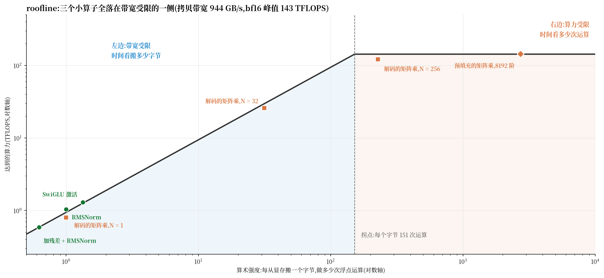
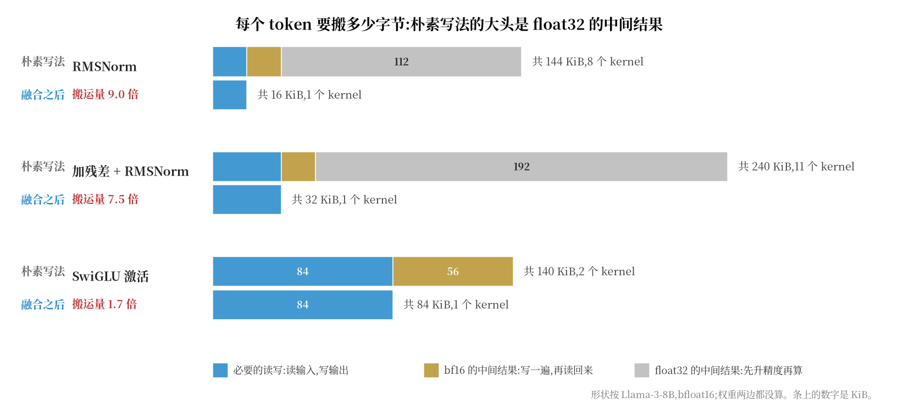
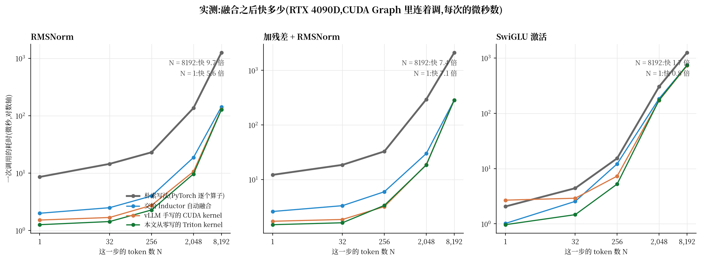
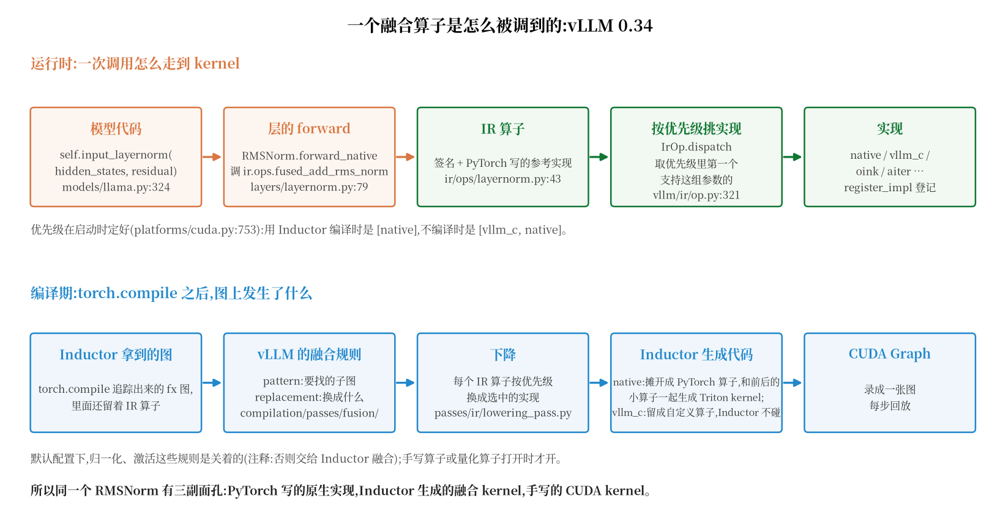

面试问"什么是算子融合",常见的回答是:把几个小算子合成一个 kernel,少读写显存。

先给一句话的版本。小算子的时间,花在把数据从显存搬进搬出上。融合就是少搬几趟。

接着问:少的是哪些读写,能少多少?vLLM 里的融合算子是手写的,还是编译器做的?自己写一个,怎么放进 vLLM?

这篇按 v0.34.0 的源码,把这三个问题走一遍。先算一笔账,再从零写一个 Triton kernel,再看 vLLM 里同一个算子的三副面孔,最后写一个自己的。

实测都在 4090D 上,形状按 Llama-3-8B。

## 一、先算账:小算子的时间花在哪

一个算子在 GPU 上要多久,有两个下限。搬数据的时间,做运算的时间,取大的那个:

$$t \ge \max\left(\frac{\text{bytes}}{\text{bandwidth}}, \frac{\text{flops}}{\text{peak}}\right)$$

意思是:数据要从显存搬进来,结果要搬出去,这要时间。运算本身也要时间。哪个大,就卡在哪个上。前者叫带宽受限,后者叫算力受限。

打个比方。显存是冰箱,计算单元是案板。数据得先从冰箱拿到案板,算完再放回去。带宽是从冰箱走到案板的速度,算力是刀工。

刀工再快,食材跟不上,时间还是花在跑冰箱上。这就是带宽受限。

4090D 上量了两个峰值。拷贝带宽 944 GB/s。bf16 矩阵乘的峰值 143 TFLOPS,每秒 143 万亿次。

两个数一除,得到拐点:

$$\text{ridge} = \frac{\text{peak}}{\text{bandwidth}} = \frac{143.0\ \text{TFLOPS}}{943.9\ \text{GB/s}} \approx 151\ \text{FLOP/byte}$$

意思是:每搬一个字节,做不满 151 次运算,就是带宽受限。做得比这多,才算力受限。



来看解码。解码时的一个矩阵乘是 [N, 4096] 乘 [4096, 4096],N 是 batch。每搬一个字节做多少次运算,差不多等于 N:

$$\text{AI} = \frac{2NKM}{2(KM + NK + NM)} \approx N$$

N 是 1,算术强度就是 1。N 是 32,是 31。都远小于 151,全是带宽受限。

算术强度,就是每跑一趟冰箱能干多少活。跑一趟只干 1 下,太亏。

实测也是。权重是 32 MiB,读一遍要 36 微秒。矩阵乘的耗时,N 是 1 的时候 42 微秒,N 是 32 的时候 41 微秒。

batch 涨了 32 倍,时间没变。卡在把权重搬进来上。

N 到 256,算术强度 228,过了拐点,才开始吃算力。70 微秒。

换个说法。权重像一本 32 MiB 的字典,每走一步都要把它从头翻一遍。这一步里查 1 个词,还是查 32 个词,翻字典的时间一样。所以 batch 从 1 涨到 32,时间没变。

RMSNorm、SwiGLU 激活这些小算子,每搬一个字节只做 1 次运算上下。全在带宽受限的那一侧。

所以解码的时候,时间花在搬字节上。省时间的办法,是少搬。

## 二、朴素写法:每一步都落一次显存

先看 RMSNorm 最直接的写法。vLLM 里就有一份,是这个算子的参考实现(`vllm/ir/ops/layernorm.py:9`):

```python
@register_op
def rms_norm(
    x: Tensor, weight: Tensor | None, epsilon: float, variance_size: int | None = None
) -> Tensor:
    """Weighted root-mean-square layer normalization."""
    orig_dtype = x.dtype
    x = x.to(torch.float32)
    x_var = x if variance_size is None else x[..., :variance_size]
    variance = x_var.pow(2).mean(dim=-1, keepdim=True)
    x = x * torch.rsqrt(variance + epsilon)
    if weight is not None:
        x = x.to(weight.dtype) * weight
    return x.to(orig_dtype)
```

函数体六行。每行是一个 PyTorch 算子,每个算子是一个 kernel。数下来是 8 个。

每个 kernel 做的事都一样。把输入从显存读进来,算,把结果写回显存。上一行写下去的,下一行再读上来。

好比记账。每加一笔,就把小计写进本子,合上。下一步再翻开本子,把小计抄出来,接着算。8 个 kernel,就是 8 次合上再翻开。

还有一处。第一行先升到 float32 再算,是为了精度。于是中间结果全是 float32,比输入大了一倍。

相当于为了量得准,把每个数从小杯倒进大杯再称。大杯占的地方是小杯的两倍,搬起来也重一倍。

把每一行的读写都数出来。d 是隐层宽度,一个数先按 1 字节算:

| 这一行 | 读 | 写 | 中间结果的精度 |
|---|---|---|---|
| `x.to(float32)` | 2d | 4d | bf16 进,float32 出 |
| `x.pow(2)` | 4d | 4d | float32 |
| `mean(-1)` | 4d | 0 | float32 |
| `x * rsqrt(...)` | 4d | 4d | float32 |
| `x.to(weight.dtype)` | 4d | 2d | float32 进,bf16 出 |
| `x * weight` | 2d | 2d | bf16 |

加起来 36d。其中 float32 的中间结果占 78%。

Llama-3-8B 的 d 是 4096,一个 token 就是 144 KiB。

这一行数据本身只有 8 KiB:4096 个数,每个 2 字节。为了算它,搬了 144 KiB,是它本身的 18 倍。



另外两个算子同理。

"加残差 + RMSNorm"是 60d,240 KiB,11 个 kernel,float32 占 80%。

SwiGLU 激活没有升精度,只有两个 kernel。多出来的是 silu 的结果:写一遍,再读回来。140 KiB,融合后 84 KiB。

## 三、融合:中间结果留在寄存器里

融合的办法只有一句话:中间结果不落显存,留在芯片里。

一个 kernel 把这一行 token 整个读进来。平方、求和、开方、缩放,都在线程自己的寄存器里做。算完了,只把结果写出去。

寄存器是计算单元手边的小格子。快,但装不了多少。案板就是它。

还是记账。这回小计不写本子,记在脑子里,一口气算到底,只把最后的总数写下来。

float32 的中间结果也在寄存器里,不占显存的字节。

这样每个算子只搬必要的那些:

| 算子 | 朴素写法 | 融合之后 | 比值 | kernel 数 |
|---|---|---|---|---|
| RMSNorm | 144 KiB | 16 KiB | 9.0 | 8 变 1 |
| 加残差 + RMSNorm | 240 KiB | 32 KiB | 7.5 | 11 变 1 |
| SwiGLU 激活 | 140 KiB | 84 KiB | 1.67 | 2 变 1 |

融合之后搬的字节,就是第一节公式里的 bytes。时间有了下限。

验一下。"加残差 + RMSNorm"在 8192 个 token 时要搬 256 MiB。按 944 GB/s 算,284 微秒。vLLM 的 CUDA kernel 实测 286 微秒,贴着下限。

## 四、来历:一张时间线

| 时间 | 发生了什么 | 解决了什么 |
|---|---|---|
| 2023 年 11 月,v0.2.2 | Support fused add rmsnorm for LLaMA | 发布说明里最早的一条手写融合 kernel |
| 2024 年 1 月,v0.3.0 | Fused MoE kernel | MoE 的专家计算合成一个 kernel |
| 2024 年 6 月,v0.5.0 | CustomOp 接口 | 一个层,多种平台的实现,统一分发 |
| 2024 年 10 月,v0.6.3 | `VLLM_TORCH_COMPILE_LEVEL` | 可以关掉手写算子,全交给 Inductor |
| 2024 年 11 月,v0.6.4 | Fuse RMSNorm with quant;分块 CUDA Graph | 编译期的融合规则第一次出现 |
| 2025 年 1 月,v0.7.0 | torch.compile 完全集成,在 V1 里默认开 | 编译器融合成了默认路线 |
| 2025 年 3 月,v0.8.0 | V1 引擎默认开 | 所有用户都走上了编译器融合 |
| 2025 年 5 月,v0.9.0 | silu_and_mul 接 fp8 量化的融合规则 | 激活也接上了量化 |
| 2025 年 7 月,v0.10.0 | FlashInfer 的 all-reduce 加 RMSNorm | 跨卡的通信也融进来 |
| 2026 年 2 月,v0.16.0 | Helion 框架 | 多了一种写 kernel 的语言 |
| 2026 年 3 月,v0.17.0 | 第一个 Helion kernel;AR 加 RMSNorm 融合默认开 | |
| 2026 年 11 月,v0.34.0 | IR 算子层 | 一个算子,多种实现,按优先级选 |

时间线上有个转折。2024 年 11 月之前,融合靠手写。之后,编译器成了主角。

## 五、从零写一个:Triton

CUDA 写 kernel,要管线程、共享内存、向量化读写。Triton 把这些包了一层,只说"一个 program 管什么数据,对它做什么"。

RMSNorm 的 Triton 写法,11 行:

```python
@triton.jit
def _rms_norm_kernel(x_ptr, w_ptr, y_ptr, eps, D: tl.constexpr, BLOCK: tl.constexpr):
    row = tl.program_id(0).to(tl.int64)          # 一个 program 管一行
    cols = tl.arange(0, BLOCK)
    mask = cols < D
    ptr = row * D + cols
    x = tl.load(x_ptr + ptr, mask=mask, other=0.0).to(tl.float32)
    var = tl.sum(x * x, axis=0) / D              # 整行一次读完,方差留在寄存器里
    rstd = tl.math.rsqrt(var + eps)
    w = tl.load(w_ptr + cols, mask=mask, other=0.0).to(tl.float32)
    tl.store(y_ptr + ptr, (x * rstd * w).to(y_ptr.dtype.element_ty), mask=mask)
```

一个 program 管一行。`row` 是这一行的编号。

好比一个厨师管一道菜,从生到熟一个人做完,不传给下一个人。

`tl.load` 把这一行整个读进来,顺手升到 float32。`x` 是寄存器里的一块。

`tl.sum(x * x)` 在寄存器里把整行加起来。没有写显存,也没有读回来。

后面两行是缩放和乘权重,也在寄存器里。最后一行转回 bf16,写出去。

显存只碰了两次。读一行,写一行。

"加残差 + RMSNorm"只多三行。再读一个残差进来,相加,把和写回去:

```python
    r = tl.load(r_ptr + ptr, mask=mask, other=0.0).to(tl.float32)
    s = x + r
    tl.store(res_ptr + ptr, s.to(res_ptr.dtype.element_ty), mask=mask)
```

之后的方差从 `s` 算,不从 `x` 算。

启动它只要一行:

```python
_rms_norm_kernel[(N,)](x, w, y, eps, D=4096, BLOCK=4096, num_warps=8)
```

`(N,)` 是开 N 个 program,一行一个。`BLOCK` 要是 2 的幂,不小于 D。

完整代码在同目录的 `bench/fusion_ops.py`。

## 六、实测:同一个算子,四种写法

四种写法放在一起量:

- 朴素写法。就是第二节的 PyTorch 代码。
- 交给 Inductor。同一个函数,套一层 `torch.compile`。
- vLLM 手写的 CUDA kernel。
- 本文的 Triton kernel。



8192 个 token 的时候,数据放不进 L2 缓存,卡在显存带宽上。三种融合写法打平:

| 算子 | 朴素写法 | Inductor | vLLM CUDA | Triton | 朴素慢几倍 |
|---|---|---|---|---|---|
| RMSNorm | 1,252.7 | 142.3 | 129.1 | 126.8 | 9.7 |
| 加残差 + RMSNorm | 2,116.8 | 284.8 | 285.9 | 285.6 | 7.4 |
| SwiGLU 激活 | 1,247.5 | 735.2 | 725.3 | 739.5 | 1.7 |

单位微秒。最后一列按 vLLM CUDA 算。

对比第三节的表。搬运量的比值是 9.0、7.5、1.67。实测的加速比是 9.7、7.4、1.7。

**省了多少字节,就快了多少。**

token 数是 1 的时候,情况变了:

| 算子 | 朴素写法 | Inductor | vLLM CUDA | Triton |
|---|---|---|---|---|
| RMSNorm | 8.6 | 2.0 | 1.5 | 1.3 |
| 加残差 + RMSNorm | 12.1 | 2.6 | 1.7 | 1.5 |
| SwiGLU 激活 | 2.1 | 1.0 | 2.7 | 1.0 |

单位微秒。朴素写法的 kernel 数是 8、11、2,其余都是 1。

N 是 1,数据一共 8 KiB,搬运不花时间。时间花在别处:每个 kernel 不管多小,都要 1 微秒上下。朴素写法 8 个 kernel,8.6 微秒。融合后 1 个,1.5 微秒。

好比叫外卖。配送是按单算的,点 1 样和点 8 样,每单都得跑一趟。8 个 kernel 是 8 单。融合是把 8 样合成一单送。

所以小形状上,融合省的是 kernel 的个数。

还有三处值得看。

**一,中等形状上,手写的比 Inductor 快**。2048 个 token 的 RMSNorm:Inductor 18.7 微秒,手写 10.6 微秒,慢了 76%。这个形状的数据放得进 L2,比的是谁把缓存用得好。

**二,vLLM 的 SwiGLU kernel 在 N 是 1 的时候,比朴素写法还慢**。2.7 微秒对 2.1 微秒。原因在启动配置(`csrc/activation_kernels.cu:252`):一个线程块管一行,N 是 1 就只开 1 个块,整张卡 1 个 SM 在干活。本文的 Triton 版把一行切成 14 块,0.96 微秒。

厨房里有 114 个灶台,只点了 1 个。

**三,融合之后误差更小**。SwiGLU 在 8192 个 token 时,和 float64 的参考比:朴素写法最大误差 0.0625,Triton 和 Inductor 是 0.0002。朴素写法先算 silu,舍入成 bf16,再乘,又舍入一次。融合的 kernel 在 float32 里一口气算完,只舍入一次。

好比算账。每加一笔就先四舍五入到元,加 100 笔,零头全丢了。先用分记到底,最后才取整,只差一次零头。

本文的 kernel 是照着这两个形状写的。vLLM 的要处理任意宽度、带步长的输入、可选的权重,还有 2 维到 4 维的张量。

## 七、放到一步解码里

一个 token 过一层,要两次"加残差 + 归一化",一次 SwiGLU。朴素写法 620 KiB,融合后 148 KiB。32 层,19.4 MiB 对 4.6 MiB。

融合之后剩下的 148 KiB 里,SwiGLU 占 57%。它的中间维是 14336,是隐层的 3.5 倍。再要省,得从它下手。

换成时间。并发 32 解码,一步 25.3 毫秒。这一步里这三样小算子的耗时,按实测的每次调用乘调用次数:

| 写法 | 一步里的耗时 | 占一步 |
|---|---|---|
| 朴素写法 | 1.33 毫秒 | 5.2% |
| Inductor | 0.29 毫秒 | 1.2% |
| vLLM CUDA | 0.21 毫秒 | 0.8% |

在 Llama-3-8B 上,融合省下的是一步的 4% 上下。

一顿饭做了 25 分钟,切配的零碎活从 1.3 分钟缩到 0.2 分钟。零碎,但省了。

不大,但白拿的。这笔账还随模型变:中间维更宽的模型,占比往上走。

## 八、vLLM 里,一个算子有三副面孔

第六节量了四种写法。vLLM 里,它们是怎么组织在一起的?

0.34 的源码里有一层叫 IR 算子,在 `vllm/ir/` 下。一个算子分成三样东西:定义,实现,优先级。

**定义**,就是一个 PyTorch 写的函数。第二节的代码就是。它有两个用处。一是说明这个算子算什么。二是它自己就是一种实现,叫 `native`。

**实现**,用 `register_impl` 往算子上挂(`vllm/kernels/vllm_c.py:17`):

```python
rms_no_var_size = lambda x, weight, epsilon, variance_size=None: (
    variance_size is None and (weight is None or weight.dtype == x.dtype)
)
"""vLLM kernel requires no variance_size override and matching input/weight dtype."""


@ir.ops.rms_norm.register_impl(
    "vllm_c", supports_args=rms_no_var_size, supported=GPGPU_DEVICE
)
def rms_norm(
    x: Tensor, weight: Tensor | None, epsilon: float, variance_size: int | None = None
) -> Tensor:
    assert variance_size is None
    ...
    output = torch.empty(x.shape, device=x.device, dtype=x.dtype)
    torch.ops._C.rms_norm(output, x, weight, epsilon)
    return output
```

`"vllm_c"` 是实现的名字。

`supported` 是静态的:这个平台上有没有。

`supports_args` 是动态的:这组参数行不行。手写的 kernel 只支持不带 `variance_size`、权重和输入同类型的调用。别的,交给下一个。

同一个算子上还挂着别家的。AMD 的是 `"aiter"`,在 `vllm/kernels/aiter_ops.py`。

**优先级**,决定先用谁(`vllm/ir/op.py:337`):

```python
for impl in self._priority_impls:
    ...
    if impl.supports_args(*args, **kwargs):
        return impl
```

顺着列表往下找,第一个支持这组参数的,就是它。

好比排班。同一个活有好几个人能干,表上写着先叫谁。排在前面的人说"这个参数处理不了",就轮到下一个。

列表在启动时定好(`vllm/platforms/cuda.py:757`):

```python
# Native used by default when compiling,
# use vllm_c kernels where available when no codegen
cc = vllm_config.compilation_config
using_inductor = cc.backend == "inductor" and cc.mode != CompilationMode.NONE
default = ["native"] if using_inductor else ["vllm_c", "native"]
```

注释说得很清楚。编译的时候用 `native`,不编译的时候用 `vllm_c`。

所以同一个 RMSNorm 有三副面孔:

- `native`。PyTorch 写的那个函数。用 Inductor 编译时默认是它,摊开以后交给 Inductor 融合。
- Inductor 生成的 kernel。不是谁手写的,是编译器照着 `native` 生成的。
- `vllm_c`。手写的 CUDA kernel。不编译的时候是它。



模型代码不关心这些。解码层里只有一行(`vllm/model_executor/models/llama.py:324`):

```python
hidden_states, residual = self.input_layernorm(hidden_states, residual)
```

## 九、手写的 CUDA kernel 长什么样

`vllm_c` 背后是 C++ 写的 kernel,在 `csrc/layernorm_kernels.cu:108`。去掉模板和临时变量,"加残差 + RMSNorm"是这样:

```cpp
__global__ ...
fused_add_rms_norm_kernel(
    scalar_t* __restrict__ input,  // [..., hidden_size]
    ...
    scalar_t* __restrict__ residual,      // [..., hidden_size]
    const scalar_t* __restrict__ weight,  // [hidden_size], null if !HasWeight
    const float epsilon, const int num_tokens, const int hidden_size,
    const int64_t residual_stride) {
  __shared__ float s_variance;
  float variance = 0.0f;
  ...
  for (int idx = threadIdx.x; idx < vec_hidden_size; idx += blockDim.x) {
    ...
    _f16Vec<scalar_t, width> temp = input_v[strided_id];
    temp += residual_v[id];
    variance += temp.sum_squares();
    residual_v[id] = temp;
  }
  ...
  variance = BlockReduce(reduceStore).Reduce(variance, CubAddOp{}, blockDim.x);

  if (threadIdx.x == 0) {
    s_variance = rsqrtf(variance / hidden_size + epsilon);
  }
  __syncthreads();

  for (int idx = threadIdx.x; idx < vec_hidden_size; idx += blockDim.x) {
    ...
    _f16Vec<scalar_t, width> res = residual_v[id];
    _f16Vec<scalar_t, width> out;
    ...
    if constexpr (HasWeight) {
      _f16Vec<scalar_t, width> w = weight_v[idx];
#pragma unroll
      for (int j = 0; j < width; ++j) {
        ...
        out.data[j] = Converter::convert(x * s_variance * wf);
      }
    }
    ...
    input_v[strided_id] = out;
  }
}
```

结构是"两遍"。

第一遍,一个线程块读一行。每个线程读几个向量,和残差相加,累加平方,把新的残差写回去。

然后整块求和。一个线程算出开方,放进共享内存。

第二遍再读一遍这一行,乘上缩放和权重,写出。

为什么要读两遍?方差要先看完一行才知道。算缩放的时候,得回头再用一遍每个数。

像给全班写评语。得先把所有人的分数都看一遍,才知道平均分。知道了平均分,才能回头给每个人写。

第二遍读的数据,刚才才写过,还在芯片的缓存里,不用再从显存搬。

成绩单还在手边,不用再跑一趟档案室。

第五节的 Triton kernel 只读一遍,因为整行放在寄存器里。这要求一行放得下,宽度有上限。手写 CUDA 的两遍写法,多宽都行。

启动配置在同一个文件里(`csrc/layernorm_kernels.cu:253`):

```cpp
// For large num_tokens, use smaller blocks to increase SM concurrency.
const int max_block_size =
    batch_invariant_launch ? 1024 : ((num_tokens < 256) ? 1024 : 256);
dim3 grid(num_tokens);
```

一行一个线程块。token 少的时候每块开 1024 个线程,token 多的时候开 256 个,让更多的块同时跑。

## 十、Inductor 生成的 kernel 长什么样

`native` 那副面孔,摊开以后交给 Inductor。Inductor 看到的是一串 PyTorch 算子:转类型,加,平方,求均值,乘,开方,再乘。

它把这些合成一个 Triton kernel。名字就是这些算子的列表:`triton_red_fused__to_copy_add_mean_mul_pow_rsqrt_0`。`red` 是带归约,`poi` 是纯逐点。

生成的代码由 `torch.compile` 导出,一字未改,在同目录的 `bench/inductor_fused_add_rms_norm.py`。去掉临时变量和一部分参数,主干是这样:

```python
@triton.jit
def triton_red_fused__to_copy_add_mean_mul_pow_rsqrt_0(in_ptr0, ...):
    xnumel = 8
    r0_numel = 4096
    ...
    _tmp7 = tl.full([XBLOCK, R0_BLOCK], 0, tl.float32)
    for r0_offset in tl.range(0, r0_numel, R0_BLOCK):
        ...
        tmp0 = tl.load(in_ptr0 + (r0_1 + 4096*x0), ...).to(tl.float32)
        tmp2 = tl.load(in_ptr1 + (r0_1 + 4096*x0), ...).to(tl.float32)
        tmp4 = tmp0 + tmp2
        tmp5 = tmp4 * tmp4
        ...
        _tmp7 = tl.where(r0_mask & xmask, _tmp7 + tmp5, _tmp7)
    tmp7 = tl.sum(_tmp7, 1)[:, None]
    for r0_offset in tl.range(0, r0_numel, R0_BLOCK):
        ...
        tmp9 = tl.load(in_ptr0 + (r0_1 + 4096*x0), ...).to(tl.float32)
        tmp11 = tl.load(in_ptr1 + (r0_1 + 4096*x0), ...).to(tl.float32)
        tmp21 = tl.load(in_ptr2 + (r0_1), ...).to(tl.float32)
        ...
        tmp18 = libdevice.rsqrt(tmp15 + tmp16)
        tmp19 = tmp13 * tmp18
        ...
        tl.store(out_ptr1 + (r0_1 + 4096*x0), tmp22, ...)
        tl.store(out_ptr2 + (r0_1 + 4096*x0), tmp23, ...)
```

也是两遍。第一个循环累加平方。第二个循环再读一遍,缩放,写出。

和第九节手写的 CUDA kernel,结构一模一样。区别是谁写的:一个是人,一个是编译器照着 PyTorch 代码生成的。

一个是厨师照着菜谱,自己设计了这道工序。另一个是看了菜谱上的 11 步,自动写出同样的工序。

第一个循环里的 `eviction_policy='evict_last'` 是一个提示。这些数据等下还要读,先别挤出缓存。

## 十一、编译期:vLLM 自己的融合规则

Inductor 会融合逐点的算子和归约。有两类东西它融不了。

一类是它看不进去的。手写的 kernel 是一个黑盒,前后的算子融不进去。

另一类是它不认识的。量化就是。

所以 vLLM 还有一套自己的融合规则,在 `vllm/compilation/passes/fusion/` 下,13 个文件。

**老办法:CustomOp**。SwiGLU 激活是这么写的(`vllm/model_executor/layers/activation.py:116`):

```python
@CustomOp.register("silu_and_mul")
class SiluAndMul(CustomOp):
    ...
    def __init__(self, *, compile_native: bool = True):
        super().__init__(compile_native=compile_native)
        if (
            current_platform.is_cuda_alike()
            or current_platform.is_xpu()
            ...
        ):
            self.op = torch.ops._C.silu_and_mul

    @staticmethod
    def forward_native(x: torch.Tensor) -> torch.Tensor:
        """PyTorch-native implementation equivalent to forward()."""
        d = x.shape[-1] // 2
        return F.silu(x[..., :d]) * x[..., d:]

    def forward_cuda(self, x: torch.Tensor) -> torch.Tensor:
        d = x.shape[-1] // 2
        output_shape = x.shape[:-1] + (d,)
        out = torch.empty(output_shape, dtype=x.dtype, device=x.device)
        self.op(out, x)
        return out
```

一个类,两份实现。`forward_native` 是 PyTorch 写的。`forward_cuda` 调手写的 kernel。基类按配置挑一个。

默认挑哪个(`vllm/model_executor/custom_op.py:292`):

```python
@staticmethod
def default_on() -> bool:
    """Behavior controlled by `CompilationConfig.custom_ops`: On by default if
    'all', off by default if 'none'.
    When PyTorch Inductor is used, 'none' is the default value,
    otherwise 'all'.
    """
```

用 Inductor 的时候,手写的默认关着。走 `forward_native`,交给 Inductor 融合。想打开,加 `+silu_and_mul`。

**新办法:融合规则**。每条规则是三个成员(`vllm/compilation/passes/vllm_inductor_pass.py:194`):

```python
class VllmPatternReplacement(ABC, Generic[P, R]):
    """A pattern/replacement pair for FX graph fusion.

    Implement the three abstract members below, then pass
    instances to VllmFusionPatternMatcherPass.register(). The pass will
    find every occurrence of `pattern` in the graph and substitute it
    with `replacement`.
    """

    @property
    @abstractmethod
    def pattern(self) -> Callable[P, R]:
        """Returns a closure defining the FX subgraph to search for."""
        ...

    @property
    @abstractmethod
    def replacement(self) -> Callable[P, R]:
        """Returns a closure defining the FX subgraph to
        substitute in place of each match.
        """
        ...

    @abstractmethod
    def get_inputs(self) -> list[torch.Tensor]:
        """Example tensors used to trace pattern and replacement."""
        ...
```

`pattern` 是要找的子图。`replacement` 是换成什么。`get_inputs` 是示例张量,用来把前两个追踪成图。

好比在菜谱里发现"切片"和"切丝"总是连着做,就换成一台直接切丝的机器。pattern 是那两步,replacement 是那台机器。

最短的一条规则是"加残差 + 归一化"(`vllm/compilation/passes/fusion/add_rms_fusion.py:17`):

```python
class AddRMSNormPattern(VllmPatternReplacement):
    ...
    @property
    def pattern(self):
        def _pattern(
            branch: torch.Tensor,
            residual: torch.Tensor,
            weight: torch.Tensor,
        ) -> tuple[torch.Tensor, torch.Tensor]:
            residual_out = (
                residual + branch if self.residual_first else branch + residual
            )
            rms = vllm.ir.ops.rms_norm(residual_out, weight, self.epsilon)
            return rms, residual_out

        return _pattern

    @property
    def replacement(self):
        def _replacement(
            branch: torch.Tensor,
            residual: torch.Tensor,
            weight: torch.Tensor,
        ) -> tuple[torch.Tensor, torch.Tensor]:
            return vllm.ir.ops.fused_add_rms_norm(
                branch, residual, weight, self.epsilon
            )

        return _replacement
```

左边是"先加,再归一化"两个算子。右边是一个。

其余的规则是一类:某个算子后面接一个量化。

归一化后接 FP8 量化,换成 `torch.ops._C.rms_norm_static_fp8_quant`。

激活后接量化,换成 `torch.ops._C.silu_and_mul_quant`。

all-reduce 后接归一化,换成 FlashInfer 的 `flashinfer_trtllm_fused_allreduce_norm`。

思路一样。两道工序总是一前一后,就换一台机器一口气做完,省掉中间那一趟。量化好比做完菜还要打包,就有"做好顺便打包"的机器。

**什么时候生效**。规则挂在 Inductor 的 `post_grad_custom_post_pass` 钩子上。Inductor 自己的融合跑完,再跑它们。

默认是关的(`vllm/config/vllm.py:186`):

```python
def enable_norm_fusion(cfg: "VllmConfig") -> bool:
    """Enable if either RMS norm or quant FP8 custom op is active;
    otherwise Inductor handles fusion."""
    return (
        cfg.compilation_config.is_custom_op_enabled("rms_norm")
        or cfg.compilation_config.is_custom_op_enabled("quant_fp8")
        or cfg.kernel_config.ir_op_priority.rms_norm[0] != "native"
    )
```

注释里的 otherwise 就是答案。手写算子没开的时候,交给 Inductor。

量化算子打开的时候,规则跟着打开。权重分块量化的 FP8 模型就是:量化算子默认是开的。注释里写了原因,"On H100 the CUDA kernel is faster than native implementation"。

**规则跑完,还有一步**。叫下降(`vllm/compilation/passes/ir/lowering_pass.py:41`):

```python
node = match.nodes[0]
ir_op = get_ir_op(node)  # TODO is node.target always an overload?
...
# Select and record the implementation, using fake args
fake_args = fx.map_arg(node.args, lambda arg: arg.meta["val"])
ir_op_impl = ir_op.dispatch(*fake_args)
self.selected_impls[ir_op.name][node.name] = ir_op_impl.provider
...
match.replace_by_example(
    ir_op_impl.func_impl_fn, bound_args.args, run_functional_passes=False
)
```

图里每个 IR 算子,按优先级挑一个实现。把那个实现的代码追踪进图里,替掉原来的节点。

挑中 `native`,追踪进去的是一串 PyTorch 算子。Inductor 接着融。

挑中 `vllm_c`,追踪进去的是一个自定义算子。Inductor 不碰。

这一步是编译器融合能成立的前提。IR 算子在 `torch.compile` 眼里本来是个黑盒。是下降把它拆开的。

好比中转站把封好的大包裹拆开。拆开了,里面的小件才能和别的小件重新拼成一箱。

## 十二、怎么写一个自己的融合算子

照第八节的接口,从零登记一个。能跑的完整代码在同目录的 `bench/my_op_recipe.py`。

**第一步,定义算子**。函数体是 PyTorch 写的参考实现:

```python
@ir.register_op
def my_rms_norm(x: Tensor, weight: Tensor, epsilon: float) -> Tensor:
    orig_dtype = x.dtype
    x = x.to(torch.float32)
    variance = x.pow(2).mean(dim=-1, keepdim=True)
    x = x * torch.rsqrt(variance + epsilon)
    x = x.to(weight.dtype) * weight
    return x.to(orig_dtype)
```

**第二步,给一组示例输入**。vLLM 用它核对各种实现:

```python
@my_rms_norm.register_input_generator
def _my_rms_norm_inputs(num_tokens, hidden_size, dtype, epsilon=1e-5, device=None):
    x = torch.randn(num_tokens, hidden_size, dtype=dtype, device=device)
    weight = torch.randn(hidden_size, dtype=dtype, device=device)
    return x, weight, epsilon
```

**第三步,写 kernel**。就是第五节那个。

**第四步,把 kernel 包成 torch 自定义算子。**

```python
@triton_op("my::my_rms_norm_triton", mutates_args=())
def _my_rms_norm_launch(x: Tensor, weight: Tensor, epsilon: float) -> Tensor:
    y = torch.empty_like(x)
    n, d = x.shape
    wrap_triton(_my_rms_norm_kernel)[(n,)](x, weight, y, epsilon, D=d,
                                           BLOCK=triton.next_power_of_2(d), num_warps=8)
    return y
```

这一步不能省。直接发射 Triton kernel 的函数,追踪不了:下降那一步要用假张量把它追进图里,报的是"不能访问假张量的数据指针"。

vLLM 自己的 Triton 实现也是这么包的(`vllm/kernels/triton/activation.py:73`)。

**第五步,登记,设优先级。**

```python
@my_rms_norm.register_impl("my_triton", supported=torch.cuda.is_available())
def _my_rms_norm_triton(x, weight, epsilon):
    return _my_rms_norm_launch(x, weight, epsilon)

my_rms_norm.set_default(["my_triton", "native"])
```

**跑出来是这样**。数的是 kernel 的个数:

| 怎么用 | 优先级 `native` | 优先级 `my_triton` |
|---|---|---|
| 直接调用 | 8 个,PyTorch 的 | 1 个,本文写的 |
| 普通的 `torch.compile` | 8 个,没融合 | 1 个,本文写的 |
| vLLM 的编译流程 | 1 个,Inductor 生成的 | 1 个,本文写的 |
| vLLM 的编译流程,前后各加一个算子 | 还是 1 个 | 2 个 |

第二行是个坑。普通的 `torch.compile` 把 IR 算子当黑盒,拿不到融合。要经过 vLLM 自己的编译流程,下降那一步把黑盒拆开,才有第三行。

最后一行是取舍。`native` 是一扇门,前后的算子融得进来。手写的是一堵墙,它自己是一个 kernel,前后的算子进不来。

还是寄快递。手写的 kernel 是一个封好的箱子,编译器只能整箱贴单,没法把旁边的小件塞进去。原生实现是散件,编译器能把相邻的散件拼成一箱。

## 十三、什么时候值得手写

默认不用手写。PyTorch 写清楚,交给 Inductor。第六节的实测:大形状上,三种融合写法打平。

四种情况值得手写。

**一,Inductor 看不进去的东西**。量化是手写算子。归一化后接量化,Inductor 融不了。这时写一个"归一化 + 量化"的融合 kernel。

**二,要跨出算子的边界**。all-reduce 是跨卡的通信,后面接归一化。合成一个 kernel,数据不用绕一圈。这要 FlashInfer 这类库配合,只在 Hopper 和 Blackwell 上开。

**三,启动配置有讲究**。第六节,SwiGLU 在 N 是 1 时,vLLM 的 kernel 比朴素写法还慢,就因为一个线程块管一行。Inductor 在中等形状上慢 76%。形状固定,又在乎这点时间,自己写。

**四,没有编译器的时候**。`--enforce-eager` 关掉编译。优先级自动切到 `vllm_c`。

## 十四、怎么选:一张表

| 你的情况 | 怎么做 | 原因 |
|---|---|---|
| 一般的模型 | 默认配置 | Inductor 融合,大形状上和手写的一样快 |
| 想用 vLLM 手写的 kernel | `--compilation-config '{"custom_ops": ["+silu_and_mul"]}'` | 小形状上手写的快 |
| 不要编译 | `--enforce-eager` | 优先级切到手写 kernel |
| 权重分块量化的 FP8 模型 | 默认配置 | 量化和"归一化 + 量化"的规则默认是开的 |
| 要写一个新算子 | 第十二节的五步 | |
| 新算子前后还有小算子 | 优先级留 `native` | 前后的算子融得进来 |

## 十五、面试里会问的

每个问题给一段能直接说出口的回答。先结论,再机制,最后一个数。

**1. 什么是算子融合,为什么能快?**

答:把几个小算子合成一个 kernel,中间结果留在寄存器里,不写显存也不读回来。

打个比方,显存是冰箱,计算单元是案板。朴素写法是每做一步就把半成品放回冰箱,下一步再拿出来。融合是在案板上一口气做完。

小算子都是带宽受限的。每搬一个字节只做 1 次运算上下,时间等于搬字节的时间。

所以省了多少字节,就快了多少。RMSNorm 融合后搬的字节是原来的九分之一,实测快 9.7 倍。

**2. 怎么判断一个算子该不该融合?**

答:算术强度。每搬一个字节做多少次运算。和这张卡的拐点比,4090D 是 151。

比拐点小,是带宽受限,时间花在搬字节上,融合有用。

矩阵乘在解码 batch 小的时候也是带宽受限。batch 1 和 batch 32 的矩阵乘,都是 41 微秒。

**3. RMSNorm 的朴素写法慢在哪?**

答:两处。

好比记账,每加一笔就合上本子,下一步再翻开。

一是每行一个 kernel,每个 kernel 读写一遍显存。8 个 kernel,搬 144 KiB。

二是先升到 float32 再算,中间结果大了一倍。float32 的中间结果占搬动量的 78%。

**4. vLLM 的融合算子是手写的,还是编译器做的?**

答:都有。默认是编译器做的。

0.34 里一个算子是个 IR 算子。PyTorch 写的函数是它的参考实现,叫 native。手写的 CUDA kernel 是挂在它上面的一种实现。

用 Inductor 编译时,默认走 native,编译器自动融合。不编译时走手写的。

**5. 手写的 kernel 和 Inductor 生成的比,谁快?**

答:大形状上打平,都卡在显存带宽上。

中等形状上手写的快。2048 个 token 的 RMSNorm,Inductor 慢 76%。

手写的另一个好处是能挑启动配置。vLLM 的 SwiGLU kernel 在 batch 1 时比朴素写法还慢,一个线程块管一行,只用上 1 个 SM。

**6. 手写的 kernel 有什么代价?**

答:它是一堵墙。前后的算子融不进来。

实测:优先级设成手写的,算子前后各加一个算子,出来 2 个 kernel。设成 native,还是 1 个。

所以 vLLM 的默认是 native,让 Inductor 把前后一起融。

**7. Inductor 生成的 kernel 长什么样?**

答:名字就是它融合进去的算子列表,比如 `triton_red_fused__to_copy_add_mean_mul_pow_rsqrt`。

结构上是两遍。第一遍读一行,累加平方。第二遍再读一遍,缩放,写出。

vLLM 手写的 CUDA kernel 也是这个结构。

**8. 下降是什么?**

答:编译期的一步。把图里的 IR 算子,按优先级挑一个实现,把实现的代码追踪进图里。

挑中 native,追踪进去的是一串 PyTorch 算子,Inductor 接着融。

没有这一步,IR 算子在 `torch.compile` 眼里是个黑盒。普通的 `torch.compile` 编译它,出来还是 8 个 kernel。

**9. vLLM 自己的融合规则是什么?什么时候开?**

答:每条规则三个成员:pattern 是要找的子图,replacement 是换成什么,get_inputs 是示例张量。

两类。一类是加残差接归一化,换成 `fused_add_rms_norm`。一类是某个算子接量化,换成手写的融合 kernel。

默认关着。手写算子或量化算子打开的时候才开。权重分块量化的 FP8 模型上是开的。

**10. 怎么写一个自己的融合算子?**

答:五步。

用 `@ir.register_op` 定义算子,函数体是 PyTorch 写的参考实现。

登记示例输入。写 Triton kernel。

把 kernel 包成 `triton_op`。这一步不能省,不然追踪不了。

用 `register_impl` 登记实现,用 `set_default` 设优先级。

**11. Triton 和 CUDA 写 kernel,有什么区别?**

答:CUDA 要管线程、共享内存、向量化读写。Triton 只说一个 program 管什么数据、做什么。

RMSNorm 用 Triton 写是 11 行。实测和 vLLM 手写的 CUDA kernel 一样快。

vLLM 的 Triton 实现外面都包一层 `triton_op`,为了能被追踪。

**12. 融合会影响精度吗?**

答:不会变差,有的更好。

SwiGLU 和 float64 的参考比:朴素写法最大误差 0.0625,融合后 0.0002。

朴素写法先算 silu,舍入成 bf16,再乘,又舍入。融合的 kernel 在 float32 里算完,只舍入一次。

**13. 解码的时候,batch 变大,为什么时间不怎么变?**

答:解码的矩阵乘是带宽受限的。时间是读一遍权重的时间,和 batch 无关。

4090D 上,batch 1 和 batch 32 的矩阵乘都是 41 微秒。

batch 到 256 才过拐点,开始吃算力。

**14. 融合在一步解码里占多少?**

答:Llama-3-8B 上,这三样小算子朴素写法占一步的 5.2%,融合后 0.8%。

省 4% 上下。不大,但是白拿的。

## 十六、总结

**1. 小算子是带宽受限的。** 时间等于搬字节的时间。解码的矩阵乘也是。

**2. 朴素写法每一步都落显存。** float32 的中间结果占八成。

**3. 融合是把中间结果留在寄存器里。** 省多少字节,快多少。

**4. 一个算子有三副面孔。** PyTorch 写的,Inductor 生成的,手写的。

**5. 默认走编译器融合。** 手写的 kernel 是一堵墙,原生实现是一扇门。

**6. 自己写只要五步。** 关键是包成 `triton_op`,再登记实现。

调度器那篇在后面:`schedule()` 那一千一百行,到底在排什么。

如果这个系列对你有用,点个赞或关注专栏,更新会持续。

---

*实测方法:RTX 4090D,torch 2.14.0,Triton 3.8.0,vLLM 0.34.0 自带的 CUDA kernel。形状按 Llama-3-8B:隐层 4096,中间维 14336,bfloat16。① 耗时:一张 CUDA Graph 里连着调 20 次,回放 50 次取平均,折成每次调用的微秒数;token 数是 2048 和 8192 时改成连着调 4 次。四种写法在每个 token 数上交错测 5 轮取中位数,轮换先后顺序。计时前持续空跑 7 秒以上,测量期间核心时钟 2,670 到 2,685 MHz。原地写的 CUDA kernel 在输入的副本上跑。② kernel 的个数用 torch 的 profiler 数,一次调用里 CUDA 上的 kernel。③ 误差是和 float64 参考实现的最大绝对误差。④ 拷贝带宽用 512 MiB 的拷贝量。矩阵乘峰值用 8192 阶的 bf16 矩阵乘。解码的矩阵乘在一张图里轮换 4 组权重,冲掉 L2 缓存。⑤ 一步解码的耗时取自上一篇的实测:并发 32,每个请求输出 512 个 token,关着前缀缓存的 5 轮中位数是 1,262 token 每秒,一步出 32 个 token。⑥ "怎么写一个自己的"那节的 kernel 数,由 `bench/my_op_recipe.py` 在 vLLM 0.34.0 上跑出,输出在同目录的 `my_op_recipe.out.txt`。脚本和原始结果都在同目录的 bench/ 下,正文里的算例由 calc.py 一次算出。*

*历史与文献:vLLM 在 GitHub 上的发布记录:v0.2.2(2023 年 11 月 19 日)Support fused add rmsnorm for LLaMA(#1667);v0.3.0 Fused MoE kernel(#2453、#2542);v0.5.0(2024 年 6 月 11 日)Add CustomOp interface for device portability(#5255);v0.6.3(2024 年 10 月 14 日)`VLLM_TORCH_COMPILE_LEVEL`(#9058);v0.6.4(2024 年 11 月 15 日)Fuse RMSNorm with quant(#9138)、directly register custom op(#9896)、piecewise cudagraph(#9715、#10058);v0.7.0(2025 年 1 月 27 日)"`torch.compile` is now fully integrated in vLLM, and enabled by default in V1";v0.8.0(2025 年 3 月 18 日)V1 引擎默认开(#13726);v0.9.0(2025 年 5 月 15 日)silu_and_mul 接 scaled_fp8_quant 的融合规则(#10867);v0.10.0(2025 年 7 月 24 日)Integration SM100 FlashInfer fused allreduce RMSNorm(#20691);v0.16.0(2026 年 2 月 25 日)Helion kernel framework(#32740、#32964、#33203);v0.17.0(2026 年 3 月 7 日)Helion 的 silu_mul_fp8 kernel(#33373)、AR+RMSNorm fusion by default at -O2(#34299)。*

*源码与数据:文中关于设计的描述和代码摘录,来自 vLLM v0.34.0 的源码(提交 62d4bc3),行号都指这个版本。Inductor 生成的 kernel 由 torch 2.14.0 的 `torch.compile` 导出。文中数字截至 2026 年 11 月 25 日。*
