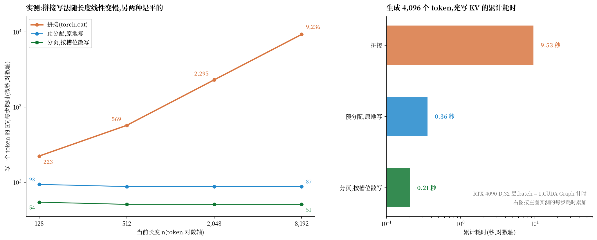
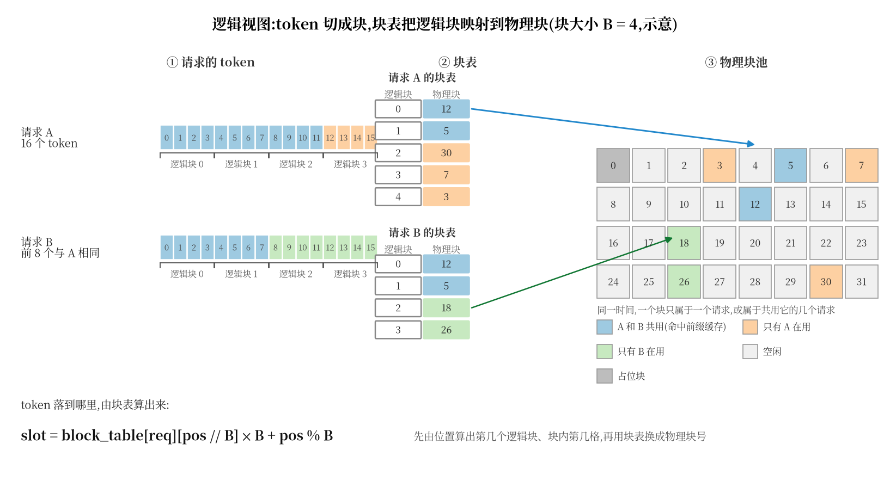
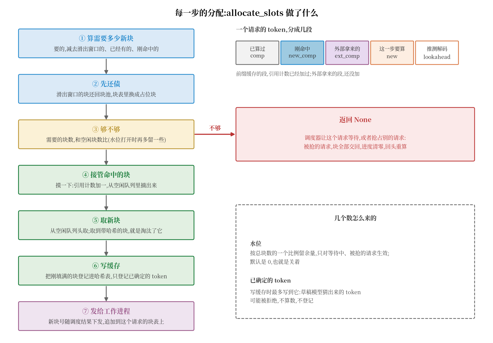
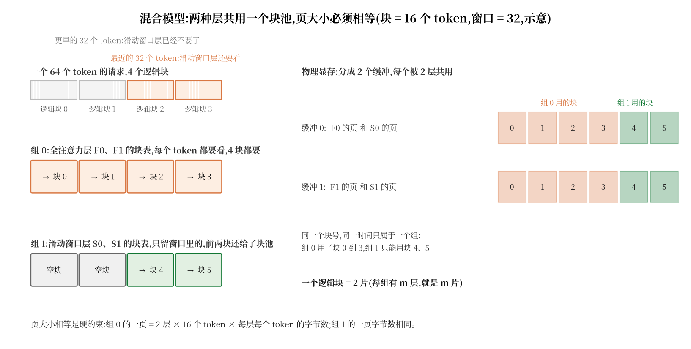

面试问 vLLM,离不开一句:讲讲 PagedAttention。

答到"像操作系统的分页",只是开了个头。接着问:KV 缓存最朴素的写法是什么,为什么慢?块表放在哪个进程里?两个请求的提示词前半段一样,它怎么知道?开了前缀缓存却一次不命中,亏不亏?

这篇按 v0.34.0 的源码,从头走一遍:先看朴素写法慢在哪,再看 vLLM 怎么分页、怎么记块池、怎么用哈希链复用,最后把一个块号从调度到写进显存的调用链串起来。

## 一、先算账:KV 缓存有多大

大模型每生成一个 token,都要回头看之前所有 token 的 K 和 V。算过的 K、V 得留着,这就是 KV 缓存。

一个 token 占多少:

$$\text{bytes per token} = 2 \times n_{\text{layer}} \times n_{\text{kv head}} \times d_{\text{head}} \times b$$

2 是 K 和 V 各一份,b 是每个数占的字节。拿 Llama-2-7B 算:32 层,32 个 KV 头,每头 128 维,半精度。2 × 32 × 32 × 128 × 2,是 524,288 字节,512 KiB。

一个 4096 个 token 的请求,KV 缓存就是 2 GiB。10 个并发,20 GiB。

对照一下:7B 个参数,每个 2 字节,权重 14 GB。KV 缓存比权重还大,而且随并发往上涨。

模型这边也在省。Llama-3-8B 用了分组查询注意力,KV 头从 32 个减到 8 个,一个 token 降到 128 KiB,四分之一。

省得更多的是多头潜在注意力。DeepSeek-V3 每个 token 每层只存一个 512 维的潜向量,加 64 维带位置信息的键,一共 576 个数。61 层算下来 70,272 字节,68.6 KiB。

要是 128 个头各存一份 128 维的 K 和 V,是 3.8 MiB。差 57 倍。

但不管模型怎么省,缓存怎么管,还有一笔账。

2023 年 6 月 vLLM 发布时的博客给了个数:当时的系统,浪费掉 60% 到 80% 的 KV 缓存,原因是碎片和过度预留。

浪费在两处。

一是预留。请求一进来,按最大长度预留一整段连续显存。实际用到的,往往短得多。

二是碎片。长短不一的请求进进出出,空出来的洞,新的请求塞不进。

这两处,操作系统的内存管理都遇到过。vLLM 的办法也一样:不按最大长度预留,按需一块一块地给。

同一篇博客里的吞吐对比:比 HuggingFace Transformers 最高快 24 倍,比 TGI 最高快 3.5 倍。

## 二、最朴素的写法,慢在哪

KV 缓存要做的事只有一件。每一层算出一个 token 的 K 和 V,找地方存下来,下一步再读。

最直接的办法:每一层放一个张量,每生成一个 token,把新的 K、V 拼到后面。HuggingFace 的 transformers 里,动态缓存就是这么写的(`DynamicLayer.update`,在 `transformers/src/transformers/cache_utils.py`):

```python
self.keys = torch.cat([self.keys, key_states], dim=-2)
self.values = torch.cat([self.values, value_states], dim=-2)
return self.keys, self.values
```

三行,一眼就懂。问题是 `torch.cat` 每次都开一块新显存,把旧的全部搬过去。

记一个 token 的 KV 在所有层加起来是 b 个字节。Llama-2-7B 是 512 KiB。

当前长度是 n 的时候,拼一次要写 n + 1 个 token:

$$W(n) = b \times (n + 1)$$

意思是:每一步搬多少,和已经有多长成正比。

生成 N 个 token,一路拼下来,总共写的是:

$$W_{\text{cat}}(N) = b \times \left(\frac{N(N+1)}{2} + N\right)$$

意思是:把每一步加起来,得到 N 的平方的一半。N 取 4096,是 4 TiB。KV 缓存本身只有 2 GiB。为了存下 2 GiB,写了 2,050 遍。

平方项不只是纸面上的。三种写法在 4090D 上量了一遍,同样是写一个 token 的 KV,32 层。



拼接这一种,长度 128 时一步 223 微秒,长度 8192 时一步 9.2 毫秒,中间是一条直线。长度 8192 那一步要搬 8 GiB,折合每秒 930 GB。纯拷贝快不过显存带宽,所以这条线压不下去。

按这条直线累加,生成 4096 个 token,光写 KV 就要 9.5 秒。另两种写法,0.36 秒和 0.21 秒。

**第二种:按最大长度预留**

别拼了。请求一进来,就给它开一段连续显存,长度是模型支持的最大长度 L_max。每一步往第 n 个位置写,什么都不搬。

一个 token 只写一次,总共 N 乘 b,没有平方项。

代价是预留。占了 L_max,实际只用了 N,利用率是:

$$U = \frac{N}{L_{\max}}$$

意思是:实际长度是最大长度的几分之几,就只有几分之几没白占。

L_max 是 4096,请求实际 512 个 token,利用率 12.5%。能同时跑几个请求,按 L_max 算,和实际长度没关系。

**第三种:倍增扩容**

折中一下:先开一小段,不够了开一段两倍大的,搬过去,旧的还掉。1、2、4、8 这样翻。

搬运量比每步拼少得多。翻到 4096,每一级各写一次,一共 4 GiB:

$$W_{\text{dbl}}(N) < 2 \times N \times b$$

意思是:不管翻多少次,写的总量不到最后那一段的两倍。

换来两个新问题。

一是里面空着。最后一次翻倍之后,占用在 N 到 2N 之间,利用率在 50% 到 100% 之间。

二是外面碎。每一段都得连续。比如显存里挨着排着三个请求,各占 1 GiB。中间那个结束了,空出 1 GiB。新来的请求要 2 GiB 连续空间,放不下,尽管两头还有空闲。这叫外碎片。

**四种写法摆在一起**

| 写法 | 每一步 | 生成 4096 个 token,累计写入 | 浪费 |
|---|---|---|---|
| 每步拼接 | 和当前长度成正比 | 4 TiB | 不浪费空间,浪费带宽 |
| 按最大长度预留 | 固定 512 KiB | 2 GiB | 每个请求,(4096 减实际长度)乘 512 KiB |
| 倍增扩容 | 偶尔翻倍 | 4 GiB | 里头最多一半,外头会碎 |
| 分页 | 固定 512 KiB | 2 GiB | 每个请求不到 32 MiB |

拼接把搬运量做成了平方。另两种把"连续"当前提,要么多占,要么会碎。

分页两样都不要。显存切成固定大小的块,每一步只写一个 token 的量。逻辑上连着,物理上随便放。

写成代码,是把"拼"换成"按槽位写":

```python
flat = cache.view(-1, H, 2 * D)      # 一整块显存,看成一个槽位数组,每格放一个 token 的 K 和 V
flat.index_copy_(0, slot, new_kv)    # 往槽位 slot 里写新的 K、V
```

`slot` 是这个 token 在整块显存里的位置,由块表算出来。上面那条 51 微秒的平线,就是这两行。

这就是 vLLM 的出发点。第一节那个"浪费 60% 到 80%"的数,两个来源都在这张表里:过度预留,是第二行;碎片,是第三行。

下面看 vLLM 具体怎么做。

## 三、来历:一张时间线

KV 缓存这一块,是一个问题接着一个问题长出来的。

| 时间 | 发生了什么 | 解决了什么 |
|---|---|---|
| 2023 年 6 月,v0.1.0 | PagedAttention:缓存切成固定大小的块 | 预留和碎片的浪费 |
| 2024 年 1 月,v0.3.0 | 实验性的前缀缓存 | 相同前缀反复计算 |
| 2024 年 3 月,v0.4.0 | 自动前缀缓存;分块预填充 | 长系统提示词跨请求复用 |
| 2025 年 3 月,v0.8.0 | 前缀缓存默认打开;LMCache 连接器;滑动窗口配前缀缓存 | KV 只能待在这张卡上;滑窗模型用不了前缀缓存 |
| 2025 年 4 月,v0.8.3 | V1 引擎原生支持滑动窗口,配混合内存分配器 | 滑窗层用不着的 KV 可以扔 |
| 2025 年 7 月,v0.9.2 | FlashInfer 的 HND 布局 | 不同 kernel 要的摆法不一样 |
| 2025 年 9 月,v0.10.2 | 混合模型和 Mamba 模型关掉前缀缓存 | 命中规则对不上,先关 |
| 2026 年 7 月,v0.26.0 | 混合模型的部分前缀命中 | 关掉的,重新打开一部分 |
| 2026 年 9 月,v0.30.0 | HiSparse | 稀疏注意力的 KV 放到主机内存 |
| 2026 年 11 月,v0.34.0 | 默认块大小从 16 改成 64;可扩展 KV 缓存默认打开 | 账本的开销;启动时只能靠估算 |

每一行的来历和原因,放到后面对应的章节里。

## 四、全貌:账在 CPU,内存在 GPU

KV 缓存的管理分几层。账记在引擎核心进程里,内存在 GPU 工作进程里。

| 层 | 管什么 | 代码在哪 |
|---|---|---|
| 规格 | 每种层,一个 token 占多少字节,哪些 token 可以扔 | `vllm/v1/kv_cache_interface.py` |
| 规划 | 启动时算出一共多少块,每层摆在哪 | `vllm/v1/core/kv_cache_planning.py` |
| 块池 | 所有块的账本:谁在用,谁空着,谁能淘汰 | `vllm/v1/core/block_pool.py` |
| 管理器 | 每个请求的块表,每一步的分配,前缀命中 | `vllm/v1/core/kv_cache_manager.py` |
| 显存和块表 | 一整块显存,每层一个视图;块表搬到 GPU 上 | `vllm/v1/worker/gpu/` |
| 连接器 | KV 从别的 GPU、别的机器、主机内存进出 | `vllm/distributed/kv_transfer/` |

为什么这样分?上一篇讲过,引擎核心进程只有一个,负责调度;工作进程每张卡一个,负责算。

KV 缓存的账,调度每一步都要查:这个请求能不能进,进了拿几块。账只能有一份,所以放在引擎核心进程里。它不管显存长什么样,只认块号。

显存在工作进程里。它不问"这块归谁",只认块号:第几块,第几层,写到哪。

关于 KV 缓存,两边之间传的只有块号,是整数。

下面按这个顺序讲:逻辑上怎么切,物理上怎么摆,账怎么记,前缀怎么复用,每一步怎么分。第十节把整条调用链串起来。

## 五、逻辑视图:token 切成块,块表做翻译



token 是按顺序生成的,逻辑上连成一条。vLLM 把它按固定长度切开,每 B 个 token 一块。

发布博客里的对应关系是:块是页,token 是字节,序列是进程。

0.34 版默认 B 是 64。之前一直是 16。

每个请求有一张块表。第 i 项写着:这个请求的第 i 个逻辑块,放在哪个物理块里。

一个 token 在缓存里的位置,三步算出来:

$$\text{slot} = \text{block\_table}[r][\lfloor \text{pos} / B \rfloor] \times B + \text{pos} \bmod B$$

第一步,拿位置 pos 除以 B。商是第几个逻辑块,余数是块内第几格。

第二步,查块表,把逻辑块号换成物理块号。

第三步,物理块号乘 B,加格号,就是槽位。

把最核心的两件事写成代码。块池和哈希链先不管,只看一个请求的 token 怎么落到块里:

```python
def allocate(self, req, tokens):
    table = self.tables.setdefault(req, [])         # 块表:逻辑块 -> 物理块
    need = -(-len(tokens) // self.B) - len(table)   # 需要的块数,减去已有的
    if need > 0:
        table.extend(self.pool.get_new_blocks(need))

def slot(self, req, pos):
    return self.tables[req][pos // self.B].block_id * self.B + pos % self.B
```

`allocate` 是每一步的分配。`-(-x // B)` 是向上取整的除法:总 token 数除以块大小,是要几块。减去块表里已有的,差几块拿几块。

`slot` 就是上面那个公式,一行。

图里块大小是 4。A 和 B 的前 8 个 token 相同,前两块指向同一批物理块:12 和 5。之后各走各的,A 用 30、7、3,B 用 18 和 26。

A 的块表多一行。提示词 16 个 token 正好填满 4 块,刚采出来的那个 token 要落到第 5 块,也就是物理块 3。

多这一层翻译,换来的是物理块不用连续。逻辑上连着的 token,物理上散在各处,任何空闲块都能给任何请求用。

第一节说的两种浪费,只剩一种:每个请求最后一块里,没填满的格子。

**一个请求是怎么一块一块拿到内存的**

拿提示词 100 个 token、块 64 来看。

预填充那一步,100 个 token 都要算,拿 2 块,128 格。

之后每步多算一个 token,位置从 100 往后数。第 1 步到第 28 步,都落在第 2 块里,一块不拿。

第 29 步,位置 128,第 2 块满了,拿第 3 块。再过 64 步,又拿一块。

所以分配不是"请求进来分一大块"。它是每一步都要算的事,而且大多数步什么都不用拿。第九节讲它。

**块为什么是 64**

块越大,账越少。

一个 131,072 个 token 的请求,块表是 2048 项。块 16 的话,是 8192 项。前缀缓存要算的哈希,也是 2048 次对 8192 次。

改默认值的那个合并请求(#63231,2026 年 11 月 5 日合并)写的动机是:64 个 token 的块减少了每块的记账开销,块表、分配器的元数据、每个 token 的前缀缓存哈希操作。

代价有两个,它自己也列了。

一是尾巴。每个请求最后一块,最多浪费 B − 1 个格子。块 64 是 63 个,在 Llama-2-7B 上是 31.5 MiB,占 4096 个 token 请求的 1.54%。块 16 只浪费 15 个,0.37%。

二是命中变粗。前缀缓存按块算,共同的前缀不到 64 个 token,就命不中。块 16 的时候,16 个就能命中。

那个合并请求里还有一句:16 和 64 的吞吐、显存对比,还没有在真实服务负载上测过。

怎么选,看负载。共享的前缀都不到 64 个 token,加 `--block-size 16`。别的情况,用默认的。

块大小不影响能装多少 token。同样是 20 GiB,块 64 是 640 块,块 16 是 2560 块,乘出来都是 40,960 个 token。

**占位块**

块表里有些位置不用存东西,比如滑窗层已经滑出去的 token。这些位置填 0 号块,叫占位块。

它不归任何请求,引用计数也不记。所以算缓存用了多少,分母是总块数减一。

## 六、物理视图:一整块显存,每层一个视图


逻辑上块是散的。物理上,整个 KV 缓存是一次申请的一整块显存。

一个块号,在每一层里都对应一段同样大小的位置。Llama-2-7B,块 64:每层里的一块是 64 × 32 × (128 + 128) × 2,1 MiB。32 层加起来,一个块号对应 32 MiB。第十二节算块数,用的就是 32 MiB。

槽位再换算成字节地址:

$$\text{addr} = \text{base} + l \times \text{layer\_stride} + b \times \text{block\_stride}$$

l 是层号,b 是物理块号。两个步长,决定摆法。

默认是层在外面:每一层占一段连续的显存,里面按块排。层的步长是 N × 1 MiB,块的步长是 1 MiB。

另一种是块在外面:同一个块的各层挨着。块的步长是 32 MiB,层的步长是 1 MiB。

每层拿到的是整块显存上的一个视图。逻辑形状是五维:层、块、KV 头、块内 token、K 的维度加 V 的维度。视图只记步长,不搬数据。

vLLM 里建视图的代码就这几行(`create_kv_cache_views`,`vllm/v1/kv_cache_interface.py:473`):

```python
view_5d = torch.as_strided(
    raw,
    size=logical_shape,
    stride=strides,
    storage_offset=raw.storage_offset() + kv_cache_tensor.offset,
)

views = []
for layer_idx in range(num_layers):
    cache_logical = view_5d[layer_idx]
    if dtype is not None:
        cache_logical = cache_logical.view(dtype)
    views.append(cache_logical)
```

`raw` 是一维的字节张量。`as_strided` 不搬数据,只告诉 PyTorch:按这个形状、这组步长去看它。每一层切一片,再把字节换成真正的数据类型。

K 和 V 拼在最后一维,是有来历的。FlashAttention 的分页接口要的就是这样一个张量:最后一维是 2 × head_size。拿到以后在中间切一刀,前一半是 K,后一半是 V。

0.34 支持 6 种摆法,逻辑形状不变,只换步长。

2025 年 7 月的 v0.9.2 加进 FlashInfer 的 HND 布局,是因为 kernel 各有自己读得最快的摆法。换 kernel 不用搬数据。

**为什么是一整块,不是每层一块**

混合模型里,不同组的层共用同一批块号。块 7 这个号,对全注意力层是它的一个块,对滑窗层也是它的一个块。

要让同一个块号在每层都对应同一个偏移,所有层的视图得叠在同一个起点上。源码里的注释只有一句:各个组从第 0 个字节开始互相重叠。

## 七、块池:一本账,三种状态


所有块在启动时一次性建好,是引擎核心进程里的一批 Python 对象。每个对象记四样:块号,引用计数,哈希,还有前一个和后一个空闲块。

按状态分三种。

在用。引用计数大于 0。别的请求可以来共用,共用一次加一。

空着,但内容还登记着。引用计数是 0,有哈希。谁的前缀对得上,谁就能拿去用。

空着,没登记。引用计数是 0,没有哈希。里面的内容作废。

后两种都在空闲队列里。队列是一条双向链表,指针就存在块对象自己身上。

为什么不用现成的 deque?队列的 docstring 写了:要从队列中间摘掉一个块,还得是 O(1)。deque 做不到。它也不在操作时新建任何 Python 对象,为的是追上 C++ 写的 deque 的速度。

什么时候要从中间摘?一个块被命中,而它正躺在空闲队列里。把它从队列里摘出来,引用计数加一。源码里这个动作叫 touch。

队列的顺序,就是淘汰的顺序。分配新块从头上取。取到的块如果带着哈希,就等于把它淘汰了,哈希表里删掉这一项。

释放的时候分两头放。

没哈希的块接到队头,后释放的排前面。源码的注释是:后进先出,GPU 访问的局部性更好。

有哈希的块接到队尾,先释放的排前面。先释放,也就是最久没被用过,下次分配先淘汰它。

把这一进一出写成代码,是这样(迷你版,空闲队列先用 list):

```python
def get_new_blocks(self, n):
    ret, self.free = self.free[:n], self.free[n:]
    for b in ret:
        if b.block_hash is not None:      # 取到带哈希的块,就是把它淘汰了
            del self.cached[b.block_hash]
            b.block_hash, b.tokens = None, []
        b.ref_cnt = 1
    return ret

def free_blocks(self, blocks):            # 调用方按倒序传入
    for b in blocks:
        b.ref_cnt -= 1
        if b.ref_cnt == 0 and b.block_hash is None:
            self.free.insert(0, b)        # 没哈希的放回头部
        elif b.ref_cnt == 0:
            self.free.append(b)           # 有哈希的放到尾部,留着给别人命中
```

`get_new_blocks` 的第一行是取,后面是淘汰和记账。`free_blocks` 是引用计数减一,减到零才回队列,回哪一头看有没有哈希。

vLLM 的真代码干的是同一件事,多两处讲究。

一是 list 换成了链表。摘一个块只动两个指针(`FreeKVCacheBlockQueue.remove`,`kv_cache_utils.py:387`):

```python
prev_block = block.prev_free_block
next_block = block.next_free_block
...
# Link the previous block to the next block.
prev_block.next_free_block = next_block
# Link the next block to the previous block.
next_block.prev_free_block = prev_block

# Remove the block from the linked list.
block.prev_free_block = block.next_free_block = None
self.num_free_blocks -= 1
```

二是占位块不记账。命中的时候调的 `touch`(`BlockPool.touch`,`block_pool.py:774`):

```python
for block in blocks:
    if block.is_null:
        continue
    # ref_cnt=0 means this block is in the free list (i.e. eviction
    # candidate), so remove it.
    if block.ref_cnt == 0:
        self.free_block_queue.remove(block)
    block.ref_cnt += 1
```

引用计数是 0 的,说明躺在空闲队列里,先摘出来。然后加一。

一个请求的块,是倒着还的。管理器里 `free` 的注释:倒序释放,为的是链尾的块先被淘汰。

为什么链尾先淘汰?一条哈希链上,靠前的块能当更多请求的前缀,更值钱。

**不去重**

还有一种情况:两个请求各自算出了内容相同的块,都登记了。块池里就有两个哈希相同的块。

源码不处理这个。注释写的是:不去重,是因为要保证分出去的块号不变,这样块表只会往后追加。

去重就得让后来的请求改指向先前的块。块表不再只追加,工作进程那边已经搬上 GPU 的表也要跟着改。多占的那几块,换的是简单。

## 八、前缀缓存:哈希链


100 个请求,开头是同一段 2,000 个 token 的系统提示。算 100 遍?

不算。算过一遍,后面 99 个直接拿来用。这就是前缀缓存。

问题是怎么认出"前缀一样"。逐个比 token,每个请求进来都要和缓存里的请求比一遍,太慢。

vLLM 的办法是给每个块算一个哈希:

$$h_i = H(h_{i-1}, \text{tokens}_i, \text{extra})$$

三个输入。上一个块的哈希,本块的 token,额外键。

哈希要链起来,是因为一个块的 KV 不只取决于它自己的 token,还取决于前面的全部 token。同样的 64 个 token,前面接的东西不同,算出来的 K、V 就不同。

链起来之后,这个条件自动满足。h_i 相同,说明从 h_0 到 h_i 整条链都相同。查一次哈希表,等于比完了前面所有 token。

图里 A 和 B 的前两块相同,h0、h1 相同,B 直接命中。第三块 token 不同,h2' 和 h2 对不上,后面的也全对不上。

所以查找是顺着链走的:从第一块开始,命中就往下走,第一个不命中就停。

写成代码是这样(迷你版):

```python
def find_hit(self, tokens):
    parent, hit = None, []
    while (len(hit) + 1) * self.B <= len(tokens):   # 只看填满的块
        h = self.block_hash(parent, tokens[len(hit) * self.B:(len(hit) + 1) * self.B])
        blk = self.pool.cached.get(h)
        if blk is None:
            break                                    # 第一个不命中就停
        hit.append(blk)
        parent = h
    return hit
```

`parent` 是上一块的哈希。每查中一块,它就成了下一块的 `parent`。

vLLM 的哈希(`hash_block_tokens`,`kv_cache_utils.py:703`):

```python
if not parent_block_hash:
    parent_block_hash = NONE_HASH

curr_block_token_ids_tuple = tuple(curr_block_token_ids)
return BlockHash(
    hash_function((parent_block_hash, curr_block_token_ids_tuple, extra_keys))
)
```

三元组进哈希函数:父哈希,本块的 token,额外键。链首没有父哈希,用种子。

vLLM 的查找(`FullAttentionManager.find_longest_cache_hit`,`single_type_kv_cache_manager.py:748`):

```python
# Phase 1: longest run of cached full blocks from the start. A missing
# block implies every later block misses too (chained hashes).
for block_hash in itertools.islice(full_block_hashes, max_length // block_size):
    cached_block = block_pool.get_cached_block(block_hash, kv_cache_group_ids)
    if not cached_block:
        break
    for computed, cached in zip(computed_blocks, cached_block):
        computed.append(cached)
hit_length = len(computed_blocks[0]) * block_size
```

和迷你版的 `find_hit` 一行对一行。注释里的那句,就是哈希链的性质:一块不命中,后面的全不命中。

**几个细节**

只给填满的块算哈希。半块的 KV 以后还会变,没法复用。

链的第一块没有上一块,用一个空哈希当种子。

额外键里有 LoRA 的编号,有图片的哈希,有请求的盐。token 相同但 LoRA 不同,KV 就不同。多模态里,图片被换成占位 token,两张不同的图 token 序列一样,得靠图片哈希区分。盐只混进第一块,用来隔开不同租户的缓存。

哈希算法默认 sha256。设计文档写的是:从 v0.11 起,默认用 sha256,解决碰撞的风险。想换更快的 xxhash 可以,文档提醒它不是密码学哈希,多租户环境要先想清楚。

来历是这样的。2024 年 1 月的 v0.3.0,是实验性的前缀缓存。两个月后的 v0.4.0,变成自动的,加 `--enable-prefix-caching` 打开。2025 年 3 月的 v0.8.0,默认打开。

**命中之后发生什么**

新请求进来,调度器先拿它的块哈希去查。命中的块逐个 touch:引用计数加一,在空闲队列里的就摘出来。然后这些块接到新请求的块表前面。

拿第五节那张图的例子。A 先到,B 后到,前 8 个 token 和 A 相同。B 查到块 12 和 5,引用计数从 1 变成 2。一块显存没新开,少算了 8 个 token。

命中的最后一块要是半块,就不能这么接。那半块别的请求也在用,往里写会写坏别人的。

这时另拿一块,把半块复制过去,再写进新的这块。源码里叫写时复制。

写时复制是 2023 年博客里就有的:物理块记着引用计数,要改的时候才复制。博客给的数:并行采样时,显存最多省 55%,吞吐最多是原来的 2.2 倍。

命中有上限。全部命中时,最后一个 token 还是要算一遍,才有输出。所以查找的长度,封顶在提示词长度减一。

块 64 下,这会多算一点。提示词正好 128 个 token,以前全见过。封顶 127,只能命中 1 块,64 个 token。剩下 64 个要重算。

源码注释说了原因:命中的长度必须按块对齐,不然块表接不上。

**不命中的时候,亏多少**

前缀缓存是额外的工作,得有个数。

先看单项。哈希每 64 个 token 算一次。一次是先序列化,再 sha256(`vllm/utils/hashing.py:40`):

```python
input_bytes = pickle.dumps(input, protocol=pickle.HIGHEST_PROTOCOL)
return hashlib.sha256(input_bytes).digest()
```

在一台 Mac 的 CPU 上量:一块 1.9 微秒,摊到每个 token 0.03 微秒。4096 个 token 的提示词,64 块,一共 0.12 毫秒。

同样这 4096 个 token,预填充本身在 4090D 上要 0.54 秒。哈希不到它的五千分之一。

再看查找。命中的块数就是查表的次数。不命中,一次就停。

端到端呢?在 4090D 上量了。Llama-3.1-8B,同一张卡,"关着"和"开着"交替各跑 5 轮,先后顺序每轮对调。

提示词全是随机 token,每个都不一样。"开着"的那些轮,服务端指标里查了 359 万个 token,命中 0 个。

输出 token 的吞吐,每秒多少个,5 轮取中位数:

| 负载 | 关着 | 开着,零命中 | 差 |
|---|---|---|---|
| 短进短出:输入 64,输出 32,并发 256 | 2,783 | 2,781 | −0.09% |
| 解码为主:输入 512,输出 512,并发 32 | 1,262 | 1,262 | −0.06% |
| 预填充为主:输入 4096,输出 32,并发 8 | 59 | 59 | 0 |

差别都在千分之一以内。同一种配置,5 轮之间的起伏最大有 0.8%,比两种配置之间的差别还大。

所以它从 v0.8.0 起默认打开。不命中,几乎不亏。命中,省下的是整段的预填充。

**什么时候写入**

每一步算完,刚填满的块登记进哈希表。推测解码时,草稿模型猜的 token 不算,只登记确认过的。

登记几块,是这样算的(`SingleTypeKVCacheManager.cache_blocks`,同文件 506 行):

```python
num_cached_blocks = self.num_cached_block.get(request.request_id, 0)
num_hashed_tokens = len(request.block_hashes) * self.block_pool.hash_block_size
num_full_blocks = min(num_tokens, num_hashed_tokens) // self.block_size
```

`num_tokens` 是已经算过的 token 数。`num_hashed_tokens` 是已经算过哈希的 token 数。

两者取小的,按块向下取整,是填满的块数。减去登记过的,就是这一步新登记的。

登记之后,这个请求结束了,块空出来了,块还挂在哈希表上,直到被淘汰。下一个前缀相同的请求,照样命中。

算一笔账。2,000 个 token 的系统提示,块 64 能命中 31 块,1,984 个 token。100 个请求里后来的 99 个,一共少算 196,416 个 token。

开销是每 64 个 token 一次哈希。请求进来时,提示词的一次算完。

## 九、每一步:allocate_slots



调度器每一步,对每个要跑的请求调一次 `allocate_slots`。问它:这个请求这一步要算的 token,地方够不够。

一个请求的 token 分五段:已经算过的,刚命中前缀缓存的,从外部拿来的,这一步要算的,推测解码多留的。

这个函数分三段。

还。滑窗层滑出去的块还回块池,块表里换成占位块。这一步放在查够不够之前:先还了,后面要淘汰的就少。

查。需要的块数,和空闲块数比。不够,返回 None。

给。命中的块接管过来,引用计数加一。再从空闲队列头上取新块,接到块表后面。最后把刚填满的块登记进哈希表。

vLLM 的代码,省掉一部分参数,主干是这样(`KVCacheManager.allocate_slots`,`vllm/v1/core/kv_cache_manager.py:401`)。

先查。算要几块,再和空闲块数比:

```python
num_blocks_to_allocate = self.coordinator.get_num_blocks_to_allocate(
    request_id=request.request_id,
    num_tokens=num_tokens_need_slot,
    new_computed_blocks=new_computed_block_list,
    ...
)

# Keep `reserved_blocks` free for other in-flight sequences, and an
# additional watermark of headroom for waiting/preempted admissions.
available_blocks = self.block_pool.get_num_free_blocks() - reserved_blocks
required_blocks = num_blocks_to_allocate + watermark_blocks
if required_blocks > available_blocks:
    # Cannot allocate new blocks
    return None
```

再给。接管命中的块之后,取新块:

```python
new_blocks = self.coordinator.allocate_new_blocks(
    request.request_id,
    num_tokens_need_slot,
    num_tokens_main_model,
    num_encoder_tokens,
)
```

差几块,是这样算的(`SingleTypeKVCacheManager.allocate_new_blocks`,`single_type_kv_cache_manager.py:405`):

```python
req_blocks = self.req_to_blocks[request_id]
num_required_blocks = cdiv(num_tokens, self.block_size)
num_new_blocks = num_required_blocks - len(req_blocks)
if num_new_blocks <= 0:
    return cow_blocks
else:
    new_blocks = self.block_pool.get_new_blocks(num_new_blocks)
    req_blocks.extend(new_blocks)
```

`cdiv` 是向上取整的除法。总 token 数除以块大小,是要几块。减去块表里已有的,是还差几块。差的大于零才取,取来就接到块表后面。

正在跑的请求,查的那一步也有一条快路(`get_num_blocks_to_allocate`,同文件 235 行):

```python
if request_id in self.num_cached_block:
    # Fast-path: a running request won't have any new prefix-cache hits.
    assert len(new_computed_blocks) == 0
    ...
    return max(num_required_blocks - num_req_blocks, 0)
```

和上面是同一个式子。

**返回 None 之后**

等待中的请求拿到 None,接着等。

正在跑的请求拿到 None,调度器抢占别的请求。被抢的那个,块全部还回去,进度清零,回等待队列。这叫重算。

0.34 的调度器只有这一种,没有换出。按 Llama-2-7B 算,一个 4096 的请求就占 2 GiB。搬进搬出,不如重算。

重算也没有听上去那么亏。被抢的请求登记过的块还挂在哈希表上,它回来的时候能命中。真正重算的,只有最后没填满的那一块。

**两个容易漏的点**

水位。给等待中的请求留一点余量,别让它们一进来,就把正在跑的请求挤到抢占。它只对等待中和被抢的请求生效。默认是 0,也就是关着。

只登记确认过的。推测解码时草稿 token 可能被拒,不能登记。所以写进哈希表的长度,封顶在请求已经确认的 token 数。

## 十、调用链:一个块号从调度到写进显存

前面每一节各讲一块。按调用的先后串起来,是这样:


跟着一个请求走一遍。行号都是 v0.34.0 的。

**第一步:引擎推进一步。** `EngineCore.step()`(`vllm/v1/engine/core.py:713`)一行调调度,一行调执行,最后更新:

```python
scheduler_output = self.scheduler.schedule(self._should_throttle_prefills())
future = self.model_executor.execute_model(scheduler_output, non_block=True)
...
engine_core_outputs = self.scheduler.update_from_output(
    scheduler_output, model_output
)
```

**第二步:调度器问两次。** `Scheduler.schedule()`(`vllm/v1/core/sched/scheduler.py:716`)逐个看请求。

等待中的请求,先查前缀命中:`get_computed_blocks()`,同文件 691 行,包在 `_get_local_prefix_cache_hit` 里。再问位置:`allocate_slots()`,1497 行。

正在跑的请求不查命中,只问位置,930 行:

```python
while True:
    new_blocks = self.kv_cache_manager.allocate_slots(
        request,
        num_new_tokens,
        num_lookahead_tokens=self.num_lookahead_tokens,
    )

    if new_blocks is not None:
        # The request can be scheduled.
        break
```

拿到 None,往下走的是抢占的分支。

**第三步:管理器算账。** `KVCacheManager.allocate_slots()`(`vllm/v1/core/kv_cache_manager.py:401`)的代码在上一节。

往下两层不做决定,只转发。`KVCacheCoordinator.allocate_new_blocks()`(`kv_cache_coordinator.py:315`)转给每一种层的管理器。`SingleTypeKVCacheManager.allocate_new_blocks()`(`single_type_kv_cache_manager.py:375`)算出差多少块。

**第四步:块池出块。** `BlockPool.get_new_blocks()`(`block_pool.py:681`)向空闲队列要。`FreeKVCacheBlockQueue.popleft_n()`(`kv_cache_utils.py:343`)摘下队头的 n 个。

块号就这样一层层返回去,装进 `SchedulerOutput`。

**第五步:过进程边界。** 调度结果里关于 KV 缓存的,只有块号,是整数。经共享内存发给工作进程。

**第六步:工作进程落账。** `update_requests()`(`vllm/v1/worker/gpu/model_runner.py:1340`)取出新块号。`BlockTables.append_block_ids()`(`block_table.py:125`)接到块表的后面。

**第七步:算槽位,写显存。** 每层前向之前,`prepare_attn()`(`model_runner.py:1672`)调两个函数。`gather_block_tables` 把这一批请求的块表收拢,`compute_slot_mappings` 给每个要算的 token 算槽位。

然后注意力层调 `reshape_and_cache_flash()`(`flash_attn.py:1490`),按槽位把 K、V 散写进缓存。

新 token 回到引擎,`update_from_output()` 收尾,进下一步。

**数一数每一步的开销**

一个正在跑的请求,走的是不碰前缀缓存的那条路。调度器这边只有算术:一次向上取整的除法,一次减法,一次比较。

工作进程那边多出来的,是一个小 kernel:每个 token 一次除法、一次取余、一次查表。

每样操作的花费:

| 操作 | 花费 |
|---|---|
| 算一个 token 的槽位 | 一次除法,一次取余,一次查块表 |
| 给一个请求取 k 块 | 和 k 成正比,每块改一个引用计数 |
| 命中 b 块 | b 次查哈希表,b 次引用计数加一 |
| 释放 n 块 | 和 n 成正比,每块动两个指针 |
| 给提示词算哈希 | 每 64 个 token 一次,每次先序列化再 sha256 |

都只和这次动了几块、几个 token 成正比。和缓存的总量,和这个请求已经多长,都没关系。

对照第二节的拼接写法:那边每一步的花费,和请求已经多长成正比。

## 十一、不同的层,不同的要法

上面都按全注意力讲:每个 token 要看前面所有 token,KV 全部留着。不是所有层都这样。

| 层的类型 | 要留哪些 token | 规格类 |
|---|---|---|
| 全注意力 | 从头到尾,全部 | `FullAttentionSpec` |
| 滑动窗口 | 只有窗口里的 | `SlidingWindowSpec` |
| 分块局部注意力 | 只有当前这一块里的 | `ChunkedLocalAttentionSpec` |
| 多头潜在注意力 | 全部,但每个 token 只存一个潜向量 | `MLAAttentionSpec` |
| Mamba 这类状态空间层 | 一个固定大小的状态,不随长度涨 | `MambaSpec` |
| 交叉注意力 | 编码器那一侧的 token | `CrossAttentionSpec` |

每种层报一个规格,管理器按规格分。

**滑动窗口**

窗口外的 token 不再看,KV 就可以扔。规格里写的要留的长度是:窗口长度减一,再加额外保留的 token 数。

一个请求最多占几块,规格里也给了公式:

$$\text{blocks} \le \left\lceil \frac{w - 1 + e}{B} \right\rceil + 1$$

意思是:窗口长度 w 减一,加上额外保留的 e 个 token,是要留的 token 数。除以块大小 B,向上取整。再加一块,因为窗口不一定从块的边界开始。

一个请求最多占几块,从此和上下文多长没关系。窗口 4096、块 64:按公式是 65 块,在途的 token 另算。全注意力层,131,072 的上下文要 2048 块。

为什么多出一块?源码注释举了个例子:块大小 4,要存 6 个 token 的窗口 `[CDEF]`,得两块 `[XXCD][EF]`。窗口不一定从块的边界开始。

滑出窗口的块,块表里换成占位块,还回块池。

**混合模型:一个池子**

Gemma 3、gpt-oss 这些模型,滑窗层和全注意力层混着排。规划代码的注释说,2025 年 6 月时开源的混合模型都是 n 比 1 的规律:Gemma 3 是 5 比 1,LLaMA 4 是 3 比 1。

两种层各开一个池子,行不行?

不行。比例得在启动时定死。流量一变,总有一边先满,另一边空着。

vLLM 用一个池子。块不分给谁,谁需要谁拿。

代价是页大小必须相等。规划代码列的第一条假设:物理内存每块必须一样。不一样,就有不同大小块的碎片问题,处理起来不简单。

全注意力层和滑窗层的头数、维度一样,所以每个 token 的字节数天然相同。

层按类型分组,规格相同的层共用一张块表。注释里的例子:10 层全注意力加 20 层滑窗,按 1 比 2 的规律重复 10 次。分成 3 组,每组 10 层。

各组的层数要一样,层数少的类型要补占位层。gpt-oss-20b 带推测解码的草稿层,是 12 层滑窗加 13 层全注意力。补成 13 和 13,不是 12 和 24。启动日志会报:补了几层,最多浪费百分之几。

一个块号,同一时间只属于一个组。



图里组 0 用了块 0 到 3,组 1 只能拿别的块。

物理上,每组 m 层,就是 m 个缓冲,每个缓冲被两个组里的各一层共用。一个逻辑块,在每个缓冲里各有一片。

**混合模型的前缀命中**

全注意力层,命中的条件是从头到这个块,全部还在。滑窗层,只要窗口里的还在。

两种层都得满足,所以命中长度取交集。源码用的是迭代:先拿一个候选长度,每种注意力类型要么接受,要么往下压。有谁压了,就从头再来一遍。

规划代码的注释里列着第六条假设:大部分组件对任意多种注意力类型都是通用的。只有查找命中这一步,目前支持一种类型,或者全注意力加另一种类型。

这就是时间线上那三行。

2025 年 4 月的 v0.8.3,V1 引擎支持了滑动窗口,配混合内存分配器。

同年 9 月的 v0.10.2,混合模型和 Mamba 模型的前缀缓存被关掉了:规则对不上。

2026 年 7 月的 v0.26.0,加上了部分命中。

## 十二、启动时:KV 缓存开多大


启动日志里有这么一行:`GPU KV cache size: 40,960 tokens, Maximum concurrency for 4,096 tokens per request: 10.00x`。

这行数是怎么来的?引擎核心进程初始化 KV 缓存,顺序是:

1. 每个注意力层报规格。
2. 工作进程空跑一次,量峰值。
3. 算块数。
4. 定摆法:每层的偏移和步长。
5. 工作进程开显存,建视图。
6. 编译,预热,录 CUDA Graph。

块数是整除:

$$N = \left\lfloor \frac{\text{available}}{\text{bytes per block}} \right\rfloor$$

available 是分给 KV 缓存的字节数。bytes per block 取各组里最大的那个。

源码就一行(`vllm/v1/core/kv_cache_planning.py:724`):

```python
num_blocks = available_memory // bytes_per_block
```

Llama-2-7B,20 GiB:一块 32 MiB,除下来 640 块。乘 64,是 40,960 个 token。一个 4096 的请求要 64 块,640 除以 64,10 个并发。就是上面那行日志。

日志里那个倍数,就是这个式子:

$$\text{concurrency} = \frac{N}{\lceil L_{\max} / B \rceil}$$

意思是:总块数 N,除以一个请求按最大长度要几块。

Llama-3-8B:一块 8 MiB,2560 块,163,840 个 token。8192 的请求,20 个并发。

在 24 GB 的 4090D 上跑 Llama-3.1-8B,权重先占去 15 GiB。启动日志里这一行是实测的样子:

```text
GPU KV cache size: 44,032 tokens, Maximum concurrency for 8,192 tokens per request: 5.38x
```

44,032 是 688 块乘 64。5.38 是 44,032 除以 8,192。

换一次启动,同一张卡、同一个模型,这一行是 47,616 个 token,744 块,5.81 倍。差了 56 块。

因为这个数是预热之后量出来的,每次量到的余量略有出入。以前按估算定,每次都是同一个数。

**以前怎么定 available**

0.34 之前,available 是估出来的。

预算是显存总量乘 `gpu_memory_utilization`,默认 0.92。减去权重,再减去空跑一次测到的激活峰值。

估就有偏差。CUDA Graph、预热时要编译的算子,都还要再吃显存。余量留小了,跑着跑着 OOM。留大了,KV 缓存就小。

**0.34:预热之后量**

0.34 起,CUDA 和 ROCm 上默认换了个办法,叫可扩展 KV 缓存。

先按老办法估一个块数。只把地址空间占下来,不真的给物理显存,只提交最少的一点,够占位块用。

然后编译、预热、录 CUDA Graph。这些过程中要用到多少块,就提交多少。

都做完,量一次真实空闲的显存。这时候还剩多少,才是准的。

能这么做,靠的是显存的虚拟内存管理。思路和操作系统的按需调页一样:地址先留着,物理页后给。

CUDA 给了一组接口:保留地址,创建物理块,映射,给访问权限。vLLM 用 ctypes 直接调它们,在 `vllm/utils/vmm_driver.py`。

关键是地址不变。块从头到尾在哪就是哪,后来提交的只是物理显存。之前建的视图、录好的 CUDA Graph,都不用动。

量完还要留余量。源码里定的是:至少 1 GiB,或者瞬时峰值的 75%,取大的。瞬时峰值本身也要整个留着。

所以 `gpu_memory_utilization` 的默认值,也从 0.92 改成了 1.0。发布说明的建议是:大多数情况下,把这个参数从配置里删掉。

效果,发布说明给的例子:MiniMax-M3 在 H200 上,KV 缓存从 433k 个 token 涨到 672k,多了 55%。

代价也写了:并发 128 时,H200 上有些模型每个 token 的解码延迟高了 6% 到 18%。不想要,加 `--gpu-memory-utilization 0.9`,或者 `--no-enable-extensible-kv-cache`。

顺带一个用处。更新权重时显存不够,可以把 KV 缓存的物理显存先还回去,用完再映射回来。地址不动。

## 十三、GPU 上怎么用

引擎核心进程定了块号,工作进程把它变成显存地址。

块表在 GPU 上。每个组一张,形状是最大请求数乘最大块数,int32。131,072 的上下文,一行 2048 项,8 KiB。

新请求头一次,整张块表发过去。之后每一步,调度结果只带新拿到的块号,工作进程把它们追加到这个请求那一行的后面。不用重传整张表,这就是前面说"块表只追加"换来的。

追加的代码(`update_requests`,`vllm/v1/worker/gpu/model_runner.py:1349`):

```python
if req_new_block_ids is not None:
    self.block_tables.append_block_ids(
        req_index, req_new_block_ids, overwrite=False
    )
```

`overwrite=False`:不覆盖,只往后接。

算槽位是一个小 kernel。去掉掩码和并行的细节,是这四行:

```python
block_indices = positions // kv_block_size
block_offsets = positions % kv_block_size
block_numbers = block_table[req_state_idx][block_indices]
slot_ids = block_numbers * kv_block_size + block_offsets
```

每一层算完 K 和 V,按槽位散写进缓存。读的时候,注意力 kernel 拿着块表,一块一块地取。

写的那一步(`flash_attn.py:1481` 和 1490):

```python
key_cache, value_cache = kv_cache.transpose(1, 2).split(self.head_size, dim=-1)
...
reshape_and_cache_flash(
    key,
    value,
    key_cache,
    value_cache,
    slot_mapping,
    self.kv_cache_dtype,
    layer._k_scale,
    layer._v_scale,
)
```

`slot_mapping` 就是上面那个 kernel 算出来的槽位,每个 token 一个。

FlashAttention 后端里,缓存的形状是 `[num_blocks, num_kv_heads, block_size, 2 * head_size]`。

**2023 年的 kernel**

最早不是这样。v0.1.0 的 PagedAttention 是自己写的 CUDA kernel。设计文档里,K 缓存的形状是 `[num_blocks, num_kv_heads, head_size/x, block_size, x]`,V 缓存是 `[num_blocks, num_kv_heads, head_size, block_size]`。K 在块内是转着放的,V 是顺着放的。

现在 V1 引擎的后端目录里,是 FlashAttention、FlashInfer、Triton 这些。自己写的那套接口,还登记在 `_custom_ops.py` 里。

## 十四、KV 离开 GPU:连接器

前面说的所有事,都发生在一个引擎核心进程里。前缀缓存也只在这个进程里:进程一重启,全没了。

三个需求跟着来。前缀太长,一张卡放不下。多台机器各跑一个实例,同一个前缀每个实例都得算一遍。预填充和解码分开部署,KV 要从这台机器搬到那台。

这些靠连接器。接口 `KVConnectorBase_V1` 分两个角色。

调度器这一侧四个钩子:这个请求有多少 token 能从外部拿到;分配完之后更新状态;每一步打包元信息;请求结束时收尾。

工作进程这一侧四个:开始加载;每一层等它加载完;每一层算完存出去;结束前等它存完。

对连接器来说,块号是真的。调度器给它分好块,它往这些块里填。所以可扩展缓存定下最终块数之后,才创建连接器。

第九节那张图里,外部拿来的那一段是单独的一段。它和前缀命中一样,是已经算过的 token,但不进本地的哈希表。

0.34 仓库里带的连接器:NIXL、Mooncake、LMCache、3FS、FlexKV、HiSparse,还有卸载到主机内存的几个。

2025 年 3 月的 v0.8.0,LMCache 连接器带来了 KV 卸载,和预填充、解码分离。

**另外两条边**

KV 事件。块存进哈希表、被淘汰、全部清空,都可以发出去。路由器拿了这些,就知道该把请求发给哪个实例。

KV 量化。`kv_cache_dtype` 设成 fp8,每格从 2 字节变 1 字节。规格里有一张量化模式的清单,fp8、int8、int4 都在。

## 十五、怎么选:一张表

| 你的情况 | 怎么做 | 原因 |
|---|---|---|
| 共享的前缀都不到 64 个 token | `--block-size 16` | 命中按块算,不够一块,命不中 |
| 别的情况 | 默认的 64 | 块表、哈希、分配的账,都少到四分之一 |
| 滑窗和全注意力混合的模型 | 默认的混合管理器 | 滑窗层用不着全留着 |
| 多租户 | 每个租户一个 `cache_salt` | 不然同前缀会互相命中 |
| 负载里没有重复的前缀 | 前缀缓存照常开着 | 零命中的开销,实测不到千分之一 |
| GPU 上还有别的进程 | 设 `gpu_memory_utilization` | 可扩展缓存默认按 1.0 的预算量 |
| 多实例,共享的长前缀多 | 接一个 KV 连接器 | 前缀缓存只活在一个进程里 |
| 要省显存 | `kv_cache_dtype` 设 fp8 | 每格 2 字节变 1 字节 |

**常见误会**

- PagedAttention 是一种注意力算法?它是内存管理。注意力的数学没变。
- 块表由 GPU 上的 kernel 维护?账在引擎核心进程里。GPU 上那份是副本,只追加。
- 命中了就省掉整个前缀?只能命中整块,最后一个 token 一定要算。
- 被抢占就全白算了?登记过的块还在,回来能命中。
- 缓存满了会把 KV 换到内存?0.34 只有重算。
- 开了前缀缓存,不命中会吃亏?实测,差别不到千分之一。

## 十六、面试里会问的

每个问题给一段能直接说出口的回答:先结论,再机制,最后一个数。标"追问"的,是常见的下一问。

**1. PagedAttention 是什么,解决什么问题?**

答:它是 KV 缓存的内存管理。注意力的数学没变,变的是 K、V 存在哪、怎么找。

以前的系统给每个请求预留一整段连续显存,博客里说浪费 60% 到 80%。PagedAttention 把缓存切成块,块表做翻译,物理块不用连续。

浪费只剩每个请求最后一块里没填满的格子,Llama-2-7B 上最多 31.5 MiB。同样是上限 4096,一个 512 个 token 的请求,预留要占 64 块,分页只占 8 块。

**追问:比以前的系统快多少?**

答:同一篇博客给的数:吞吐比 HuggingFace 最高 24 倍,比 TGI 最高 3.5 倍。

**2. 一个 token 的 KV 存在哪,怎么算?**

答:两步。先拿位置除以块大小,商是第几个逻辑块,余数是块内第几格。再查这个请求的块表,把逻辑块号换成物理块号。

物理块号乘块大小,加格号,就是槽位。常数时间,和请求已经多长没关系。

**3. PagedAttention 的 kernel 是自己写的吗?**

答:最早是。2023 年的 v0.1.0 自己写了 CUDA kernel,K 缓存在块内是转着放的,V 是顺着放的。

现在 V1 引擎用的是 FlashAttention、FlashInfer、Triton 这些后端。它们都按块表和槽位读写 KV。自己写的那套接口,还登记在 `_custom_ops.py` 里。

**4. KV 缓存最朴素的写法是什么,为什么慢?**

答:每层一个张量,每生成一个 token,把新的 K、V 拼到后面。HuggingFace 的 DynamicCache 就是这么写的。

慢在每次拼接都把旧的搬一遍。每步搬的量和当前长度成正比,累计是长度的平方:4096 个 token,KV 缓存本身 2 GiB,累计写了 4 TiB。

4090D 上实测,长度 8192 时拼一步 9.2 毫秒。分页写一步 51 微秒。

**5. 那按最大长度预留,或者翻倍扩容,行不行?**

答:预留不搬数据,但利用率是实际长度除以最大长度。上限 4096,实际 512,只用了 12.5%。

翻倍扩容搬运少,但每一段必须连续:里头最多空一半,外头会碎出放不下的洞。

分页两样都不要。代价是多一张块表,每个 token 多一次查表。

**6. 块表放在哪,谁维护?**

答:账在引擎核心进程里,在 CPU 上,每个请求、每种层一张。调度器每一步分配块,改的就是它。

工作进程那份是副本,在 GPU 上,只往后追加。调度结果只带新拿到的块号,新请求头一次才发整张。

**7. 块是怎么分配的?**

答:调度器每一步,对每个要跑的请求调一次 `allocate_slots`。它先算需要的块数:总 token 数除以块大小,向上取整,再减去已有的。

空闲块够,就从空闲队列头上取。不够,返回 None。

大多数步什么都不用拿。提示词 100 个 token、块 64:预填充拿 2 块,之后 28 步一块不拿,第 29 步才拿第 3 块。

**8. 缓存满了淘汰谁?**

答:空闲队列是一条双向链表,新块从头上取,所以排在最前面的先被淘汰。

没哈希的块释放后接到队头,后进先出。有哈希的块接到队尾,先释放的排前面,最久没被用过的先淘汰,这就是 LRU。

取到一个带哈希的块,就等于把它从前缀缓存里删掉了,别的请求再也命中不了。

**9. 两个请求共用一块,一个结束了怎么办?**

答:每块有引用计数,共用一次加一,结束减一。没减到零,块不动,另一个请求照常用。

减到零,有哈希的块不马上作废,接到空闲队列尾部,等下一个前缀相同的请求来命中。

**10. 前缀缓存怎么判断两个请求的前缀一样?**

答:给每个块算哈希。输入是三样:上一个块的哈希,本块的 token,额外键。额外键里有 LoRA 编号、图片哈希、请求的盐。默认用 sha256。

只给填满的块算。查找从第一块顺着链走,命中就往下,第一个不命中就停。

命中的块引用计数加一,直接接到新请求的块表前面。2,000 个 token 的系统提示,后来的每个请求少算 1,984 个 token。

**追问:多租户会不会互相命中?**

答:会,前缀一样就命中。要隔开,给每个租户一个 `cache_salt`,它只混进第一块的哈希。

**11. 哈希为什么要链起来?**

答:一个块的 KV 不只取决于它自己的 token,还取决于前面所有 token。同样的 64 个 token,前面接的东西不同,算出来的 K、V 就不同。

链起来之后,第 i 块的哈希相同,就说明从头到第 i 块整段都相同。查一次表,等于比完了整条前缀。

**追问:哈希碰撞怎么办?**

答:默认 sha256,是密码学哈希。想换更快的 xxhash 可以,但它不是密码学哈希,多租户环境要先想清楚。

**12. 开了前缀缓存却不命中,亏多少?**

答:几乎不亏。哈希每 64 个 token 算一次。4096 个 token 的提示词,哈希一共 0.12 毫秒,预填充本身是 0.54 秒。

4090D 上实测,开着和关着的吞吐差在千分之一以内。所以从 v0.8.0 起,它默认打开。

**13. 全部命中,是不是一点都不用算了?**

答:不是。最后一个 token 一定要重算,才有输出。所以命中的长度封顶在提示词长度减一。

而且命中按块算。提示词正好 128 个 token,封顶 127,只能命中 1 块,64 个,剩下 64 个要重算。

**追问:命中的那半块,别的请求也在用,怎么办?**

答:不往里写。另拿一块,把半块复制过去,再写进新的这块,叫写时复制。

**14. 显存不够了怎么办?**

答:`allocate_slots` 返回 None。等待中的请求接着等。正在跑的请求会触发抢占。

被抢的请求块全部还回去,进度清零,回来重算。0.34 只有重算,没有换出。

它登记过的块还挂在哈希表上,回来的时候能命中。真正重算的,只有最后没填满的那一块。

**15. 滑窗层和全注意力层怎么共用显存?**

答:一个池子,页大小必须相等。每种层有自己的块表,块号不分给谁,谁需要谁拿。

滑窗层只留窗口里的 token。窗口 4096,按公式一个请求最多 65 块。全注意力层,131,072 的上下文要 2048 块。

代价是各组的层数要一样多,层数少的要补占位层。

**16. 启动时 KV 缓存多大,怎么定的?**

答:能给 KV 缓存的字节数,整除每块的字节数,得到块数。Llama-2-7B 一块 32 MiB,20 GiB 是 640 块,40,960 个 token。

0.34 起默认是可扩展缓存。地址空间先按估算占好,编译、预热、录 CUDA Graph 之后,再按实测的空闲显存提交。发布说明给的例子,MiniMax-M3 在 H200 上从 433k 个 token 涨到 672k。

**17. 一个块号从调度到写进显存,过哪些函数?**

答:引擎的 `step()` 调调度器的 `schedule()`。`schedule` 对每个请求调 `allocate_slots`,经协调器、每一种层的管理器,到块池,到空闲队列。

块号装进调度结果,经共享内存发给工作进程。工作进程把它追加到 GPU 上的块表,算出槽位,注意力层按槽位把 K、V 散写进缓存。

**18. 块 64 和块 16 怎么选?**

答:0.34 默认 64。块大,账少:131,072 的上下文,块表 2048 项,块 16 是 8192 项。哈希也少到四分之一。

代价两个。尾巴最长 63 个 token,块 16 是 15 个。共同前缀不到 64 个 token,命不中。

共享的前缀都很短,用 16。其余用 64。

## 十七、总结

**1. 朴素写法有两个坑。** 每步拼接,搬运量是长度的平方。预留一段连续显存,要么多占,要么会碎。

**2. 多一层翻译。** token 切成块,块表把逻辑块映射到物理块。换来的是不用预留,不怕碎片。

**3. 账在 CPU,内存在 GPU。** 引擎核心进程只管块号,工作进程只认块号。

**4. 哈希链。** 一个块的哈希里有上一个块的哈希。查一次,等于比完整条前缀。

**5. 块池三种状态。** 在用,空着但登记着,空着没登记。淘汰顺序就是空闲队列的顺序。

**6. 一个池子装所有层。** 页大小相等,块不分给谁,谁需要谁拿。

**7. 先占后量。** 地址先占好,预热之后按实测给物理显存。

调度器那篇在后面:`schedule()` 那一千一百行,到底在排什么。

如果这个系列对你有用,点个赞或关注专栏,更新会持续。

---

*实测方法:三项测量,脚本和原始结果都在同目录的 bench/ 下。① 三种写法的耗时:RTX 4090D,torch 2.14.1,形状按 Llama-2-7B(32 层,32 个 KV 头,128 维,半精度,batch = 1),当前长度取 128、512、2048、8192;每种写法录一张 CUDA Graph,回放 20 次取平均,三种写法在每个长度上交错测 5 轮取中位数;计时前持续空跑 7 秒以上,测量期间核心时钟 2,520 到 2,700 MHz。② 前缀缓存零命中的开销:同一张 4090D,vLLM 0.34.0(注意力后端 FlashAttention),Llama-3.1-8B-Instruct,`--max-model-len 8192 --max-num-seqs 256`;关着和开着交替各启动 5 轮,每轮先预热再依次跑三种负载;提示词是各不相同的随机 token 序列,开着的那 5 轮一共查了 358 万多个 token,命中数由服务端指标核对为 0;每轮记了时钟和功耗,核心时钟 2,325 到 2,670 MHz,没有发生抢占;10 次启动量出的 KV 缓存都是 47,616 个 token。③ 哈希的耗时:一台 Apple Silicon 的 Mac,只用 CPU,Python 3.11,每轮 2 万次取平均,7 轮取中位数。正文里的算例由同目录的 calc.py 一次算出,图由 gen_figs.py 生成,迷你版管理器是 mini_paged_kv.py。*

*历史与文献:Kwon, Li, Zhuang, Sheng, Zheng, Yu, Gonzalez, Zhang, Stoica, Efficient Memory Management for Large Language Model Serving with PagedAttention(SOSP 2023,arXiv:2309.06180,DOI 10.1145/3600006.3613165);vLLM 官方博客 "vLLM: Easy, Fast, and Cheap LLM Serving with PagedAttention"(2023 年 6 月 20 日);vLLM 在 GitHub 上的发布记录 v0.1.0 至 v0.34.0;改默认块大小的合并请求 #63231(2026 年 11 月 5 日合并);HuggingFace transformers 仓库的 src/transformers/cache_utils.py。*

*源码与数据:文中关于设计的描述和代码摘录,来自 vLLM v0.34.0 的源码(提交 62d4bc3)和它自带的 docs/design/ 下的 paged_attention.md、prefix_caching.md、hybrid_kv_cache_manager.md;行号都指这个版本。模型配置取自 Llama-2-7B、Llama-3-8B、DeepSeek-V3 在 Hugging Face 上的 config.json。文中数字截至 2026 年 11 月 24 日。*
