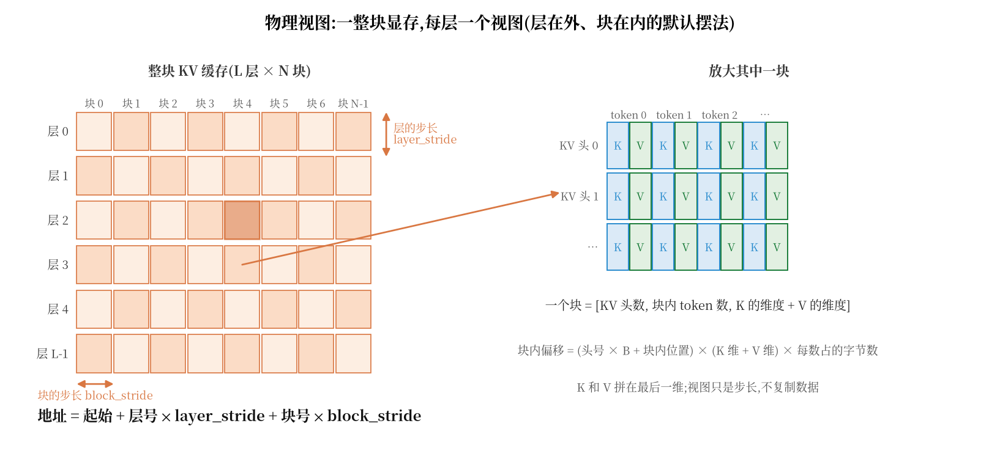
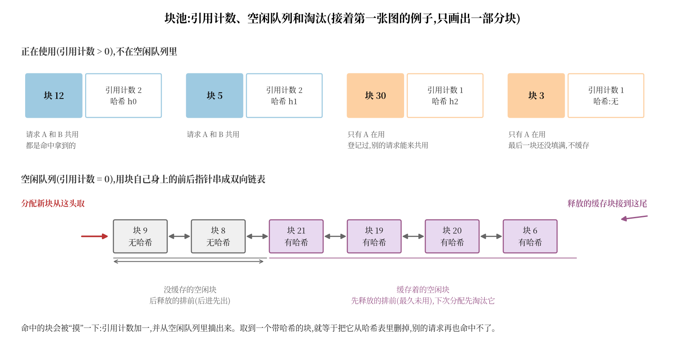
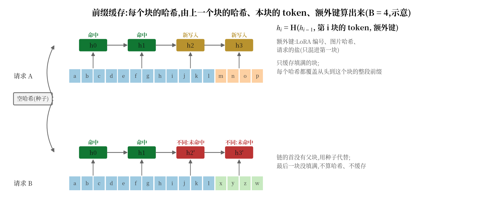
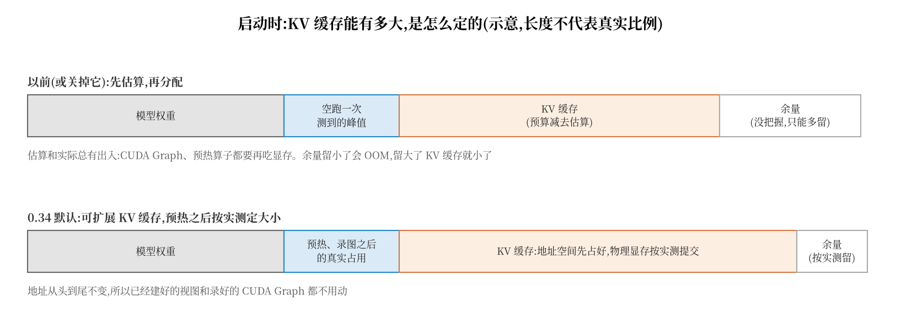

面试问 vLLM,离不开一句:讲讲 PagedAttention。

答到"像操作系统的分页",只是开了个头。接着问:块表放在哪个进程里?两个请求的提示词前半段一样,它怎么知道?滑窗层和全注意力层要的不一样,怎么共用一块显存?启动日志里那行 `GPU KV cache size`,数是怎么来的?

这篇按 v0.34.0 的源码,把 KV 缓存走一遍:先算账,再从逻辑到物理,从启动到每一步。

## 一、先算账:KV 缓存有多大

大模型每生成一个 token,都要回头看之前所有 token 的 K 和 V。算过的 K、V 得留着,这就是 KV 缓存。

一个 token 占多少:

$$\text{bytes per token} = 2 \times n_{\text{layer}} \times n_{\text{kv head}} \times d_{\text{head}} \times b$$

2 是 K 和 V 各一份,b 是每个数占的字节。拿 Llama-2-7B 算:32 层,32 个 KV 头,每头 128 维,半精度。2 × 32 × 32 × 128 × 2,是 524,288 字节,512 KiB。

一个 4096 个 token 的请求,KV 缓存就是 2 GiB。10 个并发,20 GiB。

对照一下:7B 个参数,每个 2 字节,权重 14 GB。KV 缓存比权重还大,而且随并发往上涨。

模型这边也在省。Llama-3-8B 用了分组查询注意力,KV 头从 32 个减到 8 个,一个 token 降到 128 KiB,四分之一。

省得更多的是多头潜在注意力。DeepSeek-V3 每个 token 每层只存一个 512 维的潜向量,加 64 维带位置信息的键,一共 576 个数。61 层算下来 70,272 字节,68.6 KiB。

要是 128 个头各存一份 128 维的 K 和 V,是 3.8 MiB。差 57 倍。

但不管模型怎么省,缓存怎么管,还有一笔账。

2023 年 6 月 vLLM 发布时的博客给了个数:当时的系统,浪费掉 60% 到 80% 的 KV 缓存,原因是碎片和过度预留。

浪费在两处。

一是预留。请求一进来,按最大长度预留一整段连续显存。实际用到的,往往短得多。

二是碎片。长短不一的请求进进出出,空出来的洞,新的请求塞不进。

这两处,操作系统的内存管理都遇到过。vLLM 的办法也一样:不按最大长度预留,按需一块一块地给。

同一篇博客里的吞吐对比:比 HuggingFace Transformers 最高快 24 倍,比 TGI 最高快 3.5 倍。

## 二、来历:一张时间线

KV 缓存这一块,是一个问题接着一个问题长出来的。

| 时间 | 发生了什么 | 解决了什么 |
|---|---|---|
| 2023 年 6 月,v0.1.0 | PagedAttention:缓存切成固定大小的块 | 预留和碎片的浪费 |
| 2024 年 1 月,v0.3.0 | 实验性的前缀缓存 | 相同前缀反复计算 |
| 2024 年 3 月,v0.4.0 | 自动前缀缓存;分块预填充 | 长系统提示词跨请求复用 |
| 2025 年 3 月,v0.8.0 | 前缀缓存默认打开;LMCache 连接器;滑动窗口配前缀缓存 | KV 只能待在这张卡上;滑窗模型用不了前缀缓存 |
| 2025 年 4 月,v0.8.3 | V1 引擎原生支持滑动窗口,配混合内存分配器 | 滑窗层用不着的 KV 可以扔 |
| 2025 年 7 月,v0.9.2 | FlashInfer 的 HND 布局 | 不同 kernel 要的摆法不一样 |
| 2025 年 9 月,v0.10.2 | 混合模型和 Mamba 模型关掉前缀缓存 | 命中规则对不上,先关 |
| 2026 年 7 月,v0.26.0 | 混合模型的部分前缀命中 | 关掉的,重新打开一部分 |
| 2026 年 9 月,v0.30.0 | HiSparse | 稀疏注意力的 KV 放到主机内存 |
| 2026 年 11 月,v0.34.0 | 默认块大小从 16 改成 64;可扩展 KV 缓存默认打开 | 账本的开销;启动时只能靠估算 |

每一行的来历和原因,放到后面对应的章节里。

## 三、全貌:账在 CPU,内存在 GPU

KV 缓存的管理分几层。账记在引擎核心进程里,内存在 GPU 工作进程里。

| 层 | 管什么 | 代码在哪 |
|---|---|---|
| 规格 | 每种层,一个 token 占多少字节,哪些 token 可以扔 | `vllm/v1/kv_cache_interface.py` |
| 规划 | 启动时算出一共多少块,每层摆在哪 | `vllm/v1/core/kv_cache_planning.py` |
| 块池 | 所有块的账本:谁在用,谁空着,谁能淘汰 | `vllm/v1/core/block_pool.py` |
| 管理器 | 每个请求的块表,每一步的分配,前缀命中 | `vllm/v1/core/kv_cache_manager.py` |
| 显存和块表 | 一整块显存,每层一个视图;块表搬到 GPU 上 | `vllm/v1/worker/gpu/` |
| 连接器 | KV 从别的 GPU、别的机器、主机内存进出 | `vllm/distributed/kv_transfer/` |

为什么这样分?上一篇讲过,引擎核心进程只有一个,负责调度;工作进程每张卡一个,负责算。

KV 缓存的账,调度每一步都要查:这个请求能不能进,进了拿几块。账只能有一份,所以放在引擎核心进程里。它不管显存长什么样,只认块号。

显存在工作进程里。它不问"这块归谁",只认块号:第几块,第几层,写到哪。

关于 KV 缓存,两边之间传的只有块号,是整数。

下面按这个顺序讲:逻辑上怎么切,物理上怎么摆,账怎么记,前缀怎么复用,每一步怎么分。

## 四、逻辑视图:token 切成块,块表做翻译


token 是按顺序生成的,逻辑上连成一条。vLLM 把它按固定长度切开,每 B 个 token 一块。

发布博客里的对应关系是:块是页,token 是字节,序列是进程。

0.34 版默认 B 是 64。之前一直是 16。

每个请求有一张块表。第 i 项写着:这个请求的第 i 个逻辑块,放在哪个物理块里。

一个 token 在缓存里的位置,三步算出来:

$$\text{slot} = \text{block\_table}[r][\lfloor \text{pos} / B \rfloor] \times B + \text{pos} \bmod B$$

第一步,拿位置 pos 除以 B。商是第几个逻辑块,余数是块内第几格。

第二步,查块表,把逻辑块号换成物理块号。

第三步,物理块号乘 B,加格号,就是槽位。

图里块大小是 4。A 和 B 的前 8 个 token 相同,前两块指向同一批物理块:12 和 5。之后各走各的,A 用 30、7、3,B 用 18 和 26。

A 的块表多一行。提示词 16 个 token 正好填满 4 块,刚采出来的那个 token 要落到第 5 块,也就是物理块 3。

多这一层翻译,换来的是物理块不用连续。逻辑上连着的 token,物理上散在各处,任何空闲块都能给任何请求用。

第一节说的两种浪费,只剩一种:每个请求最后一块里,没填满的格子。

**一个请求是怎么一块一块拿到内存的**

拿提示词 100 个 token、块 64 来看。

预填充那一步,100 个 token 都要算,拿 2 块,128 格。

之后每步多算一个 token,位置从 100 往后数。第 1 步到第 28 步,都落在第 2 块里,一块不拿。

第 29 步,位置 128,第 2 块满了,拿第 3 块。再过 64 步,又拿一块。

所以分配不是"请求进来分一大块"。它是每一步都要算的事,而且大多数步什么都不用拿。第八节讲它。

**块为什么是 64**

块越大,账越少。

一个 131,072 个 token 的请求,块表是 2048 项。块 16 的话,是 8192 项。前缀缓存要算的哈希,也是 2048 次对 8192 次。

改默认值的那个合并请求(#63231,2026 年 11 月 5 日合并)写的动机是:64 个 token 的块减少了每块的记账开销,块表、分配器的元数据、每个 token 的前缀缓存哈希操作。

代价有两个,它自己也列了。

一是尾巴。每个请求最后一块,最多浪费 B − 1 个格子。块 64 是 63 个,在 Llama-2-7B 上是 31.5 MiB,占 4096 个 token 请求的 1.54%。块 16 只浪费 15 个,0.37%。

二是命中变粗。前缀缓存按块算,共同的前缀不到 64 个 token,就命不中。块 16 的时候,16 个就能命中。

那个合并请求里还有一句:16 和 64 的吞吐、显存对比,还没有在真实服务负载上测过。

怎么选,看负载。共享的前缀都不到 64 个 token,加 `--block-size 16`。别的情况,用默认的。

块大小不影响能装多少 token。同样是 20 GiB,块 64 是 640 块,块 16 是 2560 块,乘出来都是 40,960 个 token。

**占位块**

块表里有些位置不用存东西,比如滑窗层已经滑出去的 token。这些位置填 0 号块,叫占位块。

它不归任何请求,引用计数也不记。所以算缓存用了多少,分母是总块数减一。

## 五、物理视图:一整块显存,每层一个视图



逻辑上块是散的。物理上,整个 KV 缓存是一次申请的一整块显存。

一个块号,在每一层里都对应一段同样大小的位置。Llama-2-7B,块 64:每层里的一块是 64 × 32 × (128 + 128) × 2,1 MiB。32 层加起来,一个块号对应 32 MiB。第十节算块数,用的就是 32 MiB。

槽位再换算成字节地址:

$$\text{addr} = \text{base} + l \times \text{layer\_stride} + b \times \text{block\_stride}$$

l 是层号,b 是物理块号。两个步长,决定摆法。

默认是层在外面:每一层占一段连续的显存,里面按块排。层的步长是 N × 1 MiB,块的步长是 1 MiB。

另一种是块在外面:同一个块的各层挨着。块的步长是 32 MiB,层的步长是 1 MiB。

每层拿到的是整块显存上的一个视图。逻辑形状是五维:层、块、KV 头、块内 token、K 的维度加 V 的维度。视图只记步长,不搬数据。

K 和 V 拼在最后一维,是有来历的。FlashAttention 的分页接口要的就是这样一个张量:最后一维是 2 × head_size。拿到以后在中间切一刀,前一半是 K,后一半是 V。

0.34 支持 6 种摆法,逻辑形状不变,只换步长。

2025 年 7 月的 v0.9.2 加进 FlashInfer 的 HND 布局,是因为 kernel 各有自己读得最快的摆法。换 kernel 不用搬数据。

**为什么是一整块,不是每层一块**

混合模型里,不同组的层共用同一批块号。块 7 这个号,对全注意力层是它的一个块,对滑窗层也是它的一个块。

要让同一个块号在每层都对应同一个偏移,所有层的视图得叠在同一个起点上。源码里的注释只有一句:各个组从第 0 个字节开始互相重叠。

## 六、块池:一本账,三种状态



所有块在启动时一次性建好,是引擎核心进程里的一批 Python 对象。每个对象记四样:块号,引用计数,哈希,还有前一个和后一个空闲块。

按状态分三种。

在用。引用计数大于 0。别的请求可以来共用,共用一次加一。

空着,但内容还登记着。引用计数是 0,有哈希。谁的前缀对得上,谁就能拿去用。

空着,没登记。引用计数是 0,没有哈希。里面的内容作废。

后两种都在空闲队列里。队列是一条双向链表,指针就存在块对象自己身上。

为什么不用现成的 deque?队列的 docstring 写了:要从队列中间摘掉一个块,还得是 O(1)。deque 做不到。它也不在操作时新建任何 Python 对象,为的是追上 C++ 写的 deque 的速度。

什么时候要从中间摘?一个块被命中,而它正躺在空闲队列里。把它从队列里摘出来,引用计数加一。源码里这个动作叫 touch。

队列的顺序,就是淘汰的顺序。分配新块从头上取。取到的块如果带着哈希,就等于把它淘汰了,哈希表里删掉这一项。

释放的时候分两头放。

没哈希的块接到队头,后释放的排前面。源码的注释是:后进先出,GPU 访问的局部性更好。

有哈希的块接到队尾,先释放的排前面。先释放,也就是最久没被用过,下次分配先淘汰它。

一个请求的块,是倒着还的。管理器里 `free` 的注释:倒序释放,为的是链尾的块先被淘汰。

为什么链尾先淘汰?一条哈希链上,靠前的块能当更多请求的前缀,更值钱。

**不去重**

还有一种情况:两个请求各自算出了内容相同的块,都登记了。块池里就有两个哈希相同的块。

源码不处理这个。注释写的是:不去重,是因为要保证分出去的块号不变,这样块表只会往后追加。

去重就得让后来的请求改指向先前的块。块表不再只追加,工作进程那边已经搬上 GPU 的表也要跟着改。多占的那几块,换的是简单。

## 七、前缀缓存:哈希链



100 个请求,开头是同一段 2,000 个 token 的系统提示。算 100 遍?

不算。算过一遍,后面 99 个直接拿来用。这就是前缀缓存。

问题是怎么认出"前缀一样"。逐个比 token,每个请求进来都要和缓存里的请求比一遍,太慢。

vLLM 的办法是给每个块算一个哈希:

$$h_i = H(h_{i-1}, \text{tokens}_i, \text{extra})$$

三个输入。上一个块的哈希,本块的 token,额外键。

哈希要链起来,是因为一个块的 KV 不只取决于它自己的 token,还取决于前面的全部 token。同样的 64 个 token,前面接的东西不同,算出来的 K、V 就不同。

链起来之后,这个条件自动满足。h_i 相同,说明从 h_0 到 h_i 整条链都相同。查一次哈希表,等于比完了前面所有 token。

图里 A 和 B 的前两块相同,h0、h1 相同,B 直接命中。第三块 token 不同,h2' 和 h2 对不上,后面的也全对不上。

所以查找是顺着链走的:从第一块开始,命中就往下走,第一个不命中就停。

**几个细节**

只给填满的块算哈希。半块的 KV 以后还会变,没法复用。

链的第一块没有上一块,用一个空哈希当种子。

额外键里有 LoRA 的编号,有图片的哈希,有请求的盐。token 相同但 LoRA 不同,KV 就不同。多模态里,图片被换成占位 token,两张不同的图 token 序列一样,得靠图片哈希区分。盐只混进第一块,用来隔开不同租户的缓存。

哈希算法默认 sha256。设计文档写的是:从 v0.11 起,默认用 sha256,解决碰撞的风险。想换更快的 xxhash 可以,文档提醒它不是密码学哈希,多租户环境要先想清楚。

来历是这样的。2024 年 1 月的 v0.3.0,是实验性的前缀缓存。两个月后的 v0.4.0,变成自动的,加 `--enable-prefix-caching` 打开。2025 年 3 月的 v0.8.0,默认打开。

**命中之后发生什么**

新请求进来,调度器先拿它的块哈希去查。命中的块逐个 touch:引用计数加一,在空闲队列里的就摘出来。然后这些块接到新请求的块表前面。

拿图一的例子。A 先到,B 后到,前 8 个 token 和 A 相同。B 查到块 12 和 5,引用计数从 1 变成 2。一块显存没新开,少算了 8 个 token。

命中的最后一块要是半块,就不能这么接。那半块别的请求也在用,往里写会写坏别人的。

这时另拿一块,把半块复制过去,再写进新的这块。源码里叫写时复制。

写时复制是 2023 年博客里就有的:物理块记着引用计数,要改的时候才复制。博客给的数:并行采样时,显存最多省 55%,吞吐最多是原来的 2.2 倍。

命中有上限。全部命中时,最后一个 token 还是要算一遍,才有输出。所以查找的长度,封顶在提示词长度减一。

块 64 下,这会多算一点。提示词正好 128 个 token,以前全见过。封顶 127,只能命中 1 块,64 个 token。剩下 64 个要重算。

源码注释说了原因:命中的长度必须按块对齐,不然块表接不上。

**什么时候写入**

每一步算完,刚填满的块登记进哈希表。推测解码时,草稿模型猜的 token 不算,只登记确认过的。

登记之后,这个请求结束了,块空出来了,块还挂在哈希表上,直到被淘汰。下一个前缀相同的请求,照样命中。

算一笔账。2,000 个 token 的系统提示,块 64 能命中 31 块,1,984 个 token。100 个请求里后来的 99 个,一共少算 196,416 个 token。

开销是每 64 个 token 一次哈希。请求进来时,提示词的一次算完。

## 八、每一步:allocate_slots


调度器每一步,对每个要跑的请求调一次 `allocate_slots`。问它:这个请求这一步要算的 token,地方够不够。

一个请求的 token 分五段:已经算过的,刚命中前缀缓存的,从外部拿来的,这一步要算的,推测解码多留的。

这个函数分三段。

还。滑窗层滑出去的块还回块池,块表里换成占位块。这一步放在查够不够之前:先还了,后面要淘汰的就少。

查。需要的块数,和空闲块数比。不够,返回 None。

给。命中的块接管过来,引用计数加一。再从空闲队列头上取新块,接到块表后面。最后把刚填满的块登记进哈希表。

**返回 None 之后**

等待中的请求拿到 None,接着等。

正在跑的请求拿到 None,调度器抢占别的请求。被抢的那个,块全部还回去,进度清零,回等待队列。这叫重算。

0.34 的调度器只有这一种,没有换出。按 Llama-2-7B 算,一个 4096 的请求就占 2 GiB。搬进搬出,不如重算。

重算也没有听上去那么亏。被抢的请求登记过的块还挂在哈希表上,它回来的时候能命中。真正重算的,只有最后没填满的那一块。

**两个容易漏的点**

水位。给等待中的请求留一点余量,别让它们一进来,就把正在跑的请求挤到抢占。它只对等待中和被抢的请求生效。默认是 0,也就是关着。

只登记确认过的。推测解码时草稿 token 可能被拒,不能登记。所以写进哈希表的长度,封顶在请求已经确认的 token 数。

## 九、不同的层,不同的要法

上面都按全注意力讲:每个 token 要看前面所有 token,KV 全部留着。不是所有层都这样。

| 层的类型 | 要留哪些 token | 规格类 |
|---|---|---|
| 全注意力 | 从头到尾,全部 | `FullAttentionSpec` |
| 滑动窗口 | 只有窗口里的 | `SlidingWindowSpec` |
| 分块局部注意力 | 只有当前这一块里的 | `ChunkedLocalAttentionSpec` |
| 多头潜在注意力 | 全部,但每个 token 只存一个潜向量 | `MLAAttentionSpec` |
| Mamba 这类状态空间层 | 一个固定大小的状态,不随长度涨 | `MambaSpec` |
| 交叉注意力 | 编码器那一侧的 token | `CrossAttentionSpec` |

每种层报一个规格,管理器按规格分。

**滑动窗口**

窗口外的 token 不再看,KV 就可以扔。规格里写的要留的长度是:窗口长度减一,再加额外保留的 token 数。

一个请求最多占几块,从此和上下文多长没关系。窗口 4096、块 64:按公式是 65 块,在途的 token 另算。全注意力层,131,072 的上下文要 2048 块。

为什么多出一块?源码注释举了个例子:块大小 4,要存 6 个 token 的窗口 `[CDEF]`,得两块 `[XXCD][EF]`。窗口不一定从块的边界开始。

滑出窗口的块,块表里换成占位块,还回块池。

**混合模型:一个池子**

Gemma 3、gpt-oss 这些模型,滑窗层和全注意力层混着排。规划代码的注释说,2025 年 6 月时开源的混合模型都是 n 比 1 的规律:Gemma 3 是 5 比 1,LLaMA 4 是 3 比 1。

两种层各开一个池子,行不行?

不行。比例得在启动时定死。流量一变,总有一边先满,另一边空着。

vLLM 用一个池子。块不分给谁,谁需要谁拿。

代价是页大小必须相等。规划代码列的第一条假设:物理内存每块必须一样。不一样,就有不同大小块的碎片问题,处理起来不简单。

全注意力层和滑窗层的头数、维度一样,所以每个 token 的字节数天然相同。

层按类型分组,规格相同的层共用一张块表。注释里的例子:10 层全注意力加 20 层滑窗,按 1 比 2 的规律重复 10 次。分成 3 组,每组 10 层。

各组的层数要一样,层数少的类型要补占位层。gpt-oss-20b 带推测解码的草稿层,是 12 层滑窗加 13 层全注意力。补成 13 和 13,不是 12 和 24。启动日志会报:补了几层,最多浪费百分之几。

一个块号,同一时间只属于一个组。


图里组 0 用了块 0 到 3,组 1 只能拿别的块。

物理上,每组 m 层,就是 m 个缓冲,每个缓冲被两个组里的各一层共用。一个逻辑块,在每个缓冲里各有一片。

**混合模型的前缀命中**

全注意力层,命中的条件是从头到这个块,全部还在。滑窗层,只要窗口里的还在。

两种层都得满足,所以命中长度取交集。源码用的是迭代:先拿一个候选长度,每种注意力类型要么接受,要么往下压。有谁压了,就从头再来一遍。

规划代码的注释里列着第六条假设:大部分组件对任意多种注意力类型都是通用的。只有查找命中这一步,目前支持一种类型,或者全注意力加另一种类型。

这就是时间线上那三行。

2025 年 4 月的 v0.8.3,V1 引擎支持了滑动窗口,配混合内存分配器。

同年 9 月的 v0.10.2,混合模型和 Mamba 模型的前缀缓存被关掉了:规则对不上。

2026 年 7 月的 v0.26.0,加上了部分命中。

## 十、启动时:KV 缓存开多大



启动日志里有这么一行:`GPU KV cache size: 40,960 tokens, Maximum concurrency for 4,096 tokens per request: 10.00x`。

这行数是怎么来的?引擎核心进程初始化 KV 缓存,顺序是:

1. 每个注意力层报规格。
2. 工作进程空跑一次,量峰值。
3. 算块数。
4. 定摆法:每层的偏移和步长。
5. 工作进程开显存,建视图。
6. 编译,预热,录 CUDA Graph。

块数是整除:

$$N = \left\lfloor \frac{\text{available}}{\text{bytes per block}} \right\rfloor$$

available 是分给 KV 缓存的字节数。bytes per block 取各组里最大的那个。

Llama-2-7B,20 GiB:一块 32 MiB,除下来 640 块。乘 64,是 40,960 个 token。一个 4096 的请求要 64 块,640 除以 64,10 个并发。就是上面那行日志。

Llama-3-8B:一块 8 MiB,2560 块,163,840 个 token。8192 的请求,20 个并发。

**以前怎么定 available**

0.34 之前,available 是估出来的。

预算是显存总量乘 `gpu_memory_utilization`,默认 0.92。减去权重,再减去空跑一次测到的激活峰值。

估就有偏差。CUDA Graph、预热时要编译的算子,都还要再吃显存。余量留小了,跑着跑着 OOM。留大了,KV 缓存就小。

**0.34:预热之后量**

0.34 起,CUDA 和 ROCm 上默认换了个办法,叫可扩展 KV 缓存。

先按老办法估一个块数。只把地址空间占下来,不真的给物理显存,只提交最少的一点,够占位块用。

然后编译、预热、录 CUDA Graph。这些过程中要用到多少块,就提交多少。

都做完,量一次真实空闲的显存。这时候还剩多少,才是准的。

能这么做,靠的是显存的虚拟内存管理。思路和操作系统的按需调页一样:地址先留着,物理页后给。

CUDA 给了一组接口:保留地址,创建物理块,映射,给访问权限。vLLM 用 ctypes 直接调它们,在 `vllm/utils/vmm_driver.py`。

关键是地址不变。块从头到尾在哪就是哪,后来提交的只是物理显存。之前建的视图、录好的 CUDA Graph,都不用动。

量完还要留余量。源码里定的是:至少 1 GiB,或者瞬时峰值的 75%,取大的。瞬时峰值本身也要整个留着。

所以 `gpu_memory_utilization` 的默认值,也从 0.92 改成了 1.0。发布说明的建议是:大多数情况下,把这个参数从配置里删掉。

效果,发布说明给的例子:MiniMax-M3 在 H200 上,KV 缓存从 433k 个 token 涨到 672k,多了 55%。

代价也写了:并发 128 时,H200 上有些模型每个 token 的解码延迟高了 6% 到 18%。不想要,加 `--gpu-memory-utilization 0.9`,或者 `--no-enable-extensible-kv-cache`。

顺带一个用处。更新权重时显存不够,可以把 KV 缓存的物理显存先还回去,用完再映射回来。地址不动。

## 十一、GPU 上怎么用

引擎核心进程定了块号,工作进程把它变成显存地址。

块表在 GPU 上。每个组一张,形状是最大请求数乘最大块数,int32。131,072 的上下文,一行 2048 项,8 KiB。

新请求头一次,整张块表发过去。之后每一步,调度结果只带新拿到的块号,工作进程把它们追加到这个请求那一行的后面。不用重传整张表,这就是前面说"块表只追加"换来的。

算槽位是一个小 kernel。去掉掩码和并行的细节,是这四行:

```python
block_indices = positions // kv_block_size
block_offsets = positions % kv_block_size
block_numbers = block_table[req_state_idx][block_indices]
slot_ids = block_numbers * kv_block_size + block_offsets
```

每一层算完 K 和 V,按槽位散写进缓存。读的时候,注意力 kernel 拿着块表,一块一块地取。

FlashAttention 后端里,缓存的形状是 `[num_blocks, num_kv_heads, block_size, 2 * head_size]`。

**2023 年的 kernel**

最早不是这样。v0.1.0 的 PagedAttention 是自己写的 CUDA kernel。设计文档里,K 缓存的形状是 `[num_blocks, num_kv_heads, head_size/x, block_size, x]`,V 缓存是 `[num_blocks, num_kv_heads, head_size, block_size]`。K 在块内是转着放的,V 是顺着放的。

现在 V1 引擎的后端目录里,是 FlashAttention、FlashInfer、Triton 这些。自己写的那套接口,还登记在 `_custom_ops.py` 里。

## 十二、KV 离开 GPU:连接器

前面说的所有事,都发生在一个引擎核心进程里。前缀缓存也只在这个进程里:进程一重启,全没了。

三个需求跟着来。前缀太长,一张卡放不下。多台机器各跑一个实例,同一个前缀每个实例都得算一遍。预填充和解码分开部署,KV 要从这台机器搬到那台。

这些靠连接器。接口 `KVConnectorBase_V1` 分两个角色。

调度器这一侧四个钩子:这个请求有多少 token 能从外部拿到;分配完之后更新状态;每一步打包元信息;请求结束时收尾。

工作进程这一侧四个:开始加载;每一层等它加载完;每一层算完存出去;结束前等它存完。

对连接器来说,块号是真的。调度器给它分好块,它往这些块里填。所以可扩展缓存定下最终块数之后,才创建连接器。

第八节那张图里,外部拿来的那一段是单独的一段。它和前缀命中一样,是已经算过的 token,但不进本地的哈希表。

0.34 仓库里带的连接器:NIXL、Mooncake、LMCache、3FS、FlexKV、HiSparse,还有卸载到主机内存的几个。

2025 年 3 月的 v0.8.0,LMCache 连接器带来了 KV 卸载,和预填充、解码分离。

**另外两条边**

KV 事件。块存进哈希表、被淘汰、全部清空,都可以发出去。路由器拿了这些,就知道该把请求发给哪个实例。

KV 量化。`kv_cache_dtype` 设成 fp8,每格从 2 字节变 1 字节。规格里有一张量化模式的清单,fp8、int8、int4 都在。

## 十三、怎么选:一张表

| 你的情况 | 怎么做 | 原因 |
|---|---|---|
| 共享的前缀都不到 64 个 token | `--block-size 16` | 命中按块算,不够一块,命不中 |
| 别的情况 | 默认的 64 | 块表、哈希、分配的账,都少到四分之一 |
| 滑窗和全注意力混合的模型 | 默认的混合管理器 | 滑窗层用不着全留着 |
| 多租户 | 每个租户一个 `cache_salt` | 不然同前缀会互相命中 |
| GPU 上还有别的进程 | 设 `gpu_memory_utilization` | 可扩展缓存默认按 1.0 的预算量 |
| 多实例,共享的长前缀多 | 接一个 KV 连接器 | 前缀缓存只活在一个进程里 |
| 要省显存 | `kv_cache_dtype` 设 fp8 | 每格 2 字节变 1 字节 |

**常见误会**

- PagedAttention 是一种注意力算法?它是内存管理。注意力的数学没变。
- 块表由 GPU 上的 kernel 维护?账在引擎核心进程里。GPU 上那份是副本,只追加。
- 命中了就省掉整个前缀?只能命中整块,最后一个 token 一定要算。
- 被抢占就全白算了?登记过的块还在,回来能命中。
- 缓存满了会把 KV 换到内存?0.34 只有重算。

## 十四、面试里会问的

- **PagedAttention 解决什么问题?** 预留和碎片的浪费。把缓存切块,像分页一样管。
- **块表放在哪?** 引擎核心进程里,每个请求一张。工作进程拿的是块号,搬上 GPU 的那份只追加。
- **前缀缓存怎么判断命中?** 哈希链:上一个块的哈希,加本块的 token,加额外键。
- **哈希为什么要链起来?** 一个块的 KV 取决于前面所有 token。链起来,查一次等于比完整条前缀。
- **两个请求共用一块,一个结束了怎么办?** 引用计数减一。没减到零,块不动。
- **显存不够了怎么办?** `allocate_slots` 返回 None。等待的接着等,正在跑的触发抢占。被抢的清零重算,登记过的块能命中。
- **滑窗层和全注意力层怎么共用显存?** 一个池子,页大小相等。各用各的块表,块号不分给谁。
- **启动时那行日志怎么来的?** 能给 KV 缓存的字节数,整除每块的字节数,得到块数。0.34 起这个数是预热之后量出来的。
- **块 64 和 16 怎么选?** 前缀短就 16,其余用 64。64 的账少,尾巴长。

## 十五、总结

**1. 多一层翻译。** token 切成块,块表把逻辑块映射到物理块。换来的是不用预留,不怕碎片。

**2. 账在 CPU,内存在 GPU。** 引擎核心进程只管块号,工作进程只认块号。

**3. 哈希链。** 一个块的哈希里有上一个块的哈希。查一次,等于比完整条前缀。

**4. 块池三种状态。** 在用,空着但登记着,空着没登记。淘汰顺序就是空闲队列的顺序。

**5. 一个池子装所有层。** 页大小相等,块不分给谁,谁需要谁拿。

**6. 先占后量。** 地址先占好,预热之后按实测给物理显存。

调度器那篇在后面:`schedule()` 那一千一百行,到底在排什么。

如果这个系列对你有用,点个赞或关注专栏,更新会持续。

---

*历史与文献:Kwon, Li, Zhuang, Sheng, Zheng, Yu, Gonzalez, Zhang, Stoica, Efficient Memory Management for Large Language Model Serving with PagedAttention(SOSP 2023,arXiv:2309.06180,DOI 10.1145/3600006.3613165);vLLM 官方博客 "vLLM: Easy, Fast, and Cheap LLM Serving with PagedAttention"(2023 年 6 月 20 日);vLLM 在 GitHub 上的发布记录 v0.1.0 至 v0.34.0;改默认块大小的合并请求 #63231(2026 年 11 月 5 日合并)。*

*源码与数据:文中关于设计的描述,来自 vLLM v0.34.0 的源码(提交 62d4bc3)和它自带的 docs/design/ 下的 paged_attention.md、prefix_caching.md、hybrid_kv_cache_manager.md。模型配置取自 Llama-2-7B、Llama-3-8B、DeepSeek-V3 在 Hugging Face 上的 config.json;正文里的算例,由同目录的 calc.py 一次算出,图由同目录的 gen_figs.py 生成。文中数字截至 2026 年 11 月 24 日。*
