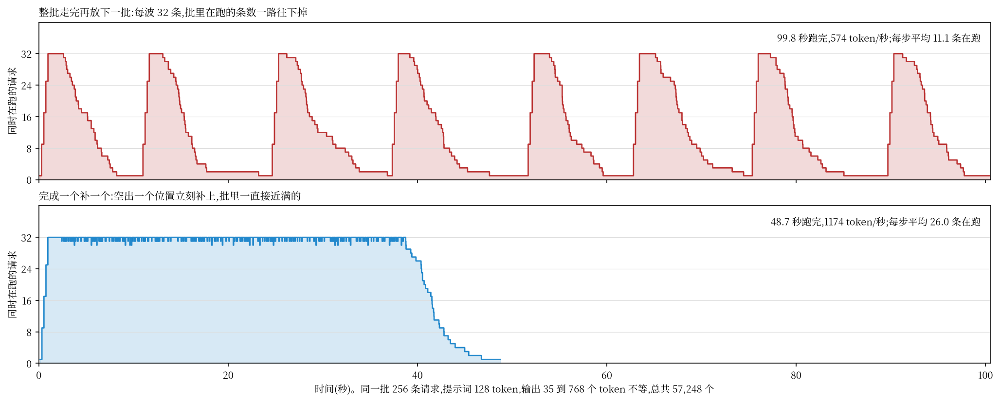
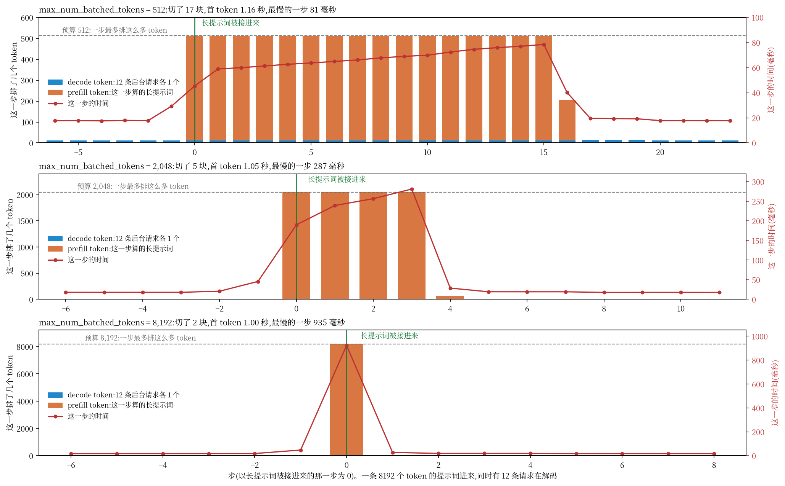
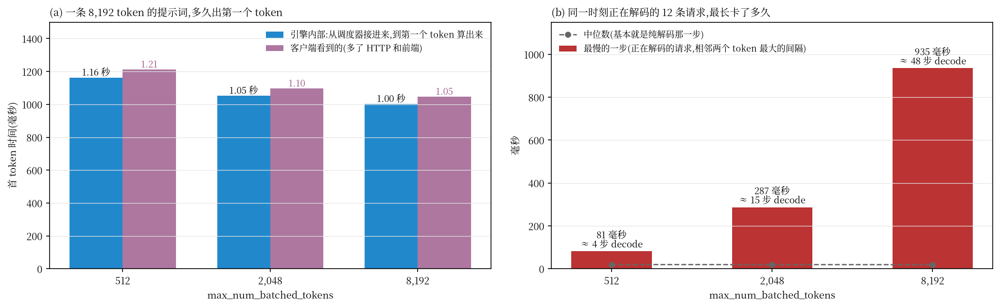
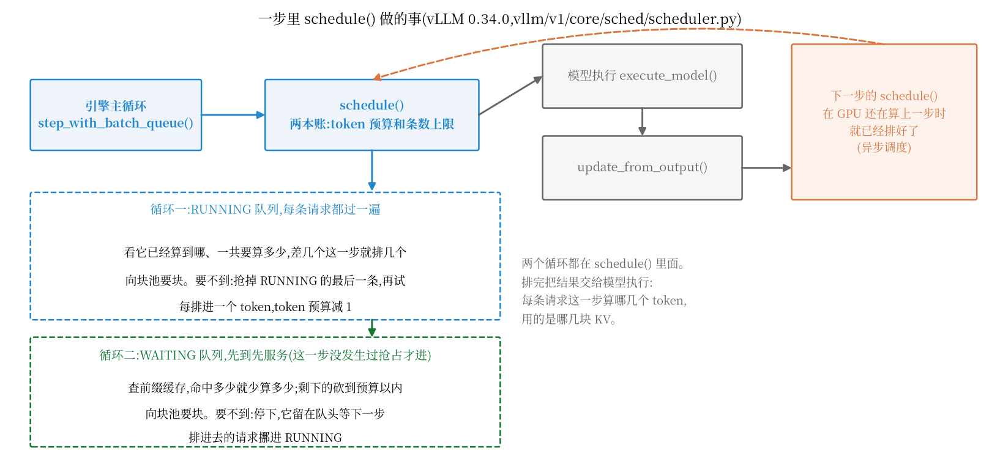
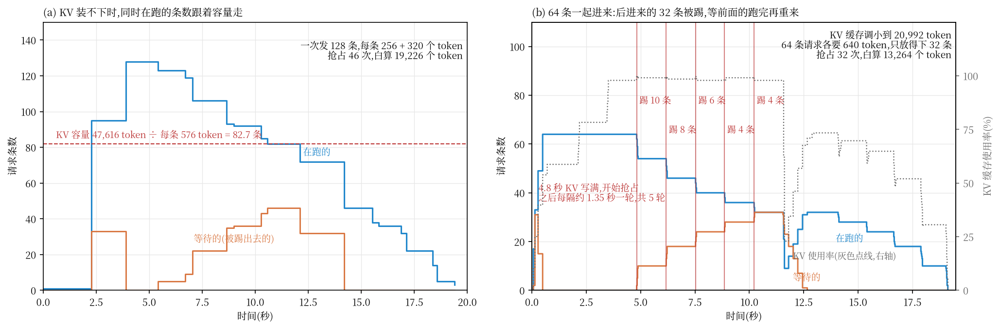
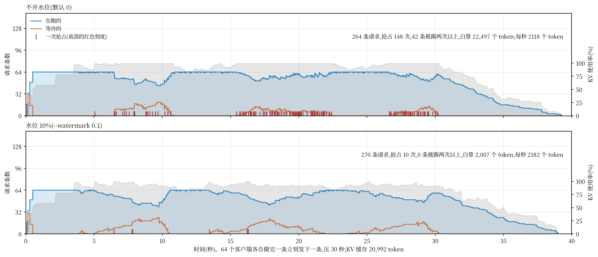

答到"连续批处理",只是开了个头。接着问:每一步让谁算、算几个 token,是谁定的?一条几万 token 的提示词,一次放不进去怎么办?KV 装不下了踢谁,踢掉以后已经算过的那部分怎么办?

前三篇的结尾都留了同一句话:`schedule()` 那一千一百行,到底在排什么。这篇按 v0.34.0 的源码回答它:先看最朴素的排法慢在哪,再看它怎么记两本账、怎么切块、怎么抢,最后在 4090D 上把每一件量一遍。

## 一、最朴素的排法:凑一批,一起跑,一起结束

最直接的做法:凑够 N 条请求,一次送进模型。每一步 N 条各出一个 token。等 N 条都写完,再收下一批。

Hugging Face transformers 的 `model.generate()` 就是这个样子:一个 batch 进去,全部生成完才返回。

问题在长短不齐。一批 32 条,31 条写 200 个 token 就完了,剩 1 条要写 700 个。前 31 条的位置空出来,没人补,GPU 陪着最后那 1 条一步一步走完。

打个比方,班车坐满 32 个人发车。有人半路下车,车不补客,空着位子一直开到终点,才回头拉下一批。

## 二、先算账:一步的时间,几乎不随 batch 变

要看 GPU 亏在哪,得先知道解码的一步时间花在哪。

每出 1 个 token,要把全部权重读一遍。Llama-3.1-8B 有 8.03 B 个参数,每个 2 字节,16.06 GB。

嵌入表只取用到的那几行,不整张读。输出层要整张读。一步实际读 15.01 GB。

4090D 上实测,batch 1 一步 16.36 毫秒:

$$t_0 = \frac{15.01\ \text{GB}}{16.36\ \text{ms}} = 918\ \text{GB/s}$$

融合算子那篇量过这张卡的拷贝带宽,944 GB/s。解码一步跑到了它的 97%。时间全花在读权重上,算力闲着。

打个比方,一本厚菜谱。做一道菜要把整本从头翻一遍。一桌点了 32 道菜,翻一遍就够 32 道菜用,每道菜摊到的翻书时间只有三十二分之一。

batch 是 32,权重照样只读一遍,32 条请求共用。多出来的只有各自的 KV:

$$t(b, L) \approx t_0 + \frac{b \cdot L \cdot 128\ \text{KiB}}{BW}$$

b 是条数,L 是每条的上下文长度,128 KiB 是一个 token 的 KV,BW 是显存带宽。

实测如下,上下文 64 到 120 个 token:

| batch | 一步(毫秒) | 整卡(token/秒) | 每条请求(token/秒) |
|---|---|---|---|
| 1 | 16.36 | 61 | 61 |
| 8 | 16.97 | 471 | 59 |
| 32 | 18.67 | 1,714 | 54 |
| 64 | 19.77 | 3,237 | 51 |
| 128 | 21.71 | 5,895 | 46 |
| 256 | 35.84 | 7,143 | 28 |

batch 到 128,一步只慢 33%,吞吐涨 96 倍。每条请求的速度只从每秒 61 个掉到 46 个。

过了 128 才开始吃算力。到 256 这一步,时钟从 2,670 MHz 掉到 2,512 MHz,功耗顶在 411 W。

公式里的 BW 也是量出来的。同样 64 条请求,上下文从平均 92 个 token 涨到 416 个,一步多 2.86 毫秒。多读的 KV 是 2.72 GB,折合 951 GB/s。


有个细节。CUDA Graph 只抓了 1, 2, 4, 8 和 8 的倍数这些 batch 大小,别的 batch 向上补齐到能装下它的最小的那个图。所以曲线在 8 以后是每 8 一格的台阶。

## 三、第一次改进:完成一个补一个

2022 年 OSDI 的 Orca 论文把调度的粒度从"整个请求"改成"一次迭代":每一步重新组 batch,写完的出去,排队的进来。vLLM 在 2023 年的论文里沿用,叫连续批处理。

打个比方,班车改成公交。到站就下,站台上有客就上,车始终坐满。

同一个引擎,同一批 256 条请求,只改客户端的补位方式,各测两轮:

| 补位方式 | 跑完用时 | 吞吐 | 每步平均在跑 |
|---|---|---|---|
| 整批走完再放下一批,每批 32 条 | 99.8 秒 | 574 token/秒 | 11.1 条 |
| 完成一个补一个,同时最多 32 条 | 48.7 秒 | 1,174 token/秒 | 26.0 条 |

快 2.05 倍。两轮之间差 2% 以内。请求是同一批:提示词 128 个 token,输出 35 到 768 个不等,共 57,248 个 token。

原因在上一节的账里。整批走完时,每一波的用时由最长的那条决定。每波的平均长度除以最大长度,8 波平均只有 35%。

输出长度服从指数分布时,这个比有个现成的结果。b 条里的最大值,期望是 $\mu H_b$:$\mu$ 是平均长度,$H_b$ 是调和数。利用率就是它的倒数:

$$E[L_{\max}] = \mu \sum_{j=1}^{b} \frac{1}{j} = \mu H_b,\qquad \eta = \frac{b\,\mu}{b\,E[L_{\max}]} = \frac{1}{H_b}$$

b = 32 时 $H_{32} = 4.06$,利用率 24.6%。实测那批请求的长度没这么偏,所以是 35%。

用实测的步时间代进去算。整批走完,第 k 步还在跑的条数记作 $N_k$:

$$T_{\text{static}} = \sum_{k=0}^{L_{\max}-1} t(N_k),\quad N_k = \#\{\,i : L_i > k\,\}$$

完成一个补一个,batch 基本是满的:

$$T_{\text{cont}} \approx \frac{\sum_i L_i}{b}\cdot t(b) + T_{\text{tail}}$$

算出来 94.3 秒和 44.8 秒,是实测的 95% 和 92%。差的 5% 到 8%,一部分是 HTTP 和前端的开销,一部分是模拟里 prefill 的代价只取了一个平均值。步时间几乎不随 batch 变,这一条就够解释那 2 倍。



## 四、来历:一张时间线

| 时间 | 发生了什么 | 解决了什么 |
|---|---|---|
| 2022 年 7 月,Orca 论文(OSDI 2022) | 按迭代调度 | 写完的立刻走,排队的立刻进 |
| 2023 年 9 月,v0.2.0 | `max_num_batched_tokens` 自动设置(#1198);`swap_space`(#1090) | 一步算多少 token 有了旋钮;装不下可以换到内存 |
| 2024 年 4 月,v0.4.1 | Chunked prefill scheduler(#3853) | 提示词可以切块 |
| 2024 年 5 月,v0.4.2 | Chunked prefill is ready for testing(#4580) | 分块预填充可用了 |
| 2024 年 9 月,v0.6.2 | Priority Scheduling(#5958) | 请求可以带优先级 |
| 2024 年 11 月,v0.6.4 | Implement vLLM V1 [1/N] (#9289) | V1 的第一块砖 |
| 2024 年 12 月,v0.6.5 | Always set enable_chunked_prefill = True for V1(#11061) | V1 里分块默认打开 |
| 2025 年 3 月,v0.8.0 | V1 默认启用(#13726);Pluggable scheduler(#14466) | 调度器可以换成自己的 |
| 2025 年 4 月,v0.8.3 | V1 支持 `long_prefill_token_threshold`(#15419) | 限制一条长提示词每步占多少 |
| 2025 年 7 月,v0.10.0 | Experimental async scheduling(#19970) | 排下一步和算这一步重叠 |
| 2025 年 10 月,v0.11.0 | 移除 V0 的 preemption mode(#25334) | 只剩重算一种 |
| 2026 年 1 月,v0.14.0 | Async scheduling is now enabled by default | 异步调度成了默认 |
| 2026 年 6 月,v0.24.0 | KV-cache watermark to reduce preemptions(#44594) | 水位 |
| 2026 年 8 月,v0.28.0 | `max_num_batched_tokens` raised from 8192 to 16384(#51726) | 默认预算变大 |
| 2026 年 11 月,v0.34.0 | cached reservations: 47.2 → 5.4 ms per schedule(#65285) | 调度器自己变快 |

发布说明里有两处缺口。`scheduler_reserve_full_isl` 和 `prefill_schedule_interval` 这两个开关,在现有的说明文件里都没查到是哪一版加的。

## 五、第二个问题:长提示词把别人的 token 卡住

连续批处理之后,一个 batch 里同时有两种活。

解码:每条请求每步算 1 个 token。prefill:新进来的提示词要算完几千个 token,才能出第一个。

两种活的代价差着量级。4090D 上,12 条请求各解码 1 个 token,一步 19.3 毫秒。一条 8,192 个 token 的提示词做 prefill,要 0.9 秒多。

要是让它一步做完,同时正在解码的 12 条请求全跟着等这 0.9 秒。流式输出看着就是卡一下。

打个比方,食堂只有一个窗口。一个人点了 100 份小菜,后面排队的每人只要一份饭。让 100 份小菜一口气做完,后面的人干等。让窗口做几份小菜就插着卖一份饭,后面的人每轮只等一小会儿。

vLLM 的做法是切块:一步里先排解码的 token,剩下的额度给 prefill,没做完的留给下一步。Sarathi-Serve(OSDI 2024)论文把这个取舍量了一遍。vLLM 在 v0.4.1 把分块接了进来,v0.4.2 的发布说明是这样写的:

> Chunked prefill is ready for testing! It improves inter-token latency in high load scenario by chunking the prompt processing and priortizes decode(#4580)

`priortizes` 是原文的拼写。

实测:12 条请求在解码,每条出 2,048 个 token;每隔 2 秒进来一条 8,192 个 token 的提示词。三个预算各起一个服务:

| `max_num_batched_tokens` | 512 | 2,048 | 8,192 |
|---|---|---|---|
| 长提示词切成几块 | 17 | 5 | 2 |
| 解码的请求最长卡多久 | 81 毫秒 | 287 毫秒 | 935 毫秒 |
| 折合几步解码 | 4.2 | 15 | 48 |
| 长提示词的首 token 时间 | 1.16 秒 | 1.05 秒 | 1.00 秒 |
| 带它的那几步,GPU 一共花了 | 1.14 秒 | 1.01 秒 | 0.96 秒 |

预算大 16 倍,首 token 快 16%,最长的一次停顿长了 11.5 倍。GPU 花的总量差不多,区别在怎么分。

块数是这样来的:

$$n_{\text{chunk}} = \left\lceil \frac{L_{\text{prompt}}}{B - d} \right\rceil$$

B 是预算,d 是这一步里的解码 token 数,这里是 12。8,192 除以 500,向上取整是 17。

每块占一步,每一步都带着解码。所以块越多,首 token 越晚:

$$\text{TTFT} \approx T_{\text{prefill}} + n_{\text{chunk}} \cdot t_{\text{decode}}$$

拿 512 那组验一下:17 块,每块带着一步 19.3 毫秒的解码,光是这些解码就是 0.33 秒。

停顿的上限和预算成正比。一个 prefill token 约 100 微秒:8,180 个 token 的那一步,实测 927 毫秒,合 113 微秒一个。





默认值按显卡分三档(`vllm/engine/arg_utils.py:3010`):

| 显存 | `LLM` 类 | `vllm serve` | `max_num_seqs` |
|---|---|---|---|
| 160 GB 以上 | 16,384 | 16,384 | 1,024 |
| 70 GB 以上,不是 A100 | 16,384 | 8,192 | 1,024 |
| 其余 | 8,192 | 2,048 | 256 |

A100 被单独排除了。代码里的注释写着,大的 `max_num_batched_tokens` 在 A100 上会降吞吐,见 #17885。开了吞吐模式,两个默认值都翻倍。

预算还有一条硬约束:不能小于 `max_num_seqs`(`vllm/config/scheduler.py:375`)。每条请求一步至少要 1 个 token 的位置。

## 六、vLLM 怎么排:两本账,两个循环

调用链从引擎的主循环开始:

```
EngineCoreProc.run_busy_loop()        vllm/v1/engine/core.py:1794
  _process_input_queue()              收新请求、中止          :1820
  _process_engine_step()                                     :1855
    step_fn()                                                 :1860
      scheduler.schedule()            排这一步
      model_executor.execute_model()  送 GPU 算
      scheduler.update_from_output()  收 token,看谁写完了
```

请求从 HTTP 进来,前端进程校验、分词,经消息队列送到引擎核心进程。`scheduler.add_request()`(`scheduler.py:3065`)把它放进 WAITING 队列。

算完的 token 走 `update_from_output()`(`scheduler.py:2301`):每条请求把新 token 接上,逐个过一遍 `check_stop`(`vllm/v1/core/sched/utils.py:98`)。写完的释放块,结果再经消息队列回前端,流式发给客户端。

`step_fn` 指向哪个函数,取决于开没开异步调度(`core.py:254`)。没开是 `step()`,去掉细节就剩三步:

```python
        scheduler_output = self.scheduler.schedule(self._should_throttle_prefills())
        future = self.model_executor.execute_model(scheduler_output, non_block=True)
        grammar_output = self.scheduler.get_grammar_bitmask(scheduler_output)
        ...
            model_output = self._wait_for_output(future)
        ...
        engine_core_outputs = self.scheduler.update_from_output(
            scheduler_output, model_output
        )
```

`vllm/v1/engine/core.py:723`。排,算,收。



`schedule()` 在 `vllm/v1/core/sched/scheduler.py:716`,到 1,852 行结束,一共 1,137 行。开头有一段设计注释:

```python
        # NOTE(woosuk) on the scheduling algorithm:
        # There's no "decoding phase" nor "prefill phase" in the scheduler.
        # Each request just has the num_computed_tokens and
        # num_tokens_with_spec. num_tokens_with_spec =
        # len(prompt_token_ids) + len(output_token_ids) + len(spec_token_ids).
        # At each step, the scheduler tries to assign tokens to the requests
        # so that each request's num_computed_tokens can catch up its
        # num_tokens_with_spec. This is general enough to cover
        # chunked prefills, prefix caching, speculative decoding,
        # and the "jump decoding" optimization in the future.
```

调度器里没有"prefill 阶段"和"decode 阶段"。每条请求只有两个数:已经算了几个,`num_computed_tokens`;一共要算几个,`num_tokens_with_spec`。每一步做的事,就是让前者追上后者。

提示词 8,192 个 token,算了 3,000 个,还差 5,192 个。预算够就多给,不够就少给,下一步接着给。分块、前缀缓存、推测解码,都在这两个数里。

**两本账。**

```python
        token_budget = self.max_num_scheduled_tokens
        spec = self.vllm_config.speculative_config
        draft_slots = spec.max_num_new_slots_for_drafting if spec is not None else 0
        input_budget = self.scheduler_config.max_num_batched_tokens
```

`scheduler.py:735`。没开推测解码,两个预算相等,都是 `max_num_batched_tokens`。另有一条硬上限是条数,`max_num_seqs`(`scheduler.py:129`)。

打个比方,饭票。调度员每步手里有一沓票,一张票算一个 token。先发给已经入座的,每人至少一张;剩下的票发给门口排号的;票发完了,剩下的等下一步。

再打个比方,餐厅的两个队列。RUNNING 是已经入座、正在上菜的,WAITING 是门口拿号等位的。调度员先伺候入座的,再领等位的入座。

**循环一,RUNNING 队列。**

```python
        # First, schedule the RUNNING requests.
        req_index = 0
        while req_index < len(self.running) and token_budget > 0:
            request = self.running[req_index]
            ...
            num_new_tokens = (
                request.num_tokens_with_spec
                + request.num_output_placeholders
                - request.num_computed_tokens
            )
            ...
            num_new_tokens = min(
                num_new_tokens, token_budget, input_budget - draft_slots
            )
```

`scheduler.py:809`。差几个就排几个,再按两本账的余额封顶。解码中的请求差 1 个,每步排 1 个。prefill 没做完的请求差得多,能排多少排多少。

排了 token 就要有地方放 KV。接着向块池要块(`scheduler.py:928`):

```python
            with record_function_or_nullcontext("schedule: allocate_slots"):
                while True:
                    new_blocks = self.kv_cache_manager.allocate_slots(
                        request,
                        num_new_tokens,
                        num_lookahead_tokens=self.num_lookahead_tokens,
                    )

                    if new_blocks is not None:
                        # The request can be scheduled.
                        break
                    ...
                    # The request cannot be scheduled.
                    # Preempt the lowest-priority request.
                    if self.policy == SchedulingPolicy.PRIORITY:
                        preempted_req = max(
                            self.running,
                            key=lambda r: (r.priority, r.arrival_time),
                        )
                    else:
                        preempted_req = self.running[-1]
```

要不到,就抢一条,下一节细说。

要到了就记账(`scheduler.py:1012`):

```python
            num_scheduled_tokens[request_id] = num_new_tokens
            token_budget -= num_new_tokens
            input_budget -= num_new_tokens + draft_slots
```

**循环二,WAITING 队列。**

```python
        # Next, schedule the WAITING requests.
        if not preempted_reqs and self._pause_state != PauseState.PAUSED_ALL:
```

`scheduler.py:1065`。这一步抢过别人,就不再收新请求,免得一边踢一边收。

队列默认是先到先服务。`FCFSRequestQueue` 就是一个 `deque`,来了 `append`,取的时候 `popleft`(`request_queue.py:75`)。`priority` 策略下是一个堆,`priority` 小的先,一样再按到达时间(`request.py:409`)。

排到队的请求,先查前缀缓存(`scheduler.py:1149`):

```python
                # Get already-cached tokens.
                if request.num_computed_tokens == 0:
                    ...
                    (
                        new_computed_blocks,
                        num_new_local_computed_tokens,
                        request.shared_prefix_boundary,
                        hit_diverged,
                    ) = self._get_local_prefix_cache_hit(request, max_cache_hit_length)
```

命中 3 个块,这条请求的 `num_computed_tokens` 就直接记成 192,只剩后面的要算。怎么查、块怎么复用,KV 缓存那篇讲过。

然后算这一步排几个(`scheduler.py:1345`):

```python
                    request_token_budget = min(token_budget, input_budget - draft_slots)
                    ...
                    num_new_tokens = request.num_tokens - num_computed_tokens
                    ...
                    # chunked prefill has to be enabled explicitly to allow
                    # pooling requests to be chunked
                    if (
                        not self.scheduler_config.enable_chunked_prefill
                        and num_new_tokens > request_token_budget
                        and not self.is_mm_encoder_only
                    ):
                        # If chunked_prefill is disabled,
                        # we can stop the scheduling here.
                        break

                    num_new_tokens = min(num_new_tokens, request_token_budget)
```

剩下的 token 比余额多,就切到余额那么大。分块默认是开的;用 `--no-enable-chunked-prefill` 关掉,放不下的请求就整个等下一步。

再要块(`scheduler.py:1497`):

```python
                new_blocks = self.kv_cache_manager.allocate_slots(
                    request,
                    num_tokens_past_hit,
                    ...
                    full_sequence_must_fit=self.scheduler_reserve_full_isl,
                    ...
                )

                if new_blocks is None:
                    # The request cannot be scheduled.
                    ...
                    break
```

排队的新请求要不到块,只停下,不去抢正在跑的。它留在队头,下一步再看。

要到了,就进 RUNNING(`scheduler.py:1609`):

```python
                request = request_queue.pop_request()
                self.deferred_waiting.discard(request)
                self.running.append(request)
                ...
                token_budget -= num_new_tokens
                input_budget -= num_new_tokens + draft_slots
                request.status = RequestStatus.RUNNING
```

两个循环走完,把这一步的结果打包成 `SchedulerOutput`:每条请求算几个 token,新请求带整张块表,老请求只带新增的块。模型执行器照着它去算。

## 七、装不下:并发上限,和抢占

**并发上限是算出来的。** KV 缓存一共 744 块,每块 64 个 token,47,616 个。

$$N_{\max} = \min\left(\text{max\_num\_seqs},\ \frac{47{,}616}{L}\right)$$

L 是每条请求的上下文长度。

| 每条上下文 | 576 | 1,024 | 4,096 | 16,384 |
|---|---|---|---|---|
| 能同时跑(条) | 82.7 | 46.5 | 11.6 | 2.9 |

启动日志里那行 Maximum concurrency for 16,384 tokens per request: 2.91x,算的就是这个。`max_num_seqs` 默认 256,在这张卡上多数时候轮不到它管。

打个比方,停车场。车位是定死的,每辆车占的地方随上下文变长。车越长,停得下的越少。

实测对得上。一次发 128 条请求,每条 256 + 320 = 576 个 token。开头 128 条全在跑,之后一路往下掉:106, 93, 85, 82。到第 10.6 秒剩 82 条,46 条在排队。两轮各抢了 46 次,白算 19,226 个 token。

一次发 256 条,最多同时在跑 150 条,排队最多 221 条。最晚的首 token 等了 29.8 秒。



**新请求进门时先查一遍。** `allocate_slots` 有个开关 `full_sequence_must_fit`,默认打开:

```python
        if full_sequence_must_fit:
            # First check and fail if the full request sequence won't fit.
            full_num_tokens = min(request.num_tokens, self.max_model_len)
            ...
            required_blocks = num_blocks_to_allocate + watermark_blocks
            if required_blocks > self.block_pool.get_num_free_blocks():
                return None
```

`vllm/v1/core/kv_cache_manager.py:552`。只查第一块的话,一条长提示词进得来门,做到一半没地方写,就得踢别人。所以整段放得下才放它进来。

这里查的是提示词本身,还没生成的输出不算。所以上面 128 条请求都进得来,写着写着就不够了。

正在跑的请求没有这道门。它每多写一个 token 就多占一点地方,写满一块就要再要一块:

```python
        available_blocks = self.block_pool.get_num_free_blocks() - reserved_blocks
        required_blocks = num_blocks_to_allocate + watermark_blocks
        if required_blocks > available_blocks:
            # Cannot allocate new blocks
            return None
```

同文件 605 行。要不到,`schedule()` 就回到上一节那段 `while True`:抢一条,再要。

**踢谁。** 默认策略 `fcfs` 下是 `self.running[-1]`,最晚进来的那条。`priority` 策略下是优先级数值最大、来得最晚的那条。

踢完接着要,还要不到接着踢。直到要到,或者把自己也踢出去了。

**踢掉以后。** `_preempt_request`(`scheduler.py:1853`):

```python
        self._free_request_blocks(request)
        self.encoder_cache_manager.free(request)
        ...
        request.status = RequestStatus.PREEMPTED
        request.num_computed_tokens = 0
        ...
        request.num_preemptions += 1
        ...
        # Put the request back to the waiting queue.
        self.waiting.prepend_request(request)
```

块全部还回去,已经算的 token 数清零,放到等待队列的最前面。已经生成的 token 文本留着。等它再被接进来,提示词加已生成的 token 一起重算一遍。

打个比方,自习室占座。一个人摊了一桌子书,新来的没地方,管理员把最晚进来的那位请出去,书全收走。他回来时从头再摆一遍。

V1 里只有重算这一种。V0 曾经能把块换到内存(`swap_space`)。v0.11.0 移除了换出这个模式,v0.18.0 连 `swap_space` 参数也删了。

**一次性实验。** 把 KV 缓存调到 20,992 个 token(328 块),一次发 64 条请求。每条提示词 128、输出 512,共 640 个 token,占 10 块。算下来只放得下 32 条。

4.8 秒时 KV 写满,开始踢。分 5 轮,踢了 10, 8, 6, 4, 4 条,每隔约 1.35 秒一轮。

每一轮都是同一笔账。每条请求写满一块(64 个 token)就要再要一块。装得下的条数,等于 328 块除以每条当时的块数:要第 6 块时 54 条,第 7 块 46 条,第 10 块 32 条。实测留下 54, 46, 40, 36, 32 条。

一共白算 13,264 个 token。没被踢的 32 条 11.6 秒做完。被踢的 32 条等它们做完才重新进来,每条重算 317 到 575 个 token,到 14.1 至 19.1 秒才做完。

按实测的步时间推算,KV 够用的话 64 条一起 12.2 秒做完。这个数是算的,没有实测。

**持续压力更糟。** 64 个客户端,各自做完一条立刻发下一条,压 30 秒:

| | 不开水位 | 水位 10% |
|---|---|---|
| 请求数 | 264 | 270 |
| 抢占次数 | 148 | 10 |
| 被踢两次以上的请求 | 42 条 | 0 条 |
| 白算的 token | 22,497 | 2,007 |
| 吞吐(token/秒) | 2,118 | 2,182 |

一条请求最多被踢了 6 次。白算的量是全部提示词 token 的 67%。

水位是 v0.24.0 加的开关。它的意思是:等待中的请求进门时,要求空闲块比它要的多出一截:

```python
        watermark_blocks = 0
        # The watermark is applied to waiting/preempted requests only, and only
        # when there's at least one request already scheduled.
        if has_scheduled_reqs and request.status in (
            RequestStatus.WAITING,
            RequestStatus.PREEMPTED,
        ):
            watermark_blocks = self.watermark_blocks
```

`kv_cache_manager.py:539`。10% 就是 32 块。已经在跑的请求不受影响。留出的这一截,是给被踢出去的请求回来时用的。实测抢占少了 14.8 倍,吞吐没掉。

好比停车场留几个位子不给长租车,只给马上要回来的车。



## 八、异步调度:排下一步,不等这一步

第六节的 `step()` 是排一步,算一步,收一步。CPU 排的时候 GPU 闲着,GPU 算的时候 CPU 闲着。

调度器自己的开销不小。实测,`schedule()` 加 `update_from_output()`:

| batch | 1 | 32 | 128 | 256 |
|---|---|---|---|---|
| CPU 时间(毫秒) | 0.41 | 2.05 | 5.35 | 13.9 |
| 占这一步的比例 | 2.5% | 11% | 25% | 39% |

batch 小的时候看不出来。到 256,CPU 要忙 13.9 毫秒,GPU 一步 35.8 毫秒。串行的话一步 49.7 毫秒,慢 39%。

打个比方,记账员。桌数越多,记一趟账越久。小馆子几张桌子,记账的时间可以忽略;几百张桌子的大排档,记账员自己的速度就成了问题。

异步调度把这两段重叠起来:GPU 算第 N 步时,CPU 已经在排第 N + 1 步。

打个比方,餐厅点单。服务员等前一桌的菜全上齐了才去下一桌,是同步。厨房炒着前一桌的菜,服务员已经站在下一桌旁边点单了,是异步。

有个坎。排第 N + 1 步时,第 N 步的 token 还没采样出来,解码请求的下一个输入是什么,不知道。

`AsyncScheduler` 的办法是先记一个占位符:

```python
            # The request will generate num_sampled_tokens_per_step new tokens
            # plus num_spec_tokens in this scheduling step. Diffusion has no AR
            ...
            cur_num_spec_tokens = len(spec_decode_tokens.get(req_id, ()))
            request.num_output_placeholders += (
                self.num_sampled_tokens_per_step + cur_num_spec_tokens
            )
```

`vllm/v1/core/sched/async_scheduler.py:31`。第六节循环一里的 `num_tokens_with_spec + request.num_output_placeholders` 就是这么来的。采样在 GPU 上做完,worker 自己留着结果,直接填进占位的位置,不用调度器送回来。

排完立刻把"已算"的数加上去(`scheduler.py:1910`):

```python
        for req_id, num_scheduled_token in num_scheduled_tokens.items():
            request = self.requests[req_id]
            request.num_computed_tokens += num_scheduled_token
```

排了就算数,不等结果。推测解码有 token 被拒时,再在 `update_from_output` 里改回来。

引擎这边配合的是一个深度为 2 的批队列(`vllm/config/vllm.py:559`):一批在 GPU 上跑,一批已经排好。开了它,`step_fn` 换成 `step_with_batch_queue()`(`core.py:758`):队列没满就先排,排完直接返回;满了才停下来等最早那批的结果。

异步调度 v0.10.0 引入,v0.14.0 起默认开。pooling 模型会自动把它关掉(`vllm/config/vllm.py:1610`),CPU 后端也不用它(`vllm/platforms/cpu.py:345`)。

## 九、这些数是怎么量的

vLLM 留了一个换调度器的口子:

```python
    def get_scheduler_cls(self) -> type["SchedulerInterface"]:
        if self.scheduler_cls is None:
            if self.async_scheduling:
                from vllm.v1.core.sched.async_scheduler import AsyncScheduler

                return AsyncScheduler
            from vllm.v1.core.sched.scheduler import Scheduler

            return Scheduler
```

`vllm/config/scheduler.py:266`。启动时加 `--scheduler-cls 模块名.类名`,就换成自己的类。

这里用的记录器继承 `AsyncScheduler`,排班逻辑一行没改,只在 `schedule()` 前后和 `update_from_output()` 前后多记几笔:这一步排了几个 prefill token、几个 decode token,几条在跑,几条在等,谁被踢了。

```python
    def schedule(self, throttle_prefills: bool = False):
        before = {
            r.request_id: (r.num_computed_tokens, r.num_tokens) for r in self.running
        }
        ...
        out = super().schedule(throttle_prefills)
        ...

    def update_from_output(self, scheduler_output, model_output):
        tu = time.time()
        res = super().update_from_output(scheduler_output, model_output)
        ...
```

一步的时间,就是相邻两步 `update_from_output()` 被调用的时刻之差。

有个坑。继承 `Scheduler` 而不是 `AsyncScheduler` 会把异步调度关掉,启动日志里有一句警告。并发一高,量出来的数就偏慢。

## 十、怎么选:一张表

| 你的情况 | 怎么做 | 原因 |
|---|---|---|
| 一般的在线服务 | 默认配置 | 4090D 上 `vllm serve` 是 2,048 和 256;2,048 的块最长卡 287 毫秒 |
| 要首 token 快,不介意输出卡顿 | 调大 `--max-num-batched-tokens` | 长 prompt 少切几块;停顿按比例变长 |
| 流式输出要顺滑 | 调小 `--max-num-batched-tokens` | 最长停顿和预算成正比,512 时 81 毫秒;首 token 慢 16% |
| 一条长 prompt 拖累同批的解码 | `--long-prefill-token-threshold` | 只限制长 prompt 每步占多少,预算不用动;只有它一条请求时不限 |
| 显存小,并发一高就抖 | `--watermark 0.1` | 抢占从 148 次降到 10 次,吞吐没掉 |
| 想多并发 | 加显存,或换 KV 小的模型 | 并发上限等于 KV 容量除以上下文长度 |
| 有请求要插队 | `--scheduling-policy priority`,请求带 `priority` | 数小的先;被踢的也是数值最大的 |
| 共享前缀多 | 开前缀缓存,加 `--cache-aware-admission-window N` | 窗口内命中的先接,不挤掉别人的块;0.34 的新开关,默认 0 |
| 要自己的调度策略 | `--scheduler-cls` | 继承 `AsyncScheduler`,别继承 `Scheduler` |

## 十一、面试里会问的

每个问题给一段能直接说出口的回答。先结论,再机制,最后一个数。

**1. 什么是连续批处理,为什么能快?**

答:每一步重新组 batch。写完的请求立刻出去,排队的立刻进来,batch 始终是满的。

解码一步的时间主要是读一遍权重,和 batch 大小关系不大。4090D 上 batch 1 一步 16.36 毫秒,batch 128 一步 21.71 毫秒。

所以 batch 越满,每个 token 摊到的读权重时间越少。同一批 256 条请求,整批走完再放下一批要 99.8 秒,完成一个补一个只要 48.7 秒。

追问:步时间什么时候开始随 batch 涨?每条请求的 KV 要各读各的,上下文越长、条数越多,读的越多。再往上,矩阵乘开始吃算力。这张卡 256 条时一步 35.84 毫秒,时钟也掉了。

**2. vLLM 的调度器每一步做什么?**

答:让每条请求"已算的 token 数"追上"要算的 token 数",总数不超过 token 预算。

它过两遍队列。先过 RUNNING:在跑的请求差几个 token 就排几个。再过 WAITING:按先到先服务接新请求,查前缀缓存,剩下的切块到预算以内。

拿 Llama-3.1-8B 在 4090D 上起 `vllm serve`,预算是 2,048 个 token,最多 256 条。

追问:调度器里有 prefill 和 decode 两个阶段吗?没有。代码注释写的是 There's no "decoding phase" nor "prefill phase" in the scheduler。区别只在每条请求差多少个 token。

**3. `max_num_batched_tokens` 调大还是调小?**

答:看在意首 token,还是在意输出顺滑。

它是一步里能排的 token 总数。长提示词按它切块,预算越大块越少,首 token 越快。但一块占一步,正在解码的请求要等这一步做完。

实测一条 8,192 个 token 的提示词:预算 512 时首 token 1.16 秒,解码的请求最长卡 81 毫秒;预算 8,192 时首 token 1.00 秒,最长卡 935 毫秒。

**4. 新请求进 RUNNING 要过哪几道门?**

答:三道。条数没到 `max_num_seqs`;token 预算有余额;KV 放得下。

放得下的检查在 `allocate_slots` 里。默认开了 `scheduler_reserve_full_isl`,要整段序列放得下才放进来,不是只看第一块。

追问:只看第一块会怎样?长提示词做了一半没地方写,只能踢正在跑的。

**5. KV 装不下了,踢谁?被踢的请求怎么办?**

答:踢最晚进 RUNNING 的那一条,`running[-1]`。

`_preempt_request` 把它的块全还回去,已算的 token 数清零,放回等待队列最前面。等它再进来,提示词加已生成的 token 重算一遍。已经生成的文本不丢。

实测 KV 调到 20,992 个 token,64 条请求各要 640 个 token:踢了 32 次,白算 13,264 个 token。

追问:为什么是最后一条?它来得最晚,按先到先服务,轮到它让位。`priority` 策略下踢优先级数值最大的。

追问:能换到内存吗?0.34 的 V1 里只有重算。换出是 V0 的功能,随 V0 删掉了。

**6. 抢占反复发生怎么办?**

答:开水位,`--watermark`。

它让等待中的请求进门时多留一截空闲块,被踢出去的请求回来时才有地方。已经在跑的不受影响。

实测持续压 30 秒:不开水位抢占 148 次,一条请求最多被踢 6 次;开 10% 降到 10 次,吞吐还高了 3%。

**7. 一个 GPU 能同时跑多少请求?**

答:KV 容量除以每条请求的长度,再和 `max_num_seqs` 取小的。

4090D 跑 Llama-3.1-8B,KV 缓存 47,616 个 token。每条 1,024 个 token 时能跑 46 条,4,096 个 token 时 12 条。

实测一次发 128 条各 576 个 token 的请求,在跑的条数从 128 掉到 82,和算出来的 82.7 对上。

**8. 什么是异步调度?**

答:GPU 算第 N 步的时候,CPU 已经在排第 N + 1 步。

第 N 步的 token 还没采样出来,调度器先给解码请求记一个占位符,`num_output_placeholders`。排完立刻把"已算"的数加上,真实的 token 由 worker 在 GPU 上填。

不开的话 CPU 和 GPU 是串行的。batch 256 时调度器一步要花 13.9 毫秒的 CPU,占 GPU 一步的 39%。v0.14.0 起默认开。

**9. 前缀缓存和调度器怎么配合?**

答:新请求被接到时先查一次前缀缓存。命中几个块,`num_computed_tokens` 就直接拨到那里。

只剩后面的 token 要算,token 预算也只花在没命中的部分。

追问:在跑的请求每步都查吗?不查。只在 `num_computed_tokens == 0` 时查,也就是新请求,和被踢后重来的请求。

**10. 调度器是单线程的吗?开销有多大?**

答:是。它在引擎核心进程里,纯 Python,一步调一次 `schedule()` 和一次 `update_from_output()`。

开销随 batch 涨:batch 1 时 0.41 毫秒,batch 256 时 13.9 毫秒。

v0.34.0 的发布说明里有一组专门优化它的条目,比如带缓存的预留把一次调度从 47.2 毫秒降到 5.4 毫秒。

**11. `max_num_batched_tokens` 和 `max_num_scheduled_tokens` 有什么区别?**

答:前者管一步里有多少个输入 token 的位置,后者管调度器最多发出多少个 token。

不开推测解码时两个数相等。开了推测解码,草稿要占位置,后者可以设得比前者小。循环里扣账就能看出来:输入预算扣的是 `num_new_tokens + draft_slots`。

**12. 先到先服务会不会让后来的请求一直等着?**

答:会。队列里没有老化,也没有超时。

一条被踢的请求排在队头,它进不来,排在它后面的新请求也进不来。实测一次发 256 条各 576 个 token 的请求,最晚的首 token 等了 29.8 秒。

要插队用 `--scheduling-policy priority`;要少抢,开水位。

**13. 怎么换掉 vLLM 的调度器?**

答:`--scheduler-cls 模块名.类名`。继承 `AsyncScheduler`,覆写 `schedule()`。

要继承异步那个类。继承 `Scheduler` 会关掉异步调度,启动时有警告。

这篇的数,就是靠一个只加记录、不改排班的子类量出来的。

## 十二、总结

**1. 朴素排法慢在长短不齐。** 一批里最长的那条决定用时,其余位置空着。

**2. 步时间几乎不随 batch 变。** 解码卡在读权重上,15.01 GB 读一遍 16.36 毫秒。所以补满 batch 几乎是白赚的。

**3. 调度器只有两个数。** 已算几个,要算几个。每一步让前者追上后者,总数不超过 token 预算。没有 prefill 阶段和 decode 阶段。

**4. 预算是一杆秤。** 预算大,长提示词快,别人卡得久;预算小,反过来。4090D 上默认 2,048。

**5. 并发上限是算出来的。** KV 容量除以上下文长度。装不下就踢最晚进来的,它回来要重算。

**6. 水位治反复抢占。** 148 次降到 10 次,吞吐没掉。

**7. 异步调度把 CPU 藏到 GPU 后面。** batch 256 时调度器要 13.9 毫秒,占了 GPU 一步的 39%。

如果这个系列对你有用,点个赞或关注专栏,更新会持续。

---

*实测方法:RTX 4090 D,vLLM 0.34.0,torch 2.14.0,Llama-3.1-8B-Instruct,bfloat16,FlashAttention 2,`--max-num-seqs 256 --max-model-len 16384`。除两组抢占实验外,KV 缓存 47,616 个 token(744 块),块大小 64。① 调度记录:继承 AsyncScheduler 的子类,每步记排了多少 prefill 和 decode token、时刻、在跑和等待的条数;一步的时间取相邻两步 update_from_output() 时刻之差;稳态窗口取中间 5/7 的步,取中位数;正着测一轮,倒着测一轮,差 2% 以上的取小的那轮;进程没有绑核,按 vLLM 默认的方式放置。② 步时间扫描:提示词 64 个 token、输出 56 个(短),提示词 256 个、输出 320 个(长);batch 取 CUDA Graph 抓取过的大小。测量期间核心时钟 2,670 MHz,batch 96 以上掉到 2,460 至 2,580 MHz,功耗最高 429 W。③ 静态对连续:同一批 256 条请求,两种补位方式交替各测两轮,两轮差 2% 以内。④ 预算:三个预算各起一个服务,12 条后台请求各出 2,048 个 token,每 2 秒进一条 8,192 个 token 的提示词,没有发生抢占,前缀缓存没有命中。⑤ 抢占:`--gpu-memory-utilization 0.80`,KV 缓存 20,992 个 token(328 块)。首 token 时间在引擎内部量,从调度器接进来到第一个 token 算出来;客户端看到的另列,多出 HTTP 和前端的开销。② 开跑时机器空载,负载 0.4;②的后半段和③④期间,机器上另有一个 13 核的 Python 任务在跑。两轮之间、14 条长提示词之间,偏差都在 3% 以内;只有短上下文扫描里 batch 8 的第一轮慢了 8%,按①的规则取了小的那轮。更早的一轮扫描赶上了别人的任务,有一组比另一轮慢 18%,没有采用。KV 够用时 64 条请求的 12.2 秒是按实测步时间推算的。脚本在 bench/ 下,原始记录在 bench/results/。*

*历史与文献:Yu, Jeong, Kim, Kim, Chun, Orca: A Distributed Serving System for Transformer-Based Generative Models(OSDI 2022,arXiv:2111.11778),提出按迭代调度;Kwon 等,Efficient Memory Management for Large Language Model Serving with PagedAttention(SOSP 2023,arXiv:2309.06180);Agrawal, Kedia, Panwar, Mohan, Kwatra 等,Taming Throughput-Latency Tradeoff in LLM Inference with Sarathi-Serve(OSDI 2024,arXiv:2403.02310)。vLLM 在 GitHub 上的发布记录:v0.2.0(2023 年 9 月 28 日);v0.4.1(2024 年 4 月 24 日);v0.4.2(2024 年 5 月 5 日);v0.6.2(2024 年 9 月 25 日);v0.6.4(2024 年 11 月 15 日);v0.6.5(2024 年 12 月 17 日);v0.8.0(2025 年 3 月 18 日);v0.8.3(2025 年 4 月 6 日);v0.9.0(2025 年 5 月 15 日)Perf: Use small max_num_batched_tokens for A100(#17885);v0.10.0(2025 年 7 月 24 日);v0.11.0(2025 年 10 月 2 日);v0.14.0(2026 年 1 月 20 日);v0.24.0(2026 年 6 月 29 日);v0.28.0(2026 年 8 月 26 日);v0.34.0(2026 年 11 月 16 日)。时间线里的英文条目是发布记录的原文。*

*源码与数据:文中关于设计的描述和代码摘录,来自 vLLM v0.34.0 的源码(提交 62d4bc3),行号都指这个版本。模型配置取自 Llama-3.1-8B-Instruct 在 Hugging Face 上的 config.json。表中数字截至 2026 年 11 月 26 日。*
