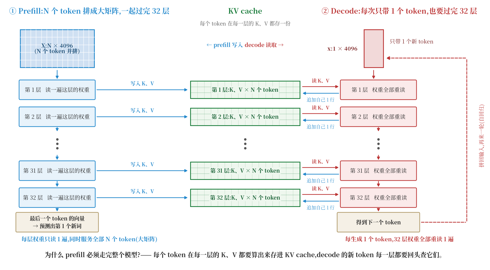
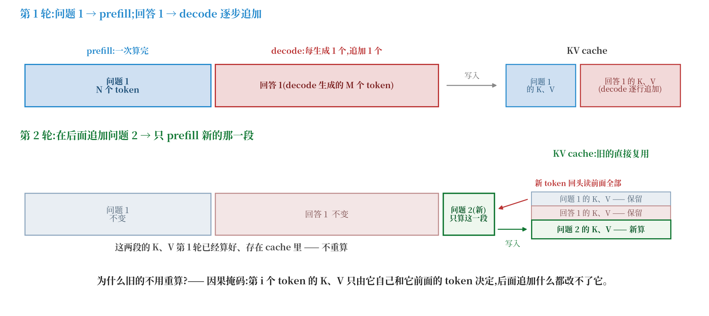
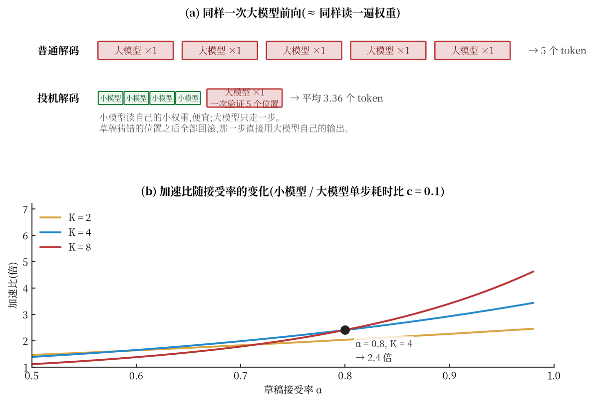
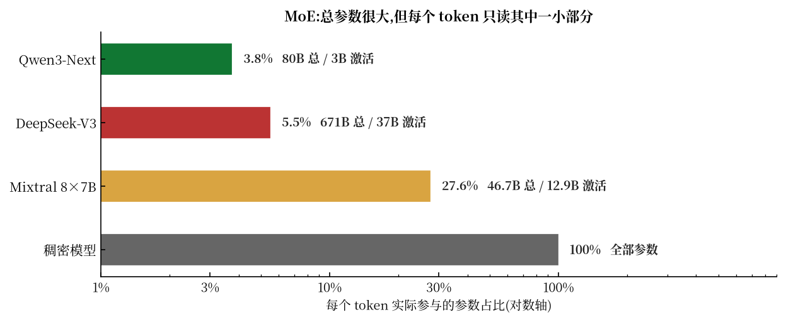
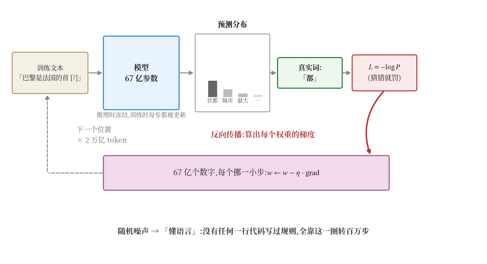

6,740,000,000 个数字。

一个 Llama-2-7B,就是这 67 亿个 fp16,13.5 GB。每个数字都是一个小数,比如 0.0317 或 −1.204,排成几百个矩阵,躺在显存里。

推理时它们一动不动——没有代码在跑,没有规则在查。所有"智能",都是这 67 亿个数字参与的乘法和加法。

它们是谁?一个词进来之后,这些数字对它做了什么?它们又是怎么从随机噪声变成"懂语言"的?

这篇文章解剖模型权重:组成、用法、来历,三段讲完。上一篇(GPU 解剖台第八篇)讲了权重的**硬件活法**(prefill 批发、decode 零售),这篇往模型内部再挖一层——**权重本身是什么**。

## 一、先分清显存里的三种数字

推理时,显存里住着三样东西,很多人混为一谈:

| 名字 | 是什么 | 大小(7B, FP16) | 变不变 |
|---|---|---|---|
| **参数(权重)** | 学出来的矩阵,模型的本体 | **13.5 GB** | 推理时冻结,每个 token 都要用 |
| **激活** | 当前 token 流过各层时的中间向量 | MB 级,用完即弃 | 每个 token 一套新的 |
| **KV cache** | 过去 token 的 K、V 激活,存起来复用 | 0.5 MB/token(32K = 17 GB) | 只增不减 |

注意一个反直觉的事实:**模型本体只占 13.5 GB,长上下文时 KV cache 反而比模型本身还大**。这就是 MLA、GQA 那些压缩技术存在的原因。

参数的三个特征,后面全部要用到:**推理时冻结、每个 token 都要过一遍全部参数、读它要花带宽**。

## 二、67 亿都是谁:一层的解剖

7B 模型 = 32 层 × 每层 2 亿参数 + 词表两头。一层里面的编制(以 Llama-2-7B 为准,隐藏维 d=4096,32 头,MLP 中间维 11008):


**注意力组(67.1M 参数,占 1/3)**——四个 d×d 矩阵:

| 矩阵 | 形状 | 参数量 | 干的活 |
|---|---|---|---|
| $W_Q$ | 4096×4096 | 16.8M | 把当前 token 的向量变成**提问**(query) |
| $W_K$ | 4096×4096 | 16.8M | 把每个 token 的向量变成**索引标签**(key) |
| $W_V$ | 4096×4096 | 16.8M | 把每个 token 的向量变成**可提取的内容**(value) |
| $W_O$ | 4096×4096 | 16.8M | 把 32 个头各自取回的信息**合并** |

**门控 MLP 组(135.3M 参数,占 2/3)**——三个矩阵,中间维是 11008:

| 矩阵 | 形状 | 参数量 | 干的活 |
|---|---|---|---|
| $W_{gate}$ | 4096×11008 | 45.1M | 升维,输出过 SiLU 门(每通道一个开关) |
| $W_{up}$ | 4096×11008 | 45.1M | 升维,提供内容 |
| $W_{down}$ | 11008×4096 | 45.1M | 降维,投影回原空间 |

算总账:

$$\underbrace{32 \times (67.1\,\text{M} + 135.3\,\text{M})}_{\text{32 layers}} + \underbrace{131\,\text{M}}_{\text{embedding}} + \underbrace{131\,\text{M}}_{\text{lm head}} \approx 6.74\,\text{B}$$

32 层,加上词嵌入和输出头。

两个值得记住的结构事实:

**MLP 占参数的 2/3。** 大家谈 Transformer 必谈注意力,但按参数量,MLP 才是大头。注意力负责"从上下文取信息"(通信),MLP 负责"对信息做计算"(计算)——一篇有影响力的研究(Geva et al., 2021)把 MLP 看成 key-value 记忆库:事实性知识大量存在这里。

**门控是关键设计。** MLP 的公式:

$$\text{MLP}(x) = W_{down}\,\big(\text{SiLU}(W_{gate}\,x) \odot W_{up}\,x\big)$$

$W_{gate}$ 升到 11008 维后,每一维过 SiLU($x \cdot \sigma(x)$)——值域可正可负,大部分落在零附近。它和 $W_{up}$ 的输出**逐通道相乘**:gate 给 0.9,内容几乎全过;gate 给 0.01,内容基本被掐死。11008 个通道,就是 11008 个"这条信息放不放行"的旋钮——这些旋钮的松紧,全是学出来的。

MoE(混合专家)把这个思路推到极致:Qwen3-Next(80B 总参数)在 MLP 位置放一组专家,一个路由门控**每个 token 现场决定**走哪几个专家——所以每 token 只激活 3B 参数。门控从"通道开关"升级成了"专家开关"。

## 三、一个词的旅程:权重怎么"解析"它

现在放一个词进去,跟踪它和这些矩阵的每一次相遇。

### 3.1 第 0 步:tokenizer——唯一的"非数学"环节

词不是直接进模型的。"巴黎是法国的首都" 先被切词器(BPE)切成 token id:

```
"巴黎是法国的首都" → [12376, 4719, 3444, 31064, 30931, ...]
```

这是整个流程里唯一的查表离散操作。从此以后,词消失了,只剩下数字向量。

### 3.2 第 1 步:词嵌入——从 id 到向量

token id 去**嵌入矩阵**(32000×4096)里取一行。id 12376 取第 12376 行,得到一个 4096 维向量。

这一行也是参数(131M 的一部分),也是学出来的:训练结束时,"猫"和"狗"的向量挨得很近,"猫"和"微积分"离得远——语义被压成了**几何**。

### 3.3 第 2 步:注意力——提问、匹配、取货


进入第 1 层,当前 token 的向量 $h$ 被 $W_Q$、$W_K$、$W_V$ 三个矩阵分别乘:

- $q = W_Q\,h$:这个 token 的**问题**("我在找主语"/"我在找时间状语")
- $k_j = W_K\,h_j$:每个历史 token 挂出的**标签**
- $v_j = W_V\,h_j$:每个历史 token 可被取走的**内容**

然后是注意力唯一的"软"运算:

$$\text{score}_j = \frac{q \cdot k_j}{\sqrt{128}}, \qquad \alpha_j = \text{softmax}(\text{score}), \qquad o = \sum_j \alpha_j\, v_j$$

$q \cdot k_j$ 是两个向量的点积——**衡量"问题"和"标签"的匹配度**;softmax 把匹配度变成权重分配;最后按比例把各家的 $v$ 混合取回。"注意力"这个名字说的就是 $\alpha_j$:模型对每个历史 token 分配了多少注意力。32 个头并行,各自问不同的问题,取回的信息由 $W_O$ 拼装。

注意:KV cache 缓存的正是这些 $k_j$、$v_j$——**过去的 token 不用重新算 $W_K$、$W_V$,直接用存货**。这就是 0.5 MB/token 的由来,也是长上下文贵的原因。

### 3.4 第 3 步:门控 MLP——计算发生在哪

取货之后,残差相加($h \leftarrow h + o$),再进 MLP。注意力只是"搬运"了上下文的信息,MLP 才是对向量做非线性加工的地方:11008 个门控通道里,大量知识检索和推理计算发生在此。

再残差相加,一层结束。如此 32 层。

### 3.5 第 4 步:输出头——词的分布

32 层之后,向量 $h_{final}$ 过最后的**输出头**(4096×32000),得到 32000 个 logits——词表里每个 token 各得一个分数。softmax 一压,变成概率分布。

**这个分布,就是语言模型的全部输出。** "巴黎是法国的首"之后,分布大概是:首都 96.2%,城市 2.1%,最大 0.4%,……剩下 31997 个 token 分残余。采样(argmax 或 top-p)从分布里挑一个,拼回上下文,循环——生成就是这么一个词一个词重复的(这个环节的数学在 argmax 那篇拆过)。

## 四、同一个权重的一生:批发 8192 次,零售 1 次

模型解剖完了,回到上一篇留下的那个硬件视角——**这 67 亿个数字,在 prefill 和 decode 里的活法完全不同**。



跟住第 5 层 MLP 里的一个权重 $w_{1024,2048}$:

**Prefill(批发)**:8192 个 token 一起进,激活排成 (8192×4096) 的大矩阵右乘权重。$w$ 被装进 Shared Memory **一次**,和 8192 列激活各乘一次——干活 8192 次才下班。

**Decode(零售)**:每步只有 1 个新 token。$w$ 装载一次,乘 **1 次**,被挤出 cache。下一个 token 来——再从 HBM 读一遍。

全模型对账:

| | Prefill(8192 token) | Decode(1 token) |
|---|---|---|
| 13.5 GB 参数从 HBM 读 | **1 遍** | **每个 token 1 遍** |
| 每个 w 干活次数 | 8192 次 MAC | 1 次 MAC |
| 计算量 | ≈ 115 TFLOP | 14 GFLOP |
| 算术强度 | ≈ 8192(屋顶上方) | 1(墙根) |

为什么 decode 不能把参数留在片上省着读?L2 一共 50 MB,参数 13.5 GB,差 270 倍——装不下,只能每个 token 全量重读。所以推理引擎的一切招数——continuous batching(64 个用户的 token 拼一步,复用 64 次)、chunked prefill 混排(512 个 prefill token 捎上 decode)、FP8 量化(读的字节砍半)——本质都是同一件事:**给每个参数安排更多的"陪算对象"**。屋顶线的完整推导在 GPU 解剖台第八篇,这里不重复。

### 4.1 为什么是"全部"——稠密矩阵乘,一个都跳不掉

每一层的计算是 $y = W x$:输出的每个分量,都是输入全部分量加权求和的结果。

```
y[0] = w[0][0]·x[0] + w[0][1]·x[1] + ... + w[0][4095]·x[4095]
y[1] = w[1][0]·x[0] + ...
```

$W$ 里没有一个数字是多余的——少任何一个,结果就错了。所以一个 token 要从第 1 层走到第 32 层,每层的每个矩阵都必须完整参与。这就是"稠密"(dense)的含义:**参数 100% 都在干活**。

(MoE 是例外:路由门控让每个 token 只走少数专家,所以每个 token 只读一部分权重。)

### 4.2 为什么是"一遍"——N 个 token 是一起过每一层的

prefill 的时间线:

```
读入第 1 层权重 → 同时乘 8192 个 token → 这层用完,权重被挤出
读入第 2 层权重 → 同时乘 8192 个 token → 用完
...
读入第 32 层权重 → 同时乘 8192 个 token
```

关键在"同时"。第 1 层的权重装进来一次,8192 列激活挨个流过去用它——读完这一层,8192 个 token 的第 1 层就全算完了,然后才换第 2 层。所以整段 prefill 下来,13.5 GB 权重恰好从 HBM 读了一次。

读完就扔,是因为装不下:L2 才 50 MB,全部权重 13.5 GB,差 270 倍。第 1 层的权重算完,马上被第 2 层的权重冲掉。

对比 decode 的时间线:

```
prefill: [第 1 层→8192 token][第 2 层→8192 token]...[第 32 层→8192 token]   读 1 遍
decode:  [第 1~32 层→1 token] [第 1~32 层→1 token] [第 1~32 层→1 token]...  每 token 读 1 遍
```

一个是"每层权重读一次,伺候所有 token";一个是"所有层权重读一次,伺候一个 token"。

### 4.3 边界:读取遍数 = 分几次把 token 送过模型

- **Chunked prefill**:8192 的 prompt 切成 16 块 × 512 逐块算,每块都要把 32 层权重重新读一遍——权重读 16 遍。这是为省显存、不让 decode 饿死付出的带宽代价(每遍仍有 512 个 token 摊销,所以还在屋顶上)
- **多个 prompt 拼 batch**:一起算,权重还是读 1 遍——矩阵更宽了而已
- **decode 配 continuous batching**:64 个用户的 token 拼一步,权重读 1 遍伺候 64 个 token

## 五、decode 的一步,就是长度为 1 的 prefill

回看第四节开头的流程图:decode 的一步和 prefill 做的是同一件事——新 token 走完 32 层,每层算出自己的 K、V 追加进 cache,再回头看前面全部。计算内容完全一样,只是每次只有 1 个 token。

顺着这个观察,有一个很自然的疑问:**多轮对话时,前面说过的内容要重算吗?**

### 5.1 旧的 KV 不用重算

第二轮,你在后面追加了一个新问题。新 token 会影响后面的 logits 分布——但改不了前面的 token。

原因在因果掩码:注意力被规定只能看自己和前面的位置。所以第 $i$ 个 token 在第 $\ell$ 层的 K、V,只由它自己和它前面的 token 决定:

$$K_i^{\ell},\, V_i^{\ell} \quad \text{depend only on} \quad x_1, \ldots, x_i$$

后面追加什么都改不了它。前面的 K、V 是关于过去的事实,算好了就不会变。



于是第二轮是这样:

- 第 1 轮结束时,cache 里已经有「问题 1 + 回答 1」全部 token 的 K、V(decode 每步都在往里追加)
- 第 2 轮只需 prefill **新的那段**(问题 2):算它的 K、V,并让它回头看前面全部
- 这就是推理引擎的 **prefix caching**(前缀缓存),也是第二轮首字比第一轮快的原因

### 5.2 什么时候才要重算

- **前面的内容被改了**:从改动处往后全部重算
- **cache 被清掉了**:显存不够或闲置太久,只能从头来——所以隔很久再聊,首字又变慢
- **猜出来的 token 被否决**:投机解码里猜错的那几个 token,要先从 cache 里撤掉再重算

## 六、能不能不每次读全部层?

看到这里很容易冒出一个念头:decode 每个 token 都要把 13.5 GB 权重读一遍,只用了 0.3% 的算力——这里优化空间巨大。能不能几层合起来算一次?能不能把模型"固定成一个状态",新 token 只跟状态打照面?

有这个空间,也有这些机制。只是"把几层合并成一层"这条路,在数学上走不通。

### 6.1 为什么几层不能合成一次算

层和层之间夹着非线性:softmax、SiLU 门、RMSNorm。它们的输出取决于输入的具体数值,所以没法预先折成一个矩阵。

```
能合并:   x → [W1] → [W2] → y          等价于 x → [W2·W1] → y
不能合并: x → [W1] → 门控 → [W2] → y     门控随 x 变,找不到固定的 W' 能代替
```

能合的早就合了:Q、K、V 三个投影实际拼成一个大矩阵读一次,gate 和 up 也是。但 32 层之间合不了。**权重必须每次都读,是因为"乘这些矩阵"本身就是计算**——新 token 的每一步变换都要用到 W;留不住,是因为装不下。

### 6.2 六种机制总览

优化方向不是"合并层",而是把"少读、一次多算几个、把权重放近"做到极致:

| 直觉 | 机制 | 怎么做 |
|---|---|---|
| 把上下文固定成一个状态 | KV cache;线性注意力(GDN/KDA) | 上下文压成状态,新 token 只和状态交互 |
| 不是每个 token 都需要全部层 | 早退、LayerSkip、Mixture-of-Depths | 简单的 token 走几层就出去 |
| 别每个 token 都读一遍全部权重 | 投机解码 | 小模型先连猜几个,大模型一次并行验证;相当于一次 prefill 好几个 token |
| 只读一部分权重 | MoE | 每个 token 只读少数几个专家 |
| 多层共用一套权重 | 循环深度(recurrent depth,研究阶段) | 同一个块反复套用,要存的权重少很多,深度可以现场加 |
| 让权重不用反复搬 | Groq、d-Matrix | 把权重放到片上 SRAM |

下面逐个拆开,每种都按同一套问:解决什么、怎么做、能省多少、代价是什么、谁在用。

### 6.2.1 上下文压成状态:KV cache 与线性注意力

**解决什么**:新 token 不必重算前面的内容。

KV cache 是第一层答案,第五节讲过:每个 token 在每一层的 K、V 存下来,新 token 只做"回头看"。它的代价是**状态随长度线性增长**。Llama-2-7B 每 token 0.5 MB,32K 上下文就是 17 GB;而且 decode 每一步都要把这 17 GB 读一遍。KV cache 是把"重算的计算"换成了"读状态的带宽"——上下文越长,decode 越慢,这件事没有解决。

线性注意力要把状态**压成固定大小**。先看全注意力为什么压不动:

$$o_t = \sum_{i \le t} \mathrm{softmax}_i(q_t \cdot k_i)\, v_i$$

softmax 是对**全部**历史分数做归一化,所以每个历史 token 的 $k_i$、$v_i$ 都得单独留着。

把 softmax 拿掉,求和就能先算完:

$$o_t = \sum_{i \le t} v_i\,(k_i \cdot q_t) = \Big(\sum_{i \le t} v_i\, k_i^{\top}\Big) q_t = S_t\, q_t$$

括号里就是一个矩阵 $S_t$,每来一个 token 累加一次:

$$S_t = S_{t-1} + v_t\, k_t^{\top}$$

GDN(Gated DeltaNet)在这上面加两样东西:衰减门 $\alpha_t$(旧的慢慢忘)和 delta rule(先擦掉旧记忆里冲突的部分再写):

$$S_t = \alpha_t\, S_{t-1}\,(I - \beta_t\, k_t k_t^{\top}) + \beta_t\, v_t\, k_t^{\top}$$

**能省多少**(7B 口径,32 头 × 128 × 128,FP16):每层状态 1 MB,32 层共 32 MB,**不随长度变**。对照全注意力在 32K 时的 17 GB,小了 500 多倍。decode 每步的计算也从"读 17 GB"变成"更新 32 MB"。

**代价**有两条:

- 召回精度。softmax 拿掉后,"大海捞针"式的精确检索会糊。所以当红模型都用 3:1 混合——每 4 层留 1 层全注意力,负责精确检索
- GPU 不友好。状态更新是小矩阵上的逐元素运算,Tensor Core 插不上手,要靠分块扫描重新矩阵化(GPU 解剖台第八篇)

**谁在用**:Qwen3-Next(GDN)、Kimi Linear(KDA)。

### 6.2.2 早退、LayerSkip、Mixture-of-Depths:不是每个 token 都要 32 层

**解决什么**:token 的难度不一样。"今天天气"后面接"很",浅层就定了;真正要推理的位置才用得上深层。一律走满 32 层是浪费。

**早退**(early exit,CALM,2022)的做法最直接:每层后面都挂一个输出头,decode 时每过一层看一眼这一层的预测——够自信就输出,后面的层不走了。

问题是,普通方式训练出来的模型,浅层根本没学过"预测下一个词"。它们的存在意义是把信息加工好传给下一层,直接让它们输出,准确率很差。

**LayerSkip**(2024,Meta)从训练下手,两招:

- 层丢弃:训练时随机跳过一些层的贡献,逼后面的层在"前面信息不全"时也能工作
- 早退损失:每一层都加一个"预测下一个词"的辅助损失,让浅层也学会预测

推理时,前几层快速起草几个 token,剩下的层**一次并行验证**——模型自己给自己当草稿模型。论文报告最高 2.16 倍加速。

**Mixture-of-Depths**(2024,DeepMind)换个角度:每个 token 进每层之前,一个学出来的路由器决定它"进不进这一层的注意力 + MLP",不进的直接走残差绕过去。每层只让一部分 token 参与,有固定的计算预算。论文的结果:训练和推理的提速接近一个更小的模型,质量接近基线。

**能省多少**(按读权重的口径):batch=1 的 decode 是串行的,这个 token 在第 12 层退出,后 20 层的权重就真的不读——只读 37.5%。

**代价**:batch 一大就不灵。只要 batch 里有一个 token 要走满 32 层,这一层的权重就得读,节省就没了;得把退出深度相同的 token 凑进同一个 batch 才能兑现。另外模型必须专门训练,普通模型不能直接早退。

**现状**:以研究为主,目前不是主流推理引擎的默认选项。

### 6.2.3 投机解码:一次读权重,验证好几个 token

**解决什么**:decode 慢不是因为算不动,是因为每个 token 只配 1 次"读权重的机会"——读完 13.5 GB 只干 14 GFLOP 的活,算力闲着 99.7%。那就想办法读一次、多验证几个。



流程四步:

1. **起草**:小模型(参数量约为大模型的 1/10)自回归连猜 K 个 token。它读的是自己的小权重,便宜
2. **验证**:大模型把"上下文 + 这 K 个 token"当成一段 prompt,**一次前向**同时给出 K+1 个位置各自的分布。这就是一次长度为 K+1 的 prefill,大模型的权重只读一遍
3. **接受**:从头往后比,草稿 token 和大模型分布一致的就留下;遇到第一个不一致的停下,那一步直接用大模型自己的输出——白送一个 token
4. **回滚**:被否决的 token 从 KV cache 里撤掉(第五节 5.2 的第三种情况),回到第 1 步

**无损**:接受和拒绝的规则是一套严格的采样方案(Leviathan et al., 2023),最终输出的分布和大模型自己逐个生成**完全相同**。快了,但没有变笨。

**能省多少**:设每个草稿 token 被接受的概率是 $\alpha$,每轮起草 $K$ 个,则每轮期望产出

$$E[\#\text{accepted}] = \frac{1 - \alpha^{K+1}}{1 - \alpha}$$

再记 $c$ 为"小模型走一步 / 大模型走一步"的耗时比,加速比是

$$\text{speedup} = \frac{1 - \alpha^{K+1}}{(1 - \alpha)\,(K c + 1)}$$

代入 $\alpha = 0.8$、$K = 4$、$c = 0.1$:每轮期望产出 3.36 个 token,耗时 1.4 个大模型步,加速 2.4 倍。

实测数字:Leviathan et al. 报告 2–3 倍;EAGLE-3(2025)论文报告最高 6.5 倍;DeepSeek-V3 用训练时自带的多 token 预测(MTP)模块当草稿模型,第二个 token 的接受率 85%–90%,解码吞吐约 1.8 倍。

**代价与边界**:

- batch 大了不灵。验证那一步本身变成计算受限,多出来的 token 不再"免费"(据公开分析,batch 16 时收益只剩约 1.35 倍)
- 草稿模型占显存
- 接受率看任务:代码、公式这类好猜的文本接受率高,自由创作低

**谁在用**:主流推理引擎(vLLM、SGLang)都已内置。这个专栏有一篇专门拆过(投机解码篇)。

### 6.2.4 MoE:只读一部分权重

**解决什么**:模型想变大(知识更多),但每个 token 不想多读权重。

**怎么做**:把每层的 MLP(占参数 2/3 的那部分)复制成 E 份"专家",再加一个路由器(一个小线性层)。每个 token 过来,路由器打分,只选得分最高的 k 个专家参与计算,其余 E−k 个专家的权重**这个 token 根本不读**。第二节讲的"门控"在这里从通道开关升级成了专家开关。



**能省多少**:

| 模型 | 路由专家数 | 每 token 激活 | 总参数 | 每 token 实际读 | 占比 |
|---|---|---|---|---|---|
| Mixtral 8×7B | 8 | 2 | 46.7B | 12.9B | 27.6% |
| DeepSeek-V3 | 256 + 1 共享 | 8 + 1 | 671B | 37B | 5.5% |
| Qwen3-Next | 512 + 1 共享 | 10 + 1 | 80B | 3B | 3.8% |

**代价**有三条:

- 显存反而更贵。虽然每个 token 只读 5%,但**全部**专家都得常驻显存——下一个 token 路由到谁,事先不知道。671B 的 DeepSeek-V3 光权重就是 1.3 TB(FP16),只能几十张卡分片,再配上专家之间的 all-to-all 通信
- 负载均衡。路由器一旦"偏心",几个热门专家被挤爆、其余闲着,节省就没了。训练时要专门加约束(Switch Transformer 的辅助损失、DeepSeek 的无辅助损失均衡)
- batch 大的时候,一个 batch 里几乎每个专家都会被用到,省的其实是计算量而不是带宽。所以 MoE 的主战场是高吞吐

**谁在用**:Mixtral、DeepSeek-V2/V3、Qwen3 系列、Kimi Linear——主流开源模型几乎都是 MoE。

### 6.2.5 循环深度:多层共用一套权重

**解决什么**:32 层就是 32 套不同的权重。能不能让多层共用一套,把模型做小?

**怎么做**:把"32 层各带一套权重"换成"前奏 + 核心块 + 尾声"三段。Geiping et al.(2025)的 3.5B 模型是这样:2 层前奏 → 4 层的循环核心(只有这一套权重)→ 尾声,训练了约 800B token。训练时每一步的循环次数从一个截断的随机分布里抽,所以这个核心块套几遍都能工作。

**为什么普通模型不能直接循环**:第 5 层的权重,是"默认输入正好是第 4 层的输出"训练出来的。把第 5 层再套一遍,输入就不是它见过的分布了。要循环,必须从训练时就让它适应。

**能省多少**(这里要纠正总览表里容易引起的误会):它省的是**要存多少不同的权重**,不是**每个 token 读多少字节**。核心块每套用一遍,这 4 层的权重就要读一遍;套 R 遍就是读 R 遍。同样深度下,每个 token 读的总字节数和普通模型差不多。

它真正换来的是**另一个东西**:模型很小(3.5B),但"想多久"可以现场决定——难题多套几百遍,简单题少套几遍。这是测试时计算的一个旋钮,不是带宽优化。

**现状**:研究阶段,代表作 Huginn-0125 已开源;还没有主流生产模型采用。更早的思想来源是 Universal Transformer(2018)和 ALBERT 的跨层共享(2019)。

### 6.2.6 把权重放近:Groq、d-Matrix

**解决什么**:前面五招都在"少读"或"一次读、多个用"。第六招直接冲着"读得慢"本身:既然瓶颈是把权重从 HBM 搬进计算单元,那就把权重放到片上 SRAM。

**差多少**:SRAM 就在计算单元旁边,带宽比 HBM 高一到两个数量级。

| | 片上 SRAM 容量 | 带宽 |
|---|---|---|
| H100(HBM3) | 80 GB(显存) | 3.35 TB/s |
| Groq 第一代 LPU | 约 230 MB | 约 80 TB/s |
| d-Matrix Corsair | 约 4 GB / 卡 | 300 TB/s |

带宽差 24 倍到 90 倍。拿 70B 模型算:FP16 权重 140 GB,在 H100 的 HBM 带宽下读完一遍要 140 GB ÷ 3.35 TB/s ≈ 42 毫秒,上限约 24 token/s。Groq 公开演示的 70B 级模型,单用户解码在 220–300 token/s 量级;Mixtral 8×7B 约 500 token/s(它原生用 8 位精度)。

**代价**有两条:

- 容量小、贵。SRAM 存一个比特要 6 个晶体管,同样的容量比 DRAM 贵得多。Groq 一颗芯片只有 230 MB,装一个 70B 模型要 576 颗芯片(合计约 130–140 GB)
- 只擅长 decode。prefill 是计算受限,要的是算力和大容量,SRAM 芯片在这上面没有优势。所以这类芯片的定位是"解码加速器",常见做法是 prefill 交给 GPU、decode 交给它

**同类**:Cerebras 的晶圆级引擎(公开规格:片上 SRAM 44 GB、带宽 21 PB/s)走的是同一条路。

### 6.2.7 六种机制放在一起看

| 机制 | 省的是什么 | 代价 | 成熟度 |
|---|---|---|---|
| KV cache / 线性注意力 | 上下文的状态:17 GB → 32 MB | 精确召回变差,需混合 | 已量产 |
| 早退 / LayerSkip / MoD | 浅层就结束的 token 不读深层权重 | 需专门训练,batch 大时失效 | 研究 |
| 投机解码 | 一次读权重出多个 token(2–3 倍) | 大 batch 失效,占显存 | 已量产 |
| MoE | 每 token 只读 3%–28% 的参数 | 总显存更大,需负载均衡 | 已量产 |
| 循环深度 | 要存的权重少,深度可调 | 不省带宽 | 研究 |
| 片上 SRAM | 读一遍快 24–90 倍 | 容量小,只擅长 decode | 小规模商用 |

没有哪一招单独解决问题,所以真实系统是叠着用的:一个典型的线上模型可能同时是 MoE + 3:1 线性注意力混合,跑在开了投机解码和 prefix caching 的引擎上。

## 七、来历:2 万亿 token 怎么教会 67 亿个数字

最后一问:这些数字一开始全是随机噪声,它们是怎么变成"懂语言"的?

### 7.1 预训练的唯一任务

拿一段文本,遮住下一个词,让模型猜:

$$L = -\log P(x_{t+1} \mid x_1, \ldots, x_t)$$

就这一个损失。训练开始时模型输出接近均匀分布,"首都"的概率是 1/32000,损失高;猜对了概率升到 0.96,损失降到接近 0。**整个预训练,就是对互联网文本的每个位置,重复这个"猜下一个词 + 罚错"的过程**——Llama-2 用了约 2 万亿 token,每个 token 给全部 67 亿参数一次微调的信号。

### 7.2 梯度:一次教学怎么传到 67 亿个数字



"猜错"产生一个损失值,反向传播沿着词的旅程**倒着走**:从输出头的 32000 维分布,穿过 32 层的门控 MLP 和注意力,一路算出**每个权重的梯度**——"如果你往这个方向挪一点,下次猜这个位置会更准"。

优化器(SGD → AdamW,优化器演化那篇的主角)按梯度把每个参数推一小步。一步训练,67 亿个数字同时各挪一点;2 万亿 token 下来,挪了百万步量级。

尺度感:这就像用整片海洋的浪,把 67 亿块石头各自冲到精确的位置——每一块石头的位置,都由它和所有浪的相互作用决定。

### 7.3 "词的分布"存在哪里?

这是最值得想清楚的一点。模型学到的是:给定上文,下一个词的**条件分布**。这个分布存在哪个权重里?

**哪个都不在,哪个都在。**

"巴黎是法国的首"→"首都"这条知识,拆开看是:"巴黎"和"法国"的嵌入向量里各有半个地理事实;若干层的注意力权重学会了把这两个向量连起来;某些 MLP 门控通道学会了在两者同时出现时,把输出向量推向"首都"的方向;输出头把这个方向变成 32000 维里的一个高峰。

没有一行代码写着"法国的首都是巴黎"。**知识被摊薄成 67 亿个数字的几何关系**——这也是为什么大模型的能力难以解释、难以精确删除(忘掉一条事实要动多少权重?),也是为什么它又能泛化:几何关系是连续的,近似的问法会落在相近的位置。

## 八、总结

四条带走:

**1. 权重就是"学出来的程序"。** 矩阵乘是指令,67 亿个数字是操作数;注意力组(1/3 参数)管从上下文取信息,门控 MLP(2/3 参数)管计算和知识存储,嵌入和输出头管进出词表。

**2. 词的旅程是一条乘法链。** 切词 → 查嵌入 → 32 层(提问-匹配-取货 + 门控加工)→ 输出头 → 32000 维分布 → 采样。除了一头一尾的查表和最后的采样,全程连续、全程可微——这是它能被梯度训练的前提。

**3. 参数在推理时的全部成本是"读"。** 每个 token 都要过一遍全部参数:prefill 时每个参数干 8192 次活(批发,算力受限),decode 时干 1 次(零售,带宽受限)。KV cache 存的不是参数,是历史 token 的激活存货。

**4. decode 的一步 = 长度为 1 的 prefill,旧的 KV 不用重算。** 因果掩码保证前面的 K、V 不受后面追加的影响,所以多轮对话只 prefill 新的那段。想少读权重,靠的是 MoE、早退、投机解码这些"少读、一次多算几个"的机制,而不是合并层。

模型侧的"权重是什么"讲完了。下一篇回 GPU 解剖台,填分支发散的坑:warp 里 32 个线程在 if/else 面前分道扬镳,硬件怎么处理。

如果这个系列对你有用,点个赞或关注专栏,更新会持续。

---

*参考:Llama 2: Open Foundation and Fine-Tuned LLMs(Touvron et al.,arXiv:2307.09288,架构超参 d=4096/L=32/中间维 11008/词表 32000/约 2T token);Geva et al., Transformer Feed-Forward Layers Are Key-Value Memories(arXiv:2012.14913);Shazeer, GLU Variants Improve Transformer(arXiv:2002.05202,SwiGLU);Vaswani et al., Attention Is All You Need(arXiv:1706.03762);Qwen3-Next 技术博客(MoE 每 token 激活 3B);Elhoushi et al., LayerSkip(arXiv:2404.16710);Raposo et al., Mixture-of-Depths(arXiv:2404.02258);Geiping et al., Scaling up Test-Time Compute with Latent Reasoning: A Recurrent Depth Approach(arXiv:2502.05171);Jiang et al., Mixtral of Experts(arXiv:2401.04088);DeepSeek-V3 Technical Report(arXiv:2412.19437,MTP 接受率与 1.8 倍吞吐);Leviathan et al., Fast Inference from Transformers via Speculative Decoding(arXiv:2211.17192);Li et al., EAGLE-3(arXiv:2503.01840);Schuster et al., CALM(arXiv:2207.07061);Srivastava et al., Corsair: An In-Memory Computing Chiplet Architecture(IEEE 2025);Qwen3-Next-80B-A3B 模型卡(Hugging Face);Groq、Cerebras 公开规格与演示;vLLM 文档(Automatic Prefix Caching);本系列 argmax 篇(采样数学)、优化器演化篇(AdamW)、投机解码篇、GPU 解剖台第八篇(屋顶线与复用定律)。参数量、KV cache、算术强度均可按文中公式复算。*
