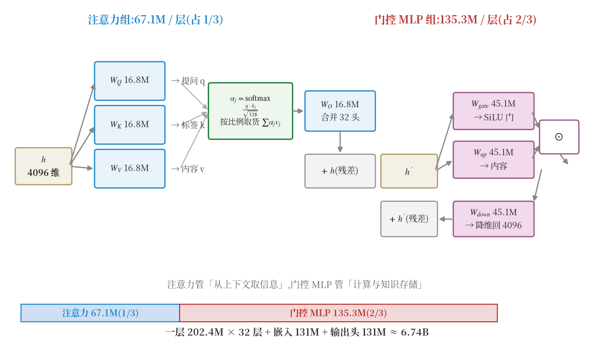
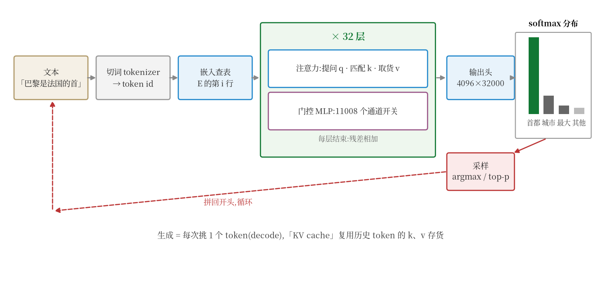

6,740,000,000 个数字。

一个 Llama-2-7B,就是这 67 亿个 fp16,13.5 GB。每个数字都是一个小数,比如 0.0317 或 −1.204,排成几百个矩阵,躺在显存里。

推理时它们一动不动——没有代码在跑,没有规则在查。所有"智能",都是这 67 亿个数字参与的乘法和加法。

它们是谁?一个词进来之后,这些数字对它做了什么?它们又是怎么从随机噪声变成"懂语言"的?

这篇文章解剖模型权重:组成、用法、来历,三段讲完。上一篇(GPU 解剖台第八篇)讲了权重的**硬件活法**(prefill 批发、decode 零售),这篇往模型内部再挖一层——**权重本身是什么**。

## 一、先分清显存里的三种数字

推理时,显存里住着三样东西,很多人混为一谈:

| 名字 | 是什么 | 大小(7B, FP16) | 变不变 |
|---|---|---|---|
| **参数(权重)** | 学出来的矩阵,模型的本体 | **13.5 GB** | 推理时冻结,每个 token 都要用 |
| **激活** | 当前 token 流过各层时的中间向量 | MB 级,用完即弃 | 每个 token 一套新的 |
| **KV cache** | 过去 token 的 K、V 激活,存起来复用 | 0.5 MB/token(32K = 17 GB) | 只增不减 |

注意一个反直觉的事实:**模型本体只占 13.5 GB,长上下文时 KV cache 反而比模型本身还大**。这就是 MLA、GQA 那些压缩技术存在的原因。

参数的三个特征,后面全部要用到:**推理时冻结、每个 token 都要过一遍全部参数、读它要花带宽**。

## 二、67 亿都是谁:一层的解剖

7B 模型 = 32 层 × 每层 2 亿参数 + 词表两头。一层里面的编制(以 Llama-2-7B 为准,隐藏维 d=4096,32 头,MLP 中间维 11008):



**注意力组(67.1M 参数,占 1/3)**——四个 d×d 矩阵:

| 矩阵 | 形状 | 参数量 | 干的活 |
|---|---|---|---|
| $W_Q$ | 4096×4096 | 16.8M | 把当前 token 的向量变成**提问**(query) |
| $W_K$ | 4096×4096 | 16.8M | 把每个 token 的向量变成**索引标签**(key) |
| $W_V$ | 4096×4096 | 16.8M | 把每个 token 的向量变成**可提取的内容**(value) |
| $W_O$ | 4096×4096 | 16.8M | 把 32 个头各自取回的信息**合并** |

**门控 MLP 组(135.3M 参数,占 2/3)**——三个矩阵,中间维是 11008:

| 矩阵 | 形状 | 参数量 | 干的活 |
|---|---|---|---|
| $W_{gate}$ | 4096×11008 | 45.1M | 升维,输出过 SiLU 门(每通道一个开关) |
| $W_{up}$ | 4096×11008 | 45.1M | 升维,提供内容 |
| $W_{down}$ | 11008×4096 | 45.1M | 降维,投影回原空间 |

算总账:

$$\underbrace{32 \times (67.1\,\text{M} + 135.3\,\text{M})}_{\text{32 layers}} + \underbrace{131\,\text{M}}_{\text{embedding}} + \underbrace{131\,\text{M}}_{\text{lm head}} \approx 6.74\,\text{B}$$

32 层,加上词嵌入和输出头。

两个值得记住的结构事实:

**MLP 占参数的 2/3。** 大家谈 Transformer 必谈注意力,但按参数量,MLP 才是大头。注意力负责"从上下文取信息"(通信),MLP 负责"对信息做计算"(计算)——一篇有影响力的研究(Geva et al., 2021)把 MLP 看成 key-value 记忆库:事实性知识大量存在这里。

**门控是关键设计。** MLP 的公式:

$$\text{MLP}(x) = W_{down}\,\big(\text{SiLU}(W_{gate}\,x) \odot W_{up}\,x\big)$$

$W_{gate}$ 升到 11008 维后,每一维过 SiLU($x \cdot \sigma(x)$)——值域可正可负,大部分落在零附近。它和 $W_{up}$ 的输出**逐通道相乘**:gate 给 0.9,内容几乎全过;gate 给 0.01,内容基本被掐死。11008 个通道,就是 11008 个"这条信息放不放行"的旋钮——这些旋钮的松紧,全是学出来的。

MoE(混合专家)把这个思路推到极致:Qwen3-Next(48B 总参数)在 MLP 位置放一组专家,一个路由门控**每个 token 现场决定**走哪几个专家——所以每 token 只激活 3B 参数。门控从"通道开关"升级成了"专家开关"。

## 三、一个词的旅程:权重怎么"解析"它

现在放一个词进去,跟踪它和这些矩阵的每一次相遇。

### 3.1 第 0 步:tokenizer——唯一的"非数学"环节

词不是直接进模型的。"巴黎是法国的首都" 先被切词器(BPE)切成 token id:

```
"巴黎是法国的首都" → [12376, 4719, 3444, 31064, 30931, ...]
```

这是整个流程里唯一的查表离散操作。从此以后,词消失了,只剩下数字向量。

### 3.2 第 1 步:词嵌入——从 id 到向量

token id 去**嵌入矩阵**(32000×4096)里取一行。id 12376 取第 12376 行,得到一个 4096 维向量。

这一行也是参数(131M 的一部分),也是学出来的:训练结束时,"猫"和"狗"的向量挨得很近,"猫"和"微积分"离得远——语义被压成了**几何**。

### 3.3 第 2 步:注意力——提问、匹配、取货



进入第 1 层,当前 token 的向量 $h$ 被 $W_Q$、$W_K$、$W_V$ 三个矩阵分别乘:

- $q = W_Q\,h$:这个 token 的**问题**("我在找主语"/"我在找时间状语")
- $k_j = W_K\,h_j$:每个历史 token 挂出的**标签**
- $v_j = W_V\,h_j$:每个历史 token 可被取走的**内容**

然后是注意力唯一的"软"运算:

$$\text{score}_j = \frac{q \cdot k_j}{\sqrt{128}}, \qquad \alpha_j = \text{softmax}(\text{score}), \qquad o = \sum_j \alpha_j\, v_j$$

$q \cdot k_j$ 是两个向量的点积——**衡量"问题"和"标签"的匹配度**;softmax 把匹配度变成权重分配;最后按比例把各家的 $v$ 混合取回。"注意力"这个名字说的就是 $\alpha_j$:模型对每个历史 token 分配了多少注意力。32 个头并行,各自问不同的问题,取回的信息由 $W_O$ 拼装。

注意:KV cache 缓存的正是这些 $k_j$、$v_j$——**过去的 token 不用重新算 $W_K$、$W_V$,直接用存货**。这就是 0.5 MB/token 的由来,也是长上下文贵的原因。

### 3.4 第 3 步:门控 MLP——计算发生在哪

取货之后,残差相加($h \leftarrow h + o$),再进 MLP。注意力只是"搬运"了上下文的信息,MLP 才是对向量做非线性加工的地方:11008 个门控通道里,大量知识检索和推理计算发生在此。

再残差相加,一层结束。如此 32 层。

### 3.5 第 4 步:输出头——词的分布

32 层之后,向量 $h_{final}$ 过最后的**输出头**(4096×32000),得到 32000 个 logits——词表里每个 token 各得一个分数。softmax 一压,变成概率分布。

**这个分布,就是语言模型的全部输出。** "巴黎是法国的首"之后,分布大概是:首都 96.2%,城市 2.1%,最大 0.4%,……剩下 31997 个 token 分残余。采样(argmax 或 top-p)从分布里挑一个,拼回上下文,循环——生成就是这么一个词一个词重复的(这个环节的数学在 argmax 那篇拆过)。

## 四、同一个权重的一生:批发 8192 次,零售 1 次

模型解剖完了,回到上一篇留下的那个硬件视角——**这 67 亿个数字,在 prefill 和 decode 里的活法完全不同**。

跟住第 5 层 MLP 里的一个权重 $w_{1024,2048}$:

**Prefill(批发)**:8192 个 token 一起进,激活排成 (8192×4096) 的大矩阵右乘权重。$w$ 被装进 Shared Memory **一次**,和 8192 列激活各乘一次——干活 8192 次才下班。

**Decode(零售)**:每步只有 1 个新 token。$w$ 装载一次,乘 **1 次**,被挤出 cache。下一个 token 来——再从 HBM 读一遍。

全模型对账:

| | Prefill(8192 token) | Decode(1 token) |
|---|---|---|
| 13.5 GB 参数从 HBM 读 | **1 遍** | **每个 token 1 遍** |
| 每个 w 干活次数 | 8192 次 MAC | 1 次 MAC |
| 计算量 | ≈ 115 TFLOP | 14 GFLOP |
| 算术强度 | ≈ 8192(屋顶上方) | 1(墙根) |

为什么 decode 不能把参数留在片上省着读?L2 一共 50 MB,参数 13.5 GB,差 270 倍——装不下,只能每个 token 全量重读。所以推理引擎的一切招数——continuous batching(64 个用户的 token 拼一步,复用 64 次)、chunked prefill 混排(512 个 prefill token 捎上 decode)、FP8 量化(读的字节砍半)——本质都是同一件事:**给每个参数安排更多的"陪算对象"**。屋顶线的完整推导在 GPU 解剖台第八篇,这里不重复。

## 五、来历:2 万亿 token 怎么教会 67 亿个数字

最后一问:这些数字一开始全是随机噪声,它们是怎么变成"懂语言"的?

### 5.1 预训练的唯一任务

拿一段文本,遮住下一个词,让模型猜:

$$L = -\log P(x_{t+1} \mid x_1, \ldots, x_t)$$

就这一个损失。训练开始时模型输出接近均匀分布,"首都"的概率是 1/32000,损失高;猜对了概率升到 0.96,损失降到接近 0。**整个预训练,就是对互联网文本的每个位置,重复这个"猜下一个词 + 罚错"的过程**——Llama-2 用了约 2 万亿 token,每个 token 给全部 67 亿参数一次微调的信号。

### 5.2 梯度:一次教学怎么传到 67 亿个数字


"猜错"产生一个损失值,反向传播沿着词的旅程**倒着走**:从输出头的 32000 维分布,穿过 32 层的门控 MLP 和注意力,一路算出**每个权重的梯度**——"如果你往这个方向挪一点,下次猜这个位置会更准"。

优化器(SGD → AdamW,优化器演化那篇的主角)按梯度把每个参数推一小步。一步训练,67 亿个数字同时各挪一点;2 万亿 token 下来,挪了百万步量级。

尺度感:这就像用整片海洋的浪,把 67 亿块石头各自冲到精确的位置——每一块石头的位置,都由它和所有浪的相互作用决定。

### 5.3 "词的分布"存在哪里?

这是最值得想清楚的一点。模型学到的是:给定上文,下一个词的**条件分布**。这个分布存在哪个权重里?

**哪个都不在,哪个都在。**

"巴黎是法国的首"→"首都"这条知识,拆开看是:"巴黎"和"法国"的嵌入向量里各有半个地理事实;若干层的注意力权重学会了把这两个向量连起来;某些 MLP 门控通道学会了在两者同时出现时,把输出向量推向"首都"的方向;输出头把这个方向变成 32000 维里的一个高峰。

没有一行代码写着"法国的首都是巴黎"。**知识被摊薄成 67 亿个数字的几何关系**——这也是为什么大模型的能力难以解释、难以精确删除(忘掉一条事实要动多少权重?),也是为什么它又能泛化:几何关系是连续的,近似的问法会落在相近的位置。

## 六、总结

三条带走:

**1. 权重就是"学出来的程序"。** 矩阵乘是指令,67 亿个数字是操作数;注意力组(1/3 参数)管从上下文取信息,门控 MLP(2/3 参数)管计算和知识存储,嵌入和输出头管进出词表。

**2. 词的旅程是一条乘法链。** 切词 → 查嵌入 → 32 层(提问-匹配-取货 + 门控加工)→ 输出头 → 32000 维分布 → 采样。除了一头一尾的查表和最后的采样,全程连续、全程可微——这是它能被梯度训练的前提。

**3. 参数在推理时的全部成本是"读"。** 每个 token 都要过一遍全部参数:prefill 时每个参数干 8192 次活(批发,算力受限),decode 时干 1 次(零售,带宽受限)。KV cache 存的不是参数,是历史 token 的激活存货。

模型侧的"权重是什么"讲完了。下一篇回 GPU 解剖台,填分支发散的坑:warp 里 32 个线程在 if/else 面前分道扬镳,硬件怎么处理。

如果这个系列对你有用,点个赞或关注专栏,更新会持续。

---

*参考:Llama 2: Open Foundation and Fine-Tuned LLMs(Touvron et al.,arXiv:2307.09288,架构超参 d=4096/L=32/中间维 11008/词表 32000/约 2T token);Geva et al., Transformer Feed-Forward Layers Are Key-Value Memories(arXiv:2012.14913);Shazeer, GLU Variants Improve Transformer(arXiv:2002.05202,SwiGLU);Vaswani et al., Attention Is All You Need(arXiv:1706.03762);Qwen3-Next 技术博客(MoE 每 token 激活 3B);本系列 argmax 篇(采样数学)、优化器演化篇(AdamW)、GPU 解剖台第八篇(屋顶线与复用定律)。参数量、KV cache、算术强度均可按文中公式复算。*
