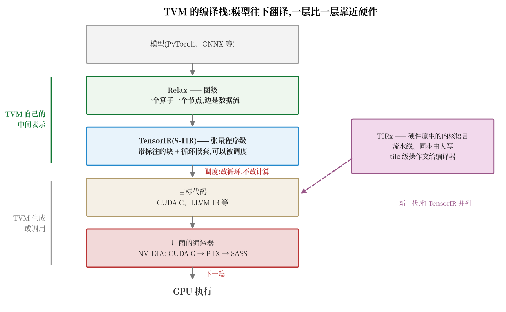
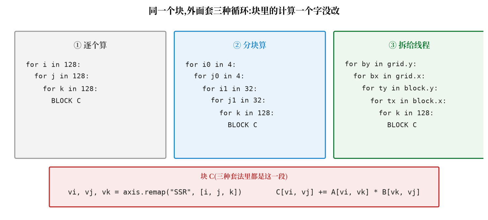

这一篇学起来会比较痛苦。中间表示、调度原语、自动调优,每个词单拎出来都能讲一学期。希望大白话能减少七分痛苦。

先看几个数字。

今天我照着这个专栏第 3 篇、第 6 篇的写法,手写了一个分块矩阵乘(32×32 的 tile,数组多加一列),放到一台 V100 上编译了一遍:

```
Used 32 registers, used 1 barriers, 8448 bytes smem
```

32 个寄存器,8448 字节 Shared Memory。这几个数字不是免费的——tile 取 32×32 而不是 64×64,数组多加一列躲 Bank Conflict,内层循环展开 32 次。每一个都是人拍板的。

换一块 GPU,这些参数得重拍。换一个矩阵大小,也得重拍。矩阵乘只有一种,可 GPU 有十几种,模型里的算子有几百种。

**TVM 想解决的就是这件事:让这些决定由程序来做,而不是由人来做。**

## 一、TVM 是什么

官方首页只有一句话:

> Apache TVM, a deep learning compiler that enables access to high-performance machine learning anywhere for everyone.

翻译过来:一个深度学习编译器,让任何人、在任何硬件上,都能跑上高性能的机器学习。

关键词是"编译器"。它不是一个推理框架,也不是一个算子库。它干的事和 `nvcc`、`clang` 是同一类:**输入一份程序的描述,输出一份在特定硬件上跑得快的代码。**

它的来历,时间线不长:

| 时间 | 事件 |
|---|---|
| 2017 | 在华盛顿大学作为一个研究项目起步 |
| 2018 | 两篇论文:TVM 编译器栈(OSDI)、用机器学习来优化张量程序(AutoTVM) |
| 2019 年 3 月 | 进入 Apache 孵化器 |
| 2020 | Ansor 论文(OSDI),自动搜索调度;同年年底成为 Apache 顶级项目 |
| 2023 | TensorIR 论文(ASPLOS),今天这套抽象的基础 |

## 二、问题:N 种算子 × M 种硬件

一个模型,比如一层 Transformer,拆开是十几种算子:矩阵乘、归一化、softmax、逐元素相加。

每种算子要在每种硬件上跑快,都得有一份专门的实现。N 种算子乘 M 种硬件,就是 N×M 份代码。

更糟的是,这 N×M 份代码没有一份是"写完就完"的。第 9 篇讲过:同一块 B200,同一个矩阵乘,朴素写法 254 TFLOPS,优化到底 1476。中间那 5.8 倍,全靠人一点点调。

TVM 的思路是把这 N×M 切成 N+M:

- **N 侧**:每种算子只写一次,写的是"算什么",不写"怎么算"
- **M 侧**:每种硬件只描述一次,它有什么特性
- **中间**:编译器负责把"算什么"翻译成在这种硬件上"怎么算最快"

要做到这一点,编译器手里必须有一种语言,既能表达算子的计算,又方便它做各种变换。这就是中间表示。

## 三、三层中间表示



按今天官方文档的结构,TVM 的中间表示有三层,从上到下越来越靠近硬件。

### 3.1 第一层:Relax,整个模型长什么样

最上面一层叫 Relax。它把一个模型表示成一张图:节点是算子,边是数据流。官方文档给的例子:

```python
@R.function
def main(
    x: R.Tensor((1, 784), dtype="float32"),
    weight: R.Tensor((784, 256), dtype="float32"),
    bias: R.Tensor((256,), dtype="float32"),
) -> R.Tensor((1, 256), dtype="float32"):
    with R.dataflow():
        lv0 = R.matmul(x, weight)
        lv1 = R.add(lv0, bias)
        gv = R.nn.relu(lv1)
        R.output(gv)
    return gv
```

这就是一层全连接:矩阵乘,加偏置,过 ReLU。三行。

这一层关心的是全局的事。官方列的三个特点:形状可以用符号表示(推理时输入长度不定,也能提前优化)、能跨层优化(从整个模型一直看到单个张量操作)、变换可以组合着用。

### 3.2 第二层:TensorIR,一个算子内部怎么算

图上每个节点,最后都要落到一个具体的循环嵌套上。这一层官方现在叫 S-TIR(schedulable TensorIR,可调度的 TensorIR)。

官方文档里矩阵乘加 ReLU 的例子(省略了外层的模块包装):

```python
Y = T.alloc_tensor(ty_args=[T.Tensor((128, 128), "float32")])
for i, j, k in T.grid(128, 128, 128):
    with Ts.sblock("Y"):
        vi, vj, vk = Ts.axis.remap("SSR", [i, j, k])
        with Ts.init():
            Y[vi, vj] = T.float32(0)
        Y[vi, vj] = Y[vi, vj] + A[vi, vk] * B[vk, vj]
for i, j in T.grid(128, 128):
    with Ts.sblock("C"):
        vi, vj = Ts.axis.remap("SS", [i, j])
        C[vi, vj] = T.max(Y[vi, vj], T.float32(0))
```

看着像普通循环,但比普通循环多了三样东西。

**第一,`sblock`,块。** 它把"这个计算"圈起来。块里面的内容,只通过块自己的轴(vi、vj、vk)和外面的世界打交道。

**第二,轴有类型。** `"SSR"` 的意思是:vi 和 vj 是空间轴(spatial),vk 是归约轴(reduce)。空间轴的意思是,vi 取不同的值,算出来的是输出的不同位置,互相独立;归约轴的意思是,vk 取不同的值,结果要累加到同一个位置上。

**第三,块是自包含的。** 官方的说法是:一个块"对于它该做的迭代是自包含的,不依赖外面的循环嵌套"。也就是说,外面套的是 `range(128)` 还是两层 `range(16)` 套 `range(8)`,块的计算都不变。



这三样加起来,就是 TensorIR 的核心思想:**把"算什么"和"按什么顺序算"分开。**

块描述的是"算什么"。循环嵌套描述的是"按什么顺序算"。有了轴的类型,编译器才知道哪些循环可以换顺序、哪些可以拆、哪些可以并行,而不改变计算的结果。

### 3.3 第三层:TIRx,直接对着硬件指令写

最底下这一层叫 TIRx(官方注音 "tier-ex"),是新一代的内核级编译器结构。官方对它的定位是"面向硬件原生"的内核语言。

它的思路和上面两层相反。上面两层是让编译器多管一点,这一层是让编译器少管一点:流水线的结构、同步、哪个 warp 干什么活,这些专家才拿得准的东西,留在源码里由人写;只把重复出现的 tile 级操作交给编译器。

它可以直接调用硬件指令。官方文档里的例子:

```python
Tx.cuda.tile.apply(Tx.ptx["ld.global.v4.b32"], registers, global_words)
```

`ld.global.v4.b32` 是一条 PTX 指令:从显存一次读 4 个 32 位数。PTX 是什么,是下一篇的内容。

官方说这一层也面向"agent 生成的内核"和 megakernel(把很多个内核合成一个)。

## 四、调度:把第 6 篇的手写优化变成几行调用

块写好之后,怎么让它跑得快?答案是改它外面的循环。这些改动有个名字,叫调度。

我在服务器上装了 pip 版的 TVM(0.27.0),把它当前调度器的方法列了一遍,有六十多个——其中不少是查询和采样用的辅助方法,真正做变换、常用的就这些:

| 调度方法 | 干什么 |
|---|---|
| `split` | 把一个循环拆成两个(比如 128 拆成 4×32) |
| `reorder` | 调换循环的嵌套顺序 |
| `fuse` | 把两个循环合并成一个 |
| `bind` | 把一个循环绑到线程上(`threadIdx.x` 之类) |
| `unroll` | 循环展开 |
| `vectorize` | 把连续几次访问合并成一次向量访问 |
| `cache_read` / `cache_write` | 给读或写单独加一个缓冲阶段 |
| `set_scope` | 指定一个缓冲放在哪(Shared Memory、寄存器) |
| `storage_align` | 调整缓冲区的对齐 |
| `tensorize` | 把一个循环块整体换成一条硬件指令 |
| `decompose_reduction` | 把归约拆成初始化和累加两步 |

现在对照这个专栏之前手写过的东西:

| 手写的时候 | 在 TVM 里 |
|---|---|
| 第 3 篇:矩阵乘分块 | `split` + `reorder` |
| 第 3 篇:把 tile 搬进 Shared Memory | `cache_read` + `set_scope` |
| 每个线程负责一个输出位置 | `bind` |
| 内层循环展开 32 次 | `unroll` |
| 第 6 篇:数组加一列躲 Bank Conflict | `storage_align` |
| 第 5 篇:用 Tensor Core | `tensorize` |

注意最后一行的意思。`tensorize` 把一整块循环换成一个"不透明的块"——比如一条 Tensor Core 指令。这正是 2023 年那篇 TensorIR 论文的主题:让张量计算成为程序表示里的"一等公民"。

## 五、谁来决定用哪种调度

有了这几十种调度方法,新的问题是:一个具体的算子,在一块具体的 GPU 上,该用哪几种、参数取多少?

TVM 的回答换过三代:

1. **人写模板,机器选参数**(AutoTVM,2018):人先写出几种可行的调度框架,机器在框架里面试参数。判断哪个好,靠一个学出来的代价模型
2. **机器自己找框架**(Ansor,2020):不给人写的模板,机器先生成一批大致可行的调度骨架,再去填细节
3. **按规则来**(官方文档里的 DLight):把专家经验写成规则,遇到矩阵乘就套矩阵乘的规则

第三种最快,第一种最灵活。今天的 TVM 三种都有。

## 六、TVM 生成的是什么

到这里有个常见误会要说清楚:**TVM 不生成 GPU 真正执行的机器码。**

以 NVIDIA 的卡为例,TVM 的 CUDA 后端生成的是 CUDA C 源码。这份源码还要交给 NVIDIA 自己的编译器,再走两步才变成硬件能执行的东西:

```
TVM 生成的 CUDA C → nvcc → PTX → SASS → GPU 执行
```

中间那个 PTX,是 NVIDIA 自己的"中间层"。它长什么样、为什么要多这一层、同一个 PyTorch 为什么在有的卡上跑不了——下一篇专门讲。

顺带一提,今天主流的 PyTorch 走的是另一套,但思路属于同一类:Inductor 加 Triton。我在 V100 上用 Triton 编译了一个最简单的向量加法,它一次产出了五层中间结果:`ttir`、`ttgir`、`llir`、`ptx`、`cubin`。从 Triton 自己的 IR,到 LLVM 的 IR,再到 PTX,一层层往下翻译。

## 七、两点实话

**第一,TVM 不是万能的。** 它把"写 kernel"变成了"写调度、搜调度",但没有消除复杂性,只是把复杂性挪了个地方。要让它跑赢 cuBLAS 这种调了十几年的库,仍然需要人懂硬件。TensorIR 论文的措辞也是"有竞争力的性能",不是"更快"。

**第二,它的文档和代码跟得很快,快到会对不上。** 我这次照着官网文档的例子写矩阵乘,想实际跑一遍调度前后的对比。装上 pip 版的 0.27.0,发现文档里写的 `from tvm.script import s_tir` 这个包根本导入不了——官网文档跟的是开发分支,发布版还没有跟上。所以这篇里的代码示例都来自官方文档,调度方法清单来自我装的那个版本,两者是分开取的。调度前后循环结构具体怎么变,我没有跑出来,就不贴"运行结果"了。

这算是这类快速演进的编译器项目的常态,用之前得有心理准备。

## 八、总结

四条带走:

**1. TVM 是编译器,不是框架。** 它把"N 种算子 × M 种硬件"切成"N + M":算子只描述算什么,硬件只描述有什么,中间由编译器翻译。

**2. 中间表示有三层。** Relax 描述整个模型(图),TensorIR 描述一个算子内部(带标注的循环),TIRx 直接对着硬件指令写内核。

**3. TensorIR 的核心是把"算什么"和"按什么顺序算"分开。** 块描述计算,循环描述顺序,轴的类型告诉编译器哪些变换是安全的。

**4. 手写优化在这里变成了调度方法。** 这个专栏之前手写的分块、Shared Memory、展开、对齐、Tensor Core,对应的调度方法是 `split`、`cache_read`、`unroll`、`storage_align`、`tensorize`。

打个比方:手写 kernel 像自己开车,每个弯都得自己打方向;TVM 像先画一张地图,把"哪些路能走、哪些路是单行"都标在地图上,然后再让导航去选路线。地图画得越准,导航选出来的路越好走。

地图画好了,下一篇文章看 NVIDIA 自己那张地图:PTX。

如果这个系列对你有用,点个赞或关注专栏,更新会持续。

---

*参考:Apache TVM 官方文档(docs:首页 "Deep Learning Compiler that enables access to high-performance machine learning anywhere for everyone";Deep Dive / TensorIR:Tensor Program Abstraction、Understand TensorIR Abstraction;Deep Dive / Relax:Graph Abstraction for ML Models;TIRX:Overview)——文中三段代码示例均取自这些页面;apache-tvm 0.27.0.post1(pip 发行版)的 `tvm.s_tir.Schedule` 方法清单,为在服务器上实际列出的结果;Feng et al., TensorIR: An Abstraction for Automatic Tensorized Program Optimization(ASPLOS 2023,arXiv:2207.04296);Chen et al., TVM: An Automated End-to-End Optimizing Compiler for Deep Learning(OSDI 2018);Chen et al., Learning to Optimize Tensor Programs(arXiv:1805.08166);Zheng et al., Ansor: Generating High-Performance Tensor Programs for Deep Learning(OSDI 2020);时间线据官方公告与公开报道。手写矩阵乘的寄存器与 Shared Memory 用量为 CUDA 12.9 `ptxas -v` 在 V100 上的实际输出;Triton 的五层中间结果为 torch 2.7.1 + triton 3.3.1 在 V100 上的实际输出。*
