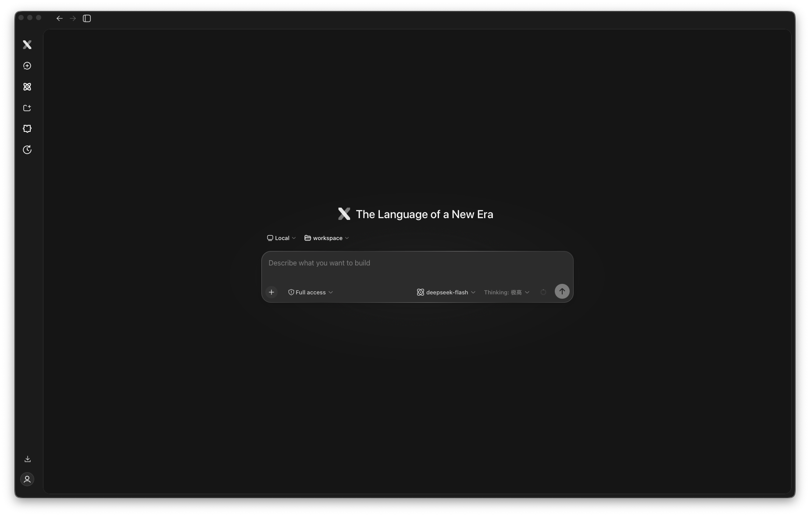
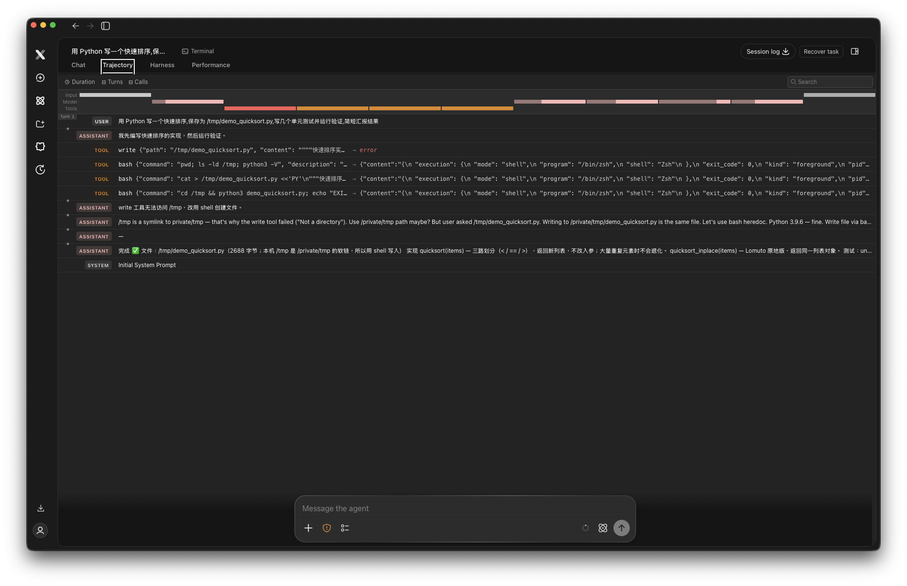
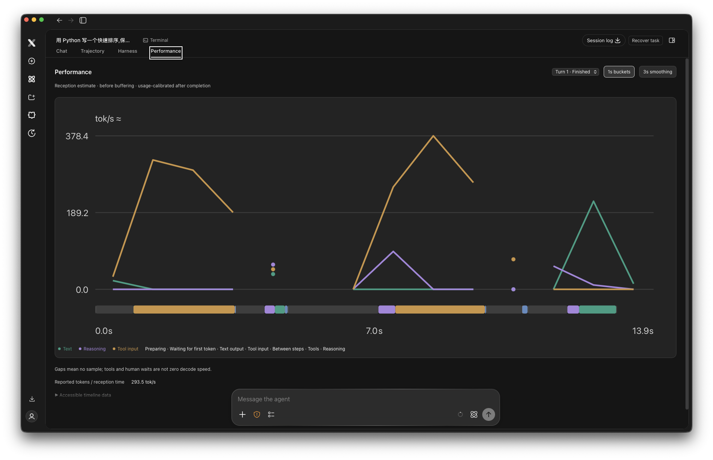
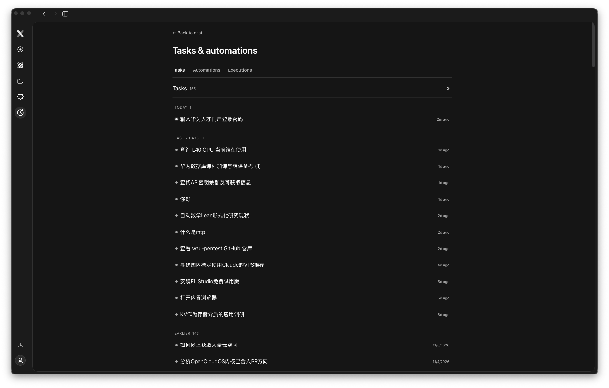
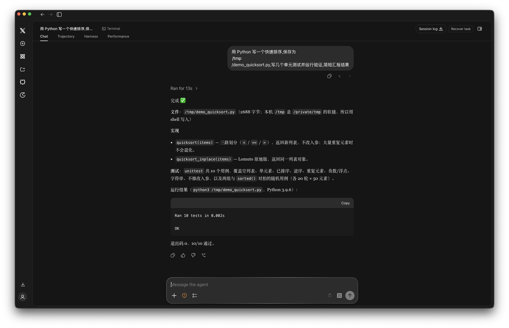

*(开源,Apache-2.0:https://github.com/123123213weqw/x-harness-rs | 国内镜像:https://gitee.com/wangyue2006/x-harness-rs )*

Claude Code 和 Codex CLI 我都用过很久。它们很强,但都是**终端产品**——这个形态决定了有些事情它们永远做不到。

所以我自己用 Rust 写了 **XHarness**:一个 GUI 优先、桌面/网页同源的 agent 运行时。这篇文章不讲"我也行",只讲**它做到、而那两家(以它们的形态)做不到的六件事**——每件都有真实截图。



## 一、会话是真正的"档案":断电、崩溃,恢复时不重放副作用

终端 agent 的"resume"恢复的是上下文。XHarness 的会话是 **append-only 日志 + 检查点 + 持久输入队列**:进程死了,Host 从日志完整重建对话——关键是**被中断的写文件/执行命令会被明确标注,而不是重启后偷偷再执行一遍**。

让 agent 替你跑半小时的任务然后电脑死机,你就知道这条差别值多少钱。副作用静默重放是 coding agent 最阴险的故障模式,别家没有对它的明确承诺。

界面上的对应物:每个会话都有 **Session log(可下载)和 Recover task 按钮**。会话不是聊天记录,是可审计的执行档案。

## 二、Trajectory 视图:agent 干活的全程,像看甘特图一样看

终端里 agent 的执行过程是一滚而过的日志流。XHarness 给每个会话配了 **Trajectory 视图**:顶部按耗时分解的甘特时间线(Input/Model/Tools 三层),下面是完整轮次流——用户消息、推理、每次工具调用的参数与返回。



上面这张图里藏着最好的广告:**write 工具报错 → agent 自己诊断出 /tmp 是软链 → 换 heredoc 写入 → 完成**。整个自愈过程在 Trajectory 里一目了然——这种过程透明度,滚动日志给不了。

## 三、Performance 视图:token 级的显微镜

按秒绘制的 **tok/s 曲线**(Text/Reasoning/Tool input 三色分解)、底部阶段条带(首 token 等待、推理、工具执行各占多久)、按轮次切换、上下文余量实时计量。



做 agent 调优、选模型、算成本的人,看到这个面板的第一反应都是"终端里我上哪看这个去"。

## 四、内嵌浏览器工作区:agent 上网干活,你在旁边看

XHarness 的桌面端有**原生内嵌浏览器**作为 agent 的工作区——agent 操作网页时,你实时看到它在点哪里、填什么;它也能截屏取证。我的日常会话里同时挂着上百个工作区标签。

配套的还有任务自动化面板:给 agent 设目标,它可以带暂停/审计地多轮自动推进:



## 五、模型零绑定:任意 OpenAI 兼容端点,云上自托管随便切

不绑 Anthropic、不绑 OpenAI。Chat Completions 和 Responses 协议都支持,多 provider 路由一个配置文件搞定,本地 Ollama 也行。输入框上一行:模型、权限模式(Full access / 受限)、思考等级,全部随时切换。

## 六、整个运行时可以被嵌入你的产品

`xharness-sdk` 提供进程内 SDK:注入模型与工具、入队输入、观察事件、恢复会话、优雅关停。**你可以在自己的产品里跑一个完整的耐久 agent 运行时**,而不是套壳调用别人的 CLI。Claude Code 没有官方嵌入途径,Codex 的 core 库很新——而 XHarness 的 SDK 和运行时是一体的。

## 关于质量:同构对照实验,而不是口号

"Rust 重写有没有损失质量?"——这个问题我用**对照实验**回答,而不是宣称。XHarness 是 deepseek-harness 的 Rust 重实现,与上游说同一套控制平面(52 个 RPC 方法全兼容,冻结在 upstream tag 上),于是能做**同构对照**:固定模型、任务、工作区、prompt、工具面,只变实现。

Terminal-Bench 2.0 上 47 题的配对结果:XHarness 74.5% vs 上游 79.1%,McNemar 检验 **p = 1.0000**——统计上无法区分,即**重实现没有损失质量**。方法学细节(oracle/nop/mini-swe-agent 三条强制基线、26 个效度威胁清单、验证脚本 SHA-256 前后比对)全部公开在 [xharness-bench](https://github.com/123123213weqw/xharness-bench),可复跑。

顺带一句别的项目不会说的:同模型换 harness,Terminal-Bench 上能差出 35 个百分点(这是我另一个项目 harness-arena 的实测出发点)——**选 harness 比选模型影响还大**,这个领域值得更多认真的选项。

## 一次真实任务的闭环

下面这张是一次真实运行(我用它给自己写了个快速排序加单元测试):文件、实现说明、测试输出、退出码,一次汇报闭环:



## 快速上手

**桌面版**(macOS / Linux / Windows 安装包):[Releases](https://github.com/123123213weqw/x-harness-rs/releases) 下载即用,带内建更新,每个版本附 SHA256 校验。

**Web Host** 一条命令(仓库自带前端 bundle,无需构建前端):

```bash
XHARNESS_WORKSPACE="$PWD" XHARNESS_WEB_DIST="$PWD/ui/dist" \
XHARNESS_BASE_URL="http://127.0.0.1:8000/v1" XHARNESS_MODEL="your-model" \
cargo run --locked -p xharness-host-app --bin xharness-host
```

## 最后

XHarness 仍在快速迭代(46 个 crate 的 Rust 工作区,平均几天一个版本),Web UI 引用了 DeepSeek Harness 组件并保留其许可声明。如果你的需求是:耐久的会话、看得见的过程、桌面/网页同源、能嵌进自己产品——**这四件事同时要,目前只有这一个答案**。

GitHub:https://github.com/123123213weqw/x-harness-rs
Gitee 镜像:https://gitee.com/wangyue2006/x-harness-rs
对照实验:https://github.com/123123213weqw/xharness-bench

觉得方向对的,点个 star;觉得哪里不对的,issue 里见——这个项目的对照实验都敢公开不利数字,还有什么反馈不能接。

---

*文中截图均为本机真实运行画面,Trajectory 里的工具失败自愈也是真实发生的。*
